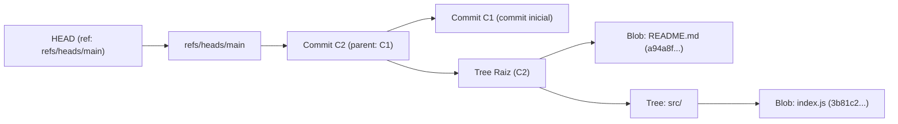
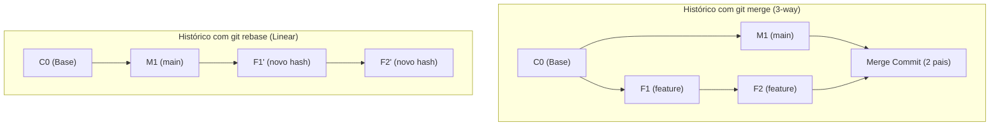

# 📁 Aula 01 — Git & GitHub Avançado

> *"Domine o controle de versão. Entenda como o Git funciona por baixo dos panos, como gerenciar ramificações de forma profissional e colaborar em equipes de alto nível."*

---

## 1. 🚀 Briefing da Missão (Contexto Temático & Realidade de Mercado)

### Metadados do Setor
| Campo | Especificação |
| :--- | :--- |
| **Galáxia** | Galáxia 1: Nébula dos Fundamentos (`fundamentos`) |
| **ID do Módulo** | `git-github` |
| **Pré-requisitos** | Nenhum (Ponto de partida da Academia) |
| **Próxima Órbita** | [Aula 02 — Lógica, Estruturas de Dados & Complexidade](./02-logica-estruturas-dados-complexidade.md) |
| **Nível de Impacto** | Crítico — 100% dos times de engenharia usam controle de versão diariamente |

### Analogia Espacial: O Navegador Cósmico e a Caixa-Preta Temporal
Imagine que sua equipe pilota uma frota de naves espaciais explorando um setor desconhecido. Cada mudança no código da nave — uma atualização no reator, um ajuste nos propulsores ou uma correção no escudo — precisa ser registrada sem que uma alteração apague o trabalho de outro piloto.

Para a maioria dos iniciantes, o Git parece uma magia obscura onde você digita `git add .`, `git commit -m "arrumei"` e `git push` rezando para nada explodir. Mas, para um **Navegador Cósmico** experiente, o Git é uma **máquina do tempo baseada em grafos imutáveis**: cada `commit` é uma fotografia completa do estado da nave em um instante exato do espaço-tempo, ligada à fotografia anterior por um ponteiro criptográfico. Branches não são pastas duplicadas — são apenas etiquetas leves presas a um ponto da linha do tempo. Quando você entende a física por trás da caixa-preta (`.git`), parar de ter medo de `rebase`, `cherry-pick` ou conflitos vira uma consequência natural.

### Qual dor real este módulo resolve em uma empresa?
Em ambientes profissionais, o código não pertence a um único programador trabalhando sozinho em um arquivo `projeto_final_v2_agora_vai.zip`. Times reais trabalham simultaneamente na mesma base de código, corrigindo bugs urgentes em produção enquanto constroem novas funcionalidades. Sem domínio avançado de Git:
1. **Históricos poluídos** com dezenas de commits `"wip"`, `"fix typo"` e `"teste"` tornam impossível usar `git bisect` ou `git revert` quando algo quebra em produção.
2. **Conflitos mal resolvidos** silenciosamente sobrescrevem código de colegas e reintroduzem bugs antigos.
3. **Pull Requests gigantes e sem contexto** travam o fluxo de Code Review por dias, atrasando entregas de toda a squad.

Dominar o Git além do básico é o sinal mais rápido em uma primeira semana de emprego de que um Dev Júnior tem maturidade de engenharia.

---

## 2. 📚 Carga de Conhecimento Completa (Tópico por Tópico)

### 2.1 Estrutura Interna do Diretório `.git` (Objetos, Referências e HEAD)
Quando você executa `git init`, o Git não cria um servidor nem um banco de dados mágico na nuvem: ele cria uma única pasta oculta chamada `.git` na raiz do projeto. Toda a história do repositório vive ali dentro. O Git é, em sua essência, um **sistema de arquivos endereçável por conteúdo** (*content-addressable filesystem*), estruturado como um par chave-valor onde a chave é o hash criptográfico (SHA-1 de 40 caracteres hexadecimais, ou SHA-256 em repositórios modernos configurados para isso) calculado sobre o conteúdo do objeto.

Dentro de `.git/objects/`, existem **quatro tipos fundamentais de objetos**:

1. **Blob (*Binary Large Object*)**: Armazena exclusivamente o conteúdo bruto de um arquivo (os bytes). Um blob **não guarda o nome do arquivo, permissões nem data**. Se dois arquivos em pastas diferentes tiverem exatamente o mesmo conteúdo, o Git armazena apenas **um único blob** e ambos apontam para o mesmo hash.
2. **Tree (Árvore)**: Funciona como um diretório do sistema operacional. Uma `tree` armazena uma lista de entradas onde cada entrada contém: modo/permissão (ex: `100644` para arquivo comum, `100755` para executável), tipo (`blob` ou `tree`), o hash SHA-1 do objeto apontado e o nome do arquivo ou subdiretório.
3. **Commit**: É o nó da linha do tempo. Um objeto `commit` aponta para **uma `tree` raiz** (o retrato completo do projeto naquele momento), aponta para **zero, um ou mais commits pais (`parent`)**, e guarda metadados: autor, committer, timestamp e mensagem.
4. **Annotated Tag (Tag Anotada)**: Aponta para um commit específico adicionando autor, data, mensagem de versão e opcionalmente assinatura GPG.

As **Referências** vivem em `.git/refs/`:
- `.git/refs/heads/` guarda as **branches locais** (ex: um arquivo de texto simples chamado `main` contendo apenas os 40 caracteres do hash do commit mais recente daquela branch).
- `.git/refs/remotes/origin/` guarda o último estado conhecido das branches remotas.
- `.git/refs/tags/` guarda os ponteiros de tags.

E o **`HEAD`** (arquivo `.git/HEAD`)? Ele indica **onde você está agora**:
- **Estado normal (Attached HEAD)**: contém uma referência simbólica, como `ref: refs/heads/main`. Quando você faz um commit, o Git cria o novo objeto commit apontando para o antigo como `parent` e atualiza o hash dentro do arquivo `.git/refs/heads/main`.
- **Estado Detached HEAD**: quando você faz `git checkout <hash-de-um-commit>` ou `git checkout v1.0.0`, o arquivo `.git/HEAD` passa a conter diretamente o hash SHA-1 em vez de apontar para uma branch. Commits criados nesse estado ficam órfãos se você mudar de branch sem criar uma nova branch (`git switch -c nova-branch`), podendo eventualmente ser coletados pelo *garbage collector* (`git gc`) após expirarem no `reflog`.



Você pode inspecionar esses objetos reais no terminal com os comandos de *plumbing* (baixo nível) do Git: `git cat-file -t <hash>` (mostra o tipo) e `git cat-file -p <hash>` (mostra o conteúdo legível).

---

### 2.2 Ramificação Avançada: `git merge` vs. `git rebase`
Em algum momento, você cria uma branch `feature/login` a partir da `main`. Enquanto você desenvolve o login (commits `F1` e `F2`), outro desenvolvedor integra alterações na `main` (commit `M2`). Agora os históricos divergiram. Como integrá-los? Existem duas filosofias principais: **Merge** e **Rebase**.

#### Como funciona o `git merge`
O `merge` preserva a topologia exata do que aconteceu no tempo:
- **Fast-Forward Merge**: Se a `main` não recebeu nenhum novo commit desde que você criou `feature/login`, o Git simplesmente move o ponteiro `main` para frente até `F2`. Não é criado nenhum commit extra, a menos que você force com `git merge --no-ff` (muito usado quando times querem manter explicitamente o agrupamento visual de uma feature no grafo).
- **Three-Way Merge (Merge de 3 vias)**: Se ambas as branches evoluíram, o Git localiza o **ancestral comum** (`M1`), compara as diferenças de `M1 -> M2` e `M1 -> F2`, combina tudo e cria um **novo commit de mesclagem (`Merge Commit`)** que possui **dois pais** (`M2` e `F2`).

#### Como funciona o `git rebase`
O `rebase` literalmente **muda a base** da sua branch. Se você está em `feature/login` e executa `git rebase main`:
1. O Git salva temporariamente as diferenças introduzidas pelos seus commits (`F1`, `F2`).
2. Ele move a ponta da sua branch para a ponta atual da `main` (`M2`).
3. Ele reaplica `F1` e `F2` um por um em cima de `M2`, gerando **novos commits (`F1'`, `F2'`) com novos hashes SHA-1**, pois o `parent` e o timestamp de criação mudaram.



#### A Regra de Ouro do Rebase
**Nunca faça rebase em uma branch pública/compartilhada (como `main`, `develop` ou uma branch onde colegas já estão fazendo commits em cima).** Como o rebase reescreve o histórico criando hashes inéditos, quem já puxou o histórico antigo entrará em um pesadelo de commits duplicados e divergências. Use `rebase` na sua branch local de feature antes de abrir ou atualizar seu Pull Request, e se já tiver feito `push` dessa branch individual antes, atualize o remoto com `git push --force-with-lease` (que aborta o envio se alguém tiver colocado algo novo no remoto desde seu último `fetch`, evitando sobrescrever trabalho alheio — muito mais seguro que `git push --force`).

---

### 2.3 Rebase Interativo (`git rebase -i`) e Higienização de Histórico
Durante o desenvolvimento real, cometemos erros, esquecemos um ponto e vírgula ou fazemos commits incrementais para não perder progresso (`"wip"`, `"ajuste lint"`, `"agora vai"`). Antes de enviar esse código para revisão da equipe, o comando `git rebase -i` (modo interativo) permite editar o roteiro dos seus últimos commits como um editor de vídeo corta e une cenas.

Ao executar `git rebase -i HEAD~4` (para revisar os últimos 4 commits) ou `git rebase -i main` (para revisar todos os commits da sua branch desde a divergência com `main`), o Git abre seu editor configurado com uma lista em **ordem cronológica (do mais antigo no topo para o mais recente embaixo)**:

```text
pick a1b2c3d feat: adiciona schema de usuario
pick e4f5g6h wip: tentativa validacao email
pick 7h8i9j0 fix: corrige typo na validacao
pick 1k2l3m4 docs: atualiza readme da api
```

Os principais comandos disponíveis para substituir a palavra `pick` são:
- **`pick` (`p`)**: Mantém o commit exatamente como está.
- **`reword` (`r`)**: Mantém as alterações do commit, mas abre o editor para você reescrever a mensagem de commit.
- **`edit` (`e`)**: Pausa o rebase naquele commit para você alterar arquivos, rodar `git add`, `git commit --amend` ou até dividir um commit grande em dois menores, finalizando depois com `git rebase --continue`.
- **`squash` (`s`)**: Funde este commit **com o commit imediatamente acima dele**, abrindo o editor para combinar as mensagens de ambos.
- **`fixup` (`f`)**: Igual ao `squash`, porém **descarta automaticamente a mensagem deste commit**, mantendo apenas a mensagem do commit superior (ideal para commits de correção rápida de lint ou typo).
- **`drop` (`d`)**: Apaga completamente o commit e suas alterações do histórico.
- **Reordenar linhas**: Mudando a ordem das linhas no arquivo de texto, você altera a ordem em que os commits são aplicados (atenção: se houver dependências de código entre eles, pode ocorrer conflito durante a reaplicação).

Para cenários em que você já sabe na hora do commit que aquela correção pertence a um commit anterior, existe o atalho `git commit --fixup <hash-antigo>` combinado depois com `git rebase -i --autosquash main`, que organiza automaticamente os `fixup` no lugar exato!

---

### 2.4 Cherry-pick: Cirurgia de Precisão para Mover Commits Específicos
Imagine a seguinte situação em produção: a branch `feature/novo-checkout` tem 18 commits incompletos que não podem ir ao ar ainda, mas o commit `9f3a21c` dessa branch contém a correção exata de um bug de arredondamento de centavos que também está afetando os clientes na branch `main` (produção).

Você não quer fazer `merge` da `feature/novo-checkout` (levaria código inacabado para produção) nem quer copiar alterações manualmente no editor. É aqui que entra o **`git cherry-pick`**: ele lê o diff introduzido por um commit específico de qualquer outra branch e o reaplica como um **novo commit** na branch onde você está atualmente.

Variações práticas essenciais do `cherry-pick`:
- `git cherry-pick 9f3a21c`: Aplica o commit selecionado e cria imediatamente um novo commit na branch atual com a mesma mensagem original (e novo hash SHA-1).
- `git cherry-pick -x 9f3a21c`: Recomendado para branches públicas/hotfix — adiciona automaticamente na mensagem do novo commit a linha `(cherry picked from commit 9f3a21c...)`, facilitando rastreabilidade de auditoria.
- `git cherry-pick A..B`: Aplica um intervalo de commits (excluindo `A` e incluindo até `B`; use `A^..B` para incluir também o `A`).
- `git cherry-pick -n 9f3a21c` (`--no-commit`): Aplica as mudanças no *working directory* e *staging area* sem gerar o commit ainda, permitindo que você junte vários cherry-picks ou ajuste algo antes de commitar.

Se houver conflito durante o cherry-pick, você resolve os arquivos, faz `git add <arquivo>` e finaliza com `git cherry-pick --continue` (ou cancela tudo com `git cherry-pick --abort`).

---

### 2.5 Resolução de Conflitos Complexos no Terminal
Um conflito não é um erro do Git — é o Git sendo responsável e avisando: *"Duas pessoas editaram exatamente as mesmas linhas do mesmo arquivo de maneiras incompatíveis; não vou adivinhar qual vence, você decide"*.

Quando ocorre um conflito (durante `merge`, `rebase` ou `cherry-pick`), o Git marca o arquivo no disco com delimitadores padrão:

```javascript
<<<<<<< HEAD
const TAXA_SERVICO = 0.08; // Alteração que já estava na sua branch atual
=======
const TAXA_SERVICO = 0.10; // Alteração vinda da branch sendo integrada
>>>>>>> feature/reajuste-tarifas
```

#### Configurando o estilo `diff3` (O segredo dos profissionais)
No modo padrão acima, você vê o código "seu" (`HEAD`) e o código "deles", mas **não vê como a linha era originalmente no ancestral comum**. Sem o ancestral comum, é difícil saber se você apenas renomeou uma variável ou se alterou uma regra de negócio propositalmente. Ative o modo `zdiff3` (ou `diff3` em versões antigas) globalmente:

```bash
git config --global merge.conflictstyle zdiff3
```

Com `zdiff3`, o Git passa a exibir um terceiro bloco (`|||||||`) mostrando a base original:

```javascript
<<<<<<< HEAD
const TAXA_SERVICO = 0.08; // Sua versão
||||||| merged common ancestors
const TAXA_SERVICO = 0.05; // Como era originalmente antes da divergência
=======
const TAXA_SERVICO = 0.10; // Versão da branch recebida
>>>>>>> feature/reajuste-tarifas
```

#### Comandos cirúrgicos para conflitos complexos no terminal
- **`git status`**: Lista todos os arquivos em estado de conflito não resolvido (`both modified`, `deleted by them`, `added by both`).
- **Inspeção das 3 versões no Index (Stage 1, 2 e 3)**: Enquanto um arquivo está em conflito, o *staging area* guarda três versões numeradas:
  - `git show :1:caminho/arquivo.js` -> Versão do **ancestral comum** (base).
  - `git show :2:caminho/arquivo.js` -> Versão **ours** (`HEAD` atual).
  - `git show :3:caminho/arquivo.js` -> Versão **theirs** (commit/branch entrando).
- **Aceitar um lado inteiro**: Quando você sabe com 100% de certeza que em um arquivo específico vence apenas um lado (muito útil em `package-lock.json` ou arquivos binários), use `git checkout --ours caminho/arquivo` ou `git checkout --theirs caminho/arquivo` seguido de `git add caminho/arquivo`. *(Atenção: durante um `git rebase`, `ours` e `theirs` parecem invertidos! Durante o rebase, `HEAD` é a branch sobre a qual você está reescrevendo — ex: `main` — e `theirs` é o seu próprio commit sendo reaplicado!)*
- **`git rerere` (*Reuse Recorded Resolution*)**: Ative com `git config --global rerere.enabled true`. Se você estiver fazendo um rebase longo com vários commits e resolver o mesmo conflito uma vez, o Git grava a assinatura da resolução e a reaplica automaticamente se o conflito reaparecer.

---

### 2.6 Fluxos de Trabalho em Equipe: GitFlow vs. Trunk-Based Development
Escolher o modelo de branching errado gera gargalos enormes em uma empresa. Os dois principais paradigmas do mercado são:

| Dimensão | GitFlow | Trunk-Based Development (TBD) |
| :--- | :--- | :--- |
| **Branches permanentes** | Duas principais (`main` para produção e `develop` para integração) + branches temporárias `feature/*`, `release/*`, `hotfix/*`. | Apenas uma principal (`main` ou `trunk`). |
| **Tempo de vida das branches** | Médio a longo (dias ou semanas antes de ir para `release` e `main`). | Muito curto (algumas horas a no máximo 1–2 dias) ou commits diretos via PRs atômicos. |
| **Gestão de releases** | Baseada em versões planejadas e empacotadas (`v2.1.0`, `v2.2.0`), ideal para software instalável, aplicativos mobile sujeitos à revisão de lojas ou sistemas legados com ciclos longos. | Entrega Contínua (CD): cada merge na `main` pode ir direto para produção usando pipelines automatizadas. |
| **Controle de features incompletas** | Isoladas na `develop` ou em branches de longa duração. | Controladas por **Feature Flags** (chaves de configuração que escondem a funcionalidade em produção até estar pronta). |
| **Maior risco** | **Merge Hell**: branches que divergem por semanas geram conflitos gigantes na hora do release. | Exige forte cobertura de **testes automatizados** e disciplina em CI, pois tudo entra rápido na `main`. |

No mercado moderno de aplicações web SaaS e microsserviços com CI/CD, o **Trunk-Based Development** (usando branches curtas de 1 dia e Pull Requests rápidos) ou o **GitHub Flow** (uma simplificação com apenas `main` + `feature/*` + PR) dominam a grande maioria das vagas de Dev Júnior a Sênior.

---

### 2.7 Pull Requests Profissionais, Conventional Commits e Code Review
Abrir um Pull Request (PR) não é apenas apertar um botão no GitHub: é **comunicação técnica assíncrona**. Um PR ruim diz `"ajustes"` e tem 1.800 linhas modificadas em 40 arquivos sem explicação. Um PR profissional respeita o tempo do revisor.

#### Boas práticas de um PR de alto nível:
1. **Tamanho reduzido (PRs atômicos)**: Mantenha entre 100 e 400 linhas alteradas sempre que possível. Se uma tarefa é grande, quebre em etapas entregáveis (ex: PR 1 cria o modelo/migração, PR 2 cria o serviço, PR 3 cria o endpoint).
2. **Título padronizado (Conventional Commits)**: Adote prefixos claros como `feat:`, `fix:`, `refactor:`, `docs:`, `test:`, `chore:` (ex: `feat(auth): implementa bloqueio após 5 tentativas inválidas`).
3. **Descrição estruturada com o "Porquê"**: O código mostra o *como*, a descrição explica o *porquê*, o contexto de negócio, como testar localmente, evidências visuais (prints/GIFs se houver UI ou saída de terminal) e impacto em variáveis de ambiente/banco de dados.
4. **Auto-revisão (*Self-Review*)**: Antes de marcar colegas como revisores, abra a aba *Files changed* do seu próprio PR no GitHub. Remova `console.log` esquecidos, comentários obsoletos e formatação acidental.
5. **Postura no Code Review**: Ao receber comentários, lembre-se que a crítica é ao código, nunca à sua pessoa. Responda de forma objetiva, explique decisões quando discordar com respeito e marque conversas como resolvidas somente após aplicar e commitar a correção.

---

## 3. 💻 Mão no Código (Jeito Iniciante vs. Padrão Profissional)

Vamos comparar um fluxo real no terminal de quem está começando versus como um desenvolvedor preparado para o mercado gerencia sua branch antes de abrir um Pull Request.

### ❌ Jeito Iniciante (Histórico sujo, merge cego e conflitos perdidos)
```bash
# Cria branch sem padrão de nomenclatura
git checkout -b arrumando_tudo

# Faz vários commits confusos sem atomicidade
git add .
git commit -m "mexi no arquivo"
git add .
git commit -m "ops esqueci um ponto e virgula"
git add .
git commit -m "wip testando"

# Puxa a main gerando um commit de merge redundante na própria feature branch
git pull origin main

# Sobe usando --force cego (pode destruir trabalho de outro dev se a branch for pareada)
git push --force origin arrumando_tudo
```
**Por que isso é ruim?** O histórico fica ilegível, o `git pull` padrão mistura commits alheios com um *merge commit* desnecessário na feature branch, e o `--force` absoluto ignora se o repositório remoto avançou.

### ✅ Padrão Profissional (Histórico limpo, rebase seguro e commit cirúrgico)
```bash
# 1. Configura proteções essenciais no ambiente local (feitas uma única vez)
git config --global merge.conflictstyle zdiff3
git config --global rerere.enabled true
git config --global pull.rebase true

# 2. Cria a branch a partir da main atualizada usando comando moderno (git switch)
git switch main
git fetch origin
git pull --ff-only origin main
git switch -c fix/calculo-desconto-cupom

# 3. Trabalha com commits claros ou marca correções rápidas com --fixup
git add src/desconto.js
git commit -m "fix(checkout): corrige arredondamento de cupom percentual"

# ... percebeu que esqueceu um caso de borda (cupom 100%) no mesmo arquivo ...
git add src/desconto.js tests/desconto.test.js
git commit --fixup HEAD

# 4. Atualiza a base em cima da main mais recente e limpa os fixups antes do PR
git fetch origin
git rebase -i --autosquash origin/main
# O Git abre o editor já marcando o segundo commit como 'fixup' abaixo do primeiro!
# Basta salvar e fechar para obter 1 único commit atômico, limpo e testado.

# 5. Envia com segurança (só sobrescreve se ninguém alterou o remoto por fora)
git push --force-with-lease -u origin fix/calculo-desconto-cupom
```

#### Modelo de Template Profissional de Pull Request (`.github/pull_request_template.md`)
```markdown
## 🎯 Objetivo / Contexto
<!-- Explique o problema resolvido e o link da issue/card -->
Corrige o arredondamento de centavos ao aplicar cupons percentuais em carrinhos com múltiplos itens. Fixes #142.

## 🔧 O que foi alterado?
- Ajuste na função `calcularDesconto` usando inteiros em centavos para evitar imprecisão de ponto flutuante.
- Adição de testes unitários cobrindo cupons de 0%, 15% e 100%.

## 🧪 Como testar
1. Execute `npm test -- desconto.test.js`.
2. Simule um carrinho de R$ 99,99 com cupom `BEMVINDO15` e verifique que o total final resulta em R$ 84,99.

## ✅ Checklist antes do Review
- [x] Realizei auto-revisão das linhas alteradas
- [x] Não deixei logs de debug ou variáveis não utilizadas
- [x] Os testes locais e o linter passaram sem alertas
```

---

## 4. 🛠️ Laboratório de Voo (Exercício Prático Guiado)

**Tempo estimado:** 40 minutos
**Objetivo:** Inspecionar objetos reais dentro da pasta `.git`, provocar um conflito proposital entre duas branches, resolvê-lo via `zdiff3` no terminal, limpar 3 commits bagunçados com `git rebase -i` e extrair um commit específico com `git cherry-pick`.

### Passo a Passo Reproduzível

1. **Inicialize a missão e ative `zdiff3`**:
   ```bash
   mkdir lab-git-galactico && cd lab-git-galactico
   git init -b main
   git config merge.conflictstyle zdiff3
   ```
2. **Crie o arquivo inicial e inspecione a caixa-preta `.git`**:
   ```bash
   echo "const velocidade = 100;" > motor.js
   git add motor.js
   git commit -m "chore: inicializa motor da nave"

   # Descubra o hash do commit atual e explore os objetos internos
   git log --oneline
   git cat-file -p HEAD
   # Pegue o hash da 'tree' exibida acima e rode:
   git cat-file -p HEAD^{tree}
   # Observe o hash do blob de motor.js e leia seu conteúdo bruto:
   git cat-file -p HEAD:motor.js
   ```
3. **Crie duas branches que entram em conflito na mesma linha**:
   ```bash
   git switch -c feature/turbo
   echo "const velocidade = 250;" > motor.js
   git commit -am "feat: ativa modo turbo"

   git switch main
   echo "const velocidade = 180;" > motor.js
   git commit -am "perf: calibra velocidade segura em 180"
   ```
4. **Simule uma branch com histórico sujo e faça Rebase Interativo**:
   ```bash
   git switch feature/turbo
   echo "// log temporario" >> motor.js
   git commit -am "wip"
   echo "const escudo = true;" > escudo.js
   git add escudo.js
   git commit -m "adiciona escudo"
   echo "const escudo = false;" > escudo.js
   git commit -am "fix typo escudo"
   ```
   Agora execute `git rebase -i main`.
   - Quando abrir o editor interativo: mantenha `pick` no commit do turbo, marque `drop` no commit `wip`, mantenha `pick` no `adiciona escudo` e marque `fixup` no `fix typo escudo`.
   - O rebase vai pausar acusando **conflito em `motor.js`**!
5. **Resolva o conflito analisando o ancestral comum (`zdiff3`)**:
   - Abra `motor.js` ou visualize com `cat motor.js`. Note os três blocos (`250`, ancestral `100`, e `180`).
   - Edite `motor.js` para manter `const velocidade = 250; // calibrado com turbo`.
   - Execute `git add motor.js` e `git rebase --continue`.
6. **Teste o Cherry-pick cirúrgico**:
   - Verifique com `git log --oneline` o hash do commit que criou `escudo.js` em `feature/turbo`.
   - Volte para `main` (`git switch main`) e aplique **apenas** o commit do escudo usando `git cherry-pick -x <hash-do-escudo>` sem trazer a alteração de `motor.js`.

### Critérios de Domínio
- [ ] Você consegue apontar no output de `git cat-file -p HEAD` onde está o hash da `tree` e o hash do `parent`.
- [ ] Ao rodar `git log --graph --oneline --all`, a branch `feature/turbo` está linear em cima de `main`, sem o commit `wip` e com apenas um commit consolidado de `escudo.js`.
- [ ] A branch `main` possui o arquivo `escudo.js` trazido via `cherry-pick`, mantendo `velocidade = 180` em `motor.js`.

---

## 5. 🎯 Resolução Comentada do Teste de Ignição (Quest Oficial)

> **Pergunta Oficial (`git-github`):**
> *Qual a diferença fundamental entre 'git merge' e 'git rebase' ao integrar alterações de uma branch secundária na principal?*

- **A)** *"O merge cria um novo commit de mesclagem mantendo o histórico cronológico exato, enquanto o rebase reaplica os commits por cima da branch alvo, reescrevendo o histórico para torná-lo linear."*
- **B)** *"O rebase apaga a branch secundária permanentemente, enquanto o merge a mantém para referência futura."*
- **C)** *"O merge é executado apenas localmente, enquanto o rebase exige conexão ativa com o servidor remoto (GitHub)."*
- **D)** *"O rebase copia apenas arquivos alterados, enquanto o merge junta todo o repositório em um arquivo ZIP."*

### ✅ Resposta Correta: **Alternativa A**

**Por que a Alternativa A está correta:**
Em uma integração com divergência (3-way merge), o `git merge` preserva todos os commits originais com seus hashes e timestamps inalterados e os une por meio de um novo *merge commit* com dois pais, refletindo fielmente a topologia histórica de bifurcação e junção. Já o `git rebase` pega a sequência de commits da branch secundária e os reaplica um a um sobre a ponta da branch alvo, gerando novos commits (novos hashes SHA-1 e novos pais) para construir uma linha do tempo única e linear.

**Por que as outras 3 alternativas estão erradas:**
- **Alternativa B (Incorreta):** Nem o `merge` nem o `rebase` apagam automaticamente a branch secundária. A remoção de uma branch só ocorre se o desenvolvedor executar explicitamente `git branch -d nome-da-branch` (ou marcar a opção de exclusão automática após o merge no GitHub).
- **Alternativa C (Incorreta):** Ambos (`merge` e `rebase`) são operações **100% locais** que manipulam objetos e ponteiros dentro do diretório `.git` da sua máquina. Você pode fazer dezenas de merges e rebases dentro de um avião sem internet. A rede só é necessária para `fetch`, `pull` e `push`.
- **Alternativa D (Incorreta):** O Git nunca agrupa o repositório em arquivos `.zip` durante merges, e cada commit no Git armazena um snapshot completo (via `tree` e `blobs` deduplicados por hash), não apenas deltas soltos de arquivos modificados.

---

## 6. 🎤 Kit de Apresentação (Como Dar Aula / Apresentar Este Módulo)

### Pitch Feynman de 2 Minutos (Texto Pronto para Falar)
> "Muita gente usa Git todo dia como se fosse um feitiço: `add`, `commit`, `push` e torce para não dar erro. Só que quando você entende o que tem dentro da pasta `.git`, todo o medo desaparece. O Git não guarda cópias inteiras de pastas para cada branch — ele é basicamente um mapa de fotografias imutáveis ligadas umas às outras. Cada arquivo vira um bloco de conteúdo chamado *blob*, cada pasta vira uma *tree*, e cada *commit* aponta para uma *tree* e para o commit anterior. Uma branch nada mais é do que um adesivo de post-it com 40 letras apontando para um commit!
>
> Quando duas pessoas mexem no projeto ao mesmo tempo, o caminho se divide. Para juntar de volta, você tem duas escolhas de design de histórico: o **merge**, que amarra as duas pontas com um nó chamado *merge commit* preservando exatamente o que aconteceu paralelo no tempo; ou o **rebase**, que tira seus commits da curva e coloca eles em fila indiana na ponta da linha principal, deixando o histórico retinho como uma estrada.
>
> É por isso que na prática profissional a gente combina três superpoderes: usamos `rebase -i` na nossa branch local para limpar commits de rascunho antes de pedir revisão, `cherry-pick` quando precisamos pescar uma correção urgente sem puxar trabalho inacabado, e Pull Requests curtos e bem documentados para que o time revise rápido e com qualidade."

### Roteiro de Slides (6 Slides)
1. **Slide 1 — Título:** *"Git Além do Básico: A Caixa-Preta e Fluxos Profissionais"* | Visual: Ilustração de uma caixa-preta espacial com ponteiros luminosos conectando snapshots.
2. **Slide 2 — Anatomia do `.git`:** Blobs, Trees, Commits, Refs e HEAD (Attached vs. Detached) | Visual: Diagrama com as caixas `HEAD -> refs/heads/main -> Commit -> Tree -> Blob`.
3. **Slide 3 — A Grande Batalha: Merge vs. Rebase:** Preservação histórica vs. Linearidade e a Regra de Ouro do Rebase | Visual: Comparativo lado a lado de dois grafos de commits (diamante com merge commit vs. linha reta).
4. **Slide 4 — Ferramentas Cirúrgicas:** `git rebase -i` (`squash`, `fixup`, `reword`) e `git cherry-pick` | Visual: Antes e depois de um `git log --oneline` bagunçado virando 2 commits semânticos.
5. **Slide 5 — Sobrevivendo a Conflitos:** Como ler `<<<<<<<`, `||||||| (zdiff3)`, `=======`, `>>>>>>>` e `--force-with-lease` | Visual: Print colorido de um conflito `zdiff3` destacando base, `ours` e `theirs`.
6. **Slide 6 — Colaboração Real:** GitFlow vs. Trunk-Based Development + Checklist de um Pull Request perfeito | Visual: Tabela comparativa rápida + card de exemplo de um PR com descrição e checklist.

### Roteiro de Demo Ao Vivo (3 Minutos)
1. **Minuto 1:** Abra o terminal em um repositório pequeno de exemplo e rode `git cat-file -p HEAD` e `git cat-file -p HEAD^{tree}` mostrando que o nome do arquivo não fica no blob, e sim na tree.
2. **Minuto 2:** Crie 3 commits rápidos (`feat`, `wip`, `typo`) e execute `git rebase -i HEAD~3` ao vivo, transformando os três em um único commit limpo com `fixup` e `reword`.
3. **Minuto 3:** Mostre o antes e depois com `git log --oneline --graph` e finalize demonstrando um `git reflog` para provar à plateia que no Git quase nada se perde de verdade nos primeiros dias.

### Perguntas Difíceis da Plateia (Respostas Seguras)
- **Pergunta 1:** *"Se eu fizer `git rebase -i` e deletar um commit sem querer com `drop`, eu perdi meu código para sempre?"*
  - **Resposta:** "Na maioria das vezes, não! Enquanto o commit estiver recente (por padrão até 30 ou 90 dias, dependendo da configuração do garbage collector), ele continua registrado no **`git reflog`**. Basta rodar `git reflog`, encontrar o hash do estado antes do rebase e recuperar com `git reset --hard <hash>` ou `git cherry-pick <hash>`."
- **Pergunta 2:** *"Se `git rebase` deixa o histórico tão limpo, por que empresas ainda usam `merge`?"*
  - **Resposta:** "Porque reescrever histórico exige coordenação. Em branches compartilhadas por várias pessoas ou quando você precisa de auditoria fiel de exatamente quando uma feature foi integrada (usando `git merge --no-ff`), o merge é mais seguro e preserva o contexto agrupado do Pull Request sem obrigar ninguém a usar `force push`."

---

## 7. 💼 Radar do Mercado de Trabalho (Foco Dev Júnior)

### 3 Perguntas Reais de Entrevista Técnica Júnior
1. **Pergunta:** *"Você fez um `git commit` local errado (ou com um bug feio) e acabou de perceber. Qual a diferença prática entre corrigir usando `git reset` ou `git revert`, e quando usar cada um?"*
   - **Resposta-modelo:** "O `git reset` move o ponteiro da branch para trás, alterando ou removendo commits do histórico (com `--soft` mantém as mudanças em stage, `--mixed` mantém no working directory e `--hard` descarta tudo). Ele só deve ser usado para commits que ainda estão **locais** na minha máquina. Já o `git revert` não apaga o commit antigo; ele cria um **novo commit** que aplica exatamente as alterações inversas para desfazer o efeito do commit anterior. Como o `revert` não reescreve o histórico, ele é o comando seguro e obrigatório para desfazer algo que já foi enviado para branches compartilhadas como `main` ou `develop`."
2. **Pergunta:** *"Você abriu uma branch, mas percebeu que começou a codar direto na `main` por engano (ainda não deu push). Como você transfere esses commits para uma nova branch sem perder nada?"*
   - **Resposta-modelo:** "Como os commits ainda são só locais, eu primeiro crio a nova branch exatamente a partir do ponto onde estou com `git branch feature/minha-tarefa` (ou `git switch -c`), garantindo que o trabalho está salvo lá. Depois, volto para a `main` (`git switch main`) e volto o ponteiro dela para sincronizar com o remoto usando `git reset --hard origin/main`. Assim a `main` volta a ficar limpa e minha nova branch fica com os commits intactos."
3. **Pergunta:** *"Por que devemos preferir `git push --force-with-lease` em vez de `git push --force` após um rebase?"*
   - **Resposta-modelo:** "O `git push --force` sobrescreve cegamente a branch remota com o que tenho localmente, o que pode apagar commits que um colega subiu naquela mesma branch enquanto eu trabalhava. O `--force-with-lease` faz uma trava de segurança: ele verifica se a referência remota ainda está no exato commit que meu repositório local conhecia no último `fetch`; se alguém subiu algo novo nesse meio-tempo, o push é rejeitado antes de causar perda de código."

### Erros Clássicos de Júnior vs. Postura Profissional
- ❌ **Comportamento de Júnior:** Dar `git add .` sem olhar o `git status` ou `git diff`, acabando por commitar arquivo `.env` com senhas, pasta `node_modules` ou logs temporários.
  - ✅ **Postura Profissional:** Configurar `.gitignore` robusto, revisar mudanças com `git diff --staged` ou `git add -p` (stage interativo por pedaços) antes de cada commit.
- ❌ **Comportamento de Júnior:** Deixar uma feature branch aberta por 2 semanas sem nunca sincronizar com a `main`, criando um conflito monstruoso na sexta-feira.
  - ✅ **Postura Profissional:** Sincronizar com a `main` diariamente (via `fetch` + `rebase` local ou merges frequentes) e entregar PRs pequenos.

### Evidência para Portfólio / GitHub / LinkedIn
- **No GitHub:** Mantenha em seus projetos pessoais um histórico de commits real usando **Conventional Commits** (`feat:`, `fix:`, `docs:`, `test:`) e adote Pull Requests até em repositórios solo para demonstrar disciplina com templates de PR e CI.
- **No LinkedIn / Blog:** Escreva um post curto com print mostrando como ativar `merge.conflictstyle zdiff3` e explicando por que entender `blobs`, `trees` e `HEAD` acabou com o seu medo de conflitos no Git. Recrutadores e Tech Leads valorizam muito quem ensina fundamentos com clareza.

---

## 8. 📡 Transmissões Recomendadas & Próxima Órbita

### Materiais Oficiais de Aprofundamento (`data.js`)
- 📖 **[Git Book (Oficial)](https://git-scm.com/book/pt-br/v2)** — Leia especialmente o *Capítulo 3 (Ramificação no Git)* e o *Capítulo 10 (Funcionamento Interno do Git)*.
- 🎮 **[Oh My Git! (Jogo interativo)](https://ohmygit.org/)** — Jogo open-source que visualiza o grafo interno do Git em tempo real enquanto você resolve missões por cartas e terminal.
- 🔭 **[Visualizing Git (Simulador)](https://git-school.github.io/visualizing-git/)** — Simulador visual no navegador excelente para testar `merge`, `rebase`, `cherry-pick` e `reset` observando os ponteiros se moverem.

### Próxima Órbita Desbloqueada
Com o controle de versão dominado, você já tem a caixa-preta e o sistema de navegação da sua nave prontos. O próximo salto na **Nébula dos Fundamentos** leva você ao motor de raciocínio e eficiência de qualquer software:

➡️ **[Aula 02 — Lógica, Estruturas de Dados & Complexidade (`logica-ed`)](./02-logica-estruturas-dados-complexidade.md)**
