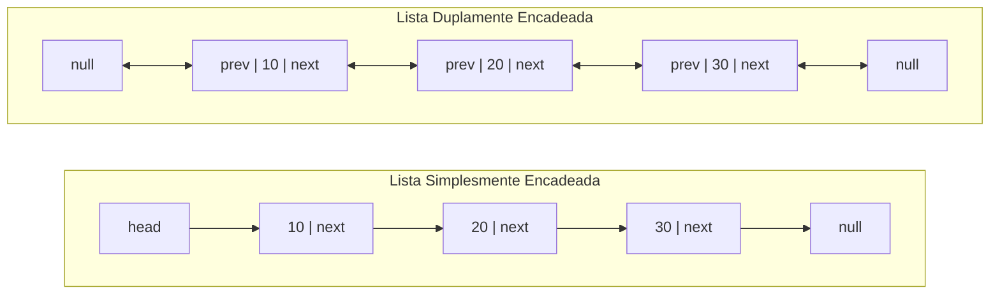
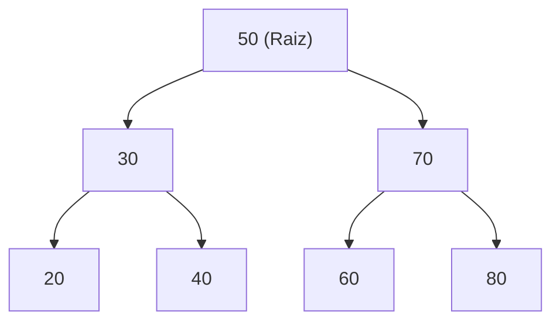

# 🧠 Aula 02 — Lógica, Estruturas de Dados & Complexidade

> *"O motor de qualquer software. Aprenda a analisar o consumo de tempo e memória dos seus algoritmos (Big-O) e escolha as estruturas de dados certas para cada problema."*

---

## 1. 🚀 Briefing da Missão (Contexto Temático & Realidade de Mercado)

### Metadados do Setor
| Campo | Especificação |
| :--- | :--- |
| **Galáxia** | Galáxia 1: Nébula dos Fundamentos (`fundamentos`) |
| **ID do Módulo** | `logica-ed` |
| **Pré-requisitos** | [Aula 01 — Git & GitHub Avançado](./01-git-github-avancado.md) (`git-github`) |
| **Próximas Órbitas** | [Aula 03 — Paradigmas de Programação](./03-paradigmas-de-programacao.md) e [Aula 04 — APIs & Protocolo HTTP](./04-apis-protocolo-http.md) |
| **Nível de Impacto** | Altíssimo — Principal filtro em entrevistas técnicas e gargalos de escala |

### Analogia Espacial: O Navegador Cósmico e o Compartimento de Carga da Nave
Imagine que você comanda um cargueiro interplanetário com 1 milhão de contêineres de suprimentos. Se você empilhar todas as caixas aleatoriamente em um corredor estreito e precisar encontrar o único kit médico para salvar um tripulante, terá que abrir caixa por caixa — no pior cenário, verificará 1 milhão de contêineres. Agora imagine outra organização: você etiqueta cada tipo de item com uma coordenada matemática instantânea (Tabela Hash), organiza os motores por peso em estantes balanceadas (Árvore Binária de Busca) e empilha as ferramentas de reparo de emergência na boca da escotilha (Pilha).

Em software, **Estruturas de Dados são o jeito como você arruma a carga na memória RAM**, e **Algoritmos são as rotas que você percorre para manipular essa carga**. A **Notação Big-O** é o computador de bordo que calcula quanto combustível (CPU e memória) essa rota vai gastar não quando você tem 10 caixas de teste no seu notebook, mas quando a empresa crescer para 10 milhões de usuários simultâneos.

### Qual dor real este módulo resolve em uma empresa?
Um código pode "funcionar perfeitamente" com 50 registros no ambiente de desenvolvimento e derrubar o servidor inteiro quando vai para produção com 200.000 pedidos no banco ou em memória:
1. **Loops aninhados invisíveis (`O(n²)`):** Cruzar duas listas de 50.000 itens com `.find()` dentro de um `.forEach()` gera 2,5 bilhões de comparações, travando a event loop do Node.js ou esgotando a CPU de uma API.
2. **Escolha errada de estrutura:** Usar `array.shift()` repetidamente para processar filas gigantes move todos os elementos da memória a cada remoção (`O(n)`), enquanto uma fila encadeada faria em `O(1)`.
3. **Falha em entrevistas técnicas:** Empresas de produto, fintechs e big techs usam Estruturas de Dados e Complexidade para testar se você sabe raciocinar sobre escalabilidade além de copiar código de frameworks.

---

## 2. 📚 Carga de Conhecimento Completa (Tópico por Tópico)

### 2.1 Notação Big-O: Análise de Complexidade de Tempo e Espaço
A **Notação Big-O** descreve o **limite superior assintótico** de crescimento de um algoritmo à medida que o tamanho da entrada (`n`) tende ao infinito. Ela não mede segundos no relógio (que dependem do processador, linguagem ou processos rodando no computador), mas sim **como o número de operações elementares (Tempo) ou de memória extra alocada (Espaço) escala quando `n` cresce**.

Duas regras práticas para calcular o Big-O de qualquer algoritmo:
- **Descarte constantes multiplicativas:** `O(2n)` ou `O(n/2)` simplifica para `O(n)`, pois o fator linear de crescimento é o mesmo.
- **Considere o termo dominante (e geralmente o pior caso):** `O(n² + 10n + 50)` simplifica para `O(n²)`, porque para entradas grandes o termo quadrático esmaga os demais.

Principais ordens de complexidade, da mais rápida para a mais lenta:

| Notação | Nome | Comportamento para `n = 1.000.000` | Exemplo clássico |
| :--- | :--- | :--- | :--- |
| **`O(1)`** | Constante | ~1 operação | Acessar `arr[42]` ou buscar chave em Tabela Hash ideal |
| **`O(log n)`** | Logarítmica | ~20 operações | Busca Binária em array ordenado |
| **`O(n)`** | Linear | 1.000.000 operações | Percorrer um array ou lista encadeada uma vez |
| **`O(n log n)`** | Linearítmica | ~20.000.000 operações | MergeSort, QuickSort (caso médio), `Array.prototype.sort` |
| **`O(n²)`** | Quadrática | 1.000.000.000.000 operações | Bubble Sort, dois loops `for` aninhados sobre a mesma entrada |
| **`O(2ⁿ)`** | Exponencial | Intratável mesmo para `n = 100` | Fibonacci recursivo ingênuo sem memoização |

**Complexidade de Espaço (Space Complexity):** Mede quanta memória **auxiliar** adicional seu algoritmo aloca além dos dados de entrada. Um algoritmo que altera um array no próprio lugar (*in-place*) usando apenas duas variáveis temporárias tem espaço `O(1)`; já um algoritmo que cria um novo array cópia do tamanho da entrada ou empilha `n` chamadas recursivas na Call Stack consome espaço `O(n)`.

---

### 2.2 Listas Encadeadas (Simples e Duplas)
Diferente de um Array tradicional — que exige um bloco **contíguo** (colado) na memória RAM para calcular o endereço de `arr[i]` em `O(1)` —, uma **Lista Encadeada (*Linked List*)** espalha seus elementos em qualquer espaço livre da memória. Cada elemento é um **Nó (*Node*)** que guarda seu valor (`data`) e um ponteiro (referência) para o próximo nó.

- **Lista Simplesmente Encadeada (*Singly Linked List*):** Cada nó possui `value` e `next`. A lista guarda a referência do primeiro nó (`head`) e opcionalmente do último (`tail`). O último nó aponta para `null`.
  - Inserir ou remover no **início (`head`)**: **`O(1)`** (basta redirecionar um ponteiro!).
  - Acessar o elemento da posição `k`: **`O(n)`** (precisa caminhar nó por nó desde o `head`, sem acesso direto por índice).
- **Lista Duplamente Encadeada (*Doubly Linked List*):** Cada nó possui `value`, `next` e **`prev`** (ponteiro para o nó anterior).
  - Gasta um pouco mais de memória por nó por causa do segundo ponteiro, mas permite navegar para frente e para trás, além de remover o último nó (`tail`) ou um nó específico (tendo sua referência) em **`O(1)`**.



**Quando usar:** Ideal quando há muitas inserções e remoções nas extremidades ou no meio (tendo a referência do nó), como no histórico de navegação (voltar/avançar páginas), playlists de música ou implementação de caches **LRU (*Least Recently Used*)**.

---

### 2.3 Pilhas (LIFO) e Filas (FIFO) e suas Aplicações Reais
Pilhas e Filas são **Tipos Abstratos de Dados (TADs)** definidos pelas regras de ordem em que itens entram e saem — podendo ser implementados internamente sobre Arrays dinâmicos ou Listas Encadeadas.

#### Pilha (*Stack* — LIFO: *Last-In, First-Out*)
O último elemento a entrar é o primeiro a sair, exatamente como uma pilha de pratos.
- **`push(item)`**: Insere no topo em `O(1)`.
- **`pop()`**: Remove e retorna o topo em `O(1)`.
- **`peek()` / `top()`**: Apenas espia o topo sem remover em `O(1)`.
- **Aplicações reais no mercado:**
  1. **Call Stack da linguagem:** Toda chamada de função empilha um *stack frame* com variáveis locais e endereço de retorno; quando termina, desempilha (estourar o limite causa *Stack Overflow*).
  2. **Botão Desfazer (`Ctrl + Z`)** em editores de texto e ferramentas de design.
  3. **Validação de sintaxe em compiladores e linters:** Conferir se parênteses, colchetes e chaves `({[]})` estão balanceados.

#### Fila (*Queue* — FIFO: *First-In, First-Out*)
O primeiro elemento a entrar é o primeiro a sair, como uma fila justa de embarque.
- **`enqueue(item)`**: Entra no final (`tail`) em `O(1)`.
- **`dequeue()`**: Sai da frente (`head`) em `O(1)` (quando implementada com Lista Encadeada ou Buffer Circular — cuidado: usar `array.shift()` em JavaScript custa `O(n)`!).
- **Aplicações reais no mercado:**
  1. **Event Loop do JavaScript / Node.js:** Filas de tarefas (Callback Queue e Microtask Queue) aguardando execução na thread principal.
  2. **Mensageria e processamento assíncrono:** Sistemas como RabbitMQ, SQS e BullMQ enfileiram envio de e-mails, processamento de pagamentos e geração de PDFs.
  3. **Algoritmo BFS (*Breadth-First Search*):** Busca em largura em grafos e árvores.

---

### 2.4 Tabelas Hash e Técnicas de Resolução de Colisões
A **Tabela Hash (*Hash Table* / *Hash Map*)** é provavelmente a estrutura mais utilizada para otimizar algoritmos de `O(n²)` para `O(n)`. Em JavaScript, `Object` e `Map` (e `Set` para valores únicos) são baseados em tabelas hash.

#### Como funciona por baixo dos panos
1. Você fornece uma chave (ex: `"usuario_42"`).
2. Uma **Função Hash** determinística converte essa chave em um número inteiro e aplica o operador módulo (`hash % tamanhoDoArray`) para descobrir o índice do *bucket* (gaveta) em um array interno.
3. O valor é gravado ou lido diretamente naquela gaveta em **`O(1)` no caso médio**.

#### O problema inevitável: Colisões
Como existem infinitas chaves possíveis (strings quaisquer) e um array interno de tamanho finito, duas chaves diferentes inevitavelmente podem gerar o mesmo índice (`hash("ana") % 8 === 3` e `hash("bia") % 8 === 3`). Isso se chama **colisão**. As duas principais técnicas para resolver colisões são:

1. **Encadeamento Separado (*Separate Chaining*):** Cada índice do array não guarda apenas um valor, mas sim um ponteiro para uma **Lista Encadeada** (ou pequena árvore balanceada, como faz o `HashMap` do Java 8+ quando a lista fica grande). Se duas chaves caírem na mesma gaveta, ambas são encadeadas ali.
2. **Endereçamento Aberto (*Open Addressing*):** Tudo fica no próprio array principal. Se a gaveta `3` já estiver ocupada, o algoritmo procura a próxima gaveta livre seguindo uma regra determinística, como **Sondagem Linear (*Linear Probing*)** (`3 -> 4 -> 5...`), **Sondagem Quadrática** ou **Double Hashing**.

**Por que existe o Pior Caso `O(n)`?**
Se a função hash for péssima (ou sofrer um ataque malicioso de *Hash Flooding*) e jogar todas as `n` chaves na mesma gaveta, ou se o fator de carga (*load factor* = itens / buckets) ficar alto demais sem *rehashing* (redimensionar o array para o dobro do tamanho), a busca degenera para percorrer uma lista inteira de `n` elementos: **`O(n)`**.

---

### 2.5 Árvores Binárias de Busca (BST) e Travessias
Uma **Árvore Binária de Busca (*Binary Search Tree* — BST)** é uma estrutura hierárquica ligada por nós (`value`, `left`, `right`) com uma **regra invariante rígida**:
- Para qualquer nó `X`, **todos** os valores na subárvore à esquerda (`left`) são **menores** que `X`, e **todos** os valores na subárvore à direita (`right`) são **maiores** que `X`.



- **Complexidade na BST balanceada:** Busca, inserção e remoção custam **`O(log n)`**, pois a cada passo você descarta metade da árvore restante.
- **Degeneração (Pior caso):** Se você inserir dados já ordenados (`10, 20, 30, 40, 50`) em uma BST simples sem balanceamento, todos os nós cairão sempre para a direita, transformando a árvore em uma **Lista Encadeada torta** com busca **`O(n)`**. Para evitar isso em produção (como nos índices de bancos de dados), usam-se árvores auto-balanceáveis como **AVL**, **Red-Black Trees** ou **B-Trees**.

#### Algoritmos de Travessia (Como visitar todos os nós)
1. **DFS (*Depth-First Search* — Busca em Profundidade):** Explora um ramo até o fundo antes de retroceder (usa recursão ou Pilha):
   - **Pré-Ordem (*Pre-Order*: Raiz -> Esquerda -> Direita):** Útil para clonar ou serializar a estrutura exata da árvore. Output no exemplo acima: `50, 30, 20, 40, 70, 60, 80`.
   - **Em-Ordem (*In-Order*: Esquerda -> Raiz -> Direita):** Em uma BST, **sempre retorna os elementos em ordem crescente ordenada**! Output: `20, 30, 40, 50, 60, 70, 80`.
   - **Pós-Ordem (*Post-Order*: Esquerda -> Direita -> Raiz):** Visita os filhos antes do pai; excelente para deletar uma árvore da memória ou calcular tamanho total de pastas em um sistema de arquivos. Output: `20, 40, 30, 60, 80, 70, 50`.
2. **BFS (*Breadth-First Search* — Busca em Largura / Por Nível):** Usa uma **Fila (FIFO)** para visitar andar por andar de cima para baixo. Output: `50, 30, 70, 20, 40, 60, 80`.

---

### 2.6 Algoritmos de Ordenação: QuickSort vs. MergeSort
Ambos utilizam o paradigma **Dividir para Conquistar (*Divide and Conquer*)** e atingem a barreira teórica ótima `O(n log n)` para ordenação baseada em comparações — muito superiores aos `O(n²)` de Bubble Sort, Insertion Sort e Selection Sort para listas grandes. Contudo, possuem trade-offs importantes:

| Critério | QuickSort | MergeSort |
| :--- | :--- | :--- |
| **Mecânica** | Escolhe um **pivô**, particiona o array (menores à esquerda, maiores à direita) e ordena recursivamente as duas metades. | Divide o array exatamente ao meio até sobrarem subarrays de tamanho 1 e depois os **intercala (*merge*)** ordenados de volta. |
| **Tempo — Caso Médio** | `O(n log n)` (na prática costuma ser mais rápido por excelente localidade de cache da CPU). | `O(n log n)` |
| **Tempo — Pior Caso** | **`O(n²)`** (ocorre se o pivô escolhido for sistematicamente o menor ou maior elemento, ex: array já ordenado com pivô fixo na ponta). Mitigado com pivô aleatório ou mediana de três. | **`O(n log n)` garantido** sempre, independente da entrada. |
| **Espaço Auxiliar** | **`O(log n)`** (ordenado *in-place*, gasta memória apenas na pilha de recursão). | **`O(n)`** (precisa alocar arrays auxiliares temporários durante o *merge*). |
| **Estabilidade** | **Não estável** por padrão (elementos com chaves iguais podem trocar de ordem relativa). | **Estável** (preserva a ordem original de elementos empatados — crucial ao ordenar tabelas por múltiplas colunas!). |

Em linguagens modernas como o motor V8 do Node.js/Chrome e Python, o método `.sort()` nativo usa **Timsort** (um algoritmo híbrido que combina **MergeSort** com **Insertion Sort** para subarrays pequenos, garantindo estabilidade e `O(n log n)` no pior caso).

---

### 2.7 Busca Binária e sua Eficiência `O(log n)`
Se você tem um array **não ordenado**, a única garantia para encontrar um valor é a Busca Linear (`O(n)`): olhar elemento por elemento. Porém, se a coleção estiver **ordenada** (ou for uma função monotônica), podemos aplicar a **Busca Binária**:

1. Olhe para o elemento exatamente no **meio** do intervalo (`mid = Math.floor((left + right) / 2)`).
2. Se `arr[mid] === target`, encontrou!
3. Se `target < arr[mid]`, descarte toda a metade direita (`right = mid - 1`).
4. Se `target > arr[mid]`, descarte toda a metade esquerda (`left = mid + 1`).
5. Repita até encontrar ou os ponteiros se cruzarem (`left > right`).

**Por que isso é tão absurdo?** A cada única comparação, você corta o espaço de busca pela **metade**.
- Em uma lista de **1.000** itens: no máximo **10** comparações (`log₂(1024) = 10`).
- Em uma lista de **1.000.000** de itens: no máximo **20** comparações.
- Em uma lista com **4.000.000.000** (4 bilhões — quase metade da população da Terra!): no máximo **32** comparações!

---

## 3. 💻 Mão no Código (Jeito Iniciante vs. Padrão Profissional)

### Cenário Real: Detectar pedidos duplicados ou cruzar dois lotes de dados (Conciliação)
Você recebe uma lista de `100.000` transações do gateway de pagamento e precisa filtrar rapidamente quais transações não pertencem a usuários bloqueados.

#### ❌ Jeito Iniciante — Força bruta quadrática `O(n * m)`
```javascript
/**
 * PROBLEMA: Para cada transação (n), o .includes() percorre toda a lista
 * de bloqueios (m) do zero. Se n = 50.000 e m = 50.000, são 2,5 BILHÕES de iterações.
 */
function filtrarTransacoesSegurasLento(transacoes, idsBloqueados) {
  const seguras = [];

  for (let i = 0; i < transacoes.length; i++) {
    const transacao = transacoes[i];
    // .includes() em Array faz busca linear O(m) dentro de um loop O(n) -> O(n * m)!
    if (!idsBloqueados.includes(transacao.usuarioId)) {
      seguras.push(transacao);
    }
  }

  return seguras;
}
```

#### ✅ Padrão Profissional — Tabela Hash (`Set`) reduzindo para `O(n + m)`
```javascript
/**
 * SOLUÇÃO PROFISSIONAL: Converte a lista de bloqueios em um Set (Tabela Hash)
 * uma única vez em O(m). Cada consulta .has() dentro do loop custa O(1) médio.
 * Complexidade Total de Tempo: O(n + m) | Complexidade de Espaço: O(m).
 */
function filtrarTransacoesSegurasRapido(transacoes, idsBloqueados) {
  // Pré-processamento em Tabela Hash: de O(m) para consultas O(1)
  const bloqueadosSet = new Set(idsBloqueados);
  const seguras = [];

  for (const transacao of transacoes) {
    // .has() calcula o hash do ID e consulta o bucket diretamente em O(1)
    if (!bloqueadosSet.has(transacao.usuarioId)) {
      seguras.push(transacao);
    }
  }

  return seguras;
}
```

### Implementações Fundamentais Comentadas (Lista Encadeada, Busca Binária e MergeSort)
```javascript
// ==========================================================
// 1. LISTA SIMPLESMENTE ENCADEADA (Singly Linked List)
// ==========================================================
class Node {
  constructor(value) {
    this.value = value;
    this.next = null;
  }
}

class LinkedList {
  constructor() {
    this.head = null;
    this.tail = null;
    this.length = 0;
  }

  // Inserção no início em O(1) — impossível de bater em Arrays nativos
  prepend(value) {
    const newNode = new Node(value);
    newNode.next = this.head;
    this.head = newNode;
    if (!this.tail) {
      this.tail = newNode;
    }
    this.length++;
    return this;
  }

  // Inserção no final em O(1) graças ao ponteiro tail
  append(value) {
    const newNode = new Node(value);
    if (!this.head) {
      this.head = newNode;
      this.tail = newNode;
    } else {
      this.tail.next = newNode;
      this.tail = newNode;
    }
    this.length++;
    return this;
  }
}

// ==========================================================
// 2. BUSCA BINÁRIA ITERATIVA — Tempo O(log n) | Espaço O(1)
// ==========================================================
function binarySearch(sortedArr, target) {
  let left = 0;
  let right = sortedArr.length - 1;

  while (left <= right) {
    // Evita overflow em linguagens tipadas (equivalente seguro a (left + right) / 2)
    const mid = left + Math.floor((right - left) / 2);

    if (sortedArr[mid] === target) {
      return mid; // Índice encontrado
    }
    if (sortedArr[mid] < target) {
      left = mid + 1; // Descarta metade esquerda
    } else {
      right = mid - 1; // Descarta metade direita
    }
  }

  return -1; // Não encontrado
}

// ==========================================================
// 3. MERGESORT — Tempo O(n log n) garantido | Espaço O(n) | Estável
// ==========================================================
function mergeSort(arr) {
  if (arr.length <= 1) return arr;

  const mid = Math.floor(arr.length / 2);
  const leftSorted = mergeSort(arr.slice(0, mid));
  const rightSorted = mergeSort(arr.slice(mid));

  return merge(leftSorted, rightSorted);
}

function merge(left, right) {
  const result = [];
  let i = 0;
  let j = 0;

  while (i < left.length && j < right.length) {
    // <= garante estabilidade (mantém ordem original em caso de empate)
    if (left[i] <= right[j]) {
      result.push(left[i]);
      i++;
    } else {
      result.push(right[j]);
      j++;
    }
  }

  // Anexa os elementos restantes de qualquer metade que não terminou
  return result.concat(left.slice(i)).concat(right.slice(j));
}
```

---

## 4. 🛠️ Laboratório de Voo (Exercício Prático Guiado)

**Tempo estimado:** 45 minutos
**Objetivo:** Sentir na pele a diferença entre `O(n²)`, `O(n log n)` e `O(n)` medindo tempo real no Node.js e construindo um **Validador de Expressões e uma BST**.

### Passo a Passo Reproduzível

1. **Crie o arquivo `benchmark-ed.js`** e gere um array com `100.000` transações fictícias e uma lista de bloqueio com `20.000` IDs:
   - Implemente a versão com busca linear (`Array.includes`) dentro de um loop (`O(n * m)`).
   - Implemente a versão com `Set` (`O(n + m)`).
   - Implemente a versão ordenando os IDs bloqueados com seu próprio `mergeSort` e buscando com `binarySearch` (`O((n + m) log m)`).
   - Use `console.time()` e `console.timeEnd()` para comparar os milissegundos gastos por cada abordagem.
2. **Construa uma BST com travessia Em-Ordem (`inOrder`)**:
   - Crie uma classe `BinarySearchTree` com método `insert(value)` e `inOrder(node, result = [])`.
   - Insira os valores `[50, 30, 70, 20, 40, 60, 80]` e comprove que `inOrder` devolve exatamente `[20, 30, 40, 50, 60, 70, 80]`.
3. **Implemente um Validador de Parênteses usando Pilha (LIFO)**:
   - Escreva a função `isBalanced(expr)` que retorna `true` para `"{[()]}"` e `false` para `"{[(])}"` ou `"((("`, em tempo `O(n)`.

### Critérios de Domínio
- [ ] No benchmark com `100.000` itens, você observou na prática a diferença brutal entre vários segundos na versão `O(n * m)` e poucos milissegundos na versão com Tabela Hash (`Set`) ou Busca Binária.
- [ ] Você consegue desenhar no papel a recursão do `mergeSort` e explicar por que existem `log₂(n)` níveis de divisão com custo `n` por nível.
- [ ] Sua função `isBalanced` trata corretamente casos de borda: string vazia (`true`), fechamento sem abertura (`")"` -> `false`) e pilha não vazia no final (`"("` -> `false`).

---

## 5. 🎯 Resolução Comentada do Teste de Ignição (Quest Oficial)

> **Pergunta Oficial (`logica-ed`):**
> *Em uma Tabela Hash ideal (sem colisões frequentes), qual a complexidade de tempo de busca, inserção e remoção no pior caso e no caso médio, respectivamente?*

- **A)** *"Caso médio O(log n) e Pior caso O(n)"*
- **B)** *"Caso médio O(1) e Pior caso O(n)"*
- **C)** *"Caso médio O(1) e Pior caso O(1)"*
- **D)** *"Caso médio O(n) e Pior caso O(n²)"*

### ✅ Resposta Correta: **Alternativa B**
*(Observação didática: repare que o enunciado cita "pior caso e caso médio", mas todas as alternativas padronizadas apresentam primeiro o **Caso médio** e depois o **Pior caso**. A resposta oficial correta é a **B**).*

**Por que a Alternativa B está correta:**
No **caso médio**, com uma boa função hash que distribui as chaves uniformemente pelos buckets e mantendo um fator de carga controlado (com redimensionamento automático quando a tabela enche), calcular o hash e acessar o índice do array custa tempo constante **`O(1)`** para busca, inserção e remoção. Já no **pior caso** teórico, se todas as `n` chaves colidirem no mesmo bucket (por exemplo, função hash mal projetada ou ataque de colisão), a tabela hash degenera para uma lista linear dentro daquele único bucket, exigindo até **`O(n)`** operações.

**Por que as outras 3 alternativas estão erradas:**
- **Alternativa A (Incorreta):** `O(log n)` no caso médio é a complexidade típica de uma **Árvore Binária de Busca (BST)** balanceada ou de Busca Binária em array ordenado, não de uma Tabela Hash (que não compara chaves ordenadamente — ela calcula endereço direto via hash).
- **Alternativa C (Incorreta):** Embora na prática quase sempre experimentemos `O(1)` amortizado, teoricamente **não é garantido `O(1)` no pior caso** absoluto devido à possibilidade matemática de colisões máximas concentrarem `n` chaves em uma mesma posição (Princípio da Casa dos Pombos).
- **Alternativa D (Incorreta):** Se uma Tabela Hash fosse `O(n)` no caso médio e `O(n²)` no pior caso, ela seria pior do que um simples Array desordenado! Toda a razão de existir da Tabela Hash é justamente atingir `O(1)` no caso médio.

---

## 6. 🎤 Kit de Apresentação (Como Dar Aula / Apresentar Este Módulo)

### Pitch Feynman de 2 Minutos (Texto Pronto para Falar)
> "Imagina que você precisa achar o número de telefone do 'Pedro' em uma lista telefônica de papel com um milhão de nomes. Se os nomes estiverem totalmente embaralhados, você não tem saída: tem que ler de cima a baixo até dar sorte. Isso é **busca linear**, ou **`O(n)`** — se a lista dobra de tamanho, seu trabalho dobra junto.
>
> Agora, como a lista telefônica está em ordem alfabética, você não começa na página 1! Você abre exatamente no meio. Caiu no 'M'? Joga metade do livro fora! Abre no meio do resto. Em apenas 20 aberturas de página você acha qualquer pessoa entre um milhão. Isso é **Busca Binária**, ou **`O(log n)`**.
>
> E se você pudesse ser ainda mais rápido e ter um índice mágico onde você diz o nome 'Pedro', faz uma conta rápida com as letras e descobre na hora que ele está na gaveta 42? Isso é uma **Tabela Hash**, que entrega busca em tempo **`O(1)`** na média!
>
> Estruturas de Dados e Big-O não são matéria chata de faculdade: são o jeito que engenheiros escolhem entre um sistema que responde em 3 milissegundos e um sistema que trava o servidor da empresa na Black Friday."

### Roteiro de Slides (6 Slides)
1. **Slide 1 — Título:** *"Por que Código Lento Quebra Empresas: Big-O e Estruturas de Dados"* | Visual: Gráfico de curvas mostrando `O(1)`, `O(log n)`, `O(n)`, `O(n log n)` e a explosão vertical de `O(n²)`.
2. **Slide 2 — Memória Física vs. Encadeada:** Arrays contíguos vs. Listas Encadeadas (Simples e Duplas) | Visual: Diagrama de blocos de RAM colados vs. nós espalhados ligados por setas.
3. **Slide 3 — Pilhas (LIFO) e Filas (FIFO):** Como o `Ctrl+Z`, a Call Stack e o RabbitMQ funcionam | Visual: Pilha de pratos vs. fila de embarque com setas de entrada e saída.
4. **Slide 4 — O Superpoder da Tabela Hash:** Função Hash, Buckets e Colisões (Chaining vs. Open Addressing) | Visual: Chave `"ana"` entrando numa caixa de função hash e saindo no índice `3` com duas chaves encadeadas.
5. **Slide 5 — Árvores Binárias de Busca (BST) e Travessias:** A regra esquerda-menor / direita-maior + DFS vs. BFS | Visual: Árvore com 7 números mostrando o caminho destacado da travessia Em-Ordem gerando lista ordenada.
6. **Slide 6 — Dividir para Conquistar:** Busca Binária `O(log n)` + Duelo QuickSort vs. MergeSort | Visual: Tabela comparativa de estabilidade, memória auxiliar e pior caso.

### Roteiro de Demo Ao Vivo (3 Minutos)
1. **Minuto 1:** Rode no terminal `node benchmark-ed.js` mostrando um filtro com `Array.includes()` demorando segundos com `100.000` itens vs. `Set.has()` terminando em ~5 milissegundos. A plateia vê o poder do Big-O na prática.
2. **Minuto 2:** Abra o site **VisuAlgo** (`visualgo.net`) na aba *Sorting* ou *BST* e execute passo a passo uma Busca ou MergeSort visualmente para mostrar as partições acontecendo.
3. **Minuto 3:** Mostre as 15 linhas da função `isBalanced("({[]})")` usando um array como Pilha (`push`/`pop`), explicando cada linha no VS Code.

### Perguntas Difíceis da Plateia (Respostas Seguras)
- **Pergunta 1:** *"Se `Set` e `Map` são `O(1)` na média e Arrays são `O(n)` para buscar, por que não usamos apenas Tabelas Hash para tudo?"*
  - **Resposta:** "Porque Tabelas Hash não mantêm ordenação para buscas por intervalo (ex: 'traga todos os usuários com idade entre 18 e 25 anos' — aí uma BST/B-Tree é muito superior), consomem mais memória por causa dos buckets vazios e ponteiros, e em listas minúsculas (ex: 10 itens) o custo de calcular o hash pode ser maior que varrer um array contíguo super amigável ao cache L1 da CPU."
- **Pergunta 2:** *"No dia a dia do JavaScript já existe `.sort()`, então por que preciso saber a diferença entre QuickSort e MergeSort?"*
  - **Resposta:** "Primeiro, para entender **estabilidade** — se você ordena uma tabela por nome e depois por departamento, um algoritmo estável preserva os nomes em ordem dentro do mesmo departamento. Segundo, para respeitar o consumo de memória (`O(n)` vs. `O(log n)`) e reconhecer que toda ordenação comparativa custa no mínimo `O(n log n)`, evitando colocar um `.sort()` desnecessariamente dentro de um loop!"

---

## 7. 💼 Radar do Mercado de Trabalho (Foco Dev Júnior)

### 3 Perguntas Reais de Entrevista Técnica Júnior
1. **Pergunta:** *"Dado um array de números inteiros e um valor alvo `target`, encontre os índices de dois números que somam `target` (Two Sum). Como fazer melhor que `O(n²)`?"*
   - **Resposta-modelo:** "A abordagem ingênua usa dois loops `for` aninhados (`O(n²)`). Para otimizar para tempo **`O(n)`** (usando espaço **`O(n)`**), eu crio um `Map` (Tabela Hash) para guardar cada número já visto e seu índice. Em uma única passada pelo array, para cada `num` atual eu calculo `complemento = target - num`. Se `complemento` já estiver no `Map`, retorno `[map.get(complemento), i]` imediatamente; caso contrário, armazeno `map.set(num, i)`."
2. **Pergunta:** *"Qual a diferença de complexidade entre inserir no início de um Array dinâmico versus no início de uma Lista Encadeada?"*
   - **Resposta-modelo:** "Em um Array contíguo, inserir no índice `0` (`unshift`) exige deslocar todos os `n` elementos existentes uma casa para a direita, custando **`O(n)`**. Em uma Lista Encadeada, basta criar o novo nó, apontar seu `next` para o antigo `head` e atualizar o `head` para o novo nó, custando tempo constante **`O(1)`**."
3. **Pergunta:** *"Quando o algoritmo QuickSort atinge seu pior caso `O(n²)` e como evitamos isso na prática?"*
   - **Resposta-modelo:** "Ele atinge `O(n²)` quando o pivô escolhido produz partições totalmente desbalanceadas a cada chamada — por exemplo, escolher sempre o primeiro ou último elemento em um array que já está ordenado ou inversamente ordenado. Na prática, evitamos escolhendo o **pivô aleatoriamente**, usando a técnica da **mediana de três** (início, meio e fim), ou adotando algoritmos híbridos como **Introsort** (que troca para HeapSort se a recursão ficar funda demais)."

### Erros Clássicos de Júnior vs. Postura Profissional
- ❌ **Comportamento de Júnior:** Chamar `.find()`, `.includes()`, `.indexOf()` ou `.filter()` dentro de outro `.map()` ou `for`, criando bombas-relógio `O(n²)` sem perceber.
  - ✅ **Postura Profissional:** Identificar loops aninhados e indexar previamente a coleção auxiliar usando `Map` ou `Set` antes de iterar.
- ❌ **Comportamento de Júnior:** Usar `array.shift()` dentro de um `while (queue.length > 0)` para processar milhares de itens como fila.
  - ✅ **Postura Profissional:** Usar um ponteiro de índice de leitura (`headIndex++`), uma Lista Encadeada simples ou estrutura circular para garantir remoção real em `O(1)`.

### Evidência para Portfólio / GitHub / LinkedIn
- **No GitHub:** Crie um repositório chamado `algoritmos-estruturas-js` organizado por pastas (`linked-list/`, `stack-queue/`, `bst/`, `sorting/`) com **testes automatizados** para cada estrutura e um `README.md` contendo tabela de complexidade Big-O de cada implementação.
- **No LinkedIn:** Publique o resultado do seu benchmark comparando `O(n²)` vs. `O(n)` com `Set` em 100.000 registros (ex: *"Como reduzir o tempo de processamento de 12 segundos para 4 milissegundos trocando Array.includes por Set"*).

---

## 8. 📡 Transmissões Recomendadas & Próxima Órbita

### Materiais Oficiais de Aprofundamento (`data.js`)
- 📊 **[Big-O Cheat Sheet](https://www.bigocheatsheet.com/)** — Tabela de referência rápida com gráficos e complexidades médias/piores de todas as estruturas e algoritmos de ordenação.
- 🎬 **[VisuAlgo (Visualização de Algoritmos)](https://visualgo.net/)** — Plataforma interativa que anima passo a passo Listas Encadeadas, Pilhas, Filas, Tabelas Hash, BST, QuickSort e MergeSort.
- 🧩 **[Exercícios no LeetCode (Fáceis/Médios)](https://leetcode.com/)** — Pratique problemas clássicos como *Two Sum*, *Valid Parentheses*, *Binary Search* e *Reverse Linked List*.

### Próximas Órbitas Desbloqueadas
Na árvore da **Nébula dos Fundamentos**, dominar Lógica e Estruturas de Dados desbloqueia **dois caminhos simultâneos**:
1. ➡️ **[Aula 03 — Paradigmas de Programação (`paradigmas`)](./03-paradigmas-de-programacao.md)** — Para estruturar código elegante com POO e Programação Funcional.
2. ➡️ **[Aula 04 — APIs & Protocolo HTTP (`apis-web`)](./04-apis-protocolo-http.md)** — Para conectar suas estruturas de dados e algoritmos ao mundo através da web.
