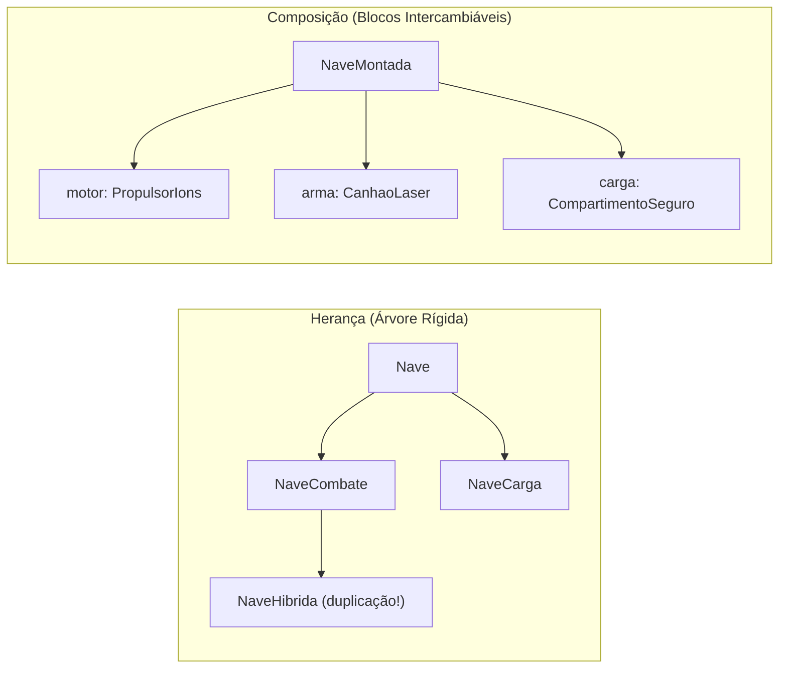

# ⚙️ Aula 03 — Paradigmas de Programação

> *"Entenda as diferentes formas de pensar e estruturar seu código. Domine as nuances da Programação Orientada a Objetos e da Programação Funcional."*

---

## 1. 🚀 Briefing da Missão (Contexto Temático & Realidade de Mercado)

### Metadados do Setor
| Campo | Especificação |
| :--- | :--- |
| **Galáxia** | Galáxia 1: Nébula dos Fundamentos (`fundamentos`) |
| **ID do Módulo** | `paradigmas` |
| **Pré-requisitos** | [Aula 02 — Lógica, Estruturas de Dados & Complexidade](./02-logica-estruturas-dados-complexidade.md) (`logica-ed`) |
| **Próxima Órbita** | [Aula 05 — Bancos de Dados Relacionais & SQL](./05-bancos-de-dados-relacionais-sql.md) *(requer também a Aula 04)* |
| **Nível de Impacto** | Alto — Base para Clean Code, React, NestJS, Java/C# e testes automatizados |

### Analogia Espacial: O Navegador Cósmico e as Duas Escolas de Engenharia de Frota
Imagine que você precisa construir uma nova estação espacial modular. Há duas filosofias complementares de engenharia que dominam o universo do software:

1. **Programação Orientada a Objetos (POO) — A Oficina de Módulos Autônomos:** Você projeta naves e compartimentos como **entidades vivas com estado próprio e responsabilidades fechadas**. Um módulo "Propulsor de Íons" esconde seus circuitos internos (encapsulamento), expõe apenas um painel de controle simples (`acelerar(potencia)`) e conversa com o computador central seguindo um contrato padrão (interface).
2. **Programação Funcional (PF) — A Linha de Refino Sem Contaminação:** Em vez de objetos mutáveis que alteram seu estado interno com o tempo, você projeta **câmaras de transformação puras**. Entra minério bruto por um lado, sai combustível refinado do outro — sem nunca contaminar o tanque original e sem depender da hora do dia ou da temperatura externa. Se entrar exatamente o mesmo minério amanhã, sairá exatamente o mesmo combustível.

Um Navegador Cósmico júnior que conhece apenas comandos imperativos soltos escreve "código espaguete". Quem domina **POO + Programação Funcional** sabe exatamente quando modelar domínios ricos com objetos compostos e quando processar dados em pipelines previsíveis e imutáveis.

### Qual dor real este módulo resolve em uma empresa?
À medida que um projeto passa de 500 para 50.000 linhas, o maior inimigo deixa de ser a sintaxe da linguagem e passa a ser o **acoplamento** e o **estado compartilhado mutável**:
1. **Bugs fantasmas de mutação:** Você passa um objeto `pedido` para calcular o frete, e aquela função altera silenciosamente `pedido.itens` ou `pedido.total`. Três arquivos depois, o pagamento cobra o valor errado e ninguém descobre onde o objeto foi modificado.
2. **Árvores de herança engessadas:** Você cria uma hierarquia `Usuario -> Funcionario -> Gerente`, mas depois surge um "Terceirizado com acesso de Gerente sem folha salarial" e toda a árvore de classes quebra porque uma classe só herda de um pai.
3. **Código impossível de testar:** Funções que leem variáveis globais, acessam `new Date()` direto ou gravam no banco no meio de um cálculo financeiro exigem gambiarras gigantes para escrever um simples teste unitário.

---

## 2. 📚 Carga de Conhecimento Completa (Tópico por Tópico)

### 2.1 Os 4 Pilares da POO: Encapsulamento, Abstração, Herança e Polimorfismo
A Programação Orientada a Objetos organiza o software ao redor de **objetos** que combinam dados (atributos) e comportamentos (métodos), sustentados por quatro pilares essenciais:

1. **Encapsulamento:** É a proteção do estado interno de um objeto, impedindo que código externo altere propriedades críticas arbitrariamente sem passar por regras de validação. Em JavaScript moderno usamos campos privados com `#saldo`; em TypeScript, Java e C# usamos modificadores `private` e `protected`. Exemplo: você não faz `conta.saldo = -9999` direto; você chama `conta.sacar(100)`, que valida se há limite suficiente antes de atualizar `#saldo`.
2. **Abstração:** É expor **o que** um componente faz, escondendo **como** a complexidade interna funciona. Ao chamar `processadorPagamento.cobrar(valor)`, o código cliente não precisa saber se por dentro existem 80 linhas abrindo conexão TLS, assinando tokens HMAC ou tratando timeouts de rede.
3. **Herança:** Permite que uma subclasse (`ContaPoupanca`) reaproveite atributos e métodos de uma superclasse (`ContaBancaria`) estabelecendo uma relação do tipo **"é um"** (*is-a*). Embora poderosa para especializações reais e estáveis, o abuso de herança cria alto acoplamento entre pai e filhos (o problema da "classe base frágil": mudar algo no pai quebra filhos inesperados).
4. **Polimorfismo:** Significa "muitas formas" — a capacidade de objetos de classes diferentes responderem à **mesma mensagem (método)** cada um à sua maneira. Se `Pix`, `CartaoCredito` e `Boleto` possuem o método `pagar(valor)`, o seu `CheckoutService` apenas itera e chama `metodo.pagar(total)` sem precisar escrever um `if/else` ou `switch` gigante para cada meio de pagamento!

---

### 2.2 Classes Abstratas vs. Interfaces
Tanto **Classes Abstratas** quanto **Interfaces** servem para definir contratos e viabilizar o polimorfismo, mas possuem propósitos e regras distintas (muito explícitas em linguagens como TypeScript, Java e C#):

| Característica | Classe Abstrata (`abstract class`) | Interface (`interface`) |
| :--- | :--- | :--- |
| **Propósito central** | Compartilhar **código base + estado + contrato** entre classes fortemente ligadas pela mesma identidade ("o que ela É"). | Definir exclusivamente um **contrato de capacidades/comportamento** ("o que ela FAZ"), totalmente desacoplado de implementação. |
| **Pode ser instanciada?** | Não (`new ClasseAbstrata()` gera erro). | Não (existe apenas como contrato/tipo; em TypeScript, desaparece após compilar para JavaScript). |
| **Implementação de métodos** | Pode ter métodos **concretos** (já implementados) e métodos **abstratos** (sem corpo, obrigando as subclasses a implementar). | Tradicionalmente declara apenas assinaturas de métodos e tipos de propriedades (sem estado de instância). |
| **Atributos com estado** | Sim, pode armazenar campos/estado compartilhado e ter construtor. | Não armazena estado interno de execução. |
| **Herança múltipla** | Uma classe normalmente só pode estender **uma única** classe abstrata (`extends`). | Uma classe pode implementar **múltiplas** interfaces ao mesmo tempo (`implements Logavel, Serializavel, Pagavel`). |

**Nota prática para JavaScript puro:** JavaScript não possui a palavra-chave `interface` nativa em runtime (diferente do TypeScript). Em JS puro, contratos são expressos por convenção (*Duck Typing*: *"se anda como pato e grasna como pato, então é um pato"*) ou simulando classes abstratas que lançam `throw new Error("Método não implementado")` quando chamadas diretamente sem sobrescrita.

---

### 2.3 Composição sobre Herança
Um dos princípios mais célebres da engenharia de software (eternizado pelo livro *Design Patterns* da Gang of Four) é: **"Favoreça a composição de objetos em vez da herança de classes"**.

#### Por que a Herança falha quando o negócio muda?
Imagine um jogo espacial onde você cria `Nave` -> `NaveCombate` (atira) e `NaveCarga` (transporta minério). Amanhã o cliente pede uma `NaveExploradora` que **atira E transporta minério, mas não usa escudo** — e depois uma `TorretaEstacionaria` que **atira, mas não se move**! Com herança simples (`extends`), você fica preso tentando encaixar comportamentos em uma árvore rígida (ou duplicando código).

#### Como a Composição resolve (*"Tem um"* em vez de *"É um"*)
Em vez de herdar comportamentos de uma hierarquia vertical, você **monta o objeto injetando peças independentes** (módulos de comportamento):



Com composição, criar uma `TorretaEstacionaria` significa simplesmente instanciar um objeto que recebe `{ arma: canhaoLaser }` sem precisar carregar nenhum código de `motor` ou `carga` herdado à força!

---

### 2.4 Programação Funcional: Funções Puras e Imutabilidade
Enquanto a POO foca em gerenciar mudanças de estado dentro de fronteiras encapsuladas, a **Programação Funcional (PF)** evita a própria mutação de estado tratando computação como avaliação de funções matemáticas.

#### 1. Funções Puras
Uma função é **pura** quando obedece estritamente a duas regras:
1. **Determinismo:** Para os mesmos argumentos de entrada, ela **sempre** retorna exatamente o mesmo resultado (não depende de variáveis externas mutáveis, relógio do sistema, `Math.random()` ou respostas de rede).
2. **Ausência de Efeitos Colaterais (*No Side Effects*):** Ela não modifica nada fora de seu escopo local — não altera argumentos recebidos por referência, não escreve em variáveis globais, não imprime no console e não altera banco de dados.

#### 2. Imutabilidade
Imutabilidade significa que **um dado, uma vez criado, nunca é alterado no mesmo endereço de memória**. Se você precisa adicionar um item a um carrinho de compras ou atualizar o preço de um produto, você não modifica o array ou objeto original — você cria **uma nova versão atualizada** preservando os dados anteriores intactos.
- Em JavaScript, objetos e arrays são passados por **referência**! Usar `arr.push()`, `arr.sort()`, `arr.splice()` ou `obj.prop = novoValor` **muta** o original!
- Alternativas imutáveis em JS moderno:
  - Arrays: `[...arr, novoItem]`, `.map()`, `.filter()`, `.toSorted()`, `.toReversed()`, `.with(index, valor)`.
  - Objetos: `{ ...usuario, ativo: true }`, ou `structuredClone(obj)` para cópias profundas quando necessário.

---

### 2.5 Funções de Alta Ordem (*Higher-Order Functions*): `map`, `filter` e `reduce`
Na Programação Funcional, **funções são cidadãs de primeira classe** (*first-class citizens*): podem ser armazenadas em variáveis, passadas como argumento e retornadas por outras funções. Uma **Função de Alta Ordem (HOF)** é justamente uma função que **recebe outra função como parâmetro** ou **retorna uma função**.

As três HOFs fundamentais para substituir loops imperativos `for` com variáveis acumuladoras mutáveis são:

1. **`Array.prototype.map(fn)` — Transformação (1 para 1):**
   Recebe um array de tamanho `N` e devolve um **novo array** de tamanho `N`, aplicando `fn` a cada elemento sem alterar o array original.
   - *Uso:* Extrair campos de objetos, formatar preços de centavos para reais, converter DTOs.
2. **`Array.prototype.filter(predicado)` — Seleção (N para <= N):**
   Recebe um array e devolve um **novo array** contendo apenas os elementos para os quais a função `predicado` retornou `true`.
   - *Uso:* Filtrar pedidos pagos, remover usuários inativos, buscar itens em estoque.
3. **`Array.prototype.reduce(redutor, valorInicial)` — Agregação (N para 1 ou outra estrutura):**
   Percorre o array acumulando cada elemento dentro de um resultado único (um número, um objeto agrupado, outro array ou uma string). **Sempre passe o `valorInicial`** para evitar bugs com arrays vazios!
   - *Uso:* Somar o total do carrinho, agrupar transações por categoria (`groupBy`), calcular médias.

---

### 2.6 Efeitos Colaterais (*Side Effects*) e Transparência Referencial
#### O que é um Efeito Colateral (*Side Effect*)?
Qualquer interação da função com o mundo externo além de receber parâmetros e devolver um valor de retorno é um efeito colateral:
- Modificar uma variável global ou um objeto/array passado por parâmetro;
- Fazer requisição HTTP (`fetch`), ler/gravar arquivo no disco (`fs`), consultar banco de dados;
- Chamar `console.log`, manipular o DOM (`document.querySelector`), gerar números aleatórios ou ler `Date.now()`.

**Atenção:** Software útil **precisa** de efeitos colaterais (senão nunca salvaria nada no banco nem exibiria nada na tela!). O segredo da arquitetura funcional — conhecido como **Functional Core, Imperative Shell** (*Núcleo Funcional, Casca Imperativa*) — é **isolar 100% da lógica de negócio em funções puras no núcleo** e empurrar os efeitos colaterais (ler banco, responder HTTP, logar) para as bordas do sistema!

#### Transparência Referencial
Uma expressão ou função possui **transparência referencial** se você pode substituir a chamada da função diretamente pelo seu valor de retorno sem alterar o comportamento do programa.
- Exemplo: `somar(2, 3)` pode ser trocada pelo literal `5` em qualquer lugar do código — isso só é verdade porque `somar` é pura!
- Benefícios diretos: código extremamente fácil de testar (zero mocks complexos), fácil de cachear (**memoização**: se já calculou para entrada `X`, devolve o resultado salvo) e seguro para rodar em paralelo sem *race conditions*.

---

## 3. 💻 Mão no Código (Jeito Iniciante vs. Padrão Profissional)

### Cenário Real: Processar pedidos de e-commerce aplicando desconto VIP e regras de envio

#### ❌ Jeito Iniciante — Herança engessada + Mutação silenciosa + Efeitos colaterais misturados
```javascript
// Estado global mutável fora da função (perigoso!)
let receitaTotalDoDia = 0;

// Herança rígida que obriga toda classe filha a carregar estrutura fixa
class PedidoBase {
  constructor(itens) {
    this.itens = itens;
  }
  calcularTotal() {
    let soma = 0;
    for (let i = 0; i < this.itens.length; i++) {
      // ANTIPADRÃO: muta o próprio objeto recebido de fora!
      this.itens[i].preco = this.itens[i].preco * 0.9;
      soma += this.itens[i].preco;
    }
    // ANTIPADRÃO: efeito colateral escondido em variável global e console.log
    receitaTotalDoDia += soma;
    console.log("Total calculado:", soma);
    return soma;
  }
}

class PedidoVIP extends PedidoBase {
  // E se amanhã um PedidoComum também precisar de cupom ou frete grátis?
  // Fica difícil combinar regras sem multiplicar subclasses.
}
```
**Por que isso quebra em produção?** Quem passou o array `itens` não espera que os preços originais dentro dele sejam reduzidos em 10% permanentemente cada vez que `calcularTotal()` for chamado. Além disso, `receitaTotalDoDia` muda dependendo de quantas vezes a função rodou!

#### ✅ Padrão Profissional — Composição para comportamentos + Núcleo Funcional Puro e Imutável
```javascript
// =========================================================================
// 1. NÚCLEO FUNCIONAL PURO (Zero mutação, zero console.log, zero estado global)
// =========================================================================

// Função pura: recebe dados, não os modifica e sempre devolve o mesmo resultado
const filtrarItensEmEstoque = (itens) =>
  itens.filter((item) => item.estoque > 0);

// HOF que retorna uma função pura configurada (Currying / Factory de estratégia)
const criarAplicadorDeDesconto = (percentual) => (itens) =>
  itens.map((item) => ({
    ...item, // Cria NOVO objeto preservando imutabilidade do original
    precoComDesconto: Math.round(item.precoCentavos * (1 - percentual)),
  }));

// Função pura usando reduce para totalizar sem variáveis mutáveis externas
const somarSubtotalCentavos = (itens) =>
  itens.reduce((acumulado, item) => acumulado + item.precoComDesconto * item.quantidade, 0);

// =========================================================================
// 2. COMPOSIÇÃO DE OBJETOS (Injeção de estratégias de desconto e frete)
// =========================================================================

// Estratégias independentes e intercambiáveis (Polimorfismo sem herança!)
const estrategiaPadrao = {
  aplicarDesconto: criarAplicadorDeDesconto(0),
  calcularFreteCentavos: (subtotal) => (subtotal >= 20000 ? 0 : 1990),
};

const estrategiaVIP = {
  aplicarDesconto: criarAplicadorDeDesconto(0.15),
  calcularFreteCentavos: () => 0,
};

// Função construtora/classe baseada em COMPOSIÇÃO ("tem estratégias")
class ProcessadorPedido {
  #estrategia; // Campo privado encapsulado (ES2022+)

  constructor(estrategia) {
    if (
      typeof estrategia?.aplicarDesconto !== "function" ||
      typeof estrategia?.calcularFreteCentavos !== "function"
    ) {
      throw new TypeError("Estratégia inválida: deve implementar aplicarDesconto e calcularFreteCentavos.");
    }
    this.#estrategia = estrategia;
  }

  // Orquestra o pipeline puro retornando um novo objeto de resumo
  processar(itensOriginais) {
    const disponiveis = filtrarItensEmEstoque(itensOriginais);
    const itensPrecificados = this.#estrategia.aplicarDesconto(disponiveis);
    const subtotalCentavos = somarSubtotalCentavos(itensPrecificados);
    const freteCentavos = this.#estrategia.calcularFreteCentavos(subtotalCentavos);

    return Object.freeze({
      itens: itensPrecificados,
      subtotalCentavos,
      freteCentavos,
      totalCentavos: subtotalCentavos + freteCentavos,
    });
  }
}

// =========================================================================
// 3. CASCA IMPERATIVA (Borda onde rodamos I/O e exibição)
// =========================================================================
const carrinho = Object.freeze([
  Object.freeze({ nome: "Teclado Mecânico", precoCentavos: 35000, quantidade: 1, estoque: 4 }),
  Object.freeze({ nome: "Cabo USB-C", precoCentavos: 4000, quantidade: 2, estoque: 0 }),
]);

const processadorVip = new ProcessadorPedido(estrategiaVIP);
const resumo = processadorVip.processar(carrinho);
// 'carrinho' permanece 100% intacto; 'resumo' é previsível e fácil de testar!
console.log(resumo);
```

---

## 4. 🛠️ Laboratório de Voo (Exercício Prático Guiado)

**Tempo estimado:** 40 minutos
**Objetivo:** Refatorar um sistema de notificações e relatórios usando **Composição (sem herança)** e um **Pipeline Funcional (`filter`, `map`, `reduce`)** com garantia de imutabilidade.

### Passo a Passo Reproduzível

1. **Crie o arquivo `telemetria-frota.js`** com um array congelado (`Object.freeze`) contendo 6 registros de missões espaciais (`{ id, nave, status: "sucesso" | "falha", combustivelGasto, distanciaAnosLuz }`).
2. **Construa 3 funções puras encadeáveis**:
   - `apenasConcluidas(missoes)`: usa `.filter()` para manter apenas `status === "sucesso"`.
   - `comEficiencia(missoes)`: usa `.map()` para retornar novos objetos contendo a propriedade calculada `eficiencia = distanciaAnosLuz / combustivelGasto` **sem alterar nenhum objeto original**.
   - `gerarRelatorioPorNave(missoes)`: usa `.reduce()` para retornar um objeto agrupado por nave (`{ "Apollo": { totalMissoes: 2, distanciaTotal: 140 }, ... }`).
3. **Crie um `SistemaAlerta` por Composição**:
   - Em vez de criar classes `AlertaEmail extends AlertaBase` e `AlertaSlack extends AlertaBase`, crie objetos de canal que respeitem o contrato `{ enviar(mensagem) }`: `canalConsole` e `canalArquivoSimulado` (que guarda em um array interno privado).
   - Faça `class DespachanteAlertas` receber uma lista de canais no construtor (`constructor(canais)`) e disparar para todos polimorficamente em `notificar(mensagem)`.
4. **Valide a Transparência Referencial**:
   - Chame suas funções puras duas vezes seguidas com o mesmo array e use `assert.deepStrictEqual` (do módulo nativo `node:assert`) para comprovar que o resultado é idêntico e o array original não sofreu nenhuma modificação.

### Critérios de Domínio
- [ ] Zero usos de `.push()`, `.splice()` ou reatribuição de propriedades nos dados originais dentro das funções puras.
- [ ] `assert.deepStrictEqual` passa verificando que chamar a função pura 2 vezes gera saídas idênticas e preserva o array de entrada intacto.
- [ ] O `DespachanteAlertas` aceita qualquer novo canal (ex: Discord ou SMS) sem alterar uma única linha da classe despachante.

---

## 5. 🎯 Resolução Comentada do Teste de Ignição (Quest Oficial)

> **Pergunta Oficial (`paradigmas`):**
> *O que caracteriza uma 'Função Pura' no paradigma da Programação Funcional?*

- **A)** *"Uma função que não aceita argumentos e sempre retorna o mesmo valor constante."*
- **B)** *"Uma função que altera variáveis globais mas executa de forma muito rápida."*
- **C)** *"Uma função que, dados os mesmos argumentos, sempre retorna o mesmo resultado e não produz efeitos colaterais fora de seu escopo."*
- **D)** *"Uma função escrita sem o uso de estruturas condicionais (if/else)."*

### ✅ Resposta Correta: **Alternativa C**

**Por que a Alternativa C está correta:**
Essa é a definição matemática e computacional exata de pureza funcional: (1) **Determinismo / Transparência Referencial** — dada a mesma entrada, a saída é sempre idêntica, independentemente de quantas vezes ou em que momento a função seja executada; e (2) **Ausência de efeitos colaterais (*side effects*)** — a função não lê nem altera estado externo mutável, variáveis globais, argumentos recebidos por referência ou sistemas de I/O fora de seu escopo.

**Por que as outras 3 alternativas estão erradas:**
- **Alternativa A (Incorreta):** Funções puras aceitam quantos argumentos forem necessários (como `somar(a, b)` ou `calcularImposto(valor, aliquota)`). Uma função sem argumentos que retorna uma constante até é pura, mas seria uma definição absurdamente restritiva e inútil para representar transformações de dados.
- **Alternativa B (Incorreta):** Alterar variáveis globais é literalmente a definição clássica de **efeito colateral (*side effect*)**, violando frontalmente a pureza da função. Velocidade de execução não tem relação alguma com pureza.
- **Alternativa D (Incorreta):** Estruturas condicionais (`if/else`, operadores ternários) são perfeitamente válidas dentro de funções puras, desde que dependam apenas dos argumentos recebidos e não alterem estado externo.

---

## 6. 🎤 Kit de Apresentação (Como Dar Aula / Apresentar Este Módulo)

### Pitch Feynman de 2 Minutos (Texto Pronto para Falar)
> "Quando você aprende a programar, escreve uma receita de bolo linha por linha — isso é o estilo imperativo. Mas quando um projeto cresce e dezenas de programadores mexem nele juntos, a gente precisa de organização. É aí que entram dois grandes paradigmas que não são inimigos, são ferramentas complementares: a **Orientação a Objetos** e a **Programação Funcional**.
>
> Na **Orientação a Objetos**, eu penso em **atores independentes**. Um objeto protege seus dados por dentro (encapsulamento), esconde a bagunça atrás de botões simples (abstração) e permite que vários tipos diferentes respondam ao mesmo comando (polimorfismo). E o segredo sênior da POO é: em vez de criar árvores gigantes de herança onde o filho herda coisas que não pediu, a gente usa **composição** — igual montar um robô com peças de Lego intercambiáveis!
>
> Já na **Programação Funcional**, eu penso em **tubulações limpas de transformação**. Eu uso **funções puras**, que nunca alteram nada fora delas e sempre dão a mesma resposta para a mesma entrada, junto com **imutabilidade**, usando `filter`, `map` e `reduce` para criar novos dados em vez de estragar os antigos.
>
> Nos sistemas reais modernos — como React no frontend ou Node/NestJS no backend — você mistura os dois todos os dias: encapsula serviços e fronteiras com POO e composição, e escreve regras de negócio puras e previsíveis com Programação Funcional!"

### Roteiro de Slides (6 Slides)
1. **Slide 1 — Título:** *"Paradigmas de Programação: POO e Funcional na Vida Real"* | Visual: Dois ícones complementares (Engrenagens modulares da POO + Fluxo de tubos limpos da PF).
2. **Slide 2 — Os 4 Pilares da POO Sem Enrolação:** Encapsulamento, Abstração, Herança e Polimorfismo com 1 exemplo de código por pilar | Visual: Diagrama de cartão bancário com botão `sacar()` e `#saldo` trancado por dentro.
3. **Slide 3 — Classe Abstrata vs. Interface & Composição vs. Herança:** Por que "Tem um" vence "É um" | Visual: Comparativo entre árvore de herança quebrada pelo "Pato de Borracha que não voa" vs. blocos montáveis.
4. **Slide 4 — Coração da Programação Funcional:** Funções Puras, Imutabilidade e Transparência Referencial | Visual: Caixa preta matemática `f(2, 3) -> 5` com cadeado anti-mutação.
5. **Slide 5 — O Trio de Ouro (`map`, `filter`, `reduce`):** Substituindo `for` mutável por pipelines declarativos | Visual: Ilustração clássica visual com ingredientes sendo filtrados, transformados e reduzidos em um prato pronto.
6. **Slide 6 — Arquitetura Híbrida Moderna:** *Functional Core, Imperative Shell* | Visual: Cebola arquitetural com núcleo puro no centro e efeitos colaterais (DB, HTTP, Logs) na casca externa.

### Roteiro de Demo Ao Vivo (3 Minutos)
1. **Minuto 1:** Mostre um bug clássico ao vivo no terminal Node: uma função que usa `.sort()` ou `.push()` direto no array recebido e acaba corrompendo o array original em outro ponto do código.
2. **Minuto 2:** Substitua ao vivo por `[...arr].sort()` (ou `.toSorted()`) e `.filter().map().reduce()`, mostrando com `console.log` que o original permaneceu intacto.
3. **Minuto 3:** Mostre o `ProcessadorPedido` trocando apenas a estratégia injetada (`estrategiaPadrao` -> `estrategiaVIP`) sem tocar em nenhum `if/else` dentro da classe.

### Perguntas Difíceis da Plateia (Respostas Seguras)
- **Pergunta 1:** *"Copiar arrays e objetos inteiros toda hora com spread (`{...obj}`) e `.map()` por causa da imutabilidade não deixa a memória lenta?"*
  - **Resposta:** "Para a imensa maioria das coleções em aplicações web (centenas ou milhares de objetos de tela/requisição), o custo é irrelevante e os benefícios contra bugs de concorrência e estado (como no React) compensam muito. Além disso, o spread faz *shallow copy* (compartilha referências dos subobjetos que não mudaram — chamado *Structural Sharing*). Só em algoritmos críticos com milhões de itens por segundo é que fazemos otimização pontual com mutação isolada localmente dentro de uma função que ainda parece pura por fora."
- **Pergunta 2:** *"JavaScript é uma linguagem Orientada a Objetos ou Funcional?"*
  - **Resposta:** "JavaScript é **multiparadigma**! Ela suporta Orientação a Objetos (baseada em protótipos por baixo dos panos, com açúcar sintático de `class`), Programação Funcional (funções de primeira classe, closures, HOFs) e Programação Imperativa/Procedural. Essa flexibilidade permite aplicar o melhor de cada paradigma no mesmo projeto."

---

## 7. 💼 Radar do Mercado de Trabalho (Foco Dev Júnior)

### 3 Perguntas Reais de Entrevista Técnica Júnior
1. **Pergunta:** *"Qual a diferença prática entre uma Classe Abstrata e uma Interface, e quando você escolheria uma ou outra?"*
   - **Resposta-modelo:** "A **Interface** define apenas um contrato — quais métodos e tipos uma classe deve possuir, sem carregar implementação nem estado — e uma classe pode implementar várias interfaces simultaneamente. A **Classe Abstrata** não pode ser instanciada diretamente, mas pode conter tanto métodos abstratos quanto código concreto e atributos compartilhados entre subclasses da mesma família, permitindo herdar apenas de uma. Escolho Interface para desacoplar camadas (ex: `RepositorioUsuario` para banco ou memória nos testes) e Classe Abstrata apenas quando múltiplas subclasses compartilham comportamento comum real e identidade estreita."
2. **Pergunta:** *"Por que o mercado recomenda 'Composição sobre Herança'?"*
   - **Resposta-modelo:** "Porque herança cria acoplamento forte e vertical: mudanças na classe pai podem quebrar subclasses inesperadamente e a maioria das linguagens permite herdar de apenas uma superclasse. Com composição, um objeto recebe suas dependências ou comportamentos no construtor, permitindo combinar funcionalidades livremente, trocar implementações em tempo de execução e facilitar muito os testes unitários com mocks/fakes."
3. **Pergunta:** *"Explique o que é imutabilidade e dê um exemplo de bug causado por mutação acidental em JavaScript."*
   - **Resposta-modelo:** "Imutabilidade significa não modificar um dado após sua criação, gerando uma nova cópia com a alteração desejada. Um bug clássico em JS ocorre quando você passa um objeto ou array para uma função auxiliar e ela faz `lista.sort()` ou `usuario.ativo = false` diretamente: como objetos e arrays são passados por referência, o dado original usado em outra tela ou cálculo também muda silenciosamente. No React, por exemplo, mutar um array de estado com `.push()` impede a biblioteca de detectar alteração de referência, fazendo a tela não re-renderizar."

### Erros Clássicos de Júnior vs. Postura Profissional
- ❌ **Comportamento de Júnior:** Criar herança só para reaproveitar 2 métodos utilitários (`class PedidoService extends BaseHelper`).
  - ✅ **Postura Profissional:** Usar funções puras importadas ou injetar um objeto helper via composição no construtor.
- ❌ **Comportamento de Júnior:** Usar `.map()` apenas para iterar executando efeitos colaterais (ignorando o retorno) ou esquecer o valor inicial no `.reduce()`.
  - ✅ **Postura Profissional:** Usar `for...of` ou `.forEach()` quando a intenção for puramente efeito colateral, reservar `.map()` para transformações retornando novo array, e sempre informar o segundo argumento no `.reduce(fn, valorInicial)`.

### Evidência para Portfólio / GitHub / LinkedIn
- **No GitHub:** Em seu próximo projeto backend ou frontend, separe uma pasta `domain/` ou `core/` com funções 100% puras cobertas por testes unitários sem mocks, e destaque essa separação (*Functional Core*) no `README.md`.
- **No LinkedIn:** Escreva um post mostrando *"Antes (for com mutação) vs. Depois (filter + map + reduce imutável)"* em um caso real como cálculo de carrinho de compras.

---

## 8. 📡 Transmissões Recomendadas & Próxima Órbita

### Materiais Oficiais de Aprofundamento (`data.js`)
- 🎥 **[Composição vs Herança (Vídeo clássico — Fun Fun Function)](https://www.youtube.com/watch?v=wfMtDGfHWpA)** — Explicação memorável de por que árvores de herança quebram no mundo real e como a composição resolve com elegância.
- 📖 **[Functional-Light JS (Livro gratuito de Kyle Simpson)](https://github.com/getify/Functional-Light-JS)** — Leitura indispensável para aplicar Programação Funcional prática em JavaScript sem precisar de jargão acadêmico excessivo.

### Próxima Órbita Desbloqueada
Com o código estruturado por paradigmas sólidos, você precisa conectar seu domínio com a rede mundial de dados — ou, se já concluiu a **Aula 04**, avançar diretamente para persistência relacional:

➡️ **[Aula 04 — APIs & Protocolo HTTP (`apis-web`)](./04-apis-protocolo-http.md)**
➡️ **[Aula 05 — Bancos de Dados Relacionais & SQL (`sql-bd`)](./05-bancos-de-dados-relacionais-sql.md)** *(requer Aulas 03 e 04 concluídas)*
