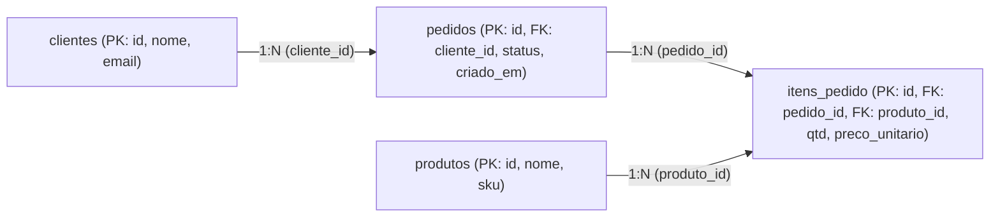
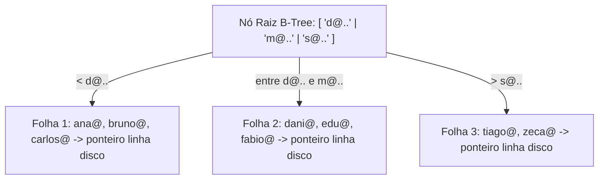

# 💾 Aula 05 — Bancos de Dados Relacionais & SQL

> *"Aprenda a estruturar e consultar dados de forma segura e veloz usando bancos relacionais e a linguagem SQL pura."*

---

## 1. 🚀 Briefing da Missão (Contexto Temático & Realidade de Mercado)

### Metadados do Setor
| Campo | Especificação |
| :--- | :--- |
| **Galáxia** | Galáxia 1: Nébula dos Fundamentos (`fundamentos`) |
| **ID do Módulo** | `sql-bd` |
| **Pré-requisitos** | [Aula 03 — Paradigmas de Programação](./03-paradigmas-de-programacao.md) (`paradigmas`) e [Aula 04 — APIs & Protocolo HTTP](./04-apis-protocolo-http.md) (`apis-web`) |
| **Próxima Órbita** | [Projeto de Consolidação da Galáxia 1](./projeto-consolidacao-01-fundamentos.md) e Galáxia 3 (`clean-solid`) |
| **Nível de Impacto** | Crítico — 90%+ das vagas backend e fullstack exigem SQL sólido além de ORMs |

### Analogia Espacial: O Navegador Cósmico e o Arquivo Central da Federação
Imagine que todas as naves da frota reportam missões, estoque de combustível e pagamentos de tripulantes para o Arquivo Central da Federação. Se você anotar tudo em uma única planilha gigante repetindo o nome, planeta natal e patente do piloto em cada uma das 50 milhões de linhas de voo, a planilha explode de tamanho, demora minutos para achar um piloto e, se o piloto for promovido, você terá que atualizar 10.000 linhas com risco de esquecer metade.

Em vez disso, um **Banco de Dados Relacional** organiza a informação em **tabelas especializadas ligadas por identificadores imutáveis** (Chaves Primárias e Estrangeiras), indexadas por catálogos em árvore (**B-Trees**) que acham qualquer registro entre milhões em milissegundos. E quando uma operação envolve duas etapas críticas — como debitar créditos de uma nave e creditar em outra — o banco protege a operação inteira dentro de uma **câmara blindada chamada Transação ACID**: ou tudo acontece com sucesso absoluto, ou tudo volta exatamente ao estado anterior sem deixar dinheiro perdido no espaço.

### Qual dor real este módulo resolve em uma empresa?
ORMs modernos (como Prisma, TypeORM, Hibernate ou SQLAlchemy) facilitam o início de um projeto, mas escondem armadilhas fatais quando o desenvolvedor não domina SQL puro:
1. **Problema de Queries `N+1` e lentidão extrema:** O dev busca 500 pedidos e faz um loop no JavaScript disparando mais 500 `SELECT` individuais em vez de escrever um único `JOIN`, derrubando o banco por excesso de conexões.
2. **Tabela sem índice virando Full Table Scan:** Uma busca por `email` ou `data_criacao` leva 2 milissegundos no dev com 20 usuários e leva 18 segundos em produção com 5 milhões de linhas porque ninguém criou um índice `B-Tree`.
3. **Dados corrompidos por falta de Constraints e Transações:** Sem `FOREIGN KEY`, `CHECK` e `BEGIN/COMMIT`, um erro de rede no meio de uma compra cria pedido sem estoque ou cobra o usuário duas vezes.

---

## 2. 📚 Carga de Conhecimento Completa (Tópico por Tópico)

### 2.1 O Modelo Relacional: Tabelas, Chaves Primárias e Chaves Estrangeiras
Proposto por Edgar F. Codd em 1970, o **Modelo Relacional** representa dados em **Relações (Tabelas)** bidimensionais compostas por:
- **Colunas (Atributos):** Definem o nome e o tipo rígido de cada dado (`INTEGER`, `TEXT`/`VARCHAR`, `NUMERIC`, `BOOLEAN`, `TIMESTAMP`), garantindo integridade de esquema (*Schema*).
- **Linhas (Tuplas / Registros):** Cada instância armazenada na tabela.

Os elos que amarram esse modelo com segurança são as chaves e restrições (*constraints*):
1. **Chave Primária (`PRIMARY KEY` — PK):** Coluna (ou conjunto de colunas) que identifica **unicamente** cada linha da tabela. Não pode se repetir (`UNIQUE`) e nunca pode ser nula (`NOT NULL`). Exemplos comuns: `id INTEGER PRIMARY KEY` (autoincremento ou `BIGSERIAL`) ou `UUID`.
2. **Chave Estrangeira (`FOREIGN KEY` — FK):** Coluna em uma tabela filha que aponta obrigatoriamente para a `PRIMARY KEY` de uma tabela pai. Ela garante **Integridade Referencial**: o banco proíbe criar um pedido para um `cliente_id = 999` se o cliente `999` não existir! Você também define o comportamento ao apagar o pai (`ON DELETE RESTRICT` para impedir, ou `ON DELETE CASCADE` para apagar os filhos juntos — use `CASCADE` com extrema cautela!).
3. **Cardinalidades:**
   - **1:1 (Um para Um):** Um `usuario` tem um único `perfil_fiscal` (FK única).
   - **1:N (Um para Muitos):** Um `cliente` realiza muitos `pedidos` (`pedidos.cliente_id` referencia `clientes.id`).
   - **N:N (Muitos para Muitos):** Um `pedido` contém vários `produtos`, e um `produto` aparece em vários `pedidos` — resolvido sempre com uma **tabela associativa intermediária** (`itens_pedido` contendo `pedido_id` e `produto_id`).



---

### 2.2 Consultas SQL com JOINs (`INNER`, `LEFT`, `RIGHT`, `FULL`)
Para recompor informações espalhadas em múltiplas tabelas normalizadas em uma única consulta eficiente, usamos a cláusula **`JOIN`** combinando a Chave Estrangeira de uma tabela com a Chave Primária da outra.

Considere duas tabelas: **A (`clientes`)** à esquerda e **B (`pedidos`)** à direita:

```text
INNER JOIN          LEFT JOIN           RIGHT JOIN          FULL OUTER JOIN
  (A ∩ B)          (Tudo de A)         (Tudo de B)          (A ∪ B completo)
  [   (X)   ]      [(XXX)     ]        [     (XXX)]         [(XXXXXXXXX)]
```

1. **`INNER JOIN`:** Retorna **apenas as linhas que têm correspondência nos dois lados**. Clientes que nunca fizeram nenhum pedido **não aparecem** no resultado.
2. **`LEFT JOIN` (`LEFT OUTER JOIN`):** Retorna **todas as linhas da tabela da esquerda (`clientes`)**, mais os dados correspondentes da direita (`pedidos`) quando existirem. Se um cliente nunca comprou nada, ele aparece normalmente com as colunas do pedido preenchidas como **`NULL`**. *(Dica de ouro: `LEFT JOIN ... WHERE pedidos.id IS NULL` é a forma clássica de achar clientes que nunca compraram!)*
3. **`RIGHT JOIN` (`RIGHT OUTER JOIN`):** Espelho inverso do `LEFT JOIN`: garante **todas as linhas da tabela da direita** mesmo sem par à esquerda. *(Na prática profissional, quase todo mundo prefere inverter a ordem das tabelas e usar sempre `LEFT JOIN` por clareza de leitura de cima para baixo).*
4. **`FULL OUTER JOIN`:** Retorna **todas as linhas de ambas as tabelas**, casando onde houver par e preenchendo `NULL` do lado faltante onde não houver. *(Suportado nativamente no PostgreSQL e SQLite 3.39+; no MySQL é emulado unindo um `LEFT JOIN` e um `RIGHT JOIN` com `UNION`).*

---

### 2.3 Funções de Agregação e Agrupamentos (`GROUP BY`, `HAVING`)
Quando você precisa transformar milhares de linhas individuais em métricas gerenciais (faturamento por mês, quantidade de pedidos por cliente, ticket médio), entram em cena as **Funções de Agregação**:
- **`COUNT(*)`** (conta linhas, incluindo `NULL`) vs. **`COUNT(coluna)`** (conta apenas valores não nulos) e **`COUNT(DISTINCT coluna)`** (valores únicos).
- **`SUM(coluna)`**, **`AVG(coluna)`**, **`MIN(coluna)`**, **`MAX(coluna)`**.

#### A Regra de Ouro: `WHERE` vs. `GROUP BY` vs. `HAVING`
Entender a ordem lógica em que o motor SQL executa uma consulta elimina 90% dos erros com agrupamentos:
1. **`FROM` / `JOIN`**: Carrega e cruza as tabelas.
2. **`WHERE`**: Filtra **linhas individuais ANTES** de formar os grupos (ex: `WHERE status = 'pago'`). Você **não pode** usar `SUM()` ou `COUNT()` dentro do `WHERE`!
3. **`GROUP BY`**: Agrupa as linhas filtradas por uma ou mais colunas (regra: toda coluna no `SELECT` que não está dentro de uma função de agregação deve estar no `GROUP BY`).
4. **`HAVING`**: Filtra **os grupos já formados DEPOIS da agregação** (ex: `HAVING SUM(total) > 1000` — "traga apenas os clientes que gastaram mais de 1.000 no total").
5. **`SELECT`** -> **`ORDER BY`** -> **`LIMIT`**.

---

### 2.4 Índices (`B-Tree`) para Otimizar a Velocidade de Busca
Sem um índice, quando você executa `SELECT * FROM usuarios WHERE email = 'ana@dev.com'`, o banco de dados é obrigado a fazer um **Full Table Scan (Sequential Scan)**: ler página por página do disco do início ao fim da tabela inteira — complexidade **`O(n)`**! Se a tabela tem 10 milhões de linhas, cada consulta lê gigabytes de dados.

Ao executar `CREATE INDEX idx_usuarios_email ON usuarios(email);`, o banco constrói uma estrutura separada em árvore balanceada multi-nível chamada **B-Tree (*Balanced Tree*)** — diferente de uma árvore binária simples, cada nó de uma B-Tree guarda dezenas ou centenas de chaves ordenadas e ponteiros para manter a profundidade baixíssima (geralmente apenas 3 ou 4 saltos em disco mesmo para **100 milhões de linhas**!), reduzindo a busca para **`O(log n)`** em poucos milissegundos.



#### Quando NÃO criar índices demais (O Trade-off)
Índices não são mágica gratuita! Toda vez que você faz `INSERT`, `UPDATE` ou `DELETE` em uma tabela, o banco precisa atualizar a tabela **e todas as B-Trees associadas a ela**, consumindo espaço em disco e tornando escritas mais lentas. Crie índices nas colunas usadas frequentemente em `WHERE`, `JOIN` (FKs — atenção: nem todo banco cria índice automático em FK!) e `ORDER BY`, e evite indexar colunas com baixíssima cardinalidade isolada (ex: booleano `ativo`) a menos que use índices parciais específicos. Use **`EXPLAIN` / `EXPLAIN QUERY PLAN`** antes e depois para comprovar se o índice está realmente sendo usado!

---

### 2.5 Propriedades ACID de Transações de Banco de Dados
Uma **Transação** é uma unidade lógica de trabalho composta por uma ou mais operações SQL (`BEGIN` ... `COMMIT` ou `ROLLBACK`). Para que sistemas financeiros, e-commerces e reservas funcionem sem corromper dados sob falhas e acessos simultâneos, bancos relacionais seguem o padrão **ACID**:

1. **Atomicidade (*Atomicity* — "Tudo ou Nada"):** Todas as operações dentro da transação têm sucesso juntas ou falham juntas. Se você debita R\$ 500 da conta A e falta energia antes de creditar na conta B, o banco desfaz (`ROLLBACK`) o débito automaticamente via *Write-Ahead Log* (WAL).
2. **Consistência (*Consistency* — "De Estado Válido para Estado Válido"):** Garante que uma transação só pode confirmar (`COMMIT`) se o estado resultante respeitar **todas** as regras e restrições declaradas no esquema do banco (`PRIMARY KEY`, `FOREIGN KEY`, `NOT NULL`, `UNIQUE`, `CHECK (saldo >= 0)`, triggers). Se qualquer regra for violada no meio do caminho, toda a transação é abortada mantendo o banco íntegro.
3. **Isolamento (*Isolation* — "Sem Interferência entre Transações Simultâneas"):** Garante que duas transações rodando ao mesmo tempo (ex: dois usuários comprando o último ingresso disponível) não vejam estados intermediários sujos uma da outra nem gerem sobrescrita fantasma, produzindo um efeito equivalente ao de uma execução serial controlada (com níveis configuráveis como *Read Committed*, *Repeatable Read* e *Serializable*).
4. **Durabilidade (*Durability* — "Gravado em Pedra"):** Uma vez que o banco respondeu sucesso ao `COMMIT`, os dados sobrevivem a quedas de energia, reinicializações ou travamentos de processo, pois já foram persistidos em armazenamento não volátil (disco/WAL).

---

### 2.6 Modelagem e Normalização (`1NF`, `2NF`, `3NF`)
**Normalização** é um conjunto progressivo de regras formais para organizar tabelas eliminando redundância desnecessária e prevenindo três anomalias clássicas (anomalia de inserção, atualização e exclusão):

1. **1ª Forma Normal (`1NF`) — Atomicidade e Sem Grupos Repetidos:**
   - Cada célula deve conter um único valor **atômico** (indivisível) e cada linha deve ser unicamente identificada por uma PK.
   - *Violação comum:* Uma coluna `telefones` contendo `"1199999-0000, 1198888-1111"` separados por vírgula, ou colunas `item1`, `item2`, `item3`.
   - *Correção:* Crie uma tabela filha `cliente_telefones` com 1 linha por telefone.
2. **2ª Forma Normal (`2NF`) — Estar na `1NF` + Sem Dependência Parcial da Chave:**
   - Aplica-se principalmente a tabelas com **Chave Primária Composta** `(pedido_id, produto_id)`. Toda coluna não-chave deve depender da **chave inteira**, nunca de apenas metade dela!
   - *Violação comum:* Colocar `nome_produto` dentro da tabela `itens_pedido(pedido_id, produto_id, quantidade, nome_produto)`. `nome_produto` depende apenas de `produto_id`, não do pedido! Se mudar o nome do produto, gera inconsistência em milhares de linhas.
   - *Correção:* Mova `nome_produto` para a tabela `produtos`, deixando na `itens_pedido` apenas o que pertence ao par `(pedido, produto)`, como `quantidade` e `preco_unitario_na_compra` (este sim histórico do pedido!).
3. **3ª Forma Normal (`3NF`) — Estar na `2NF` + Sem Dependência Transitiva:**
   - Nenhuma coluna não-chave pode depender de **outra coluna não-chave** (toda coluna deve depender *"da chave, de toda a chave e nada além da chave"*).
   - *Violação comum:* Na tabela `pedidos(id, cliente_id, cep_entrega, cidade_entrega, estado_entrega)` ou `funcionarios(id, departamento_id, nome_departamento)`. `nome_departamento` depende de `departamento_id` (não-chave), que por sua vez depende de `id`.
   - *Correção:* Extraia `departamentos(id, nome)` e mantenha apenas a FK `departamento_id` em `funcionarios`.

---

## 3. 💻 Mão no Código (Jeito Iniciante vs. Padrão Profissional)

Vamos ver um exemplo completo com **SQL puro (compatível com SQLite e PostgreSQL)** e **JavaScript/Node.js** demonstrando modelagem normalizada, índice B-Tree, `JOIN` + `GROUP BY` + `HAVING`, proteção contra SQL Injection e Transação ACID.

#### ❌ Jeito Iniciante (Tabela desnormalizada, SQL Injection e sem transação ACID)
```sql
-- ANTIPADRÃO 1: Tudo jogado numa tabela só (viola 1NF, 2NF e 3NF)
CREATE TABLE pedidos_tudo (
  id INTEGER,
  cliente_nome TEXT,
  cliente_email TEXT, -- Repetido e desatualizado em cada novo pedido!
  produtos TEXT,      -- Viola 1NF: "Mouse, Teclado" numa string só!
  total REAL          -- Float impreciso para dinheiro!
);
```

```javascript
// ANTIPADRÃO 2: Concatenar string SQL (BRECHA CRÍTICA DE SQL INJECTION!) e sem transação
async function buscarEAtualizarInseguro(db, emailUsuario, valorCompra) {
  // Se emailUsuario for: "' OR '1'='1", o atacante vaza a tabela inteira!
  const sqlPerigoso = `SELECT * FROM usuarios WHERE email = '${emailUsuario}'`;
  const user = db.exec(sqlPerigoso);

  // Sem transação: se o segundo comando falhar, o estoque cai mas o pedido não existe!
  db.exec(`UPDATE produtos SET estoque = estoque - 1 WHERE id = 10`);
  db.exec(`INSERT INTO pedidos (usuario_id, total) VALUES (${user.id}, ${valorCompra})`);
}
```

#### ✅ Padrão Profissional (Schema 3NF, Índice B-Tree, Consulta Analítica e Transação ACID Parametrizada)
```sql
-- =========================================================================
-- 1. SCHEMA NORMALIZADO (3NF) COM INTEGRIDADE REFERENCIAL E CONSTRAINTS
-- =========================================================================
PRAGMA foreign_keys = ON; -- Obrigatório habilitar FKs por conexão no SQLite

CREATE TABLE clientes (
  id INTEGER PRIMARY KEY AUTOINCREMENT,
  nome TEXT NOT NULL,
  email TEXT NOT NULL UNIQUE,
  criado_em TEXT NOT NULL DEFAULT (datetime('now'))
);

CREATE TABLE produtos (
  id INTEGER PRIMARY KEY AUTOINCREMENT,
  nome TEXT NOT NULL,
  preco_centavos INTEGER NOT NULL CHECK (preco_centavos >= 0),
  estoque INTEGER NOT NULL CHECK (estoque >= 0) -- Regra de Consistência ACID!
);

CREATE TABLE pedidos (
  id INTEGER PRIMARY KEY AUTOINCREMENT,
  cliente_id INTEGER NOT NULL,
  status TEXT NOT NULL CHECK (status IN ('pendente', 'pago', 'cancelado')),
  criado_em TEXT NOT NULL DEFAULT (datetime('now')),
  FOREIGN KEY (cliente_id) REFERENCES clientes(id) ON DELETE RESTRICT
);

CREATE TABLE itens_pedido (
  id INTEGER PRIMARY KEY AUTOINCREMENT,
  pedido_id INTEGER NOT NULL,
  produto_id INTEGER NOT NULL,
  quantidade INTEGER NOT NULL CHECK (quantidade > 0),
  preco_unitario_centavos INTEGER NOT NULL CHECK (preco_unitario_centavos >= 0),
  FOREIGN KEY (pedido_id) REFERENCES pedidos(id) ON DELETE CASCADE,
  FOREIGN KEY (produto_id) REFERENCES produtos(id) ON DELETE RESTRICT
);

-- =========================================================================
-- 2. ÍNDICES B-TREE PARA ACELERAR JOINS E FILTROS FREQUENTES
-- =========================================================================
CREATE INDEX idx_pedidos_cliente_status ON pedidos(cliente_id, status);
CREATE INDEX idx_itens_pedido_id ON itens_pedido(pedido_id);

-- =========================================================================
-- 3. CONSULTA ANALÍTICA COM JOIN + WHERE + GROUP BY + HAVING
-- Objetivo: Listar clientes com mais de 1 pedido PAGO e total gasto > R$ 500,00 (50000 centavos)
-- =========================================================================
SELECT
  c.id AS cliente_id,
  c.nome,
  COUNT(DISTINCT p.id) AS total_pedidos_pagos,
  COALESCE(SUM(ip.quantidade * ip.preco_unitario_centavos), 0) AS receita_centavos
FROM clientes c
INNER JOIN pedidos p ON p.cliente_id = c.id
INNER JOIN itens_pedido ip ON ip.pedido_id = p.id
WHERE p.status = 'pago'
GROUP BY c.id, c.nome
HAVING COUNT(DISTINCT p.id) > 1
   AND SUM(ip.quantidade * ip.preco_unitario_centavos) > 50000
ORDER BY receita_centavos DESC;
```

```javascript
/**
 * PADRÃO PROFISSIONAL EM NODE.JS:
 * - Queries 100% parametrizadas (placeholders ?) bloqueiam SQL Injection.
 * - Transação ACID explícita (BEGIN / COMMIT / ROLLBACK) garante Tudo ou Nada.
 */
function fecharPedidoAtomico(db, { clienteId, produtoId, quantidade }) {
  const iniciar = db.prepare("BEGIN IMMEDIATE");
  const confirmar = db.prepare("COMMIT");
  const desfazer = db.prepare("ROLLBACK");

  iniciar.run();
  try {
    // 1. Consulta o produto de forma segura (zero concatenação!)
    const produto = db
      .prepare("SELECT id, preco_centavos, estoque FROM produtos WHERE id = ?")
      .get(produtoId);

    if (!produto) {
      throw new Error(`Produto ${produtoId} não encontrado.`);
    }

    // 2. Baixa estoque atômica protegida por condição no próprio WHERE + CHECK constraint
    const baixa = db
      .prepare("UPDATE produtos SET estoque = estoque - ? WHERE id = ? AND estoque >= ?")
      .run(quantidade, produtoId, quantidade);

    if (baixa.changes === 0) {
      throw new Error("Estoque insuficiente para concluir o pedido.");
    }

    // 3. Cria o cabeçalho do pedido
    const pedidoInfo = db
      .prepare("INSERT INTO pedidos (cliente_id, status) VALUES (?, 'pago')")
      .run(clienteId);

    // 4. Registra o item congelando o preço histórico da compra
    db.prepare(
      `INSERT INTO itens_pedido (pedido_id, produto_id, quantidade, preco_unitario_centavos)
       VALUES (?, ?, ?, ?)`
    ).run(pedidoInfo.lastInsertRowid, produtoId, quantidade, produto.preco_centavos);

    confirmar.run(); // Só grava tudo permanentemente (Durabilidade) se todas as 4 etapas passarem
    return { pedidoId: pedidoInfo.lastInsertRowid };
  } catch (erro) {
    desfazer.run(); // Atomicidade: desfaz qualquer alteração parcial em caso de falha!
    throw erro;
  }
}
```

---

## 4. 🛠️ Laboratório de Voo (Exercício Prático Guiado)

**Tempo estimado:** 50 minutos
**Objetivo:** Criar um banco SQLite real via CLI (`sqlite3`), executar consultas com `LEFT JOIN` para achar registros órfãos, validar um plano de execução com `EXPLAIN QUERY PLAN` antes e depois de criar um índice B-Tree, e testar na prática um `ROLLBACK` ACID.

### Passo a Passo Reproduzível

1. **Crie o banco e carregue o schema 3NF da Seção 3**:
   ```bash
   sqlite3 laboratorio_cosmico.db
   ```
   Dentro do prompt do `sqlite3`, habilite `PRAGMA foreign_keys = ON;` e cole os 4 `CREATE TABLE` da Seção 3.
2. **Popule dados de teste**:
   - Insira **3 clientes** (`Ana`, `Bruno`, `Carla`).
   - Insira **2 produtos** (`Placa Solar`, `Sensor Orbital`).
   - Crie pedidos pagos para `Ana` (2 pedidos) e `Bruno` (1 pedido), mas **nenhum pedido para `Carla`**.
3. **Teste `INNER JOIN` vs. `LEFT JOIN` para encontrar quem nunca comprou**:
   ```sql
   SELECT c.id, c.nome
   FROM clientes c
   LEFT JOIN pedidos p ON p.cliente_id = c.id
   WHERE p.id IS NULL;
   ```
   Confirme que o resultado retorna exclusivamente `Carla`.
4. **Teste a Consistência ACID provocando uma violação de `CHECK`**:
   ```sql
   BEGIN TRANSACTION;
   INSERT INTO clientes (nome, email) VALUES ('Diego', 'diego@dev.com');
   -- Tente reduzir o estoque de um produto para negativo (-5):
   UPDATE produtos SET estoque = -5 WHERE id = 1;
   -- O SQLite rejeita com CHECK constraint failed!
   ROLLBACK;
   SELECT * FROM clientes WHERE email = 'diego@dev.com';
   ```
   Verifique que `Diego` **não** foi salvo após o `ROLLBACK`.
5. **Compare o plano de busca antes e depois do índice B-Tree**:
   - Crie uma tabela `logs_teste(id INTEGER PRIMARY KEY, codigo TEXT)` sem índice em `codigo` e execute:
     ```sql
     EXPLAIN QUERY PLAN SELECT * FROM logs_teste WHERE codigo = 'ERR-500';
     ```
     Observe a mensagem `SCAN logs_teste` (Full Table Scan `O(n)`).
   - Agora crie `CREATE INDEX idx_logs_codigo ON logs_teste(codigo);` e rode o mesmo `EXPLAIN QUERY PLAN`. Observe a mudança para `SEARCH logs_teste USING COVERING INDEX idx_logs_codigo` (`O(log n)` via B-Tree)!

### Critérios de Domínio
- [ ] Você retornou com sucesso os clientes sem pedidos usando `LEFT JOIN ... WHERE p.id IS NULL`.
- [ ] Você comprovou no terminal o uso de `EXPLAIN QUERY PLAN` mudando de `SCAN` para `SEARCH ... USING ... INDEX`.
- [ ] Você executou uma consulta com `GROUP BY` e `HAVING` filtrando grupos agregados sem erros de sintaxe.

---

## 5. 🎯 Resolução Comentada do Teste de Ignição (Quest Oficial)

> **Pergunta Oficial (`sql-bd`):**
> *Qual das seguintes alternativas descreve corretamente a propriedade de 'Consistência' no padrão ACID?*

- **A)** *"Garante que o banco de dados permaneça ativo mesmo se houver falhas de hardware."*
- **B)** *"Garante que uma transação leve o banco de dados de um estado válido para outro estado válido, respeitando todas as restrições declaradas."*
- **C)** *"Garante que o resultado de uma transação concluída seja persistido permanentemente no disco físico."*
- **D)** *"Garante que transações paralelas executem como se estivessem ocorrendo de forma sequencial."*

### ✅ Resposta Correta: **Alternativa B**

**Por que a Alternativa B está correta:**
No acrônimo **ACID**, o **C de Consistência (*Consistency*)** assegura que nenhuma transação pode deixar o banco de dados em um estado que viole suas invariantes e regras declaradas — tais como tipos de dados, `NOT NULL`, `UNIQUE`, chaves primárias, chaves estrangeiras, restrições `CHECK` e triggers. Se uma transação tentar violar qualquer regra no meio do caminho, ela falha e o estado anterior válido é mantido.

**Por que as outras 3 alternativas estão erradas:**
- **Alternativa A (Incorreta):** Manter um sistema ativo diante de falhas de hardware refere-se a **Alta Disponibilidade (*High Availability*) e Tolerância a Falhas** (replicação, failover), não à propriedade de Consistência de transações ACID.
- **Alternativa C (Incorreta):** Essa alternativa descreve exatamente o **D de Durabilidade (*Durability*)** — garantir que, após o `COMMIT`, os dados sobrevivam no armazenamento persistente mesmo após quedas de energia ou reinicializações.
- **Alternativa D (Incorreta):** Essa alternativa descreve o **I de Isolamento (*Isolation*)** — controlar a concorrência entre transações simultâneas para que não corrompam dados uma da outra (no nível mais rígido, chamado *Serializability*, equivale à execução sequencial).

---

## 6. 🎤 Kit de Apresentação (Como Dar Aula / Apresentar Este Módulo)

### Pitch Feynman de 2 Minutos (Texto Pronto para Falar)
> "Muita gente guarda dados achando que banco de dados é só um Excel gigante na nuvem. Mas se você colocar cliente, produto e entrega tudo na mesma tabela, quando o cliente muda de e-mail você quebra o sistema todo — e quando a tabela passa de um milhão de linhas, o site congela.
>
> Um banco relacional resolve isso com três ideias brilhantes. Primeiro, **Normalização e Chaves**: cada assunto ganha sua própria tabela limpa, conectada por IDs invioláveis (`PRIMARY KEY` e `FOREIGN KEY`), e a gente costura esses dados na hora da leitura usando **`JOIN`** (`INNER` para o que existe nos dois lados, `LEFT` para trazer todo mundo mesmo quem não tem par ainda).
>
> Segundo, **Índices em B-Tree**: procurar um dado sem índice obriga o banco a ler a tabela inteira linha por linha, igual ler um livro inteiro procurando uma palavra. Um índice cria o índice remissivo no começo do livro usando uma árvore balanceada baixinha — em 3 ou 4 pulos ele acha qualquer registro entre 100 milhões!
>
> Terceiro, **Transações ACID**: quando você faz um Pix, não pode sair dinheiro de um lado e sumir antes de entrar no outro. Envolver as duas operações em uma transação garante Atomicidade (tudo ou nada), Consistência (nunca viola regras como saldo negativo), Isolamento (duas pessoas não compram o mesmo último item) e Durabilidade (confirmou, está gravado em pedra)."

### Roteiro de Slides (6 Slides)
1. **Slide 1 — Título:** *"Bancos Relacionais & SQL Sem Mistério: Da Modelagem 3NF à Performance"* | Visual: Cofre bancário conectado a tabelas estruturadas por chaves douradas.
2. **Slide 2 — Modelagem 1NF, 2NF, 3NF e Chaves (PK/FK):** Transformando uma planilha caótica em um esquema relacional limpo | Visual: Antes (1 tabela gigante repetida) vs. Depois (3 tabelas ligadas por setas 1:N).
3. **Slide 3 — Dominando JOINs (`INNER`, `LEFT`, `RIGHT`, `FULL`):** Quando usar cada um (e o truque do `LEFT JOIN ... WHERE IS NULL`) | Visual: 4 diagramas de Venn coloridos com exemplo concreto de resultado ao lado.
4. **Slide 4 — Agregações (`GROUP BY` e `HAVING`):** A ordem secreta de execução do SQL (`FROM -> WHERE -> GROUP BY -> HAVING -> SELECT -> ORDER BY`) | Visual: Funil mostrando linhas entrando embaixo do `WHERE` e grupos saindo do `HAVING`.
5. **Slide 5 — Por baixo do capô dos Índices B-Tree:** Full Table Scan `O(n)` vs. B-Tree Index Scan `O(log n)` + custo nas escritas | Visual: Árvore B-Tree de 3 níveis apontando diretamente para blocos do disco.
6. **Slide 6 — Blindagem com ACID:** O caso clássico da transferência bancária ou baixa de estoque com `BEGIN / COMMIT / ROLLBACK` | Visual: Quadrante explicando cada letra de **A-C-I-D** com exemplos reais de falha evitada.

### Roteiro de Demo Ao Vivo (3 Minutos)
1. **Minuto 1:** No terminal com `sqlite3`, execute `EXPLAIN QUERY PLAN` antes de criar um índice (`SCAN`) e logo após rodar `CREATE INDEX` (`SEARCH USING INDEX`), mostrando a transformação na hora.
2. **Minuto 2:** Execute ao vivo a consulta com `LEFT JOIN` para encontrar clientes sem pedidos e depois a consulta com `GROUP BY` + `HAVING` mostrando o ranking de faturamento.
3. **Minuto 3:** Simule um `BEGIN; INSERT ...; UPDATE produtos SET estoque = -1;` provocando o erro de `CHECK constraint` e rode `ROLLBACK;` mostrando que o `INSERT` anterior desapareceu como mágica protegendo a consistência.

### Perguntas Difíceis da Plateia (Respostas Seguras)
- **Pergunta 1:** *"Se índices deixam as buscas tão mais rápidas, por que não colocamos um índice em absolutamente todas as colunas da tabela?"*
  - **Resposta:** "Porque cada índice é uma estrutura B-Tree adicional armazenada em disco e memória que precisa ser **atualizada e rebalanceada em todo `INSERT`, `UPDATE` e `DELETE`** naquela coluna. Uma tabela com 15 índices desnecessários torna gravações lentíssimas e consome espaço extra de armazenamento e cache RAM."
- **Pergunta 2:** *"Qual a diferença prática entre filtrar com `WHERE` e filtrar com `HAVING` se os dois usam condições?"*
  - **Resposta:** "O momento da execução! O `WHERE` filtra **linha por linha** antes dos dados serem agrupados — por isso é muito mais rápido reduzir o volume cedo e não aceita funções de agregação como `SUM()` ou `COUNT()`. Já o `HAVING` é avaliado **depois do `GROUP BY`**, servindo especificamente para filtrar os grupos resultantes com base em agregações (ex: `HAVING COUNT(*) >= 5`)."

---

## 7. 💼 Radar do Mercado de Trabalho (Foco Dev Júnior)

### 3 Perguntas Reais de Entrevista Técnica Júnior
1. **Pergunta:** *"Explique a diferença entre `INNER JOIN` e `LEFT JOIN` com um exemplo prático."*
   - **Resposta-modelo:** "O `INNER JOIN` retorna somente os registros que possuem correspondência em ambas as tabelas ligadas pela condição do `ON`. Já o `LEFT JOIN` garante que **todos** os registros da tabela à esquerda apareçam no resultado, trazendo os dados da tabela à direita quando houver correspondência ou preenchendo com `NULL` quando não houver. Um exemplo prático: se eu quiser listar apenas clientes que já compraram, uso `INNER JOIN`; se eu quiser listar todos os clientes cadastrados e a quantidade de pedidos de cada um (incluindo quem tem zero pedidos), preciso de `LEFT JOIN`."
2. **Pergunta:** *"O que é SQL Injection e como você impede isso na sua aplicação?"*
   - **Resposta-modelo:** "SQL Injection é uma vulnerabilidade grave em que dados enviados pelo usuário são concatenados diretamente dentro de uma string SQL, permitindo que um atacante altere a lógica do comando para vazar dados, burlar login ou apagar tabelas (`DROP TABLE`). A defesa definitiva é **nunca concatenar variáveis de usuário na query** — usamos sempre **Queries Parametrizadas / Prepared Statements** (com placeholders como `?` ou `$1`), onde o driver do banco envia o código SQL e os parâmetros separados, impedindo que a entrada do usuário seja interpretada como comando." *(Nota: em APIs reais, também validamos e sanitizamos tipos na entrada).*
3. **Pergunta:** *"Quando uma tabela está na Terceira Forma Normal (3NF)?"*
   - **Resposta-modelo:** "Quando ela já atende à 1NF (valores atômicos sem grupos repetidos), atende à 2NF (todas as colunas não-chave dependem da chave primária inteira, sem dependência parcial em chaves compostas) e elimina dependências transitivas: nenhuma coluna não-chave depende de outra coluna não-chave. Por exemplo, em vez de guardar `cidade` e `estado` diretamente na tabela de `clientes` ligados apenas ao `cep`, ou `nome_departamento` dentro de `funcionarios`, extraímos para uma tabela própria referenciada por chave estrangeira."

### Erros Clássicos de Júnior vs. Postura Profissional
- ❌ **Comportamento de Júnior:** Usar `SELECT *` em queries de produção e trazer todas as colunas (inclusive textos gigantes ou hashes de senha) sem necessidade.
  - ✅ **Postura Profissional:** Selecionar explicitamente apenas as colunas necessárias (`SELECT id, nome, email`), reduzindo tráfego de rede e habilitando *Covering Indexes* no banco.
- ❌ **Comportamento de Júnior:** Guardar valores monetários (`R\$ 19,99`) em colunas `FLOAT` ou `REAL`, sofrendo com erros binários de arredondamento (`0.1 + 0.2 = 0.30000000000000004`).
  - ✅ **Postura Profissional:** Armazenar valores financeiros como **inteiros em centavos** (`INTEGER` / `BIGINT`) ou usar tipo decimal de precisão exata (`NUMERIC(12, 2)` / `DECIMAL(12, 2)`).

### Evidência para Portfólio / GitHub / LinkedIn
- **No GitHub:** Inclua em todos os seus projetos backend um arquivo `schema.sql` documentado com chaves estrangeiras, restrições `CHECK`, índices justificados por comentários e um arquivo `queries.sql` com consultas analíticas usando `JOIN`, `GROUP BY` e `HAVING`.
- **No LinkedIn:** Publique um resumo visual explicando *"O erro do problema N+1 vs. um único SQL com JOIN"* ou *"Como testei um índice B-Tree com EXPLAIN QUERY PLAN na prática"*.

---

## 8. 📡 Transmissões Recomendadas & Próxima Órbita

### Materiais Oficiais de Aprofundamento (`data.js`)
- 🧪 **[SQLBolt (Aprenda SQL com exercícios práticos)](https://sqlbolt.com/)** — Melhor curso interativo direto no navegador para praticar `SELECT`, `JOIN`, `GROUP BY`, `HAVING` e manipulação de tabelas do zero.
- ⚡ **[Use The Index, Luke (Guia de Índices)](https://use-the-index-luke.com/)** — Bíblia gratuita para entender exatamente como B-Trees funcionam por dentro e por que consultas ficam lentas ou rápidas.

### Próxima Órbita Desbloqueada
Parabéns, Navegador Cósmico! Você concluiu todos os 5 módulos teóricos da **Galáxia 1: Nébula dos Fundamentos**. Agora chegou a hora da prova prática definitiva que conecta Git, Estruturas de Dados, Algoritmos manuais, API HTTP e SQLite puro em um projeto real de portfólio, abrindo caminho em seguida para a **Galáxia 3: Cinturão de Arquitetura (`clean-solid`)**:

➡️ **[Projeto de Consolidação 01 — Nébula dos Fundamentos](./projeto-consolidacao-01-fundamentos.md)**
