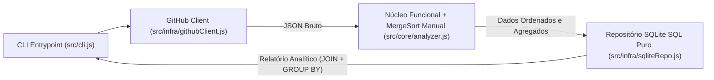

# 🎖️ Projeto de Consolidação 01 — Nébula dos Fundamentos

> **Objetivo:** Unificar Git avançado, Estruturas de Dados & Ordenação manual, Paradigmas (Composição + Funções Puras), Consumo HTTP/REST e Banco de Dados Relacional SQLite em uma única ferramenta CLI profissional digna de portfólio.

---

## 1. 🎖️ Missão Oficial & Objetivo de Portfólio

### Texto Oficial do Desafio (`consolidationProjects["sql-bd"]`)
> **Projeto de Consolidação: Nébula dos Fundamentos**
>
> *"Crie um aplicativo de linha de comando (CLI) que consuma uma API pública (ex: GitHub API), manipule os dados coletados na memória usando algoritmos de ordenação manuais e salve um relatório estruturado em um banco de dados SQLite local, utilizando consultas SQL puras."*

### O Produto que Vamos Construir: `gh-radar` (Radar Cósmico de Repositórios GitHub)
Em vez de um script descartável de 30 linhas, você vai construir uma **CLI profissional em Node.js** chamada **`gh-radar`** que:
1. Recebe via linha de comando o usuário ou organização do GitHub e critérios de ordenação (ex: `node src/cli.js facebook --sort stars --top 10`).
2. Consome a **API REST pública do GitHub** respeitando cabeçalhos HTTP oficiais, timeout de rede, tratamento explícito de status codes (`403`/`429` Rate Limit, `404` usuário inexistente) e autenticação opcional via token em `.env`.
3. Processa os repositórios usando um **Núcleo Funcional Puro** e um algoritmo de ordenação **implementado manualmente** (`mergeSort` ou `quickSort` com função comparadora genérica, sem usar `Array.prototype.sort()`), além de agregação por linguagem usando `Map` em `O(n)`.
4. Persiste o histórico de coletas em um **banco SQLite local normalizado (3NF)** com **transação ACID (`BEGIN` / `COMMIT` / `ROLLBACK`)**, índices `B-Tree` e consultas **SQL puras** com `JOIN`, `GROUP BY` e `HAVING`.
5. Exibe um relatório estruturado no terminal (e exporta opcionalmente em JSON/Markdown) combinando dados recém-coletados e histórico acumulado no banco.

### Por que este projeto chama atenção de recrutadores?
A maioria dos projetos de iniciantes apenas importa um ORM e chama `.sort()` nativo. Ao mostrar que você sabe **consumir HTTP tratando falhas reais, escrever MergeSort/QuickSort testado do zero, isolar lógica pura e modelar SQLite em 3NF com transações ACID**, você comprova domínio sólido dos fundamentos que sustentam qualquer stack.

---

## 2. 🏗️ Arquitetura da Solução

Adotamos o princípio **Functional Core, Imperative Shell** combinado com separação clara de responsabilidades:



### Árvore de Diretórios Recomendada
```text
gh-radar/
├── .env.example              # Modelo de variáveis de ambiente (GITHUB_TOKEN, DB_PATH)
├── .gitignore                # Ignora node_modules/, .env, *.db, *.db-journal
├── package.json              # Scripts (start, test, lint) e dependência better-sqlite3
├── README.md                 # Documentação completa com exemplos e arquitetura
├── sql/
│   ├── schema.sql            # DDL normalizado (3NF), chaves FK, CHECKs e índices B-Tree
│   └── queries.sql           # Consultas analíticas puras (JOIN, GROUP BY, HAVING)
├── src/
│   ├── cli.js                # Parse de argumentos da linha de comando e orquestração
│   ├── core/
│   │   ├── mergeSort.js      # Implementação manual estável O(n log n) com comparador
│   │   └── analyzer.js       # Funções puras de normalização e agregação com Map O(n)
│   └── infra/
│       ├── githubClient.js   # Cliente HTTP com fetch, headers REST, timeout e Rate Limit
│       └── sqliteRepo.js     # Persistência SQLite com queries parametrizadas e ACID
└── tests/
    ├── mergeSort.test.js     # Testes unitários nativos com node:test e node:assert
    └── analyzer.test.js      # Testes do núcleo funcional puro sem mocks de rede/banco
```

---

## 3. 🛠️ Roteiro de Construção em 5 Etapas

### Etapa 1 — Setup Git Profissional & Estrutura do Projeto (Aula 01)
Inicialize o repositório seguindo o padrão de commits semânticos desde o primeiro arquivo:

```bash
mkdir gh-radar && cd gh-radar
git init -b main
npm init -y
npm install better-sqlite3
```

Configure o `.gitignore` antes do primeiro commit para jamais vazar segredos ou arquivos binários de banco:
```text
node_modules/
.env
data/*.db
data/*.db-shm
data/*.db-wal
```

Crie as pastas e trabalhe por **feature branches** curtas (ex: `feat/github-http-client`, `feat/manual-mergesort`, `feat/sqlite-persistence`) fazendo commits atômicos com Conventional Commits (`feat:`, `test:`, `docs:`).

---

### Etapa 2 — Cliente HTTP Resiliente para a GitHub API (Aula 04)
Em `src/infra/githubClient.js`, implemente o consumo HTTP respeitando cabeçalhos exigidos pela API do GitHub (`User-Agent` e `Accept`), limite de tempo com `AbortSignal.timeout()` e interpretação semântica de Status Codes:

```javascript
// src/infra/githubClient.js
export async function fetchUserRepositories(username, { token, perPage = 100 } = {}) {
  const safeUser = encodeURIComponent(username.trim());
  const url = `https://api.github.com/users/${safeUser}/repos?per_page=${perPage}&type=owner`;

  const headers = {
    Accept: "application/vnd.github+json",
    "User-Agent": "gh-radar-cli/1.0",
    "X-GitHub-Api-Version": "2022-11-28",
  };

  if (token) {
    headers.Authorization = `Bearer ${token}`;
  }

  const response = await fetch(url, {
    method: "GET",
    headers,
    signal: AbortSignal.timeout(8000), // Evita travamento infinito se a rede cair
  });

  if (response.status === 404) {
    throw new Error(`Usuário ou organização '${username}' não encontrado no GitHub (404).`);
  }

  if (response.status === 403 || response.status === 429) {
    const resetUnix = Number(response.headers.get("x-ratelimit-reset") || 0);
    const resetIso = resetUnix ? new Date(resetUnix * 1000).toISOString() : "em breve";
    throw new Error(`Rate Limit da API do GitHub atingido (${response.status}). Tente novamente após ${resetIso}.`);
  }

  if (!response.ok) {
    throw new Error(`Falha HTTP inesperada ao consultar GitHub: ${response.status} ${response.statusText}`);
  }

  const remaining = response.headers.get("x-ratelimit-remaining");
  const repos = await response.json();

  return { repos, rateLimitRemaining: remaining };
}
```

---

### Etapa 3 — Ordenação Manual (`MergeSort`) & Núcleo Funcional Puro (Aulas 02 e 03)
Implemente `src/core/mergeSort.js` com complexidade garantida **`O(n log n)`** no pior caso, preservando **imutabilidade** (não modifica o array de entrada) e **estabilidade** (mantém a ordem em empates), aceitando qualquer função comparadora `(a, b) => number`:

```javascript
// src/core/mergeSort.js
/**
 * Ordena um novo array usando MergeSort sem mutar o array original.
 * Tempo: O(n log n) em todos os casos | Espaço auxiliar: O(n) | Estável: Sim.
 */
export function mergeSort(items, compareFn) {
  if (!Array.isArray(items)) {
    throw new TypeError("mergeSort espera um array como entrada.");
  }
  if (typeof compareFn !== "function") {
    throw new TypeError("mergeSort espera uma função comparadora.");
  }
  if (items.length <= 1) {
    return items.slice(); // Retorna cópia rasa mantendo imutabilidade
  }

  const mid = Math.floor(items.length / 2);
  const left = mergeSort(items.slice(0, mid), compareFn);
  const right = mergeSort(items.slice(mid), compareFn);

  return merge(left, right, compareFn);
}

function merge(left, right, compareFn) {
  const sorted = [];
  let i = 0;
  let j = 0;

  while (i < left.length && j < right.length) {
    // <= 0 preserva a estabilidade da ordenação em caso de empate
    if (compareFn(left[i], right[j]) <= 0) {
      sorted.push(left[i]);
      i += 1;
    } else {
      sorted.push(right[j]);
      j += 1;
    }
  }

  return sorted.concat(left.slice(i)).concat(right.slice(j));
}
```

Em `src/core/analyzer.js`, escreva funções **100% puras** para transformar o JSON bruto do GitHub, ordenar pelo critério escolhido e agregar estatísticas por linguagem usando `Map` em tempo **`O(n)`**:

```javascript
// src/core/analyzer.js
import { mergeSort } from "./mergeSort.js";

const COMPARATORS = {
  stars: (a, b) => b.stars - a.stars,
  forks: (a, b) => b.forks - a.forks,
  updated: (a, b) => b.updatedAt.localeCompare(a.updatedAt),
};

export function sanitizeRepositories(rawRepos) {
  return rawRepos.map((repo) => ({
    githubId: repo.id,
    name: repo.name,
    language: repo.language || "Não especificada",
    stars: repo.stargazers_count || 0,
    forks: repo.forks_count || 0,
    openIssues: repo.open_issues_count || 0,
    updatedAt: repo.pushed_at || repo.updated_at,
  }));
}

export function rankRepositories(repos, sortBy = "stars", topLimit = 10) {
  const compareFn = COMPARATORS[sortBy] || COMPARATORS.stars;
  const sorted = mergeSort(repos, compareFn);
  return sorted.slice(0, topLimit);
}

export function summarizeByLanguage(repos) {
  const acc = new Map();

  for (const repo of repos) {
    const current = acc.get(repo.language) || { language: repo.language, repoCount: 0, totalStars: 0 };
    acc.set(repo.language, {
      language: repo.language,
      repoCount: current.repoCount + 1,
      totalStars: current.totalStars + repo.stars,
    });
  }

  return mergeSort(Array.from(acc.values()), (a, b) => b.totalStars - a.totalStars);
}
```

---

### Etapa 4 — Banco SQLite Normalizado (3NF) & Queries SQL Puras (Aula 05)
Crie `sql/schema.sql` aplicando chaves primárias, estrangeiras, restrições de integridade e índices `B-Tree`:

```sql
-- sql/schema.sql
PRAGMA foreign_keys = ON;

CREATE TABLE IF NOT EXISTS perfis (
  id INTEGER PRIMARY KEY AUTOINCREMENT,
  username TEXT NOT NULL UNIQUE
);

CREATE TABLE IF NOT EXISTS coletas (
  id INTEGER PRIMARY KEY AUTOINCREMENT,
  perfil_id INTEGER NOT NULL,
  criterio_ordenacao TEXT NOT NULL CHECK (criterio_ordenacao IN ('stars', 'forks', 'updated')),
  coletado_em TEXT NOT NULL DEFAULT (datetime('now')),
  FOREIGN KEY (perfil_id) REFERENCES perfis(id) ON DELETE CASCADE
);

CREATE TABLE IF NOT EXISTS repositorios_coletados (
  id INTEGER PRIMARY KEY AUTOINCREMENT,
  coleta_id INTEGER NOT NULL,
  github_repo_id INTEGER NOT NULL,
  nome TEXT NOT NULL,
  linguagem TEXT NOT NULL,
  estrelas INTEGER NOT NULL CHECK (estrelas >= 0),
  forks INTEGER NOT NULL CHECK (forks >= 0),
  atualizado_em TEXT NOT NULL,
  FOREIGN KEY (coleta_id) REFERENCES coletas(id) ON DELETE CASCADE
);

CREATE INDEX IF NOT EXISTS idx_coletas_perfil ON coletas(perfil_id, coletado_em);
CREATE INDEX IF NOT EXISTS idx_repos_coleta_linguagem ON repositorios_coletados(coleta_id, linguagem);
```

Em `src/infra/sqliteRepo.js`, execute a gravação dentro de uma **transação ACID (`db.transaction`)** com placeholders parametrizados `?` e extraia o relatório analítico usando **`INNER JOIN` + `GROUP BY` + `HAVING`**:

```javascript
// src/infra/sqliteRepo.js
import fs from "node:fs";
import path from "node:path";
import Database from "better-sqlite3";

export function createSqliteRepository(dbPath, schemaPath) {
  fs.mkdirSync(path.dirname(dbPath), { recursive: true });
  const db = new Database(dbPath);
  db.exec(fs.readFileSync(schemaPath, "utf-8"));

  const saveSnapshot = db.transaction((username, sortBy, repos) => {
    db.prepare("INSERT OR IGNORE INTO perfis (username) VALUES (?)").run(username);
    const perfil = db.prepare("SELECT id FROM perfis WHERE username = ?").get(username);

    const coletaInfo = db
      .prepare("INSERT INTO coletas (perfil_id, criterio_ordenacao) VALUES (?, ?)")
      .run(perfil.id, sortBy);

    const insertRepo = db.prepare(`
      INSERT INTO repositorios_coletados
        (coleta_id, github_repo_id, nome, linguagem, estrelas, forks, atualizado_em)
      VALUES (?, ?, ?, ?, ?, ?, ?)
    `);

    for (const repo of repos) {
      insertRepo.run(
        coletaInfo.lastInsertRowid,
        repo.githubId,
        repo.name,
        repo.language,
        repo.stars,
        repo.forks,
        repo.updatedAt
      );
    }

    return coletaInfo.lastInsertRowid;
  });

  function getLanguageReport(coletaId, minRepos = 1) {
    return db
      .prepare(`
        SELECT
          p.username,
          r.linguagem,
          COUNT(r.id) AS total_repositorios,
          SUM(r.estrelas) AS soma_estrelas,
          ROUND(AVG(r.estrelas), 1) AS media_estrelas
        FROM repositorios_coletados r
        INNER JOIN coletas c ON c.id = r.coleta_id
        INNER JOIN perfis p ON p.id = c.perfil_id
        WHERE c.id = ?
        GROUP BY p.username, r.linguagem
        HAVING COUNT(r.id) >= ?
        ORDER BY soma_estrelas DESC
      `)
      .all(coletaId, minRepos);
  }

  return {
    saveSnapshot,
    getLanguageReport,
    close: () => db.close(),
  };
}
```

---

### Etapa 5 — Orquestração na CLI & Testes Unitários Nativos
Em `src/cli.js`, conecte os argumentos do terminal (`process.argv`), carregue `GITHUB_TOKEN` opcional de `process.env` (Node 20.6+ aceita `node --env-file=.env`), execute o pipeline completo e imprima com `console.table()`. Em seguida, crie `tests/mergeSort.test.js` usando o módulo nativo `node:test` (`node --test`) para provar que seu algoritmo ordena arrays vazios, duplicados, negativos e preserva a imutabilidade do input!

---

## 4. ✅ Checklist de Qualidade Profissional

Antes de publicar seu projeto no GitHub e adicionar ao currículo, garanta 100% dos itens abaixo:

- [ ] **README.md de Engenharia:** Contém título claro, problema resolvido, diagrama de arquitetura, instruções de instalação (`npm install`), exemplo de execução CLI, modelo do schema SQLite e explicação da complexidade Big-O do algoritmo de ordenação escolhido.
- [ ] **Segurança e `.env`:** Possui arquivo `.env.example` documentado (`GITHUB_TOKEN=`, `DB_PATH=./data/radar.db`), arquivo `.env` real listado no `.gitignore` e zero tokens hardcoded no histórico Git.
- [ ] **Tratamento de Erros Resiliente:** Testa e trata graciosamente usuário sem argumentos na CLI (exibindo ajuda `--help` e saindo com código `1`), falha de conexão/timeout (`8s`), status `404`, Rate Limit (`403`/`429`) e falha de escrita em disco.
- [ ] **Testes Automatizados (`npm test`):** Utiliza `node --test` cobrindo pelo menos:
  - Ordenação manual (`mergeSort`) com lista vazia, 1 elemento, empates (estabilidade) e verificação de imutabilidade do array original.
  - Funções puras de `analyzer.js` (`summarizeByLanguage`).
  - Persistência e consulta SQL em banco SQLite em memória (`:memory:`) validando integridade referencial e `JOIN`.
- [ ] **Histórico Git Limpo:** Commits semânticos em Português ou Inglês padronizados com Conventional Commits, sem commits `"wip"` ou `"teste"`.

---

## 5. 🎤 Roteiro de Pitch de 5 Minutos para Entrevista Técnica

Quando um Tech Lead ou entrevistador perguntar *"Me fale sobre um projeto seu do qual você se orgulha"*, use esta estrutura de 5 minutos focada em **decisões de engenharia**:

1. **Minuto 1 — Contexto e Arquitetura (Visão Macro):**
   > *"Eu construí o `gh-radar`, uma CLI em Node.js que coleta dados públicos de repositórios da API do GitHub, aplica ordenação e análise em memória sem depender de bibliotecas externas pesadas ou `.sort()` nativo, e persiste snapshots históricos em um banco SQLite usando SQL puro. Organizei o código seguindo a ideia de Núcleo Funcional Puro e Casca Imperativa, separando totalmente regras de ordenação/agregação das chamadas HTTP e de banco."*
2. **Minuto 2 — Protocolo HTTP e Resiliência:**
   > *"Na camada HTTP, consumo a REST API do GitHub com `fetch` nativo configurando headers explícitos (`Accept`, `User-Agent`, versão da API) e timeout com `AbortSignal`. Trato semanticamente status `404` e principalmente `403`/`429`, lendo o header `x-ratelimit-reset` para informar ao usuário exatamente quando a janela de requisições renova, além de suportar token pessoal via `.env` para ampliar a cota de 60 para 5.000 requisições por hora."*
3. **Minuto 3 — Algoritmos, Estruturas de Dados e Paradigmas:**
   > *"Em vez de usar `.sort()`, implementei manualmente um **MergeSort genérico** com função comparadora. Escolhi MergeSort em vez de QuickSort simples porque ele garante **`O(n log n)` no pior caso** e é um algoritmo **estável**, preservando a ordem relativa em empates, além de nunca mutar o array original. Para consolidar métricas por linguagem sem cair em loops `O(n²)`, usei uma Tabela Hash (`Map`) acumulando em uma única passada **`O(n)`**."*
4. **Minuto 4 — Modelagem Relacional e SQL Puro:**
   > *"Para não misturar dados repetidos numa tabela única, modelei 3 tabelas normalizadas na 3NF (`perfis`, `coletas` e `repositorios_coletados`) ligadas por chaves estrangeiras com `PRAGMA foreign_keys = ON`, restrições `CHECK` contra valores negativos e índices B-Tree nas colunas de filtro e junção. Toda inserção de snapshot roda dentro de uma transação **ACID** (`BEGIN/COMMIT/ROLLBACK`) com queries parametrizadas para evitar SQL Injection e impedir salvamento parcial caso ocorra erro no meio do lote."*
5. **Minuto 5 — Qualidade, Testes e Próximos Passos:**
   > *"Escrevi testes automatizados nativos com `node:test` cobrindo o MergeSort e inclusive o repositório SQLite rodando em memória (`:memory:`), o que roda em milissegundos no terminal. Como próximo passo evolutivo, o núcleo puro já está desacoplado o suficiente para virar uma API HTTP ou receber um cache em memória sem reescrever a regra de negócio."*
