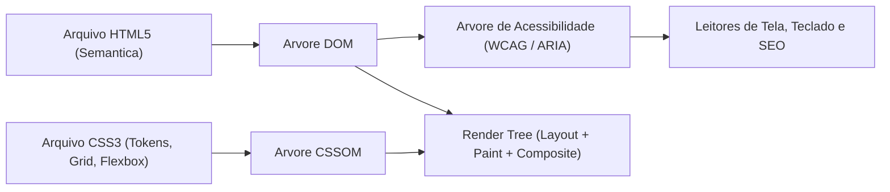

# Aula 06 — HTML5 & CSS3 Moderno

> *"Uma interface sem semântica e acessibilidade é como uma nave espacial sem rótulos nos painéis e com escotilhas travadas: pode até parecer bonita por fora, mas trava a tripulação na primeira turbulência."*

---

## 1. 🚀 Briefing da Missão (Contexto Temático & Realidade de Mercado)

| Metadado da Órbita | Valor |
| :--- | :--- |
| **Galáxia** | Galáxia 2 — Constelação do Frontend Web |
| **ID do Módulo** | `fe-html-css` |
| **Pré-requisitos** | [`apis-web` — APIs & Protocolo HTTP](../01-nebula-dos-fundamentos/README.md) *(Nébula dos Fundamentos)* |
| **Descrição Oficial** | *"A escotilha visual da nave. Crie interfaces modernas, responsivas e totalmente acessíveis de acordo com as especificações da W3C."* |
| **Próxima Órbita** | [Aula 07 — JavaScript Moderno (ES6+)](./07-javascript-moderno-es6.md) |

### 🛸 Analogia do Navegador Cósmico

Imagine o navegador (Chrome, Firefox, Safari) como o **Computador Central da Nave "Navegador Cósmico"**. Quando ele recebe uma resposta HTTP de um servidor (conhecimento que você trouxe da órbita `apis-web`), ele não lê apenas "pixels bonitos": ele constrói duas grandes estruturas internas — a **Árvore do DOM** (*Document Object Model*, feita pelo HTML5) e a **Árvore de Acessibilidade** (*Accessibility Tree*, usada por leitores de tela, teclados e robôs de busca como o Googlebot). Depois, ele combina o DOM com o **CSSOM** (*CSS Object Model*, feito pelo CSS3) para desenhar cada painel na escotilha visual da nave.

Se você construir o painel da nave apenas com `<div class="botao">` e `<div class="cabecalho">`, o computador visual até desenha retângulos coloridos, mas os sensores de navegação automática (SEO), os controles manuais de emergência (navegação via teclado com `Tab`) e os visores táteis de tripulantes com deficiência visual (leitores de tela como NVDA e VoiceOver) ficam completamente cegos. HTML5 semântico é o **projeto estrutural da fuselagem**; CSS3 moderno é o **sistema adaptativo de escotilha, gravidade e iluminação** que ajusta os painéis automaticamente, seja no visor minúsculo de um traje espacial (mobile) ou na parede panorâmica da ponte de comando (desktop ultrawide).

### 🏢 Qual dor real esse módulo resolve nas empresas?

No mercado brasileiro e internacional, empresas perdem dinheiro diariamente por três falhas ligadas diretamente a HTML e CSS mal construídos:
1. **Perda de tráfego orgânico (SEO técnico):** páginas feitas com "sopas de `<div>`" (`divitis`) não comunicam hierarquia de conteúdo para mecanismos de busca, derrubando a posição no Google e encarecendo o custo de aquisição de clientes (CAC).
2. **Exclusão de usuários e risco jurídico/contratual:** no Brasil (Lei Brasileira de Inclusão — LBI) e no exterior (ADA / EAA), produtos digitais de bancos, e-commerces, govtechs e SaaS B2B precisam cumprir critérios WCAG AA. Interfaces sem contraste mínimo, sem foco visível ou sem suporte a teclado bloqueiam vendas e fecham portas em contratos corporativos.
3. **Layout quebrado e CSS impossível de manter:** times sem domínio de Flexbox, Grid, Container Queries e Custom Properties acabam empilhando `!important`, valores fixos em `px` e centenas de linhas duplicadas para criar um simples dark mode ou adaptar um card em telas diferentes.

---

## 2. 📚 Carga de Conhecimento Completa (Tópico por Tópico)

Antes de entrar nos detalhes, observe como o navegador transforma o HTML5 e o CSS3 no que o usuário vê e interage na tela:



### 2.1 Dominar o uso de tags HTML5 semânticas para SEO e legibilidade

**HTML semântico** significa escolher cada elemento pelo **significado do conteúdo** que ele carrega, e não pela aparência padrão que o navegador aplica. Tags como `<div>` e `<span>` são contêineres genéricos — elas têm valor semântico zero. Já as **landmarks** (regiões estruturais) e tags semânticas do HTML5 criam um mapa claro do documento:

- `<header>`: cabeçalho introdutório da página ou de uma seção específica (logotipo, título principal, barra de busca).
- `<nav>`: bloco de navegação principal ou secundária com links importantes (`<ul><li><a href="...">`).
- `<main>`: conteúdo central e único da página. **Regra de ouro:** deve existir apenas um `<main>` visível por página, permitindo que leitores de tela saltem direto para ele.
- `<section>`: agrupamento temático de conteúdo que normalmente possui um título (`<h2>` a `<h6>`).
- `<article>`: conteúdo autônomo e redistribuível de forma independente (um post de blog, um card de notícia, um comentário completo, um produto no catálogo).
- `<aside>`: conteúdo tangencial ou complementar (barra lateral de filtros, caixa de "leia também", sumário).
- `<footer>`: rodapé da página ou de uma seção (direitos autorais, links institucionais, autor).
- **Hierarquia de títulos (`<h1>` até `<h6>`):** representa o índice do documento. Use apenas um `<h1>` para o assunto principal da página e nunca pule níveis apenas para diminuir o tamanho da fonte (por exemplo, ir de `<h1>` direto para `<h4>`). Se quiser ajustar tamanho visual, use CSS (`font-size`), nunca escolha o `<h*>` pela aparência.
- **Elementos interativos nativos:** use `<button type="button">` para ações na mesma página e `<a href="...">` para navegação entre URLs/âncoras. Um `<div onclick="...">` não é focável por `Tab`, não responde a `Enter`/`Espaço` por padrão e não anuncia papel de botão.

### 2.2 Estudar acessibilidade web (Diretrizes WCAG e papéis WAI-ARIA)

**Acessibilidade web (a11y)** garante que pessoas com deficiências visuais, auditivas, motoras ou cognitivas — além de usuários em condições adversas (sol forte na tela, navegação só por teclado, conexão lenta) — consigam perceber, operar e entender a aplicação.

A W3C organiza as diretrizes **WCAG (Web Content Accessibility Guidelines)** em quatro princípios (**POUR**):
1. **Perceptível:** imagens informativas têm texto alternativo (`alt="..."`), imagens puramente decorativas recebem `alt=""`, vídeos têm legenda, e **a cor nunca é o único meio de transmitir informação** (por exemplo, um erro de formulário deve mostrar ícone/texto além da borda vermelha). O contraste mínimo de texto normal no nível **WCAG AA** é de **4.5:1** (e **3:1** para texto grande ou componentes gráficos de UI).
2. **Operável:** toda funcionalidade deve ser acessível apenas pelo teclado (`Tab`, `Shift+Tab`, `Enter`, `Espaço`, `Esc`, setas). Nunca remova `outline: none` sem fornecer um `:focus-visible` claramente contrastante.
3. **Compreensível:** linguagem clara, rótulos explícitos ligados aos campos (`<label for="email">` conectado a `<input id="email">`), mensagens de erro descritivas que explicam como corrigir o problema e idioma declarado no HTML (`<html lang="pt-BR">`).
4. **Robusto:** HTML válido e compatível com tecnologias assistivas atuais e futuras.

Quando o HTML nativo não possui um componente complexo pronto (como abas, modais customizados, menus dropdown ou alertas dinâmicos), entra o **WAI-ARIA** (*Accessible Rich Internet Applications*):
- **1ª Regra de Ouro do ARIA:** *não use ARIA se um elemento HTML nativo já resolve o problema.* Prefira `<button>` a `<div role="button" tabindex="0">`.
- **Papéis (`role`):** definem o que o elemento é (`role="dialog"`, `role="tablist"`, `role="alert"`).
- **Estados e propriedades (`aria-*`):** comunicam mudanças dinâmicas para leitores de tela, como `aria-expanded="true|false"` (menu aberto/fechado), `aria-controls="menu-id"`, `aria-label="..."` (rótulo invisível para botões com apenas ícone), `aria-describedby="erro-senha"` (liga um input à mensagem de erro) e `aria-live="polite|assertive"` (anuncia notificações dinâmicas sem mover o foco do usuário).

### 2.3 Criar layouts complexos com CSS Flexbox e CSS Grid

A maior confusão de iniciantes em CSS moderno é tentar escolher entre Flexbox e Grid por palpite. A regra mental é objetiva:

- **CSS Flexbox (1 Dimensão — Linha OU Coluna):** ideal para distribuir espaço e alinhar itens ao longo de um único eixo por vez. Perfeito para barras de navegação (`navbar`), grupos de botões, alinhamento de ícone + texto, cards que precisam alinhar o botão no rodapé (`margin-top: auto` ou `justify-content: space-between`).
  - Principais propriedades no **container** (`display: flex`): `flex-direction`, `flex-wrap`, `justify-content` (eixo principal), `align-items` (eixo transversal) e `gap`.
  - Principais propriedades nos **itens**: `flex-grow`, `flex-shrink`, `flex-basis` (atalho `flex: 1 1 250px`) e `align-self`.
- **CSS Grid (2 Dimensões — Linhas E Colunas simultaneamente):** ideal para estruturar o layout macro da página, dashboards, galerias e formulários em grade onde linhas e colunas precisam manter alinhamento entre si.
  - Principais propriedades no **container** (`display: grid`): `grid-template-columns`, `grid-template-rows`, `grid-template-areas`, `gap`, `place-items`.
  - **Superpoder responsivo sem Media Query:** `grid-template-columns: repeat(auto-fit, minmax(min(100%, 280px), 1fr));` cria uma grade que ajusta automaticamente quantas colunas cabem na largura disponível e nunca gera barra de rolagem horizontal em telas estreitas.

Na prática profissional, **Flexbox e Grid trabalham juntos**: o Grid monta a estrutura bidimensional dos cards ou do dashboard, e o Flexbox organiza o conteúdo interno de cada card e dos cabeçalhos.

### 2.4 Implementar responsividade avançada (Media Queries e Container Queries)

Responsividade moderna deixou de ser "decorar larguras de iPhone". Adote **Mobile-First** por padrão: os estilos base descrevem o layout de tela pequena (mais simples, em coluna única), e você adiciona complexidade progressivamente conforme há mais espaço.

- **Media Queries (`@media`)**: avaliam características da **viewport inteira** ou preferências do sistema operacional do usuário:
  - Largura com sintaxe moderna de intervalo (Baseline amplamente suportada): `@media (width >= 48rem) { ... }` (equivalente a `min-width: 768px`, usando `rem` para respeitar o zoom de fonte do usuário).
  - Preferências de acessibilidade do usuário: `@media (prefers-reduced-motion: reduce)` (desliga animações intensas para quem sofre de labirintite/vestibulopatia) e `@media (prefers-color-scheme: dark)` (respeita tema escuro do sistema).
- **Container Queries (`@container`)**: resolvem o grande limite das Media Queries! Uma Media Query olha para a **tela**, mas um componente reutilizável (como um Card de Produto) pode viver ora numa coluna estreita de `300px` (sidebar), ora numa área larga de `900px` (vitrine principal) — **na mesma tela de desktop**.
  1. Defina o elemento pai como um contêiner monitorado: `container-type: inline-size; container-name: card-slot;`
  2. Adapte o componente filho conforme a largura **do próprio contêiner**, não da janela: `@container card-slot (width >= 420px) { .card { flex-direction: row; } }`
- **Tipografia e espaçamentos fluidos:** use `clamp(min, ideal, max)`, por exemplo `font-size: clamp(1.5rem, 2.5vw + 1rem, 2.75rem);`, garantindo escalabilidade suave entre celular e monitor grande sem dezenas de breakpoints.

### 2.5 Gerenciar variáveis CSS (Custom Properties) para criação de temas

**CSS Custom Properties** (`--nome-da-variavel`) são variáveis nativas e dinâmicas do navegador (diferentes de variáveis de pré-processadores como Sass, que viram valores estáticos após compilação). Como participam da cascata do DOM, você pode sobrescrevê-las em um escopo específico (como `[data-theme="dark"]` ou dentro de uma Media Query) e toda a interface se atualiza instantaneamente sem recarregar CSS.

A arquitetura profissional utiliza **Design Tokens em duas camadas**:
1. **Tokens Primitivos (Paleta bruta):** `--palette-slate-950: #0b1120;`, `--palette-cyan-400: #38bdf8;`.
2. **Tokens Semânticos (Intenção de uso):** `--surface-bg: var(--palette-slate-950);`, `--text-primary: #f8fafc;`, `--accent-action: var(--palette-cyan-400);`.

Ao alternar temas (Claro / Escuro / Alto Contraste), seus componentes continuam usando `background: var(--surface-bg); color: var(--text-primary);` — você troca apenas os valores dos tokens semânticos no elemento raiz (`:root` / `[data-theme="light"]`), mantendo zero duplicação de regras nos componentes.

---

## 3. 💻 Mão no Código (Jeito Iniciante vs. Padrão Profissional)

Vamos comparar dois códigos que constroem um **Painel de Alerta e Grade de Módulos Responsiva com Tema**.

### ❌ Jeito Iniciante (Antipadrão: `divitis`, falta de a11y, pixels fixos e cores hardcoded)

```html
<!-- antipattern.html -->
<div class="topo">
  <div class="titulo-grande">Painel da Nave</div>
  <div class="btn-tema" onclick="trocarTema()">Mudar tema</div>
</div>

<div class="wrapper">
  <div class="card">
    
    <div class="nome-card">Propulsor Iônico</div>
    <!-- Erro apenas pela cor vermelha: daltônicos e leitores de tela não entendem -->
    <div style="color: red; border: 1px solid red;">FALHA</div>
    <div class="btn-acao" onclick="abrirDetalhes()">Ver</div>
  </div>
</div>
```

```css
/* antipattern.css */
.topo { width: 1200px; height: 70px; background: #111; color: #fff; }
.wrapper { width: 1200px; display: flex; } /* Quebra no mobile com scroll horizontal */
.card { width: 380px; margin: 10px; background: #1e293b; color: #475569; } /* Contraste péssimo! */
.btn-acao:focus { outline: none; } /* Mata a navegação por teclado */
```

**Por que isso falha em produção?**
- `div onclick` não recebe foco pelo teclado (`Tab`) nem aciona com `Enter`.
- `width: 1200px` cria rolagem horizontal em celulares.
- `` sem `alt` faz o leitor de tela ler o nome do arquivo ou ignorar informação importante.
- Cores fixas (`#1e293b`) impedem temas limpos e `#475569` sobre `#1e293b` viola o contraste mínimo WCAG AA (4.5:1).

### ✅ Padrão Profissional (HTML5 Semântico, WCAG AA, Grid + Flexbox, Container Queries e Tokens)

```html
<!-- index.html -->
<!DOCTYPE html>
<html lang="pt-BR" data-theme="dark">
<head>
  <meta charset="UTF-8" />
  <meta name="viewport" content="width=device-width, initial-scale=1.0" />
  <title>Painel da Nave — Constelação Frontend</title>
  <link rel="stylesheet" href="styles.css" />
</head>
<body>
  <!-- Skip link: permite que usuários de teclado pulem o menu direto para o conteúdo -->
  <a class="skip-link" href="#conteudo-principal">Pular para o conteúdo principal</a>

  <header class="site-header">
    <div class="header-inner">
      <a href="/" class="brand">Academia Galáctica</a>
      <nav aria-label="Navegação principal">
        <ul class="nav-list">
          <li><a href="#modulos">Módulos</a></li>
          <li><a href="#telemetria">Telemetria</a></li>
        </ul>
      </nav>
      <!-- Botão nativo com aria-pressed comunicando estado atual do tema -->
      <button type="button" class="theme-toggle" aria-pressed="true" aria-label="Alternar tema claro e escuro">
        Tema Escuro
      </button>
    </div>
  </header>

  <main id="conteudo-principal" class="layout-main">
    <section aria-labelledby="titulo-sistemas">
      <h1 id="titulo-sistemas" class="page-title">Sistemas da Nave</h1>

      <!-- Grid fluido sem media queries rígidas -->
      <div class="systems-grid">
        <div class="card-slot">
          <article class="system-card">
            
            <div class="card-body">
              <h2 class="card-title">Propulsor Iônico</h2>
              <!-- Status usa cor + ícone + texto explícito (WCAG 1.4.1) -->
              <p class="status-badge status-badge--error" role="status">
                <span aria-hidden="true">⚠</span> Crítico: Pressão baixa no setor 4
              </p>
              <button type="button" class="btn-primary">Inspecionar Propulsor</button>
            </div>
          </article>
        </div>
      </div>
    </section>
  </main>
</body>
</html>
```

```css
/* styles.css — Arquitetura com Custom Properties, Grid, Flexbox e Container Queries */

/* 1. Tokens Semânticos (Tema Escuro Padrão) */
:root,
[data-theme="dark"] {
  --surface-page: #0b1120;
  --surface-card: #162033;
  --text-primary: #f8fafc;   /* Contraste > 13:1 sobre --surface-card */
  --text-muted: #cbd5e1;     /* Contraste > 9:1 sobre --surface-card */
  --accent-primary: #38bdf8;
  --accent-text: #082f49;
  --danger-bg: #7f1d1d;
  --danger-border: #fca5a5;
  --danger-text: #fef2f2;
  --focus-ring: #fde047;
  --space-md: 1rem;
  --radius-md: 0.75rem;
}

/* 2. Sobrescrita limpa apenas de tokens para Tema Claro */
[data-theme="light"] {
  --surface-page: #f8fafc;
  --surface-card: #ffffff;
  --text-primary: #0f172a;
  --text-muted: #334155;
  --accent-primary: #0284c7;
  --accent-text: #ffffff;
  --danger-bg: #fee2e2;
  --danger-border: #b91c1c;
  --danger-text: #7f1d1d;
  --focus-ring: #1d4ed8;
}

*, *::before, *::after { box-sizing: border-box; }

body {
  margin: 0;
  font-family: system-ui, -apple-system, sans-serif;
  background-color: var(--surface-page);
  color: var(--text-primary);
  line-height: 1.5;
}

/* Foco visível acessível apenas quando navegado via teclado */
:focus-visible {
  outline: 3px solid var(--focus-ring);
  outline-offset: 3px;
}

/* Skip link oculto visualmente até receber foco via Tab */
.skip-link {
  position: absolute;
  left: -9999px;
}
.skip-link:focus {
  position: fixed;
  top: 1rem;
  left: 1rem;
  z-index: 100;
  padding: 0.75rem 1rem;
  background: var(--accent-primary);
  color: var(--accent-text);
  font-weight: 700;
  border-radius: var(--radius-md);
}

/* Cabeçalho com Flexbox */
.header-inner {
  max-width: 75rem;
  margin-inline: auto;
  padding: var(--space-md);
  display: flex;
  flex-wrap: wrap;
  align-items: center;
  justify-content: space-between;
  gap: var(--space-md);
}

.nav-list {
  display: flex;
  gap: 1.25rem;
  list-style: none;
  margin: 0;
  padding: 0;
}

.layout-main {
  max-width: 75rem;
  margin-inline: auto;
  padding: var(--space-md);
}

.page-title {
  font-size: clamp(1.5rem, 2.5vw + 1rem, 2.5rem);
}

/* Grid 2D responsivo sem overflow horizontal */
.systems-grid {
  display: grid;
  grid-template-columns: repeat(auto-fit, minmax(min(100%, 18rem), 1fr));
  gap: 1.5rem;
}

/* Definição de Container Query no slot pai */
.card-slot {
  container-type: inline-size;
  container-name: system-slot;
}

.system-card {
  display: flex;
  flex-direction: column;
  height: 100%;
  background: var(--surface-card);
  border-radius: var(--radius-md);
  overflow: hidden;
  border: 1px solid rgb(148 163 184 / 0.25);
}

.card-media {
  width: 100%;
  aspect-ratio: 16 / 9;
  object-fit: cover;
}

.card-body {
  display: flex;
  flex-direction: column;
  gap: 0.75rem;
  padding: 1.25rem;
  flex: 1;
}

/* Empurra o botão sempre para o fundo do card quando estiver em grid */
.btn-primary {
  margin-top: auto;
  padding: 0.75rem 1rem;
  border: 0;
  border-radius: 0.5rem;
  background: var(--accent-primary);
  color: var(--accent-text);
  font-weight: 700;
  cursor: pointer;
}

.status-badge--error {
  padding: 0.5rem 0.75rem;
  border-radius: 0.5rem;
  background: var(--danger-bg);
  border: 1px solid var(--danger-border);
  color: var(--danger-text);
  font-weight: 600;
}

/* Container Query: quando o espaço do card passa de 420px, vira layout horizontal */
@container system-slot (width >= 420px) {
  .system-card {
    flex-direction: row;
  }
  .card-media {
    width: 40%;
    aspect-ratio: auto;
  }
}

/* Respeita preferência de movimento reduzido */
@media (prefers-reduced-motion: reduce) {
  *, *::before, *::after {
    animation-duration: 0.01ms !important;
    transition-duration: 0.01ms !important;
  }
}
```

---

## 4. 🛠️ Laboratório de Voo (Exercício Prático Guiado)

**Duração estimada:** 45 minutos | **Objetivo:** Construir uma **Central de Missões Espaciais** responsiva com alternância de tema e pontuação máxima em Acessibilidade.

### Passo a Passo
1. Crie uma pasta `lab-06-central-missoes` com `index.html` e `styles.css`.
2. Estruture o `index.html` com um *skip link*, `<header>` (título e `<nav>`), `<main>` dividido em duas regiões: uma lista principal de 4 cards de missões (`<article>`) e uma barra `<aside>` de filtros e status da nave.
3. No CSS, defina `:root` com tokens semânticos de cor (`--bg-page`, `--bg-card`, `--text-main`, `--border-subtle`, `--accent`) e um bloco `[data-theme="light"]` invertendo o tema.
4. Use **CSS Grid** no `<main>` para exibir 1 coluna no mobile e 2 colunas (`2fr 1fr`, `main` + `aside`) a partir de `@media (width >= 60rem)`.
5. Envolva cada `<article>` em um container com `container-type: inline-size`, fazendo o card alternar de vertical (`flex-direction: column`) para horizontal (`flex-direction: row`) quando seu container tiver `width >= 30rem`.
6. Garanta que todo botão de status ("Ativa", "Em Risco", "Concluída") exiba **cor + símbolo/ícone (`aria-hidden="true"`) + texto legível**.
7. Teste a navegação **100% pelo teclado** (`Tab`, `Shift+Tab`, `Enter`) sem tocar no mouse, e rode a auditoria **Accessibility** no Lighthouse do Chrome DevTools.

### ✅ Critérios de Domínio
- [ ] Zero `<div>` clicáveis; apenas `<button>` e `<a href>` nativos.
- [ ] Apenas um `<main>` e hierarquia correta `<h1>` -> `<h2>` -> `<h3>`.
- [ ] Sem rolagem horizontal entre `320px` e `1440px` de largura.
- [ ] Tema alterna corretamente mudando `data-theme="light"` no `<html>` sem alterar classes dos cards.
- [ ] Nota de **Accessibility >= 95** no Lighthouse e foco sempre visível ao pressionar `Tab`.

---

## 5. 🎯 Resolução Comentada do Teste de Ignição (Quest Oficial)

**Pergunta Oficial (`data.js`):**
> *De acordo com as diretrizes do WCAG, qual o comportamento correto sobre o uso de cores em elementos de interface web?*

- **A)** A cor deve ser o único meio de destacar botões de exclusão.
- **B)** A cor não deve ser usada como o único meio visual de transmitir informações, indicar uma ação, solicitar uma resposta ou distinguir um elemento visual.
- **C)** Todas as fontes devem obrigatoriamente ser renderizadas na cor verde limão para contraste.
- **D)** Os leitores de tela ignoram folhas de estilo, logo a cor dos elementos é irrelevante para a acessibilidade.

### ✅ Resposta Correta: **Alternativa B**

**Por que a Alternativa B está correta:**
Ela traduz diretamente o critério de sucesso **WCAG 1.4.1 — Uso de Cor (Nível A)**. Pessoas com daltonismo (deuteranopia, protanopia, tritanopia), usuários com baixa visão, telas monocromáticas ou brilho sob luz solar direta podem não distinguir verde de vermelho. Por isso, sempre que a cor comunica significado (erro, sucesso, link no meio de um parágrafo, série em um gráfico), ela precisa ser acompanhada por **texto explícito, ícone, padrão visual ou sublinhado**.

**Por que cada uma das outras alternativas está incorreta:**
- **Alternativa A (Errada):** faz exatamente o oposto da diretriz WCAG 1.4.1. Um botão de exclusão só vermelho e sem texto/ícone claro ("Excluir", lixeira + confirmação) pode passar despercebido por um usuário daltônico e causar perda acidental de dados.
- **Alternativa C (Errada):** a WCAG não impõe nenhuma cor específica (como verde limão — que inclusive teria contraste péssimo sobre fundo branco!). O que a WCAG exige são **razões de contraste** entre texto e fundo (ex: 4.5:1 no nível AA para texto normal).
- **Alternativa D (Errada):** acessibilidade vai muito além de pessoas cegas que usam leitores de tela. Inclui usuários com baixa visão, daltonismo e sensibilidade à luz que **enxergam a tela** e dependem diretamente de contraste adequado e indicadores não dependentes de cor. Além disso, regras CSS como `display: none` e `visibility: hidden` *afetam sim* a Árvore de Acessibilidade lida pelos leitores de tela!

---

## 6. 🎤 Kit de Apresentação (Como Dar Aula / Apresentar Este Módulo)

### 🎙️ Pitch Feynman de 2 Minutos
> "Pense no HTML5 e no CSS3 como a arquitetura elétrica e visual de uma nave espacial, não apenas como 'desenhar quadrados na tela'. Quando eu escrevo HTML5 semântico — usando `<header>`, `<nav>`, `<main>`, `<article>` e `<button>` em vez de sair empilhando `<div>` —, eu estou criando o mapa oficial que tanto o Google quanto leitores de tela e o teclado do usuário usam para navegar sem bater na parede. E aqui entra a acessibilidade com WCAG e WAI-ARIA: a cor sozinha nunca pode carregar o peso de uma informação, e antes de inventar atributos `aria-*` complexos, eu sempre uso a tag nativa certa. Na camada visual, o CSS3 moderno resolve layout sem gambiarras: Flexbox alinha elementos em uma única direção (como um menu ou o interior de um card), enquanto o CSS Grid organiza a grade em duas dimensões. Juntando isso com Container Queries — onde o componente se adapta ao tamanho da caixa onde ele mora, e não apenas da tela inteira — e Variáveis CSS semânticas para temas, conseguimos construir interfaces que funcionam em qualquer dispositivo e permanecem limpas mesmo quando o projeto cresce."

### 📊 Roteiro de Slides (6 Slides)
1. **Slide 1 — Mais que pixels: a Árvore do DOM e de Acessibilidade**
   - *Bullets:* HTML vira DOM + Accessibility Tree; custo de "sopas de `<div>`"; impacto direto em SEO e WCAG.
   - *Visual:* Diagrama comparando árvore genérica (`div > div > div`) vs. árvore semântica (`header > nav`, `main > article`).
2. **Slide 2 — Semântica e WCAG na Prática (POUR)**
   - *Bullets:* Perceptível, Operável, Compreensível, Robusto; contraste 4.5:1; 1ª regra do ARIA (use HTML nativo primeiro).
   - *Visual:* Card de erro antes (só borda vermelha) vs. depois (borda + ícone + texto + `aria-describedby`).
3. **Slide 3 — Flexbox vs. CSS Grid: A Regra 1D vs. 2D**
   - *Bullets:* Flexbox = eixo único (menus, barras); Grid = linhas + colunas simultâneas (`repeat(auto-fit, minmax(...))`).
   - *Visual:* Sobreposição de eixos 1D (setas em linha) e malha 2D (células de Grid).
4. **Slide 4 — Responsividade Além da Viewport: Container Queries**
   - *Bullets:* Mobile-First; Media Queries (`@media (width >= 48rem)`); Container Queries (`@container`) para componentes portáteis.
   - *Visual:* O mesmo Card de Produto renderizado estreito na sidebar e largo na área principal simultaneamente.
5. **Slide 5 — Design Tokens e Temas com Variáveis CSS**
   - *Bullets:* Tokens primitivos vs. tokens semânticos; cascata em tempo de execução; Dark Mode com `[data-theme]`.
   - *Visual:* Código curto mostrando troca de 5 variáveis em `:root` mudando toda a tela.
6. **Slide 6 — Checklist de Produção & Próximos Passos**
   - *Bullets:* Teste de teclado (`Tab`), Lighthouse Accessibility, transição para JavaScript ES6+.
   - *Visual:* Screenshot de auditoria Lighthouse com 100 em Accessibility.

### 💻 Roteiro de Demo Ao Vivo (3 Minutos)
1. *(0:00–1:00)* Abra o site da aula no Chrome DevTools → aba **Elements → Accessibility** (painel lateral). Mostre a diferença entre clicar em um `<div onclick>` (aparece como `generic`, sem papel) e um `<button>` (aparece como `button`, focável).
2. *(1:00–2:00)* Pressione `Ctrl+Shift+P` no DevTools → digite **Rendering → Emulate vision deficiencies → Deuteranopia**. Mostre como o card sem ícone some a percepção do erro vermelho, enquanto o card WCAG com ícone e texto continua 100% legível.
3. *(2:00–3:00)* No DevTools, selecione o `.card-slot` e arraste a largura da coluna/viewport ou ative o **Grid/Flexbox overlay** no painel Elements para mostrar a Container Query transformando o card de coluna para linha sem depender da largura total da janela.

### ❓ Perguntas Difíceis da Plateia
1. **"Se hoje quase todo mundo usa Tailwind CSS ou Bootstrap, ainda faz sentido estudar CSS Grid, Flexbox e Variáveis CSS puras?"**
   - *Resposta:* Sim, totalmente. Frameworks utilitários como Tailwind são literalmente abreviações de propriedades CSS nativas (`grid-cols-3`, `flex`, `var(--...)`). Se você não entende `flex-shrink`, `minmax()`, cascata ou especificidade, você trava no primeiro bug de layout mesmo usando Tailwind. Além disso, Design Systems modernos usam CSS Custom Properties por baixo dos panos.
2. **"Quando devo usar `aria-label` vs. texto visível ou `<label>`?"**
   - *Resposta:* Sempre prefira texto visível (ou `<label for="...">` para inputs), porque ele ajuda quem usa leitor de tela e quem enxerga a tela — além de ser traduzido automaticamente por ferramentas de tradução. Reserve `aria-label` apenas para elementos sem texto visível, como um botão que contém somente um ícone de fechar (`✕`) ou lupa.

---

## 7. 💼 Radar do Mercado de Trabalho (Foco Dev Júnior)

### 🎯 3 Perguntas Reais de Entrevista Técnica Júnior
1. **Pergunta:** *"Qual a diferença prática entre CSS Flexbox e CSS Grid, e quando você escolhe cada um?"*
   - **Resposta Modelo:** "Eu uso Flexbox para layouts unidimensionais — quando quero alinhar ou distribuir itens em uma linha ou em uma coluna, como uma navbar, botões de ação ou o alinhamento interno de um card. Já o CSS Grid eu uso para layouts bidimensionais, onde preciso controlar linhas e colunas ao mesmo tempo, como a grade principal de uma página ou um dashboard. Na prática, eles são complementares: estruturo a grade externa com Grid e alinho o conteúdo interno de cada bloco com Flexbox."
2. **Pergunta:** *"O que você verifica para garantir que um formulário que acabou de criar é acessível?"*
   - **Resposta Modelo:** "Primeiro, uso HTML semântico nativo: `<form>`, `<label for>` ligado ao `id` de cada `<input>`, e `<button type="submit">`. Segundo, verifico contraste WCAG AA (mínimo 4.5:1) e garanto que mensagens de erro não dependam só de borda vermelha, trazendo texto claro vinculado via `aria-describedby` e foco visível com `:focus-visible`. Por fim, testo percorrendo e enviando o formulário inteiro usando apenas o teclado (`Tab`, `Shift+Tab`, `Enter`), e valido com o Lighthouse."
3. **Pergunta:** *"Qual problema as Container Queries resolvem que as Media Queries tradicionais não resolvem?"*
   - **Resposta Modelo:** "Media Queries reagem ao tamanho da janela inteira do navegador (viewport), não ao espaço que o componente realmente tem disponível. Se eu crio um Card reutilizável e coloco ele tanto numa sidebar estreita quanto na área principal larga dentro de uma tela de desktop, uma Media Query acha que ambos têm `1440px` de tela e quebra a sidebar. Com `@container`, o componente consulta a largura do seu elemento pai imediato, tornando o CSS verdadeiramente modular e reutilizável."

### ⚠️ Erros Clássicos de Júnior vs. Postura Profissional

| Erro Clássico de Júnior | Postura Profissional Esperada |
| :--- | :--- |
| Colocar `outline: none` no `*` porque "a borda azul é feia". | Manter foco acessível estilizado com `:focus-visible` e alto contraste. |
| Usar `<div onclick>` ou `<a>` sem `href` no lugar de `<button>`. | Usar `<button type="button">` para ações e `<a href>` apenas para navegação. |
| Sair escrevendo `@media` para larguras aleatórias e fixando `px` em tudo. | Projetar Mobile-First com `rem`, `clamp()`, Grid fluido (`minmax`) e `@container`. |
| Deixar contraste baixo (cinza claro sobre branco) copiado de layout sem validar. | Validar contraste com DevTools/WCAG (4.5:1) e centralizar cores em tokens CSS. |

### 🌐 Evidência para Portfólio / GitHub / LinkedIn
- **GitHub:** Suba o repositório do **Laboratório de Voo** com um `README.md` mostrando prints no modo Claro e Escuro, link publicado no GitHub Pages/Vercel e screenshot da auditoria **Lighthouse 100/100 em Accessibility e Best Practices**.
- **LinkedIn:** Grave um vídeo curto de 60 segundos mostrando você navegando no seu próprio projeto **apenas pelo teclado** e explicando como `Container Queries` + `Custom Properties` adaptaram os cards sem duplicar código.

---

## 8. 📡 Transmissões Recomendadas & Próxima Órbita

### 🔗 Recursos Oficiais (`data.js`)
- [MDN: Aprenda Web Development](https://developer.mozilla.org/pt-BR/docs/Learn) — Referência definitiva de HTML semântico, CSS e boas práticas da W3C.
- [Flexbox Froggy (Jogo de CSS)](https://flexboxfroggy.com/#pt-br) — Treino interativo para fixar `justify-content`, `align-items`, `flex-direction` e `order`.
- [Guia de Acessibilidade Web (W3C)](https://www.w3.org/WAI/fundamentals/accessibility-intro/pt) — Introdução oficial às diretrizes WCAG, leitores de tela e navegação acessível.

### 🚀 Conexão com a Próxima Órbita
Agora que a fuselagem semântica e a escotilha visual da nave respondem a qualquer tela e usuário, a nave ainda está estática — os painéis não reagem a cliques, não buscam telemetria ao vivo nem guardam preferências de voo. Na próxima aula, você vai ligar os motores de interatividade com **JavaScript Moderno (ES6+)**!

👉 **Avançar para:** [Aula 07 — JavaScript Moderno (ES6+)](./07-javascript-moderno-es6.md)
