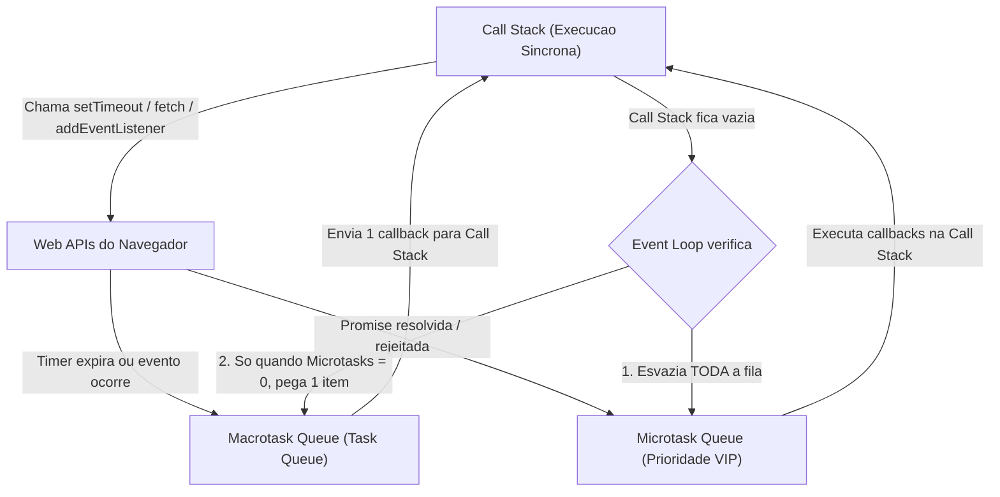

# Aula 07 — JavaScript Moderno (ES6+)

> *"HTML e CSS constroem a cabine e os botões da nave; JavaScript é o sistema nervoso elétrico que faz os sensores responderem, busca telemetria em estações distantes sem travar os controles e memoriza o plano de voo."*

---

## 1. 🚀 Briefing da Missão (Contexto Temático & Realidade de Mercado)

| Metadado da Órbita | Valor |
| :--- | :--- |
| **Galáxia** | Galáxia 2 — Constelação do Frontend Web |
| **ID do Módulo** | `fe-js-moderno` |
| **Pré-requisitos** | [Aula 06 — HTML5 & CSS3 Moderno](./06-html5-css3-moderno.md) (`fe-html-css`) |
| **Descrição Oficial** | *"Dê vida às suas telas. Domine a manipulação da DOM, o fluxo assíncrono e os recursos mais modernos do JavaScript (ES6+)."* |
| **Próxima Órbita** | [Aula 08 — Componentização & React](./08-componentizacao-react.md) |

### 🛸 Analogia do Navegador Cósmico

Imagine o **Motor do JavaScript** (como o V8 no Chrome) como um **Piloto Único extremamente veloz** dentro da ponte de comando. Esse piloto tem apenas um par de mãos — isto é, o JavaScript é **single-threaded** (uma única Call Stack executando uma instrução por vez). Se ele ficasse parado olhando pela janela esperando uma transmissão de rádio levar 2 segundos para voltar da base lunar (`fetch`), todos os botões da cabine congelariam e o painel não responderia nem ao toque de emergência.

Para resolver isso sem perder a simplicidade de um único piloto, a nave possui **módulos auxiliares do navegador (Web APIs)**: cronômetros, antenas de rede (`fetch`) e acesso ao DOM. O piloto dispara o pedido pela antena e continua operando a cabine. Quando a resposta chega, a **Central de Despacho (Event Loop)** organiza duas filas de prioridade na escrivaninha do piloto: a **Fila VIP de Microtasks** (promessas resolvidas com `Promise` / `async-await`) e a **Fila Padrão de Macrotasks** (`setTimeout`, eventos de clique). Assim que o piloto termina a tarefa atual, ele zera toda a fila VIP de Microtasks antes de pegar o próximo item da fila padrão — garantindo respostas rápidas sem congelar a interface.

### 🏢 Qual dor real esse módulo resolve nas empresas?

Todo framework moderno (React, Vue, Angular, Next.js) é JavaScript puro por baixo dos panos. Em entrevistas técnicas e no trabalho diário de um Dev Júnior, as principais dores que esse módulo elimina são:
1. **Interfaces travadas ou "race conditions" em requisições:** júniores que não entendem Promises, `async/await` e `AbortController` disparam múltiplas chamadas de API fora de ordem e exibem dados antigos por cima de buscas recentes.
2. **Bugs misteriosos de mutação e referências:** modificar arrays/objetos diretamente causa efeitos colaterais silenciosos que viram bugs graves ao migrar para React.
3. **Vulnerabilidades de XSS e perda de performance na DOM:** concatenar HTML com strings não sanitizadas usando `innerHTML` abre brechas de segurança críticas, enquanto anexar dezenas de listeners individuais desperdiça memória.

---

## 2. 📚 Carga de Conhecimento Completa (Tópico por Tópico)

Observe o fluxo completo do **Event Loop** no navegador entre a Call Stack, Web APIs, Microtask Queue e Macrotask Queue:



### 2.1 Manipular dinamicamente elementos da página através da DOM API

A **DOM (Document Object Model)** é a representação em árvore de objetos JavaScript que o navegador cria a partir do HTML. Com a DOM API, você lê, cria, altera e remove elementos em tempo real:

- **Seleção precisa:** `document.querySelector(".card")` (primeiro elemento que casa com o seletor CSS) e `document.querySelectorAll(".card")` (retorna uma `NodeList` iterável com `forEach`). Para buscas repetidas dentro de um contêiner, chame `container.querySelector(...)` em vez de varrer o documento inteiro.
- **Criação segura e eficiente:** prefira `document.createElement("li")`, configure `textContent` (que **escapa caracteres HTML automaticamente**, protegendo contra ataques XSS — ao contrário de `innerHTML`, que interpreta HTML bruto!) e adicione em lote com `DocumentFragment` ou `.append(...items)` para evitar múltiplos *reflows* (recálculos de layout).
- **Classes e atributos:** manipule classes com `el.classList.add()`, `.remove()`, `.toggle()` e atributos de acessibilidade com `el.setAttribute("aria-expanded", "true")` e `el.dataset.id` (que lê `data-id="..."`).
- **Event Delegation (Delegação de Eventos):** em vez de colocar um `addEventListener("click", ...)` em 200 botões de uma lista dinâmica, coloque **um único listener no elemento pai** (`<ul>` ou `<tbody>`) e identifique o alvo clicado usando `event.target.closest("[data-action]")`. Isso economiza memória e funciona automaticamente para itens adicionados depois da carga inicial.

### 2.2 Utilizar sintaxe ES6+ (Destructuring, Arrow Functions, Rest/Spread)

Introduzido a partir do ECMAScript 2015 (ES6), o JavaScript moderno tornou o código mais declarativo, conciso e seguro contra mutações:

- **`const` e `let` (Escopo de Bloco):** abandone `var`. Use `const` por padrão (impede reatribuição da variável) e `let` apenas quando houver reatribuição intencional (contadores, acumuladores).
- **Arrow Functions (`=>`):** sintaxe enxuta para funções e callbacks (`items.map((item) => item.price)`). Diferente de funções tradicionais, arrow functions têm **`this` léxico** (herdam o `this` do escopo onde foram definidas), evitando confusões clássicas em callbacks.
- **Destructuring (Desestruturação):** extrai valores de objetos e arrays diretamente para variáveis, inclusive com renomeação e valores padrão:
  - Objeto: `const { name: shipName, fuel = 100 } = telemetry;`
  - Array: `const [firstPlanet, secondPlanet] = planets;`
- **Spread (`...`) e Rest (`...`):** usam os mesmos três pontos, mas em contextos opostos:
  - **Spread (espalhar):** copia e mescla arrays/objetos sem mutar os originais: `const nextState = { ...state, status: "online" };` ou `const allItems = [...oldItems, newItem];`. Atenção: é uma cópia rasa (*shallow copy*); objetos aninhados ainda compartilham referência.
  - **Rest (agrupar):** captura o restante de argumentos ou propriedades: `const { password, ...publicUser } = user;` ou `function logEvents(first, ...others) {}`.
- **Recursos complementares essenciais (ES2020+):** Template Literals (`` `Olá, ${name}` ``), Optional Chaining (`user?.address?.city` evita `TypeError` em valores nulos) e Nullish Coalescing (`count ?? 10` só aplica fallback para `null`/`undefined`, preservando `0` e `""` — diferente de `||`).

### 2.3 Compreender a concorrência e o Event Loop do JavaScript

O modelo de concorrência do JavaScript se apoia em quatro peças fundamentais:

1. **Call Stack (Pilha de Execução):** estrutura LIFO (*Last In, First Out*) onde o JavaScript empilha funções em execução. Como existe só uma pilha, um `while (true)` ou cálculo pesado trava a aba inteira (nem clique nem scroll funcionam).
2. **Heap:** região de memória onde objetos, arrays e funções são alocados.
3. **Web APIs (Host Environment):** funcionalidades fornecidas pelo navegador (ou `libuv` no Node.js), como `fetch`, `setTimeout`, eventos de DOM e `localStorage`, que executam esperas fora da Call Stack.
4. **Filas de Tarefas e Event Loop:**
   - **Microtask Queue:** callbacks de `Promise.then/catch/finally`, continuações de `await`, `queueMicrotask()` e `MutationObserver`.
   - **Macrotask Queue (Task Queue):** `setTimeout`, `setInterval`, callbacks de eventos de interface (`click`, `input`), I/O.
   - **Ordem exata de execução:**
     1. Roda todo o código síncrono da Call Stack até esvaziá-la.
     2. O Event Loop drena **toda** a Microtask Queue (incluindo novas microtasks agendadas durante esse processamento!).
     3. O navegador pode atualizar a renderização da tela (*repaint*), se necessário.
     4. O Event Loop move **exatamente 1** tarefa da Macrotask Queue para a Call Stack e repete o ciclo.

### 2.4 Dominar chamadas assíncronas com Promises e blocos Async/Await

Antigamente, operações assíncronas eram encadeadas em callbacks aninhados conhecidos como *Callback Hell* ("Hadouken code"). A **Promise** resolveu isso representando um valor futuro que pode estar em um de três estados imutáveis após transição:
- `pending` (aguardando resultado),
- `fulfilled` (resolvida com um valor — cai em `.then()`),
- `rejected` (rejeitada com um motivo/erro — cai em `.catch()`).

Com **ES2017 (`async/await`)**, escrevemos código assíncrono com a legibilidade de código síncrono:
- Toda função marcada com `async` **sempre retorna uma Promise**.
- A palavra-chave `await` pausa apenas a execução *daquela função `async`* (sem bloquear a Call Stack global!) enquanto aguarda a Promise resolver, devolvendo o resultado ou lançando uma exceção capturada por `try / catch / finally`.
- **Regra de ouro de performance:** não use `await` sequencial quando duas requisições são independentes! Em vez de esperar `await getA()` (1s) e depois `await getB()` (1s) totalizando 2s, dispare em paralelo com **`Promise.all([getA(), getB()])`** (1s total) ou **`Promise.allSettled([...])`** quando você precisa do resultado individual mesmo se uma das Promises falhar.

### 2.5 Consumir APIs externas utilizando a Fetch API

A **`fetch()`** é a API nativa moderna do navegador para requisições HTTP (conectando o que você aprendeu em `apis-web` à sua interface). Pontos críticos que diferenciam iniciantes de profissionais:

- **Pegadinha clássica do `fetch`:** a `fetch()` **não rejeita a Promise em erros HTTP 404 ou 500!** Ela só entra no `catch` se houver falha de rede (sem internet, DNS falhou, CORS bloqueado ou requisição abortada). Portanto, você **sempre** deve validar `if (!response.ok) { throw new Error(...) }` antes de chamar `await response.json()`.
- **Cabeçalhos e corpo em POST/PUT/PATCH:** envie objetos convertidos via `JSON.stringify(payload)` acompanhados do header `"Content-Type": "application/json"`.
- **Cancelamento com `AbortController`:** quando o usuário digita rápido em uma busca ou fecha uma tela antes da resposta voltar, passe `signal: controller.signal` no `fetch` e chame `controller.abort()` para cancelar a requisição antiga e evitar sobrescrever dados novos com respostas atrasadas.

### 2.6 Utilizar armazenamento local do navegador (LocalStorage e SessionStorage)

A **Web Storage API** permite persistir pares chave-valor (`string -> string`) diretamente no navegador do usuário, sem tráfego automático em cada requisição HTTP (ao contrário de cookies):

| Característica | `localStorage` | `sessionStorage` |
| :--- | :--- | :--- |
| **Tempo de vida** | Persiste mesmo após fechar o navegador ou reiniciar o computador. | Dura apenas enquanto a aba/janela estiver aberta (sobrevive a F5, apaga ao fechar a aba). |
| **Escopo de compartilhamento** | Compartilhado entre todas as abas da **mesma origem** (protocolo + domínio + porta). | Isolado por **aba** específica (duas abas do mesmo site têm `sessionStorage` independentes). |
| **Capacidade típica** | ~5 MB por origem (síncrono). | ~5 MB por origem (síncrono). |
| **Uso recomendado** | Tema claro/escuro, preferências de UI, rascunhos locais, carrinho anônimo. | Etapas de um formulário multi-step naquela sessão, filtros temporários da aba. |

**Cuidados obrigatórios em produção:**
1. Tanto `localStorage` quanto `sessionStorage` aceitam **apenas strings**: serialize com `JSON.stringify(obj)` e desserialize dentro de `try/catch` com `JSON.parse(raw)` (dados corrompidos ou editados no DevTools quebram `JSON.parse`).
2. **Nunca armazene senhas, chaves secretas de API ou tokens altamente sensíveis sem proteção** no `localStorage`, pois qualquer script rodando na página (incluindo scripts de terceiros ou ataque XSS) consegue ler `localStorage.getItem(...)`. Para sessões críticas em apps web, o mercado combina cookies `HttpOnly; Secure; SameSite` gerenciados pelo backend.

---

## 3. 💻 Mão no Código (Jeito Iniciante vs. Padrão Profissional)

Cenário real: **Buscador de Repositórios/Perfis com histórico salvo no `localStorage`, cancelamento de requisições duplicadas e renderização segura na DOM**.

### ❌ Jeito Iniciante (Antipadrão: `var`, `innerHTML` inseguro, sem tratamento de `response.ok`, listeners individuais e `JSON.parse` sem `try/catch`)

```javascript
// antipattern.js
var lista = document.getElementById("lista-usuarios");
var salvos = JSON.parse(localStorage.getItem("buscas")); // Quebra tudo se for null ou inválido!

function buscarUsuario(nome) {
  // Não verifica response.ok, não cancela busca anterior, usa .then aninhado
  fetch("https://api.github.com/users/" + nome)
    .then(function (res) {
      return res.json();
    })
    .then(function (dados) {
      // PERIGO DE XSS: se dados.bio tiver , executa script!
      lista.innerHTML += "<div class='card' onclick='selecionar(\"" + dados.login + "\")'>" +
        "<h3>" + dados.name + "</h3>" +
        "<p>" + dados.bio + "</p>" +
      "</div>";
    });
}
```

### ✅ Padrão Profissional (ES6+, `async/await`, `AbortController`, Event Delegation, `textContent` anti-XSS e Storage seguro)

```javascript
// app.js — Padrão de produção em JavaScript Moderno (ES6+)
const STORAGE_KEY = "galactic:recent-searches";
const resultsContainer = document.querySelector("#results");
const searchForm = document.querySelector("#search-form");
const searchInput = document.querySelector("#search-input");
const statusRegion = document.querySelector("#status-message");

let activeController = null;

// Helper seguro para leitura do localStorage com fallback resiliente
const loadRecentSearches = () => {
  try {
    const raw = localStorage.getItem(STORAGE_KEY);
    const parsed = raw ? JSON.parse(raw) : [];
    return Array.isArray(parsed) ? parsed : [];
  } catch {
    return [];
  }
};

const saveSearchTerm = (username) => {
  const current = loadRecentSearches();
  // Imutabilidade com Set + Spread mantendo no máximo 5 itens únicos recentes
  const updated = [username, ...current.filter((item) => item !== username)].slice(0, 5);
  localStorage.setItem(STORAGE_KEY, JSON.stringify(updated));
  return updated;
};

// Criação de elemento DOM segura contra XSS (sem innerHTML com dados externos)
const createProfileCard = (profile) => {
  const {
    login,
    name = "Tripulante sem nome público",
    bio = "Sem biografia cadastrada.",
    public_repos: publicRepos = 0,
    avatar_url: avatarUrl
  } = profile;

  const article = document.createElement("article");
  article.className = "profile-card";
  article.dataset.username = login;

  const img = document.createElement("img");
  img.src = avatarUrl;
  img.alt = `Avatar de ${login}`;
  img.width = 64;
  img.height = 64;

  const title = document.createElement("h3");
  title.textContent = name ?? login;

  const description = document.createElement("p");
  description.textContent = bio || "Sem biografia cadastrada.";

  const button = document.createElement("button");
  button.type = "button";
  button.dataset.action = "inspect";
  button.textContent = `Inspecionar (${publicRepos} repos)`;

  article.append(img, title, description, button);
  return article;
};

const fetchGitHubProfile = async (username) => {
  // Cancela qualquer requisição em andamento antes de iniciar a nova (evita race condition)
  if (activeController) {
    activeController.abort();
  }
  activeController = new AbortController();

  statusRegion.textContent = "Rastreando sinal na órbita do GitHub...";

  try {
    const response = await fetch(`https://api.github.com/users/${encodeURIComponent(username)}`, {
      signal: activeController.signal,
      headers: { Accept: "application/vnd.github+json" }
    });

    // Tratamento explícito de status HTTP (404, 403 rate limit, 500...)
    if (!response.ok) {
      throw new Error(`Erro HTTP ${response.status}: perfil "${username}" não localizado.`);
    }

    const profileData = await response.json();
    const card = createProfileCard(profileData);

    // Substitui conteúdo de forma atômica
    resultsContainer.replaceChildren(card);
    saveSearchTerm(profileData.login);
    statusRegion.textContent = `Perfil ${profileData.login} carregado com sucesso.`;
  } catch (error) {
    // AbortError não é falha real para o usuário; significa apenas que uma busca mais nova começou
    if (error.name === "AbortError") return;
    statusRegion.textContent = error.message;
  }
};

// Event Delegation no container pai para tratar cliques em botões criados dinamicamente
resultsContainer.addEventListener("click", (event) => {
  const actionButton = event.target.closest("[data-action='inspect']");
  if (!actionButton) return;

  const card = actionButton.closest(".profile-card");
  const username = card?.dataset.username;
  if (username) {
    statusRegion.textContent = `Modo de inspeção ativado para @${username}.`;
  }
});

searchForm.addEventListener("submit", (event) => {
  event.preventDefault();
  const term = searchInput.value.trim();
  if (!term) return;
  fetchGitHubProfile(term);
});
```

---

## 4. 🛠️ Laboratório de Voo (Exercício Prático Guiado)

**Duração estimada:** 50 minutos | **Objetivo:** Construir um **Rastreador de Planetas & APIs (Explorador JSONPlaceholder / GitHub)** em Vanilla JS ES6+ com carregamento paralelo e persistência local.

### Passo a Passo
1. Crie uma pasta `lab-07-explorador-es6` com `index.html`, `styles.css` e `main.js` (carregado com `<script type="module" src="main.js"></script>`).
2. No HTML, crie um formulário de busca (`#search-form`), uma área de status com `aria-live="polite"`, uma lista de favoritos salvos (`#favorites-list`) e uma grade de resultados (`#results-grid`).
3. No `main.js`, implemente uma função `async loadDashboard(username)` que utilize **`Promise.all`** para buscar simultaneamente:
   - `https://api.github.com/users/${username}`
   - `https://api.github.com/users/${username}/repos?sort=updated&per_page=5`
4. Use **Destructuring** e **Optional Chaining / Nullish Coalescing** para extrair `name`, `followers`, `avatar_url` e mapear os 5 repositórios com `.map(...)` criando os nós DOM via `document.createElement` + `textContent` + `DocumentFragment`.
5. Implemente um botão **"Favoritar"** em cada card utilizando **Event Delegation** no `#results-grid`. Ao clicar, salve/remova o item em `localStorage` usando Spread (`[...]`) sem mutar o array original.
6. Adicione um campo de filtro em tempo real que salve o texto digitado no **`sessionStorage`** (para que o filtro sobreviva ao F5 daquela aba, mas comece limpo em uma nova aba).
7. Execute no console do navegador um pequeno experimento com `console.log("1")`, `setTimeout(() => console.log("2"), 0)`, `Promise.resolve().then(() => console.log("3"))` e `console.log("4")` e verifique a ordem `1 -> 4 -> 3 -> 2`.

### ✅ Critérios de Domínio
- [ ] Nenhum uso de `var` ou `innerHTML` com dados vindos da API.
- [ ] Requisições de usuário e repositórios rodam em paralelo via `Promise.all`, verificando `response.ok`.
- [ ] Cliques nos cards dinâmicos são capturados por **um único `addEventListener`** no container pai.
- [ ] Favoritos persistem após fechar e reabrir a aba (`localStorage`), enquanto o filtro temporário persiste apenas ao recarregar a aba (`sessionStorage`).
- [ ] `AbortController` cancela requisições anteriores quando o usuário dispara uma nova busca rapidamente.

---

## 5. 🎯 Resolução Comentada do Teste de Ignição (Quest Oficial)

**Pergunta Oficial (`data.js`):**
> *No Event Loop do JavaScript, qual a diferença na prioridade de execução entre as Microtasks (ex: Callbacks de Promises) e as Macrotasks (ex: Callbacks de setTimeout)?*

- **A)** Macrotasks rodam sempre primeiro porque são mais antigas na linguagem.
- **B)** A fila de Microtasks é processada inteiramente imediatamente após a execução do script atual e antes de processar qualquer nova Macrotask da fila.
- **C)** O motor do JavaScript escolhe aleatoriamente entre as duas filas para evitar gargalos na thread.
- **D)** Promises são convertidas em threads de baixo nível do sistema operacional e rodam em background independente do Event Loop.

### ✅ Resposta Correta: **Alternativa B**

**Por que a Alternativa B está correta:**
Na especificação do ECMAScript e do HTML Living Standard (Event Loop), após a **Call Stack** ficar vazia (ao final da execução síncrona do script atual ou após o término de uma tarefa), o Event Loop realiza um *microtask checkpoint*: ele processa **todos** os itens da **Microtask Queue** (como callbacks de `Promise.then`, `catch`, `finally`, continuações de `await` e `queueMicrotask`) até a fila zerar por completo — inclusive novas microtasks adicionadas durante essa drenagem — antes de permitir que o navegador execute a próxima **Macrotask** (como `setTimeout`, `setInterval` ou próximo evento da fila).

**Por que cada uma das outras alternativas está incorreta:**
- **Alternativa A (Errada):** antiguidade na linguagem não define prioridade de fila. Mesmo que `setTimeout(..., 0)` seja chamado antes de uma `Promise.resolve().then(...)`, a Macrotask aguarda toda a drenagem da Microtask Queue antes de entrar na Call Stack.
- **Alternativa C (Errada):** a ordem do Event Loop é **100% determinística**, jamais aleatória. Se fosse aleatória, código assíncrono seria imprevisível e impossível de debugar ou testar.
- **Alternativa D (Errada):** callbacks de Promises **não** criam threads de sistema operacional. Embora operações de rede/IO do navegador ocorram no host environment fora da Call Stack, a resolução da Promise e a execução do seu `.then()` / `await` passam obrigatoriamente pela Microtask Queue e executam na única thread principal do JavaScript via Event Loop. (Para paralelismo real em threads separadas no browser, existem os *Web Workers*.)

---

## 6. 🎤 Kit de Apresentação (Como Dar Aula / Apresentar Este Módulo)

### 🎙️ Pitch Feynman de 2 Minutos
> "Muitos iniciantes acham que o JavaScript é complicado porque 'tudo roda fora de ordem'. Na verdade, a regra é surpreendentemente elegante. Imagine que o JavaScript é um único chef na cozinha — ele só consegue mexer uma panela por vez na Call Stack. Se ele fosse esperar a água ferver parado olhando pro fogão, nenhum cliente receberia pedido. Então ele coloca a água no fogo (que são as Web APIs do navegador, como `fetch` e `setTimeout`) e continua picando os outros ingredientes. Quando o timer apita ou a API responde, os callbacks vão para duas bandejas de espera: a bandeja VIP das Microtasks (onde moram Promises e `async/await`) e a bandeja comum das Macrotasks (onde mora o `setTimeout`). Toda vez que o chef termina o que está na mão, o gerente — chamado Event Loop — obriga ele a limpar 100% da bandeja VIP de Microtasks antes de sequer olhar para um único prato da bandeja comum. Quando você entende esse mecanismo, junto com imutabilidade do ES6+ (`const`, destructuring, spread), manipulação segura da DOM sem `innerHTML` e persistência com `localStorage`, você para de escrever código por tentativa e erro e passa a controlar exatamente o que acontece na sua aplicação."

### 📊 Roteiro de Slides (6 Slides)
1. **Slide 1 — Da Tela Estática à Reatividade: O Papel do JavaScript**
   - *Bullets:* DOM API como ponte para o HTML; `querySelector` e `createElement`; risco de `innerHTML` (XSS) vs. `textContent`.
   - *Visual:* Árvore DOM sendo atualizada dinamicamente com um nó novo destacado em verde.
2. **Slide 2 — Kit de Sobrevivência ES6+**
   - *Bullets:* `const`/`let`, Arrow Functions (`this` léxico), Destructuring, Spread/Rest (`...`), `?.` e `??`.
   - *Visual:* Comparação lado a lado "ES5 verboso (8 linhas)" vs. "ES6+ declarativo (2 linhas)".
3. **Slide 3 — O Mistério do Event Loop Desvendado**
   - *Bullets:* Single-thread (Call Stack), Web APIs, Microtasks (Promises) vs. Macrotasks (`setTimeout`).
   - *Visual:* Diagrama animado ou passo a passo mostrando a saída `1 -> 4 -> 3 -> 2`.
4. **Slide 4 — Assincronismo Limpo: Promises, `async/await` e `Promise.all`**
   - *Bullets:* Estados da Promise; `try/catch/finally`; paralelismo com `Promise.all` vs. armadilha do `await` em série.
   - *Visual:* Linha do tempo comparando duas requisições em sequência (2s) vs. `Promise.all` (1s).
5. **Slide 5 — Fetch API no Mundo Real**
   - *Bullets:* Por que `404` não cai no `catch` (`response.ok`); headers JSON; `AbortController` contra race conditions.
   - *Visual:* Fluxograma simples: `fetch -> !res.ok? -> throw -> catch`.
6. **Slide 6 — Memória do Navegador: `localStorage` vs. `sessionStorage`**
   - *Bullets:* Escopo por aba vs. por origem; `JSON.stringify/parse` seguro; o que **não** guardar (segredos/tokens críticos).
   - *Visual:* Tabela comparativa visual entre aba aberta, F5 e fechar navegador.

### 💻 Roteiro de Demo Ao Vivo (3 Minutos)
1. *(0:00–1:15)* Abra o console do navegador (ou JS Visualizer 9000) e cole ao vivo:
   ```javascript
   console.log("A - Síncrono");
   setTimeout(() => console.log("B - Macrotask"), 0);
   Promise.resolve().then(() => console.log("C - Microtask"));
   console.log("D - Síncrono");
   ```
   Peça para a plateia adivinhar a ordem antes de apertar Enter, depois explique por que `C` saiu antes de `B`.
2. *(1:15–2:15)* Abra a aba **Network** do DevTools com throttling *Slow 3G* e digite rápido no buscador do seu código profissional vs. código sem `AbortController`: mostre no Network as requisições antigas marcadas como `(canceled)` em vermelho claro sem sobrescrever a tela.
3. *(2:15–3:00)* Abra **Application → Local Storage** no DevTools, adicione um favorito na interface e mostre o array JSON aparecendo em tempo real, depois dê F5 para provar a persistência.

### ❓ Perguntas Difíceis da Plateia
1. **"Se `async/await` pausa a função esperando a resposta, ele não trava a tela do navegador?"**
   - *Resposta:* Não! O `await` pausa apenas a execução *interna* daquela função `async`, liberando a Call Stack imediatamente para o navegador continuar respondendo a cliques, animações e rolagem. O restante da função é embalado internamente como uma continuação na **Microtask Queue** quando a Promise resolver.
2. **"Qual o perigo de usar `||` em vez de `??` ao ler dados de API ou `localStorage`?"**
   - *Resposta:* O operador `||` trata qualquer valor *falsy* (`0`, `""`, `false`, `NaN`, `null`, `undefined`) como inválido. Se uma API retorna `estoque: 0` ou `desconto: 0` e você escreve `estoque || 10`, você transforma um estoque zerado em 10! Já o Nullish Coalescing (`estoque ?? 10`) só usa o valor padrão se o dado for exatamente `null` ou `undefined`.

---

## 7. 💼 Radar do Mercado de Trabalho (Foco Dev Júnior)

### 🎯 3 Perguntas Reais de Entrevista Técnica Júnior
1. **Pergunta:** *"O que acontece quando você faz um `fetch()` para uma rota que retorna HTTP 404 ou 500? Ele vai para o bloco `.catch()`?"*
   - **Resposta Modelo:** "Não vai para o `.catch()` automaticamente. A `fetch()` só rejeita a Promise em erros de rede, bloqueio de CORS ou cancelamento via `AbortController`. Se o servidor respondeu com qualquer status HTTP — mesmo `404` ou `500` — a Promise é resolvida e `response.ok` vem como `false`. Por isso, sempre verifico `if (!response.ok)` e lanço um `Error` manualmente para centralizar o tratamento no `catch`."
2. **Pergunta:** *"Explique o que é Event Delegation e por que usamos isso na DOM."*
   - **Resposta Modelo:** "Event Delegation aproveita o mecanismo de propagação (*bubbling*) dos eventos na DOM: em vez de anexar um listener em cada botão ou item de uma lista grande, adicionamos um único `addEventListener` no elemento pai e identificamos o item clicado usando `event.target.closest(...)`. Isso reduz drasticamente o uso de memória e garante que itens inseridos dinamicamente depois continuem funcionando sem precisar reanexar eventos."
3. **Pergunta:** *"Qual a diferença prática entre `Promise.all` e `Promise.allSettled`, e quando escolher cada um?"*
   - **Resposta Modelo:** "Ambos executam múltiplas Promises em paralelo. O `Promise.all` adota estratégia *fail-fast*: se uma única Promise falhar, ele rejeita imediatamente — ideal quando todos os dados são obrigatórios para montar a tela. Já o `Promise.allSettled` espera todas terminarem e devolve um array com o status (`fulfilled` ou `rejected`) de cada uma — perfeito quando partes independentes de um dashboard podem carregar mesmo se um microserviço secundário falhar."

### ⚠️ Erros Clássicos de Júnior vs. Postura Profissional

| Erro Clássico de Júnior | Postura Profissional Esperada |
| :--- | :--- |
| Encadear `await` em série para chamadas independentes dentro de `for` ou linhas seguidas. | Disparar chamadas independentes em paralelo com `Promise.all` ou `Promise.allSettled`. |
| Ignorar erros de `fetch` ou fazer `catch (e) {}` silencioso sem avisar a UI. | Checar `if (!res.ok)`, tratar `AbortError` separadamente e exibir feedback claro na interface. |
| Usar `innerHTML` com dados vindos do usuário ou de API externa. | Usar `textContent`, `createElement` ou sanitização explícita para prevenir XSS. |
| Mutar arrays/objetos recebidos por parâmetro (`arr.push(...)`, `obj.x = 1`). | Criar novas referências imutáveis usando Spread (`[...arr, item]`), `.map()` e `.filter()`. |

### 🌐 Evidência para Portfólio / GitHub / LinkedIn
- **GitHub:** Crie um mini projeto em **Vanilla JS puro (sem framework!)** consumindo uma API pública real com busca debounced, `AbortController`, estados de Loading/Error/Empty acessíveis e favoritos no `localStorage`. Empresas adoram ver que você domina os fundamentos do JS antes de usar React.
- **LinkedIn:** Escreva um post didático com um mini diagrama explicando o quiz clássico `console.log / setTimeout / Promise` no Event Loop — esse é um dos conteúdos técnicos mais engajadores e compartilhados por recrutadores e tech leads de frontend.

---

## 8. 📡 Transmissões Recomendadas & Próxima Órbita

### 🔗 Recursos Oficiais (`data.js`)
- [JavaScript.info (Tutorial completo)](https://javascript.info/) — Um dos guias mais completos, modernos e profundos sobre linguagem JavaScript, DOM, Event Loop, Promises e Browser Storage.
- [Lydia Hallie: Visualizing the Event Loop](https://dev.to/lydiahallie/javascript-visualized-event-loop-3dif) — Explicação visual passo a passo (com GIFs) mostrando exatamente como Call Stack, Web APIs e Filas interagem.

### 🚀 Conexão com a Próxima Órbita
Você percebeu como manipular a DOM manualmente (`document.createElement`, atualizar textos quando um array muda, sincronizar estado no `localStorage` e na tela ao mesmo tempo) começa a ficar trabalhoso conforme a aplicação cresce? Essa dor exatamente motivou a criação do **React**: em vez de você dar ordens manuais imperativas para cada elemento da DOM, você declara *como a interface deve parecer para um determinado estado* e deixa o React sincronizar a tela para você!

👉 **Avançar para:** [Aula 08 — Componentização & React](./08-componentizacao-react.md)
