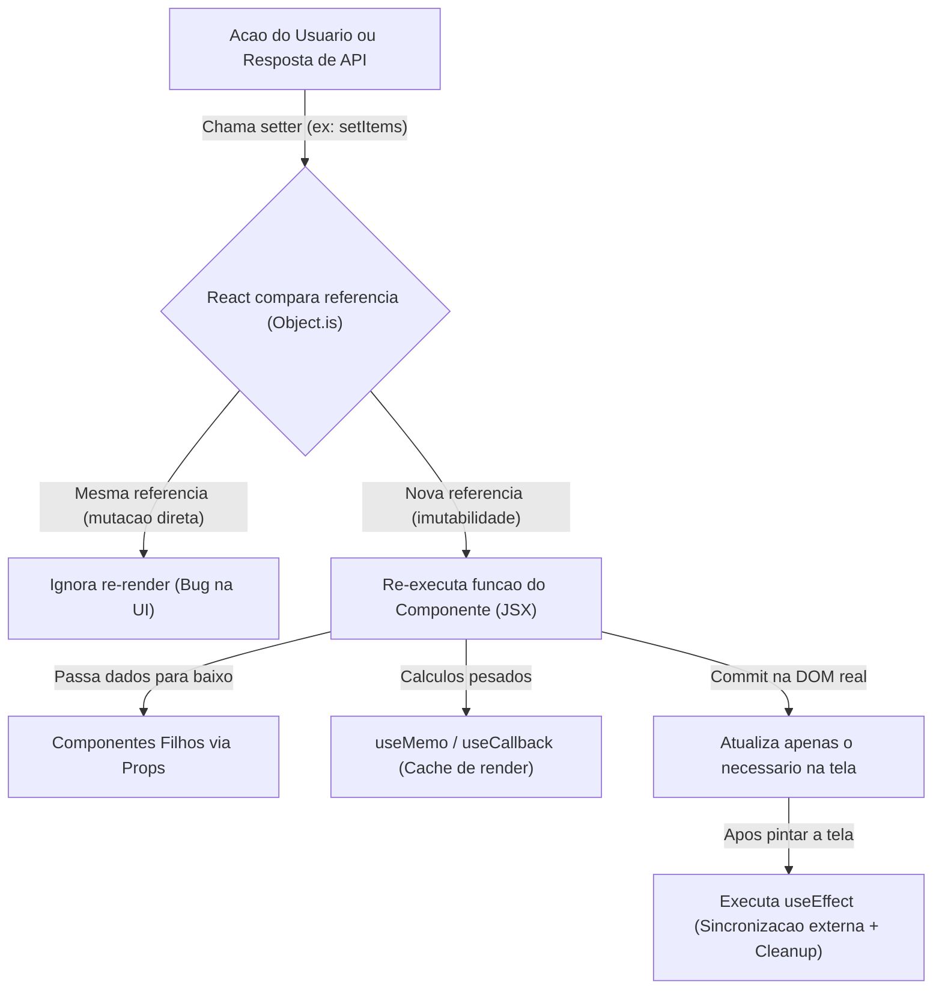

# Aula 08 — Componentização & React

> *"Construir um software inteiro em um único arquivo monolítico é como soldar todos os móveis e motores da nave em um bloco maciço: se uma lâmpada queimar, você precisa serrar a fuselagem inteira para trocar."*

---

## 1. 🚀 Briefing da Missão (Contexto Temático & Realidade de Mercado)

| Metadado da Órbita | Valor |
| :--- | :--- |
| **Galáxia** | Galáxia 2 — Constelação do Frontend Web |
| **ID do Módulo** | `fe-frameworks` |
| **Pré-requisitos** | [Aula 07 — JavaScript Moderno (ES6+)](./07-javascript-moderno-es6.md) (`fe-js-moderno`) |
| **Descrição Oficial** | *"Modularidade extrema. Construa aplicações escaláveis aplicando os conceitos de componentização, reatividade e Hooks com o React."* |
| **Próxima Órbita** | [Aula 09 — Estado Global & Roteamento](./09-estado-global-roteamento.md) |

### 🛸 Analogia do Navegador Cósmico

No módulo anterior, você comandou a interface da nave **no braço (modo imperativo)**: "pegue o elemento X, crie um `<li>`, mude o texto, remova a classe Y". Em uma nave pequena, isso funciona. Mas quando a estação espacial tem 150 painéis que dependem uns dos outros (sensor de oxigênio, lista de tripulantes, barra de energia e alertas), ficar atualizando cada parafuso da DOM manualmente gera inconsistências graves.

O **React** transforma a cabine em um **sistema de Módulos Encaixáveis (Componentes)** guiados por um painel de **Telemetria Reativa (Estado)**. Em vez de dizer *como* alterar cada elemento passo a passo, você descreve de forma **declarativa**: *"Se `oxigenio < 20`, este componente PainelDeAlerta deve renderizar um aviso vermelho"*. Cada módulo da nave é autossuficiente (estrutura + lógica + estilo), recebe leituras de cima por dutos unidirecionais (**Props**), guarda sua própria memória local (**useState**), conecta-se a sensores externos com limpeza automática (**useEffect**) e transmite energia vital para toda uma ala sem precisar puxar cabos por cada corredor (**Context API**).

### 🏢 Qual dor real esse módulo resolve nas empresas?

O React é a biblioteca de UI mais demandada no mercado global e brasileiro de frontend. Ele resolve diretamente três gargalos críticos de times de produto:
1. **Reuso e velocidade de entrega:** criar um componente `<Button />`, `<Modal />` ou `<DataTable />` testado uma única vez e reaproveitá-lo em 40 telas reduz bugs visuais e acelera novas features.
2. **Previsibilidade de estado (UI = f(state)):** a interface passa a ser uma função pura dos dados atuais, eliminando estados impossíveis ("o botão diz 'Carregando', mas o erro já apareceu e a lista sumiu").
3. **Escalabilidade de equipe:** vários desenvolvedores conseguem trabalhar simultaneamente em componentes independentes da mesma aplicação sem pisar no código uns dos outros.

---

## 2. 📚 Carga de Conhecimento Completa (Tópico por Tópico)

Veja como funciona o ciclo de **Renderização Reativa** e o fluxo de dados no React:



### 2.1 Compreender os conceitos de arquitetura baseada em componentes

Na arquitetura baseada em componentes do React, a interface inteira é decomposta em **funções JavaScript independentes e reutilizáveis** cujo nome começa sempre com letra maiúscula (`UserCard`, `FilterBar`, `MissionPage`) e que retornam **JSX** (sintaxe declarativa que parece HTML, mas compila para chamadas JavaScript `jsx(...)`).

Princípios essenciais de uma boa componentização:
- **Responsabilidade Única (Coesão):** se um componente tem 500 linhas misturando chamada `fetch`, validação de formulário, modal e lista de cards, ele precisa ser dividido em subcomponentes menores e focados.
- **Composição via `children`:** em vez de criar 15 props booleanas (`hasHeader`, `hasFooter`, `isBlue`), crie contêineres flexíveis como `<Card>{children}</Card>` que aceitam qualquer conteúdo JSX dentro deles.
- **Listas com `key` estável:** ao renderizar arrays com `.map()`, todo item precisa de uma prop `key` única e estável (como `item.id`), **nunca o índice do array (`index`)** quando a lista pode ser ordenada, filtrada ou removida — caso contrário, o React mistura o estado interno dos elementos na tela.

### 2.2 Dominar gerenciamento de estado local com o hook `useState`

Variáveis locais comuns (`let count = 0;`) dentro de uma função de componente são zeradas toda vez que o componente renderiza novamente — e alterá-las não avisa o React para redesenhar a tela. O hook **`useState`** resolve ambos os problemas:

```jsx
const [missions, setMissions] = useState([]);
```

Três regras inegociáveis do `useState`:
1. **Imutabilidade obrigatória:** o React usa comparação por referência (`Object.is`) para decidir se o estado mudou. Nunca faça `missions.push(newItem)` ou `user.name = "Ana"`. Sempre crie uma nova referência:
   - Arrays: adicionar `[...missions, item]`, remover `missions.filter((m) => m.id !== id)`, atualizar `missions.map((m) => (m.id === id ? { ...m, done: true } : m))`.
   - Objetos: `{ ...user, name: "Ana" }`.
2. **Atualização funcional (*updater function*):** quando o próximo estado depende do valor anterior (especialmente dentro de timers, eventos múltiplos ou callbacks), use `setCount((prev) => prev + 1)` em vez de `setCount(count + 1)`, evitando ler um valor obsoleto (*stale closure*) porque atualizações de estado no React são agrupadas em lote (*batching*) e assíncronas em relação à linha seguinte do código.
3. **Derivação vs. Estado redundante:** se um valor pode ser calculado diretamente a partir de um estado ou prop existente (ex: `const totalItems = items.length;` ou `const filtered = items.filter(...)`), **não crie um segundo `useState` para ele!** Estado duplicado gera dessincronização.

### 2.3 Controlar efeitos colaterais na interface usando `useEffect`

Um componente React deve ser, sempre que possível, uma **função pura** durante a renderização: dado o mesmo conjunto de `props` e `state`, produz o mesmo JSX, sem alterar o mundo externo durante o cálculo do JSX. Operações que interagem com sistemas fora do controle do React — chamadas de API, assinaturas WebSocket, timers (`setInterval`), eventos globais (`window.addEventListener`), sincronização com `document.title` ou `localStorage` — são **efeitos colaterais** gerenciados pelo **`useEffect`**:

```jsx
useEffect(() => {
  // 1. Efeito (executa APÓS o React atualizar o DOM)
  const controller = new AbortController();
  loadData(query, controller.signal);

  // 2. Função de Cleanup (executa antes do próximo efeito ou ao desmontar o componente)
  return () => controller.abort();
}, [query]); // 3. Array de dependências
```

Como o array de dependências controla o `useEffect`:
- `[depA, depB]`: roda na montagem inicial e sempre que `depA` ou `depB` mudarem de referência.
- `[]` (array vazio): roda apenas uma vez na montagem (e limpa na desmontagem; em desenvolvimento com `<React.StrictMode>`, o React monta, desmonta e remonta propositalmente para expor bugs de falta de *cleanup*!).
- Sem array: roda após **toda** renderização (raramente desejado e perigoso para loops infinitos se alterar estado dentro dele).

**Atenção da documentação oficial (`react.dev`):** *"You Might Not Need an Effect"*. Não use `useEffect` para transformar dados de estado (calcule durante o render) nem para responder a cliques do usuário (coloque a lógica diretamente no handler `onClick`/`onSubmit`).

### 2.4 Compartilhar dados entre componentes usando Context API

Quando um dado precisa ser lido por vários componentes distantes na árvore (como usuário autenticado, tema Claro/Escuro, idioma ou notificações), passá-lo de pai para filho por 5 níveis seguidos gera **Prop Drilling** (poluição de interfaces intermediárias).

A **Context API** cria um canal de transmissão direto para uma subárvore:
1. **Criar o contexto:** `const AuthContext = createContext(null);`
2. **Prover o valor (`Provider`):** envolva a árvore com `<AuthContext.Provider value={{ user, login, logout }}>{children}</AuthContext.Provider>` (ou `<AuthContext value={...}>` no React 19).
3. **Consumir via Hook customizado:** crie `export function useAuth() { ... }` encapsulando `useContext(AuthContext)` e validando se o hook foi usado dentro do Provider — oferecendo excelente ergonomia e mensagens de erro claras.

**Limite importante da Context API:** todo componente que consome um Context é **re-renderizado** sempre que a propriedade `value` do Provider muda de referência. Por isso, Context API é excelente para dados que mudam com pouca frequência (tema, autenticação, preferências), mas não substitui stores especializados ou caches de servidor quando há alta frequência de atualizações parciais — tema que aprofundaremos na Aula 09!

### 2.5 Otimizar renders utilizando hooks de memoização (`useMemo`, `useCallback`)

Por padrão, quando um componente pai re-renderiza, o React re-renderiza seus filhos também. Na maioria dos casos, o React é rápido o suficiente sem nenhuma otimização extra — **memoização prematura adiciona complexidade e custo de memória sem ganho real**. Porém, em cenários específicos de gargalo mensurado (listas com milhares de itens, gráficos complexos, componentes filhos pesados envolvidos em `React.memo`), dois hooks entram em cena:

- **`useMemo(() => calculoCaro(items, filter), [items, filter])`:** armazena em cache o **valor retornado** por uma função custosa, recalculando apenas quando alguma dependência mudar. Também preserva a mesma referência de objeto/array entre renders.
- **`useCallback((id) => handleSelect(id), [dependency])`:** armazena em cache a **própria referência da função** entre renders (equivalente a `useMemo(() => fn, deps)`). É útil principalmente em dois cenários:
  1. Quando você passa essa função como `prop` para um componente filho otimizado com `React.memo(...)` (sem `useCallback`, a função ganha nova referência a cada render do pai e invalida o `React.memo` do filho).
  2. Quando a função entra no array de dependências de um `useEffect` no filho ou no próprio componente.

### 2.6 Praticar a passagem de parâmetros unidirecional através de Props

No React, os dados seguem estritamente o padrão **One-Way Data Flow (Fluxo Unidirecional de Dados — "Top-Down")**:
- **Pais passam dados para Filhos via Props** (`<MissionCard title={m.title} onSelect={handleSelect} />`).
- **Props são somente leitura (*read-only*):** um componente filho **nunca** deve modificar uma prop recebida (`props.title = "Outro"` é proibido).
- **Como o filho comunica mudanças para o pai?** O pai passa uma função de callback via prop (`onSelect`, `onToggle`). Quando o usuário clica no filho, o filho **chama o callback recebido** passando apenas os dados necessários (`onSelect(mission.id)`), e o pai decide como atualizar seu próprio estado. Esse padrão também sustenta o **Lifting State Up** (elevar o estado para o ancestral comum mais próximo quando dois componentes irmãos precisam compartilhar e alterar o mesmo dado).

---

## 3. 💻 Mão no Código (Jeito Iniciante vs. Padrão Profissional)

Cenário: **Painel de Módulos com Busca, Seleção, Tema Compartilhado via Context API e Chamada de API com Cleanup**.

### ❌ Jeito Iniciante (Antipadrão: mutação direta de estado, estado derivado duplicado, `useEffect` sem cleanup e prop drilling excessivo)

```jsx
// BadDashboard.jsx
import { useState, useEffect } from "react";

export function BadDashboard() {
  const [tasks, setTasks] = useState([]);
  const [filteredTasks, setFilteredTasks] = useState([]); // ERRO: estado duplicado derivado!
  const [search, setSearch] = useState("");
  const [theme, setTheme] = useState("dark");

  useEffect(() => {
    // ERRO: sem AbortController; se usuário sair da tela, tenta atualizar componente desmontado
    fetch("https://jsonplaceholder.typicode.com/todos?_limit=10")
      .then((r) => r.json())
      .then((data) => {
        setTasks(data);
        setFilteredTasks(data);
      });
  }, []);

  // ERRO: useEffect desnecessário apenas para sincronizar filtro com estado derivado
  useEffect(() => {
    setFilteredTasks(tasks.filter((t) => t.title.includes(search)));
  }, [search, tasks]);

  function toggleTask(id) {
    // ERRO FATAL: mutação direta! Mantém a mesma referência do array, a tela não atualiza!
    const found = tasks.find((t) => t.id === id);
    found.completed = !found.completed;
    setTasks(tasks);
  }

  return (
    <div>
      {/* Prop drilling de theme em todos os filhos */}
      <Header theme={theme} setTheme={setTheme} search={search} setSearch={setSearch} />
      {filteredTasks.map((task, index) => (
        // ERRO: usando index como key em lista filtrável!
        <div key={index} onClick={() => toggleTask(task.id)}>
          {task.title}
        </div>
      ))}
    </div>
  );
}
```

### ✅ Padrão Profissional (Imutabilidade, Estado Derivado, Context API, `useMemo`/`useCallback`, `AbortController` e Fluxo Unidirecional)

```jsx
// ThemeContext.jsx — Compartilhamento limpo de tema sem Prop Drilling
import { createContext, useContext, useState, useMemo, useCallback } from "react";

const ThemeContext = createContext(null);

export function ThemeProvider({ children }) {
  const [theme, setTheme] = useState("dark");

  // useCallback mantém referência estável da função de alternância
  const toggleTheme = useCallback(() => {
    setTheme((prev) => (prev === "dark" ? "light" : "dark"));
  }, []);

  // useMemo evita recriar o objeto value se o theme não tiver mudado
  const value = useMemo(() => ({ theme, toggleTheme }), [theme, toggleTheme]);

  return <ThemeContext.Provider value={value}>{children}</ThemeContext.Provider>;
}

export function useTheme() {
  const context = useContext(ThemeContext);
  if (!context) {
    throw new Error("useTheme deve ser usado dentro de um ThemeProvider.");
  }
  return context;
}
```

```jsx
// TaskItem.jsx — Componente puro, reutilizável e memoizado
import { memo } from "react";
import { useTheme } from "./ThemeContext";

export const TaskItem = memo(function TaskItem({ task, onToggle }) {
  const { theme } = useTheme(); // Consome direto do Context sem Prop Drilling

  return (
    <li className={`task-item task-item--${theme}`}>
      <label>
        <input
          type="checkbox"
          checked={task.completed}
          // Fluxo unidirecional: notifica o pai apenas com o ID
          onChange={() => onToggle(task.id)}
        />
        <span>{task.title}</span>
      </label>
    </li>
  );
});
```

```jsx
// TaskDashboard.jsx — Estado mínimo, imutabilidade e cleanup em useEffect
import { useState, useEffect, useMemo, useCallback } from "react";
import { TaskItem } from "./TaskItem";
import { useTheme } from "./ThemeContext";

export function TaskDashboard() {
  const { theme, toggleTheme } = useTheme();
  const [tasks, setTasks] = useState([]);
  const [search, setSearch] = useState("");
  const [status, setStatus] = useState("loading"); // "loading" | "ready" | "error"

  useEffect(() => {
    const controller = new AbortController();

    async function loadTasks() {
      try {
        setStatus("loading");
        const res = await fetch("https://jsonplaceholder.typicode.com/todos?_limit=12", {
          signal: controller.signal
        });
        if (!res.ok) throw new Error("Falha ao buscar tarefas da estação.");
        const data = await res.json();
        setTasks(data);
        setStatus("ready");
      } catch (err) {
        if (err.name === "AbortError") return;
        setStatus("error");
      }
    }

    loadTasks();
    // Cleanup cancela a requisição se o componente desmontar antes da resposta
    return () => controller.abort();
  }, []);

  // Estado derivado com useMemo (sem criar segundo useState nem useEffect redundante!)
  const visibleTasks = useMemo(() => {
    const normalized = search.trim().toLowerCase();
    return tasks.filter((task) => task.title.toLowerCase().includes(normalized));
  }, [tasks, search]);

  // Atualização imutável + funcional + referência estável para TaskItem memoizado
  const handleToggleTask = useCallback((taskId) => {
    setTasks((prevTasks) =>
      prevTasks.map((task) =>
        task.id === taskId ? { ...task, completed: !task.completed } : task
      )
    );
  }, []);

  return (
    <section className={`dashboard dashboard--${theme}`}>
      <header>
        <h1>Checklist da Missão ({visibleTasks.length})</h1>
        <button type="button" onClick={toggleTheme}>
          Tema atual: {theme}
        </button>
      </header>

      <input
        type="search"
        value={search}
        onChange={(e) => setSearch(e.target.value)}
        placeholder="Filtrar tarefas..."
        aria-label="Filtrar tarefas"
      />

      {status === "loading" && <p role="status">Sincronizando dados...</p>}
      {status === "error" && <p role="alert">Erro de comunicação com a API.</p>}

      {status === "ready" && (
        <ul>
          {visibleTasks.map((task) => (
            // key única e estável vinda do ID do registro
            <TaskItem key={task.id} task={task} onToggle={handleToggleTask} />
          ))}
        </ul>
      )}
    </section>
  );
}
```

---

## 4. 🛠️ Laboratório de Voo (Exercício Prático Guiado)

**Duração estimada:** 50 minutos | **Objetivo:** Construir uma **Central de Tripulação React** com filtros derivados, Context API de Favoritos e verificação de renderizações.

### Passo a Passo
1. Crie um projeto rápido com `npm create vite@latest lab-08-react -- --template react` e instale as dependências (`npm install`).
2. Crie um contexto `src/contexts/FavoritesContext.jsx` que guarde um array `favoriteIds` no `useState` e exponha `toggleFavorite(id)` e `isFavorite(id)` via hook customizado `useFavorites()`.
3. Crie um componente `src/components/CrewCard.jsx` envolvido em `React.memo`. Ele deve receber `member` e `onSelect` via props, ler `isFavorite(member.id)` do Context e renderizar nome, cargo e botão de favoritar/selecionar.
4. No `src/App.jsx`, busque uma lista de usuários (`https://jsonplaceholder.typicode.com/users`) dentro de um `useEffect` usando `AbortController` no `return () => controller.abort()`, tratando `loading` e `error`.
5. Adicione um `<input>` controlado de busca (`search`) e um `<select>` de ordenação (`A-Z` / `Z-A`). Calcule `sortedAndFilteredUsers` usando **`useMemo`** — sem criar nenhum `useState` extra para a lista filtrada!
6. Crie um painel de detalhes lateral que exiba o tripulante selecionado (elevação de estado no `App.jsx` passando `onSelect` via `useCallback`).
7. Teste abrir o **React Developer Tools (aba Profiler)** no Chrome para observar quando `CrewCard` re-renderiza ao digitar no campo ou favoritar um item.

### ✅ Critérios de Domínio
- [ ] Zero mutações diretas em arrays ou objetos de estado (`.push`, `.sort()` direto no array sem `[...arr].sort()`).
- [ ] `key` baseada em `user.id`, nunca em `index`.
- [ ] Nenhum `useEffect` redundante para derivar lista filtrada/ordenada.
- [ ] `AbortController` presente no cleanup do `useEffect` de busca.
- [ ] Tema ou Favoritos compartilhados com `Context API` + hook customizado (`useFavorites`) com erro explícito caso usado fora do Provider.

---

## 5. 🎯 Resolução Comentada do Teste de Ignição (Quest Oficial)

**Pergunta Oficial (`data.js`):**
> *No React, por que é uma regra fundamental tratar o estado como imutável (ex: nunca fazer 'state.value = x' diretamente)?*

- **A)** Porque mutações diretas bloqueiam a compilação do JavaScript.
- **B)** Porque o React detecta alterações e dispara a renderização atualizada do componente comparando as referências do estado; alterar o objeto diretamente mantém a mesma referência e não atualiza a tela.
- **C)** Porque dados imutáveis ocupam menos espaço na memória VRAM da GPU do cliente.
- **D)** Porque objetos mutáveis são deletados automaticamente pelo navegador a cada 30 segundos.

### ✅ Resposta Correta: **Alternativa B**

**Por que a Alternativa B está correta:**
Internamente, quando você chama `setState(novoValor)`, o React compara o estado anterior com o novo estado usando **`Object.is(prevState, nextState)`** (comparação rasa de identidade de referência para objetos e arrays). Se você faz `state.value = x` e depois chama `setState(state)`, o ponteiro na memória continua exatamente igual! O React conclui *"nada mudou"* (`Object.is(state, state) === true`) e **não agenda a re-renderização**, deixando a UI desatualizada em relação aos dados. Ao passar um **novo objeto ou array** (`{ ...state, value: x }`), a referência muda (`Object.is` retorna `false`), o React percebe a mudança e atualiza a tela corretamente — além de permitir otimizações seguras em `useMemo`, `useEffect` e `React.memo`.

**Por que cada uma das outras alternativas está incorreta:**
- **Alternativa A (Errada):** JavaScript é dinamicamente tipado e permite mutação de propriedades de objetos normalmente em tempo de execução e compilação — inclusive, esse código compila sem erro e só falha silenciosamente na lógica de renderização!
- **Alternativa C (Errada):** criar novos objetos imutáveis via Spread na verdade aloca *novas* referências na memória RAM (Heap do V8), não tem relação com economia de VRAM da GPU. O ganho está na **comparação O(1) por referência** (muito mais barata do que percorrer árvores profundas de objetos comparando cada propriedade) e na previsibilidade de histórico/render.
- **Alternativa D (Errada):** o coletor de lixo (*Garbage Collector*) do navegador jamais deleta objetos que ainda estão referenciados pela aplicação, sejam eles mutáveis ou imutáveis, muito menos em um intervalo arbitrário de 30 segundos.

---

## 6. 🎤 Kit de Apresentação (Como Dar Aula / Apresentar Este Módulo)

### 🎙️ Pitch Feynman de 2 Minutos
> "Antes do React, fazer uma tela complexa em JavaScript puro era como ser um gerente que precisa correr atrás de cada funcionário dizendo manualmente: 'troca aquele número, apaga aquela linha, muda a cor daquele botão'. Quanto maior o sistema, mais você esquece de atualizar um canto e a tela fica inconsistente. O React vira esse jogo com uma ideia simples: a interface é uma fotografia do estado atual (`UI = f(estado)`). Nós quebramos a página em blocos independentes chamados Componentes. Cada componente recebe configurações de cima para baixo pelas Props (como parâmetros de uma função) e controla sua própria memória com o `useState`. E por que nunca podemos alterar o `useState` direto fazendo `lista.push()`? Porque o React é esperto e preguiçoso no bom sentido: para saber se precisa redesenhar a tela rápido, ele não abre a caixa para olhar item por item — ele só olha se chegou uma caixa nova na memória (nova referência). Quando precisamos conectar o componente ao mundo externo, como uma API, usamos o `useEffect` sempre com limpeza. Se um dado precisa cruzar vários andares de componentes sem poluir todo mundo no meio do caminho, ligamos um canal direto com a Context API. E só se um cálculo pesado realmente gargalar, colocamos um cache com `useMemo` e `useCallback`."

### 📊 Roteiro de Slides (6 Slides)
1. **Slide 1 — Imperativo (DOM Manual) vs. Declarativo (React)**
   - *Bullets:* O custo de sincronizar múltiplos pontos da tela na mão; `UI = f(state)`; arquitetura em árvore de componentes.
   - *Visual:* Comparação código DOM manual vs. componente JSX declarativo.
2. **Slide 2 — Props e Fluxo Unidirecional de Dados**
   - *Bullets:* Dados descem via props (`read-only`), eventos sobem via callbacks; composição com `children`; Lifting State Up.
   - *Visual:* Árvore hierárquica com setas azuis descendo (Props) e setas laranjas subindo (Callbacks).
3. **Slide 3 — `useState` e a Regra de Ouro da Imutabilidade**
   - *Bullets:* Por que `Object.is` exige nova referência; atualização funcional `prev => ...`; evitar estado derivado duplicado.
   - *Visual:* Endereço de memória `#0x1A` (mutação = não renderiza) vs. `#0x2B` (novo objeto = re-render).
4. **Slide 4 — `useEffect`: Sincronizando com o Mundo Externo**
   - *Bullets:* Render puro vs. efeito colateral; array de dependências; função de cleanup (`AbortController`, `clearInterval`); "You Might Not Need an Effect".
   - *Visual:* Linha do tempo: Mount -> Paint -> Effect -> Re-render -> Cleanup -> New Effect -> Unmount.
5. **Slide 5 — Context API contra o Prop Drilling**
   - *Bullets:* Criando `createContext`, `Provider` e custom hook `useX()`; quando usar vs. impacto em re-renders.
   - *Visual:* Árvore antes (prop passando por 4 nós inúteis) vs. depois (túnel direto do Provider ao consumidor).
6. **Slide 6 — Otimização Consciente: `useMemo`, `useCallback` e `React.memo`**
   - *Bullets:* Não otimize no escuro; estabilidade referencial; quando `useCallback` faz diferença real.
   - *Visual:* Gráfico simples mostrando React Profiler antes e depois de memoizar uma lista grande.

### 💻 Roteiro de Demo Ao Vivo (3 Minutos)
1. *(0:00–1:00)* Mostre ao vivo um botão "Adicionar item" usando `items.push(novo); setItems(items);` e prove que a tela **não muda**, depois troque para `setItems((prev) => [...prev, novo]);` e mostre funcionando instantaneamente.
2. *(1:00–2:00)* Abra o **React Developer Tools → Highlight updates when components render**. Digite na caixa de busca e mostre visualmente quais componentes piscam na tela, demonstrando como `React.memo` + `useCallback` impedem que itens não alterados repintem desnecessariamente.
3. *(2:00–3:00)* Remova temporariamente a `key={item.id}` e coloque `key={index}`, marque um checkbox no item 1 e inverta a ordenação — mostre na prática o bug do checkbox "ficar preso" no item errado por causa do `key={index}`.

### ❓ Perguntas Difíceis da Plateia
1. **"Por que o meu `useEffect` com `[]` roda duas vezes quando testo localmente no Vite?"**
   - *Resposta:* Isso acontece por causa do `<React.StrictMode>` ativado em ambiente de desenvolvimento (no build de produção ele roda normalmente apenas uma vez). O React faz esse ciclo proposital *Mount -> Cleanup -> Remount* para revelar se você esqueceu de limpar conexões, timers ou cancelar `fetch` com `AbortController` na função de retorno do `useEffect`.
2. **"Se eu colocar `useMemo` e `useCallback` em tudo por precaução, meu app fica mais rápido?"**
   - *Resposta:* Não, muitas vezes fica até um pouco mais lento e mais difícil de ler. Cada `useMemo` e `useCallback` tem um custo: o React precisa alocar memória para guardar valores antigos e comparar arrays de dependências em cada render. Só vale a pena quando há cálculo realmente custoso, estabilidade referencial necessária para um `useEffect`, ou filhos realmente pesados envolvidos em `React.memo`.

---

## 7. 💼 Radar do Mercado de Trabalho (Foco Dev Júnior)

### 🎯 3 Perguntas Reais de Entrevista Técnica Júnior
1. **Pergunta:** *"Qual a diferença entre `state` e `props` em React?"*
   - **Resposta Modelo:** "`Props` são dados ou callbacks passados de um componente pai para um filho; eles são somente leitura para quem recebe e garantem o fluxo unidirecional. Já o `state` é a memória interna e mutável (de forma imutável via setter) controlada pelo próprio componente. Quando uma prop ou um estado muda, o componente re-renderiza, mas apenas o dono do estado pode alterá-lo diretamente."
2. **Pergunta:** *"Por que devemos evitar usar o índice do array (`index`) como `key` ao renderizar listas dinâmicas?"*
   - **Resposta Modelo:** "O React usa a `key` para identificar qual elemento da lista corresponde a qual nó da árvore entre duas renderizações. Se uma lista pode ser filtrada, reordenada ou ter itens inseridos no início, os índices mudam de dono (quem era índice 0 vira índice 1). Isso faz o React reaproveitar estado interno — como valor de inputs ou checkboxes — no item errado e pode gerar degradação de performance. Por isso usamos um ID único e estável vindo dos dados."
3. **Pergunta:** *"Quando você usaria `useEffect` e qual a importância da função de cleanup?"*
   - **Resposta Modelo:** "Eu uso `useEffect` exclusivamente para sincronizar meu componente com sistemas externos após a renderização — como buscar dados de uma API, registrar `addEventListener` em `window`, criar `setInterval` ou integrar uma biblioteca imperativa de gráficos. A função de cleanup (`return () => ...`) é essencial para cancelar requisições em voo com `AbortController`, remover listeners ou limpar timers antes de o efeito rodar de novo ou quando o componente sai da tela, evitando vazamentos de memória e race conditions."

### ⚠️ Erros Clássicos de Júnior vs. Postura Profissional

| Erro Clássico de Júnior | Postura Profissional Esperada |
| :--- | :--- |
| Chamar `setCount(count + 1)` três vezes seguidas achando que vai somar +3. | Usar atualização funcional `setCount((c) => c + 1)` quando depende do estado anterior. |
| Criar `useState` + `useEffect` para filtrar uma lista que já existe no estado. | Derivar o valor diretamente no corpo do componente (ou com `useMemo` se for pesado). |
| Esquecer `cleanup` em `setInterval`, WebSockets ou `fetch`, causando warnings e bugs. | Sempre retornar função de limpeza cancelando timers, listeners ou `AbortController`. |
| Deixar componentes gigantes de 600 linhas misturando UI, fetch e regras de negócio. | Extrair subcomponentes coesos e hooks customizados (`useTasks`, `useTheme`). |

### 🌐 Evidência para Portfólio / GitHub / LinkedIn
- **GitHub:** Suba o projeto do **Laboratório de Voo** organizado em pastas (`components/`, `contexts/`, `hooks/`), com print do **React DevTools Profiler** no `README.md` provando controle de re-renderizações e tratamento completo dos estados `loading`, `error` e `empty`.
- **LinkedIn:** Faça um post rápido mostrando o antes e depois de remover um `useEffect` desnecessário por estado derivado — esse tema mostra maturidade moderna alinhada exatamente com a documentação oficial do `react.dev`.

---

## 8. 📡 Transmissões Recomendadas & Próxima Órbita

### 🔗 Recursos Oficiais (`data.js`)
- [React Documentation (Nova)](https://react.dev/) — Documentação oficial moderna focada em Hooks, componentes funcionais e modelos mentais corretos.
- [React Labs / Learn (Exercícios práticos)](https://react.dev/learn) — Trilha interativa oficial com sandboxes para treinar imutabilidade, Thinking in React e "You Might Not Need an Effect".

### 🚀 Conexão com a Próxima Órbita
Com React puro (`useState`, `useEffect` e `Context API`), você já constrói interfaces modulares incríveis. Porém, logo aparecem três desafios de aplicações reais: **1)** navegar entre dezenas de URLs com parâmetros dinâmicos e rotas protegidas sem recarregar a página; **2)** gerenciar estados globais complexos sem provocar cascata de re-renders da Context API; e **3)** evitar reinventar cache, loading, retentativas e revalidação de APIs em todo `useEffect`. Na próxima aula, você assume a torre de controle com **React Router, Zustand e TanStack Query**!

👉 **Avançar para:** [Aula 09 — Estado Global & Roteamento](./09-estado-global-roteamento.md)
