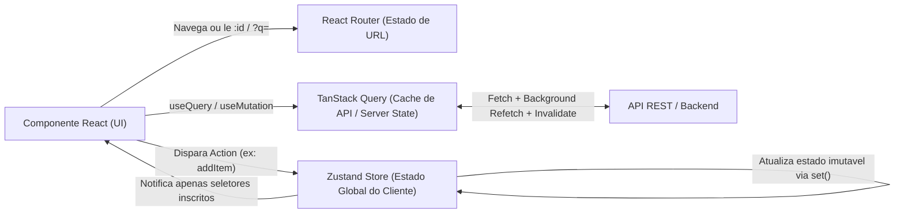

# Aula 09 — Estado Global & Roteamento

> *"À medida que uma nave cresce de cápsula individual para cruzador interestelar, passar recados de corredor em corredor não funciona mais: você precisa de corredores mapeados por coordenadas (Rotas), um barramento central de energia sem acoplamento (Estado Global) e memória de cache sincronizada com a base estelar (Server State)."*

---

## 1. 🚀 Briefing da Missão (Contexto Temático & Realidade de Mercado)

| Metadado da Órbita | Valor |
| :--- | :--- |
| **Galáxia** | Galáxia 2 — Constelação do Frontend Web |
| **ID do Módulo** | `fe-estado-roteamento` |
| **Pré-requisitos** | [Aula 08 — Componentização & React](./08-componentizacao-react.md) (`fe-frameworks`) |
| **Descrição Oficial** | *"Controle fluxos complexos de dados. Gerencie rotas em SPAs e utilize bibliotecas de estado global eficientes."* |
| **Próxima Órbita** | [Aula 10 — Performance & Build Tools](./10-performance-build-tools.md) |

### 🛸 Analogia do Navegador Cósmico

Em uma **Single Page Application (SPA)**, você nunca troca de nave física quando muda de tela — o navegador carrega um único `index.html` e alterna os módulos da ponte de comando instantaneamente sem recarregar a página. Quem controla em qual compartimento da nave o tripulante está (e se ele tem credencial para entrar na sala de máquinas) é o **Sistema de Comportas e Coordenadas: o React Router** (`BrowserRouter`, rotas dinâmicas como `/naves/:id` e rotas protegidas).

Mas existe um erro que todo cadete comete quando a nave cresce: tentar colocar **tudo** no mesmo lugar — ora passando dados por 8 componentes intermediários que nem usam aquela informação (**Prop Drilling**), ora salvando respostas gigantes de API dentro de uma store global na mão com `useEffect` + `isLoading` + `error` repetidos em 15 telas. Na engenharia moderna de Frontend, dividimos a comunicação da nave em **três painéis especializados**:
1. **Estado de Navegação / URL (React Router):** qual módulo/filtro/página o usuário está vendo agora (`/catalogo?categoria=motores`).
2. **Estado Global de Cliente (Zustand / Redux):** dados locais compartilhados entre telas (carrinho de suprimentos, usuário logado, barra lateral aberta, preferências).
3. **Estado de Servidor / Cache Assíncrono (TanStack Query / React Query):** dados que moram no backend, com cache inteligente, atualização em segundo plano e invalidação automática após `POST`/`PUT`/`DELETE`.

### 🏢 Qual dor real esse módulo resolve nas empresas?

Times de Frontend em produção sofrem diariamente quando misturam tudo em `useEffect` e Context API gigante:
1. **Re-renderizações em cascata e acoplamento:** colocar carrinho, filtros, notificações e usuário em um único `Context` faz o rodapé re-renderizar toda vez que um contador muda. Zustand permite assinar **apenas a fatia exata** (`selector`) que o componente usa.
2. **Requisições duplicadas e telas piscando loading sem necessidade:** sem TanStack Query, voltar da página `/produtos/42` para `/produtos` refaz o `fetch` inteiro do zero, mostra *spinner* de novo e não sincroniza alterações feitas no detalhe.
3. **Links que quebram ao compartilhar ou apertar "Voltar":** sem React Router bem estruturado (parâmetros de rota, `searchParams` e fallback 404), copiar uma URL e mandar no Slack não leva o colega para o mesmo lugar.

---

## 2. 📚 Carga de Conhecimento Completa (Tópico por Tópico)

Observe como os três tipos de estado e o fluxo unidirecional de ações se integram em uma SPA profissional:



### 2.1 Implementar roteamento dinâmico em SPAs usando React Router

Em sites tradicionais (MPA — *Multi-Page Application*), clicar em um link envia uma nova requisição HTTP de página HTML inteira para o servidor, apagando o estado em memória do JavaScript. Já em uma **SPA (Single Page Application)**, o **React Router** intercepta a navegação via **History API** do navegador (`window.history.pushState`), atualiza a barra de endereços sem recarregar o documento e renderiza apenas os componentes correspondentes àquela rota.

Peças essenciais do React Router moderno:
- **`<BrowserRouter>` (ou `createBrowserRouter`):** envolve a aplicação habilitando URLs limpas (`/produtos/10` em vez de `/#/produtos/10`).
- **Rotas Aninhadas e `<Outlet />`:** um componente `<AppLayout />` mantém cabeçalho e menu lateral fixos enquanto `<Outlet />` renderiza dinamicamente a página filha ativa.
- **Rotas Dinâmicas (`:id`) e `useParams()`:** permite definir `/catalog/:productId` e ler `const { productId } = useParams()` dentro do componente de detalhe.
- **Query Params (`useSearchParams()`):** mantém filtros, busca e paginação na URL (`/catalog?category=propulsores&page=2`), permitindo compartilhar o link exato e usar o botão "Voltar" do navegador.
- **Navegação Programática e Declarativa:** use `<Link to="...">` ou `<NavLink>` (que adiciona classe/estado `isActive` automaticamente) para links clicáveis pelo usuário, e `useNavigate()` após ações como envio de formulário ou login (`navigate("/dashboard", { replace: true })`).
- **Rotas Protegidas (*Protected Routes*) e Fallback 404 (`path="*"`):** um wrapper `<ProtectedRoute>` checa se há usuário autenticado na store; se não houver, redireciona com `<Navigate to="/login" state={{ from: location }} replace />`.

### 2.2 Gerenciar estados globais complexos sem acoplamento (Zustand ou Redux)

Quando você precisa compartilhar dados entre componentes distantes — como o carrinho de compras no botão do `<Header />` e a página `<Checkout />`, ou o estado de autenticação em rotas protegidas —, usar `useState` no topo e repassar via props cria **Prop Drilling**. E usar um `Context` único para dados que mudam muito causa re-renders desnecessários em todos os consumidores.

Por isso o mercado utiliza stores externas desacopladas como **Zustand** (minimalista, baseada em hooks, zero boilerplate de Providers) ou **Redux Toolkit** (padrão corporativo altamente estruturado para fluxos grandes):
- **Sem Providers obrigatórios (Zustand):** você cria um hook store com `create((set, get) => ({ ... }))` fora da árvore React e importa somente nos componentes que precisam dele.
- **Assinatura granular via Seletores (evita re-renders e acoplamento):**
  ```js
  // O Header re-renderiza APENAS quando o tamanho do carrinho muda — e nunca se 'user' mudar!
  const totalItems = useCartStore((state) => state.items.length);
  ```
- **Persistência integrada (`persist` middleware):** com um wrapper nativo do Zustand, sua store sincroniza automaticamente com `localStorage` ou `sessionStorage` sem você escrever `useEffect` manual em todo canto.
- **Redux vs. Zustand — quando escolher cada um?**
  - **Zustand:** ideal para 90% das aplicações React modernas (SPAs médias/grandes) pela simplicidade, leveza (~1 KB gzipped) e ausência de boilerplate.
  - **Redux Toolkit (RTK):** forte em times grandes com regras auditáveis estritas, histórico temporal com Redux DevTools avançado e padrões rígidos de slices/thunks.

### 2.3 Entender o fluxo unidirecional de dados (Actions -> Reducers/Setters)

Tanto o Redux quanto o Zustand (e até o hook nativo `useReducer`) seguem a filosofia da arquitetura **Flux / Fluxo Unidirecional de Dados** em ciclo fechado:

1. **View (Interface):** lê o estado atual da Store de forma somente leitura (ex: `const items = useCartStore((s) => s.items)`).
2. **Action (Intenção):** o usuário clica em "Adicionar ao Carrinho". A View **não** edita o array diretamente; ela dispara uma ação nomeada e expressiva (`addItem(product)` ou `dispatch({ type: "cart/add", payload: product })`).
3. **Reducer / Setter (Transição Pura e Imutável):** a função dentro da store recebe o estado atual (`state`) e os parâmetros da ação, calcula o **novo estado imutável** (`set((state) => ({ items: [...state.items, product] }))`) e substitui a referência na store.
4. **Notificação:** a store avisa apenas os componentes cujos seletores retornaram um valor diferente, fechando o ciclo com previsibilidade total — você sabe *exatamente* qual ação alterou qual estado e em qual momento!

### 2.4 Implementar cache de dados de APIs e sincronização com React Query

Um dos maiores saltos de senioridade no frontend é entender que **dados vindos do backend NÃO são estado local do cliente — eles são um snapshot assíncrono em cache (Server State)** que pode ficar desatualizado a qualquer segundo!

Fazer `fetch` dentro de `useEffect` manualmente obriga você a reescrever em toda tela: `isLoading`, `error`, `AbortController`, cache entre rotas, deduplicação de chamadas iguais simultâneas, retentativas (*retry*) e atualização após edição. O **TanStack Query (React Query)** resolve tudo isso declarativamente:

- **`useQuery({ queryKey, queryFn, staleTime })` (Leitura e Cache):**
  - `queryKey`: chave única em array que identifica os dados no cache, por exemplo `["products", { category, page }]`. Se o filtro muda, a chave muda e o React Query busca automaticamente!
  - **`staleTime` vs. `gcTime`:** `staleTime` define por quanto tempo o dado em cache é considerado "fresco" (sem precisar refazer requisição na rede ao voltar para a tela). `gcTime` (antigo `cacheTime`) define quanto tempo o dado permanece guardado na memória depois que nenhum componente está usando aquela query.
  - **Estados prontos:** `isPending` (primeira carga sem cache), `isFetching` (atualização silenciosa em segundo plano), `isError`, `error`, `data` e `refetch`.
- **`useMutation({ mutationFn, onSuccess })` (Escrita: POST, PUT, PATCH, DELETE):**
  - Executa alterações no servidor e, dentro do `onSuccess`, chama **`queryClient.invalidateQueries({ queryKey: ["products"] })`**. Automaticamente, qualquer lista na tela marcada com essa chave é revalidada e sincronizada com o backend — zero gambiarra manual de sincronização!

---

## 3. 💻 Mão no Código (Jeito Iniciante vs. Padrão Profissional)

Cenário: **Catálogo com Rota Dinâmica (`/products/:id`), Carrinho Global no Zustand e Cache de API com TanStack Query**.

### ❌ Jeito Iniciante (Antipadrão: Context único acoplado, `fetch` manual em toda tela sem cache e estado de servidor misturado com estado de UI)

```jsx
// BadApp.jsx
import { createContext, useContext, useState, useEffect } from "react";

// ERRO: Um único Context gigante mistura lista da API, loading, usuário e carrinho!
const AppContext = createContext();

export function BadApp() {
  const [products, setProducts] = useState([]);
  const [cart, setCart] = useState([]);
  const [loading, setLoading] = useState(false);

  // Toda vez que o usuário troca de tela e volta, refaz o fetch do zero sem cache
  useEffect(() => {
    setLoading(true);
    fetch("https://fakestoreapi.com/products")
      .then((r) => r.json())
      .then((data) => {
        setProducts(data);
        setLoading(false);
      });
  }, []);

  // Qualquer mudança em `cart` re-renderiza TODOS os componentes ligados ao AppContext!
  return (
    <AppContext.Provider value={{ products, cart, setCart, loading }}>
      <Navbar />
      <ProductList />
    </AppContext.Provider>
  );
}
```

### ✅ Padrão Profissional (React Router + Zustand desacoplado com seletores + TanStack Query com Cache e Invalidação)

#### 1. Store Global Desacoplada com Zustand (`src/stores/useCartStore.js`)

```javascript
// src/stores/useCartStore.js
import { create } from "zustand";
import { persist } from "zustand/middleware";

// Fluxo unidirecional explícito: View chama Actions -> Setter gera novo estado imutável
export const useCartStore = create(
  persist(
    (set, get) => ({
      items: [],

      // Action 1: adiciona item ou incrementa quantidade de forma imutável
      addItem: (product) =>
        set((state) => {
          const existing = state.items.find((item) => item.id === product.id);
          if (existing) {
            return {
              items: state.items.map((item) =>
                item.id === product.id
                  ? { ...item, quantity: item.quantity + 1 }
                  : item
              )
            };
          }
          return { items: [...state.items, { ...product, quantity: 1 }] };
        }),

      // Action 2: remove item por ID
      removeItem: (productId) =>
        set((state) => ({
          items: state.items.filter((item) => item.id !== productId)
        })),

      clearCart: () => set({ items: [] }),

      // Getter auxiliar usando get()
      getTotalPrice: () =>
        get().items.reduce((acc, item) => acc + item.price * item.quantity, 0)
    }),
    {
      name: "galactic-cart-storage" // Persiste automaticamente no localStorage
    }
  )
);
```

#### 2. Camada de Server State com TanStack Query (`src/hooks/useProducts.js`)

```javascript
// src/hooks/useProducts.js
import { useQuery, useMutation, useQueryClient } from "@tanstack/react-query";

const API_URL = "https://fakestoreapi.com/products";

async function fetchProducts(category) {
  const endpoint = category && category !== "all"
    ? `${API_URL}/category/${encodeURIComponent(category)}`
    : API_URL;

  const response = await fetch(endpoint);
  if (!response.ok) {
    throw new Error(`Falha ao carregar catálogo (HTTP ${response.status}).`);
  }
  return response.json();
}

async function fetchProductById(id) {
  const response = await fetch(`${API_URL}/${encodeURIComponent(id)}`);
  if (!response.ok) {
    throw new Error("Produto não encontrado no catálogo.");
  }
  return response.json();
}

export function useProductsQuery(category = "all") {
  return useQuery({
    queryKey: ["products", { category }], // Chave inclui o filtro para cache isolado por categoria
    queryFn: () => fetchProducts(category),
    staleTime: 1000 * 60 * 5 // Dados ficam frescos por 5 minutos sem refetch desnecessário
  });
}

export function useProductDetailQuery(productId) {
  return useQuery({
    queryKey: ["product", productId],
    queryFn: () => fetchProductById(productId),
    enabled: Boolean(productId) // Só dispara se productId existir
  });
}

export function useCreateProductMutation() {
  const queryClient = useQueryClient();

  return useMutation({
    mutationFn: async (newProduct) => {
      const res = await fetch(API_URL, {
        method: "POST",
        headers: { "Content-Type": "application/json" },
        body: JSON.stringify(newProduct)
      });
      if (!res.ok) throw new Error("Erro ao cadastrar produto.");
      return res.json();
    },
    onSuccess: () => {
      // Invalida o cache de listagens para sincronizar automaticamente após mutação
      queryClient.invalidateQueries({ queryKey: ["products"] });
    }
  });
}
```

#### 3. Roteamento Dinâmico + Protegido + Consumo Granular (`src/App.jsx`)

```jsx
// src/App.jsx
import { QueryClient, QueryClientProvider } from "@tanstack/react-query";
import { BrowserRouter, Routes, Route, Link, Outlet, Navigate, useParams, useSearchParams } from "react-router-dom";
import { useCartStore } from "./stores/useCartStore";
import { useProductsQuery, useProductDetailQuery } from "./hooks/useProducts";

const queryClient = new QueryClient();

function Navbar() {
  // Seletor granular: Navbar só re-renderiza quando a contagem total muda!
  const totalCount = useCartStore((state) =>
    state.items.reduce((sum, item) => sum + item.quantity, 0)
  );

  return (
    <header>
      <nav>
        <Link to="/catalog">Catálogo</Link>
        <Link to="/checkout">Carrinho ({totalCount})</Link>
      </nav>
      <Outlet />
    </header>
  );
}

function CatalogPage() {
  const [searchParams, setSearchParams] = useSearchParams();
  const category = searchParams.get("category") ?? "all";
  const addItem = useCartStore((state) => state.addItem);

  const { data: products = [], isPending, isError, error } = useProductsQuery(category);

  if (isPending) return <p role="status">Carregando catálogo...</p>;
  if (isError) return <p role="alert">{error.message}</p>;

  return (
    <main>
      <select
        value={category}
        onChange={(e) => setSearchParams({ category: e.target.value })}
        aria-label="Filtrar por categoria"
      >
        <option value="all">Todas as categorias</option>
        <option value="electronics">Eletrônicos</option>
        <option value="jewelery">Joias</option>
      </select>

      <ul>
        {products.map((product) => (
          <li key={product.id}>
            <Link to={`/catalog/${product.id}`}>{product.title}</Link>
            <button type="button" onClick={() => addItem(product)}>
              Adicionar
            </button>
          </li>
        ))}
      </ul>
    </main>
  );
}

function ProductDetailPage() {
  const { productId } = useParams();
  const { data: product, isPending, isError } = useProductDetailQuery(productId);

  if (isPending) return <p>Carregando detalhes...</p>;
  if (isError || !product) return <p>Item não localizado.</p>;

  return (
    <article>
      <h1>{product.title}</h1>
      <p>{product.description}</p>
      <Link to="/catalog">Voltar ao catálogo</Link>
    </article>
  );
}

function ProtectedRoute({ isAuthenticated, children }) {
  if (!isAuthenticated) {
    return <Navigate to="/login" replace />;
  }
  return children;
}

export default function App() {
  const isAuthenticated = true; // Em produção vem da useAuthStore!

  return (
    <QueryClientProvider client={queryClient}>
      <BrowserRouter>
        <Routes>
          <Route element={<Navbar />}>
            <Route path="/" element={<Navigate to="/catalog" replace />} />
            <Route path="/catalog" element={<CatalogPage />} />
            <Route path="/catalog/:productId" element={<ProductDetailPage />} />
            <Route
              path="/checkout"
              element={
                <ProtectedRoute isAuthenticated={isAuthenticated}>
                  <section><h1>Finalizar Pedido</h1></section>
                </ProtectedRoute>
              }
            />
            <Route path="*" element={<p>404 — Setor espacial não encontrado.</p>} />
          </Route>
        </Routes>
      </BrowserRouter>
    </QueryClientProvider>
  );
}
```

---

## 4. 🛠️ Laboratório de Voo (Exercício Prático Guiado)

**Duração estimada:** 55 minutos | **Objetivo:** Construir um **Painel de Suprimentos Espaciais** com rotas dinâmicas, store de autenticação + carrinho em Zustand e cache com TanStack Query.

### Passo a Passo
1. Crie um projeto Vite React (`npm create vite@latest lab-09-rotas-estado -- --template react`) e instale as 3 bibliotecas centrais:
   `npm install react-router-dom zustand @tanstack/react-query`
2. Crie `src/stores/useAuthStore.js` com Zustand armazenando `user` (`null` ou `{ name, role }`), `login(name)` e `logout()`, persistido no `localStorage`.
3. Crie `src/stores/useCartStore.js` com Zustand contendo `items`, `addItem`, `removeItem` e `clearCart`.
4. Configure o `QueryClientProvider` e o `BrowserRouter` em `src/App.jsx` com as seguintes rotas:
   - `/login` (tela simples para entrar com nome de usuário),
   - `/products` (listagem com filtro em `useSearchParams` consumindo API via `useQuery`),
   - `/products/:id` (rota dinâmica lendo `useParams()` e buscando detalhe com `useQuery`),
   - `/cart` (rota **protegida** pelo `ProtectedRoute` que redireciona para `/login` se `user === null`),
   - `*` (página 404 amigável com botão de voltar).
5. Navegue de `/products` para `/products/1` e volte para `/products`: verifique na aba **Network** do DevTools que, graças ao `staleTime`, a lista não dispara novo carregamento bloqueante ao voltar!
6. Adicione um item ao carrinho e garanta que o contador no `<Navbar />` atualize instantaneamente usando um seletor específico no Zustand (`useCartStore((s) => s.items.length)`).

### ✅ Critérios de Domínio
- [ ] Filtro de busca ou categoria sincronizado na URL (`useSearchParams`), sobrevivendo ao F5.
- [ ] Rota `/cart` bloqueada para usuário deslogado, redirecionando para `/login` com `replace`.
- [ ] Store Zustand sem nenhum `Provider` acoplado ao `App.jsx` e com seletores específicos nos componentes.
- [ ] Zero `useEffect` manual fazendo `fetch()` — todas as buscas de API usam `useQuery`.
- [ ] Rota inválida (`/nao-existe`) exibe componente 404 customizado sem tela branca.

---

## 5. 🎯 Resolução Comentada do Teste de Ignição (Quest Oficial)

**Pergunta Oficial (`data.js`):**
> *Qual problema de design de software é evitado ao adotar uma biblioteca de estado global como Zustand em uma aplicação com muitos níveis de componentes?*

- **A)** Evita a necessidade de escrever testes automatizados para a interface.
- **B)** Evita o 'Prop Drilling' (passar props através de múltiplos níveis de componentes intermediários que não precisam desses dados apenas para chegar a um filho profundo).
- **C)** Impede que o usuário aperte F5 para atualizar a página.
- **D)** Garante que o banco de dados SQL seja atualizado instantaneamente do lado do cliente.

### ✅ Resposta Correta: **Alternativa B**

**Por que a Alternativa B está correta:**
**Prop Drilling** ocorre quando um estado criado em um componente ancestral alto (ex: `App`) precisa atravessar 4, 5 ou mais componentes intermediários (`Layout -> Sidebar -> MenuList -> MenuItem -> UserBadge`) apenas para chegar ao componente folha que realmente o consome. Os componentes do meio ficam acoplados a props que eles mesmos não utilizam, dificultando refatorações e testes. Bibliotecas de estado global como **Zustand** (ou Redux) centralizam esse estado fora da hierarquia rígida de props, permitindo que qualquer componente assine apenas a fatia de estado de que precisa diretamente via hook (`useAuthStore((s) => s.user)`).

**Por que cada uma das outras alternativas está incorreta:**
- **Alternativa A (Errada):** nenhuma biblioteca de gerenciamento de estado dispensa testes automatizados. Pelo contrário, separar regras de negócio em actions puras de uma store até facilita testar fluxos de estado, mas testes unitários, de integração e E2E continuam essenciais.
- **Alternativa C (Errada):** o gerenciamento de estado roda na memória JavaScript do navegador; ele não bloqueia o atalho `F5` nem impede o recarregamento da página (embora middlewares como `persist` no Zustand possam salvar e restaurar o estado no `localStorage` após um `F5`).
- **Alternativa D (Errada):** Zustand é uma biblioteca de estado em memória do **Frontend (lado do cliente)**. Ela não possui conexão direta com bancos de dados SQL do servidor — a comunicação com o backend continua acontecendo via APIs HTTP/GraphQL/WebSockets.

---

## 6. 🎤 Kit de Apresentação (Como Dar Aula / Apresentar Este Módulo)

### 🎙️ Pitch Feynman de 2 Minutos
> "Quando uma aplicação React cresce de cinco telas para cinquenta, aparecem duas dores gigantes: primeiro, passar dados de pai para filho por seis andares de componentes que nem precisam daquela informação — o famoso Prop Drilling; segundo, sair escrevendo `useEffect` com `isLoading` e `fetch` repetido em cada página sem cache nenhum. É aí que dividimos a arquitetura em três especialistas. O **React Router** cuida de onde o usuário está (rotas dinâmicas como `/produtos/:id`, filtros na URL e rotas protegidas sem recarregar a página). O **Zustand** cuida do estado global do próprio cliente — como carrinho de compras ou usuário logado — com fluxo unidirecional limpo: a tela dispara uma Action, o setter gera um estado imutável e apenas o componente que assinou aquele pedacinho via seletor atualiza, sem Prop Drilling. E o **TanStack Query (React Query)** cuida do estado que mora no servidor: ele transforma chamadas de API em um cache inteligente com `staleTime`, deduplicação automática e revalidação via `invalidateQueries` sempre que uma mutação altera dados. Juntos, eles deixam o código enxuto, rápido e fácil de manter."

### 📊 Roteiro de Slides (6 Slides)
1. **Slide 1 — Anatomia do Estado em SPAs Modernas**
   - *Bullets:* Nem todo estado é igual: URL State vs. Client State vs. Server State.
   - *Visual:* Diagrama em 3 colunas mostrando React Router, Zustand e TanStack Query cada um no seu quadrado.
2. **Slide 2 — React Router: Navegação sem Recarregar a Nave**
   - *Bullets:* History API; rotas aninhadas + `<Outlet />`; rotas dinâmicas (`useParams`), filtros na URL (`useSearchParams`) e `<ProtectedRoute>`.
   - *Visual:* Fluxograma de redirecionamento de `/checkout` -> `/login` quando `user === null`.
3. **Slide 3 — O Fim do Prop Drilling: Zustand & Fluxo Unidirecional**
   - *Bullets:* Fluxo `View -> Action -> Setter/Reducer -> View`; seletores granulares contra re-renders em cascata; Zustand vs. Redux Toolkit.
   - *Visual:* Árvore de 5 níveis com props atravessando tudo (X vermelho) vs. acesso direto ao hook `useStore(selector)` (check verde).
4. **Slide 4 — Por que Server State NÃO deve morar no seu `useState` global**
   - *Bullets:* Problemas do `useEffect + fetch` manual (duplicação, falta de cache, corrida de dados, sem refetch ao focar aba).
   - *Visual:* Lista de 15 linhas repetidas de boilerplate vs. 4 linhas de `useQuery`.
5. **Slide 5 — TanStack Query na Prática: `useQuery` + `useMutation`**
   - *Bullets:* `queryKey` estruturada; `staleTime` vs. `gcTime`; `invalidateQueries` após `POST`/`DELETE`.
   - *Visual:* Ciclo de vida de cache (Fresh -> Stale -> Fetching -> Fresh).
6. **Slide 6 — Conectando Tudo em Produção**
   - *Bullets:* Quando escolher Context API vs. Zustand vs. TanStack Query; preparação para Code Splitting e Performance.
   - *Visual:* Matriz de decisão rápida (3 linhas x 3 colunas).

### 💻 Roteiro de Demo Ao Vivo (3 Minutos)
1. *(0:00–1:00)* Instale e ative o **React Query Devtools** (`<ReactQueryDevtools />`) no canto da tela: clique entre `/catalog` e `/catalog/3`, depois volte para `/catalog` mostrando a query passar de `fetching` para `fresh`/`stale` instantaneamente **sem mostrar loading spinner de novo**.
2. *(1:00–2:00)* Na página `/catalog?category=electronics`, copie a URL, abra uma **nova aba** e cole: mostre que o filtro já abre aplicado porque vive na URL via `useSearchParams`, não apenas em um `useState` perdido na memória.
3. *(2:00–3:00)* Adicione um item ao carrinho via Zustand, abra **Application → Local Storage** no DevTools mostrando o `galactic-cart-storage` salvo pelo middleware `persist`, aperte `F5` e comprove que o contador do carrinho continuou intacto.

### ❓ Perguntas Difíceis da Plateia
1. **"Se eu já uso TanStack Query para buscar dados da API, ainda preciso de Zustand ou Redux no projeto?"**
   - *Resposta:* Sim, mas sua store global fica **muito menor e mais limpa**! O TanStack Query assume tudo que vem do servidor (produtos, pedidos, perfil vindo da API), enquanto o Zustand fica focado estritamente no estado de cliente que não vem de um GET simples — como carrinho offline antes de fechar pedido, etapas de wizard, modais globais, notificações locais ou preferências de UI.
2. **"Se eu colocar os dados da API dentro do Zustand manualmente, não dá no mesmo que usar React Query?"**
   - *Resposta:* Não, porque você teria que implementar na mão invalidação por tempo (`staleTime`), deduplicação de duas componentes pedindo o mesmo endpoint no mesmo milissegundo, cancelamento de requisições obsoletas, retentativas automáticas em queda de rede, refetch ao reconectar ou voltar para a aba do navegador e paginação infinita — tudo que o TanStack Query já entrega testado em batalha.

---

## 7. 💼 Radar do Mercado de Trabalho (Foco Dev Júnior)

### 🎯 3 Perguntas Reais de Entrevista Técnica Júnior
1. **Pergunta:** *"Como você implementaria uma rota protegida em React Router para impedir usuários não autenticados de acessar `/dashboard`?"*
   - **Resposta Modelo:** "Eu crio um componente wrapper, por exemplo `<ProtectedRoute>`, que consulta o estado de autenticação na store (como Zustand). Se o usuário ainda estiver sendo verificado no boot da sessão, exibo um estado de carregamento; se não estiver autenticado, retorno `<Navigate to="/login" state={{ from: location }} replace />` para não poluir o histórico do botão Voltar e permitir redirecionar de volta após o login. Se estiver autenticado, renderizo `children` ou `<Outlet />`."
2. **Pergunta:** *"Qual a diferença entre gerenciar estado de cliente com Zustand e estado de servidor com React Query?"*
   - **Resposta Modelo:** "Estado de cliente (como carrinho temporário, filtros de UI ou sidebar aberta) é síncrono e pertence totalmente ao navegador do usuário, sendo perfeito para Zustand com seletores granulares. Já o estado de servidor (dados vindos de API) é assíncrono, compartilhado e pode ficar desatualizado a qualquer instante. O React Query gerencia esse cache de servidor cuidando de loading, erro, `staleTime`, revalidação em segundo plano e invalidação automática pós-mutação."
3. **Pergunta:** *"O que é Prop Drilling e quais abordagens você conhece para evitá-lo no React?"*
   - **Resposta Modelo:** "Prop Drilling é quando precisamos repassar props por vários níveis de componentes intermediários que não usam aqueles dados, só para alcançar um componente neto ou bisneto. Podemos evitar isso de três formas conforme o caso: primeiro, usando **composição de componentes (`children`)** quando só queremos injetar JSX; segundo, usando **Context API** para dados simples que mudam pouco (como tema); e terceiro, usando uma biblioteca de estado global com seletores como **Zustand** quando vários pontos da aplicação lêem e alteram estados compartilhados sem querer acoplar a árvore."

### ⚠️ Erros Clássicos de Júnior vs. Postura Profissional

| Erro Clássico de Júnior | Postura Profissional Esperada |
| :--- | :--- |
| Guardar resposta de 10 endpoints da API dentro de `Redux` ou `Zustand` com `useEffect` manual. | Separar Server State no **TanStack Query** e deixar Client State enxuto no **Zustand**. |
| Assinar a store inteira (`const store = useCartStore();`) re-renderizando em qualquer mudança. | Sempre usar seletor específico: `const addItem = useCartStore((s) => s.addItem);`. |
| Usar `window.location.href = "/perfil"` dentro de uma SPA, matando todo o cache em memória. | Navegar com `<Link to="/perfil">` ou `navigate("/perfil")` do React Router. |
| Guardar filtros e página atual só no `useState`, perdendo tudo ao compartilhar o link. | Sincronizar busca, filtros e paginação na URL com `useSearchParams()`. |

### 🌐 Evidência para Portfólio / GitHub / LinkedIn
- **GitHub:** Documente no `README.md` do seu projeto de estudo um pequeno diagrama ou seção **"Decisões Arquiteturais"** explicando exatamente por que você separou Zustand (estado do cliente), React Query (cache de API) e React Router (estado na URL). Tech Leads valorizam muito ver *o porquê* das escolhas, não só o código.
- **LinkedIn:** Publique um comparativo prático mostrando como você reduziu 40 linhas de `useEffect + useState(loading/error/data)` para um hook `useProductsQuery` com 10 linhas e cache automático usando TanStack Query.

---

## 8. 📡 Transmissões Recomendadas & Próxima Órbita

### 🔗 Recursos Oficiais (`data.js`)
- [Zustand Docs](https://github.com/pmndrs/zustand) — Repositório e documentação oficial com padrões de seletores, middlewares (`persist`, `devtools`) e boas práticas em TypeScript/JavaScript.
- [TanStack Query (React Query) Guide](https://tanstack.com/query/latest) — Documentação oficial completa sobre `useQuery`, `useMutation`, `QueryClient`, `staleTime`, invalidação de cache e paginação.

### 🚀 Conexão com a Próxima Órbita
Sua aplicação SPA agora tem rotas dinâmicas, rotas protegidas, estado global limpo e cache inteligente de API. Mas há um desafio decisivo antes de ir para produção: e se a tela inicial baixar 3 MB de JavaScript de uma vez incluindo gráficos da área administrativa que o visitante nunca vai abrir? E como o Vite empacota tudo isso na velocidade da luz e o Google Lighthouse audita sua aplicação? Na última aula da **Constelação do Frontend Web**, vamos colocar a nave em **velocidade de dobra**!

👉 **Avançar para:** [Aula 10 — Performance & Build Tools](./10-performance-build-tools.md)
