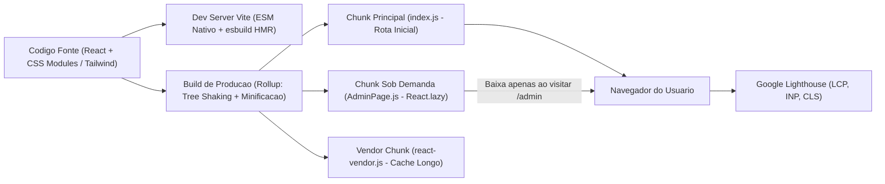

# Aula 10 — Performance & Build Tools

> *"De nada adianta construir uma nave linda com React, Zustand e Router se ela demora 12 segundos só para ligar os motores na decolagem: performance é engenharia de massa, combustível modular e telemetria afiada."*

---

## 1. 🚀 Briefing da Missão (Contexto Temático & Realidade de Mercado)

| Metadado da Órbita | Valor |
| :--- | :--- |
| **Galáxia** | Galáxia 2 — Constelação do Frontend Web |
| **ID do Módulo** | `fe-build-performance` |
| **Pré-requisitos** | [Aula 09 — Estado Global & Roteamento](./09-estado-global-roteamento.md) (`fe-estado-roteamento`) |
| **Descrição Oficial** | *"Sua tela na velocidade da luz. Configure bundlers modernos, aplique otimizações de carregamento e atinja nota máxima em auditorias."* |
| **Próxima Órbita** | [Projeto de Consolidação — Constelação do Frontend Web](./projeto-consolidacao-02-frontend.md) |

### 🛸 Analogia do Navegador Cósmico

Imagine carregar uma nave espacial antes de decolar da plataforma de lançamento. Se você amarrar no módulo principal todo o laboratório de astrobiologia, os mapas de 40 galáxias futuras, 500 fontes decorativas e imagens de alta resolução que ninguém pediu na saída, o foguete fica pesado demais e demora uma eternidade para sair do chão.

Um **Bundler Moderno (Vite)** funciona como o **Estaleiro Automatizado de Montagem**:
- Durante o **desenvolvimento** na base (local), ele usa **ES Modules nativos (ESM)** no navegador e pré-empacota dependências em Go com **esbuild**, iniciando o servidor em milissegundos e atualizando apenas o módulo editado (*HMR — Hot Module Replacement*).
- Para a **viagem espacial real (Build de Produção)**, ele empacota o código com **Tree Shaking** (jogando fora código morto nunca importado), minificação, hashes de cache e **Code Splitting** (fatiando a nave em cápsulas acopláveis — *chunks* — que só são baixadas sob demanda via **Lazy Loading** quando o astronauta realmente entra naquela rota!).
- E no painel de controle final, o **Google Lighthouse e os Core Web Vitals (LCP, INP, CLS)** funcionam como a **inspeção de voo pré-lançamento**, garantindo que a tela apareça rápido, não pule de lugar e responda instantaneamente ao toque.

### 🏢 Qual dor real esse módulo resolve nas empresas?

No mercado real, **velocidade de carregamento impacta conversão, SEO e receita diretamente**:
1. **Abandono em conexões móveis (4G instável):** cada segundo extra de carregamento inicial derruba drasticamente a taxa de conversão de e-commerces e SaaS. Um bundle monolítico de 2 MB em JS bloqueia a thread principal em celulares intermediários.
2. **Penalização no ranqueamento do Google:** o Google usa os **Core Web Vitals** (LCP, INP, CLS) como sinal oficial de ranqueamento em buscas.
3. **"Na minha máquina funcionava!":** times que não entendem `package-lock.json`/`yarn.lock`, variáveis de ambiente `VITE_*`, aliases e estratégias de estilização modular sofrem com builds quebrados no CI/CD e conflitos de CSS em produção.

---

## 2. 📚 Carga de Conhecimento Completa (Tópico por Tópico)

Visualize o pipeline completo de desenvolvimento e otimização de build até a auditoria no navegador:



### 2.1 Configurar e otimizar projetos utilizando o bundler Vite

O **Vite** (palavra francesa para "rápido") tornou-se o padrão moderno da indústria para aplicações React SPA, substituindo bundlers antigos lentos como Create React App (Webpack sem otimizações modernas).

Por que o Vite é tão rápido e como configurá-lo profissionalmente em `vite.config.js`:
- **Modo Dev (Sem bundle total):** o Vite serve arquivos via ESM nativo sob demanda quando o navegador pede, mantendo tempo de inicialização constante mesmo em projetos com milhares de componentes.
- **Modo Build (`vite build`):** compila, otimiza e gera `dist/` pronto para CDN com hashes únicos nos nomes dos arquivos (`assets/index-8a9f2b.js`) para cache imutável no navegador.
- **Configurações essenciais no `vite.config.js`:**
  - `resolve.alias`: configurar `@` apontando para `./src` elimina imports frágeis como `../../../components/Button`.
  - **Variáveis de ambiente:** apenas variáveis prefixadas com `VITE_` (ex: `VITE_API_URL`) são expostas no bundle do cliente via `import.meta.env.VITE_API_URL`. **Regra de segurança:** nunca coloque chaves privadas de servidor com prefixo `VITE_`, pois qualquer usuário pode ler o JS compilado!
  - `build.rollupOptions.output.manualChunks`: permite separar bibliotecas grandes e raramente alteradas (como `react`, `react-dom`, `react-router-dom`) em um chunk separado para maximizar reaproveitamento do cache do navegador entre deploys.
  - **Tree Shaking eficiente:** sempre use `import { debounce } from "lodash-es"` (ES Modules com imports nomeados) em vez de `import _ from "lodash"` (CommonJS monolítico que impede eliminação de código não utilizado).

### 2.2 Gerenciar dependências e scripts com o NPM ou Yarn

Um projeto profissional depende de gerenciamento previsível de pacotes e automação de scripts no `package.json`:

- **SemVer (Semantic Versioning — `MAJOR.MINOR.PATCH`):**
  - `^1.4.2` (Caret): permite atualizações automáticas compatíveis dentro da mesma major (`>=1.4.2 <2.0.0`).
  - `~1.4.2` (Tilde): permite apenas patches de correção (`>=1.4.2 <1.5.0`).
- **`dependencies` vs. `devDependencies`:**
  - `dependencies`: bibliotecas necessárias em **runtime** no navegador do usuário final (`react`, `react-router-dom`, `zustand`, `@tanstack/react-query`).
  - `devDependencies`: ferramentas usadas apenas durante o desenvolvimento e build (`vite`, `eslint`, `prettier`, `vitest`, `tailwindcss`).
- **O papel crítico do Lockfile (`package-lock.json` / `yarn.lock`):** ele congela a árvore exata de versões (incluindo subdependências) instalada na sua máquina. **Sempre versione o lockfile no Git!** Em ambientes de CI/CD ou deploy, use **`npm ci`** (ou `yarn install --frozen-lockfile`) em vez de `npm install`, garantindo builds 100% reprodutíveis.
- **Scripts padronizados no `package.json`:** `"dev"`, `"build"`, `"preview"` (testa localmente o build real de produção antes do deploy!), `"lint"` e `"test"`. E use `npx` (ou `yarn dlx`) para rodar CLIs pontuais sem poluir instalações globais.

### 2.3 Aplicar divisão de código (`Code Splitting` / `Lazy Loading`) em rotas

Por padrão, um bundler empacota toda a aplicação em um único arquivo `index.js`. Se sua SPA possui área pública, checkout, painel administrativo com biblioteca pesada de gráficos e editor PDF, um visitante entrando apenas na Home baixaria e executaria centenas de kilobytes de código que nunca vai usar!

**Code Splitting por Rota com `React.lazy` + `<Suspense>`:**
1. Substitua o import estático (`import AdminPage from "./pages/AdminPage"`) pelo import dinâmico:
   ```jsx
   const AdminPage = lazy(() => import("./pages/AdminPage"));
   ```
2. Envolva as rotas (ou trechos pesados como modais grandes e gráficos) com **`<Suspense fallback={<PageSkeleton />}>`**.
3. Durante `npm run build`, o Vite detecta cada `import(...)` dinâmico e gera um **chunk separado** (`AdminPage-xxxx.js`). O navegador só baixa esse arquivo no instante em que o usuário navegar para `/admin` — reduzindo drasticamente o bundle inicial e o tempo até a primeira interação!
4. **Dica avançada (Error Boundary):** como um chunk dinâmico depende de rede, se a conexão cair exatamente no clique da rota ou um novo deploy apagar chunks antigos, envolva o `<Suspense>` com um **Error Boundary** oferecendo botão de "Recarregar página".

### 2.4 Estruturar estilos modulares (CSS Modules ou Tailwind/CSS-in-JS)

Em SPAs com dezenas de componentes, CSS global tradicional vira um campo minado de colisões de nomes (`.card`, `.title`, `.active` sobrescrevendo regras em páginas diferentes). Conheça as três principais estratégias de estilização modular do mercado e seus impactos em performance:

| Abordagem | Como funciona | Impacto em Performance / Bundle | Quando escolher |
| :--- | :--- | :--- | :--- |
| **CSS Modules (`*.module.css`)** | Escreve CSS puro com escopo local automático (`styles.card` vira `.card_x8f2a`). Suportado nativamente pelo Vite. | **Zero runtime JS**; CSS extraído estaticamente no build, excelente LCP/INP. | Times que amam CSS moderno puro (Grid, Container Queries, Tokens) sem dependências extras. |
| **Tailwind CSS (Utility-First)** | Classes utilitárias compostas direto no JSX; o compilador varre os arquivos e gera **apenas as classes realmente usadas**. | **Zero runtime JS**; arquivo CSS final minúsculo e estável mesmo em apps grandes. | Times que priorizam velocidade de prototipagem, consistência de Design System e fácil manutenção. |
| **CSS-in-JS clássico (Styled-Components / Emotion)** | Gera estilos via JavaScript em tempo de execução no navegador. | **Custo de runtime** (parse e injeção de `<style>` no cliente pode degradar INP em listas grandes). | Projetos legados ou necessidades altamente dinâmicas que não rodam com React Server Components. *(Hoje alternativas zero-runtime como Vanilla Extract ou Panda CSS vêm substituindo o modelo runtime.)* |

### 2.5 Auditar e consertar gargalos de performance usando o Google Lighthouse

O **Google Lighthouse** (integrado à aba **Lighthouse** no Chrome DevTools ou via PageSpeed Insights) audita uma página em quatro pilares: **Performance**, **Accessibility**, **Best Practices** e **SEO**. No pilar de Performance, foque nos três **Core Web Vitals**:

1. **LCP (*Largest Contentful Paint*) — Meta: <= 2.5s:** mede quanto tempo leva para o maior elemento visível acima da dobra (hero image, banner ou título principal) ser pintado na tela.
   - *Como consertar LCP ruim:* comprimir imagens em **WebP/AVIF**, declarar `width` e `height` explícitos, usar `fetchpriority="high"` na imagem hero (e **nunca** `loading="lazy"` na imagem principal acima da dobra!), reduzir JS bloqueante com Code Splitting e pré-conectar origens críticas.
2. **INP (*Interaction to Next Paint*) — Meta: <= 200ms:** mede a latência entre uma interação do usuário (clique, digitação, toque) e a próxima atualização visual da tela (substituiu o antigo FID).
   - *Como consertar INP ruim:* evitar tarefas longas (> 50ms) na thread principal, evitar re-renderizações em massa (seletores Zustand, listas virtualizadas, debouncing em filtros pesados) e evitar código JS pesado no carregamento.
3. **CLS (*Cumulative Layout Shift*) — Meta: <= 0.1:** mede o quanto os elementos "pulam" de lugar inesperadamente enquanto a página carrega.
   - *Como consertar CLS ruim:* sempre definir `width`/`height` ou `aspect-ratio` em `` e vídeos, usar **Skeletons** com altura reservada para conteúdo assíncrono de APIs e configurar `font-display: swap` com métrica de fallback compatível.

**Regra fundamental de auditoria:** rode o Lighthouse sempre contra o **build de produção (`npm run build && npm run preview`) em janela anônima** (sem extensões do Chrome interferindo!), jamais contra o servidor de desenvolvimento (`npm run dev`), que envia código não minificado e módulos individuais sem otimização.

---

## 3. 💻 Mão no Código (Jeito Iniciante vs. Padrão Profissional)

Cenário: **Configuração do Vite, Roteamento com Code Splitting (`React.lazy` + `Suspense`), CSS Modules sem colisão e otimização de mídia para Core Web Vitals**.

### ❌ Jeito Iniciante (Antipadrão: tudo no chunk inicial, CSS global colidindo, `` causando CLS e sem alias no Vite)

```jsx
// BadRoutes.jsx — Baixa TODAS as páginas no carregamento inicial (mesmo o Painel Admin pesado!)
import { BrowserRouter, Routes, Route } from "react-router-dom";
import HomePage from "../../../pages/HomePage";
import CatalogPage from "../../../pages/CatalogPage";
import AdminAnalyticsPage from "../../../pages/AdminAnalyticsPage"; // Importa biblioteca de gráficos de 400KB na Home!
import "./styles.css"; // Classes globais genéricas como .card e .title colidem entre páginas!

export function BadRoutes() {
  return (
    <BrowserRouter>
      <Routes>
        <Route path="/" element={<HomePage />} />
        <Route path="/catalog" element={<CatalogPage />} />
        <Route path="/admin" element={<AdminAnalyticsPage />} />
      </Routes>
    </BrowserRouter>
  );
}
```

```jsx
// BadHero.jsx — Causa CLS (salto de layout) e LCP lento!
export function BadHero() {
  // Sem width/height/aspect-ratio e com lazy loading na imagem principal acima da dobra!
  return ;
}
```

### ✅ Padrão Profissional (`vite.config.js` otimizado, Code Splitting por rota + Error Boundary, CSS Modules e Mídia Otimizada)

#### 1. `vite.config.js` (Aliases + Separação inteligente de Vendor Chunks)

```javascript
// vite.config.js
import { defineConfig } from "vite";
import react from "@vitejs/plugin-react";
import path from "node:path";

export default defineConfig({
  plugins: [react()],
  resolve: {
    alias: {
      // Permite importar "@/components/Button" em qualquer profundidade de pasta
      "@": path.resolve(import.meta.dirname, "./src")
    }
  },
  build: {
    // Separa bibliotecas estáveis em chunk próprio para cache de longo prazo no navegador
    rollupOptions: {
      output: {
        manualChunks: {
          "react-vendor": ["react", "react-dom", "react-router-dom"],
          "query-vendor": ["@tanstack/react-query", "zustand"]
        }
      }
    }
  }
});
```

#### 2. `ProductCard.module.css` & `ProductCard.jsx` (Estilos Modulares Zero-Runtime + Anti-CLS)

```css
/* src/components/ProductCard.module.css */
.card {
  display: flex;
  flex-direction: column;
  gap: 0.75rem;
  padding: 1rem;
  border-radius: 0.75rem;
  background: var(--surface-card, #162033);
  border: 1px solid rgb(148 163 184 / 0.25);
}

.media {
  width: 100%;
  /* Reserva o espaço exato antes da imagem baixar: CLS = 0! */
  aspect-ratio: 4 / 3;
  object-fit: cover;
  border-radius: 0.5rem;
}

.title {
  margin: 0;
  font-size: 1.125rem;
  color: var(--text-primary, #f8fafc);
}
```

```jsx
// src/components/ProductCard.jsx
import styles from "./ProductCard.module.css";

export function ProductCard({ product, isAboveTheFold = false }) {
  return (
    <article className={styles.card}>
      
      <h2 className={styles.title}>{product.title}</h2>
    </article>
  );
}
```

#### 3. `AppRoutes.jsx` (Code Splitting por Rota com `React.lazy`, `Suspense` e Error Boundary)

```jsx
// src/routes/AppRoutes.jsx
import { lazy, Suspense, Component } from "react";
import { BrowserRouter, Routes, Route } from "react-router-dom";

// Cada import dinâmico gera um chunk independente no build do Vite
const HomePage = lazy(() => import("@/pages/HomePage"));
const CatalogPage = lazy(() => import("@/pages/CatalogPage"));
const ProductDetailPage = lazy(() => import("@/pages/ProductDetailPage"));
const AdminAnalyticsPage = lazy(() => import("@/pages/AdminAnalyticsPage"));

// Error Boundary protege contra falhas de rede ao baixar chunks sob demanda
class ChunkErrorBoundary extends Component {
  constructor(props) {
    super(props);
    this.state = { hasError: false };
  }

  static getDerivedStateFromError() {
    return { hasError: true };
  }

  render() {
    if (this.state.hasError) {
      return (
        <div role="alert">
          <p>Não foi possível carregar este módulo. Verifique sua conexão.</p>
          <button type="button" onClick={() => window.location.reload()}>
            Recarregar Nave
          </button>
        </div>
      );
    }
    return this.props.children;
  }
}

function RouteFallback() {
  return (
    <div role="status" aria-live="polite" style={{ minHeight: "60vh", padding: "2rem" }}>
      Carregando módulo da rota...
    </div>
  );
}

export function AppRoutes() {
  return (
    <BrowserRouter>
      <ChunkErrorBoundary>
        <Suspense fallback={<RouteFallback />}>
          <Routes>
            <Route path="/" element={<HomePage />} />
            <Route path="/catalog" element={<CatalogPage />} />
            <Route path="/catalog/:id" element={<ProductDetailPage />} />
            {/* AdminAnalyticsPage só é baixado se o usuário realmente acessar /admin */}
            <Route path="/admin" element={<AdminAnalyticsPage />} />
          </Routes>
        </Suspense>
      </ChunkErrorBoundary>
    </BrowserRouter>
  );
}
```

---

## 4. 🛠️ Laboratório de Voo (Exercício Prático Guiado)

**Duração estimada:** 55 minutos | **Objetivo:** Aplicar **Code Splitting, CSS Modules, build de produção no Vite e auditoria no Google Lighthouse** elevando todas as métricas para a zona verde (>= 90).

### Passo a Passo
1. Pegue o projeto criado no laboratório da Aula 09 (ou inicie um novo com `npm create vite@latest lab-10-performance -- --template react`).
2. Configure o alias `@` e `manualChunks` no `vite.config.js` e crie um arquivo `.env.example` documentando `VITE_API_BASE_URL=https://fakestoreapi.com`.
3. Converta pelo menos dois componentes (ex: `Navbar` e `ProductCard`) para **CSS Modules** (`*.module.css`), garantindo zero vazamento de classes globais.
4. Crie uma página pesada simulada `src/pages/TelemetryReportPage.jsx` (ex: renderizando uma tabela grande ou importando dados extensos) e registre a rota `/report` usando **`React.lazy`** e **`<Suspense>`** com um fallback que reserva `min-height` para evitar CLS.
5. Rode `npm run build` no terminal e observe atentamente a saída do Vite mostrando os arquivos gerados em `dist/assets/` (confirme a criação dos chunks separados `TelemetryReportPage-*.js` e `react-vendor-*.js`).
6. Rode `npm run preview`, abra o link em uma **janela anônima do Chrome** (`Ctrl+Shift+N` / `Cmd+Shift+N`), abra o DevTools → **Network** e clique para navegar até `/report` provando que o chunk novo só é baixado no instante do clique.
7. Na mesma janela anônima, abra o **DevTools → Lighthouse**, selecione *Mobile* + *Performance / Accessibility / Best Practices / SEO* e gere o relatório. Se houver algum alerta (ex: falta de `<meta name="description">`, imagem sem `width`/`height` ou contraste insuficiente), corrija e rode novamente até atingir **>= 90** em Performance e **>= 95** em Accessibility/SEO.

### ✅ Critérios de Domínio
- [ ] `npm run build` gera múltiplos chunks (`index`, `vendor` e pelo menos 1 chunk lazy de rota).
- [ ] A rota lazy **não** aparece na aba Network durante a carga inicial da Home, aparecendo somente ao navegar para ela.
- [ ] `package-lock.json` presente e scripts `"dev"`, `"build"`, `"preview"` funcionando sem erros.
- [ ] Imagens possuem dimensões reservadas (`width`/`height` ou `aspect-ratio`), mantendo **CLS <= 0.1**.
- [ ] Auditoria Lighthouse rodada em **build de produção (`npm run preview`)** com nota **>= 90** em Performance.

---

## 5. 🎯 Resolução Comentada do Teste de Ignição (Quest Oficial)

**Pergunta Oficial (`data.js`):**
> *Como a técnica de 'Code Splitting' (Divisão de Código) aliada ao Lazy Loading melhora o tempo de carregamento inicial de um site?*

- **A)** Ela divide o banco de dados relacional em pedaços que rodam no navegador.
- **B)** Ela quebra o bundle de JavaScript final em arquivos menores chamados chunks, fazendo com que o navegador baixe apenas o código necessário para a rota ativa atual, reduzindo o tempo de carregamento inicial.
- **C)** Ela comprime todas as imagens do site em arquivos de texto criptografados.
- **D)** Ela bloqueia o download de arquivos CSS para priorizar arquivos HTML puros.

### ✅ Resposta Correta: **Alternativa B**

**Por que a Alternativa B está correta:**
Sem Code Splitting, o bundler junta todas as rotas, modais, gráficos e bibliotecas da aplicação em um único arquivo JavaScript gigante. O navegador precisa baixar, descomprimir, fazer *parse* e compilar esse arquivo inteiro antes de tornar a tela inicial interativa. Ao combinar **Code Splitting** (no bundler, como Vite/Rollup via `import()` dinâmico) com **Lazy Loading** (no React via `React.lazy` + `Suspense`), o código é fatiado em **chunks** menores por rota ou funcionalidade pesada. No acesso inicial, o navegador baixa somente o chunk essencial para a rota ativa (melhorando FCP, LCP e INP), deixando os demais chunks para serem baixados sob demanda apenas quando o usuário navegar até eles.

**Por que cada uma das outras alternativas está incorreta:**
- **Alternativa A (Errada):** Code Splitting e Lazy Loading atuam sobre os **arquivos estáticos de código frontend (JavaScript/CSS)** gerados pelo bundler — não têm nenhuma relação com particionamento (*sharding*) ou execução de bancos de dados relacionais no navegador.
- **Alternativa C (Errada):** compressão de imagens usa formatos binários otimizados (WebP, AVIF) e ferramentas de imagem, não "arquivos de texto criptografados" nem Code Splitting de JavaScript.
- **Alternativa D (Errada):** bloquear o download do CSS deixaria a página sem estilização (*FOUC — Flash of Unstyled Content*) e não é o que Code Splitting faz. Pelo contrário, o CSS necessário para a rota ativa continua sendo carregado normalmente (e CSS de rotas lazy pode até ser dividido junto com seus respectivos chunks JS).

---

## 6. 🎤 Kit de Apresentação (Como Dar Aula / Apresentar Este Módulo)

### 🎙️ Pitch Feynman de 2 Minutos
> "Pense em uma mudança de apartamento: se você precisa começar a trabalhar no escritório novo hoje de manhã, não faz sentido esperar um caminhão gigante descarregar todos os móveis da casa inteira na calçada antes de abrir o notebook — você leva primeiro só a mesa, a cadeira e o laptop, e o resto vai chegando por cômodo quando precisar. No frontend, quando não configuramos otimização de build, o navegador faz exatamente o erro contrário: ele baixa um pacotão único com código de todas as rotas do site de uma vez só. Com um bundler moderno como o **Vite**, trabalhamos em desenvolvimento na velocidade da luz com ESM nativo e, no build de produção, aplicamos **Tree Shaking** para jogar fora código morto e **Code Splitting com `React.lazy` + `Suspense`** para quebrar o app em chunks pequenos por rota. Somado a estilos modulares sem custo de runtime (como **CSS Modules** ou **Tailwind**) e auditoria contínua pelo **Google Lighthouse** olhando os Core Web Vitals — **LCP** (velocidade de pintura principal), **INP** (rapidez da resposta ao clique) e **CLS** (nada pulando na tela) — garantimos que a aplicação abra rápido mesmo no 4G de um celular simples."

### 📊 Roteiro de Slides (6 Slides)
1. **Slide 1 — O Peso Invisível do JavaScript no Navegador**
   - *Bullets:* Por que 500 KB de JS custa muito mais CPU que 500 KB de imagem (Download + Parse + Compile + Execute); impacto direto em conversão e SEO.
   - *Visual:* Gráfico de barras comparando tempo de parse de JS em desktop topo de linha vs. celular Android intermediário.
2. **Slide 2 — Como o Vite Revolucionou o Fluxo de Build**
   - *Bullets:* Bundler tradicional vs. Vite ESM nativo em dev; Rollup + Tree Shaking + hashing de cache em produção; `vite.config.js` e `VITE_*`.
   - *Visual:* Diagrama comparando tempo de boot no Webpack antigo vs. Vite instantâneo.
3. **Slide 3 — Code Splitting & Lazy Loading na Prática**
   - *Bullets:* `import()` dinâmico; `React.lazy` + `<Suspense>` + `ErrorBoundary`; `manualChunks` para `react-vendor`.
   - *Visual:* Um bloco de 1.2 MB sendo fatiado em `index (180 KB)`, `vendor (140 KB)`, `admin (450 KB sob demanda)`.
4. **Slide 4 — NPM / Yarn & Estilos Modulares Sem Dor**
   - *Bullets:* Lockfiles + `npm ci`; `dependencies` vs. `devDependencies`; CSS Modules vs. Tailwind vs. CSS-in-JS runtime.
   - *Visual:* Tabela rápida de tradeoffs de estilização e anatomia de um `package.json` limpo.
5. **Slide 5 — Core Web Vitals: Os 3 Sinais Vitais da Tela**
   - *Bullets:* **LCP <= 2.5s** (carregamento), **INP <= 200ms** (interatividade), **CLS <= 0.1** (estabilidade visual).
   - *Visual:* Três velocímetros verdes com as metas oficiais do Google (`web.dev`).
6. **Slide 6 — Protocolo Profissional de Auditoria com Lighthouse**
   - *Bullets:* Sempre testar `npm run preview` (produção); aba anônima sem extensões; interpretar oportunidades reais vs. ruído.
   - *Visual:* Screenshot de painel Lighthouse com os 4 ponteiros em 95–100.

### 💻 Roteiro de Demo Ao Vivo (3 Minutos)
1. *(0:00–1:00)* Rode `npm run build` no terminal ao vivo mostrando o output colorido do Vite com tamanhos em kB e gzip de cada chunk gerado (`dist/assets/AdminPage-*.js`).
2. *(1:00–2:00)* Rode `npm run preview`, abra uma janela anônima com **DevTools → Network (filtro JS)**, carregue a Home mostrando que o chunk de `/admin` **não** foi baixado; depois clique no link "Admin" e aponte para o chunk aparecendo na hora no Network!
3. *(2:00–3:00)* Abra a aba **Lighthouse**, mostre um antes/depois rápido (por exemplo, tirando `width`/`height` de uma imagem ou simulando layout shift com um banner tardio para o **CLS** subir, e depois corrigindo com `aspect-ratio` para voltar a `0.00`).

### ❓ Perguntas Difíceis da Plateia
1. **"Devo colocar `React.lazy` em TODOS os componentes pequenos (como `<Button />` e `<Input />`) para o bundle ficar menor?"**
   - *Resposta:* Não! Fazer `React.lazy` em componentes minúsculos gera dezenas de mini requisições HTTP e mini spinners piscando na tela, piorando a experiência e o LCP. O ideal é aplicar Code Splitting **no nível das rotas** (páginas) e em **componentes isolados realmente pesados** (editores rich-text, visualizadores de PDF, bibliotecas de gráficos ou modais administrativos pouco acessados).
2. **"Qual a diferença entre `npm install` e `npm ci` na hora de rodar o projeto no servidor ou CI/CD?"**
   - *Resposta:* `npm install` pode atualizar dependências dentro das faixas do SemVer (`^`) e modificar o `package-lock.json`, além de aproveitar `node_modules` existente. Já o `npm ci` (*Clean Install*) apaga `node_modules`, exige a presença do `package-lock.json` e instala **exatamente** as versões travadas nele — garantindo que o build do servidor seja 100% idêntico ao testado pelos desenvolvedores.

---

## 7. 💼 Radar do Mercado de Trabalho (Foco Dev Júnior)

### 🎯 3 Perguntas Reais de Entrevista Técnica Júnior
1. **Pergunta:** *"O que são os Core Web Vitals (LCP, INP e CLS) e dê um exemplo prático de como corrigir cada um."*
   - **Resposta Modelo:** "**LCP** (*Largest Contentful Paint*, meta <= 2.5s) mede o carregamento do maior conteúdo visível inicial — corrigimos usando imagens em WebP/AVIF, `fetchpriority="high"` no hero e reduzindo JS inicial com Code Splitting. **INP** (*Interaction to Next Paint*, meta <= 200ms) mede a responsividade a cliques e digitação — corrigimos evitando tarefas longas que travam a thread principal, reduzindo re-renders desnecessários e usando estilos sem overhead pesado de runtime. **CLS** (*Cumulative Layout Shift*, meta <= 0.1) mede saltos visuais — corrigimos reservando espaço com `width`/`height` ou `aspect-ratio` em imagens e Skeletons em carregamentos assíncronos."
2. **Pergunta:** *"Por que devemos rodar auditorias do Google Lighthouse no build de produção (`vite preview`) em janela anônima em vez de usar o servidor `vite dev`?"*
   - **Resposta Modelo:** "Porque no modo `dev` o Vite não minifica o código, envia dezenas ou centenas de arquivos ESM separados sem bundling otimizado e inclui códigos extras de desenvolvimento como React StrictMode e HMR — o que derruba artificialmente a pontuação de Performance. Além disso, extensões instaladas no navegador normal injetam scripts e modificam o DOM, distorcendo o relatório. Testar `npm run build && npm run preview` em aba anônima reflete a experiência real do usuário em produção."
3. **Pergunta:** *"Qual a função do `package-lock.json` (ou `yarn.lock`) e por que nunca devemos deletá-lo sem critério?"*
   - **Resposta Modelo:** "O `package.json` especifica faixas de versões aceitáveis (`^1.2.0`), mas uma subdependência publicada na terça-feira pode quebrar o app na quarta mesmo sem você mexer no código. O lockfile registra o grafo exato de versões e hashes criptográficos de todos os pacotes instalados. Mantê-lo versionado no Git garante que toda a equipe e o pipeline de CI/CD (`npm ci`) instalem exatamente o mesmo código."

### ⚠️ Erros Clássicos de Júnior vs. Postura Profissional

| Erro Clássico de Júnior | Postura Profissional Esperada |
| :--- | :--- |
| Colocar `loading="lazy"` em **todas** as imagens, inclusive no banner hero inicial. | Usar `loading="eager"` + `fetchpriority="high"` acima da dobra e `lazy` abaixo da dobra. |
| Commitar `node_modules` ou `.env` com senhas no Git, ou apagar o `package-lock.json`. | Versionar `package-lock.json` e `.env.example`; manter `node_modules` e `.env` no `.gitignore`. |
| Subir fotos de 5 MB tiradas direto da câmera sem redimensionar ou converter. | Otimizar imagens para WebP/AVIF no tamanho adequado de exibição com `width`/`height`. |
| Rodar Lighthouse no `localhost` em modo `dev` com 10 extensões ligadas e se assustar com nota 45. | Auditar `npm run build && npm run preview` em aba anônima e analisar gargalos reais no Trace. |

### 🌐 Evidência para Portfólio / GitHub / LinkedIn
- **GitHub:** Inclua no seu repositório principal um print real do **Google Lighthouse** (de preferência com os 4 círculos verdes >= 90 no build publicado na Vercel/Netlify) e mostre a saída do `vite build` evidenciando a divisão dos chunks por rota.
- **LinkedIn:** Escreva um estudo de caso curto: *"Como reduzi o bundle inicial do meu projeto React aplicando `React.lazy`, `manualChunks` no Vite e eliminei CLS reservando `aspect-ratio` — indo de X para Y no Lighthouse."* Recrutadores adoram métricas reais antes/depois!

---

## 8. 📡 Transmissões Recomendadas & Próxima Órbita

### 🔗 Recursos Oficiais (`data.js`)
- [Vite Guide](https://vite.dev/) — Documentação oficial do Vite cobrindo configuração, otimização de build, variáveis de ambiente, CSS Modules e Rollup chunks.
- [web.dev: Métricas Web Essenciais (Core Web Vitals)](https://web.dev/explore/vitals) — Guias oficiais do Google sobre LCP, INP, CLS e estratégias práticas de otimização.

### 🚀 Conexão com a Próxima Órbita
Parabéns, comandante! Você percorreu todas as 5 órbitas da **Constelação do Frontend Web** (`fe-html-css` → `fe-js-moderno` → `fe-frameworks` → `fe-estado-roteamento` → `fe-build-performance`). Agora é hora de provar domínio completo construindo o **Projeto de Consolidação** integrando tudo em uma aplicação de portfólio digna de vaga Júnior — e, em seguida, avançar para a **Galáxia 3: Cinturão de Arquitetura** (`Clean Code & SOLID`, `Testes Automatizados` e `Design Patterns`) para blindar seu código com qualidade de engenharia sênior!

👉 **Avançar para:** [Projeto de Consolidação — Constelação do Frontend Web](./projeto-consolidacao-02-frontend.md)
