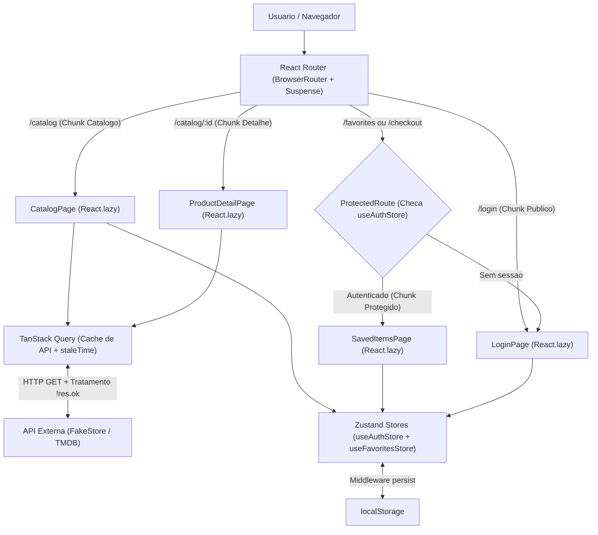

# Projeto de Consolidação: Constelação do Frontend Web

> *"Conhecimento isolado é combustível solto no hangar; um Projeto de Consolidação bem arquitetado é a nave montada, testada e pronta para decolar diante de qualquer Tech Lead."*

---

## 1. 🎖️ Missão Oficial & Objetivo de Portfólio

| Metadado do Projeto | Detalhe |
| :--- | :--- |
| **Galáxia Concluída** | Galáxia 2 — Constelação do Frontend Web (`fe-html-css` → `fe-build-performance`) |
| **Chave Oficial (`app.js`)** | `consolidationProjects["fe-build-performance"]` |
| **Título Oficial** | **Projeto de Consolidação: Constelação do Frontend Web** |
| **Sugestão de Domínio** | Catálogo Interativo de Produtos, Filmes (*TMDB*) ou Missões/Equipamentos (*Galactic Catalog*) |

### 📜 Briefing Oficial (`app.js`)
> **"Projeto de Consolidação: Constelação do Frontend Web"**
>
> *"Desenvolva uma Single Page Application (SPA) responsiva em React utilizando Vite. A aplicação deve carregar dinamicamente dados de uma API (por exemplo, catálogo de filmes ou produtos), implementar rotas protegidas e dinâmicas com React Router, gerenciar estados globais com Zustand e aplicar técnicas de otimização de performance como Code Splitting, lazy loading de componentes e cache de consultas com React Query."*

### 🎯 Objetivo de Portfólio (Por que esse projeto contrata Júnior)
Diferente de clones genéricos de tutorial ("To-Do List" ou "Calculadora"), este projeto integra **todas as camadas que um time real de Frontend exige no primeiro emprego**:
1. **Fundação acessível e responsiva (Aula 06):** HTML5 semântico, contraste WCAG AA, navegação por teclado, CSS Grid/Flexbox e tokens CSS para Tema Claro/Escuro.
2. **Assincronismo resiliente e API real (Aula 07):** consumo de API externa com tratamento explícito de status HTTP, erro, vazio e persistência local.
3. **Componentização limpa em React (Aula 08):** componentes reutilizáveis, imutabilidade, hooks customizados e acessibilidade em feedbacks (`role="status"`, `role="alert"`).
4. **Arquitetura de estados separada (Aula 09):** **URL State** (`React Router` com rotas dinâmicas `:id`, query params e rotas protegidas), **Client State** (`Zustand` para sessão + favoritos/carrinho) e **Server State** (`TanStack Query` com cache, `staleTime` e invalidação).
5. **Engenharia de Build e Performance (Aula 10):** `Vite` com aliases e `manualChunks`, `React.lazy` + `Suspense` + Error Boundary, CSS Modules zero-runtime e auditoria **Google Lighthouse**.

---

## 2. 🏗️ Arquitetura da Solução

### 🔭 Diagrama Arquitetural (Fluxo de Rotas, Estados e Chunks)



### 📂 Árvore de Diretórios Recomendada

```text
galactic-catalog-spa/
├── .env.example                 # Documenta VITE_API_BASE_URL sem expor segredos
├── .gitignore                   # Ignora node_modules, dist, .env.local
├── index.html                   # Meta description, lang="pt-BR", título semântico
├── package.json                 # Scripts dev, build, preview, lint, test
├── vite.config.js               # Alias "@", manualChunks para vendors
└── src/
    ├── main.jsx                 # QueryClientProvider + import de tokens CSS
    ├── App.jsx                  # BrowserRouter + ErrorBoundary + Suspense + Rotas
    ├── styles/
    │   └── tokens.css           # Design tokens semânticos (dark/light) e reset acessível
    ├── services/
    │   └── apiClient.js         # Wrapper fetch com base URL do .env e checagem !res.ok
    ├── hooks/
    │   └── useCatalogQueries.js # useQuery para lista, categorias e detalhe :id
    ├── stores/
    │   ├── useAuthStore.js      # Estado de sessão (user, login, logout) + persist
    │   └── useFavoritesStore.js # Estado global de favoritos/carrinho + persist
    ├── components/
    │   ├── layout/
    │   │   ├── AppLayout.jsx    # Header semântico, Skip Link, ThemeToggle e <Outlet />
    │   │   └── AppLayout.module.css
    │   ├── common/
    │   │   ├── ProtectedRoute.jsx
    │   │   ├── ChunkErrorBoundary.jsx
    │   │   └── CatalogSkeleton.jsx
    │   └── catalog/
    │       ├── ItemCard.jsx
    │       └── ItemCard.module.css
    └── pages/
        ├── CatalogPage.jsx      # Busca na URL (?q=&category=), grid responsivo
        ├── ProductDetailPage.jsx# Lê useParams() e exibe detalhe em cache
        ├── FavoritesPage.jsx    # Rota protegida usando Zustand
        ├── LoginPage.jsx        # Autenticação simulada com redirect pós-login
        └── NotFoundPage.jsx     # Rota fallback "*"
```

---

## 3. 🛠️ Roteiro de Construção em 5 Etapas

### Etapa 1 — Bootstrap do Vite, Dependências e Variáveis de Ambiente

Crie o projeto, instale as bibliotecas essenciais e configure o `vite.config.js`:

```bash
npm create vite@latest galactic-catalog-spa -- --template react
cd galactic-catalog-spa
npm install react-router-dom zustand @tanstack/react-query
```

Crie `.env.example` (e copie para `.env` localmente):

```env
VITE_API_BASE_URL=https://fakestoreapi.com
```

Configure `vite.config.js` com alias `@` e separação de chunks de vendor:

```javascript
// vite.config.js
import { defineConfig } from "vite";
import react from "@vitejs/plugin-react";
import path from "node:path";

export default defineConfig({
  plugins: [react()],
  resolve: {
    alias: {
      "@": path.resolve(import.meta.dirname, "./src")
    }
  },
  build: {
    rollupOptions: {
      output: {
        manualChunks: {
          "react-vendor": ["react", "react-dom", "react-router-dom"],
          "state-vendor": ["zustand", "@tanstack/react-query"]
        }
      }
    }
  }
});
```

### Etapa 2 — Design Tokens Acessíveis, Cliente HTTP e TanStack Query

Crie a base de estilos (`src/styles/tokens.css`), o cliente HTTP (`src/services/apiClient.js`) e os hooks de consulta (`src/hooks/useCatalogQueries.js`):

```javascript
// src/services/apiClient.js
const BASE_URL = import.meta.env.VITE_API_BASE_URL ?? "https://fakestoreapi.com";

export async function apiGet(endpoint, { signal } = {}) {
  const response = await fetch(`${BASE_URL}${endpoint}`, { signal });
  if (!response.ok) {
    throw new Error(`Erro HTTP ${response.status} ao consultar ${endpoint}`);
  }
  return response.json();
}
```

```javascript
// src/hooks/useCatalogQueries.js
import { useQuery } from "@tanstack/react-query";
import { apiGet } from "@/services/apiClient";

export function useCatalogItemsQuery(category = "all") {
  return useQuery({
    queryKey: ["catalog-items", { category }],
    queryFn: ({ signal }) => {
      const path =
        category && category !== "all"
          ? `/products/category/${encodeURIComponent(category)}`
          : "/products";
      return apiGet(path, { signal });
    },
    staleTime: 1000 * 60 * 5 // Mantém cache fresco por 5 minutos
  });
}

export function useCatalogItemDetailQuery(itemId) {
  return useQuery({
    queryKey: ["catalog-item", itemId],
    queryFn: ({ signal }) => apiGet(`/products/${encodeURIComponent(itemId)}`, { signal }),
    enabled: Boolean(itemId),
    staleTime: 1000 * 60 * 5
  });
}
```

### Etapa 3 — Stores Globais Desacopladas com Zustand (`Auth` + `Favorites`)

```javascript
// src/stores/useAuthStore.js
import { create } from "zustand";
import { persist } from "zustand/middleware";

export const useAuthStore = create(
  persist(
    (set) => ({
      user: null,
      login: (email) =>
        set({
          user: {
            email,
            name: email.split("@")[0] || "Comandante"
          }
        }),
      logout: () => set({ user: null })
    }),
    { name: "galactic-auth-session" }
  )
);
```

```javascript
// src/stores/useFavoritesStore.js
import { create } from "zustand";
import { persist } from "zustand/middleware";

export const useFavoritesStore = create(
  persist(
    (set, get) => ({
      items: [],
      toggleFavorite: (product) =>
        set((state) => {
          const exists = state.items.some((item) => item.id === product.id);
          return {
            items: exists
              ? state.items.filter((item) => item.id !== product.id)
              : [...state.items, product]
          };
        }),
      isFavorite: (productId) => get().items.some((item) => item.id === productId),
      clearFavorites: () => set({ items: [] })
    }),
    { name: "galactic-favorites-storage" }
  )
);
```

### Etapa 4 — Rotas Dinâmicas, Rota Protegida e Code Splitting (`React.lazy` + `Suspense`)

Crie o guarda de rota (`src/components/common/ProtectedRoute.jsx`) e o roteador principal (`src/App.jsx`) com **Lazy Loading** de todas as páginas:

```jsx
// src/components/common/ProtectedRoute.jsx
import { Navigate, useLocation } from "react-router-dom";
import { useAuthStore } from "@/stores/useAuthStore";

export function ProtectedRoute({ children }) {
  const user = useAuthStore((state) => state.user);
  const location = useLocation();

  if (!user) {
    // Salva a rota de origem para redirecionar de volta logo após o login
    return <Navigate to="/login" state={{ from: location }} replace />;
  }

  return children;
}
```

```jsx
// src/App.jsx
import { lazy, Suspense } from "react";
import { BrowserRouter, Routes, Route, Navigate } from "react-router-dom";
import { AppLayout } from "@/components/layout/AppLayout";
import { ProtectedRoute } from "@/components/common/ProtectedRoute";
import { ChunkErrorBoundary } from "@/components/common/ChunkErrorBoundary";
import { CatalogSkeleton } from "@/components/common/CatalogSkeleton";

// Cada página vira um chunk independente gerado pelo Vite no build de produção
const CatalogPage = lazy(() => import("@/pages/CatalogPage"));
const ProductDetailPage = lazy(() => import("@/pages/ProductDetailPage"));
const FavoritesPage = lazy(() => import("@/pages/FavoritesPage"));
const LoginPage = lazy(() => import("@/pages/LoginPage"));
const NotFoundPage = lazy(() => import("@/pages/NotFoundPage"));

export default function App() {
  return (
    <BrowserRouter>
      <ChunkErrorBoundary>
        <Suspense fallback={<CatalogSkeleton />}>
          <Routes>
            <Route element={<AppLayout />}>
              <Route path="/" element={<Navigate to="/catalog" replace />} />
              <Route path="/catalog" element={<CatalogPage />} />
              <Route path="/catalog/:id" element={<ProductDetailPage />} />
              <Route path="/login" element={<LoginPage />} />
              <Route
                path="/favorites"
                element={
                  <ProtectedRoute>
                    <FavoritesPage />
                  </ProtectedRoute>
                }
              />
              <Route path="*" element={<NotFoundPage />} />
            </Route>
          </Routes>
        </Suspense>
      </ChunkErrorBoundary>
    </BrowserRouter>
  );
}
```

### Etapa 5 — `main.jsx`, CSS Modules Responsivo e Tratamento Completo de Estados

Configure o `QueryClient` no `src/main.jsx` e construa o card com CSS Modules (`aspect-ratio` para CLS = 0) e a página `CatalogPage` ligando URL (`useSearchParams`) + `useQuery` + `Zustand`:

```jsx
// src/main.jsx
import { StrictMode } from "react";
import { createRoot } from "react-dom/client";
import { QueryClient, QueryClientProvider } from "@tanstack/react-query";
import App from "./App";
import "./styles/tokens.css";

const queryClient = new QueryClient({
  defaultOptions: {
    queries: {
      retry: 1,
      refetchOnWindowFocus: false
    }
  }
});

createRoot(document.getElementById("root")).render(
  <StrictMode>
    <QueryClientProvider client={queryClient}>
      <App />
    </QueryClientProvider>
  </StrictMode>
);
```

```jsx
// src/pages/CatalogPage.jsx (trecho principal com URL State + TanStack Query + Skeleton + Erro)
import { useMemo } from "react";
import { useSearchParams, Link } from "react-router-dom";
import { useCatalogItemsQuery } from "@/hooks/useCatalogQueries";
import { useFavoritesStore } from "@/stores/useFavoritesStore";
import { CatalogSkeleton } from "@/components/common/CatalogSkeleton";

export default function CatalogPage() {
  const [searchParams, setSearchParams] = useSearchParams();
  const category = searchParams.get("category") ?? "all";
  const query = searchParams.get("q") ?? "";

  const toggleFavorite = useFavoritesStore((s) => s.toggleFavorite);
  const favorites = useFavoritesStore((s) => s.items);

  const { data: items = [], isPending, isError, error, refetch } = useCatalogItemsQuery(category);

  const filteredItems = useMemo(() => {
    const term = query.trim().toLowerCase();
    if (!term) return items;
    return items.filter((item) => item.title.toLowerCase().includes(term));
  }, [items, query]);

  if (isPending) return <CatalogSkeleton />;

  if (isError) {
    return (
      <section role="alert">
        <p>Não foi possível carregar o catálogo: {error.message}</p>
        <button type="button" onClick={() => refetch()}>Tentar novamente</button>
      </section>
    );
  }

  return (
    <section aria-labelledby="catalog-heading">
      <h1 id="catalog-heading">Catálogo da Frota ({filteredItems.length})</h1>
      {/* Filtros sincronizados na URL sobrevivem a F5 e compartilhamento de link */}
      <input
        type="search"
        value={query}
        onChange={(e) => setSearchParams({ category, q: e.target.value })}
        placeholder="Buscar por nome..."
        aria-label="Buscar itens no catálogo"
      />
      {filteredItems.length === 0 ? (
        <p role="status">Nenhum item encontrado para "{query}".</p>
      ) : (
        <div className="catalog-grid">
          {filteredItems.map((item) => {
            const saved = favorites.some((fav) => fav.id === item.id);
            return (
              <article key={item.id}>
                <h2>
                  <Link to={`/catalog/${item.id}`}>{item.title}</Link>
                </h2>
                <button type="button" onClick={() => toggleFavorite(item)} aria-pressed={saved}>
                  {saved ? "Remover dos Favoritos" : "Salvar nos Favoritos"}
                </button>
              </article>
            );
          })}
        </div>
      )}
    </section>
  );
}
```

---

## 4. ✅ Checklist de Qualidade Profissional

Antes de publicar no GitHub e colocar no currículo, valide **100%** dos critérios abaixo:

### 📄 Documentação & Configuração
- [ ] `README.md` completo com: visão geral, stack utilizada, diagrama de arquitetura, instruções de instalação (`npm install`, `.env`), prints em Desktop e Mobile, e captura de tela do relatório **Lighthouse**.
- [ ] `.env.example` versionado no Git e `.env` / `dist` / `node_modules` ignorados no `.gitignore`.
- [ ] `package-lock.json` commitado para garantir builds reprodutíveis (`npm ci`).

### 🛡️ Resiliência, Acessibilidade e UX
- [ ] Todos os 4 estados de tela tratados em consultas assíncronas: **Loading (Skeleton com altura reservada)**, **Error (com botão de Retry)**, **Empty (busca sem resultados)** e **Success**.
- [ ] HTML semântico (`<header>`, `<nav>`, `<main>`, `<article>`, `<button>`), `Skip Link` funcional, foco visível (`:focus-visible`) e `aria-pressed` / `role="alert"` aplicados corretamente.
- [ ] Rota protegida (`/favorites`) redireciona para `/login` preservando a rota de destino (`state.from`) e volta automaticamente após autenticar.
- [ ] Rota inválida (`/*`) exibe página 404 amigável com link de retorno para `/catalog`.

### ⚡ Performance & Testes
- [ ] `npm run build` gera chunks separados por rota (`CatalogPage-*.js`, `ProductDetailPage-*.js`, `FavoritesPage-*.js`) + vendor chunks (`react-vendor`, `state-vendor`).
- [ ] Auditoria **Google Lighthouse** executada sobre `npm run preview` (ou URL publicada na Vercel/Netlify) em janela anônima atingindo **>= 90 em Performance, Accessibility, Best Practices e SEO**.
- [ ] **Testes automatizados (diferencial forte para Júnior):** configure `vitest` + `@testing-library/react` para testar pelo menos:
  1. A store `useFavoritesStore` (adicionar/remover item mantendo imutabilidade);
  2. O componente `ProtectedRoute` (redireciona quando deslogado e renderiza filho quando logado).
- [ ] **Deploy público ativo:** publique o projeto gratuitamente na **Vercel**, **Netlify** ou **Cloudflare Pages** (com regra de fallback SPA para `index.html` para que recarregar `/catalog/3` não dê 404 no servidor!).

---

## 5. 🎤 Roteiro de Pitch de 5 Minutos para Entrevista Técnica

Quando um Tech Lead ou entrevistador pedir *"Me fale sobre o projeto que você mais se orgulha no seu portfólio"*, use exatamente esta estrutura em 5 blocos cronometrados:

### ⏱️ Minuto 0:00 – 0:45 | Contexto e Problema Resolvido
> *"Construí esta SPA de Catálogo usando React e Vite para resolver um problema clássico de interfaces modernas: como escalar uma aplicação com múltiplas rotas, filtros persistentes na URL, área autenticada e dados vindos de API externa sem cair em Prop Drilling, chamadas duplicadas na rede ou um bundle lento para carregar no celular."*

### ⏱️ Minuto 0:45 – 2:00 | Arquitetura de Estados (O Grande Diferencial)
> *"O ponto central da arquitetura foi **separar responsabilidades de estado em três camadas**, em vez de jogar tudo num Context gigante:*
> - ***Estado da URL (React Router):*** *usei rotas dinâmicas como `/catalog/:id`, query params via `useSearchParams` para que filtros sobrevivam ao F5 e compartilhamento de link, e um wrapper `ProtectedRoute` que bloqueia `/favorites` para usuários não logados preservando o redirecionamento pós-login.*
> - ***Estado Global de Cliente (Zustand):*** *gerencia apenas sessão e lista de favoritos persistida no `localStorage`, com seletores granulares para que alterar um favorito não re-renderize componentes não relacionados.*
> - ***Estado de Servidor (TanStack Query):*** *substituiu `useEffect` manual, entregando cache com `staleTime`, `AbortController` nativo no `queryFn`, deduplicação de requests e tratamento unificado de loading skeleton, erro com retry e empty state."*

### ⏱️ Minuto 2:00 – 3:15 | Performance, Build e Acessibilidade
> *"Na camada de entrega, configurei o Vite com alias `@`, `manualChunks` para separar `react-vendor` e cachear melhor entre deploys, e apliquei **Code Splitting por rota** com `React.lazy`, `Suspense` e um `ErrorBoundary` de fallback — então quem abre o catálogo inicial não baixa o JavaScript de rotas protegidas ou administrativas. Na interface, usei CSS Modules zero-runtime com Custom Properties para tema claro/escuro, `aspect-ratio` nas imagens para zerar Layout Shift (CLS) e validei navegação completa por teclado mais auditoria no Lighthouse em build de produção (`vite preview`), batendo notas acima de 90."*

### ⏱️ Minuto 3:15 – 4:15 | Um Desafio Real e Como Resolvi
> *"Um bug real que enfrentei durante o projeto foi quando testei o deploy em produção e percebi que recarregar a página diretamente na rota dinâmica `/catalog/5` retornava 404 do servidor estático, porque fisicamente só existe `index.html` no `dist/`. Configurei a regra de rewrite SPA (`vercel.json` / `_redirects`) apontando todas as rotas para `/index.html` para o React Router assumir a navegação, e aproveitei para adicionar um `ChunkErrorBoundary` caso algum usuário perca conexão durante um lazy import."*

### ⏱️ Minuto 4:15 – 5:00 | Próximos Passos & Abertura para Perguntas
> *"Como evolução natural desse projeto — conectando já com a próxima etapa dos meus estudos em Arquitetura e Testes —, deixei testes unitários iniciais da store e rotas protegidas com Vitest e pretendo expandir cobertura E2E com Playwright e tipagem estrita em TypeScript. Fico super aberto para mostrar o código ou a aba Network/Lighthouse rodando se quiser dar uma olhada!"*

---

🚀 **Missão da Galáxia 2 concluída!** Você agora domina os pilares essenciais de um **Desenvolvedor Frontend Júnior moderno**. Quando concluir seu Projeto de Consolidação, o próximo destino na árvore da Academia Galáctica Dev é a **Galáxia 3 — Cinturão de Arquitetura** (`Clean Code & SOLID`, `Testes Automatizados` e `Design Patterns`).
