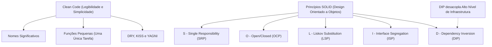
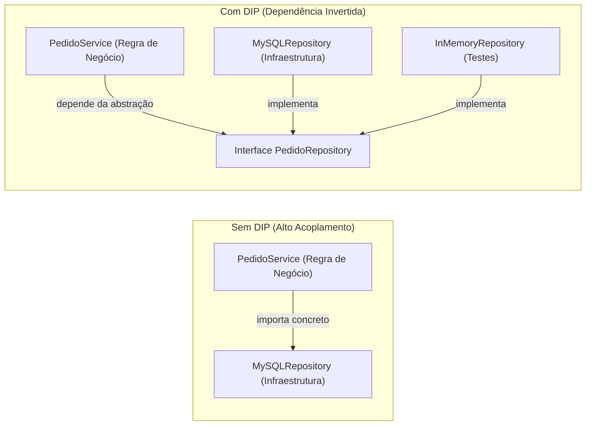

# 💎 Setor 11: Clean Code & SOLID

> **"Código bom é código limpo. Aprenda a estruturar softwares fáceis de ler, manter e alterar aplicando princípios clássicos de engenharia."**

---

## 1. 🚀 Briefing da Missão (Contexto Temático & Realidade de Mercado)

| Atributo do Setor | Especificação |
| :--- | :--- |
| **Galáxia** | Cinturão de Arquitetura |
| **ID do Módulo** | `clean-solid` |
| **Pré-requisitos** | Bancos de Dados Relacionais & SQL (`sql-bd` — Nébula dos Fundamentos) |
| **Desbloqueia** | [Setor 12: Testes Automatizados & TDD](./12-testes-automatizados-tdd.md) e [Setor 13: Padrões de Projeto](./13-padroes-de-projeto.md) |
| **Nível de Criticidade** | Fundamental para Sobrevivência em Times de Engenharia |

### 🛸 Analogia do Navegador Cósmico

Imagine assumir o comando de um cruzador interestelar construído às pressas. Ao abrir o painel de engenharia, você encontra milhares de fios vermelhos idênticos sem etiquetas, uma única alavanca que controla simultaneamente os propulsores de dobra, a cafeteira da cabine e as escotilhas de oxigênio, e peças soldadas diretamente no casco que exigem serrar a nave inteira para trocar uma simples lâmpada queimada. Você teria coragem de apertar qualquer botão durante uma tempestade de asteroides?

É exatamente assim que um desenvolvedor se sente ao abrir um sistema sem **Clean Code** e sem **SOLID**. Nomes obscuros são fios sem etiqueta; funções gigantes são alavancas acopladas que causam efeitos colaterais imprevistos; dependências concretas chumbadas no código são peças soldadas no casco. Aplicar Clean Code e SOLID significa projetar uma nave modular, com painéis rotulados, fusíveis independentes e encaixes padronizados, onde qualquer engenheiro da tripulação consegue diagnosticar e substituir um componente em minutos sem derrubar o suporte de vida.

### 🏢 A Dor Real no Mercado de Tecnologia

Em empresas reais, **código é lido dez vezes mais do que é escrito**. O custo de um software não está na primeira semana de desenvolvimento do MVP, mas nos 2 a 5 anos seguintes de evolução contínua, correções em produção e entrada de novos desenvolvedores na equipe.

Quando um time ignora legibilidade e coesão:
- Uma simples alteração de regra de imposto quebra o envio de e-mails de boas-vindas (efeito cascata por acoplamento).
- Novos desenvolvedores júniores levam semanas para entender um único arquivo de serviço de 1.500 linhas.
- O medo de mexer no código legado paralisa entregas, gerando bugs recorrentes e dívida técnica impagável.

Dominar Clean Code e os 5 princípios SOLID desde o nível júnior separa quem "faz o código rodar na máquina" de quem constrói software sustentável em equipe.

---

## 2. 📚 Carga de Conhecimento Completa (Tópico por Tópico)



### 2.1 Aplicar nomes descritivos e significativos a variáveis, funções e classes

Dar bons nomes é a forma mais barata e poderosa de documentação viva. Um nome significativo revela **a intenção**, **o domínio do negócio** e **o tipo de dado esperado**, eliminando a necessidade de comentários redundantes que tentam explicar código confuso.

Regras práticas aplicadas no dia a dia:
- **Revele a intenção:** prefira `diasDesdeUltimoLogin` em vez de `d` ou `aux`. Se uma variável precisa de um comentário ao lado para explicar o que ela guarda, o nome dela falhou.
- **Evite desinformação e abreviações enigmáticas:** `listaUsuarios` quando a estrutura na verdade é um `Set` ou um objeto `Map` confunde o leitor; prefira `usuariosPorId` ou `usuariosAtivos`. Abreviações como `calcDescCli` obrigam o leitor a decifrar sílabas; use `calcularDescontoCliente`.
- **Nomes pronunciáveis e pesquisáveis:** código é discutido em code reviews e pair programming. `gerarTimestampUtc()` é muito superior a `genymdhms()`. Constantes mágicas como `86400` devem virar `SEGUNDOS_EM_UM_DIA`.
- **Convenção gramatical consistente:**
  - **Classes e Interfaces:** substantivos ou sintagmas nominais (`Pedido`, `CalculadoraFrete`, `RepositorioUsuarios`). Evite termos genéricos vazios como `Manager`, `Processor` ou `Data` sem contexto.
  - **Funções e Métodos:** verbos ou locuções verbais (`aprovarPagamento`, `buscarPedidosPendentes`, `validarCpf`).
  - **Booleanos:** prefixos interrogativos claros (`isAtivo`, `temPermissaoAdmin`, `podeCancelarPedido`, `possuiEstoqueSuficiente`).

### 2.2 Reduzir o tamanho das funções de modo que façam apenas uma coisa

Robert C. Martin resume a regra de ouro das funções em duas frases: *"Funções devem ser pequenas. Elas devem ser ainda menores do que isso."* Uma função que faz "uma única coisa" executa passos que pertencem **ao mesmo nível de abstração**.

Como identificar que uma função está fazendo coisas demais:
1. **Ela tem blocos separados por comentários de seção** como `// 1. Valida entrada`, `// 2. Calcula desconto`, `// 3. Salva no banco`. Cada bloco desses é um candidato natural a ser extraído para uma função privada bem nomeada.
2. **Ela mistura lógica de alto nível com detalhes de baixo nível** (por exemplo, uma função `fecharPedido` que contém validação de regra de negócio, manipulação manual de strings de SQL e formatação HTML de e-mail).
3. **Ela recebe muitos parâmetros (3 ou mais)** ou recebe **flags booleanas** (`processar(pedido, true, false)`). Uma flag booleana dentro de uma assinatura anuncia literalmente que a função faz duas coisas distintas: uma quando é `true` e outra quando é `false`.
4. **Ela possui aninhamento profundo (Arrow Code / Hadouken Code):** múltiplos `if` dentro de `for` dentro de `try`. A técnica **Early Return (Guard Clauses)** resolve isso invertendo condições de erro e retornando cedo, mantendo o fluxo principal ("caminho feliz") na indentação mais rasa possível.

### 2.3 Praticar os princípios DRY, KISS e YAGNI no dia a dia

Esses três acrônimos formam a bússola de pragmatismo contra código duplicado e engenharia exagerada (*overengineering*):

- **DRY (Don't Repeat Yourself — Não se repita):** cada peça de conhecimento ou regra de negócio deve ter uma representação única e autoritativa no sistema. Atenção importante: DRY não significa eliminar duas linhas parecidas só porque parecem idênticas sintaticamente! Se a alíquota de imposto estadual e a taxa de comissão de afiliados hoje valem ambas `0.05`, elas representam **conhecimentos de negócio diferentes** que evoluem por motivos distintos. Unificá-las em uma constante `TAXA_CINCO_POR_CENTO` cria acoplamento falso. Aplique DRY quando duas partes replicam **a mesma regra de domínio**.
- **KISS (Keep It Simple, Stupid — Mantenha simples):** a maioria dos sistemas funciona melhor se permanecer simples em vez de ser transformada em uma obra complexa cheia de abstrações prematuras. Prefira fluxo direto, estruturas de dados nativas e legibilidade óbvia a truques "inteligentes" em uma única linha que ninguém entende seis meses depois.
- **YAGNI (You Aren't Gonna Need It — Você não vai precisar disso):** não implemente funcionalidades, parâmetros genéricos ou camadas extras hoje apenas porque "talvez no ano que vem o cliente peça suporte a múltiplos idiomas e três bancos diferentes". Código especulativo aumenta o custo de manutenção, de testes e de leitura sem gerar valor presente. Construa o que o requisito atual exige, mantendo a porta aberta para evoluir com limpeza quando a necessidade real chegar.

### 2.4 Compreender e aplicar SOLID: Single Responsibility e Open/Closed

Os dois primeiros pilares do acrônimo **SOLID** (cunhado por Michael Feathers a partir dos princípios compilados por Robert C. Martin) atacam diretamente o problema de módulos inchados e frágeis:

#### **S — Single Responsibility Principle (Princípio da Responsabilidade Única — SRP)**
Definição clássica precisa: *"Um módulo deve ser responsável por um, e apenas um, ator."* (Um "ator" é um grupo de usuários ou área interessada que solicita mudanças naquela regra.)

Muitos iniciantes confundem SRP com "uma função que faz só uma coisa". Na verdade, SRP opera no nível de **classes, módulos e serviços**. Considere uma classe `Funcionario` que possui três métodos:
- `calcularSalario()` (especificado pelo **RH / Folha de Pagamento**);
- `reportarHoras()` (especificado pelo **Gerente de Operações**);
- `salvarNoBanco()` (especificado pela **Equipe de Banco de Dados / Infraestrutura**).

Se o RH mudar o cálculo de hora extra e um dev alterar um método auxiliar compartilhado dentro dessa mesma classe, a lógica de `reportarHoras()` pode quebrar silenciosamente. A solução pelo SRP é separar as responsabilidades em classes coesas (`CalculadoraFolhaPagamento`, `RelatorioHoras`, `FuncionarioRepository`), onde cada classe tem **um único motivo para mudar**.

#### **O — Open/Closed Principle (Princípio Aberto/Fechado — OCP)**
Definição: *"Entidades de software (classes, módulos, funções) devem estar abertas para extensão, mas fechadas para modificação."*

Quando uma nova regra de negócio surge — por exemplo, um novo tipo de frete (`Sedex10`, `RetiradaLoja`, `TransportadoraExterna`) ou um novo método de pagamento (`Pix`, `Boleto`, `CartaoCredito`) — e o código exige abrir um `if/else` ou `switch` gigantesco no coração do sistema para adicionar mais um `case`, o código viola o OCP. Cada alteração no núcleo arrisca quebrar os casos antigos já testados.

Ao seguir o OCP, definimos uma **abstração estável** (uma interface como `EstrategiaFrete` ou `ProcessadorPagamento`) e estendemos o sistema **criando novas classes** que implementam esse contrato, sem editar o serviço orquestrador que as consome.

### 2.5 Entender o Liskov Substitution Principle e evitar quebras de polimorfismo

#### **L — Liskov Substitution Principle (Princípio da Substituição de Liskov — LSP)**
Formulado por Barbara Liskov em 1987: *"Se S é um subtipo de T, então objetos do tipo T podem ser substituídos por objetos do tipo S sem alterar nenhuma das propriedades desejáveis do programa (como corretude e tarefa executada)."*

Em termos práticos de engenharia: **herança só é válida quando a classe filha honra integralmente o contrato comportamental da classe pai**. Não basta ter os mesmos nomes de métodos — as pré-condições, pós-condições e invariantes precisam ser preservadas.

O exemplo clássico da violação do LSP é **Quadrado herdando de Retângulo**:
- Na matemática, todo quadrado é um retângulo.
- Em código orientando a objetos mutável, `Retangulo` tem `setLargura(w)` e `setAltura(h)` independentes, e uma função cliente espera que após `r.setLargura(5); r.setAltura(4);`, a área `r.area()` seja obrigatoriamente `20`.
- Se `Quadrado` herda de `Retangulo` e força largura e altura a serem sempre iguais, chamar `setAltura(4)` sobrescreve a largura para `4` e devolve área `16` — quebrando silenciosamente a expectativa do código cliente!

Outra violação frequentíssima em APIs backend: criar uma classe pai `ContaBancaria` com `sacar(valor)` e uma subclasse `ContaPoupancaBloqueada` que lança `throw new Error("Operação não suportada")` dentro de `sacar()`. Qualquer código que receba `ContaBancaria` esperando poder sacar vai explodir em runtime. A solução correta é modelar hierarquias por **capacidades/comportamentos** (por exemplo, separando `ContaConsulta` e `ContaComSaque`) ou preferir **composição sobre herança**.

### 2.6 Estruturar interfaces coesas (Interface Segregation)

#### **I — Interface Segregation Principle (Princípio da Segregação de Interfaces — ISP)**
Definição: *"Nenhum cliente deve ser forçado a depender de métodos que não utiliza."*

Interfaces "gordas" (ou *Fat Interfaces*) nascem quando o desenvolvedor coloca todas as operações possíveis de um domínio em um único contrato gigantesco. Por exemplo, uma interface `DispositivoMultifuncional` com `imprimir()`, `escanear()`, `enviarFax()` e `grampear()`.

Se você precisa plugar uma `ImpressoraTermicaSimples` (que só imprime recibos), a linguagem obriga essa classe a implementar `escanear()`, `enviarFax()` e `grampear()` com métodos vazios ou lançando `NotImplementedError`. Além de violar o LSP na sequência, qualquer alteração na assinatura de `enviarFax()` força a recompilação e revisão da `ImpressoraTermicaSimples`, que nem sequer envia fax!

Aplicando ISP, dividimos o contrato gigante em **interfaces pequenas e altamente coesas**: `Imprimivel`, `Digitalizavel`, `EnviadorFax`. Classes simples implementam apenas `Imprimivel`, enquanto equipamentos completos implementam todas as que suportam. Em TypeScript, isso traz flexibilidade enorme com baixo acoplamento.

### 2.7 Praticar a Inversão de Dependências (DIP) criando contratos flexíveis

#### **D — Dependency Inversion Principle (Princípio da Inversão de Dependências — DIP)**
Definição em duas regras de Robert C. Martin:
1. *"Módulos de alto nível não devem depender de módulos de baixo nível. Ambos devem depender de abstrações."*
2. *"Abstrações não devem depender de detalhes. Detalhes devem depender de abstrações."*

Observe o fluxo tradicional sem DIP: a camada de regra de negócio (`PedidoService` — alto nível) importa e instancia diretamente `MySQLPedidoRepository` ou `NodemailerClient` (baixo nível / infraestrutura). A seta de dependência no código-fonte aponta diretamente da regra de negócio para o banco de dados ou biblioteca externa. Se o banco mudar para PostgreSQL ou se você quiser rodar testes sem subir um MySQL real, `PedidoService` precisa ser modificado!

Com o DIP, a camada de alto nível define **ela mesma** o contrato de que precisa — por exemplo, uma interface `PedidoRepository` com `salvar(pedido)` — e recebe qualquer implementação que cumpra essa interface via construtor (**Injeção de Dependência**). O `MySQLPedidoRepository` passa a depender da interface `PedidoRepository` definida pelo domínio. A seta de dependência no código-fonte foi **invertida**!



> **Diferença importante:** **DIP** é o princípio arquitetural (depender de abstrações, não de implementações); **Injeção de Dependência (DI)** é o mecanismo técnico (passar a dependência pelo construtor ou parâmetro em vez de usar `new` internamente) usado para viabilizar o DIP.

---

## 3. 💻 Mão no Código (Jeito Iniciante vs. Padrão Profissional)

Vamos analisar um cenário real de e-commerce: **processamento de checkout com cálculo de desconto, validação de estoque, salvamento e notificação**.

### ❌ Jeito Iniciante (Nomes ruins, função monolítica, acoplamento total, violação de SRP/OCP/DIP)

```typescript
// ❌ ANTIPADRÃO: Tudo misturado em uma classe Deus com nomes genéricos
import { PrismaClient } from '@prisma/client';
import nodemailer from 'nodemailer';

export class Manager {
  private db = new PrismaClient(); // Violação de DIP: acoplado diretamente ao Prisma!

  // Violação de função pequena e nomes ruins: o que é "d", "t", "flg"?
  async proc(uId: number, items: any[], t: string, flg: boolean) {
    // Busca usuário e valida tudo na mão com aninhamento profundo
    const u = await this.db.user.findUnique({ where: { id: uId } });
    if (u) {
      if (items && items.length > 0) {
        let tot = 0;
        for (let i = 0; i < items.length; i++) {
          tot += items[i].p * items[i].q;
        }

        // Violação de OCP: cada novo cupom obriga editar esta função central
        if (t === 'VIP') {
          tot = tot * 0.8;
        } else if (t === 'NATAL') {
          tot = tot * 0.9;
        } else if (t === 'BLACKFRIDAY') {
          tot = tot * 0.7;
        }

        // Violação de responsabilidade única: persistência + e-mail juntos
        const res = await this.db.order.create({
          data: { userId: u.id, total: tot }
        });

        // Flag booleana controlando fluxo paralelo
        if (flg) {
          const transporter = nodemailer.createTransport({ host: 'smtp.mail.com', port: 587 });
          await transporter.sendMail({
            to: u.email,
            subject: 'Pedido!',
            text: `Total: ${tot}`
          });
        }
        return res;
      } else {
        throw new Error('err1');
      }
    } else {
      throw new Error('err2');
    }
  }
}
```

### ✅ Padrão Profissional (Clean Code + SRP + OCP + ISP + DIP)

```typescript
// ✅ PADRÃO DE MERCADO: Contratos limpos, responsabilidades isoladas, Early Return e DIP

// 1. Tipos e Contratos de Domínio (falam a língua do negócio)
export interface ItemPedido {
  produtoId: string;
  precoUnitarioCentavos: number;
  quantidade: number;
}

export interface PedidoCriado {
  id: string;
  clienteId: string;
  valorFinalCentavos: number;
}

// ISP + OCP: Interface coesa apenas para regra de desconto (aberta para novos cupons)
export interface RegraDesconto {
  calcularValorComDesconto(valorBrutoCentavos: number): number;
}

// DIP: O domínio define o contrato de persistência; a infra implementará
export interface PedidoRepositorio {
  salvar(dados: { clienteId: string; valorFinalCentavos: number }): Promise<PedidoCriado>;
}

// ISP: Contrato pequeno apenas para notificação de pedido, sem vazar SMTP
export interface NotificadorPedido {
  notificarConfirmacao(emailCliente: string, pedido: PedidoCriado): Promise<void>;
}

export interface ClienteRepositorio {
  buscarPorId(clienteId: string): Promise<{ id: string; email: string } | null>;
}

// 2. Extensões do OCP (novos descontos não tocam no serviço principal)
export class SemDesconto implements RegraDesconto {
  calcularValorComDesconto(valorBrutoCentavos: number): number {
    return valorBrutoCentavos;
  }
}

export class DescontoPercentual implements RegraDesconto {
  constructor(private readonly percentual: number) {
    if (percentual < 0 || percentual > 100) {
      throw new Error('Percentual de desconto deve estar entre 0 e 100.');
    }
  }

  calcularValorComDesconto(valorBrutoCentavos: number): number {
    const fator = 1 - this.percentual / 100;
    return Math.round(valorBrutoCentavos * fator);
  }
}

// 3. Serviço Orquestrador Coeso (SRP + DIP + Funções Pequenas + Early Return)
export class FinalizarPedidoService {
  constructor(
    private readonly clienteRepositorio: ClienteRepositorio,
    private readonly pedidoRepositorio: PedidoRepositorio,
    private readonly notificador: NotificadorPedido
  ) {}

  async executar(
    clienteId: string,
    itens: ItemPedido[],
    regraDesconto: RegraDesconto = new SemDesconto()
  ): Promise<PedidoCriado> {
    // Guard Clauses (Early Return) eliminam aninhamento profundo
    if (itens.length === 0) {
      throw new Error('O pedido deve conter ao menos um item.');
    }

    const cliente = await this.clienteRepositorio.buscarPorId(clienteId);
    if (!cliente) {
      throw new Error('Cliente não encontrado para finalizar o pedido.');
    }

    const valorBrutoCentavos = this.calcularValorBruto(itens);
    const valorFinalCentavos = regraDesconto.calcularValorComDesconto(valorBrutoCentavos);

    const pedidoCriado = await this.pedidoRepositorio.salvar({
      clienteId: cliente.id,
      valorFinalCentavos,
    });

    await this.notificador.notificarConfirmacao(cliente.email, pedidoCriado);
    return pedidoCriado;
  }

  // Função auxiliar coesa no mesmo nível de abstração
  private calcularValorBruto(itens: ItemPedido[]): number {
    return itens.reduce((acumulador, item) => {
      if (item.quantidade <= 0 || item.precoUnitarioCentavos < 0) {
        throw new Error(`Item inválido no pedido: ${item.produtoId}`);
      }
      return acumulador + item.precoUnitarioCentavos * item.quantidade;
    }, 0);
  }
}
```

**Por que esse código brilha em um Code Review?**
1. **Valores monetários em centavos inteiros:** elimina erros clássicos de ponto flutuante (`0.1 + 0.2 === 0.30000000000000004`).
2. **Testável em memória em 1 milissegundo:** como `FinalizarPedidoService` recebe interfaces no construtor (DIP), não precisamos de banco nem servidor SMTP para validar a lógica.
3. **Zero `if/else` de cupons:** para criar um cupom `PRIMEIRA_COMPRA` de 15%, instanciamos `new DescontoPercentual(15)` ou uma nova classe implementando `RegraDesconto`, sem alterar uma linha de `FinalizarPedidoService` (OCP).

---

## 4. 🛠️ Laboratório de Voo (Exercício Prático Guiado)

**Duração estimada:** 45 minutos | **Linguagem:** TypeScript ou JavaScript (Node.js)

### 🎯 Objetivo da Missão
Refatorar um módulo legado de **Cálculo de Frete e Emissão de Etiqueta** que viola todos os 5 princípios SOLID e diversas regras de Clean Code.

### 📋 Passo a Passo Reproduzível

1. **Crie o projeto local:**
   ```bash
   mkdir lab-clean-solid && cd lab-clean-solid
   npm init -y
   npm install -D typescript tsx @types/node
   npx tsc --init
   ```
2. **Crie o arquivo `legado.ts` com o código problemático abaixo:**
   - Uma classe `LogisticaHandler` com método `handle(peso: number, dist: number, tipo: string, salvar: boolean)`.
   - Dentro dele: um `switch(tipo)` para `'CORREIOS'`, `'MOTOBOY'` e `'DRONE'`; cálculo de preço misturado com formatação de etiqueta; `fs.writeFileSync('./etiquetas.txt', ...)` diretamente dentro da função.
   - Além disso, adicione uma interface `Transportadora` com `calcularFrete()`, `rastrearViaSatelite()` e `agendarColetaCaminhao()`, forçando a classe `Motoboy` a lançar erro em `rastrearViaSatelite()`.
3. **Execute a Auditoria Clean Code + SOLID (anote cada violação):**
   - Identifique os nomes sem significado (`dist`, `handle`, `tipo`).
   - Aponte onde ocorre a violação de **SRP** (cálculo vs. persistência em disco).
   - Aponte onde ocorre a violação de **OCP** (`switch(tipo)`).
   - Aponte onde ocorre a violação de **ISP** e **LSP** (`Motoboy` lançando erro em método herdado de interface gorda).
   - Aponte onde ocorre a violação de **DIP** (`fs.writeFileSync` direto na regra de negócio).
4. **Refatore criando a pasta `src/` com módulos limpos:**
   - `src/contratos/CalculadorFrete.ts` (interface focada apenas em `calcular(pesoKg, distanciaKm)`).
   - `src/contratos/EtiquetaRepositorio.ts` (interface de persistência desacoplada).
   - `src/estrategias/FreteCorreios.ts`, `FreteMotoboy.ts`, `FreteDrone.ts` (implementações independentes sem quebrar LSP).
   - `src/infra/ArquivoEtiquetaRepositorio.ts` (implementação concreta usando `fs/promises`).
   - `src/servicos/EmitirEtiquetaService.ts` (orquestrador recebendo dependências via construtor).
5. **Adicione um quarto tipo de frete (`FreteRetiradaLocal`)** comprovando que `EmitirEtiquetaService.ts` não precisou sofrer nenhuma edição (**OCP comprovado**).

### ✅ Critérios de Domínio
- [ ] Zero abreviações obscuras nas variáveis e parâmetros (unidades explícitas como `pesoEmKg`, `distanciaEmKm`).
- [ ] Nenhuma função com mais de 20 linhas ou com mais de 2 níveis de indentação.
- [ ] Nenhuma classe lança `"Not implemented"` em métodos herdados de interfaces/classes pai (LSP e ISP respeitados).
- [ ] `EmitirEtiquetaService` funciona tanto com `ArquivoEtiquetaRepositorio` quanto com um repositório fake em memória sem alterar seu código-fonte (DIP comprovado).

---

## 5. 🎯 Resolução Comentada do Teste de Ignição (Quest Oficial)

> **Pergunta Oficial (`data.js`):**
> *De acordo com o Princípio de Substituição de Liskov (LSP), o que deve ser verdadeiro ao herdar de uma classe?*
>
> - **A)** A classe filha deve poder ser substituída por sua classe base sem alterar a corretude do programa.
> - **B)** A classe filha deve sempre sobrescrever todos os métodos da classe pai para torná-los mais rápidos.
> - **C)** A classe base deve obrigatoriamente instanciar a classe filha internamente.
> - **D)** A herança deve ser usada em vez de interfaces em todos os cenários possíveis.

### ✅ Resposta Correta: **Alternativa A**

*Nota técnica sobre a redação da alternativa no banco de questões:* Embora a formulação matemática original de Barbara Liskov diga que a subclasse deve poder substituir a classe base (ou seja, onde o sistema espera a classe base `T`, você entrega a classe filha `S` sem quebrar o programa), a alternativa **A** é exatamente a opção oficial que expressa a **substituibilidade segura preservando a corretude do programa**.

### 🔍 Análise Técnica de Cada Alternativa

- **Por que A está correta:** A essência do **LSP** é garantir a integridade comportamental no polimorfismo. Se um módulo cliente interage com um contrato base (ex.: `MetodoPagamento`), qualquer subtipo entregue em tempo de execução (ex.: `PagamentoPix` ou `PagamentoCartao`) deve respeitar as pré-condições, pós-condições e garantias do contrato pai, sem surpreender o cliente com exceções inesperadas ou mudanças silenciosas de semântica que comprometam a corretude do sistema.
- **Por que B está incorreta:** Sobrescrever todos os métodos da classe pai anularia um dos propósitos da herança (reaproveitar comportamento comum), além de o LSP não tratar de otimização de performance nem exigir sobrescrita total — na verdade, sobrescritas descuidadas costumam ser a principal causa de quebra do LSP!
- **Por que C está incorreta:** Se a classe base instancia a classe filha internamente, ela cria uma dependência circular e acoplamento rígido com suas subclasses, destruindo completamente o polimorfismo e violando o Princípio Aberto/Fechado (OCP). A classe base jamais deve conhecer suas implementações concretas.
- **Por que D está incorreta:** É exatamente o oposto das boas práticas modernas de engenharia de software. Princípios como **ISP**, **DIP** e o próprio catálogo GoF recomendam **"favorecer composição e interfaces em vez de herança de classes"** sempre que possível, porque a herança cria o acoplamento mais forte existente na orientação a objetos.

---

## 6. 🎤 Kit de Apresentação (Como Dar Aula / Apresentar Este Módulo)

### ⏱️ Pitch Feynman de 2 Minutos (Texto Pronto para Falar)

> "Sabe quando você entra em uma cozinha onde alguém usou uma única faca para cortar cebola, abrir lata de tinta e mexer cimento, e ainda jogou todas as panelas em uma gaveta sem rótulo? Programar sem Clean Code e SOLID cria exatamente esse caos no software.
>
> O Clean Code cuida da clareza local: nomes que explicam o porquê daquela variável existir, funções curtas que fazem uma coisa só sem você precisar rolar três telas para entender, e a disciplina de manter tudo simples — sem duplicar regra de negócio (DRY), sem complicar à toa (KISS) e sem programar coisas pro futuro que ninguém pediu hoje (YAGNI).
>
> Já o SOLID organiza a arquitetura das peças maiores. O **S** garante que cada classe tenha um único dono ou motivo para mudar — quem calcula imposto não é quem manda e-mail. O **O** permite plugar novas regras, como um novo meio de pagamento, criando uma classe nova sem mexer no código antigo que já funciona. O **L** garante que qualquer classe filha honre a palavra da classe mãe: se você prometeu que todo veículo acelera, não crie uma bicicleta quebrando o método acelerar com um erro. O **I** evita contratos gigantes que forçam ninguém a assinar cláusulas que não usa. E o **D** é o superpoder final: suas regras de negócio dependem de tomadas padronizadas — interfaces — e nunca da marca do banco de dados soldada direto na parede. Com isso, seu software deixa de ser uma bomba-relógio e vira um sistema legível, testável e pronto para crescer."

### 📊 Roteiro de Slides (6 Slides)

1. **Slide 1 — O Problema do "Código Espaguete" na Vida Real**
   - *Bullets:* Tempo de leitura vs. tempo de escrita (10:1); Por que sistemas param de evoluir; A metáfora da nave sem etiquetas.
   - *Visual:* Gráfico comparativo mostrando custo de alteração ao longo dos meses sem vs. com arquitetura limpa.
2. **Slide 2 — Clean Code na Prática: Nomes, Funções e Early Return**
   - *Bullets:* Nomes que revelam intenção; Regra do único nível de abstração; Eliminando "Arrow Code" com Guard Clauses.
   - *Visual:* Print lado a lado (Antes: 45 linhas aninhadas -> Depois: 12 linhas lineares + 2 helpers privados).
3. **Slide 3 — A Bússola Pragmática: DRY, KISS e YAGNI**
   - *Bullets:* DRY é sobre conhecimento de negócio, não código parecido; KISS contra abstração prematura; YAGNI contra código especulativo.
   - *Visual:* Três ícones minimalistas com um exemplo de "quando usar" e "quando evitar".
4. **Slide 4 — S e O do SOLID: Coesão e Extensibilidade**
   - *Bullets:* SRP = 1 ator responsável pela mudança; OCP = adicionar `class Pix` sem editar `CheckoutService`.
   - *Visual:* Diagrama de blocos mostrando um núcleo fechado conectado a módulos plugáveis.
5. **Slide 5 — L e I do SOLID: Contratos Honestos e Enxutos**
   - *Bullets:* LSP (o clássico Quadrado vs. Retângulo e erros `NotImplemented`); ISP (dividindo interfaces gordas em papéis pequenos).
   - *Visual:* Ilustração de plugues de tomada de 3 pinos vs. adaptadores específicos por capacidade.
6. **Slide 6 — D do SOLID (DIP): Invertendo o Controle do Jogo**
   - *Bullets:* Alto nível nunca importa baixo nível; Interface pertence ao domínio; Injeção de Dependência como viabilizadora de testes.
   - *Visual:* Diagrama Mermaid de inversão das setas de dependência (Domínio <- Infraestrutura).

### 💻 Roteiro de Demo Ao Vivo (3 Minutos)

1. **Minuto 0:00–1:00:** Abra um arquivo `pedido-sujo.ts` com um `switch` de descontos e um `new MySQLClient()` dentro da função. Mostre como é impossível rodar aquilo sem banco de dados ativo.
2. **Minuto 1:00–2:15:** Crie ao vivo a interface `RegraDesconto` e `PedidoRepositorio`, injetando ambos no construtor de `FinalizarPedidoService`. Use **Early Return** para limpar os `if` aninhados na tela.
3. **Minuto 2:15–3:00:** Passe um repositório fake em memória no terminal via `npx tsx` e crie uma nova classe `DescontoAniversario` em 5 linhas, executando o cálculo sem tocar no serviço nem precisar de banco de dados. A plateia vê imediatamente o poder do DIP + OCP + Testabilidade.

### ❓ 2 Perguntas Difíceis da Plateia (e Respostas Seguras)

1. **"Aplicar SOLID e criar tantas interfaces não deixa um projeto pequeno mais complexo e viola o KISS/YAGNI?"**
   - *Resposta:* Excelente ponto! Sim, se for aplicado de forma dogmática sem contexto. Se você tem um script simples de automação com 60 linhas ou uma única implementação trivial que não varia, criar cinco interfaces e três fábricas viola KISS e YAGNI. O segredo sênior é **equilíbrio**: nomes claros, funções pequenas e SRP são gratuitos e valem sempre desde a linha 1; já abstrações de OCP e DIP ganham valor máximo nas **fronteiras de I/O** (banco de dados, APIs externas, filas) e nos **pontos de variação real do negócio** (fretes, impostos, meios de pagamento).
2. **"Qual a diferença entre Inversão de Dependência (DIP), Injeção de Dependência (DI) e Inversão de Controle (IoC)?"**
   - *Resposta:* Pense em três camadas: **DIP** é o *princípio de design* (módulos de alto e baixo nível dependem de abstrações/interfaces). **DI** é o *padrão/técnica* de entregar as dependências prontas de fora para dentro (via construtor ou função) em vez de dar `new` lá dentro. **IoC (Inversão de Controle)** é o *conceito mais amplo* onde quem controla o ciclo de vida e a chamada do fluxo não é mais o seu código manualmente, mas sim um framework ou container (como NestJS, Spring ou Express passando controle para suas rotas).

---

## 7. 💼 Radar do Mercado de Trabalho (Foco Dev Júnior)

### 🎙️ 3 Perguntas Reais de Entrevista Técnica Júnior

1. **"Me dê um exemplo prático de quando você aplicaria o Princípio Aberto/Fechado (OCP) em uma API REST."**
   - *Resposta-modelo:* "Imagine um endpoint de checkout que calcula taxas de pagamento para Cartão, Boleto e Pix. Sem OCP, eu teria um `if/else` dentro do meu serviço de pagamento, e toda vez que entrasse um novo meio — como Apple Pay — eu precisaria editar esse serviço e arriscar quebrar o Pix. Com OCP, eu crio uma interface `MetodoPagamento` com `processar(valor)` e cada meio vira sua própria classe isolada. O serviço apenas recebe ou resolve a estratégia correspondente via mapa/fábrica, ficando fechado para edição e aberto para novas implementações."
2. **"Por que dizemos que 'composição é melhor que herança' ao falar de LSP e design limpo?"**
   - *Resposta-modelo:* "Porque herança acopla fortemente a classe filha à implementação interna da classe pai. Se o pai ganha um método novo que não faz sentido para uma das filhas — como um `PatoDeBorracha` herdando `voar()` de `Ave` — você acaba lançando erro ou deixando método vazio, quebrando o LSP. Com composição, o objeto recebe apenas as habilidades que realmente possui como componentes injetados (por exemplo, um componente de `ComportamentoDeVoo` ou interfaces segregadas via ISP), evitando hierarquias rígidas e frágeis."
3. **"Como você avalia se uma função no seu código ficou grande demais e precisa ser quebrada?"**
   - *Resposta-modelo:* "Eu observo três sinais claros: primeiro, se ela mistura níveis de abstração (por exemplo, valida dados HTTP, calcula regra fiscal e escreve query SQL tudo junto); segundo, se existem comentários dividindo o corpo da função em 'etapas', porque cada etapa comentada geralmente merece virar uma função privada descritiva; terceiro, se há muitos níveis de `if/else` e loops aninhados. Quando identifico isso, aplico *Early Return* para casos de erro e extraio blocos coesos para funções bem nomeadas."

### ⚖️ Erros Clássicos de Júnior vs. Postura Profissional

| Erro Clássico de Júnior | Postura Profissional Esperada |
| :--- | :--- |
| Escrever comentários longos explicando código confuso (`// soma os valores de i`). | Renomear variáveis e extrair funções até o código se explicar sozinho; usar comentários apenas para explicar **por que** uma decisão não-óbvia foi tomada. |
| Criar pastas enormes cheias de interfaces para absolutamente toda classe sem motivo (overengineering). | Aplicar Clean Code sempre e usar abstrações SOLID com pragmatismo nas fronteiras de infraestrutura e regras que variam. |
| Usar abreviações como `usr`, `prodList`, `calcVal` para "digitar mais rápido". | Digitar nomes completos e precisos; IDEs têm autocompletar, mas o cérebro humano precisa ler com fluidez. |
| Chamar `new PrismaClient()` ou `axios.post()` direto dentro de classes de regra de negócio. | Injetar repositórios e gateways via interface no construtor (DIP) para desacoplar negócio de infraestrutura. |

### 🏆 Evidência para Portfólio / GitHub / LinkedIn

- **No GitHub:** Crie um repositório curto e didático chamado `solid-refactoring-katas` (ou um PR de refatoração real em um projeto seu) mostrando no `README.md` o **Antes** (código monolítico acoplado) e o **Depois** (código refatorado em TypeScript com Clean Code e SOLID), incluindo o diagrama de dependências.
- **No LinkedIn:** Publique um carrossel ou post técnico de 3 minutos contando um bug real que você evitou (ou corrigiu) aplicando *Early Return* e *DIP*, mostrando o trecho curto de código "Antes vs. Depois" com foco na facilidade de leitura e manutenção.

---

## 8. 📡 Transmissões Recomendadas & Próxima Órbita

### 📚 Recursos Oficiais do Módulo
- 📖 **[Código Limpo (Clean Code) - Livro de Robert C. Martin](https://www.oreilly.com/library/view/clean-code-a/9780136083238/)** — A referência fundamental sobre nomenclatura, funções, formatação, tratamento de erros e refatoração contínua.
- 📝 **[SOLID Dev.to Guide](https://dev.to/srobold/solid-principles-explained-simply-with-examples-12ga)** — Guia prático e direto com exemplos visuais de cada um dos cinco princípios SOLID.

### 🛸 Próxima Órbita na Árvore de Habilidades
Com o código limpo e as dependências invertidas por interfaces, você acaba de destravar **dois setores simultâneos** no Cinturão de Arquitetura:
- ➡️ **[Setor 12: Testes Automatizados & TDD](./12-testes-automatizados-tdd.md)** — onde o DIP que você acabou de aprender se transforma em superpoder para testar regras de negócio em milissegundos usando Dublês de Teste.
- ➡️ **[Setor 13: Padrões de Projeto](./13-padroes-de-projeto.md)** — onde o OCP e a Composição ganham nomes consagrados de mercado como *Strategy*, *Adapter*, *Factory* e *Repository*.
