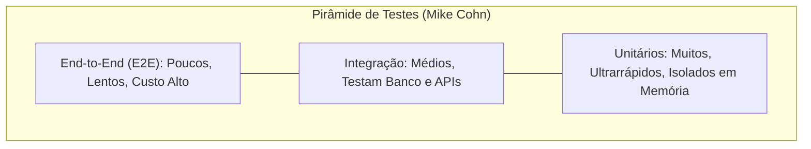
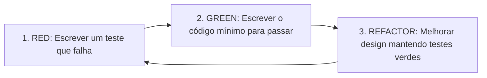

# 🛡️ Setor 12: Testes Automatizados & TDD

> **"Crie escudos digitais para seu código. Aprenda a validar seu software automaticamente e utilize TDD para guiar o design de suas funções."**

---

## 1. 🚀 Briefing da Missão (Contexto Temático & Realidade de Mercado)

| Atributo do Setor | Especificação |
| :--- | :--- |
| **Galáxia** | Cinturão de Arquitetura |
| **ID do Módulo** | `testes` |
| **Pré-requisitos** | [Setor 11: Clean Code & SOLID](./11-clean-code-solid.md) (`clean-solid`) |
| **Desbloqueia** | [Setor 14: Sistemas Distribuídos & Clean Arch](./14-sistemas-distribuidos-clean-arch.md) (em conjunto com [Setor 13: Padrões de Projeto](./13-padroes-de-projeto.md)) |
| **Nível de Criticidade** | Obrigatório para Deploys Seguros e CI/CD |

### 🛸 Analogia do Navegador Cósmico

Você confiaria em uma espaçonave tripulada que só testa o paraquedas de reentrada e os escudos térmicos **depois** que os astronautas já entraram na atmosfera em chamas? Claro que não! Antes de qualquer decolagem, cada turbina passa por testes isolados em bancada, depois os subsistemas são acoplados em câmara de vácuo e, por fim, ocorre uma simulação completa de voo.

No desenvolvimento de software, **testar manualmente clicando no Postman ou no navegador após cada mudança** equivale a descobrir que o motor falhou com a nave já em órbita. **Testes automatizados** são os escudos defletores e sensores de telemetria da sua aplicação: em segundos, milhares de verificações matemáticas rodam automaticamente antes de qualquer deploy, garantindo que a correção de um bug hoje não destruiu silenciosamente o módulo de pagamentos construído há seis meses.

### 🏢 A Dor Real no Mercado de Tecnologia

Equipes sem cultura de testes sofrem de um sintoma paralisante chamado **medo do deploy na sexta-feira**:
- Qualquer Pull Request exige horas de QA manual repetitivo e sujeito a erro humano.
- Bugs críticos de cálculo financeiro ou permissões chegam aos clientes em produção porque alguém esqueceu de retestar um caso de borda.
- Refatorar código antigo se torna impossível porque ninguém sabe o que vai quebrar depois de mexer em uma função central.

Empresas de tecnologia de ponta não contratam mais desenvolvedores que "apenas escrevem código que funciona na própria máquina". Mesmo para vagas **Júnior**, saber escrever testes unitários isolados, usar Dublês de Teste com critério e aplicar o raciocínio de TDD demonstra maturidade profissional imediata.

---

## 2. 📚 Carga de Conhecimento Completa (Tópico por Tópico)



### 2.1 Entender a pirâmide de testes (Unitários vs. Integração vs. End-to-End)

Proposta por Mike Cohn, a **Pirâmide de Testes** orienta como distribuir esforço, velocidade e confiança entre três camadas principais:

1. **Base da Pirâmide — Testes Unitários (Muitos e Ultrarrápidos):**
   - Validam a menor unidade isolada de comportamento (uma função pura, uma entidade de domínio ou um caso de uso sem rede nem disco).
   - Executam em **milissegundos** porque tudo roda na memória RAM. Devem compor a grande maioria dos testes (cerca de 70% a 80% da suíte de backend rico em regras de negócio).
2. **Meio da Pirâmide — Testes de Integração (Quantidade Moderada):**
   - Verificam se **duas ou mais partes reais conversam corretamente** — por exemplo, seu repositório executando uma query SQL verdadeira contra um PostgreSQL em container de teste, ou um controller Express passando por middlewares de autenticação e validação.
   - Executam em segundos e capturam erros de contrato, queries SQL malformadas, serialização JSON incorreta e configuração de rotas.
3. **Topo da Pirâmide — Testes End-to-End / E2E (Poucos e Estratégicos):**
   - Simulam a jornada completa de um usuário real do início ao fim (ex.: navegador com Playwright/Cypress abrindo a página, preenchendo formulário, chamando backend real e gravando no banco).
   - São caros para manter, lentos para rodar e mais sujeitos a intermitência (*flaky tests*). Por isso, devem cobrir apenas os **fluxos críticos de negócio** (cadastro, login, checkout).

> **Antipadrão do "Sorvete de Testes" (Ice Cream Cone):** acontece quando o time não escreve testes unitários, faz poucos de integração e tenta cobrir tudo via interface gráfica (E2E) ou testes manuais. O resultado é uma suíte que leva 45 minutos para rodar, quebra por mudanças de CSS e deixa o time sem feedback rápido.

### 2.2 Escrever testes unitários isolados de infraestrutura externa

Um teste unitário só merece esse nome se atender ao acrônimo **F.I.R.S.T.**:
- **Fast (Rápido):** centenas de testes devem rodar em poucos segundos. Se um teste unitário sobe o banco de dados ou faz chamada HTTP externa, ele já virou teste de integração lento.
- **Independent / Isolated (Independente):** o Teste B nunca pode depender do Teste A ter rodado antes ou de dados deixados em variáveis globais. Cada teste prepara seu próprio cenário.
- **Repeatable (Repetível):** deve dar o mesmo resultado na máquina do dev, no servidor de CI/CD sem internet, às 3h da manhã ou em ano bissexto (nunca dependa diretamente de `new Date()` sem injetar ou congelar o relógio).
- **Self-Validating (Auto-validável):** retorna **Passou** ou **Falhou** de forma booleana (usando `expect(...)`), nunca exigindo que alguém leia `console.log` para julgar se funcionou.
- **Timely (Oportuno):** escrito junto com o código (ou antes dele, no TDD), nunca "depois que sobrar tempo".

Para manter a legibilidade, estruture todo teste no padrão **AAA (Arrange, Act, Assert)** ou **Given-When-Then**:
- **Arrange (Preparar):** monte os dados de entrada, os dublês de teste e a instância sob teste.
- **Act (Agir):** execute exatamente o método ou função sendo validado.
- **Assert (Verificar):** faça as asserções explícitas sobre o retorno, exceções esperadas ou interações verificadas.

### 2.3 Usar dublês de teste (Mocks, Stubs e Spies) corretamente

Quando sua regra de negócio precisa conversar com um gateway de pagamento, serviço de e-mail ou repositório de banco de dados, você **não** conecta na infraestrutura real durante um teste unitário. Em vez disso, usa **Test Doubles (Dublês de Teste)** — termo cunhado por Gerard Meszaros e popularizado por Martin Fowler, inspirado nos dublês de ação do cinema.

Conheça a taxonomia exata dos dublês (e não chame tudo genericamente de "mock"):

| Tipo de Dublê | O que ele faz na prática | Quando usar |
| :--- | :--- | :--- |
| **Dummy** | Objeto vazio passado apenas para preencher um parâmetro obrigatório que nunca será usado naquele cenário de teste. | Teste de erro de validação onde um repositório exigido no construtor nem chega a ser chamado. |
| **Stub** | Fornece **respostas pré-programadas** (dados fixos ou erros simulados) para chamadas feitas durante o teste, controlando entradas indiretas. | Simular `clienteRepo.buscarPorId()` retornando `{ id: '1', vip: true }` ou retornando `null` para testar o caminho de erro. |
| **Spy** | Envolve ou substitui uma dependência para **registrar informações** sobre como ela foi chamada (quantas vezes, com quais argumentos), permitindo checar após o *Act*. | Verificar após a execução se `auditoriaLogger.registrar` recebeu exatamente o `pedidoId` esperado. |
| **Mock** | Objeto pré-programado com **expectativas explícitas de comportamento**. Se os métodos esperados não forem chamados na quantidade ou ordem certa, o próprio Mock reprova o teste (verificação comportamental). | Garantir em testes de interação que `gatewayPagamento.cobrar()` foi chamado exatamente 1 vez com o valor correto — e **0 vezes** se a validação falhou. |
| **Fake** | Implementação real simplificada e funcional, porém imprópria para produção (ex.: `InMemoryPedidoRepository` usando um `Map` ou `Array` em vez de PostgreSQL). | **Favorito para repositórios!** Mantém o teste limpo, realista e livre de acoplamento com detalhes internos de chamadas. |

### 2.4 Praticar o fluxo Red-Green-Refactor do TDD

**TDD (Test-Driven Development — Desenvolvimento Guiado por Testes)**, sistematizado por Kent Beck, não é apenas uma técnica de testes: é uma **técnica de design de software** que usa testes para guiar assinaturas limpas e evitar código morto.



As **3 leis clássicas do TDD**:
1. **RED (Vermelho):** Escreva primeiro um teste automatizado para um comportamento que ainda não existe. Rode a suíte e **veja o teste falhar** pelo motivo certo (por exemplo, função inexistente ou asserção diferente, não por erro de sintaxe acidental).
2. **GREEN (Verde):** Escreva o código de produção **mais simples possível** apenas para fazer o teste passar — sem otimizações prematuras ou casos extras ainda não testados.
3. **REFACTOR (Refatorar):** Com a rede de segurança verde ativa, elimine duplicações, melhore nomes, extraia funções e aplique padrões limpos **tanto no código de produção quanto no próprio código de teste**, rodando a suíte a cada passo para garantir que tudo continua verde.

**Benefício oculto do TDD:** se você tenta escrever um teste antes da implementação e percebe que precisa criar 6 dublês complicados só para instanciar uma classe, o TDD está gritando imediatamente que sua classe tem acoplamento excessivo e viola o SRP!

### 2.5 Analisar relatórios de cobertura de código (Code Coverage)

Ferramentas como Jest, Vitest (`c8` / `v8` / `istanbul`) geram relatórios de cobertura com 4 métricas distintas:
- **Statement Coverage (Declarações):** percentual de instruções executadas.
- **Branch Coverage (Desvios/Ramificações):** percentual de caminhos possíveis (`if` verdadeiro e `if` falso, cada ramo de operador ternário e `switch`) percorridos pelos testes. **Esta é a métrica mais valiosa**, porque um único `if` sem ramo `else` testado pode esconder um bug crítico mesmo com 90% de linhas cobertas!
- **Function Coverage (Funções):** percentual de funções/métodos invocados ao menos uma vez.
- **Line Coverage (Linhas):** percentual de linhas executáveis atingidas.

**Armadilha mortal (Lei de Goodhart):** *"Quando uma métrica vira meta, ela deixa de ser uma boa métrica."* Alcançar **100% de cobertura** não significa 100% de qualidade: é fácil escrever testes sem asserções (`expect`) que apenas executam todas as linhas para inflar o número no painel de CI. O foco profissional é **alta cobertura de branches em regras de negócio críticas** aliada a **asserções significativas** — se uma linha da sua lógica for alterada (mutação de código, como trocar `>` por `>=`), um bom teste precisa quebrar.

### 2.6 Escrever código com injeção de dependências para facilitar os testes

A maior barreira para testar código legado é o acoplamento direto via `import` de singletons globais ou instanciações diretas (`new PrismaClient()`, `new Stripe()`, `Math.random()`, `new Date()`).

Ao projetar funções e classes com **Injeção de Dependências (DI)** — conectando diretamente com o **DIP** do [Setor 11](./11-clean-code-solid.md) — toda dependência externa entra como parâmetro de construtor ou argumento de função:
- **Sem DI:** `CupomService` importa e chama `new Date()` internamente. Para testar se um cupom expira amanhã, você fica preso ao relógio real da máquina ou precisa hackear timers globais.
- **Com DI:** `CupomService` recebe `relogio: Relogio` (ou `agora: Date = new Date()`). No teste unitário, você injeta uma data fixa determinística (`new Date('2026-11-18T10:00:00Z')`), tornando o teste 100% reproduzível em qualquer fuso horário e em qualquer época do ano!

---

## 3. 💻 Mão no Código (Jeito Iniciante vs. Padrão Profissional)

Cenário: Serviço de **Transferência Bancária / Carteira Digital** que valida saldo, debita na origem, credita no destino e envia alerta de segurança para valores acima de R\$ 1.000,00.

### ❌ Jeito Iniciante (Código impossível de testar unitariamente sem banco real e fila real + Teste acoplado)

```typescript
// ❌ ANTIPADRÃO: Dependências chumbadas dentro do método (impossível isolar!)
import { db } from './conexao-postgres';
import { enviarEmailAlerta } from './smtp-producao';

export class TransferenciaServiceAcoplado {
  async transferir(origemId: string, destinoId: string, valorCentavos: number) {
    // Como testar sem subir um PostgreSQL real? Impossível sem monkey-patch frágil!
    const origem = await db.query('SELECT * FROM contas WHERE id = $1', [origemId]);
    const destino = await db.query('SELECT * FROM contas WHERE id = $1', [destinoId]);

    if (origem.saldo < valorCentavos) {
      throw new Error('Saldo insuficiente');
    }

    await db.query('UPDATE contas SET saldo = saldo - $1 WHERE id = $2', [valorCentavos, origemId]);
    await db.query('UPDATE contas SET saldo = saldo + $1 WHERE id = $2', [valorCentavos, destinoId]);

    if (valorCentavos > 100_000) {
      // Se esquecer de mockar módulo global, envia e-mail real durante o teste!
      await enviarEmailAlerta(origem.email, valorCentavos);
    }
  }
}
```

### ✅ Padrão Profissional (Injeção de Dependências + Fake/Stub/Spy explícitos com Vitest/Jest)

Primeiro, o código de produção desacoplado por interfaces:

```typescript
// ✅ src/transferencia/TransferenciaService.ts
export interface Conta {
  id: string;
  emailTitular: string;
  saldoCentavos: number;
}

export interface ContaRepositorio {
  buscarPorId(id: string): Promise<Conta | null>;
  atualizarSaldos(origem: Conta, destino: Conta): Promise<void>;
}

export interface ServicoAlerta {
  notificarMovimentacaoAlta(email: string, valorCentavos: number): Promise<void>;
}

export class TransferenciaService {
  private static readonly LIMITE_ALERTA_CENTAVOS = 100_000; // R$ 1.000,00

  constructor(
    private readonly contaRepositorio: ContaRepositorio,
    private readonly servicoAlerta: ServicoAlerta
  ) {}

  async executar(origemId: string, destinoId: string, valorCentavos: number): Promise<void> {
    if (valorCentavos <= 0) {
      throw new Error('O valor da transferência deve ser maior que zero.');
    }
    if (origemId === destinoId) {
      throw new Error('Conta de origem e destino devem ser diferentes.');
    }

    const origem = await this.contaRepositorio.buscarPorId(origemId);
    const destino = await this.contaRepositorio.buscarPorId(destinoId);

    if (!origem || !destino) {
      throw new Error('Conta de origem ou destino não encontrada.');
    }
    if (origem.saldoCentavos < valorCentavos) {
      throw new Error('Saldo insuficiente para realizar a transferência.');
    }

    origem.saldoCentavos -= valorCentavos;
    destino.saldoCentavos += valorCentavos;

    await this.contaRepositorio.atualizarSaldos(origem, destino);

    if (valorCentavos > TransferenciaService.LIMITE_ALERTA_CENTAVOS) {
      await this.servicoAlerta.notificarMovimentacaoAlta(origem.emailTitular, valorCentavos);
    }
  }
}
```

Agora, a suíte de testes unitários **ultrarrápida e isolada**, demonstrando **Fake**, **Stub** e **Spy/Mock** com clareza cristalina:

```typescript
// ✅ src/transferencia/TransferenciaService.spec.ts
import { describe, it, expect, vi, beforeEach } from 'vitest';
import {
  Conta,
  ContaRepositorio,
  ServicoAlerta,
  TransferenciaService,
} from './TransferenciaService';

// FAKE em memória: substitui o PostgreSQL com comportamento real e rápido
class ContaRepositorioFake implements ContaRepositorio {
  private contas = new Map<string, Conta>();

  inserir(conta: Conta) {
    // Clona para simular isolamento de persistência fora da referência em memória
    this.contas.set(conta.id, { ...conta });
  }

  async buscarPorId(id: string): Promise<Conta | null> {
    const encontrada = this.contas.get(id);
    return encontrada ? { ...encontrada } : null;
  }

  async atualizarSaldos(origem: Conta, destino: Conta): Promise<void> {
    this.contas.set(origem.id, { ...origem });
    this.contas.set(destino.id, { ...destino });
  }
}

describe('TransferenciaService', () => {
  let repositorioFake: ContaRepositorioFake;
  let alertaSpy: ServicoAlerta;
  let sut: TransferenciaService; // SUT = System Under Test

  beforeEach(() => {
    repositorioFake = new ContaRepositorioFake();
    // SPY/MOCK com vi.fn() para observar e validar chamadas ao serviço externo
    alertaSpy = {
      notificarMovimentacaoAlta: vi.fn().mockResolvedValue(undefined),
    };
    sut = new TransferenciaService(repositorioFake, alertaSpy);

    repositorioFake.inserir({
      id: 'conta-ana',
      emailTitular: 'ana@galaxia.dev',
      saldoCentavos: 250_000,
    });
    repositorioFake.inserir({
      id: 'conta-bruno',
      emailTitular: 'bruno@galaxia.dev',
      saldoCentavos: 50_000,
    });
  });

  it('deve transferir saldo corretamente sem disparar alerta quando valor for abaixo do limite', async () => {
    // Act
    await sut.executar('conta-ana', 'conta-bruno', 40_000);

    // Assert (estado no Fake + verificação comportamental no Spy)
    const anaAtualizada = await repositorioFake.buscarPorId('conta-ana');
    const brunoAtualizado = await repositorioFake.buscarPorId('conta-bruno');

    expect(anaAtualizada?.saldoCentavos).toBe(210_000);
    expect(brunoAtualizado?.saldoCentavos).toBe(90_000);
    expect(alertaSpy.notificarMovimentacaoAlta).not.toHaveBeenCalled();
  });

  it('deve disparar alerta de segurança quando a transferência exceder R$ 1.000,00', async () => {
    // Act
    await sut.executar('conta-ana', 'conta-bruno', 150_000);

    // Assert: Mock valida exatamente quantas vezes e com quais argumentos foi chamado
    expect(alertaSpy.notificarMovimentacaoAlta).toHaveBeenCalledTimes(1);
    expect(alertaSpy.notificarMovimentacaoAlta).toHaveBeenCalledWith('ana@galaxia.dev', 150_000);
  });

  it('deve lançar erro e preservar saldos originais quando não houver saldo suficiente', async () => {
    // Act & Assert
    await expect(sut.executar('conta-ana', 'conta-bruno', 300_000)).rejects.toThrow(
      'Saldo insuficiente'
    );

    const ana = await repositorioFake.buscarPorId('conta-ana');
    expect(ana?.saldoCentavos).toBe(250_000);
    expect(alertaSpy.notificarMovimentacaoAlta).not.toHaveBeenCalled();
  });
});
```

---

## 4. 🛠️ Laboratório de Voo (Exercício Prático Guiado)

**Duração estimada:** 50 minutos | **Ferramenta:** Vitest (ou Jest) + TypeScript

### 🎯 Objetivo da Missão
Construir do zero, aplicando **TDD estrito (Red-Green-Refactor)**, um **Validador e Calculador de Cupons de Desconto** com expiração temporal e limite de uso.

### 📋 Passo a Passo Reproduzível

1. **Inicialize o ambiente com Vitest e cobertura:**
   ```bash
   mkdir lab-tdd-cupons && cd lab-tdd-cupons
   npm init -y
   npm install -D typescript vitest @vitest/coverage-v8
   npx tsc --init
   ```
   Adicione no `package.json`: `"test": "vitest"`, `"test:cov": "vitest run --coverage"`.
2. **Defina os requisitos de negócio (NÃO crie o código de produção antes do teste!):**
   - Um cupom tem `codigo`, `percentualDesconto`, `expiraEm` (`Date`), `valorMinimoCentavos` e `usosRestantes`.
   - Regras:
     1. Se o cupom não existir no repositório, lançar erro `"Cupom inválido"`.
     2. Se a data atual injetada for posterior a `expiraEm`, lançar erro `"Cupom expirado"`.
     3. Se `usosRestantes <= 0`, lançar erro `"Cupom esgotado"`.
     4. Se o total do carrinho for menor que `valorMinimoCentavos`, lançar erro `"Valor mínimo não atingido"`.
     5. Caso válido, aplicar o desconto em centavos arredondado e decrementar `usosRestantes` no repositório.
3. **Ciclo 1 (RED -> GREEN -> REFACTOR):**
   - Escreva primeiro o teste `"deve rejeitar cupom inexistente"` em `AplicarCupomService.spec.ts` usando um `Stub` de `CupomRepositorio` que retorna `null`.
   - Rode `npm test` e confirme o **RED**.
   - Crie `AplicarCupomService.ts` com a lógica mínima para passar (**GREEN**).
4. **Ciclos 2 a 5:** Repita rigorosamente o ciclo **RED -> GREEN -> REFACTOR** para cada uma das 4 regras restantes, injetando uma função `obterDataAtual: () => Date` no construtor de `AplicarCupomService` para testar expiração de forma determinística.
5. **Auditoria de Cobertura:**
   ```bash
   npm run test:cov
   ```
   Abra o relatório no terminal (e em `coverage/index.html`) e verifique se **100% dos branches** da classe `AplicarCupomService` foram cobertos. Se houver algum branch não coberto, escreva o teste faltante!

### ✅ Critérios de Domínio
- [ ] Todos os 5 casos de negócio + casos de borda (ex.: exatamente na data de expiração ou exatamente no valor mínimo) estão cobertos por testes passando.
- [ ] Zero uso de `new Date()` solto sem injeção dentro da regra de expiração.
- [ ] `npm run test:cov` mostra `100%` de cobertura de Branches e Functions em `AplicarCupomService.ts`.
- [ ] Cada teste segue claramente a estrutura **Arrange, Act, Assert** e roda em menos de 10ms.

---

## 5. 🎯 Resolução Comentada do Teste de Ignição (Quest Oficial)

> **Pergunta Oficial (`data.js`):**
> *Qual a diferença essencial entre um 'Mock' e um 'Stub' ao escrever testes de unidade?*
>
> - **A)** O Mock simula a conexão com um banco de dados real, enquanto o Stub simula chamadas de rede.
> - **B)** O Stub apenas fornece dados preparados para responder a chamadas feitas durante o teste, enquanto o Mock também valida expectativas de comportamento (por exemplo, se um método foi chamado N vezes).
> - **C)** O Mock é escrito no início do projeto e o Stub é gerado automaticamente pelo compilador ao final.
> - **D)** Não há diferença; os dois termos descrevem exatamente a mesma técnica de teste.

### ✅ Resposta Correta: **Alternativa B**

### 🔍 Análise Técnica de Cada Alternativa

- **Por que B está correta:** Na definição clássica de Gerard Meszaros e Martin Fowler (*Mocks Aren't Stubs*), a distinção fundamental está entre **verificação de estado** e **verificação de comportamento**. O **Stub** existe apenas para fornecer respostas pré-definidas quando o código testado consulta uma dependência (entrada indireta), permitindo testar o estado final resultante. Já o **Mock** vai além: ele possui expectativas registradas de interação — validando se um método foi invocado, quantas vezes foi invocado e com quais argumentos exatos (saída indireta).
- **Por que A está incorreta:** Ambos (Mocks e Stubs) são dublês de teste genéricos que podem substituir **qualquer** dependência — banco de dados, gateway HTTP, sistema de arquivos, relógio do sistema ou envio de e-mail. Nenhum deles é restrito a um tipo específico de infraestrutura.
- **Por que C está incorreta:** Compiladores não geram Stubs automaticamente ao final do projeto; ambos os dublês são definidos pelo próprio desenvolvedor (manualmente ou via bibliotecas de teste como Vitest, Jest ou Sinon) na fase de escrita dos testes.
- **Por que D está incorreta:** Apesar de muitos iniciantes usarem a palavra "mock" de forma informal para todo dublê de teste, tecnicamente Stub e Mock têm papéis bem distintos: responder valores preparados vs. verificar expectativas de chamada.

---

## 6. 🎤 Kit de Apresentação (Como Dar Aula / Apresentar Este Módulo)

### ⏱️ Pitch Feynman de 2 Minutos (Texto Pronto para Falar)

> "Imagina construir um carro onde o único jeito de testar o freio é sair acelerando a 120 km/h numa avenida movimentada. Nenhuma fábrica séria trabalha assim — ela testa o freio isolado na bancada, testa o conjunto no dinamômetro e só depois vai para a pista. No software, essa bancada de segurança se chama **Pirâmide de Testes**.
>
> Na base, temos centenas de **testes unitários** que rodam em milissegundos na memória, sem banco de dados nem internet. Para conseguir isolar uma classe de pagamento sem sair cobrando cartões reais, usamos **dublês de teste**, assim como dublês de cinema: o **Stub** só devolve uma resposta ensaiada quando perguntado, e o **Mock** também fiscaliza se a cena foi gravada direito — por exemplo, se o método de cobrança foi chamado apenas uma vez e não duas.
>
> Acima deles, ficam os **testes de integração**, que conferem se o nosso código realmente conversa bem com o banco SQL ou com a API, e no topo poucos **testes End-to-End** para os fluxos mais críticos do usuário.
>
> E quando juntamos isso com **TDD** — o ciclo Vermelho, Verde e Refatora — nós invertemos o jogo: primeiro escrevemos um teste que falha descrevendo o que o sistema deveria fazer, depois fazemos passar com o mínimo necessário e aí sim refinamos o design com segurança total. O resultado não é apenas menos bug em produção: é código naturalmente desacoplado porque, para testar fácil, você é obrigado a projetar melhor."

### 📊 Roteiro de Slides (6 Slides)

1. **Slide 1 — Por que Testar? Confiança para Mudar Sem Medo**
   - *Bullets:* Custo exponencial do bug (Desenvolvimento vs. Produção); O mito do "eu testei no Postman"; Testes como documentação executável.
   - *Visual:* Curva de custo de correção de defeitos ao longo do ciclo de vida do software.
2. **Slide 2 — A Pirâmide de Testes vs. O Cone de Sorvete**
   - *Bullets:* Unitários (rápidos, base larga); Integração (contratos reais); E2E (poucos fluxos críticos).
   - *Visual:* Duas pirâmides lado a lado: a saudável vs. o antipadrão invertido.
3. **Slide 3 — Dublês de Teste Sem Mistério**
   - *Bullets:* Dummy, Fake, Stub, Spy e Mock; Diferença entre verificação de estado (Stub/Fake) e verificação de comportamento (Mock/Spy).
   - *Visual:* Tabela visual com ícones de cinema associando cada dublê a um exemplo real de API.
4. **Slide 4 — O Ciclo TDD: Red -> Green -> Refactor**
   - *Bullets:* Por que ver o teste falhar antes importa; Baby steps para o Green; Refatoração contínua sem medo.
   - *Visual:* Diagrama circular colorido (Vermelho -> Verde -> Azul/Refatorar).
5. **Slide 5 — Testabilidade Nasce da Injeção de Dependência**
   - *Bullets:* Dependências escondidas (`new Prisma()`, `new Date()`) são inimigas dos testes; Injeção pelo construtor libera o isolamento completo.
   - *Visual:* Bloco de código mostrando `constructor(repo, relogio)` abrindo portas para Fakes determinísticos.
6. **Slide 6 — Code Coverage: O Número Que Ajuda (e Que Engana)**
   - *Bullets:* Statements vs. Branches vs. Functions; Por que 80% bem asserido vence 100% sem asserções reais.
   - *Visual:* Print real de tabela de coverage no terminal com destaque para a coluna `% Branch`.

### 💻 Roteiro de Demo Ao Vivo (3 Minutos)

1. **Minuto 0:00–0:45:** Abra o terminal com `npx vitest --watch` rodando ao lado do editor. Mostre a velocidade instantânea (testes rodando a cada `Ctrl+S` em menos de 50ms).
2. **Minuto 0:45–2:00:** Faça um ciclo completo de **TDD ao vivo** para uma função `calcularMultaAtraso(diasAtraso, valorCentavos)`: escreva o teste para 0 dias (RED vermelho no terminal), implemente `return 0` (GREEN), escreva o teste de atraso de 5 dias (RED), implemente o cálculo completo (GREEN).
3. **Minuto 2:00–3:00:** Introduza intencionalmente um bug sutil no código de produção (trocando `>` por `>=`) e mostre o escudo disparando vermelho no mesmo segundo. Depois conserte e rode `--coverage` para exibir a tabela verde de branches.

### ❓ 2 Perguntas Difíceis da Plateia (e Respostas Seguras)

1. **"Na prática das empresas, alguém realmente usa TDD o tempo todo, ou isso é só teoria de livro?"**
   - *Resposta:* Ninguém sério usa TDD de forma religiosa em 100% do código — por exemplo, para prototipar uma interface visual exploratória ou configurar um script descartável, escrever o código primeiro costuma ser mais produtivo. Porém, em **regras de negócio críticas, algoritmos de cálculo, validações financeiras e correção de bugs em produção** (escrever primeiro um teste que reproduz o bug reportado!), o TDD é amplamente usado em times maduros porque garante que o bug nunca mais volte.
2. **"Se eu mockar todas as dependências no teste unitário, como vou saber se o meu código realmente funciona quando falar com o banco de dados?"**
   - *Resposta:* Excelente observação — essa é exatamente a função do **meio da pirâmide: os Testes de Integração**! Testes unitários com Fakes e Mocks provam que a *lógica de decisão* está certa, mas nunca provam que sua query SQL está sem erro de sintaxe ou que o índice do banco funciona. Por isso combinamos testes unitários rápidos para regras de negócio com testes de integração rodando contra um banco real (via Docker/Testcontainers) nas rotas e repositórios críticos.

---

## 7. 💼 Radar do Mercado de Trabalho (Foco Dev Júnior)

### 🎙️ 3 Perguntas Reais de Entrevista Técnica Júnior

1. **"Como você decide o que testar com teste unitário e o que testar com teste de integração?"**
   - *Resposta-modelo:* "Uso testes unitários para toda lógica pura e regras de negócio dentro de entidades, validadores e casos de uso — por exemplo, cálculo de desconto, validação de saldo ou transição de status de pedido — isolando banco e APIs externas via interfaces e dublês para ter feedback em milissegundos. Já os testes de integração eu reservo para verificar as fronteiras do sistema: se a rota HTTP deserializa o payload corretamente, passa pelos middlewares e executa a query real no banco de dados sem erros."
2. **"Qual o risco de abusar de Mocks nos testes unitários?"**
   - *Resposta-modelo:* "Quando um teste mocka excessivamente detalhes internos de implementação — verificando cada método privado ou a ordem rígida de chamadas internas em vez do resultado observável — ele gera **testes frágeis** (*brittle tests*). Qualquer refatoração saudável que preserve o comportamento externo quebra dezenas de testes sem motivo real. Por isso prefiro usar **Fakes em memória** para repositórios e reservar **Mocks/Spies** apenas para efeitos colaterais externos inevitáveis, como disparo de e-mail ou chamada a um gateway."
3. **"Explique o ciclo Red-Green-Refactor e por que a etapa Refactor é tão importante quanto as outras duas."**
   - *Resposta-modelo:* "No Red escrevemos o teste que falha definindo o contrato desejado; no Green fazemos passar rápido da forma mais simples possível, até mesmo com duplicação temporária se necessário. Se pararmos no Green, acumulamos dívida técnica. A etapa Refactor é onde limpamos nomes, extraímos helpers e aplicamos SOLID imediatamente após passar no teste, sabendo que a rede de testes verdes garante que a limpeza não quebrou nada."

### ⚖️ Erros Clássicos de Júnior vs. Postura Profissional

| Erro Clássico de Júnior | Postura Profissional Esperada |
| :--- | :--- |
| Escrever um teste gigante com 15 `expect` testando 4 cenários diferentes de uma vez. | Escrever testes focados em **um único comportamento** por bloco `it(...)`, com nome descritivo (`deve [resultado] quando [condição]`). |
| Deixar testes comentados (`test.skip`) ou apagar asserções quebradas para o CI passar. | Investigar imediatamente se o erro veio de um bug introduzido ou de uma mudança legítima de requisito e atualizar o contrato com consciência. |
| Usar `new Date()` ou `Math.random()` dentro da regra de negócio e depois sofrer com testes intermitentes. | Injetar relógio/gerador de ID como dependência determinística para que o teste nunca falhe aleatoriamente às 23h59. |
| Achar que "100% de cobertura" garante ausência total de bugs. | Focar em casos de borda (`0`, `null`, valores negativos, limites máximos), cobertura de branches e asserções fortes. |

### 🏆 Evidência para Portfólio / GitHub / LinkedIn

- **No GitHub:** Inclua em todos os seus projetos backend uma pasta de testes unitários e pelo menos 1 teste de integração rodando via script `npm test`. Adicione no `README.md` o badge de cobertura ou um print limpo da execução dos testes passando com o comando exato para qualquer recrutador reproduzir em 5 segundos.
- **No LinkedIn:** Escreva um post curto mostrando um bug de caso de borda (ex.: arredondamento de centavos ou virada de mês) que você pegou praticando TDD, explicando como injetar a data atual como parâmetro salvou a testabilidade do módulo.

---

## 8. 📡 Transmissões Recomendadas & Próxima Órbita

### 📚 Recursos Oficiais do Módulo
- 📖 **[TDD por Exemplo - Livro de Kent Beck](https://www.amazon.com.br/TDD-Desenvolvimento-Guiado-por-Testes/dp/8573078423)** — A obra original que define a filosofia, o ritmo dos pequenos passos e o fluxo Red-Green-Refactor.
- 📝 **[Martin Fowler: Test Double](https://martinfowler.com/bliki/TestDouble.html)** — Referência concisa e definitiva diferenciando Dummy, Fake, Stub, Spy e Mock.

### 🛸 Próxima Órbita na Árvore de Habilidades
Para desbloquear o coração arquitetural desta galáxia — o **[Setor 14: Sistemas Distribuídos & Clean Arch](./14-sistemas-distribuidos-clean-arch.md)** — certifique-se de também dominar o setor paralelo que traz a caixa de ferramentas dos padrões clássicos:
- ➡️ **[Setor 13: Padrões de Projeto](./13-padroes-de-projeto.md)** (`design-patterns`).
- ➡️ Após concluir Testes e Padrões de Projeto: **[Setor 14: Sistemas Distribuídos & Clean Arch](./14-sistemas-distribuidos-clean-arch.md)**.
