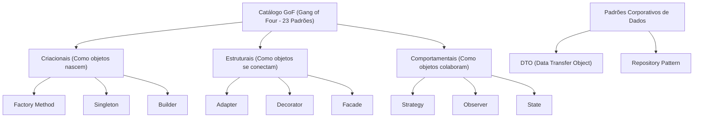

# 📐 Setor 13: Padrões de Projeto

> **"Não reinvente a roda. Use soluções consagradas para problemas recorrentes de design de software em sistemas orientados a objetos."**

---

## 1. 🚀 Briefing da Missão (Contexto Temático & Realidade de Mercado)

| Atributo do Setor | Especificação |
| :--- | :--- |
| **Galáxia** | Cinturão de Arquitetura |
| **ID do Módulo** | `design-patterns` |
| **Pré-requisitos** | [Setor 11: Clean Code & SOLID](./11-clean-code-solid.md) (`clean-solid`) |
| **Desbloqueia** | [Setor 14: Sistemas Distribuídos & Clean Arch](./14-sistemas-distribuidos-clean-arch.md) (em conjunto com [Setor 12: Testes Automatizados & TDD](./12-testes-automatizados-tdd.md)) |
| **Nível de Criticidade** | Vocabulário Universal entre Engenheiros de Software |

### 🛸 Analogia do Navegador Cósmico

Imagine que engenheiros espaciais de diferentes planetas precisem projetar uma estação orbital conjunta. Em vez de cada engenheiro inventar do zero um tipo estranho de trava de escotilha ou discutir durante horas como desenhar uma válvula antirretorno, eles dizem uma única palavra: *"Aqui usamos uma Escotilha de Descompressão Dupla e ali um Adaptador Universal Tipo-C"*. Instantaneamente, toda a equipe enxerga os mesmos encaixes, as mesmas vantagens e os mesmos riscos.

No universo do desenvolvimento, os **Design Patterns (Padrões de Projeto)** funcionam exatamente como esse vocabulário arquitetural compartilhado. Um padrão não é um pedaço de código pronto para copiar e colar: é um **molde conceitual testado em batalha** para resolver problemas estruturais recorrentes — como trocar algoritmos em tempo de execução (*Strategy*), adaptar uma biblioteca externa incompatível (*Adapter*), construir objetos complexos passo a passo (*Builder*) ou notificar múltiplos módulos quando um evento acontece (*Observer*).

### 🏢 A Dor Real no Mercado de Tecnologia

Em entrevistas técnicas, code reviews e sessões de arquitetura, times profissionais comunicam decisões inteiras usando nomes de padrões:
- *"Vamos envolver o SDK antigo da transportadora com um Adapter para não vazar esse formato feio para o domínio."*
- *"Essa cadeia de `if/else` de frete pede um Strategy."*
- *"Não exponha a entidade do banco direto na resposta HTTP; mapeie para um DTO."*

Quem não conhece padrões de projeto sofre de dois extremos prejudiciais: ou **reinventa soluções frágeis** para problemas já resolvidos há 30 anos, ou sofre de **"Patternitis"** (enfia `Singleton`, `Factory` e `Builder` até onde uma função simples resolveria). Este módulo ensina **o que cada padrão resolve, como implementá-lo em TypeScript moderno e, principalmente, quando NÃO usá-lo**.

---

## 2. 📚 Carga de Conhecimento Completa (Tópico por Tópico)



### 2.1 Compreender o catálogo clássico GoF (Gang of Four)

Em 1994, quatro autores — Erich Gamma, Richard Helm, Ralph Johnson e John Vlissides, apelidados de **Gang of Four (GoF)** — publicaram o livro *Design Patterns: Elements of Reusable Object-Oriented Software*, catalogando **23 padrões fundamentais** divididos por propósito em três famílias:

1. **Padrões Criacionais (5 no GoF):** abstraem o processo de instanciação, escondendo **como** os objetos são criados e compostos (`Factory Method`, `Abstract Factory`, `Builder`, `Prototype`, `Singleton`).
2. **Padrões Estruturais (7 no GoF):** explicam como montar objetos e classes em estruturas maiores, mantendo flexibilidade e baixo acoplamento (`Adapter`, `Bridge`, `Composite`, `Decorator`, `Facade`, `Flyweight`, `Proxy`).
3. **Padrões Comportamentais (11 no GoF):** organizam a comunicação, distribuição de responsabilidades e fluxo de controle entre objetos (`Chain of Responsibility`, `Command`, `Iterator`, `Mediator`, `Memento`, `Observer`, `State`, `Strategy`, `Template Method`, `Visitor`, `Interpreter`).

**Dois mandamentos que guiam todo o livro GoF:**
- *"Programe voltado para uma interface, não para uma implementação."*
- *"Favoreça composição de objetos sobre herança de classes."*

### 2.2 Implementar padrões criacionais úteis (Factory Method, Singleton, Builder)

- **Factory Method (Método Fábrica):**
  - *Problema:* O código cliente precisa criar um objeto (por exemplo, um conector de notificação por E-mail, SMS ou Push), mas o tipo exato depende de configuração ou entrada em tempo de execução, e você não quer acoplar o consumidor com `new EmailNotifier()` espalhado por todo lado.
  - *Solução:* Centraliza a decisão de criação em um método ou classe fábrica que retorna a **interface comum** (`Notifier`), permitindo adicionar novos produtos sem editar os consumidores.
- **Singleton (Instância Única):**
  - *Problema:* Garantir que exista **no máximo uma única instância** compartilhada de um recurso caro (ex.: pool de conexões com banco de dados ou gerenciador centralizado de configuração) com ponto de acesso controlado.
  - *Cuidado crítico em backends modernos:* O Singleton clássico com estado global mutável dificulta testes unitários (vaza estado entre testes!) e esconde dependências reais da classe (violando DIP). Em Node.js/TypeScript, prefira **gerenciar o ciclo de vida único no ponto de composição da aplicação (Container de Injeção de Dependência)** e injetar essa instância única nas classes via construtor, em vez de chamar `Database.getInstance()` escondido dentro dos serviços.
- **Builder (Construtor Passo a Passo):**
  - *Problema:* Construir objetos complexos com dezenas de configurações opcionais (como montar uma query SQL dinâmica, um relatório PDF ou uma requisição HTTP configurável) gera o antipadrão **Construtor Telescópico** (`new Relatorio(true, false, null, undefined, 'A4', true)`).
  - *Solução:* Separa a construção em métodos encadeáveis (*Fluent Interface*) como `.comTitulo('Vendas').filtrarPorPeriodo(inicio, fim).incluirGraficos().build()`, validando a consistência antes de entregar o objeto pronto e imutável.

### 2.3 Aplicar padrões estruturais (Adapter, Decorator, Facade)

- **Adapter (Adaptador):**
  - *Problema:* Seu sistema espera uma interface limpa `GatewayPagamento` com `cobrar(valorCentavos)`, mas você contratou um SDK externo legado que possui o método `makeCharge({ amountInDollars: number, currencyCode: string })`.
  - *Solução:* Cria uma classe envoltória (`StripePagamentoAdapter`) que implementa a interface interna do seu domínio e traduz chamadas e formatos para o SDK externo. Se amanhã trocar o Stripe pelo MercadoPago, você escreve outro Adapter e **zero linhas do seu domínio mudam**.
- **Decorator (Decorador):**
  - *Problema:* Você precisa adicionar comportamentos transversais em camadas — como **cache em memória**, **medição de tempo (logging)** ou **retentativa automática (retry)** — ao redor de um serviço existente sem criar uma explosão de subclasses (`PedidoRepoComCacheELogERetry`).
  - *Solução:* Cria classes que implementam a **mesma interface** do objeto original, recebem o objeto original no construtor e executam lógica antes e/ou depois de delegar a chamada a ele, como bonecas russas empilháveis!
- **Facade (Fachada):**
  - *Problema:* Realizar uma ação aparentemente simples (ex.: `transcodificarVideo` ou `processarCheckoutCompleto`) exige orquestrar 6 subsistemas complexos na ordem exata (leitor de codecs, compressor de áudio, gerador de thumbnail, uploader S3).
  - *Solução:* Fornece uma interface simplificada de alto nível (`VideoConversorFacade.converterParaMp4(arquivo)`) que encapsula toda a coreografia interna dos subsistemas complexos, sem impedir que usuários avançados acessem os subsistemas diretamente se precisarem.

### 2.4 Aprender padrões comportamentais altamente comuns (Strategy, Observer, State)

- **Strategy (Estratégia):**
  - *Problema:* Um mesmo objetivo tem múltiplos algoritmos intercambiáveis (cálculo de frete: Correios, Transportadora, Drone; ou cálculo de imposto por estado; ou algoritmo de compressão), causando `if/else` gigantescos.
  - *Solução:* Define uma família de algoritmos encapsulados em classes separadas que implementam a mesma interface (`EstrategiaFrete`). O contexto (`CalculadoraPedido`) apenas delega `this.estrategia.calcular(pedido)`, podendo trocar de estratégia dinamicamente em runtime! (É a materialização direta do Princípio **OCP**.)
- **Observer (Observador / Event Emitter):**
  - *Problema:* Quando um evento importante acontece (ex.: `PedidoPago`), vários módulos independentes precisam reagir (enviar nota fiscal, baixar estoque, pontuar programa de fidelidade, enviar push notification), mas `PedidoService` não deve conhecer nem ficar acoplado a todos eles.
  - *Solução:* O sujeito (*Subject / Publisher*) mantém uma lista de assinantes (*Observers / Listeners*) e notifica todos quando o estado muda. Em Node.js, `EventEmitter` nativo e sistemas de eventos de domínio aplicam exatamente esse padrão.
- **State (Estado):**
  - *Problema:* Um objeto muda drasticamente de comportamento dependendo do seu estado atual (ex.: um `Pedido` pode estar `Rascunho`, `AguardandoPagamento`, `Pago`, `Enviado` ou `Cancelado`), enchendo cada método de `switch(this.status)` cheio de regras de transição proibidas.
  - *Solução:* Cada estado vira uma classe própria implementando ações válidas e transições permitidas (por exemplo, `EstadoPago` permite `enviar()` e `estornar()`, mas lança erro em `adicionarItem()`). Isso elimina condicionais repetidas e garante máquinas de estado seguras.

### 2.5 Entender a utilidade prática de DTOs (Data Transfer Objects) e Repositories

Embora não façam parte dos 23 padrões do livro GoF original (são padrões corporativos catalogados principalmente por Martin Fowler em *Patterns of Enterprise Application Architecture*), **DTO** e **Repository** estão presentes em praticamente toda API backend profissional:

- **DTO (Data Transfer Object):**
  - Objeto simples, sem regra de negócio, usado exclusivamente para **transportar dados entre fronteiras** (entre cliente HTTP e Controller, ou entre Caso de Uso e resposta JSON).
  - *Por que usar em vez de devolver a entidade do banco direto?* Segurança e desacoplamento! Sua tabela `Usuario` tem `senhaHash`, `tentativasLoginFalhas` e colunas internas. Um `UsuarioResponseDTO` expõe apenas `{ id, nome, email }`, garantindo que dados sensíveis nunca vazem e permitindo alterar o banco sem quebrar o contrato JSON da API pública.
- **Repository (Repositório):**
  - Media a camada de domínio e a camada de mapeamento de dados (SQL, ORM, NoSQL), simulando uma **coleção em memória de objetos de domínio**.
  - *Regra de ouro:* O domínio fala apenas com a interface `PedidoRepository` (`salvar(pedido)`, `buscarPorId(id)`), sem saber se por trás há PostgreSQL com Prisma, SQL puro com `pg`, MongoDB ou um `Map` em memória para testes.

---

## 3. 💻 Mão no Código (Jeito Iniciante vs. Padrão Profissional)

Cenário completo unindo **Strategy + Decorator + Adapter + DTO + Repository** em um serviço de cálculo e cobrança de pagamentos.

### ❌ Jeito Iniciante (Sem padrões: switch gigante, SDK acoplado, vazamento de dados sensíveis)

```typescript
// ❌ ANTIPADRÃO: Código rígido, impossível estender sem editar e vazando campos do banco
import { StripeSDK } from './libs/stripe-sdk-legado';

export class PagamentoIniciante {
  async pagar(usuario: any, metodo: string, valorReais: number) {
    // 1. Sem Strategy: switch hardcoded para cada regra de taxa
    let taxa = 0;
    if (metodo === 'PIX') {
      taxa = valorReais * 0.005;
    } else if (metodo === 'CARTAO') {
      taxa = valorReais * 0.039 + 0.5;
    } else if (metodo === 'BOLETO') {
      taxa = 3.49;
    }

    const total = valorReais + taxa;

    // 2. Sem Adapter: acoplado diretamente ao formato estranho do SDK externo
    const stripe = new StripeSDK('sk_live_chumbada');
    const resultado = await stripe.makeCharge({
      amount_cents: Math.round(total * 100),
      curr: 'BRL',
      customer_mail: usuario.email,
    });

    // 3. Sem DTO: retorna o objeto inteiro do banco (pode vazar senhaHash, tokens secretos e campos internos)
    return { usuario, transacaoBrutaStripe: resultado };
  }
}
```

### ✅ Padrão Profissional (Strategy + Adapter + Decorator de Log + DTO)

```typescript
// ✅ PADRÃO DE MERCADO: Desacoplado, extensível e seguro

// --- DTOs (Fronteira limpa de entrada e saída) ---
export interface CobrancaRequestDTO {
  clienteId: string;
  metodo: 'PIX' | 'CARTAO' | 'BOLETO';
  valorCentavos: number;
}

export interface CobrancaResponseDTO {
  transacaoId: string;
  valorCobradoCentavos: number;
  taxaCentavos: number;
  status: 'APROVADO' | 'PENDENTE';
}

// --- STRATEGY: Família intercambiável de cálculo de taxas ---
export interface EstrategiaTaxa {
  calcularTaxaCentavos(valorBaseCentavos: number): number;
}

export class TaxaPixStrategy implements EstrategiaTaxa {
  calcularTaxaCentavos(valorBaseCentavos: number): number {
    return Math.round(valorBaseCentavos * 0.005); // 0,5%
  }
}

export class TaxaCartaoStrategy implements EstrategiaTaxa {
  calcularTaxaCentavos(valorBaseCentavos: number): number {
    return Math.round(valorBaseCentavos * 0.039) + 50; // 3,9% + R$ 0,50
  }
}

export class TaxaBoletoStrategy implements EstrategiaTaxa {
  calcularTaxaCentavos(): number {
    return 349; // R$ 3,49 fixo
  }
}

// --- ADAPTER: Traduz SDK externo incompatível para o contrato do nosso domínio ---
export interface GatewayPagamento {
  cobrar(valorCentavos: number, emailCliente: string): Promise<{ idExterno: string; aprovado: boolean }>;
}

interface SdkLegadoTerceiro {
  makeCharge(payload: { amount_cents: number; curr: string; customer_mail: string }): Promise<{
    tx_ref: string;
    paid: boolean;
  }>;
}

export class GatewayLegadoAdapter implements GatewayPagamento {
  constructor(private readonly sdk: SdkLegadoTerceiro) {}

  async cobrar(valorCentavos: number, emailCliente: string) {
    const respostaSdk = await this.sdk.makeCharge({
      amount_cents: valorCentavos,
      curr: 'BRL',
      customer_mail: emailCliente,
    });

    return {
      idExterno: respostaSdk.tx_ref,
      aprovado: respostaSdk.paid,
    };
  }
}

// --- DECORATOR: Adiciona telemetria/auditoria ao Gateway sem alterar o Adapter ---
export class GatewayComLogDecorator implements GatewayPagamento {
  constructor(
    private readonly gatewayInterno: GatewayPagamento,
    private readonly logger: { info: (msg: string) => void }
  ) {}

  async cobrar(valorCentavos: number, emailCliente: string) {
    const inicioMs = Date.now();
    this.logger.info(`[Pagamento] Iniciando cobrança de ${valorCentavos} centavos.`);

    const resultado = await this.gatewayInterno.cobrar(valorCentavos, emailCliente);

    const duracaoMs = Date.now() - inicioMs;
    this.logger.info(`[Pagamento] Transação ${resultado.idExterno} concluída em ${duracaoMs}ms.`);
    return resultado;
  }
}

// --- FACTORY simples para selecionar a Strategy por método ---
export class EstrategiaTaxaFactory {
  private static readonly mapa: Record<CobrancaRequestDTO['metodo'], EstrategiaTaxa> = {
    PIX: new TaxaPixStrategy(),
    CARTAO: new TaxaCartaoStrategy(),
    BOLETO: new TaxaBoletoStrategy(),
  };

  static criar(metodo: CobrancaRequestDTO['metodo']): EstrategiaTaxa {
    const estrategia = this.mapa[metodo];
    if (!estrategia) {
      throw new Error(`Método de pagamento não suportado: ${metodo}`);
    }
    return estrategia;
  }
}

// --- REPOSITORY (contrato) + Serviço Orquestrador ---
export interface ClienteRepository {
  buscarEmailPorId(id: string): Promise<string | null>;
}

export class ProcessarCobrancaService {
  constructor(
    private readonly clienteRepository: ClienteRepository,
    private readonly gateway: GatewayPagamento
  ) {}

  async executar(dto: CobrancaRequestDTO): Promise<CobrancaResponseDTO> {
    const email = await this.clienteRepository.buscarEmailPorId(dto.clienteId);
    if (!email) {
      throw new Error('Cliente não encontrado.');
    }

    const estrategiaTaxa = EstrategiaTaxaFactory.criar(dto.metodo);
    const taxaCentavos = estrategiaTaxa.calcularTaxaCentavos(dto.valorCentavos);
    const valorCobradoCentavos = dto.valorCentavos + taxaCentavos;

    const retornoGateway = await this.gateway.cobrar(valorCobradoCentavos, email);

    // Retorna DTO explícito: zero vazamento de entidade interna
    return {
      transacaoId: retornoGateway.idExterno,
      valorCobradoCentavos,
      taxaCentavos,
      status: retornoGateway.aprovado ? 'APROVADO' : 'PENDENTE',
    };
  }
}
```

---

## 4. 🛠️ Laboratório de Voo (Exercício Prático Guiado)

**Duração estimada:** 50 minutos | **Foco:** Composição de Padrões (`Builder` + `Observer` + `State`)

### 🎯 Objetivo da Missão
Implementar um **Sistema de Pedidos com Máquina de Estados (`State`), Montagem Fluente (`Builder`) e Notificação por Eventos (`Observer`)** em TypeScript puro.

### 📋 Passo a Passo Reproduzível

1. **Prepare o projeto:**
   ```bash
   mkdir lab-design-patterns && cd lab-design-patterns
   npm init -y
   npm install -D typescript tsx @types/node
   npx tsc --init
   ```
2. **Construa o `Builder` (`PedidoBuilder.ts`):**
   - Crie uma classe `PedidoBuilder` com métodos fluentes:
     - `.paraCliente(clienteId: string)`
     - `.adicionarItem(produto: string, precoCentavos: number, qtd: number)`
     - `.comObservacao(texto: string)`
     - `.build()` — deve validar que existe cliente e pelo menos 1 item antes de retornar um `Pedido`.
3. **Construa o `State` (`EstadoPedido.ts`):**
   - Defina uma interface `EstadoPedido` com `nome: string`, `pagar(pedido)`, `enviar(pedido)`, `cancelar(pedido)`.
   - Implemente 4 estados:
     - `EstadoAguardandoPagamento`: permite `pagar()` (muda para `EstadoPago`) e `cancelar()` (muda para `EstadoCancelado`); lança erro se tentar `enviar()`.
     - `EstadoPago`: permite `enviar()` (muda para `EstadoEnviado`) e `cancelar()` (muda para `EstadoCancelado`); lança erro se tentar `pagar()` de novo.
     - `EstadoEnviado`: não permite mais `pagar()` nem `cancelar()`.
     - `EstadoCancelado`: estado terminal; nenhuma transição é permitida.
4. **Conecte o `Observer` (`EventosPedido.ts`):**
   - Crie um `PedidoEventBus` (ou use `EventEmitter` encapsulado em contrato próprio) onde observers independentes se inscrevem no evento `'PEDIDO_PAGO'`:
     - `EstoqueObserver` (imprime `[Estoque] Reservando itens do pedido X`).
     - `EmailObserver` (imprime `[E-mail] Enviando comprovante do pedido X`).
   - Quando `EstadoAguardandoPagamento.pagar()` transicionar o pedido, dispare o evento e observe os dois assinantes reagirem sem que `Pedido` conheça nenhum deles!
5. **Execute um arquivo `demo.ts` com `npx tsx demo.ts`:**
   - Monte o pedido via `PedidoBuilder`, pague, envie e tente cancelar após enviado para validar a proteção da máquina de estados.

### ✅ Critérios de Domínio
- [ ] `PedidoBuilder` impede a criação de pedido inválido (sem itens ou sem cliente) dentro de `.build()`.
- [ ] Nenhum `if (status === ...)` ou `switch (status)` existe dentro dos métodos `pagar()`, `enviar()` e `cancelar()` da classe `Pedido` (todo controle está encapsulado nos objetos `State`).
- [ ] Adicionar um terceiro observer (`FidelidadeObserver`) não exige modificar uma linha sequer das classes `Pedido` ou `EstadoAguardandoPagamento`.

---

## 5. 🎯 Resolução Comentada do Teste de Ignição (Quest Oficial)

> **Pergunta Oficial (`data.js`):**
> *Qual padrão de projeto seria ideal para definir uma família de algoritmos, encapsular cada um deles e torná-los intercambiáveis, permitindo que o algoritmo varie independentemente dos clientes que o utilizam?*
>
> - **A)** Factory Method
> - **B)** Singleton
> - **C)** Strategy
> - **D)** Adapter

### ✅ Resposta Correta: **Alternativa C**

### 🔍 Análise Técnica de Cada Alternativa

- **Por que C está correta:** O enunciado reproduz praticamente palavra por palavra a definição oficial do padrão **Strategy** no livro *Design Patterns (GoF)*. O Strategy encapsula diferentes variações de um mesmo algoritmo (como cálculo de frete, regras de desconto ou métodos de ordenação) atrás de uma interface comum, permitindo que o código cliente receba e troque o algoritmo dinamicamente sem ficar acoplado a nenhuma implementação específica nem depender de blocos `if/else` gigantes.
- **Por que A está incorreta:** O **Factory Method** é um padrão *criacional* cujo objetivo é delegar a instanciação de objetos para subclasses ou funções fábrica — ele resolve *como criar* um objeto, não *como variar e intercambiar algoritmos de comportamento* em um contexto cliente. (Curiosidade arquitetural: muitas vezes usamos uma Factory para escolher qual Strategy instanciar!)
- **Por que B está incorreta:** O **Singleton** é um padrão *criacional* voltado exclusivamente para restringir a instanciação de uma classe a uma única instância global compartilhada. Ele não trata de família de algoritmos intercambiáveis.
- **Por que D está incorreta:** O **Adapter** é um padrão *estrutural* que serve como tradutor entre duas interfaces incompatíveis (por exemplo, adaptar um SDK legado para o formato esperado pela sua aplicação), mantendo o mesmo comportamento subjacente em vez de alternar entre diferentes algoritmos equivalentes.

---

## 6. 🎤 Kit de Apresentação (Como Dar Aula / Apresentar Este Módulo)

### ⏱️ Pitch Feynman de 2 Minutos (Texto Pronto para Falar)

> "Sabe quando você está jogando videogame e precisa equipar o personagem com espada, arco ou cajado? Você não precisa reconstruir o personagem do zero para cada arma — a mão do personagem tem um encaixe padrão onde qualquer arma entra e funciona com o mesmo botão de ataque.
>
> É exatamente isso que os **Padrões de Projeto** fazem no software: são soluções clássicas e testadas para problemas que aparecem em quase todo sistema. O catálogo famoso do *Gang of Four* organiza 23 padrões em três caixas de ferramentas. Na caixa **Criacional**, padrões como *Factory Method* e *Builder* cuidam de fabricar objetos complexos de forma limpa sem virar uma salada de parâmetros. Na caixa **Estrutural**, temos o *Adapter*, que funciona como um adaptador de tomada internacional para conectar bibliotecas incompatíveis sem sujar o sistema; o *Decorator*, que coloca camadas extras como cache ou log ao redor de um serviço; e a *Facade*, que esconde dez passos complicados atrás de um botão simples.
>
> Já na caixa **Comportamental**, brilha o *Strategy* — que é aquele encaixe da arma no videogame permitindo trocar algoritmos de frete ou pagamento sem `if/else` infinito — além do *Observer* para reagir a eventos e do *State* para evitar máquinas de estado bagunçadas. Junto com **DTOs**, para proteger os dados que entram e saem da API, e **Repositories**, para isolar o banco de dados, você para de reinventar a roda e passa a falar a mesma língua de arquitetura de qualquer time sênior do mundo."

### 📊 Roteiro de Slides (6 Slides)

1. **Slide 1 — O Que São Design Patterns (e O Que NÃO São)**
   - *Bullets:* Vocabulário compartilhado do GoF (1994); Solução conceitual vs. copy-paste; O perigo de forçar padrões onde não há problema.
   - *Visual:* Mapa mental com as 3 famílias (Criacionais, Estruturais, Comportamentais).
2. **Slide 2 — Padrões Criacionais: Nascimento Controlado**
   - *Bullets:* `Factory Method` (desacoplar o `new`); `Builder` (eliminar construtores com 8 argumentos); `Singleton` (por que evitar estado global e preferir DI).
   - *Visual:* Comparativo de construtor telescópico ilegível vs. encadeamento fluente com `Builder`.
3. **Slide 3 — Padrões Estruturais: Conectando Peças Sem Quebrar o Núcleo**
   - *Bullets:* `Adapter` (tradutor de SDKs externos); `Decorator` (empilhando Cache + Log + Retry); `Facade` (simplificando subsistemas complexos).
   - *Visual:* Ilustração de plugue adaptador (Adapter) e bonecas russas empilhadas (Decorator).
4. **Slide 4 — Padrões Comportamentais: Colaboração Elegante**
   - *Bullets:* `Strategy` (matando `if/else` de regras variantes); `Observer` (desacoplando eventos de pós-venda); `State` (transições seguras de pedido).
   - *Visual:* Diagrama de estados de um Pedido conectado a eventos publicados para Observers.
5. **Slide 5 — Padrões de Dados Corporativos: DTO e Repository**
   - *Bullets:* Por que nunca retornar entidade de banco direto na API (segurança e versionamento); Repository como coleção abstrata.
   - *Visual:* Fluxo HTTP -> Controller (DTO) -> Domínio -> Repository (Interface) -> Banco SQL.
6. **Slide 6 — Guia de Sobrevivência: Quando Usar Cada Padrão**
   - *Bullets:* Tabela rápida "Sintoma no Código -> Padrão Recomendado"; Regra YAGNI antes de abstrair.
   - *Visual:* Matriz de decisão clara em uma página.

### 💻 Roteiro de Demo Ao Vivo (3 Minutos)

1. **Minuto 0:00–1:00:** Mostre uma função de cálculo de frete com 4 `if/else` acoplados e explique a dor quando entra o quinto tipo de frete.
2. **Minuto 1:00–2:15:** Refatore para **Strategy** usando um mapa de estratégias (`Record<TipoFrete, EstrategiaFrete>`) e envolva o serviço com um **Decorator de Cache/Log** em 15 linhas.
3. **Minuto 2:15–3:00:** Rode no terminal mostrando o log de tempo do Decorator disparando automaticamente antes e depois de cada estratégia executada, sem que nenhuma Strategy saiba que está sendo logada!

### ❓ 2 Perguntas Difíceis da Plateia (e Respostas Seguras)

1. **"Em JavaScript/TypeScript funcional moderno, onde podemos passar funções diretamente como parâmetros, ainda faz sentido usar classes para padrões como Strategy e Decorator?"**
   - *Resposta:* Excelente observação! Em linguagens com funções de primeira classe (TypeScript, JavaScript, Python), **uma simples função pode ser uma Strategy ou um Decorator**! Por exemplo, `type CalcularFrete = (pesoKg: number) => number` já é uma interface de Strategy perfeitamente válida para algoritmos simples de 1 método. Usamos classes quando a estratégia precisa guardar estado/dependências injetadas (como acessar um repositório ou chave de API) ou quando possui múltiplos métodos coesos. O **conceito do padrão continua 100% vivo**, mesmo quando implementado via funções.
2. **"Qual a diferença prática entre Adapter, Decorator e Proxy, já que os três 'embrulham' outro objeto?"**
   - *Resposta:* A diferença está na **intenção e nas interfaces**: o **Adapter** muda a interface (traduz interface A incompatível para interface B esperada pelo seu domínio); o **Decorator** mantém a mesma interface e **adiciona novas responsabilidades dinâmicas** em camadas (como log, cache, compressão); já o **Proxy** mantém a mesma interface e **controla o acesso** ao objeto real (ex.: checar permissão, lazy loading ou rate limit antes de repassar a chamada).

---

## 7. 💼 Radar do Mercado de Trabalho (Foco Dev Júnior)

### 🎙️ 3 Perguntas Reais de Entrevista Técnica Júnior

1. **"Por que o padrão Singleton é frequentemente chamado de 'antipadrão' hoje em dia no desenvolvimento backend?"**
   - *Resposta-modelo:* "Porque o Singleton tradicional expõe um ponto de acesso global estático (`MinhaClasse.getInstance()`) que cria estado compartilhado oculto pela aplicação. Isso esconde as dependências reais das classes, viola o Princípio da Inversão de Dependências e faz testes unitários vazarem estado de um teste para o outro. Hoje preferimos gerenciar instância única via **Injeção de Dependências** na inicialização da aplicação: criamos uma única instância do pool ou serviço no entrypoint e a injetamos explicitamente onde for necessária."
2. **"Qual a diferença entre Adapter e Facade? Quando você usaria cada um?"**
   - *Resposta-modelo:* "Eu uso **Adapter** quando já tenho um contrato definido no meu sistema e preciso fazer uma biblioteca ou API externa com assinatura diferente se encaixar nesse contrato — por exemplo, adaptar um SDK de envio de SMS da Twilio para a minha interface `NotificadorSms`. Já a **Facade** eu uso quando quero oferecer um ponto de entrada simples para orquestrar **vários** subsistemas ou classes complexas de uma vez, escondendo a sequência técnica dos passos por trás de um único método amigável."
3. **"Por que usar DTOs se meu ORM (como Prisma ou TypeORM) já me entrega objetos prontos tipados?"**
   - *Resposta-modelo:* "Porque a modelagem da tabela no banco raramente deve ser idêntica ao contrato público da API. Se eu retornar a entidade do ORM direto no JSON, posso vazar campos sensíveis como `senhaHash` ou `cpf`, e qualquer renomeação de coluna no banco vai quebrar o frontend ou aplicativos mobile antigos. Além disso, o DTO de entrada valida e filtra exatamente os campos permitidos na requisição, impedindo ataques como *Mass Assignment* (onde o usuário envia `role: 'ADMIN'` no corpo JSON)."

### ⚖️ Erros Clássicos de Júnior vs. Postura Profissional

| Erro Clássico de Júnior | Postura Profissional Esperada |
| :--- | :--- |
| Forçar `AbstractFactory`, `Builder` e `Visitor` num CRUD simples de 2 tabelas ("Patternitis"). | Aplicar YAGNI: começar simples e introduzir o padrão apenas quando a dor real de variação ou acoplamento aparecer. |
| Usar `Singleton` global com `export const cache = {}` importado direto nos serviços. | Injetar o cliente de cache ou repositório via interface no construtor para garantir testabilidade e limpeza. |
| Retornar registros brutos do banco de dados direto nos endpoints `GET /users`. | Mapear sempre para um `ResponseDTO` explícito, selecionando apenas os campos públicos necessários. |
| Chamar SDKs de terceiros (Stripe, AWS, Twilio) espalhados por vários arquivos de regra de negócio. | Isolar toda integração externa atrás de um `Adapter` implementando uma interface de domínio. |

### 🏆 Evidência para Portfólio / GitHub / LinkedIn

- **No GitHub:** Em uma API de portfólio (fretes, notificações ou pagamentos), implemente **pelo menos 2 gateways reais ou simulados** usando **Adapter + Strategy** e um **Decorator de Log/Cache**, destacando a arquitetura no `README.md` com um diagrama mostrando como um terceiro gateway entraria sem alterar nenhuma regra de negócio.
- **No LinkedIn:** Poste um mini-artigo explicando *"Como troquei um `switch` de 150 linhas por Strategy + Map em TypeScript"* com código curto e legível — esse tipo de conteúdo tem alto engajamento entre Tech Leads e recrutadores técnicos.

---

## 8. 📡 Transmissões Recomendadas & Próxima Órbita

### 📚 Recursos Oficiais do Módulo
- 🌐 **[Refactoring.Guru (Excelente catálogo visual)](https://refactoring.guru/pt-br/design-patterns)** — O melhor catálogo visual em português, com analogias memoráveis, diagramas UML e exemplos em TypeScript, Java, Python e C#.
- 💻 **[Design Patterns in JS](https://github.com/sohamkamani/javascript-design-patterns)** — Repositório enxuto mostrando como os padrões clássicos ganham vida de forma idiomática em JavaScript.

### 🛸 Próxima Órbita na Árvore de Habilidades
Com **Clean Code & SOLID**, **Testes & TDD** e **Padrões de Projeto** no seu cinturão de engenharia, você desbloqueou o grande marco central da Galáxia 3:
- ➡️ **[Setor 14: Sistemas Distribuídos & Clean Arch](./14-sistemas-distribuidos-clean-arch.md)** (`sistemas-distribuidos`) — onde todas essas peças se encaixam em camadas concêntricas de arquitetura limpa e enfrentam os desafios reais de rede, consistência e falhas parciais.
