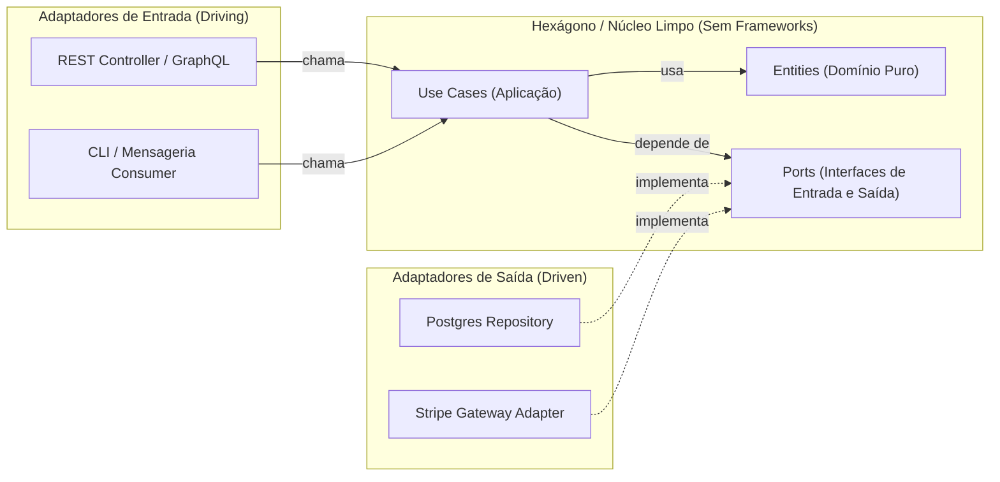
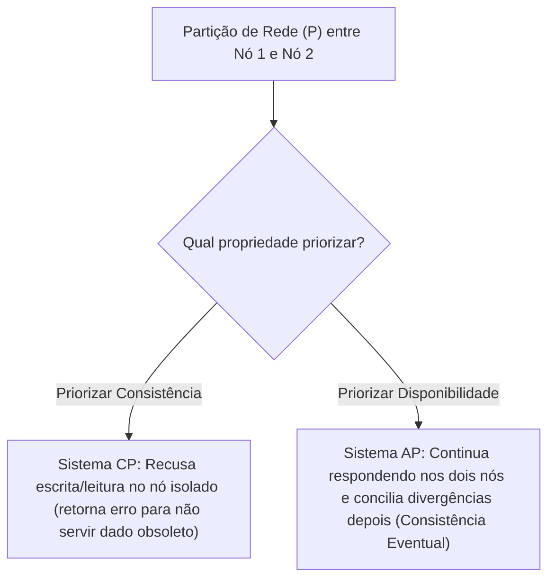

# 🕸️ Setor 14: Sistemas Distribuídos & Clean Arch

> **"Projete sistemas desacoplados e resilientes. Aprenda a Clean Architecture e entenda as leis fundamentais que regem sistemas distribuídos."**

---

## 1. 🚀 Briefing da Missão (Contexto Temático & Realidade de Mercado)

| Atributo do Setor | Especificação |
| :--- | :--- |
| **Galáxia** | Cinturão de Arquitetura |
| **ID do Módulo** | `sistemas-distribuidos` |
| **Pré-requisitos** | [Setor 12: Testes Automatizados & TDD](./12-testes-automatizados-tdd.md) (`testes`) e [Setor 13: Padrões de Projeto](./13-padroes-de-projeto.md) (`design-patterns`) |
| **Desbloqueia** | [Setor 15: Mensageria & Filas Assíncronas](./15-mensageria-filas-assincronas.md) e [Setor 16: NoSQL & Estratégias de Cache](./16-nosql-estrategias-de-cache.md) |
| **Nível de Criticidade** | Divisor de Águas para Arquitetura Backend Moderna |

### 🛸 Analogia do Navegador Cósmico

Pense em uma frota estelar composta por uma **Nave-Mãe** e várias **Sondas de Exploração** viajando pelo espaço profundo. Dentro da Nave-Mãe, existe um **Núcleo de Comando Blindado** (onde ficam os protocolos vitais de sobrevivência e navegação), cercado por anéis externos removíveis onde são acoplados os sensores de rádio, motores de propulsão e painéis solares. Se amanhã inventarem um motor de dobra novo ou trocarem o painel de rádio, os engenheiros desencaixam o módulo externo sem abrir nem arranhar o Núcleo de Comando.

Agora imagine quando essa frota precisa coordenar dados entre cinco naves separadas por tempestades solares (falhas de rede). Se o sinal de rádio cair entre a Nave A e a Nave B, o comandante enfrenta um dilema físico inevitável: ou a Nave A **trava a operação até confirmar** que todas as naves concordam com o mesmo dado (*Consistência*), ou ela **continua respondendo localmente** com o último dado conhecido mesmo correndo o risco de divergência temporária (*Disponibilidade*).

A blindagem interna da nave é a **Clean Architecture** (e a **Arquitetura Hexagonal**). As leis físicas da comunicação entre naves através de redes imperfeitas são os fundamentos de **Sistemas Distribuídos** e o **Teorema CAP**.

### 🏢 A Dor Real no Mercado de Tecnologia

No mercado, duas dores gigantescas derrubam empresas em crescimento:
1. **Acoplamento ao Framework e ao Banco:** Um sistema nasce "rápido" dentro dos controllers do Express/NestJS misturando SQL com regras de negócio. Dois anos depois, migrar de ORM, trocar de gateway ou rodar testes rápidos sem subir o ambiente inteiro se torna um pesadelo de meses.
2. **Ingenuidade sobre a Rede:** Desenvolvedores júniores costumam assumir as *Falácias da Computação Distribuída* — acham que "a rede é confiável", "a latência é zero" e "os serviços externos nunca ficam lentos". Em produção, quando um serviço parceiro passa a demorar 30 segundos para responder, toda a API trava em efeito dominó (*Cascading Failure*) por falta de timeouts, retries com backoff e circuit breakers.

---

## 2. 📚 Carga de Conhecimento Completa (Tópico por Tópico)



### 2.1 Aplicar Clean Architecture ou Hexagonal Architecture separando domínio e infra

Tanto a **Clean Architecture** (Robert C. Martin) quanto a **Hexagonal Architecture / Ports & Adapters** (Alistair Cockburn) compartilham o mesmo coração arquitetural: **a Regra da Dependência**.

#### **A Regra de Ouro da Dependência**
*"As dependências do código-fonte devem apontar apenas para dentro, em direção às políticas de mais alto nível."*

Isso significa que:
- **Camada de Domínio (Entities / Regras Corporativas Críticas):** Contém entidades, objetos de valor (ex.: `Email`, `Dinheiro`, `CPF`) e regras puras que existiriam mesmo se não houvesse computador, web ou SQL. **Zero imports** de Express, Fastify, Prisma, Mongoose, Axios ou Redis!
- **Camada de Aplicação (Use Cases / Services):** Orquestra o fluxo de cada funcionalidade do sistema (ex.: `CriarPedidoUseCase`, `CancelarAssinaturaUseCase`). Define as **Portas (Interfaces)** que precisa para falar com o mundo externo (`PedidoRepository`, `PagamentoGateway`).
- **Camada de Adaptadores de Interface (Controllers, Presenters, Gateways, Repositories concretos):** Traduz dados do formato externo (HTTP `req.body`, parâmetros SQL) para DTOs simples entendidos pelos Casos de Uso, e vice-versa.
- **Camada Externa de Frameworks e Drivers (Infraestrutura):** Banco de dados real, servidor web HTTP, filas RabbitMQ, SDKs de nuvem. Eles são **detalhes substituíveis** plugados na borda.

Na **Arquitetura Hexagonal**, visualizamos isso como um hexágono com:
- **Driving Ports & Adapters (Lado Esquerdo — Quem aciona a aplicação):** Controllers REST, comandos CLI, consumers de fila que invocam os Casos de Uso.
- **Driven Ports & Adapters (Lado Direito — Quem a aplicação aciona):** Implementações de repositórios SQL, clientes Redis, provedores de e-mail que implementam interfaces definidas dentro do núcleo.

### 2.2 Compreender os limites de acoplamento e buscar alta coesão

Duas métricas qualitativas governam toda decisão de arquitetura de software:

- **Alta Coesão (Cohesion):** Mede o quanto os elementos dentro de um mesmo módulo pertencem logicamente uns aos outros. Um módulo altamente coeso foca em um conceito bem definido do negócio (ex.: módulo `Faturamento` cuida de faturas, cobranças e notas fiscais — não de autenticação de senha nem de upload de avatar).
- **Baixo Acoplamento (Coupling):** Mede o grau de dependência e conhecimento que um módulo tem sobre os detalhes internos de outro módulo.
  - **Acoplamento Tóxico (Alto):** O módulo de Pedidos acessa diretamente a tabela `usuarios_enderecos` via SQL do módulo de Clientes, ou depende da classe concreta interna de cálculo do módulo de Estoque.
  - **Acoplamento Saudável (Baixo):** Módulos conversam exclusivamente através de contratos explícitos e estáveis (interfaces bem definidas, DTOs públicos ou eventos assíncronos).

> **Lembrete prático:** Acoplamento zero é impossível (módulos precisam colaborar para o software fazer algo útil!). O objetivo não é zerar o acoplamento, mas **direcionar o acoplamento na direção certa** (do concreto/instável para o abstrato/estável) e **minimizar a superfície de contato** entre fronteiras.

### 2.3 Dominar o Teorema CAP (Consistência, Disponibilidade, Tolerância a Partição)

Formulado por Eric Brewer e provado formalmente por Seth Gilbert e Nancy Lynch, o **Teorema CAP** afirma que um armazenamento de dados distribuído (múltiplos nós conectados por rede) pode garantir simultaneamente **no máximo duas** das três propriedades a seguir — sendo que na prática, **P não é opcional**:

1. **C — Consistency (Consistência Linearizável):** Toda leitura recebe o dado da escrita mais recente ou um erro. Todos os nós enxergam exatamente a mesma verdade no mesmo instante lógico.
2. **A — Availability (Disponibilidade):** Toda requisição enviada a um nó saudável (não caído) recebe uma resposta válida (não-erro), mesmo sem garantia de conter a escrita mais recente de outro nó isolado.
3. **P — Partition Tolerance (Tolerância a Partição de Rede):** O sistema continua operando mesmo quando há perda ou atraso arbitrário de pacotes na rede entre nós do cluster (a rede se parte em dois grupos que não conseguem conversar entre si).

#### **Por que na prática a escolha é CP vs. AP?**
Redes físicas **sempre** sofrem partições eventualmente (cabo rompido, switch travado, pico de latência entre datacenters). Portanto, todo sistema distribuído real precisa ser tolerante a partições (**P**). Quando uma partição (**P**) acontece em tempo real, o sistema fica diante de uma bifurcação inevitável:



- **Sistemas CP (Consistency + Partition Tolerance):** Bancos transacionais distribuídos, sistemas de saldo bancário, controle de estoque crítico ou coordenação distribuída (ex.: ZooKeeper, etcd, MongoDB em configuração de maioria estrita). Preferem falhar com erro controlado do que vender dois ingressos para o mesmo assento ou permitir saldo negativo por dado desatualizado.
- **Sistemas AP (Availability + Partition Tolerance):** Feeds de redes sociais, carrinhos de compra altamente disponíveis, sistemas de DNS, Cassandra, DynamoDB em leitura eventualmente consistente. Preferem responder sempre ao usuário mesmo que por alguns milissegundos ou segundos dois usuários vejam uma contagem de curtidas ligeiramente diferente (**Consistência Eventual**).

*(Nota importante: Em condições normais, SEM partição de rede, um bom sistema distribuído entrega tanto C quanto A simultaneamente. O trade-off do CAP só força a escolha quando ocorre uma partição de rede — ou, na extensão PACELC, define o trade-off entre Latência e Consistência mesmo sem partição!)*

### 2.4 Entender as diferenças conceituais entre Monólitos e Microsserviços

Uma das decisões mais mal compreendidas da indústria é escolher entre **Monólito**, **Monólito Modular** e **Microsserviços**:

| Critério | Monólito Tradicional (Big Ball of Mud) | Monólito Modular | Microsserviços |
| :--- | :--- | :--- | :--- |
| **Deploy e Processo** | 1 único deploy e 1 único processo. | 1 único deploy e 1 único processo. | Múltiplos deploys e processos independentes via rede. |
| **Fronteiras Internas** | Tudo acoplado no mesmo banco e mesmos imports. | Módulos isolados por pastas/interfaces e Clean Arch (sem cruzar bancos privados). | Isolamento físico por rede e banco de dados próprio por serviço (*Database per Service*). |
| **Complexidade Operacional** | Baixíssima. | Baixa. | Altíssima (rede, traces distribuídos, transações distribuídas, CI/CD múltiplo). |
| **Escala Granular** | Escala a aplicação inteira junta. | Escala a aplicação inteira junta. | Escala apenas o serviço sob carga (ex.: apenas o serviço de vídeo). |
| **Quando escolher** | Protótipos rápidos descartáveis. | **Padrão ouro para 90% dos projetos novos e startups!** | Times grandes e independentes (dezenas de devs) ou gargalos extremos isolados de escala/tecnologia. |

**Regra de ouro para Dev Júnior:** *"Não comece um projeto novo direto com 12 microsserviços sem entender os limites do domínio."* Um **Monólito Modular** bem estruturado com Clean Architecture oferece velocidade de desenvolvimento, transações ACID fáceis e, se um módulo precisar escalar separado no futuro, extraí-lo para um microsserviço será natural porque suas fronteiras já estavam limpas!

### 2.5 Aprender a desenhar sistemas tolerantes a falhas parciais

Em um monólito local, ou o processo inteiro está vivo ou está morto. Em um sistema distribuído, **a falha parcial é a regra diária**: o serviço de pagamento caiu, o gateway de CEP demora 18 segundos para responder ou 5% das requisições de rede falham silenciosamente.

Cinco padrões essenciais de resiliência que todo engenheiro backend precisa conhecer:

1. **Timeouts Rigorosos:** Nunca faça uma requisição HTTP ou query sem timeout explícito. Esperar indefinidamente por um serviço morto esgota rapidamente todas as conexões e threads do seu servidor, derrubando a API inteira.
2. **Retries com Exponential Backoff & Jitter:** Falhas transitórias de rede merecem retentativa — mas tentar 3 vezes coladas em 0ms sobrecarrega um serviço que já está sofrendo. O **Exponential Backoff** dobra o intervalo de espera a cada tentativa (`100ms -> 200ms -> 400ms`), e o **Jitter** adiciona um pequeno atraso aleatório para evitar que milhares de clientes disparem todos juntos no mesmo milissegundo (*Thundering Herd Problem*).
3. **Circuit Breaker (Disjuntor):** Inspirado no disjuntor elétrico da sua casa. Se um serviço externo começa a falhar consecutivamente (ex.: 50% de erros nos últimos 10 segundos), o circuito **Abre** e passa a falhar rápido (*Fail-Fast*) localmente ou retornar um fallback sem nem enviar requisições à rede por um período (ex.: 30s). Depois entra em estado **Meio-Aberto** testando uma única requisição; se funcionar, **Fecha** novamente.
4. **Bulkhead (Anteparos Estancos):** Como os compartimentos estanques do casco de um navio — se um compartimento alagar, o resto do navio não afunda. Em código, significa isolar pools de conexões/workers para diferentes integrações (se o serviço lento de PDF travar suas 10 conexões, o fluxo crítico de Checkout continua com seu próprio pool intacto).
5. **Graceful Degradation (Degradação Elegante) e Fallbacks:** Se o microsserviço de "Recomendações Personalizadas por IA" cair durante a Black Friday, a página do produto **não** deve retornar erro 500! Ela degrada elegantemente exibindo uma lista cacheada de "Mais Vendidos" para que a compra continue funcionando.

---

## 3. 💻 Mão no Código (Jeito Iniciante vs. Padrão Profissional)

Vamos comparar duas implementações de um fluxo de **Criação de Pedido com Consulta Externa de Preço/Frete e Persistência**.

### ❌ Jeito Iniciante (Domínio acoplado ao Express/Prisma + Chamada HTTP sem timeout nem proteção contra falha)

```typescript
// ❌ ANTIPADRÃO: Tudo acoplado no controller HTTP + sem resiliência de rede
import { Request, Response } from 'express';
import { PrismaClient } from '@prisma/client';
import axios from 'axios';

const prisma = new PrismaClient();

export async function criarPedidoController(req: Request, res: Response) {
  try {
    const { clienteId, cep, produtoId, quantidade } = req.body;

    // 1. Sem Timeout nem Retry/Circuit Breaker: se o serviço de frete travar, trava a API inteira!
    const freteResp = await axios.get(`https://frete-externo.internal/calcular?cep=${cep}`);

    // 2. Regra de negócio presa ao Prisma e ao req/res do Express
    const produto = await prisma.produto.findUnique({ where: { id: produtoId } });
    if (!produto || produto.estoque < quantidade) {
      return res.status(400).json({ erro: 'Sem estoque' });
    }

    const total = produto.preco * quantidade + freteResp.data.valor;
    const pedido = await prisma.pedido.create({
      data: { clienteId, total, status: 'CRIADO' },
    });

    return res.status(201).json(pedido);
  } catch (err) {
    return res.status(500).json({ erro: 'Erro interno' });
  }
}
```

### ✅ Padrão Profissional (Clean Architecture: Domínio + Use Case + Ports + Adapter com Timeout/Circuit Breaker/Fallback)

```typescript
// ✅ CAMADA 1: DOMÍNIO PURO (zero imports de Express, Axios ou Prisma)
// src/domain/entities/Pedido.ts
export class Pedido {
  private constructor(
    public readonly id: string,
    public readonly clienteId: string,
    public readonly valorProdutosCentavos: number,
    public readonly valorFreteCentavos: number,
    public readonly freteEstimadoPorFallback: boolean
  ) {}

  static criar(params: {
    id: string;
    clienteId: string;
    precoUnitarioCentavos: number;
    quantidade: number;
    valorFreteCentavos: number;
    freteEstimadoPorFallback: boolean;
  }): Pedido {
    if (params.quantidade <= 0) {
      throw new Error('Quantidade do pedido deve ser positiva.');
    }
    if (params.precoUnitarioCentavos < 0 || params.valorFreteCentavos < 0) {
      throw new Error('Valores monetários não podem ser negativos.');
    }

    const valorProdutosCentavos = params.precoUnitarioCentavos * params.quantidade;
    return new Pedido(
      params.id,
      params.clienteId,
      valorProdutosCentavos,
      params.valorFreteCentavos,
      params.freteEstimadoPorFallback
    );
  }

  get valorTotalCentavos(): number {
    return this.valorProdutosCentavos + this.valorFreteCentavos;
  }
}
```

```typescript
// ✅ CAMADA 2: APLICAÇÃO (Ports de Saída + Use Case puro)
// src/application/ports/SaidaPorts.ts
import { Pedido } from '../../domain/entities/Pedido';

export interface ProdutoLeitura {
  id: string;
  precoCentavos: number;
  estoqueDisponivel: number;
}

export interface ProdutoRepositoryPort {
  buscarPorId(produtoId: string): Promise<ProdutoLeitura | null>;
}

export interface PedidoRepositoryPort {
  salvar(pedido: Pedido): Promise<void>;
}

export interface CotacaoFretePort {
  calcularFrete(cep: string): Promise<{ valorCentavos: number; estimado: boolean }>;
}

// src/application/use-cases/CriarPedidoUseCase.ts
export interface CriarPedidoInputDTO {
  clienteId: string;
  cep: string;
  produtoId: string;
  quantidade: number;
}

export interface CriarPedidoOutputDTO {
  pedidoId: string;
  valorTotalCentavos: number;
  freteEstimadoPorFallback: boolean;
}

export class CriarPedidoUseCase {
  constructor(
    private readonly produtoRepo: ProdutoRepositoryPort,
    private readonly pedidoRepo: PedidoRepositoryPort,
    private readonly cotacaoFrete: CotacaoFretePort,
    private readonly gerarId: () => string
  ) {}

  async executar(input: CriarPedidoInputDTO): Promise<CriarPedidoOutputDTO> {
    const produto = await this.produtoRepo.buscarPorId(input.produtoId);
    if (!produto) {
      throw new Error('Produto não encontrado.');
    }
    if (produto.estoqueDisponivel < input.quantidade) {
      throw new Error('Estoque insuficiente para o produto selecionado.');
    }

    // O Caso de Uso não sabe se o frete veio da API, de retry ou de fallback gracioso
    const frete = await this.cotacaoFrete.calcularFrete(input.cep);

    const pedido = Pedido.criar({
      id: this.gerarId(),
      clienteId: input.clienteId,
      precoUnitarioCentavos: produto.precoCentavos,
      quantidade: input.quantidade,
      valorFreteCentavos: frete.valorCentavos,
      freteEstimadoPorFallback: frete.estimado,
    });

    await this.pedidoRepo.salvar(pedido);

    return {
      pedidoId: pedido.id,
      valorTotalCentavos: pedido.valorTotalCentavos,
      freteEstimadoPorFallback: pedido.freteEstimadoPorFallback,
    };
  }
}
```

```typescript
// ✅ CAMADA 3: ADAPTADOR DE INFRAESTRUTURA RESILIENTE (Timeout + Circuit Breaker + Fallback)
// src/infra/gateways/FreteHttpResilienteAdapter.ts
import { CotacaoFretePort } from '../../application/ports/SaidaPorts';

export class FreteHttpResilienteAdapter implements CotacaoFretePort {
  private falhasConsecutivas = 0;
  private circuitoAbertoAte = 0;
  private readonly MAX_FALHAS = 3;
  private readonly TEMPO_CIRCUITO_ABERTO_MS = 15_000;
  private readonly FRETE_PADRAO_FALLBACK_CENTAVOS = 1990; // R$ 19,90

  constructor(private readonly baseUrl: string, private readonly timeoutMs = 1200) {}

  async calcularFrete(cep: string): Promise<{ valorCentavos: number; estimado: boolean }> {
    const agora = Date.now();

    // Circuit Breaker ABERTO: falha rápido localmente e aciona degradação elegante
    if (agora < this.circuitoAbertoAte) {
      return { valorCentavos: this.FRETE_PADRAO_FALLBACK_CENTAVOS, estimado: true };
    }

    try {
      // Timeout explícito com AbortController nativo do Node.js
      const controlador = new AbortController();
      const timer = setTimeout(() => controlador.abort(), this.timeoutMs);

      const resposta = await fetch(`${this.baseUrl}/frete?cep=${encodeURIComponent(cep)}`, {
        signal: controlador.signal,
      });
      clearTimeout(timer);

      if (!resposta.ok) {
        throw new Error(`Status HTTP inesperado: ${resposta.status}`);
      }

      const dados = (await resposta.json()) as { valorCentavos: number };
      // Sucesso fecha/reseta o disjuntor
      this.falhasConsecutivas = 0;
      return { valorCentavos: dados.valorCentavos, estimado: false };
    } catch {
      this.falhasConsecutivas += 1;
      if (this.falhasConsecutivas >= this.MAX_FALHAS) {
        this.circuitoAbertoAte = Date.now() + this.TEMPO_CIRCUITO_ABERTO_MS;
      }
      // Graceful Degradation: não derruba a venda por culpa do serviço externo
      return { valorCentavos: this.FRETE_PADRAO_FALLBACK_CENTAVOS, estimado: true };
    }
  }
}
```

---

## 4. 🛠️ Laboratório de Voo (Exercício Prático Guiado)

**Duração estimada:** 55 minutos | **Foco:** Clean Architecture na prática + Teste de Falha Parcial

### 🎯 Objetivo da Missão
Estruturar um mini-módulo de **Aprovação de Crédito** seguindo **Clean Architecture**, rodando a mesma regra de negócio tanto via CLI no terminal quanto via servidor HTTP nativo (`http.createServer`), com um adaptador resiliente contra falhas simuladas.

### 📋 Passo a Passo Reproduzível

1. **Crie a árvore de pastas Clean Architecture:**
   ```bash
   mkdir -p lab-clean-arch/src/{domain,application/ports,application/use-cases,infra/adapters,main}
   cd lab-clean-arch
   npm init -y && npm install -D typescript tsx vitest @types/node
   npx tsc --init
   ```
2. **Camada `domain` (`src/domain/SolicitacaoCredito.ts`):**
   - Crie uma entidade pura que valida se `rendaMensalCentavos > 0` e `valorParcelaCentavos <= rendaMensalCentavos * 0.30` (comprometimento máximo de 30% da renda). Zero `import` de fora!
3. **Camada `application` (`src/application/use-cases/AvaliarCreditoUseCase.ts`):**
   - Recebe `ScoreExternoPort` (interface com `consultarScore(cpf): Promise<number | null>`).
   - Se o serviço externo retornar `null` (indisponível), aplica regra conservadora de fallback (aprovar apenas se parcela for menor que 15% da renda e valor total até R\$ 1.000,00).
4. **Camada `infra` (`src/infra/adapters/ScoreInstavelAdapter.ts`):**
   - Simule um serviço externo que em 50% das chamadas demora 3 segundos (causando timeout de 500ms) ou lança erro HTTP 503.
   - Envolva a chamada com **Retry (máximo 2 tentativas com backoff de 100ms e 200ms)** e timeout usando `Promise.race` ou `AbortController`.
5. **Dois Pontos de Entrada (`src/main/cli.ts` e `src/main/http.ts`):**
   - Conecte o mesmo `AvaliarCreditoUseCase` a um script CLI (`npx tsx src/main/cli.ts`) e a um servidor HTTP na porta 3333 (`node:http`). Comprove que o núcleo não sabe quem o está chamando!
6. **Teste Unitário Puro:** Teste o `AvaliarCreditoUseCase` em `vitest` sem rede, validando a aprovação normal, a rejeição por renda e a degradação elegante quando o score externo retorna `null`.

### ✅ Critérios de Domínio
- [ ] Nenhum arquivo dentro de `src/domain/` ou `src/application/` importa módulos de `src/infra/`, `node:http` ou `fetch`.
- [ ] O mesmo `UseCase` responde perfeitamente tanto pela interface CLI quanto pelo endpoint HTTP.
- [ ] Quando o adaptador externo falha após esgotar timeout/retries, a aplicação degrada de forma segura sem retornar erro 500 não tratado.

---

## 5. 🎯 Resolução Comentada do Teste de Ignição (Quest Oficial)

> **Pergunta Oficial (`data.js`):**
> *Segundo o Teorema CAP, na ocorrência de uma partição de rede (P) em um sistema distribuído, o arquiteto deve escolher obrigatoriamente entre quais duas propriedades?*
>
> - **A)** Escalabilidade (S) ou Portabilidade (P)
> - **B)** Segurança (S) ou Velocidade (V)
> - **C)** Consistência (C) ou Disponibilidade (A)
> - **D)** Latência (L) ou Durabilidade (D)

### ✅ Resposta Correta: **Alternativa C**

### 🔍 Análise Técnica de Cada Alternativa

- **Por que C está correta:** A sigla **CAP** representa exatamente **Consistency (Consistência)**, **Availability (Disponibilidade)** e **Partition Tolerance (Tolerância a Partição)**. Como falhas de comunicação entre nós de rede (**P**) são inevitáveis no mundo físico, no exato instante em que uma partição divide o cluster, o sistema é obrigado a optar entre recusar requisições no lado potencialmente desatualizado para preservar a **Consistência (C)** — tornando-se **CP** — ou continuar respondendo às requisições em todos os nós mesmo sob risco de dados temporariamente divergentes para preservar a **Disponibilidade (A)** — tornando-se **AP**.
- **Por que A está incorreta:** Escalabilidade e Portabilidade são atributos de qualidade arquitetural desejáveis, mas nenhuma delas compõe o Teorema CAP nem forma o dilema matemático provado por Gilbert e Lynch durante uma partição de rede.
- **Por que B está incorreta:** Segurança e Velocidade são preocupações distintas de engenharia (confidencialidade/integridade vs. desempenho), não fazendo parte das três garantias formais do Teorema CAP.
- **Por que D está incorreta:** Embora exista uma extensão famosa chamada **PACELC** que analisa o trade-off entre **Latência (L)** e **Consistência (C)** quando *não* há partição (no caso **E**lse), a pergunta trata especificamente do **Teorema CAP** durante uma **partição de rede (P)**, momento em que a escolha obrigatória é entre **Consistência (C)** e **Disponibilidade (A)** (e Durabilidade pertence ao acrônimo ACID de bancos transacionais, não ao CAP).

---

## 6. 🎤 Kit de Apresentação (Como Dar Aula / Apresentar Este Módulo)

### ⏱️ Pitch Feynman de 2 Minutos (Texto Pronto para Falar)

> "Pensa em duas realidades que todo sistema grande precisa dominar: como o código se organiza **por dentro** e como ele sobrevive **por fora** quando conversa pela rede.
>
> Por dentro, usamos a **Clean Architecture** (ou Arquitetura Hexagonal). A ideia é simples: o coração do seu negócio — as regras de calcular um pedido, validar um crédito ou aprovar uma matrícula — fica isolado num núcleo protegido sem saber se existe Express, Prisma, Postgres ou REST. Tudo que é infraestrutura fica na borda conectado por tomadas padronizadas (as *Portas* e *Adaptadores*). Se amanhã você trocar de banco de dados ou de framework web, o coração do negócio continua intacto e testável em milissegundos.
>
> Já por fora, quando esse sistema vira um **Sistema Distribuído** conversando com outros serviços pela internet, as leis da física entram em cena. E a lei mais famosa é o **Teorema CAP**. Ele diz que, quando o cabo de rede entre dois servidores rompe — uma *Partição* — você tem uma escolha dura: ou você bloqueia operações para garantir que todo mundo veja o mesmo número exato na hora (**Consistência**, como num saldo bancário), ou você continua atendendo todo mundo mesmo com risco de mostrar um número alguns segundos atrasado (**Disponibilidade**, como nas curtidas de uma rede social). E como a rede sempre falha em pedaços, projetamos sistemas tolerantes a falhas parciais usando timeouts, retries inteligentes e disjuntores (*Circuit Breakers*) para que a queda de um serviço parceiro nunca derrube a empresa inteira."

### 📊 Roteiro de Slides (6 Slides)

1. **Slide 1 — Clean Architecture & Hexagonal: Blindando o Negócio**
   - *Bullets:* A Regra da Dependência (sempre apontar para o centro); Frameworks e Bancos são detalhes substituíveis; Driving vs. Driven Adapters.
   - *Visual:* Diagrama dos círculos concêntricos da Clean Architecture ao lado do Hexágono.
2. **Slide 2 — Coesão e Acoplamento na Prática**
   - *Bullets:* Alta coesão dentro do módulo; Baixo acoplamento entre módulos; A diferença entre acoplamento saudável (interface) e tóxico (acesso direto ao banco alheio).
   - *Visual:* Comparativo visual "Teia de Aranha" vs. "Blocos Modulares com Portas".
3. **Slide 3 — Monólito vs. Monólito Modular vs. Microsserviços**
   - *Bullets:* O mito de que "monólito é ruim"; Por que começar por Monólito Modular vence na maioria dos cenários; Custo escondido da rede em microsserviços.
   - *Visual:* Espectro de complexidade e tamanho de time mostrando o ponto ideal de transição.
4. **Slide 4 — Teorema CAP Desmistificado**
   - *Bullets:* O que realmente significam C, A e P; Por que P é inevitável na nuvem; Exemplos reais de CP (bancos/pagamentos) vs. AP (feeds/catálogos).
   - *Visual:* Fluxograma mostrando dois nós com o cabo cortado no meio e os dois comportamentos possíveis.
5. **Slide 5 — Sobrevivendo a Falhas Parciais na Rede**
   - *Bullets:* Timeout obrigatório; Retry com Exponential Backoff + Jitter; Circuit Breaker (Aberto, Fechado, Meio-Aberto); Bulkhead e Fallback.
   - *Visual:* Máquina de estados do Circuit Breaker + ilustração de compartimentos estanques de um navio.
6. **Slide 6 — Conectando Tudo: Do Código Limpo à Nuvem Resiliente**
   - *Bullets:* Como SOLID + TDD + Padrões de Projeto desembocam naturalmente na Clean Architecture e preparam terreno para Filas e Cache.
   - *Visual:* Ponte ligando o núcleo limpo às próximas estações (Mensageria Assíncrona e NoSQL/Cache).

### 💻 Roteiro de Demo Ao Vivo (3 Minutos)

1. **Minuto 0:00–1:00:** Mostre a árvore de pastas de um projeto Clean Architecture e rode um `grep` ou destaque no editor provando que a pasta `domain/` e `application/` têm **zero** importações de `express`, `prisma` ou `axios`.
2. **Minuto 1:00–2:15:** Suba dois processos simples no terminal: uma API principal (`porta 3000`) e um "serviço de frete externo" (`porta 4000`). Faça chamadas normais com sucesso e veja o frete real sendo retornado.
3. **Minuto 2:15–3:00:** Derrube o serviço da porta 4000 com `Ctrl+C` ao vivo! Dispare novas requisições na API principal e mostre o **Circuit Breaker** abrindo após 3 falhas, respondendo imediatamente em 1ms com o **frete de fallback** sem retornar erro 500 para o cliente.

### ❓ 2 Perguntas Difíceis da Plateia (e Respostas Seguras)

1. **"Clean Architecture tem muitas pastas, DTOs e mapeadores entre camadas. Isso não gera código repetitivo demais para uma startup pequena?"**
   - *Resposta:* Sim, se aplicada de forma burocrática! Clean Architecture é um **espectro arquitetural**, não uma religião de quantidade de pastas. Em um MVP inicial, você pode manter a **Regra da Dependência** com apenas 3 diretórios simples (`domain`, `use-cases`, `infra`), sem criar interfaces desnecessárias para coisas que não variam ou mapeadores duplicados quando o objeto já é limpo. O essencial é **não deixar regra de negócio acoplada no controller HTTP nem dentro de queries do ORM**. Conforme o domínio cresce, as camadas extras se pagam sozinhas.
2. **"Se um sistema escolhe ser AP (disponível) durante uma partição, como ele resolve conflitos quando os dois lados voltam a se falar?"**
   - *Resposta:* Excelente pergunta! Quando a partição se cura, o sistema precisa reconciliar estados divergentes usando estratégias de resolução de conflitos: **Last-Write-Wins (LWW)** baseado em timestamps sincronizados (simples, porém arrisca perder uma escrita simultânea), **Version Vectors / Vector Clocks** para detectar conflitos e expor para a aplicação resolver (como o carrinho da Amazon que faz união de itens em vez de apagar um deles!), ou estruturas matemáticas chamadas **CRDTs (Conflict-free Replicated Data Types)** que garantem convergência automática determinística.

---

## 7. 💼 Radar do Mercado de Trabalho (Foco Dev Júnior)

### 🎙️ 3 Perguntas Reais de Entrevista Técnica Júnior

1. **"Qual o principal objetivo de separar Domínio e Infraestrutura na Clean Architecture?"**
   - *Resposta-modelo:* "O objetivo central é proteger as regras de negócio contra mudanças tecnológicas e garantir testabilidade rápida. Quando o domínio depende apenas de abstrações (interfaces/ports) e não de detalhes concretos como Express ou Prisma, eu consigo testar todas as regras críticas em memória sem subir banco de dados, e consigo trocar o framework web, o provedor de fila ou o banco SQL no futuro mexendo apenas nos adaptadores externos."
2. **"Uma startup com 3 desenvolvedores quer começar um e-commerce usando 10 microsserviços. O que você recomendaria e por quê?"**
   - *Resposta-modelo:* "Eu recomendaria começar com um **Monólito Modular** aplicando limites bem claros de módulo e Clean Architecture. Microsserviços trazem custos imediatos altos de latência de rede, monitoramento distribuído, consistência eventual e pipelines separados de deploy, que drenam a velocidade de um time de 3 pessoas. Com o Monólito Modular, o time entrega rápido, mantém transações ACID simples no banco e já deixa as fronteiras desacopladas caso um módulo específico precise ser extraído para microsserviço no futuro."
3. **"O que acontece se você colocar apenas Retry numa chamada HTTP externa sem Timeout e sem Circuit Breaker?"**
   - *Resposta-modelo:* "Se o serviço externo estiver travado demorando 60 segundos para dar erro, cada requisição sua vai ficar presa 60 segundos e ainda vai tentar novamente mais 3 vezes — prendendo conexões por 3 minutos! Sob tráfego alto, todas as conexões do meu servidor esgotam e a minha aplicação cai junto por efeito cascata. Por isso, todo Retry precisa de **Timeout curto**, **Exponential Backoff com Jitter** e um **Circuit Breaker** para parar de bater em um serviço que já está comprovadamente fora do ar."

### ⚖️ Erros Clássicos de Júnior vs. Postura Profissional

| Erro Clássico de Júnior | Postura Profissional Esperada |
| :--- | :--- |
| Colocar regras de cálculo financeiro e validações de negócio dentro das rotas do Express/Fastify (`req, res`). | Manter controllers magros: validam formato HTTP, chamam o Caso de Uso e traduzem o resultado para status HTTP. |
| Usar `fetch()` ou `axios.get()` sem configurar `timeout` (esperando infinitamente se o outro servidor travar). | Sempre definir timeout explícito (`AbortController` / `timeout`), tratar falha graciosa e configurar retries com backoff. |
| Achar que "Microsserviços" é sinônimo obrigatório de "Arquitetura Sênior". | Defender a arquitetura adequada ao tamanho do time e problema real (Monólito Modular primeiro na maioria dos casos). |
| Deixar o ORM (Prisma/TypeORM/Mongoose) vazar seus decorators ou tipos diretamente para dentro das Entidades de Domínio. | Manter entidades de domínio puras e mapear nos Repositórios concretos dentro da camada de infraestrutura. |

### 🏆 Evidência para Portfólio / GitHub / LinkedIn

- **No GitHub:** Documente no `README.md` do seu projeto principal um **ADR (Architecture Decision Record)** curto explicando por que você escolheu Clean Architecture em Monólito Modular e qual escolha CAP se aplica ao módulo de pedidos vs. módulo de catálogo. Tech Leads amam ler ADRs claros em portfólios de júnior!
- **No LinkedIn:** Publique um post curto sobre *"Por que adicionei AbortController + Circuit Breaker em uma chamada externa na minha API Node.js"* com um diagrama simples mostrando o fluxo de fallback.

---

## 8. 📡 Transmissões Recomendadas & Próxima Órbita

### 📚 Recursos Oficiais do Módulo
- 📖 **[Clean Architecture (Livro de Robert C. Martin)](https://www.oreilly.com/library/view/clean-architecture-a/9780134494272/)** — A obra definitiva sobre fronteiras arquiteturais, Regra da Dependência, componentes e desacoplamento de banco/web.
- 🌐 **[Teorema CAP - Explicação Visual](https://robertgreiner.com/cap-theorem-revisited/)** — Artigo claro revisitando o Teorema CAP, desfazendo mitos comuns e ilustrando cenários CP e AP.

### 🛸 Próxima Órbita na Árvore de Habilidades
Com a nave protegida por Clean Architecture e compreendendo os trade-offs de rede distribuída, você acaba de abrir **dois caminhos paralelos** para escalar performance e resiliência no Cinturão de Arquitetura:
- ➡️ **[Setor 15: Mensageria & Filas Assíncronas](./15-mensageria-filas-assincronas.md)** (`filas-assincrono`) — aprenda a desacoplar processos pesados no tempo com RabbitMQ, Kafka, Redis/BullMQ, Pub/Sub, DLQ e idempotência.
- ➡️ **[Setor 16: NoSQL & Estratégias de Cache](./16-nosql-estrategias-de-cache.md)** (`nosql-cache`) — domine bancos NoSQL (MongoDB, Redis) e estratégias de cache em memória para leituras em sub-milissegundos.
