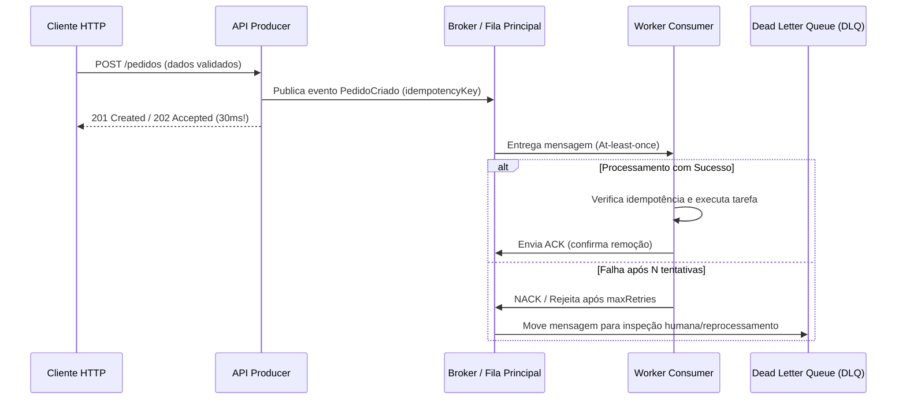

# 📥 Setor 15: Mensageria & Filas Assíncronas

> **"Desafogue seu servidor. Aprenda a delegar processos demorados para background através de sistemas de mensageria e filas assíncronas."**

---

## 1. 🚀 Briefing da Missão (Contexto Temático & Realidade de Mercado)

| Atributo do Setor | Especificação |
| :--- | :--- |
| **Galáxia** | Cinturão de Arquitetura |
| **ID do Módulo** | `filas-assincrono` |
| **Pré-requisitos** | [Setor 14: Sistemas Distribuídos & Clean Arch](./14-sistemas-distribuidos-clean-arch.md) (`sistemas-distribuidos`) |
| **Desbloqueia** | **Docker & Containerização** (`docker` — Galáxia Órbita do DevOps) e prepara para o [Projeto de Consolidação](./projeto-consolidacao-03-arquitetura.md) |
| **Nível de Criticidade** | Essencial para Escalabilidade e Resiliência em Backend |

### 🛸 Analogia do Navegador Cósmico

Imagine o balcão de despacho de cargas da Estação Orbital Central. Se o atendente do balcão (sua **API HTTP**) resolver, na frente de cada piloto da fila, conferir a carga, carimbar a guia, carregar pessoalmente cada caixa dentro do cargueiro, voar até Marte para entregar, voltar e só então dizer *"Próximo da fila!"*, em cinco minutos haverá um congestionamento espacial de quilômetros e todo mundo sofrerá *timeout* esperando na janela.

Um porto espacial profissional separa o **Recebimento Rápido** da **Execução em Segundo Plano**: o piloto entrega a caixa, o atendente valida a etiqueta, deposita na **esteira rolante (Fila de Mensagens)**, emite o protocolo `202 Accepted` em 30 milissegundos e atende imediatamente o próximo piloto. Lá nos fundos do hangar, dezenas de robôs carregadores (**Workers / Consumidores**) vão pegando as caixas da esteira no ritmo seguro da capacidade dos motores, sem deixar nenhuma carga se perder mesmo se um robô desligar no meio do turno!

### 🏢 A Dor Real no Mercado de Tecnologia

Sem filas assíncronas, APIs em produção colapsam rapidamente diante de picos de tráfego ou integrações lentas:
- O usuário clica em "Finalizar Compra" e espera 8 segundos olhando o loading girar enquanto o servidor gera PDF da nota fiscal, envia 2 e-mails via SMTP externo e dispara webhook de parceiro — se o provedor de e-mail travar, a compra inteira falha!
- Durante uma promoção ou lançamento, 5.000 requisições chegam no mesmo segundo; sem fila para amortecer a carga (*Load Leveling*), o banco de dados recebe 5.000 conexões simultâneas e sai do ar.
- Processar importações de planilhas CSV, transcodificação de imagens/vídeos ou envio de notificações em massa trava o Event Loop (em Node.js) ou esgota workers HTTP.

Dominar mensageria, garantias de entrega, **idempotência** e **Dead Letter Queues** coloca você imediatamente acima da média nas entrevistas para backend júnior e pleno.

---

## 2. 📚 Carga de Conhecimento Completa (Tópico por Tópico)



### 2.1 Entender a diferença entre comunicação síncrona e assíncrona

Na arquitetura de serviços, a escolha entre comunicação síncrona e assíncrona define acoplamento temporal e disponibilidade:

| Dimensão | Comunicação Síncrona (HTTP/REST, gRPC) | Comunicação Assíncrona (Filas / Eventos) |
| :--- | :--- | :--- |
| **Acoplamento Temporal** | **Alto:** remetente e destinatário precisam estar online no mesmo instante. | **Desacoplado no tempo:** o produtor publica a mensagem mesmo se o consumidor estiver reiniciando; ela aguarda segura no broker. |
| **Resposta ao Cliente** | Bloqueante até o fim de toda a cadeia de chamadas. | Imediata (`202 Accepted` ou `201 Created` após registrar o evento). |
| **Acoplamento de Capacidade** | Se chegarem 10x mais requisições, o serviço destino recebe o tranco direto. | O broker atua como **amortecedor (buffer)**; workers consomem na taxa que suportam sem derrubar o banco. |
| **Quando usar** | Consultas onde o usuário precisa do dado na hora (login, buscar catálogo, validar saldo antes de aprovar). | Envio de e-mails/SMS, geração de relatórios/PDFs, webhooks, processamento de imagem, sincronizações e efeitos pós-compra. |

### 2.2 Diferenciar brokers de mensagem (RabbitMQ) de streams de eventos (Kafka)

Embora ambos transportem mensagens assíncronas, **RabbitMQ (Message Broker tradicional)** e **Apache Kafka (Distributed Event Streaming Log)** têm arquiteturas e casos de uso bem distintos:

- **RabbitMQ (Smart Broker / Dumb Consumer — Modelo Fila Clássica):**
  - Baseado no protocolo **AMQP**. Funciona como um correio inteligente com **Exchanges** (roteadores de mensagens) e **Queues** (filas).
  - **Ciclo de vida da mensagem:** assim que o consumidor processa a mensagem e envia um **ACK (Acknowledgement)**, a mensagem é **apagada da fila**.
  - Excelente para **roteamento complexo** (Direct, Topic, Fanout, Headers), **filas de tarefas/jobs**, prioridades por mensagem e cenários onde cada tarefa deve ser processada uma única vez por algum worker disponível (*Competing Consumers*).
- **Apache Kafka (Dumb Broker / Smart Consumer — Modelo Log Distribuído Imutável):**
  - Funciona como um **diário de bordo (append-only log)** dividido em **Tópicos** e **Partições** persistidos em disco sequencial.
  - **Ciclo de vida da mensagem:** as mensagens **NÃO são apagadas quando lidas**! Elas permanecem gravadas pelo período de retenção configurado (ex.: 7 dias, 30 dias ou infinito). Cada grupo de consumidores (**Consumer Group**) mantém apenas um ponteiro numérico chamado **Offset** indicando até onde já leu.
  - Excelente para **altíssima vazão (milhões de eventos/segundo)**, **replay de histórico** (reprocessar todos os eventos dos últimos 7 dias com um serviço novo ou após corrigir um bug) e múltiplos sistemas independentes consumindo o mesmo stream de eventos em velocidades diferentes.

### 2.3 Implementar o modelo Publish/Subscribe (Pub/Sub)

Existem dois padrões principais de topologia em mensageria:

1. **Point-to-Point (Fila de Trabalho / Work Queue):**
   - Um produtor envia uma tarefa para uma fila. Vários workers escutam a **mesma fila**, mas **apenas um** worker recebe cada mensagem (balanceamento de carga entre trabalhadores competindo por tarefas).
2. **Publish/Subscribe (Pub/Sub):**
   - Um produtor (**Publisher**) anuncia um fato que já aconteceu no passado — por exemplo, o evento `PedidoPago` — sem saber nem se importar com quem está ouvindo.
   - Múltiplos interessados independentes (**Subscribers**) recebem uma **cópia simultânea** desse evento cada um na sua própria fila/grupo:
     - Serviço de Notificações -> envia e-mail de confirmação.
     - Serviço de Estoque -> confirma baixa física.
     - Serviço de Analytics -> registra conversão no painel de BI.
   - **Como funciona no RabbitMQ:** utiliza-se uma **Exchange do tipo `fanout`** (broadcast para todas as filas conectadas) ou **`topic`** (roteamento por padrão de chave como `pedido.*.pago`), onde cada serviço cria sua própria fila vinculada (*binding*) à exchange.
   - **Como funciona no Kafka:** basta criar **Consumer Groups diferentes** (`grupo-notificacao`, `grupo-estoque`, `grupo-analytics`) assinando o mesmo tópico `pedidos-pagos`; cada grupo recebe 100% dos eventos de forma independente.

### 2.4 Garantir a idempotência de consumidores para evitar duplicidade de dados

Em redes distribuídas reais, existem três semânticas teóricas de entrega de mensagens:
- *At-most-once* (no máximo uma vez — pode perder mensagens se o worker cair antes de processar).
- *Exactly-once* (exatamente uma vez — extremamente caro e praticamente impossível de garantir ponta a ponta entre sistemas heterogêneos externos).
- ***At-least-once* (pelo menos uma vez — o padrão prático da indústria!):** o broker garante que nenhuma mensagem se perca, mas **a mesma mensagem PODE ser entregue 2 ou mais vezes**!

**Por que ocorrem duplicidades?** Imagine que o worker leu a mensagem `"Debitar R$ 100 da conta 42"`, debitou no banco de dados com sucesso, mas **antes de conseguir enviar o `ACK` de volta para o RabbitMQ**, a rede oscilou ou o container sofreu reinício. O broker entende que ninguém confirmou aquela mensagem e a entrega novamente para outro worker!

Se o consumidor não for protegido, o cliente é cobrado duas vezes! A solução obrigatória chama-se **Idempotência**.

#### **O que é Idempotência?**
Uma operação `f(x)` é idempotente quando executá-la uma vez ou dez vezes com a mesma entrada produz **exatamente o mesmo estado final**, sem efeitos colaterais duplicados (`f(f(x)) === f(x)`).

**Como implementar consumidores idempotentes na prática:**
1. **Chave de Idempotência Única (`eventId` / `idempotencyKey`):** o produtor gera um UUID único para cada evento/comando (`event_id`) antes de publicar na fila.
2. **Tabela ou Registro Atômico de Eventos Processados:** antes ou dentro da **mesma transação SQL** da operação de negócio, o consumidor tenta inserir `(event_id)` em uma tabela `eventos_processados` com restrição `PRIMARY KEY` ou `UNIQUE` (ou usa `SET NX` atômico no Redis com TTL adequado).
3. **Se o `event_id` já existir:** o consumidor reconhece que é uma entrega duplicada, **ignora o efeito colateral** e envia `ACK` imediatamente para limpar a fila com segurança!

### 2.5 Gerenciar falhas em filas com Dead Letter Queues (DLQ)

O que acontece quando uma mensagem chega com payload corrompido ("poison pill"), ou referencia um cliente excluído, causando exceção infinita no consumidor?
Se o consumidor apenas der `NACK` com `requeue = true` (devolver imediatamente para a fila principal), a mesma mensagem envenenada entra em **loop infinito**, consumindo 100% da CPU dos workers e bloqueando todas as mensagens saudáveis atrás dela!

A arquitetura padrão de tratamento de falhas usa **Retry com Limite + Dead Letter Queue (DLQ)**:
1. **Tentativas imediatas ou com atraso (*Delayed Retries*):** se falhou por indisponibilidade temporária (ex.: SMTP fora do ar por 5 segundos), o job é reenviado para uma fila de espera/retry com atraso exponencial (ex.: 5s, 30s, 5min) até um limite máximo (ex.: `attempts: 3`).
2. **Encaminhamento para a DLQ:** ao esgotar o máximo de tentativas sem sucesso, a mensagem é roteada automaticamente para uma fila separada chamada **Dead Letter Queue (DLQ)** (no RabbitMQ configurada via `x-dead-letter-exchange`; no BullMQ mantendo o job no estado `failed`).
3. **Observabilidade e Reprocessamento (Replay):** a DLQ dispara um alerta para a equipe de engenharia inspecionar o payload e o stack trace do erro. Após corrigir o bug no código do consumidor, os engenheiros executam um script de **requeue (replay)** movendo as mensagens da DLQ de volta para a fila principal sem perder nenhum pedido de cliente!

### 2.6 Lidar com Redis como gerenciador básico de filas de segundo plano

Embora o **Redis** seja famoso como cache em memória (que aprofundaremos no [Setor 16](./16-nosql-estrategias-de-cache.md)), no ecossistema Node.js/TypeScript ele também é amplamente usado como **gerenciador rápido e leve de filas de segundo plano**, principalmente através de bibliotecas maduras como **BullMQ** (sucessora moderna do Bull).

**Como o Redis gerencia filas por baixo dos panos (e no BullMQ):**
- No nível mais básico nativo do Redis, listas (`LPUSH` no produtor + `BRPOP` bloqueante no consumidor) permitem criar uma fila simples, mas não oferecem sozinhas ACK seguro, agendamento nem DLQ se o worker morrer no meio.
- Bibliotecas como **BullMQ** constroem sobre **Streams, Sorted Sets e Scripts Lua atômicos do Redis** toda a estrutura corporativa de filas sem exigir a complexidade operacional inicial de um cluster Kafka ou RabbitMQ:
  - Estados claros do job: `waiting`, `active`, `delayed`, `completed` e `failed` (funcionando como DLQ consultável!).
  - Retentativas automáticas configuráveis com **backoff exponencial** (`attempts: 3, backoff: { type: 'exponential', delay: 2000 }`).
  - Jobs agendados com atraso (`delay`) ou recorrentes via expressão cron (ex.: disparo todo dia às 08h).
  - Controle de concorrência por worker e *Rate Limiting* (ex.: processar no máximo 10 jobs por segundo para não estourar o limite da API externa).

> **Trade-off importante (Redis/BullMQ vs. RabbitMQ/Kafka):** Como o Redis mantém os dados primariamente em RAM, se precisar de durabilidade extrema em disco para milhões de mensagens longas ou roteamento complexo entre dezenas de microsserviços poliglotas (Python + Go + Node), **RabbitMQ** ou **Kafka** são superiores. Para aplicações monolíticas modulares ou backends Node.js que precisam de filas de jobs rápidas, agendamentos e retries com setup simples, **Redis + BullMQ** é imbatível!

---

## 3. 💻 Mão no Código (Jeito Iniciante vs. Padrão Profissional)

Cenário: **API de E-commerce que envia e-mail de confirmação e gera nota fiscal após a criação do pedido**, usando **Redis + BullMQ** com **Idempotência** e **Retry + DLQ (`removeOnFail: false`)**.

### ❌ Jeito Iniciante (Processamento síncrono bloqueante dentro da rota HTTP e sem tratamento de falha)

```typescript
// ❌ ANTIPADRÃO: Tudo síncrono no request HTTP — trava o usuário e perde dados se o SMTP cair
import express from 'express';
import nodemailer from 'nodemailer';

const app = express();
app.use(express.json());

app.post('/pedidos', async (req, res) => {
  const { pedidoId, emailCliente, totalCentavos } = req.body;

  // 1. Salva no banco (rápido: ~15ms)
  await salvarPedidoNoBanco({ pedidoId, emailCliente, totalCentavos });

  // 2. ERRO GRAVE: Chama SMTP externo na requisição HTTP (lento: ~3000ms e frágil!)
  // Se o servidor de e-mail estiver lento ou fora do ar, o usuário recebe erro 500
  // mesmo com o pedido já salvo no banco!
  const transporter = nodemailer.createTransport({ host: 'smtp.provedor.com', port: 587 });
  await transporter.sendMail({
    to: emailCliente,
    subject: `Pedido ${pedidoId} confirmado`,
    text: `Valor: R$ ${(totalCentavos / 100).toFixed(2)}`,
  });

  return res.status(201).json({ pedidoId, status: 'CONFIRMADO' });
});
```

### ✅ Padrão Profissional (Producer HTTP Rápido + Fila BullMQ/Redis + Consumer Idempotente + Backoff + DLQ)

```typescript
// ✅ PADRÃO DE MERCADO: Produtor desacoplado + Worker com Retry, Backoff Exponencial e Idempotência
import { Queue, Worker, Job } from 'bullmq';
import IORedis from 'ioredis';

// Conexão compartilhada para BullMQ (maxRetriesPerRequest: null é obrigatório no Worker BullMQ)
const redisConnection = new IORedis({
  host: process.env.REDIS_HOST ?? '127.0.0.1',
  port: Number(process.env.REDIS_PORT ?? 6379),
  maxRetriesPerRequest: null,
});

export interface NotificarPedidoPayload {
  eventId: string; // Chave de idempotência gerada pelo produtor!
  pedidoId: string;
  emailCliente: string;
  totalCentavos: number;
}

// 1. FILA (Producer): Configurada com política de retry e preservação de falhas (DLQ lógica)
export const filaNotificacoesPedido = new Queue<NotificarPedidoPayload>('notificacoes-pedido', {
  connection: redisConnection,
  defaultJobOptions: {
    attempts: 4, // Tenta 1 vez + até 3 retentativas
    backoff: {
      type: 'exponential',
      delay: 2000, // 2s -> 4s -> 8s entre falhas transitórias
    },
    removeOnComplete: { count: 1000 }, // Mantém histórico recente sem lotar RAM
    removeOnFail: false, // CRÍTICO: Mantém jobs falhos esgotados para inspeção e replay (DLQ)
  },
});

// Função chamada pelo Caso de Uso / API logo após salvar o pedido no banco SQL
export async function publicarPedidoConfirmado(payload: NotificarPedidoPayload): Promise<void> {
  // jobId = eventId impede duplicação acidental já na entrada da fila!
  await filaNotificacoesPedido.add('enviar-email-confirmacao', payload, {
    jobId: payload.eventId,
  });
}

// 2. ARMAZENAMENTO DE IDEMPOTÊNCIA (Em produção: tabela SQL UNIQUE ou Redis SET NX)
interface ControleIdempotencia {
  marcarSeNaoProcessado(eventId: string): Promise<boolean>;
}

class RedisControleIdempotencia implements ControleIdempotencia {
  constructor(private readonly redis: IORedis, private readonly ttlSegundos = 86_400) {}

  async marcarSeNaoProcessado(eventId: string): Promise<boolean> {
    // SET key value EX ttl NX -> operação 100% atômica no Redis!
    // Retorna 'OK' apenas na PRIMEIRA execução; retorna null se o eventId já foi processado.
    const resultado = await this.redis.set(
      `idempotencia:evento:${eventId}`,
      'processado',
      'EX',
      this.ttlSegundos,
      'NX'
    );
    return resultado === 'OK';
  }
}

// 3. CONSUMER (Worker em processo separado que processa em segundo plano)
export function iniciarWorkerNotificacoes(
  enviarEmailFn: (para: string, assunto: string, corpo: string) => Promise<void>,
  controleIdempotencia: ControleIdempotencia = new RedisControleIdempotencia(redisConnection)
): Worker<NotificarPedidoPayload> {
  const worker = new Worker<NotificarPedidoPayload>(
    'notificacoes-pedido',
    async (job: Job<NotificarPedidoPayload>) => {
      const { eventId, pedidoId, emailCliente, totalCentavos } = job.data;

      // Proteção At-least-once: se a mensagem chegar repetida, não envia 2 e-mails!
      const deveProcessar = await controleIdempotencia.marcarSeNaoProcessado(eventId);
      if (!deveProcessar) {
        console.log(`[Worker] Evento ${eventId} já processado anteriormente. Ignorando duplicata.`);
        return;
      }

      const valorFormatado = (totalCentavos / 100).toFixed(2);
      await enviarEmailFn(
        emailCliente,
        `Pedido ${pedidoId} confirmado!`,
        `Recebemos seu pedido no valor de R$ ${valorFormatado}.`
      );
    },
    {
      connection: redisConnection,
      concurrency: 5, // Processa até 5 jobs simultaneamente neste worker
    }
  );

  // Monitoramento explícito de falhas esgotadas (envio para alerta / DLQ)
  worker.on('failed', (job, err) => {
    const tentativasFeitas = job?.attemptsMade ?? 0;
    const maximoPermitido = job?.opts.attempts ?? 1;
    if (tentativasFeitas >= maximoPermitido) {
      console.error(
        `[DLQ ALERTA] Job ${job?.id} (pedido ${job?.data.pedidoId}) falhou definitivamente após ${tentativasFeitas} tentativas: ${err.message}`
      );
    }
  });

  return worker;
}
```

> **Dica de Engenharia Sênior sobre Idempotência:** No exemplo acima, se `enviarEmailFn` falhar *depois* de `marcarSeNaoProcessado` gravar a chave no Redis, uma retentativa legítima pularia o e-mail! Em operações críticas, o padrão mais robusto é: (a) usar transação SQL quando o efeito colateral for em banco relacional (gravar na tabela de negócio + tabela `eventos_processados` na mesma transação ACID — se falhar, dá rollback nos dois!) ou (b) só gravar a chave de idempotência após o retorno de sucesso da chamada externa (ou apagá-la no `catch` antes de relançar o erro para permitir o retry).

---

## 4. 🛠️ Laboratório de Voo (Exercício Prático Guiado)

**Duração estimada:** 50 minutos | **Stack:** Node.js + TypeScript + Redis (Docker local) + BullMQ

### 🎯 Objetivo da Missão
Subir um **Redis local**, construir um **Produtor HTTP** (`POST /relatorios`) e um **Worker Consumidor** em processos separados simulando falhas aleatórias, validando **Retry Exponencial**, **DLQ (Jobs Failed)** e **Idempotência**.

### 📋 Passo a Passo Reproduzível

1. **Suba o Redis em 1 comando (ou use instalação local):**
   ```bash
   docker run -d --name redis-lab -p 6379:6379 redis:7-alpine
   ```
2. **Inicialize o projeto TypeScript:**
   ```bash
   mkdir lab-filas && cd lab-filas
   npm init -y
   npm install bullmq ioredis express
   npm install -D typescript tsx @types/node @types/express
   npx tsc --init
   ```
3. **Crie `src/queue.ts`** definindo a fila `gerar-relatorios` com `attempts: 3`, `backoff: { type: 'exponential', delay: 1000 }` e `removeOnFail: false`.
4. **Crie `src/api.ts`** com rota `POST /relatorios` que recebe `{ usuarioId, idempotencyKey }` e retorna HTTP `202 Accepted` imediatamente após adicionar o job na fila.
5. **Crie `src/worker.ts`** com o `Worker`:
   - Simule um serviço lento com `await new Promise(r => setTimeout(r, 1500))`.
   - Se o payload tiver `forcarErro: true`, lance `new Error('Serviço externo indisponível')` para observar as 3 retentativas com atraso de 1s e 2s até cair na lista de falhos (DLQ)!
   - Implemente verificação de idempotência para que enviar o mesmo `idempotencyKey` duas vezes não reexecute o processamento se já tiver concluído com sucesso.
6. **Teste com dois terminais abertos:**
   - Terminal 1: `npx tsx src/api.ts`
   - Terminal 2: `npx tsx src/worker.ts`
   - Dispare 5 requisições com `curl` em paralelo e observe a API responder em menos de 20ms enquanto o Worker processa tudo ordenadamente em segundo plano!
7. **Crie um mini script `src/reprocessar-dlq.ts`** usando `await fila.getFailed()` para listar os jobs falhos e chamar `await job.retry()`, simulando a recuperação após corrigir o bug.

### ✅ Critérios de Domínio
- [ ] A rota `POST /relatorios` responde em menos de 50ms com status `202` mesmo quando o worker leva 1,5s por relatório.
- [ ] Jobs com erro retentam automaticamente com intervalos crescentes antes de irem para `failed` (DLQ).
- [ ] Enviar duas vezes a mesma `idempotencyKey` não duplica o trabalho executado.
- [ ] O script de inspeção consegue listar e reprocessar mensagens da DLQ.

---

## 5. 🎯 Resolução Comentada do Teste de Ignição (Quest Oficial)

> **Pergunta Oficial (`data.js`):**
> *Ao utilizar uma fila com entrega garantida 'At-least-once' (Pelo menos uma vez), por que é vital que o consumidor seja 'idempotente'?*
>
> - **A)** Porque o servidor de mensageria apaga mensagens não processadas imediatamente.
> - **B)** Porque a mesma mensagem pode ser entregue mais de uma vez devido a oscilações de rede, e o processamento repetido não deve alterar o resultado final do sistema.
> - **C)** Porque a idempotência faz com que as mensagens fiquem criptografadas automaticamente na fila.
> - **D)** Porque garante que o processamento gaste menos memória RAM do servidor consumidor.

### ✅ Resposta Correta: **Alternativa B**

### 🔍 Análise Técnica de Cada Alternativa

- **Por que B está correta:** A garantia *At-least-once* assegura que nenhuma mensagem será perdida pelo caminho: se o broker não receber a confirmação (`ACK`) dentro do prazo esperado — seja por perda de pacote na rede, timeout ou queda repentina do worker logo após processar a mensagem — o broker reentrega a mesma mensagem. Sem **idempotência** no consumidor, essa reentrega causaria efeitos colaterais duplicados graves (como cobrança dupla no cartão, envio duplicado de e-mails ou baixa dupla de estoque). Com um consumidor idempotente, reprocessar o mesmo `eventId` mantém o estado final exato do sistema.
- **Por que A está incorreta:** Apagar mensagens não processadas imediatamente descreveria entrega não confiável (*At-most-once* / *Fire-and-forget* sem ACK), que é justamente o oposto de *At-least-once*, onde a mensagem fica retida até a confirmação explícita de processamento.
- **Por que C está incorreta:** Idempotência é uma propriedade matemática e lógica da execução de operações repetidas, sem nenhuma relação com criptografia de dados em trânsito ou em repouso (que é feita por TLS/AES).
- **Por que D está incorreta:** A idempotência busca **consistência e integridade de dados** diante de duplicidades, não redução de consumo de memória RAM (inclusive, checar chaves de idempotência costuma exigir um pequeno armazenamento adicional em banco ou cache!).

---

## 6. 🎤 Kit de Apresentação (Como Dar Aula / Apresentar Este Módulo)

### ⏱️ Pitch Feynman de 2 Minutos (Texto Pronto para Falar)

> "Imagina uma pizzaria onde o caixa que recebe o pedido é a mesma pessoa que abre a massa, assa no forno por 15 minutos e entrega na mesa antes de atender o próximo cliente da fila. Qualquer sábado à noite essa pizzaria trava na hora! Quando uma API web tenta enviar e-mails, gerar PDFs e chamar APIs lentas antes de responder ao usuário, ela está fazendo exatamente esse papel de pizzaiolo preso no balcão.
>
> A solução se chama **Mensageria Assíncrona**. O atendente (a API) só anota o pedido no bloquinho, prega no quadro da cozinha — a **Fila** — e responde na hora pro cliente: *'Pedido recebido!'* Lá atrás, cozinheiros independentes — os **Workers** — pegam um pedido de cada vez no seu próprio ritmo.
>
> Temos duas ferramentas famosas para esse quadro: o **RabbitMQ**, que funciona como um correio inteligente que entrega a carta para um trabalhador e apaga da fila assim que ele dá OK; e o **Kafka**, que funciona como um livro-caixa gravado por dias onde vários times diferentes podem ler a mesma história no próprio ritmo e até voltar no tempo para reler eventos antigos. Quando um evento interessa a vários setores ao mesmo tempo — estoque, e-mail, financeiro — usamos **Publish/Subscribe**, onde cada um assina sua cópia.
>
> Só tem um detalhe vital nessa cozinha: como a entrega é *pelo menos uma vez*, se o garçom tropeçar antes de avisar que entregou, o pedido pode chegar duas vezes na cozinha. Por isso o cozinheiro precisa ser **idempotente** — olhar o número único da comanda para nunca fazer duas cobranças pro mesmo pedido. E se uma comanda vier impossível de preparar, ela não trava o forno: vai para a **Dead Letter Queue**, uma caixa de revisão separada para um engenheiro analisar com calma."

### 📊 Roteiro de Slides (6 Slides)

1. **Slide 1 — O Gargalo Síncrono vs. O Desafogo Assíncrono**
   - *Bullets:* Por que processos longos derrubam APIs; Latência percebida pelo usuário; Buffer contra picos de tráfego (Load Leveling).
   - *Visual:* Diagrama de sequência comparando 1 requisição demorando 4.200ms vs. 202 Accepted em 25ms + Worker em paralelo.
2. **Slide 2 — RabbitMQ vs. Apache Kafka vs. Redis/BullMQ**
   - *Bullets:* Message Broker com remoção pós-ACK (RabbitMQ); Event Log persistente com Offsets e Replay (Kafka); Filas rápidas em memória para jobs Node.js (Redis/BullMQ).
   - *Visual:* Tabela comparativa de 3 colunas destacando "Quando escolher cada um".
3. **Slide 3 — Topologias: Work Queue vs. Publish/Subscribe (Pub/Sub)**
   - *Bullets:* Um produtor -> 1 consumidor vencedor (Work Queue); Um evento -> N assinantes independentes (Pub/Sub).
   - *Visual:* Diagrama Mermaid de Fanout Exchange / Múltiplos Consumer Groups.
4. **Slide 4 — Semântica de Entrega e Idempotência**
   - *Bullets:* Por que *Exactly-once* global é um mito prático; Como *At-least-once* gera mensagens duplicadas; Implementando `idempotencyKey` com `UNIQUE` SQL ou Redis `SET NX`.
   - *Visual:* Linha do tempo da falha de ACK que gera reentrega duplicada.
5. **Slide 5 — Quando Tudo Dá Errado: Retries e Dead Letter Queues (DLQ)**
   - *Bullets:* O perigo da "Poison Pill" em loop infinito; Retries com backoff exponencial; Isolamento em DLQ para alerta e replay manual seguro.
   - *Visual:* Fluxograma: Fila Principal -> Tentativa 1, 2, 3 -> DLQ -> Alerta + Replay.
6. **Slide 6 — Arquitetura Prática em Produção**
   - *Bullets:* Separação de processos (API Web vs. Worker CLI); Graceful Shutdown (`SIGTERM`) para o worker terminar o job atual antes de desligar no deploy.
   - *Visual:* Arquitetura mínima de produção com API + Redis + Worker + Banco SQL.

### 💻 Roteiro de Demo Ao Vivo (3 Minutos)

1. **Minuto 0:00–1:00:** Mostre no terminal a API e o Worker rodando lado a lado. Dispare 10 requisições simultâneas para `POST /pedidos` e mostre que todas retornam `202 Accepted` instantaneamente em ~15ms enquanto os logs do Worker vão processando suavemente 2 por vez (`concurrency: 2`).
2. **Minuto 1:00–2:00:** Envie uma requisição marcada com `forcarErro: true` e mostre ao vivo no log do Worker as retentativas acontecendo em 1s, depois 2s, até disparar `[DLQ ALERTA]` sem interromper os pedidos saudáveis que continuam sendo processados normalmente!
3. **Minuto 2:00–3:00:** Envie duas vezes a mesma requisição com a mesma `idempotencyKey` e destaque no log a mensagem `"Evento já processado anteriormente. Ignorando duplicata."`.

### ❓ 2 Perguntas Difíceis da Plateia (e Respostas Seguras)

1. **"Se eu usar fila assíncrona no e-commerce, como o frontend do usuário sabe que o processo em segundo plano terminou?"**
   - *Resposta:* Excelente pergunta! Como o `POST` responde rápido com `202 Accepted` e um `jobId` ou `pedidoId` com status `PROCESSANDO`, temos três caminhos de mercado para atualizar a interface: (1) **Polling curto** (`GET /pedidos/:id/status` a cada 2 segundos até mudar para `CONFIRMADO`), (2) **Server-Sent Events (SSE) ou WebSockets** (o worker publica num canal Pub/Sub assim que termina e o servidor empurra a atualização em tempo real pro navegador), ou (3) quando o passo final não precisa aparecer na tela na hora (como enviar nota fiscal por e-mail), apenas avisamos *"Enviaremos os detalhes para o seu e-mail em instantes"*.
2. **"E se o banco de dados salvar o pedido com sucesso, mas na linha seguinte a rede cair exatamente na hora de publicar a mensagem no RabbitMQ/Redis? O pedido fica salvo sem notificação para sempre?"**
   - *Resposta:* Você acabou de descrever o famoso problema de **Dual Write (Escrita Dupla)**! A solução padrão de mercado para resolver isso sem falhas é o **Transactional Outbox Pattern**: dentro da **mesma transação ACID** em que você salva o pedido na tabela `pedidos`, você também grava o evento na tabela `outbox` no próprio banco SQL. Depois, um processo leitor separado (ou CDC com Debezium) lê a tabela `outbox` e publica na fila com garantia de envio, marcando como publicado após o ACK do broker!

---

## 7. 💼 Radar do Mercado de Trabalho (Foco Dev Júnior)

### 🎙️ 3 Perguntas Reais de Entrevista Técnica Júnior

1. **"Quando você escolheria RabbitMQ e quando escolheria Apache Kafka em um projeto?"**
   - *Resposta-modelo:* "Eu escolheria **RabbitMQ** para filas de tarefas e fluxos onde preciso de roteamento flexível (como filas por prioridade ou routing keys) e onde a mensagem deve ser descartada logo após ser processada e confirmada com ACK por um worker. Já o **Kafka** eu escolheria quando há um volume altíssimo de eventos contínuos (telemetria, auditoria, eventos de domínio em escala) ou quando vários serviços independentes precisam ler o mesmo histórico de eventos em momentos diferentes e ter a capacidade de reprocessar eventos antigos ajustando o *offset*."
2. **"Explique o que é uma Dead Letter Queue (DLQ) e por que ela existe."**
   - *Resposta-modelo:* "A DLQ é uma fila de quarentena para onde vão mensagens que falharam repetidamente após todas as tentativas de *retry* configuradas. Ela existe por dois motivos essenciais: primeiro, evitar que uma mensagem com erro de formato ou bug lógico fique rodando em loop infinito travando os workers e bloqueando mensagens saudáveis; segundo, não perder o dado do cliente — a mensagem fica preservada na DLQ para a equipe analisar o erro, corrigir o código e reprocessá-la (*replay*) depois."
3. **"Como você implementa idempotência em um consumidor de fila que recebe notificações de pagamento?"**
   - *Resposta-modelo:* "Eu garanto que cada evento publicado carregue um identificador único imutável (`eventId` ou `transacaoId`). No consumidor, antes de aplicar qualquer efeito colateral como liberar acesso ou enviar recibo, verifico e registro esse `eventId` de forma atômica — seja inserindo em uma tabela `eventos_processados` com chave única `UNIQUE` dentro da mesma transação SQL da atualização do pedido, ou usando `SET NX` no Redis. Se o registro já existir, sei que é uma entrega duplicada da rede, ignoro o processamento e envio `ACK` para remover da fila."

### ⚖️ Erros Clássicos de Júnior vs. Postura Profissional

| Erro Clássico de Júnior | Postura Profissional Esperada |
| :--- | :--- |
| Executar envio de e-mail, geração de PDF e webhooks pesados dentro do `await` da rota HTTP. | Responder rápido ao usuário e delegar tarefas lentas/externas para uma fila assíncrona com worker dedicado. |
| Usar `requeue = true` infinito quando ocorre exceção no consumidor. | Configurar número máximo de tentativas com *Exponential Backoff* e encaminhar falhas definitivas para uma **DLQ**. |
| Assumir que cada mensagem da fila chegará exatamente uma única vez. | Projetar todo consumidor assumindo entrega *At-least-once* e protegê-lo com **idempotência**. |
| Rodar o Worker dentro do mesmo processo da API HTTP sem isolar memória/CPU em produção. | Executar API e Workers como processos separados (mesmo código, entrypoints distintos) para escalar e reiniciar de forma independente. |

### 🏆 Evidência para Portfólio / GitHub / LinkedIn

- **No GitHub:** Crie uma pasta `src/infra/queue/` no seu projeto e configure um `docker-compose.yml` com sua API, PostgreSQL e Redis (ou RabbitMQ) rodando com um comando, demonstrando explicitamente **retry com backoff**, **proteção de idempotência** e um script de **reprocessamento de DLQ**.
- **No LinkedIn:** Publique um post explicando *"Como o erro de enviar 2 e-mails iguais pro mesmo cliente me ensinou Idempotência em filas At-least-once"* com um diagrama simples mostrando `SET NX` ou tabela `UNIQUE` no banco.

---

## 8. 📡 Transmissões Recomendadas & Próxima Órbita

### 📚 Recursos Oficiais do Módulo
- 🐇 **[RabbitMQ Tutorials](https://www.rabbitmq.com/getstarted.html)** — Os 6 tutoriais clássicos oficiais cobrindo Work Queues, Pub/Sub (Fanout), Routing, Topics e RPC com diagramas cristalinos.
- ⚡ **[Kafka Explained (Confluent)](https://www.confluent.io/what-is-apache-kafka/)** — Guia completo da criadora comercial do Kafka explicando tópicos, partições, consumer groups e streaming de eventos.

### 🛸 Próxima Órbita na Árvore de Habilidades
Você acaba de destravar um marco estratégico da jornada:
- ➡️ **[Setor 16: NoSQL & Estratégias de Cache](./16-nosql-estrategias-de-cache.md)** (`nosql-cache`) — complete o Cinturão de Arquitetura dominando MongoDB, Redis e padrões avançados de cache antes de construir o Projeto de Consolidação.
- 🚀 **Docker & Containerização (`docker`)** — ao concluir este módulo de filas, você também abriu as portas da **Galáxia Órbita do DevOps**, onde aprenderá a empacotar sua API, Worker, Postgres e Redis em containers leves e portáteis!
