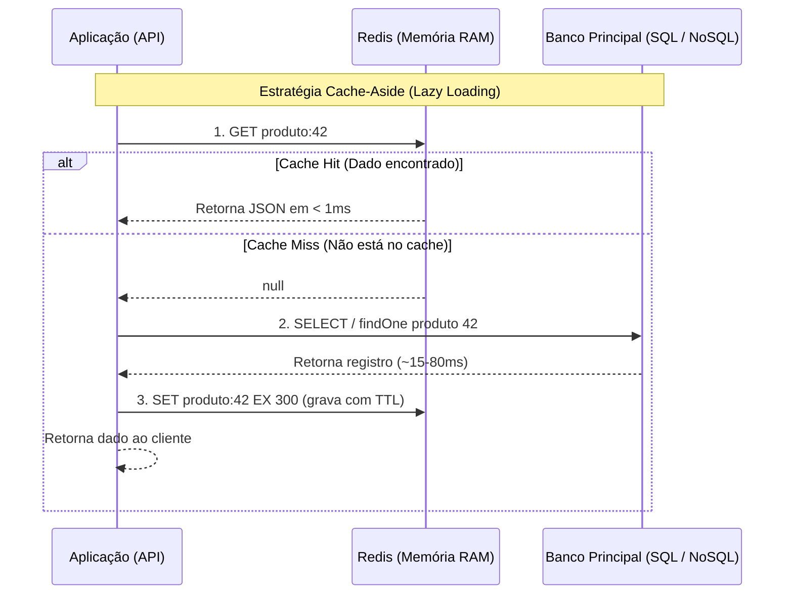

# ⚡ Setor 16: NoSQL & Estratégias de Cache

> **"Performance extrema. Aprenda quando usar bancos NoSQL e utilize caches inteligentes em memória para reduzir a latência de leituras."**

---

## 1. 🚀 Briefing da Missão (Contexto Temático & Realidade de Mercado)

| Atributo do Setor | Especificação |
| :--- | :--- |
| **Galáxia** | Cinturão de Arquitetura |
| **ID do Módulo** | `nosql-cache` |
| **Pré-requisitos** | [Setor 14: Sistemas Distribuídos & Clean Arch](./14-sistemas-distribuidos-clean-arch.md) (`sistemas-distribuidos`) |
| **Desbloqueia** | [Projeto de Consolidação: Cinturão de Arquitetura](./projeto-consolidacao-03-arquitetura.md) e completa os domínios de dados do Cinturão |
| **Nível de Criticidade** | Fundamental para Baixa Latência e Escala de Leitura |

### 🛸 Analogia do Navegador Cósmico

Imagine o navegador de bordo de uma nave exploradora. Se toda vez que você precisasse conferir as coordenadas do planeta mais próximo (uma informação consultada mil vezes por minuto) o computador central tivesse que descer até o **porão congelado de arquivos em fita magnética** (o banco SQL em disco com múltiplos `JOIN`s pesados), a nave demoraria segundos preciosos para reagir e os motores de busca superaqueceriam.

Em vez disso, um engenheiro estelar cria dois avanços: primeiro, ele guarda documentos autossuficientes prontos para leitura direta em um **arquivo de acesso flexível** (**NoSQL**, como um catálogo de fichas completas de produtos sem precisar montar o quebra-cabeça de 6 tabelas); segundo, ele coloca os 100 mapas mais consultados direto na **memória instantânea da mesa do piloto** (**Cache em Memória com Redis**), onde cada consulta responde em microssegundos — com prazo de validade (**TTL**) e regra automática para liberar espaço na mesa quando ela enche (**LRU**)!

### 🏢 A Dor Real no Mercado de Tecnologia

Em aplicações web reais, a proporção típica entre operações de leitura e escrita varia de **10:1 até 100:1** (e-commerces, feeds, catálogos, rankings). Sem estratégias NoSQL e de Cache:
- A página inicial do e-commerce ou a listagem dos produtos mais buscados executa os mesmos `JOIN`s pesados no PostgreSQL milhares de vezes por segundo, levando a CPU do banco a 100% e derrubando até os pagamentos!
- Dados altamente heterogêneos (como catálogos de produtos onde uma camiseta tem *tamanho e cor*, enquanto um notebook tem *processador, RAM e voltagem*) viram um pesadelo de dezenas de tabelas EAV ou colunas `NULL` no modelo relacional rígido.
- Guardar sessões de usuários ou contadores de *Rate Limiting* em disco no banco relacional cria gargalo de escrita em toda requisição autenticada.

Saber **modelar NoSQL conscientemente** (sem abandonar o SQL para o que exige ACID!) e **implementar Cache-Aside, Write-Through, TTL e Invalidação** é o toque final que transforma você em um desenvolvedor backend altamente valorizado.

---

## 2. 📚 Carga de Conhecimento Completa (Tópico por Tópico)



### 2.1 Conhecer as famílias NoSQL (Documentos, Chave-Valor, Colunas, Grafos)

"NoSQL" (*Not Only SQL*) não é um único banco — é um guarda-chuva com **4 famílias distintas**, cada uma otimizada para um formato de acesso específico:

| Família NoSQL | Estrutura dos Dados | Exemplos Famosos | Caso de Uso Ideal |
| :--- | :--- | :--- | :--- |
| **Documentos** | Documentos autossuficientes em JSON / BSON agrupados em coleções, com esquema flexível. | **MongoDB**, CouchDB, Firestore | Catálogos de produtos com atributos variáveis, perfis de usuário, CMS, carrinhos e histórico rico de pedidos. |
| **Chave-Valor (Key-Value)** | Dicionário ultrarrápido `chave -> valor` (strings, hashes, listas, sets), frequentemente em RAM. | **Redis**, Memcached, Amazon DynamoDB | Cache de respostas, controle de sessões, tokens de reset, placares (*leaderboards*), *rate limiting*, locks distribuídos. |
| **Família de Colunas (Wide-Column)** | Tabelas esparsas particionadas por chave de linha e agrupadas em famílias de colunas distribuídas em cluster. | **Apache Cassandra**, ScyllaDB, HBase | Ingestão massiva de séries temporais, logs de sensores IoT, mensagens de chat em altíssima escala de escrita. |
| **Grafos (Graph)** | Nós (vértices) e arestas (relacionamentos direcionados com propriedades) otimizados para travessias profundas. | **Neo4j**, Amazon Neptune | Redes sociais ("amigos de amigos"), detecção de fraudes financeiras, motores de recomendação e rotas logísticas. |

> **Regra de decisão prática (Polyglot Persistence):** Nunca escolha NoSQL por moda! Use **SQL (PostgreSQL)** quando precisar de integridade referencial forte, relatórios ad-hoc com múltiplos `JOIN`s e transações financeiras ACID complexas. Use **NoSQL** quando precisar de esquema dinâmico por documento, latência sub-milissegundo em memória ou escala horizontal massiva de escrita/leitura em padrões conhecidos.

### 2.2 Dominar o uso do Redis para cache rápido e controle de sessões

O **Redis** (*Remote Dictionary Server*) é um armazenamento de estruturas de dados em memória RAM extremamente rápido (capaz de dezenas de milhares a centenas de milhares de operações por segundo com latência abaixo de 1ms). Além de simples strings, ele domina estruturas ricas nativas:

1. **Strings (`SET`, `GET`, `INCR`, `EX`):** ideais para cache de JSON serializado de produtos, respostas de API e contadores atômicos (ex.: `INCR rate_limit:ip:192.168.0.1` + `EXPIRE` para limitar requisições por minuto!).
2. **Hashes (`HSET`, `HGET`, `HGETALL`):** perfeitos para armazenar objetos estruturados como **Sessões de Usuário**, onde você atualiza ou lê um campo isolado (ex.: `ultimaAtividade`) sem precisar serializar/deserializar o JSON inteiro da sessão.
3. **Sorted Sets (`ZADD`, `ZREVRANGE`):** ordenação automática por pontuação (*score*) — usado para rankings de produtos mais buscados ou mais vendidos em tempo real!
4. **Controle de Sessões com Redis:**
   - Em arquiteturas horizontais com 4 instâncias da sua API atrás de um Load Balancer, salvar sessão na memória local do Node.js falha assim que a próxima requisição do usuário cai em outra instância!
   - Centralizando sessões no Redis com chave `sessao:<sessionId>` e **TTL deslizante ou fixo**, qualquer instância da API valida a sessão em menos de 1ms e você consegue **revogar sessões instantaneamente** (logout global ou bloqueio de conta comprometida) apenas deletando a chave com `DEL` — algo difícil de fazer com JWT puro sem lista de revogação!

### 2.3 Modelar dados desnormalizados no MongoDB

O erro número 1 de quem migra do SQL para o MongoDB é tentar replicar a **3ª Forma Normal (3NF)** criando 8 coleções e usando `$lookup` (equivalente lento a `JOIN`) em toda consulta. A regra de ouro da modelagem orientada a documentos é: **"Dados que são lidos juntos devem ser armazenados juntos."**

Principais decisões de modelagem no MongoDB:
- **Embedding (Documentos Embutidos — Desnormalização):**
  - Ideal para relações **1-para-1** ou **1-para-poucos** (ex.: um `Pedido` embutindo o array de `itens` e o `enderecoEntrega` usado naquela compra).
  - *Bônus crucial de domínio:* em um e-commerce, **embutir o snapshot do produto dentro do pedido** (`nomeProduto`, `precoPagoCentavos` no momento da compra) não é apenas mais rápido — é **correto para o negócio**! Se o preço do produto mudar no catálogo amanhã, os pedidos históricos não podem mudar de valor!
- **Referencing (Referência por ObjectId):**
  - Ideal para relações **1-para-muitos ilimitados** (ex.: milhões de `logs` ou milhares de `avaliacoes` de um produto — pois documentos no MongoDB têm limite máximo de **16 MB**) ou **muitos-para-muitos** onde o objeto referenciado muda frequentemente e precisa estar atualizado em todos os lugares.
- **Índices no MongoDB:** assim como no SQL, campos frequentemente filtrados (`sku`, `categoria`, `clienteId`) precisam de índices (`db.produtos.createIndex({ categoria: 1, precoCentavos: 1 })`) para evitar *Collection Scan* lento.

### 2.4 Implementar padrões de cache: Cache-Aside e Write-Through

Existem diversos padrões de sincronia entre Aplicação, Cache e Banco de Dados. Os dois padrões fundamentais que você precisa dominar e saber implementar são:

1. **Cache-Aside (Lazy Loading / Leitura sob Demanda):**
   - **Como funciona:** A aplicação é a única responsável por conversar com o Cache e com o Banco (o cache fica "ao lado", sem saber que o banco existe).
     - Na leitura: consulta o Cache primeiro -> se **Cache Hit**, retorna imediatamente; se **Cache Miss**, busca no Banco de Dados, grava o resultado no Cache com um **TTL** e retorna ao cliente.
     - Na escrita/atualização: grava no Banco de Dados e **invalida (deleta)** a chave antiga no Cache (`DEL produto:42`) para evitar servir dado obsoleto ou condições de corrida.
   - **Vantagens:** só preenche o cache com os dados realmente acessados (economiza RAM); se o Redis cair, o sistema continua funcionando indo direto ao banco (resiliência natural!).
   - **Desvantagem:** a primeira leitura após um miss ou invalidação paga o custo extra de ir ao banco; exige cuidado contra *Cache Stampede* (quando uma chave muito popular expira e 1.000 requisições simultâneas vão ao banco juntas!).

2. **Write-Through (Escrita Atravessando o Cache):**
   - **Como funciona:** Toda escrita passa pelo componente de cache (ou camada unificada de repositório), que atualiza o **Cache e o Banco de Dados de forma síncrona** antes de confirmar a operação.
   - **Vantagens:** o cache está **sempre atualizado** logo após cada gravação, eliminando leituras com *cache miss* logo depois de atualizar um cadastro ou preço; reduz drasticamente dados desatualizados (*stale data*).
   - **Desvantagens:** aumenta a latência da operação de escrita (pois grava em dois lugares síncronos) e pode encher a memória do cache com dados recém-criados que talvez nunca sejam lidos logo em seguida (mitigado combinando com TTL e política de remoção LRU).

*(Menção rápida para comparação em entrevistas: existe também o **Write-Behind / Write-Back**, onde a escrita vai rápido apenas para o cache e é enviada em lote para o banco em segundo plano de forma assíncrona — altíssima velocidade de escrita, porém com risco de perda de dados se a RAM falhar antes da persistência em disco.)*

### 2.5 Gerenciar a expiração e invalidação de caches usando TTL e políticas LRU

> *"Existem apenas duas coisas difíceis na Ciência da Computação: invalidação de cache e dar nomes às coisas."* — Phil Karlton

Como a memória RAM é finita e muito mais cara que disco SSD, um cache sem controle de expiração e limite de tamanho ou cresce até travar por `OOM (Out Of Memory)`, ou serve dados errados eternamente.

1. **TTL (Time-To-Live — Tempo de Vida):**
   - Toda chave colocada no cache deve ter um prazo explícito de expiração (`EX 300` = 5 minutos). Após esse tempo, o Redis apaga a chave automaticamente, forçando uma renovação limpa na próxima leitura.
   - **Como escolher o TTL:** dados quase estáticos (lista de estados/categorias) toleram TTL longo (1 hora a 24 horas); catálogo com estoque e preço dinâmico pede TTL curto (30 segundos a 5 minutos) combinado com **invalidação ativa** (`DEL`) quando o administrador edita o produto!
   - **Dica anti-Cache Avalanche:** se você carregar 10.000 chaves todas com exatos `300s` às 10h00, todas expirarão juntas às 10h05 derrubando o banco! Adicione um pequeno **Jitter aleatório** ao TTL (ex.: `300 + Math.floor(Math.random() * 60)` segundos).
2. **Políticas de Despejo (Eviction Policies) & LRU:**
   - Quando a RAM configurada no Redis (`maxmemory`) enche, qual chave deve ser removida para abrir espaço?
   - **LRU (Least Recently Used — Menos Recentemente Usado):** descarta primeiro as chaves que ficaram mais tempo **sem serem lidas/acessadas**, preservando na memória os itens "quentes" mais buscados! É a política padrão mais popular (`allkeys-lru` ou `volatile-lru` para remover apenas chaves com TTL).
   - Outras políticas úteis do Redis para comparar: **LFU (`allkeys-lfu`)** que prioriza manter as chaves acessadas com maior *frequência* (não apenas recência), e **`noeviction`** (recusa novas gravações com erro quando lota — obrigatória quando o Redis está operando como **fila BullMQ**, pois você nunca quer que o Redis apague um job de pagamento por falta de RAM!).
3. **Cache Negative Caching (Proteção contra Cache Penetration):**
   - Se atacantes ou bots pedirem `GET /produtos/id-que-nao-existe` 10.000 vezes por segundo, o Cache-Aside ingênuo sempre dá *cache miss* e bate 10.000 vezes no banco SQL!
   - Solução: quando o banco retornar `null`, grave temporariamente um marcador leve no cache (ex.: `"__NULL__"`) com **TTL bem curto (ex.: 30s)** para blindar o banco contra consultas repetidas por IDs inexistentes.

---

## 3. 💻 Mão no Código (Jeito Iniciante vs. Padrão Profissional)

Cenário: **Catálogo de Produtos de E-commerce com Cache-Aside, TTL com Jitter, Invalidação Ativa na Atualização e Controle de Sessão/Ranking de Buscados no Redis**, além de um exemplo de **Modelagem Desnormalizada em MongoDB**.

### ❌ Jeito Iniciante (Sem cache ou cache sem TTL, sem invalidação e sem fallback se Redis cair)

```typescript
// ❌ ANTIPADRÃO: Cache ingênuo que nunca expira, nunca invalida e quebra a API se o Redis cair
import IORedis from 'ioredis';

const redis = new IORedis();

export async function buscarProdutoIniciante(db: any, id: string) {
  // 1. Se o Redis estiver fora do ar, essa linha lança exceção e derruba o endpoint inteiro!
  const cacheado = await redis.get(id);
  if (cacheado) {
    return JSON.parse(cacheado);
  }

  const produto = await db.query('SELECT * FROM produtos WHERE id = $1', [id]);

  // 2. ERRO GRAVE: Gravou sem TTL! Vai morar na RAM para sempre até estourar memória
  // e nunca mais refletirá alterações de preço feitas no banco!
  await redis.set(id, JSON.stringify(produto));
  return produto;
}
```

### ✅ Padrão Profissional (Cache-Aside Resiliente + Jitter + Invalidação + Write-Through + Modelagem MongoDB)

```typescript
// ✅ PADRÃO DE MERCADO: Repositório com Cache-Aside seguro, Fallback e Write-Through
import IORedis from 'ioredis';

export interface Produto {
  id: string;
  nome: string;
  precoCentavos: number;
  categoria: string;
}

export interface ProdutoBancoDados {
  buscarPorId(id: string): Promise<Produto | null>;
  atualizar(produto: Produto): Promise<void>;
}

export class ProdutoCacheService {
  private static readonly PREFIXO_CHAVE = 'catalogo:produto:';
  private static readonly PREFIXO_RANKING = 'catalogo:mais_buscados';
  private static readonly MARCADOR_NULO = '__NAO_ENCONTRADO__';

  constructor(
    private readonly banco: ProdutoBancoDados,
    private readonly redis: IORedis,
    private readonly ttlBaseSegundos = 300
  ) {}

  private chaveProduto(id: string): string {
    return `${ProdutoCacheService.PREFIXO_CHAVE}${id}`;
  }

  private gerarTtlComJitter(baseSegundos: number): number {
    // Evita Cache Avalanche adicionando variação aleatória de até 20%
    const jitter = Math.floor(Math.random() * Math.max(1, Math.floor(baseSegundos * 0.2)));
    return baseSegundos + jitter;
  }

  // Padrão CACHE-ASIDE com Fallback silencioso e Negative Caching
  async buscarPorId(id: string): Promise<Produto | null> {
    const chave = this.chaveProduto(id);

    // 1. Tenta ler do Redis; se Redis falhar, NÃO derruba a aplicação (degrada pro banco!)
    try {
      const emCache = await this.redis.get(chave);
      if (emCache !== null) {
        if (emCache === ProdutoCacheService.MARCADOR_NULO) {
          return null; // Cache Penetration protegido!
        }
        // Incrementa score no Sorted Set para rastrear produtos mais buscados
        await this.redis.zincrby(ProdutoCacheService.PREFIXO_RANKING, 1, id);
        return JSON.parse(emCache) as Produto;
      }
    } catch (err) {
      console.warn(`[Cache Aviso] Falha ao ler Redis para ${chave}. Seguindo para o banco.`);
    }

    // 2. Cache Miss: busca na fonte da verdade (SQL/MongoDB)
    const produto = await this.banco.buscarPorId(id);

    // 3. Popula o cache para as próximas requisições com TTL adequado
    try {
      if (!produto) {
        // Negative caching curto (30s) protege contra floods de IDs inexistentes
        await this.redis.set(chave, ProdutoCacheService.MARCADOR_NULO, 'EX', 30);
        return null;
      }

      const ttl = this.gerarTtlComJitter(this.ttlBaseSegundos);
      await this.redis.set(chave, JSON.stringify(produto), 'EX', ttl);
      await this.redis.zincrby(ProdutoCacheService.PREFIXO_RANKING, 1, id);
    } catch (err) {
      console.warn(`[Cache Aviso] Falha ao gravar Redis para ${chave}.`);
    }

    return produto;
  }

  // Padrão WRITE-THROUGH: atualiza banco e cache juntos mantendo consistência imediata
  async atualizarComWriteThrough(produto: Produto): Promise<void> {
    await this.banco.atualizar(produto);

    try {
      const ttl = this.gerarTtlComJitter(this.ttlBaseSegundos);
      await this.redis.set(this.chaveProduto(produto.id), JSON.stringify(produto), 'EX', ttl);
    } catch (err) {
      // Se gravar no cache falhar, tenta ao menos invalidar para evitar dado velho na RAM!
      await this.redis.del(this.chaveProduto(produto.id)).catch(() => undefined);
    }
  }

  // Retorna Top N IDs mais buscados usando Sorted Set (ZREVRANGE) do Redis
  async listarIdsMaisBuscados(limite = 10): Promise<string[]> {
    try {
      return await this.redis.zrevrange(ProdutoCacheService.PREFIXO_RANKING, 0, limite - 1);
    } catch {
      return [];
    }
  }
}
```

#### **Exemplo Bônus: Modelagem Desnormalizada Correta no MongoDB (Documento de Pedido)**

```json
{
  "_id": "ord_9f82a10c",
  "clienteId": "cli_402",
  "clienteResumo": {
    "nome": "Mariana Costa",
    "email": "mariana@galaxia.dev"
  },
  "enderecoEntrega": {
    "cep": "01310-100",
    "rua": "Avenida Paulista",
    "numero": "1578",
    "cidade": "São Paulo"
  },
  "itens": [
    {
      "produtoId": "prod_11",
      "nomeSnapshot": "Teclado Mecânico Galáctico",
      "precoUnitarioCentavos": 42900,
      "quantidade": 1
    }
  ],
  "totalCentavos": 42900,
  "status": "PAGO",
  "criadoEm": "2026-11-18T14:22:00.000Z"
}
```
*Observe como 1 única leitura no MongoDB entrega todos os dados da tela "Detalhes do Pedido" sem nenhum `$lookup` nem risco de mudança histórica se o cliente mudar de endereço ou o produto subir de preço no mês seguinte!*

---

## 4. 🛠️ Laboratório de Voo (Exercício Prático Guiado)

**Duração estimada:** 45 minutos | **Stack:** Node.js + TypeScript + Redis (Docker)

### 🎯 Objetivo da Missão
Medir na prática o ganho absurdo de latência entre um banco lento simulado (~180ms por consulta) e o **Cache-Aside no Redis (< 2ms)**, além de testar **TTL**, **LRU** e **Controle de Sessões**.

### 📋 Passo a Passo Reproduzível

1. **Suba um Redis configurado com limite de memória e política LRU explícita:**
   ```bash
   docker run -d --name redis-cache-lab -p 6379:6379 redis:7-alpine \
     redis-server --maxmemory 32mb --maxmemory-policy allkeys-lru
   ```
2. **Crie o projeto TypeScript:**
   ```bash
   mkdir lab-redis-cache && cd lab-redis-cache
   npm init -y
   npm install ioredis
   npm install -D typescript tsx @types/node
   ```
3. **Implemente um repositório lento simulado (`BancoLentoFake.ts`):**
   - Crie um `Map` com 5 produtos iniciais e adicione `await new Promise(r => setTimeout(r, 180))` dentro de `buscarPorId()` para simular uma query pesada em disco.
4. **Implemente `ProdutoCacheService.ts`** seguindo o modelo da Seção 3:
   - Meça o tempo gasto usando `performance.now()` e imprima no console:
     - `[CACHE MISS] Produto prod-1 carregado do banco em 182.4ms`
     - `[CACHE HIT] Produto prod-1 servido do Redis em 0.9ms`
5. **Adicione um módulo de Sessão com Redis Hash (`SessaoService.ts`):**
   - `criarSessao(token, usuario)` usando `redis.hset('sessao:' + token, ...)` + `redis.expire('sessao:' + token, 60)`.
   - `obterSessao(token)` usando `redis.hgetall` e `revogarSessao(token)` usando `redis.del`.
6. **Teste no terminal com `redis-cli`:**
   - Rode `docker exec -it redis-cache-lab redis-cli` e inspecione os tempos de vida em tempo real com `TTL catalogo:produto:prod-1` e veja o uso de memória com `INFO memory`!

### ✅ Critérios de Domínio
- [ ] A primeira leitura aciona o banco lento (~180ms) e popula o Redis com `EX` (TTL > 0 comprovado via `TTL <chave>`).
- [ ] Leituras subsequentes respondem em menos de 5ms sem chamar `BancoLentoFake`.
- [ ] Atualizar o produto via `atualizarComWriteThrough` (ou invalidar com `DEL`) reflete o novo preço imediatamente na próxima consulta.
- [ ] Parar o container do Redis (`docker stop redis-cache-lab`) **não derruba** as consultas de produto (o serviço faz fallback gracioso para o banco).

---

## 5. 🎯 Resolução Comentada do Teste de Ignição (Quest Oficial)

> **Pergunta Oficial (`data.js`):**
> *Qual das seguintes opções descreve a estratégia de cache do tipo 'Cache-Aside'?*
>
> - **A)** A aplicação grava as alterações no banco e no cache simultaneamente em uma única transação.
> - **B)** A aplicação sempre consulta o cache primeiro. Se houver um 'cache miss', ela busca os dados no banco de dados, os retorna ao usuário e atualiza o cache para futuras requisições.
> - **C)** O cache atualiza a si mesmo periodicamente em background a cada hora, sem interferência da aplicação.
> - **D)** Os dados são mantidos exclusivamente no cache e nunca gravados em disco rígido.

### ✅ Resposta Correta: **Alternativa B**

### 🔍 Análise Técnica de Cada Alternativa

- **Por que B está correta:** O padrão **Cache-Aside** (também chamado de *Lazy Loading*) coloca a responsabilidade na aplicação: antes de consultar o banco principal, ela verifica o cache (`Hit` -> retorno imediato). Quando ocorre um **Cache Miss** (chave ausente ou expirada por TTL), a própria aplicação busca o dado no banco de dados, popula o cache para acelerar chamadas futuras e entrega o resultado ao cliente.
- **Por que A está incorreta:** Gravar alterações no cache e no banco de forma coordenada no momento da escrita descreve variações do padrão **Write-Through** (e mesmo nele, Redis e PostgreSQL não compartilham uma "única transação ACID" nativa sem mecanismos distribuídos específicos).
- **Por que C está incorreta:** Um cache que se atualiza sozinho de forma proativa/agendada ou transparente sem a lógica da aplicação buscando no miss aproxima-se mais de mecanismos de *Refresh-Ahead* ou *Read-Through* gerenciados pelo próprio provedor de cache, nunca do Cache-Aside sob demanda.
- **Por que D está incorreta:** Manter dados exclusivamente em cache sem persistência em disco descreve um armazenamento puramente volátil em memória, e não uma estratégia de cache (cuja premissa básica é acelerar leituras de uma fonte primária durável em banco de dados).

---

## 6. 🎤 Kit de Apresentação (Como Dar Aula / Apresentar Este Módulo)

### ⏱️ Pitch Feynman de 2 Minutos (Texto Pronto para Falar)

> "Imagina um chefe de biblioteca atendendo mil alunos perguntando sempre pelos mesmos dez livros de física. Se toda vez que alguém perguntar ele andar até o quarto andar do prédio para buscar a resposta nos arquivos gigantes, a fila vai dar volta no quarteirão. O que um bibliotecário esperto faz? Deixa um bloquinho de anotações rápidas em cima do balcão!
>
> Esse bloquinho em cima do balcão é o **Cache em Memória**, e o rei dessa área é o **Redis**. Ao trabalhar com o padrão mais famoso do mercado, o **Cache-Aside**, o fluxo é super intuitivo: chegou um pedido, você olha no bloquinho primeiro. Tá lá? Responde em menos de um milissegundo (*Cache Hit*). Não tá? (*Cache Miss*), vai até o banco de dados principal, anota a resposta no bloquinho com um prazo de validade chamado **TTL** para aquela anotação não ficar velha para sempre, e entrega pro usuário.
>
> E quando o balcão enche? Usamos a regra **LRU (Least Recently Used)** — jogamos fora a anotação que faz mais tempo que ninguém consulta, mantendo sempre os livros mais populares à mão! Além disso, fora do mundo relacional de tabelas rígidas, existem quatro famílias **NoSQL** — Documentos como MongoDB para catálogos flexíveis, Chave-Valor como Redis para velocidade extrema, Colunas como Cassandra para chuva de dados e Grafos como Neo4j para conexões sociais. A arte da arquitetura moderna não é abandonar o SQL, mas combinar SQL, NoSQL e Cache para que cada dado more no lugar mais rápido e seguro possível."

### 📊 Roteiro de Slides (6 Slides)

1. **Slide 1 — Por Que Nem Tudo Deve Ir Direto ao Banco SQL?**
   - *Bullets:* Proporção Leitura vs. Escrita (90%+ leituras); Latência de Disco + JOINs vs. Memória RAM; Persistência Poliglota.
   - *Visual:* Comparativo de latência (Memória RAM Redis: < 1ms vs. Query SQL com JOIN: 20–150ms).
2. **Slide 2 — As 4 Famílias NoSQL e Quando Usar Cada Uma**
   - *Bullets:* Documentos (MongoDB), Chave-Valor (Redis), Colunas (Cassandra), Grafos (Neo4j); Como escolher sem modismo.
   - *Visual:* Quatro quadrantes com ícone, estrutura visual e caso de uso real de cada família.
3. **Slide 3 — Modelagem Desnormalizada no MongoDB**
   - *Bullets:* "Dados lidos juntos ficam juntos"; Embedding vs. Referencing; O exemplo do Snapshot de preço no Pedido.
   - *Visual:* 4 tabelas normalizadas com setas vs. 1 documento JSON completo do Pedido.
4. **Slide 4 — Redis Além do Cache: Sessões e Rankings**
   - *Bullets:* Strings, Hashes e Sorted Sets; Sessão centralizada atrás de Load Balancer; Revogação instantânea vs. JWT puro.
   - *Visual:* Diagrama de 3 servidores API compartilhando o mesmo Redis para validar sessões.
5. **Slide 5 — Estratégias de Cache: Cache-Aside vs. Write-Through**
   - *Bullets:* Fluxo passo a passo do Cache-Aside (Hit/Miss); Fluxo do Write-Through na escrita; Fallback quando o cache cai.
   - *Visual:* Dois diagramas de sequência limpos lado a lado.
6. **Slide 6 — Sobrevivência em Produção: TTL, LRU e Armadilhas**
   - *Bullets:* Escolhendo TTL + Jitter; Políticas `allkeys-lru`, `allkeys-lfu` e `noeviction`; Cache Penetration e Cache Avalanche.
   - *Visual:* Ilustração visual da fila LRU removendo o item mais antigo sem acesso.

### 💻 Roteiro de Demo Ao Vivo (3 Minutos)

1. **Minuto 0:00–1:00:** Execute um endpoint `GET /produtos/1` com o cache vazio e mostre no terminal/Insomnia o tempo de resposta de `~185ms` e o log `[CACHE MISS] Buscando no banco SQL`.
2. **Minuto 1:00–2:00:** Dispare o mesmo `GET /produtos/1` mais 3 vezes seguidas mostrando a queda abrupta para `1ms` (`[CACHE HIT]`) e abra `redis-cli` rodando `GET catalogo:produto:1` e `TTL catalogo:produto:1` vendo os segundos diminuindo ao vivo.
3. **Minuto 2:00–3:00:** Execute um `PUT /produtos/1` alterando o preço e prove com um novo `GET` imediato que o preço atualizado aparece sem precisar esperar o TTL expirar (demonstrando invalidação ativa / Write-Through funcionando).

### ❓ 2 Perguntas Difíceis da Plateia (e Respostas Seguras)

1. **"Se eu usar Redis para Cache E também para Fila (BullMQ), posso colocar ambos na mesma instância com política `allkeys-lru`?"**
   - *Resposta:* **JAMAIS!** Essa é uma das armadilhas mais perigosas em produção. Filas BullMQ exigem política **`noeviction`** para nunca apagarem jobs pendentes quando a RAM encher, enquanto cache precisa de **`allkeys-lru`** ou **`volatile-lru`** para liberar memória removendo entradas antigas! Se você misturar fila e cache no mesmo Redis com `allkeys-lru`, o Redis pode despejar seus jobs de pagamento para guardar cache de catálogo! Em produção, suba sempre duas instâncias/serviços Redis separados com configurações próprias.
2. **"Qual o risco de usar Cache-Aside com atualização simultânea de escrita e leitura (Race Condition)?"**
   - *Resposta:* Cenário clássico: a Requisição A lê um dado desatualizado no banco logo após um miss; antes de gravar no cache, a Requisição B atualiza o banco para um novo preço e deleta o cache; em seguida, a Requisição A atrasada grava o preço *velho* no cache, deixando o cache inconsistente até o TTL expirar! Para dados críticos onde segundos de divergência importam, mitigamos usando **Write-Through**, invalidando após o commit com atraso curto (*delayed double delete*) ou mantendo **TTLs curtos**.

---

## 7. 💼 Radar do Mercado de Trabalho (Foco Dev Júnior)

### 🎙️ 3 Perguntas Reais de Entrevista Técnica Júnior

1. **"Quando você modelaria dados em MongoDB em vez de usar PostgreSQL?"**
   - *Resposta-modelo:* "Eu escolheria MongoDB quando a estrutura dos documentos varia bastante de registro para registro — como especificações técnicas de produtos heterogêneos em um marketplace — ou quando os dados são naturalmente hierárquicos e sempre lidos juntos como um bloco único (como um catálogo rico ou histórico fechado de pedidos), evitando múltiplos JOINs. Por outro lado, para dados altamente relacionais com regras de integridade referencial rigorosas e transações financeiras entre múltiplas entidades, eu manteria o PostgreSQL."
2. **"Explique o padrão Cache-Aside e diga o que deve acontecer na sua API se o servidor Redis cair."**
   - *Resposta-modelo:* "No Cache-Aside, a aplicação consulta o Redis primeiro: se der *Cache Hit*, retorna direto; se der *Cache Miss*, consulta o banco principal, salva no Redis com um TTL e devolve ao usuário. Se o Redis ficar indisponível, o cache **não pode ser ponto único de falha**: envolvo as chamadas ao Redis em `try/catch` com timeout curto para logar o incidente e seguir transparentemente para o banco de dados principal, degradando apenas a latência em vez de derrubar a API com erro 500."
3. **"Por que toda chave de cache precisa de TTL, e como funciona uma política de despejo LRU?"**
   - *Resposta-modelo:* "O TTL garante um limite máximo de obsolescência caso alguma alteração aconteça no banco sem invalidar o cache manualmente, além de liberar espaço de memória de itens que deixaram de ser úteis. Já o **LRU (Least Recently Used)** é a política aplicada quando o limite de RAM configurada no cache (`maxmemory`) é atingido: o Redis remove automaticamente as chaves acessadas há mais tempo, preservando em memória os dados mais quentes e frequentemente consultados recentemente."

### ⚖️ Erros Clássicos de Júnior vs. Postura Profissional

| Erro Clássico de Júnior | Postura Profissional Esperada |
| :--- | :--- |
| Gravar chaves no Redis com `redis.set(key, val)` sem definir `EX` (TTL) nunca. | Sempre definir TTL explícito (preferencialmente com pequeno jitter aleatório) e planejar estratégia de invalidação. |
| Usar Redis para cache e filas BullMQ na mesma instância com `allkeys-lru`. | Isolar instâncias por propósito: `noeviction` para filas/sessões críticas e `allkeys-lru` para cache descartável. |
| Normalizar MongoDB igual a SQL criando 6 coleções separadas e fazendo `$lookup` em tudo. | Modelar orientado ao padrão de leitura (*Embedding* para dados lidos juntos e *Snapshot* histórico). |
| Deixar o endpoint falhar com erro 500 se o Redis der timeout de conexão. | Tratar cache como camada opcional de aceleração: capturar falhas de rede no cache e consultar o banco de origem. |

### 🏆 Evidência para Portfólio / GitHub / LinkedIn

- **No GitHub:** No seu projeto de e-commerce, exponha um header HTTP de observabilidade simples nos testes/dev (ex.: `X-Cache: HIT` ou `X-Cache: MISS` e `X-Response-Time: 1.2ms`) e inclua no `README.md` um comparativo real de benchmark antes e depois do Redis usando `autocannon` ou `k6`.
- **No LinkedIn:** Publique o print do seu benchmark mostrando a latência caindo de ~150ms para ~2ms e explique o porquê de usar **TTL com Jitter** e **fallback caso o Redis fique fora do ar**.

---

## 8. 📡 Transmissões Recomendadas & Próxima Órbita

### 📚 Recursos Oficiais do Módulo
- 🎓 **[Redis University](https://university.redis.com/)** — Cursos gratuitos oficiais da Redis sobre estruturas de dados em memória, padrões de cache, sessões e modelagem de alta performance.
- ☁️ **[Estratégias de Cache (AWS Guide)](https://aws.amazon.com/caching/best-practices/)** — Guia completo de arquitetura da AWS comparando Cache-Aside, Write-Through, TTL, invalidação e anti-padrões em sistemas distribuídos.

### 🛸 Próxima Órbita na Árvore de Habilidades
Parabéns! Você concluiu todos os 6 setores teóricos e práticos do **Cinturão de Arquitetura**. Agora é hora de provar domínio unindo Clean Architecture + Banco Relacional + Filas Assíncronas + Cache Redis em uma única aplicação real:
- 🏆 **[Projeto de Consolidação: Cinturão de Arquitetura](./projeto-consolidacao-03-arquitetura.md)** — roteiro completo, diagrama, starter code e pitch para transformar todo esse conhecimento no projeto estrela do seu portfólio!
- 🚀 Após o projeto, siga para a próxima galáxia: **Órbita do DevOps & Cloud (`docker`)** para containerizar, testar em CI/CD e colocar sua arquitetura no ar!
