# 🏆 Projeto de Consolidação: Cinturão de Arquitetura

> **Desafio integrador da Galáxia 3 — unindo Clean Code, SOLID, Testes Automatizados, Design Patterns, Clean Architecture, Mensageria Assíncrona e Estratégias de Cache em um único sistema de nível profissional.**

---

## 1. 🎖️ Missão Oficial & Objetivo de Portfólio

### 📜 Enunciado Oficial da Missão (`app.js` — `consolidationProjects["nosql-cache"]`)

> **Projeto de Consolidação: Cinturão de Arquitetura**
>
> *"Desenvolva uma API REST para um e-commerce simplificado aplicando Clean Architecture. Salve dados de pedidos em um banco relacional, envie notificações para uma fila Redis/RabbitMQ e processe-as em segundo plano de forma assíncrona, salvando os produtos mais buscados em um cache Redis."*

### 🎯 Por Que Este Projeto Impressiona Recrutadores e Tech Leads

A maioria dos portfólios de desenvolvedores júniores traz apenas um CRUD básico ligado diretamente ao banco de dados. Ao construir este projeto completo, você prova na prática que domina:
- **Desacoplamento real** com Clean Architecture e Inversão de Dependências (o núcleo de pedidos não conhece Express, Postgres nem Redis).
- **Persistência poliglota inteligente:** PostgreSQL com integridade ACID para transações financeiras de pedidos, aliado ao Redis em memória para acelerar consultas populares do catálogo.
- **Processamento assíncrono resiliente:** resposta HTTP imediata ao cliente enquanto um *Worker* dedicado envia notificações em segundo plano com **Retry Exponencial**, **Idempotência** e proteção contra falhas (**DLQ**).
- **Testabilidade em milissegundos:** regras de negócio críticas testadas com **Vitest/Jest** usando Dublês de Teste (*Fakes*, *Stubs* e *Spies*) sem depender da rede.

---

## 2. 🏗️ Arquitetura da Solução

### 🗺️ Diagrama Arquitetural Completo

```mermaid
flowchart LR
    Cliente["Cliente HTTP (Web / Mobile / Curl)"] -->|"GET /produtos/:id"| API["API REST (Express / Fastify)"]
    Cliente -->|"POST /pedidos"| API

    subgraph CleanCore["Núcleo Clean Architecture (Sem Frameworks)"]
        UC_Prod["BuscarProdutoUseCase"]
        UC_Ped["CriarPedidoUseCase"]
        ENT["Entities (Pedido, ItemPedido, Produto)"]
        PORTS["Ports (Interfaces de Repositório, Cache e Fila)"]
        UC_Prod --> ENT
        UC_Ped --> ENT
        UC_Prod --> PORTS
        UC_Ped --> PORTS
    end

    API -->|"Controller chama"| UC_Prod
    API -->|"Controller chama"| UC_Ped

    subgraph Infra["Adaptadores de Infraestrutura"]
        CacheRepo["ProdutoCacheAdapter (Cache-Aside + TTL + Ranking)"]
        PG["PostgresPedidoRepository (Transação ACID)"]
        ProdFila["BullMQProducerAdapter (Publica evento)"]
        RedisCache["Redis Cache (allkeys-lru)"]
        RedisFila["Redis Fila (noeviction) ou RabbitMQ"]
        Worker["Worker Assíncrono Idempotente"]
    end

    PORTS -.->|"implementa"| CacheRepo
    PORTS -.->|"implementa"| PG
    PORTS -.->|"implementa"| ProdFila

    CacheRepo -->|"1. Hit / Miss"| RedisCache
    CacheRepo -->|"2. Fallback SQL"| PG
    ProdFila -->|"Publica PedidoCriado"| RedisFila
    RedisFila -->|"Consome com Retry e DLQ"| Worker
    Worker -->|"Verifica idempotência e envia"| Notif["Provedor de E-mail / Webhook"]
```



### 📁 Árvore de Diretórios Recomendada (Clean Architecture)

```text
ecommerce-cinturao-arquitetura/
├── .env.example
├── docker-compose.yml              # PostgreSQL + Redis Cache + Redis Fila (ou RabbitMQ)
├── package.json
├── tsconfig.json
├── README.md
└── src/
    ├── domain/                     # 100% puro: zero imports externos!
    │   ├── entities/
    │   │   ├── Pedido.ts
    │   │   └── Produto.ts
    │   └── errors/
    │       └── DominioError.ts
    ├── application/                # Casos de Uso, DTOs e Portas (Interfaces)
    │   ├── dtos/
    │   │   ├── CriarPedidoDTO.ts
    │   │   └── ProdutoResponseDTO.ts
    │   ├── ports/
    │   │   ├── ProdutoRepositoryPort.ts
    │   │   ├── PedidoRepositoryPort.ts
    │   │   ├── CachePort.ts
    │   │   └── NotificacaoFilaPort.ts
    │   └── use-cases/
    │       ├── CriarPedidoUseCase.ts
    │       ├── CriarPedidoUseCase.spec.ts
    │       └── BuscarProdutoUseCase.ts
    ├── infra/                      # Adaptadores de Banco, Cache, Fila e HTTP
    │   ├── database/
    │   │   ├── postgresPool.ts
    │   │   ├── schema.sql
    │   │   ├── PostgresProdutoRepository.ts
    │   │   └── PostgresPedidoRepository.ts
    │   ├── cache/
    │   │   ├── RedisCacheAdapter.ts
    │   │   └── ProdutoCacheDecorator.ts   # Padrão Decorator aplicando Cache-Aside!
    │   ├── messaging/
    │   │   ├── BullMQNotificacaoProducer.ts
    │   │   └── NotificacaoWorker.ts
    │   └── http/
    │       ├── controllers/
    │       │   ├── PedidoController.ts
    │       │   └── ProdutoController.ts
    │       └── routes.ts
    └── main/                       # Composition Root (Injeção de Dependências)
        ├── server.ts               # Entrypoint da API HTTP
        └── worker.ts               # Entrypoint isolado do Worker em segundo plano
```

---

## 3. 🛠️ Roteiro de Construção em 5 Etapas

### Etapa 1 — Subir a Infraestrutura Local (`docker-compose.yml`) e Banco Relacional

Crie um `docker-compose.yml` com PostgreSQL e Redis separados por responsabilidade (lembre-se da lição do Setor 16: instância de cache usa `allkeys-lru` e instância de fila usa `noeviction` para nunca descartar jobs pendentes!).

```yaml
services:
  postgres:
    image: postgres:16-alpine
    environment:
      POSTGRES_USER: ${DB_USER:-admin}
      POSTGRES_PASSWORD: ${DB_PASS:-secret}
      POSTGRES_DB: ${DB_NAME:-ecommerce}
    ports:
      - "5432:5432"

  redis-cache:
    image: redis:7-alpine
    command: redis-server --maxmemory 64mb --maxmemory-policy allkeys-lru
    ports:
      - "6379:6379"

  redis-queue:
    image: redis:7-alpine
    command: redis-server --appendonly yes --maxmemory-policy noeviction
    ports:
      - "6380:6379"
```

Defina o esquema SQL inicial em `src/infra/database/schema.sql`:

```sql
CREATE TABLE IF NOT EXISTS produtos (
  id UUID PRIMARY KEY,
  nome VARCHAR(150) NOT NULL,
  preco_centavos INTEGER NOT NULL CHECK (preco_centavos >= 0),
  estoque INTEGER NOT NULL CHECK (estoque >= 0)
);

CREATE TABLE IF NOT EXISTS pedidos (
  id UUID PRIMARY KEY,
  cliente_email VARCHAR(180) NOT NULL,
  total_centavos INTEGER NOT NULL,
  status VARCHAR(30) NOT NULL,
  criado_em TIMESTAMPTZ NOT NULL DEFAULT NOW()
);

CREATE TABLE IF NOT EXISTS itens_pedido (
  id UUID PRIMARY KEY,
  pedido_id UUID NOT NULL REFERENCES pedidos(id) ON DELETE CASCADE,
  produto_id UUID NOT NULL REFERENCES produtos(id),
  quantidade INTEGER NOT NULL CHECK (quantidade > 0),
  preco_unitario_centavos INTEGER NOT NULL
);

CREATE TABLE IF NOT EXISTS eventos_processados (
  event_id UUID PRIMARY KEY,
  processado_em TIMESTAMPTZ NOT NULL DEFAULT NOW()
);
```

---

### Etapa 2 — Construir Domínio Puro, Portas e Caso de Uso (`domain` & `application`)

Implemente a entidade `Pedido` e o caso de uso `CriarPedidoUseCase` aplicando **SRP**, **DIP** e **Early Return**, completamente livres de dependências externas.

```typescript
// src/domain/entities/Pedido.ts
export interface ItemPedidoProps {
  produtoId: string;
  quantidade: number;
  precoUnitarioCentavos: number;
}

export class Pedido {
  public readonly totalCentavos: number;

  private constructor(
    public readonly id: string,
    public readonly clienteEmail: string,
    public readonly itens: ReadonlyArray<ItemPedidoProps>,
    public readonly status: 'CRIADO' | 'NOTIFICADO'
  ) {
    this.totalCentavos = itens.reduce(
      (soma, item) => soma + item.precoUnitarioCentavos * item.quantidade,
      0
    );
  }

  static criar(id: string, clienteEmail: string, itens: ItemPedidoProps[]): Pedido {
    if (!clienteEmail.includes('@')) {
      throw new Error('E-mail do cliente inválido.');
    }
    if (itens.length === 0) {
      throw new Error('Um pedido precisa conter ao menos um item.');
    }
    for (const item of itens) {
      if (item.quantidade <= 0 || item.precoUnitarioCentavos < 0) {
        throw new Error(`Item inválido no pedido: ${item.produtoId}`);
      }
    }
    return new Pedido(id, clienteEmail.trim().toLowerCase(), [...itens], 'CRIADO');
  }
}
```

```typescript
// src/application/ports/ArquiteturaPorts.ts
import { Pedido } from '../../domain/entities/Pedido';

export interface ProdutoDados {
  id: string;
  nome: string;
  precoCentavos: number;
  estoque: number;
}

export interface ProdutoRepositoryPort {
  buscarPorId(id: string): Promise<ProdutoDados | null>;
  buscarVariosPorIds(ids: string[]): Promise<ProdutoDados[]>;
}

export interface PedidoRepositoryPort {
  salvarComBaixaDeEstoque(pedido: Pedido): Promise<void>;
}

export interface NotificacaoFilaPort {
  enfileirarPedidoCriado(evento: {
    eventId: string;
    pedidoId: string;
    clienteEmail: string;
    totalCentavos: number;
  }): Promise<void>;
}
```

```typescript
// src/application/use-cases/CriarPedidoUseCase.ts
import { randomUUID } from 'node:crypto';
import { Pedido } from '../../domain/entities/Pedido';
import {
  NotificacaoFilaPort,
  PedidoRepositoryPort,
  ProdutoRepositoryPort,
} from '../ports/ArquiteturaPorts';

export interface CriarPedidoInput {
  clienteEmail: string;
  itens: Array<{ produtoId: string; quantidade: number }>;
}

export class CriarPedidoUseCase {
  constructor(
    private readonly produtoRepo: ProdutoRepositoryPort,
    private readonly pedidoRepo: PedidoRepositoryPort,
    private readonly filaNotificacoes: NotificacaoFilaPort
  ) {}

  async executar(input: CriarPedidoInput): Promise<{ pedidoId: string; totalCentavos: number }> {
    const ids = input.itens.map((i) => i.produtoId);
    const produtos = await this.produtoRepo.buscarVariosPorIds(ids);
    const mapaProdutos = new Map(produtos.map((p) => [p.id, p]));

    const itensCalculados = input.itens.map((itemReq) => {
      const produto = mapaProdutos.get(itemReq.produtoId);
      if (!produto) {
        throw new Error(`Produto ${itemReq.produtoId} não encontrado.`);
      }
      if (produto.estoque < itemReq.quantidade) {
        throw new Error(`Estoque insuficiente para o produto ${produto.nome}.`);
      }
      return {
        produtoId: produto.id,
        quantidade: itemReq.quantidade,
        precoUnitarioCentavos: produto.precoCentavos,
      };
    });

    const pedido = Pedido.criar(randomUUID(), input.clienteEmail, itensCalculados);

    // Persiste pedido e baixa estoque em transação ACID única
    await this.pedidoRepo.salvarComBaixaDeEstoque(pedido);

    // Dispara notificação assíncrona sem bloquear a resposta HTTP
    await this.filaNotificacoes.enfileirarPedidoCriado({
      eventId: randomUUID(),
      pedidoId: pedido.id,
      clienteEmail: pedido.clienteEmail,
      totalCentavos: pedido.totalCentavos,
    });

    return { pedidoId: pedido.id, totalCentavos: pedido.totalCentavos };
  }
}
```

---

### Etapa 3 — Implementar o Repositório SQL Transacional (`PostgresPedidoRepository`)

Use transações ACID (`BEGIN` / `COMMIT` / `ROLLBACK`) e bloqueio condicional de estoque (`WHERE id = $2 AND estoque >= $1`) para impedir corrida de estoque (*overselling*) em compras simultâneas.

```typescript
// src/infra/database/PostgresPedidoRepository.ts
import { Pool } from 'pg';
import { randomUUID } from 'node:crypto';
import { Pedido } from '../../domain/entities/Pedido';
import { PedidoRepositoryPort } from '../../application/ports/ArquiteturaPorts';

export class PostgresPedidoRepository implements PedidoRepositoryPort {
  constructor(private readonly pool: Pool) {}

  async salvarComBaixaDeEstoque(pedido: Pedido): Promise<void> {
    const client = await this.pool.connect();

    try {
      await client.query('BEGIN');

      await client.query(
        `INSERT INTO pedidos (id, cliente_email, total_centavos, status)
         VALUES ($1, $2, $3, $4)`,
        [pedido.id, pedido.clienteEmail, pedido.totalCentavos, pedido.status]
      );

      for (const item of pedido.itens) {
        const baixa = await client.query(
          `UPDATE produtos
           SET estoque = estoque - $1
           WHERE id = $2 AND estoque >= $1`,
          [item.quantidade, item.produtoId]
        );

        if (baixa.rowCount === 0) {
          throw new Error(`Concorrência detectada: estoque insuficiente para ${item.produtoId}`);
        }

        await client.query(
          `INSERT INTO itens_pedido (id, pedido_id, produto_id, quantidade, preco_unitario_centavos)
           VALUES ($1, $2, $3, $4, $5)`,
          [randomUUID(), pedido.id, item.produtoId, item.quantidade, item.precoUnitarioCentavos]
        );
      }

      await client.query('COMMIT');
    } catch (erro) {
      await client.query('ROLLBACK');
      throw erro;
    } finally {
      client.release();
    }
  }
}
```

---

### Etapa 4 — Implementar Produtor e Consumidor Idempotente da Fila Assíncrona (BullMQ/Redis ou RabbitMQ)

Aqui conectamos o adaptador de fila (`BullMQNotificacaoProducer`) e o worker isolado (`NotificacaoWorker`), utilizando a tabela `eventos_processados` do PostgreSQL (ou `SET NX` no Redis) para garantir **idempotência** em entregas *At-least-once*.

```typescript
// src/infra/messaging/BullMQNotificacaoProducer.ts
import { Queue } from 'bullmq';
import IORedis from 'ioredis';
import { NotificacaoFilaPort } from '../../application/ports/ArquiteturaPorts';

export class BullMQNotificacaoProducer implements NotificacaoFilaPort {
  private readonly queue: Queue;

  constructor(redisConnection: IORedis) {
    this.queue = new Queue('pedidos-notificacoes', {
      connection: redisConnection,
      defaultJobOptions: {
        attempts: 3,
        backoff: { type: 'exponential', delay: 2000 },
        removeOnComplete: 500,
        removeOnFail: false, // Mantém falhas definitivas inspecionáveis (DLQ lógica)
      },
    });
  }

  async enfileirarPedidoCriado(evento: {
    eventId: string;
    pedidoId: string;
    clienteEmail: string;
    totalCentavos: number;
  }): Promise<void> {
    await this.queue.add('pedido-criado', evento, { jobId: evento.eventId });
  }
}
```

```typescript
// src/infra/messaging/NotificacaoWorker.ts
import { Worker } from 'bullmq';
import IORedis from 'ioredis';
import { Pool } from 'pg';

export function iniciarNotificacaoWorker(redisQueue: IORedis, pgPool: Pool): Worker {
  const worker = new Worker(
    'pedidos-notificacoes',
    async (job) => {
      const { eventId, pedidoId, clienteEmail, totalCentavos } = job.data;

      // Idempotência garantida via INSERT ... ON CONFLICT DO NOTHING no PostgreSQL
      const registro = await pgPool.query(
        `INSERT INTO eventos_processados (event_id) VALUES ($1) ON CONFLICT DO NOTHING RETURNING event_id`,
        [eventId]
      );

      if (registro.rowCount === 0) {
        console.log(`[Worker] Evento duplicado ${eventId} ignorado com segurança.`);
        return;
      }

      try {
        // Aqui entraria o Adapter real de e-mail (Resend, Nodemailer, SendGrid)
        console.log(
          `[Notificação] Enviando confirmação do pedido ${pedidoId} (R$ ${(totalCentavos / 100).toFixed(2)}) para ${clienteEmail}`
        );
      } catch (erro) {
        // Libera eventId se a notificação falhou antes de concluir para permitir Retry legítimo
        await pgPool.query(`DELETE FROM eventos_processados WHERE event_id = $1`, [eventId]);
        throw erro;
      }
    },
    { connection: redisQueue, concurrency: 5 }
  );

  return worker;
}
```

*(Nota para quem preferir RabbitMQ: basta trocar `BullMQNotificacaoProducer` por um `RabbitMQNotificacaoProducer` usando `amqplib` publicando em uma Exchange durable com `x-dead-letter-exchange` configurada, sem tocar em uma única linha de `CriarPedidoUseCase.ts`!)*

---

### Etapa 5 — Aplicar Estratégia Cache-Aside com Redis, TTL e Ranking de Mais Buscados (`Decorator`)

Aplicando o **Padrão Decorator** (Setor 13) + **Cache-Aside** (Setor 16), envolvemos `PostgresProdutoRepository` sem modificá-lo:

```typescript
// src/infra/cache/ProdutoCacheDecorator.ts
import IORedis from 'ioredis';
import { ProdutoDados, ProdutoRepositoryPort } from '../../application/ports/ArquiteturaPorts';

export class ProdutoCacheDecorator implements ProdutoRepositoryPort {
  private static readonly RANKING_KEY = 'produtos:mais_buscados';

  constructor(
    private readonly origemSql: ProdutoRepositoryPort,
    private readonly redisCache: IORedis,
    private readonly ttlBaseSegundos = 300
  ) {}

  async buscarPorId(id: string): Promise<ProdutoDados | null> {
    const chave = `produto:${id}`;

    // 1. Consulta cache primeiro + registra incremento no ranking de buscas
    try {
      const cached = await this.redisCache.get(chave);
      await this.redisCache.zincrby(ProdutoCacheDecorator.RANKING_KEY, 1, id);

      if (cached) {
        return JSON.parse(cached) as ProdutoDados;
      }
    } catch {
      console.warn('[Redis Cache] Indisponível na leitura — degradando para PostgreSQL.');
    }

    // 2. Cache Miss: busca no PostgreSQL
    const produto = await this.origemSql.buscarPorId(id);
    if (!produto) {
      return null;
    }

    // 3. Atualiza cache com TTL + pequeno Jitter para evitar expiração simultânea
    try {
      const ttl = this.ttlBaseSegundos + Math.floor(Math.random() * 45);
      await this.redisCache.set(chave, JSON.stringify(produto), 'EX', ttl);
    } catch {
      console.warn('[Redis Cache] Falha ao gravar cache após leitura SQL.');
    }

    return produto;
  }

  async buscarVariosPorIds(ids: string[]): Promise<ProdutoDados[]> {
    // Escritas transacionais de pedido sempre conferem estoque fresco no SQL!
    return this.origemSql.buscarVariosPorIds(ids);
  }

  async listarMaisBuscados(limite = 5): Promise<ProdutoDados[]> {
    const idsTop = await this.redisCache.zrevrange(ProdutoCacheDecorator.RANKING_KEY, 0, limite - 1);
    if (idsTop.length === 0) {
      return [];
    }
    return this.origemSql.buscarVariosPorIds(idsTop);
  }
}
```

---

## 4. ✅ Checklist de Qualidade Profissional

Antes de publicar seu repositório no GitHub, valide todos os critérios abaixo:

### 📄 Documentação e Configuração
- [ ] **`README.md` completo:** contém título, diagrama arquitetural (Mermaid), decisões técnicas (por que Postgres + Redis separados), instruções exatas para subir via `docker compose up -d` e exemplos de `curl` para `GET /produtos/:id`, `GET /produtos/populares` e `POST /pedidos`.
- [ ] **`.env.example` versionado e `.env` no `.gitignore`:** nenhuma senha, porta fixa hardcoded ou credencial real commitada no histórico Git.

### 🧪 Testes Automatizados
- [ ] **Testes Unitários dos Casos de Uso (`*.spec.ts`):** `CriarPedidoUseCase` testado em memória com Fakes de `ProdutoRepositoryPort`, `PedidoRepositoryPort` e Spy de `NotificacaoFilaPort`, validando sucesso, produto inexistente, estoque insuficiente e chamada exata da fila.
- [ ] **Teste de Integração mínimo:** pelo menos 1 teste validando a rota HTTP ou o fluxo SQL real (incluindo rollback quando falta estoque no segundo item do pedido!).

### 🛡️ Tratamento de Erros, Resiliência e Idempotência
- [ ] **Mapeamento limpo de erros HTTP:** erros de domínio (`Estoque insuficiente`, `Produto não encontrado`) retornam `400`/`404`/`409` amigáveis em JSON — nunca stack trace cru com `500`.
- [ ] **Fallback gracioso do Cache:** se o container `redis-cache` for desligado, `GET /produtos/:id` continua respondendo normalmente buscando no PostgreSQL.
- [ ] **Idempotência verificável:** reenviar o mesmo `eventId` para o worker não gera duas notificações; falhas repetidas no worker respeitam o limite de `attempts` e ficam preservadas em `failed` (DLQ lógica).
- [ ] **Graceful Shutdown:** `server.ts` e `worker.ts` escutam `SIGINT` e `SIGTERM` fechando conexões do `pg.Pool`, `IORedis` e `Worker.close()` corretamente.

---

## 5. 🎤 Roteiro de Pitch de 5 Minutos para Entrevista Técnica

> *Use este roteiro quando o Tech Lead disser: "Me fale sobre um projeto seu do portfólio e as decisões técnicas que você tomou."*

### ⏱️ Minuto 0:00–1:00 — O Problema & A Visão Geral
- *"Eu construí uma API de e-commerce simplificado focada em três pilares de produção: desacoplamento arquitetural, integridade financeira e performance de leitura sob carga."*
- *"Para manter a regra de negócio blindada de frameworks, estruturei em **Clean Architecture**: minhas entidades e casos de uso em `domain/` e `application/` não importam Express, Postgres nem Redis — eles conversam apenas com interfaces."*

### ⏱️ Minuto 1:00–2:15 — Persistência Transacional vs. Cache-Aside
- *"Separei os dados pelo perfil de acesso. Para criação de pedidos e baixa de estoque, usei **PostgreSQL com transação ACID** e `UPDATE` condicional garantindo que duas compras simultâneas da última unidade nunca vendam estoque negativo."*
- *"Já para leitura do catálogo — que recebe muito mais acessos — apliquei o padrão **Decorator** combinando **Cache-Aside no Redis** com **TTL + Jitter** para evitar expiração em massa. Também usei um **Sorted Set** no Redis para rastrear em tempo real os produtos mais buscados e criei fallback automático: se o Redis cair, a consulta degrada para o Postgres sem retornar erro 500."*

### ⏱️ Minuto 2:15–3:30 — Mensageria Assíncrona, Idempotência e DLQ
- *"No `POST /pedidos`, eu não envio e-mail na requisição HTTP. Depois do commit no Postgres, o caso de uso publica um evento `PedidoCriado` com um `eventId` único em uma fila assíncrona (**BullMQ/Redis** — ou **RabbitMQ**, isolada do Redis de cache com política `noeviction`) e responde rápido ao cliente."*
- *"Um **Worker** em processo separado consome esses eventos com **retry exponencial** para falhas temporárias, preserva falhas esgotadas para análise como **DLQ** e garante **idempotência** registrando o `eventId` em uma tabela com chave primária para que reentregas *At-least-once* nunca mandem notificações duplicadas."*

### ⏱️ Minuto 3:30–4:30 — Testes e Trade-offs Conscientes
- *"Por ter aplicado Inversão de Dependências nas portas, escrevi testes unitários de todo o fluxo de `CriarPedidoUseCase` rodando em milissegundos com repositórios fake em memória."*
- *"E um ponto importante de trade-off que mapeei: hoje existe a janela de *Dual Write* entre o commit do Postgres e o envio na fila. Se esse sistema escalasse para alto volume financeiro crítico, meu próximo passo seria evoluir o produtor para o padrão **Transactional Outbox** gravando o evento na mesma transação SQL antes de publicar no broker."*

### ⏱️ Minuto 4:30–5:00 — Fechamento com Abertura para Perguntas
- *"Se quiser, posso abrir o repositório aqui e mostrar o fluxo do `ProdutoCacheDecorator`, o teste unitário ou o `docker-compose.yml` rodando. Qual parte você gostaria de explorar mais a fundo?"*
