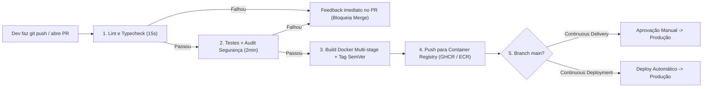

# 🚀 Aula 18 — Integração & Entrega Contínua (CI/CD)

> *"Automação total. Crie esteiras automáticas que testam, analisam e publicam seu código de forma transparente a cada commit."*

---

## 1. 🚀 Briefing da Missão (Contexto Temático & Realidade de Mercado)

| Metadado do Setor | Especificação |
| :--- | :--- |
| **Galáxia** | Galáxia 4 — Órbita do DevOps & Cloud |
| **ID do Módulo** | `cicd` |
| **Pré-requisitos** | [Aula 17 — Docker & Containerização](./17-docker-containerizacao.md) (`docker`) |
| **Próxima Aula** | [Aula 19 — Cloud Computing & Serverless](./19-cloud-computing-serverless.md) (`cloud-serverless`) |

### 🛸 Analogia do Navegador Cósmico: A Plataforma de Lançamento Automatizada

Imagine uma agência espacial onde, toda vez que um engenheiro aperta um parafuso no foguete, outro profissional precisa ir manualmente com uma prancheta testar se a turbina liga, pintar o número de série no casco com pincel, carregar o combustível no braço e apertar um botão escondido em uma sala no subsolo para lançar o foguete. Basta uma sexta-feira cansativa para alguém esquecer de checar um sensor — e o foguete explode na decolagem.

Uma esteira de **CI/CD (Continuous Integration / Continuous Delivery & Deployment)** é uma **plataforma de lançamento totalmente robotizada**. Assim que o piloto envia uma alteração para o repositório (`git push` ou Pull Request), braços robóticos assumem o controle: verificam estilo do código (linter), disparam baterias de testes, auditam vulnerabilidades, constroem a cápsula Docker da Aula 17, etiquetam a versão oficial e a estacionam no hangar (Container Registry) pronta — ou já a lançam automaticamente em órbita (produção) se todos os sensores ficarem verdes.

### 💼 A Dor Real que Este Módulo Resolve nas Empresas

Sem uma esteira de CI/CD madura, os times de software caem em armadilhas operacionais custosas:

1. **Medo de fazer deploy ("Sexta-feira sem deploy"):** quando colocar código no ar envolve rodar 12 comandos manuais via SSH, o time acumula alterações por semanas. Quanto maior o pacote acumulado, maior o risco de um bug catastrófico derrubar a produção e mais difícil fica descobrir qual commit quebrou tudo.
2. **Pull Requests quebrando a `main`:** se ninguém roda testes e linter automaticamente a cada PR, código que nem compila entra na branch principal e trava o trabalho da equipe inteira.
3. **Dependência do "Mago do Deploy":** apenas uma pessoa sênior sabe gerar o build na própria máquina e subir os arquivos no servidor. Se ela tirar férias ou sair da empresa, ninguém consegue publicar atualizações.
4. **Falta de rastreabilidade de versões:** em produção está rodando "alguma coisa que alguém subiu ontem", sem tag de versão, sem changelog e sem caminho rápido de rollback.

---

## 2. 📚 Carga de Conhecimento Completa (Tópico por Tópico)

### 2.1 O Ciclo de Feedback Rápido de Continuous Integration (CI)

**Continuous Integration (Integração Contínua)** é a prática de engenharia em que desenvolvedores integram código na branch principal com alta frequência (diariamente ou várias vezes ao dia), e **cada integração é verificada automaticamente por um build e uma suíte de testes automatizados**.

O segredo de um bom CI é o **ciclo de feedback rápido (Fast Feedback Loop)**:
* Se um erro de sintaxe, quebra de teste unitário ou vulnerabilidade grave acontecer, o desenvolvedor deve ser avisado **em minutos** — enquanto o contexto daquela tarefa ainda está fresco na cabeça dele — e **nunca** descobrir semanas depois na fase de QA ou em produção.
* Em um pipeline bem desenhado, aplicamos a estratégia **Fail-Fast** (falhar rápido):
  1. Primeiro rodamos verificações baratas e instantâneas (**Lint**, **Typecheck**, **Format** — 15 segundos).
  2. Depois rodamos **Testes Unitários e de Integração** + **Análise Estática/Segurança** (1 a 3 minutos).
  3. Só se tudo passar, construímos o artefato pesado (**Docker Build**) e o publicamos no registry.



---

### 2.2 Estruturar Pipelines de CI com GitHub Actions ou GitLab CI

Tanto o **GitHub Actions** (`.github/workflows/*.yml`) quanto o **GitLab CI** (`.gitlab-ci.yml`) seguem uma anatomia conceitual muito parecida baseada em arquivos YAML declarativos versionados **junto com o código** (Pipeline as Code):

| Conceito | GitHub Actions | GitLab CI | Papel na Esteira |
| :--- | :--- | :--- | :--- |
| **Gatilho (Trigger)** | `on: [push, pull_request]` | `rules:` / `only:` | Define *quando* a esteira acorda (ex: ao abrir PR ou criar tag `v*`). |
| **Máquina executora** | `runs-on: ubuntu-latest` | `image:` + Runner | O container/VM efêmero limpo onde os comandos são executados. |
| **Estágios / Jobs** | `jobs:` (rodam em paralelo por padrão; use `needs:` para sequenciar) | `stages:` (`build`, `test`, `deploy`) | Blocos independentes de trabalho (ex: `test`, `docker-build`, `deploy`). |
| **Passos internos** | `steps:` (`uses:` ou `run:`) | `script:` dentro do job | Comandos de shell ou ações prontas da comunidade (ex: `actions/checkout@v4`). |
| **Segredos** | `${{ secrets.NOME }}` | CI/CD Variables protegidas | Credenciais criptografadas injetadas em runtime sem expor em logs. |
| **Cache** | `actions/cache@v4` ou `cache: 'npm'` | `cache:` por `key:` | Reaproveita `node_modules` ou camadas Docker entre execuções para acelerar o pipeline. |

**Boas práticas essenciais ao estruturar pipelines:**
* **Fixe versões de Actions:** prefira `actions/checkout@v4` (ou até commit SHA em ambientes rígidos), evitando apontar cegamente para `@main`.
* **Princípio do menor privilégio no token (`permissions:`):** no GitHub Actions, declare explicitamente o que o `GITHUB_TOKEN` pode fazer (ex: `contents: read`, `packages: write`), evitando permissões excessivas de escrita em todo o repositório.
* **Controle de concorrência (`concurrency:`):** se o dev fizer 3 commits rápidos seguidos em um Pull Request, cancele automaticamente as execuções obsoletas daquele mesmo PR (`cancel-in-progress: true`), economizando minutos de runner.

---

### 2.3 Automatizar a Publicação de Imagens Docker em Registries

Um **Container Registry** é o "GitHub das imagens Docker" — exemplos famosos incluem o **GitHub Container Registry (`ghcr.io`)**, **Docker Hub (`docker.io`)**, **AWS ECR** e **Google Artifact Registry**.

Publicar imagens manualmente do seu notebook é perigoso (você pode esquecer arquivos não commitados ou buildar com arquitetura ARM de Mac M1/M2/M3 quando o servidor de produção é x86_64/amd64!). A esteira de CI deve assumir 100% do processo:

1. **Autenticação segura:** no GitHub Actions, o próprio `GITHUB_TOKEN` já autentica no `ghcr.io` usando `docker/login-action`, sem precisar gerar senhas pessoais manuais. Para AWS ECR, a recomendação moderna é **OIDC (OpenID Connect)**, que emite credenciais temporárias de curta duração sem salvar chaves IAM fixas no GitHub!
2. **Build otimizado com cache de camadas (`buildx`):** usando `docker/setup-buildx-action` e `cache-from: type=gha` / `cache-to: type=gha,mode=max`, o CI reaproveita camadas do build anterior mesmo em máquinas efêmeras novas.
3. **Etiquetagem (Tagging) Imutável — Nunca confie apenas em `:latest`!**
   * Se todas as versões sobrescreverem apenas `:latest`, você perde a capacidade de saber exatamente qual commit está em produção e não consegue voltar para a versão anterior com segurança.
   * Use `docker/metadata-action` para gerar tags rastreáveis automaticamente:
     * Tag do commit SHA curto: `ghcr.io/time/api:sha-a1b2c3d` (rastreabilidade exata).
     * Tag semântica de release: `ghcr.io/time/api:1.4.2`, `1.4` e `latest` (apenas quando uma release oficial é publicada).

---

### 2.4 Dominar Estratégias de Deploy Automático (Continuous Deployment)

Antes de escolher a estratégia de deploy, é crucial distinguir dois termos que o mercado confunde o tempo todo:

* **Continuous Delivery (Entrega Contínua):** o pipeline testa, builda e empacota o artefato automaticamente, deixando-o pronto para ir ao ar a qualquer momento. Contudo, a **decisão de apertar o botão final para produção é humana/manual** (ex: aprovação de um Tech Lead ou Product Manager no GitHub Environments).
* **Continuous Deployment (Implantação Contínua):** vai um passo além. Não há aprovação manual após o merge: **todo commit que passa por todas as baterias automáticas de testes e segurança vai direto para produção automaticamente**. Exige alta maturidade em testes automatizados, feature flags e observabilidade!

#### Principais Estratégias de Implantação em Produção

1. **Rolling Update (Atualização Gradual):** substitui as instâncias antigas pelas novas em lotes (ex: tira 1 container v1 do ar, sobe 1 container v2 saudável, passa para o próximo). Não exige infraestrutura duplicada, mas durante alguns segundos v1 e v2 convivem juntas (atenção à compatibilidade de migrations de banco!).
2. **Blue-Green Deployment:** mantém dois ambientes idênticos: **Blue** (produção atual v1) e **Green** (novo ambiente v2). Você sobe o Green, testa sua saúde longe dos usuários e então vira a chave do Load Balancer para o Green instantaneamente. Se algo der errado, vira a chave de volta para o Blue em segundos (**rollback instantâneo**). Custo: exige o dobro de recursos durante a virada.
3. **Canary Release (Canário):** libera a nova versão v2 inicialmente para apenas **1% a 5% dos usuários reais** (como o canário na mina de carvão que detectava gás tóxico antes dos mineradores). Se métricas de erro e latência continuarem saudáveis, aumenta progressivamente para 25%, 50% e 100%.

---

### 2.5 Implementar Versionamento Semântico de Forma Automatizada

O **Versionamento Semântico (SemVer)** padroniza o significado dos números de versão no formato **`MAJOR.MINOR.PATCH`** (ex: `2.4.1`):

* **MAJOR (`2.x.x`):** mudanças incompatíveis na API pública (*Breaking Changes*) — ex: remover ou renomear um campo obrigatório de um endpoint REST.
* **MINOR (`x.4.x`):** adição de nova funcionalidade mantendo compatibilidade retroativa — ex: adicionar um novo endpoint `/v1/relatorios`.
* **PATCH (`x.x.1`):** correções de bugs mantendo compatibilidade retroativa — ex: corrigir um cálculo de frete ou falha de segurança.

#### Como automatizar o SemVer sem chutes manuais?

Combinando **Conventional Commits** com ferramentas como **`semantic-release`** ou **Release Please**:

* `fix: corrige calculo de desconto no carrinho` → o robô incrementa o **PATCH** (`1.0.0` → `1.0.1`).
* `feat: adiciona webhook de pagamento via pix` → o robô incrementa o **MINOR** (`1.0.1` → `1.1.0`).
* `feat!: altera formato de resposta de autenticacao` (ou `BREAKING CHANGE:` no rodapé do commit) → o robô incrementa o **MAJOR** (`1.1.0` → `2.0.0`).

Na prática, após o merge na branch `main`, a ferramenta automática lê os commits desde a última tag, calcula a próxima versão SemVer, atualiza o `package.json`, gera o `CHANGELOG.md`, cria a Git Tag (`v1.1.0`) e dispara o build Docker etiquetado com essa versão exata!

---

## 3. 💻 Mão no Código (Jeito Iniciante vs. Padrão Profissional)

### ❌ Jeito Iniciante (Antipadrão Comum)

```yaml
# ❌ ANTIPADRÃO: sem cache, sem controle de concorrência, dispara deploy em qualquer branch,
# usa tag ':latest' mutável e não separa testes de publicação
name: CI Baguncado

on: [push] # ❌ Roda build e deploy até em commits de rascunho de qualquer branch!

jobs:
  tudo-junto:
    runs-on: ubuntu-latest
    steps:
      - uses: actions/checkout@v4
      - run: npm install # ❌ Usa 'npm install' em vez de 'npm ci' (pode mudar versões do lockfile)
      - run: npm test
      # ❌ Faz login com senha pessoal hardcoded ou sem escopo mínimo
      - run: docker login -u meuusuario -p ${{ secrets.DOCKER_PASSWORD }}
      # ❌ Publica sempre :latest — impossível rastrear qual commit está rodando ou fazer rollback!
      - run: docker build -t meuusuario/minha-api:latest .
      - run: docker push meuusuario/minha-api:latest
      # ❌ Faz deploy via SSH sem esperar nem verificar healthcheck
      - run: ssh root@123.45.67.89 "docker pull meuusuario/minha-api:latest && docker restart api"
```

### ✅ Padrão Profissional (Pipeline em Estágios com CI, Docker Metadata/Cache, SemVer e Gate de Produção)

```yaml
# .github/workflows/ci-cd.yml
name: Orbital CI/CD Pipeline

on:
  push:
    branches: ["main"]
    tags: ["v*.*.*"] # Acionado automaticamente quando uma tag SemVer (ex: v1.2.0) é criada
  pull_request:
    branches: ["main"]

# Cancela execuções anteriores na mesma branch/PR se um novo commit chegar antes de terminar
concurrency:
  group: ${{ github.workflow }}-${{ github.ref }}
  cancel-in-progress: true

# Menor privilégio padrão para todo o workflow
permissions:
  contents: read

jobs:
  # ============================================================================
  # JOB 1: QUALIDADE & TESTES (Feedback Rápido)
  # ============================================================================
  quality-and-tests:
    name: Lint, Typecheck e Testes
    runs-on: ubuntu-latest
    steps:
      - name: Baixar código-fonte
        uses: actions/checkout@v4

      - name: Configurar Node.js 20 com cache de npm
        uses: actions/setup-node@v4
        with:
          node-version: "20.18.0"
          cache: "npm"

      - name: Instalar dependências determinísticas
        run: npm ci

      - name: Verificar lint e tipagem TypeScript
        run: npm run lint && npm run typecheck

      - name: Executar suíte de testes automatizados
        run: npm test -- --ci --coverage

      - name: Auditoria básica de vulnerabilidades nas dependências
        run: npm audit --audit-level=high

  # ============================================================================
  # JOB 2: BUILD & PUSH DA IMAGEM DOCKER (Apenas na main ou em Tags SemVer)
  # ============================================================================
  docker-publish:
    name: Build e Push para GHCR
    needs: quality-and-tests # Só executa se o Job 1 ficar verde
    if: github.event_name == 'push'
    runs-on: ubuntu-latest
    permissions:
      contents: read
      packages: write # Permissão específica para publicar no GitHub Container Registry

    outputs:
      image_digest: ${{ steps.build.outputs.digest }}
      image_tags: ${{ steps.meta.outputs.tags }}

    steps:
      - name: Baixar código-fonte
        uses: actions/checkout@v4

      - name: Configurar Docker Buildx
        uses: docker/setup-buildx-action@v3

      - name: Autenticar no GitHub Container Registry (GHCR)
        uses: docker/login-action@v3
        with:
          registry: ghcr.io
          username: ${{ github.actor }}
          password: ${{ secrets.GITHUB_TOKEN }}

      - name: Gerar tags rastreáveis (SHA curto + SemVer se for tag)
        id: meta
        uses: docker/metadata-action@v5
        with:
          images: ghcr.io/${{ github.repository }}
          tags: |
            type=sha,prefix=sha-
            type=semver,pattern={{version}}
            type=semver,pattern={{major}}.{{minor}}
            type=raw,value=latest,enable={{is_default_branch}}

      - name: Construir imagem Multi-stage e publicar com cache no GitHub Actions
        id: build
        uses: docker/build-push-action@v6
        with:
          context: .
          target: production
          push: true
          tags: ${{ steps.meta.outputs.tags }}
          labels: ${{ steps.meta.outputs.labels }}
          cache-from: type=gha
          cache-to: type=gha,mode=max

  # ============================================================================
  # JOB 3: DEPLOY CONTÍNUO / ENTREGA CONTÍNUA
  # ============================================================================
  deploy-production:
    name: Deploy em Produção
    needs: docker-publish
    # Publica automaticamente em produção apenas quando uma tag SemVer (v*.*.*) é lançada
    if: startsWith(github.ref, 'refs/tags/v')
    runs-on: ubuntu-latest
    # Environment 'production' permite exigir aprovação manual no GitHub (Continuous Delivery)
    # ou seguir direto se não houver revisores obrigatórios (Continuous Deployment)
    environment:
      name: production
      url: https://api.minhanave.dev

    steps:
      - name: Acionar Deploy via Webhook / Cloud CLI (Exemplo Render ou AWS ECS)
        env:
          DEPLOY_HOOK_URL: ${{ secrets.PRODUCTION_DEPLOY_HOOK }}
          RELEASE_VERSION: ${{ github.ref_name }}
        run: |
          echo "Implantando versão $RELEASE_VERSION (${{ needs.docker-publish.outputs.image_digest }})"
          curl --fail --silent --show-error -X POST "$DEPLOY_HOOK_URL"

      - name: Smoke Test pós-deploy (Verifica se /health responde HTTP 200)
        run: |
          for i in $(seq 1 10); do
            if curl -fsS https://api.minhanave.dev/health; then
              echo "Produção saudável!"
              exit 0
            fi
            echo "Aguardando nova versão subir ($i/10)..."
            sleep 6
          done
          echo "FALHA NO SMOKE TEST: produção não respondeu 200 OK."
          exit 1
```

#### Configurando Versionamento Semântico Automático (`release-please-action`)

Em um arquivo separado `.github/workflows/release.yml`, o GitHub cria automaticamente PRs de Release calculando a próxima versão SemVer pelos seus Conventional Commits:

```yaml
# .github/workflows/release.yml
name: Release SemVer Automática

on:
  push:
    branches: ["main"]

permissions:
  contents: write
  pull-requests: write

jobs:
  release-please:
    runs-on: ubuntu-latest
    steps:
      - uses: googleapis/release-please-action@v4
        with:
          release-type: node
```

---

## 4. 🛠️ Laboratório de Voo (Exercício Prático Guiado)

**Duração estimada:** 45–60 minutos  
**Missão:** Criar uma esteira real no GitHub Actions que testa sua API containerizada da Aula 17, publica a imagem Docker no GitHub Container Registry (`ghcr.io`) com tags rastreáveis e automatiza releases SemVer via Conventional Commits.

### Passo a Passo Reproduzível

1. **Crie um repositório no GitHub** com o código do laboratório da Aula 17 (garanta que `package.json` tenha os scripts `"lint"`, `"typecheck"` e `"test"` — pode criar um teste simples com Node `node --test` nativo!).
2. **Adicione o workflow de CI/CD:**
   * Crie `.github/workflows/ci-cd.yml` baseado no código da Seção 3 (se ainda não tiver servidor em nuvem ativo, comente ou substitua temporariamente o passo do `curl "$DEPLOY_HOOK_URL"` por um `echo` simulando a notificação para testar a estrutura do job `deploy-production`).
3. **Adicione o workflow de SemVer:**
   * Crie `.github/workflows/release.yml` com `release-please-action`.
   * Nas configurações do repositório GitHub (`Settings > Actions > General > Workflow permissions`), habilite *"Allow GitHub Actions to create and approve pull requests"*.
4. **Teste o bloqueio de código quebrado (Fail-Fast):**
   * Crie uma branch `feat/teste-ci`, quebre propositalmente um teste unitário e abra um Pull Request para `main`.
   * Observe na aba **Actions** que o workflow falha no Job 1 e **nem sequer perde tempo buildando a imagem Docker**.
5. **Corrija o teste e faça merge usando Conventional Commit:**
   * Faça um commit `feat: adiciona endpoint de telemetria orbital`, passe no CI verde e faça o merge na `main`.
6. **Valide a automação completa:**
   * Verifique que o `docker-publish` publicou sua imagem em `ghcr.io/<seu-usuario>/<seu-repo>:sha-...` na aba **Packages** do seu perfil GitHub.
   * Veja o Pull Request automático de Release criado pelo `release-please` (ex: `chore(main): release 1.1.0`) com o `CHANGELOG.md` gerado sozinho! Ao fazer merge desse PR de release, a tag `v1.1.0` é criada e aciona o pipeline de release final.

### ✅ Critérios de Domínio
- [ ] O PR com teste quebrado falha no Job `quality-and-tests` antes da etapa Docker.
- [ ] A imagem Docker publicada no `ghcr.io` possui tag `sha-...` além de `latest` ou tag SemVer.
- [ ] O segundo build consecutivo no GitHub Actions mostra ganho de tempo graças ao cache de `npm` e `type=gha`.
- [ ] Ao menos uma tag SemVer (ex: `v0.1.0` ou `v1.0.0`) foi gerada automaticamente a partir de um commit `feat:` ou `fix:`.

---

## 5. 🎯 Resolução Comentada do Teste de Ignição (Quest Oficial)

> **Pergunta Oficial (`data.js`):**  
> *"Qual a diferença teórica entre Continuous Delivery (Entrega Contínua) e Continuous Deployment (Implantação Contínua)?"*
>
> **A)** No Continuous Delivery o deploy em produção é manual (após passar pelas esteiras de teste automáticas), enquanto no Continuous Deployment todo commit aprovado é implantado em produção automaticamente.  
> **B)** Continuous Delivery aplica-se apenas a aplicativos mobile, enquanto Continuous Deployment aplica-se apenas a páginas web.  
> **C)** Continuous Delivery não possui etapas de teste automatizado, ao contrário do Continuous Deployment.  
> **D)** Não existe diferença; os termos são completamente sinônimos.

### 🏆 Gabarito Oficial: **Alternativa A**

#### ✅ Por que a Alternativa A está correta?
Tanto o **Continuous Delivery** quanto o **Continuous Deployment** executam integração contínua, testes automatizados e empacotamento automático do artefato. A diferença reside exclusivamente na **última milha (produção)**:
* No **Continuous Delivery (Entrega Contínua)**, o software está sempre em estado implantável em produção, mas um humano dá o aval final (por exemplo, clicando em "Approve Deployment" por questões de janela de negócio, compliance ou marketing).
* No **Continuous Deployment (Implantação Contínua)**, essa última barreira manual desaparece: se todas as verificações automatizadas da esteira passarem, a alteração entra em produção automaticamente em minutos.

#### ❌ Por que as demais estão incorretas?
* **Alternativa B (Errada):** Ambos os conceitos são agnósticos de plataforma e aplicam-se a APIs backend, aplicações web, microsserviços, infraestrutura e até pipelines de mobile (embora no mobile as lojas Apple/Google possam exigir revisão externa no final).
* **Alternativa C (Errada):** Jamais existe Continuous Delivery sem testes automatizados! Sem suíte automatizada garantindo qualidade, você não tem garantia de que o código está "sempre pronto para ir ao ar".
* **Alternativa D (Errada):** Apesar de compartilharem a mesma sigla **"CD"**, representam níveis distintos de automação na etapa final de publicação em produção.

---

## 6. 🎤 Kit de Apresentação (Como Dar Aula / Apresentar Este Módulo)

### 🎙️ Pitch Feynman de 2 Minutos (Script Pronto para Falar)

> "Pense numa fábrica de carros onde os engenheiros desenham uma peça nova, e para saber se ela cabe no carro alguém precisa montar o veículo inteiro à mão no estacionamento. Demoraria dias, certo? No software, quando não existe CI/CD, o time acumula código por semanas e descobre só na véspera do lançamento que duas mudanças de devs diferentes quebraram o pagamento.
>
> CI/CD resolve isso em duas metades. A primeira é o **CI (Integração Contínua)**: toda vez que alguém sobe código, um robô na nuvem baixa o projeto numa máquina limpa, roda linter, testes e análise de segurança em poucos minutos. Se falhar, o Pull Request fica vermelho e nem entra na branch principal — é o famoso feedback rápido.
>
> A segunda metade é o **CD**, que muita gente confunde porque tem dois significados! No **Continuous Delivery**, o robô testa e empacota sua imagem Docker com versionamento semântico automático, e deixa tudo pronto no hangar esperando um humano apertar o botão verde de produção. Já no **Continuous Deployment**, se todos os robôs aprovaram o código, não existe nem botão manual: o sistema vai direto pro ar sozinho, usando estratégias seguras como Blue-Green ou Canary para ninguém sentir o impacto. Isso transforma o deploy de um evento assustador de sexta-feira em algo tão rotineiro quanto salvar um arquivo."

### 🖼️ Roteiro de Slides (5 Slides)

| Slide | Título do Slide | Bullets-Chave | Sugestão Visual |
| :--- | :--- | :--- | :--- |
| **1** | **Do Medo do Deploy ao Fluxo Contínuo** | • O custo de integrar código tarde demais<br>• Fast Feedback Loop (falhar em 2 min vs. 2 semanas)<br>• Pipeline como código (YAML no Git) | Linha do tempo comparando "Deploy trimestral estressante" vs. "Deploys diários tranquilos" |
| **2** | **Anatomia do Pipeline (GitHub Actions / GitLab CI)** | • Trigger (`push`, `pull_request`, `tags`)<br>• Runners efêmeros, Jobs e Steps<br>• Cache de dependências (`npm` e `Buildx GHA`) | Diagrama de fluxo com 3 jobs encadeados (`Lint & Test` → `Build & Push` → `Deploy`) |
| **3** | **Images & Tags: Adeus `:latest` Cego** | • Autenticação no Registry (`GHCR`, `ECR`)<br>• Rastreabilidade com `sha-...` + SemVer (`1.2.0`)<br>• Conventional Commits → Release automatizada | Tabela mostrando `feat:` → `MINOR`, `fix:` → `PATCH`, `BREAKING:` → `MAJOR` |
| **4** | **Continuous Delivery vs. Continuous Deployment** | • Onde termina um e começa o outro<br>• O papel do `environment: production` (aprovação)<br>• Pré-requisitos de confiança (testes + smoke test) | Fluxograma bifurcado mostrando o "Portão Humano" vs. "Via Direta" |
| **5** | **Estratégias de Lançamento Sem Downtime** | • Rolling Update (gradual em lotes)<br>• Blue-Green (virada instantânea e rollback rápido)<br>• Canary Release (teste em 5% do tráfego real) | Três mini diagramas com servidores azuis/verdes e porcentagens de tráfego |

### ⚡ Roteiro de Demo Ao Vivo (3 Minutos)

1. **Minuto 0:00 – 1:00 (O Erro Bloqueado):** mostre um PR no GitHub onde você quebrou uma linha de teste. Clique no detalhe do Action mostrando a falha vermelha rápida em ~30s e o botão de merge bloqueado.
2. **Minuto 1:00 – 2:00 (A Esteira Verde e GHCR):** mostre um commit `feat:` corrigindo o problema e fazendo merge. Abra a aba **Actions** em tempo real exibindo os 3 jobs (`Lint & Testes` → `Docker Build & Push` → `Deploy`) e abra a aba **Packages** mostrando a nova imagem taggeada com o SHA exato do commit.
3. **Minuto 2:00 – 3:00 (SemVer Automático):** abra o PR gerado automaticamente pelo `release-please`, exibindo o changelog montado com links para o commit e o incremento automático de versão no `package.json`.

### ❓ Perguntas Difíceis da Plateia

1. **"Se eu usar Continuous Deployment e passar um bug que os testes unitários não pegaram, ele não vai derrubar a produção?"**
   * **Resposta segura:** *"Vai sim — e é por isso que Continuous Deployment não significa 'jogar no ar sem proteção'. Empresas que adotam Continuous Deployment combinam três escudos: suítes robustas de testes de integração/E2E, **Canary Releases** (liberando primeiro para 2% dos usuários com rollback automático se a taxa de HTTP 500 subir) e **Feature Flags** (o código sobe desligado e é ativado gradualmente sem novo deploy)."*
2. **"Por que devo evitar usar chaves IAM ou tokens pessoais fixos nos Secrets do GitHub Actions para fazer deploy na nuvem?"**
   * **Resposta segura:** *"Chaves estáticas nunca expiram sozinhas e, se vazarem, dão acesso contínuo até alguém perceber e revogar. O padrão moderno de mercado é usar **OIDC (OpenID Connect)**: o GitHub Actions assina um token temporário dizendo 'sou o workflow da branch main do repositório X', a AWS/GCP valida essa identidade e devolve credenciais temporárias válidas por apenas alguns minutos — zero chaves estáticas salvas nos secrets."*

---

## 7. 💼 Radar do Mercado de Trabalho (Foco Dev Júnior)

### 🎯 3 Perguntas Reais de Entrevista Técnica Júnior

**1. "Qual a diferença entre `npm install` e `npm ci` dentro de uma esteira de CI, e por que preferimos o segundo?"**
* **Resposta-modelo:** *"O `npm install` pode atualizar o `package-lock.json` e instalar versões ligeiramente diferentes se houver compatibilidade no range semântico (`^` ou `~`), além de não limpar o `node_modules` existente. Já o `npm ci` (Clean Install) lê estritamente o `package-lock.json`, garante que o ambiente do CI seja 100% idêntico ao testado pelo time, falha imediatamente se o lockfile estiver dessincronizado com o `package.json` e costuma ser mais rápido em runners limpos."*

**2. "Como você garante que uma imagem Docker publicada pelo CI hoje possa sofrer rollback confiável amanhã se descobrirmos um bug?"**
* **Resposta-modelo:** *"Evitando depender exclusivamente da tag mutável `:latest`. Configuro o pipeline para publicar cada imagem com tags imutáveis ligadas ao Versionamento Semântico (`v1.4.2`) e ao hash SHA do commit (`sha-9f3a12c`). Se a `v1.4.2` apresentar bug em produção, o pipeline ou orquestrador apenas aponta novamente para a tag `v1.4.1`, que permanece intacta no Container Registry."*

**3. "Você precisa rodar um teste de integração que depende de PostgreSQL dentro do GitHub Actions. Como faria?"**
* **Resposta-modelo:** *"No GitHub Actions posso usar a diretiva `services:` dentro do próprio job para subir um container `postgres:16-alpine` junto com meu runner, configurando healthcheck via `pg_isready` nas `options`, ou utilizar `Testcontainers` direto no código de testes — garantindo um banco real e descartável a cada execução sem depender de bancos compartilhados externos."*

### ⚖️ Erros Clássicos de Júnior vs. Postura Profissional

| ❌ Erro Clássico de Júnior | ✅ Postura Profissional |
| :--- | :--- |
| Colocar `continue-on-error: true` ou comentar testes falhando para "o CI ficar verde" | Investigar e corrigir a causa raiz; pipeline verde falso é pior do que não ter pipeline. |
| Usar `git commit -m "arrumando coisas"` e mudar versão manualmente no `package.json` | Adotar Conventional Commits (`feat:`, `fix:`, `chore:`) para automatizar SemVer e Changelogs. |
| Imprimir `${{ secrets.API_KEY }}` com `echo` para debugar pipeline | Jamais logar segredos; usar variáveis de ambiente mascaradas e preferir OIDC para nuvem. |
| Deixar o pipeline demorando 20 minutos sem cache | Ativar cache de gerenciador de pacotes e cache de camadas Docker (`type=gha`) + `concurrency`. |

### 🌟 Evidência para Portfólio / GitHub / LinkedIn

* **No GitHub:** tenha pelo menos um repositório com o selo verde de **GitHub Actions** passando no `README.md` (badge oficial do workflow), histórico real de Pull Requests validados pelo CI, tags `v1.0.0` / `v1.1.0` na aba **Releases** e imagem publicada publicamente no **Packages (GHCR)**.
* **No LinkedIn:** conte como configurou um pipeline completo que roda testes, constrói imagem multi-stage em cache e gera releases automáticas com SemVer — mostrando o arquivo YAML comentado ou um GIF curto da esteira ficando verde.

---

## 8. 📡 Transmissões Recomendadas & Próxima Órbita

### 📚 Recursos Oficiais da Nave (`data.js`)
* [GitHub Actions Guide](https://docs.github.com/pt/actions) — Documentação oficial em português com sintaxe, runners, cache, ambientes e segurança OIDC.
* [SemVer - Versionamento Semântico](https://semver.org/lang/pt-BR/) — Especificação oficial (v2.0.0) explicando cada regra de `MAJOR.MINOR.PATCH`.

### 🧭 Conexão com a Próxima Órbita
Agora que seus containers nascem limpos e sua esteira automática já os testa, versiona e empacota a cada commit, falta responder à grande pergunta: **onde essa nave vai pousar e rodar para milhões de usuários?** Embarque agora para a **[Aula 19 — Cloud Computing & Serverless](./19-cloud-computing-serverless.md)** (`cloud-serverless`), onde vamos desvendar AWS, serviços gerenciados, funções Lambda sem servidor e Infraestrutura como Código com Terraform.
