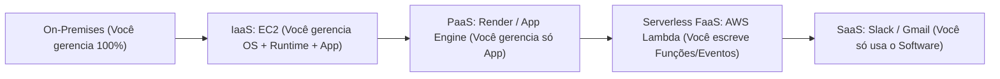
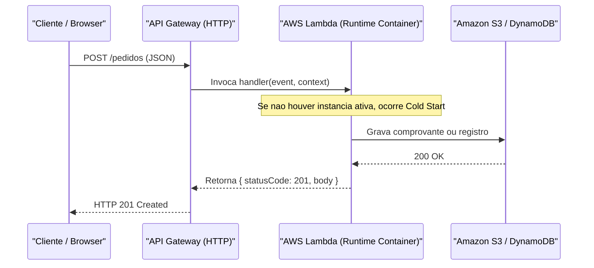

# ☁️ Aula 19 — Cloud Computing & Serverless

> *"A nuvem ao seu dispor. Conheça as bases de provedores de nuvem como AWS ou GCP e implemente funções escaláveis sem gerenciar servidores."*

---

## 1. 🚀 Briefing da Missão (Contexto Temático & Realidade de Mercado)

| Metadado do Setor | Especificação |
| :--- | :--- |
| **Galáxia** | Galáxia 4 — Órbita do DevOps & Cloud |
| **ID do Módulo** | `cloud-serverless` |
| **Pré-requisitos** | [Aula 18 — Integração & Entrega Contínua (CI/CD)](./18-integracao-entrega-continua-cicd.md) (`cicd`) |
| **Próxima Aula** | [Aula 21 — Observabilidade & Monitoramento](./21-observabilidade-monitoramento.md) (`observabilidade`) *(em conjunto com a [Aula 20 — Segurança Web & Criptografia](./20-seguranca-web-criptografia.md))* |

### 🛸 Analogia do Navegador Cósmico: A Frota Sob Demanda vs. Estação Própria

Imagine que você decidiu explorar a órbita terrestre uma vez por mês para coletar amostras. Você tem duas opções:
1. **Datacenter tradicional (On-Premises):** comprar um terreno, construir uma base de lançamento própria, contratar equipe de geradores elétricos 24h e pagar a manutenção da base inteira mesmo nos 29 dias do mês em que o foguete está desligado na garagem.
2. **Cloud Computing & Serverless:** usar uma rede galáctica de propulsores compartilhados. No modelo tradicional de nuvem (IaaS), você aluga um módulo espacial inteiro por hora (EC2). No **Serverless (FaaS)**, você nem aluga o módulo: você entrega apenas sua cápsula de código, e a base espacial só acorda os motores exatamente nos 300 milissegundos em que chega um sinal de rádio para processar — cobrando apenas pelos milissegundos de ignição!

### 💼 A Dor Real que Este Módulo Resolve nas Empresas

Antes da computação em nuvem e da Infraestrutura como Código (IaC), empresas sofriam com três gargalos dramáticos:

1. **Superprovisionamento ou queda na Black Friday:** se uma loja comprasse 2 servidores físicos para suportar um pico de Black Friday, ficava com 90% da capacidade ociosa (jogando dinheiro fora) nos outros 11 meses do ano. Se comprasse apenas para a média, o site caía no dia de maior venda.
2. **Trabalho operacional pesado (Undifferentiated Heavy Lifting):** engenheiros passavam noites trocando HD queimado, aplicando patches manuais no sistema operacional do banco de dados e configurando backups, em vez de construir funcionalidades para os clientes.
3. **"ClickOps" não reproduzível:** um analista criava 15 recursos clicando no painel web da AWS durante a madrugada. Quando precisavam replicar o mesmo ambiente para homologação (`staging`) ou recuperar após um desastre, ninguém lembrava quais caixinhas tinham sido marcadas no console.

Cloud resolve a elasticidade e a terceirização de hardware; Serverless elimina a gestão de servidores para cargas orientadas a eventos; e Terraform garante infraestrutura versionada no Git!

---

## 2. 📚 Carga de Conhecimento Completa (Tópico por Tópico)

### 2.1 Modelos de Serviço de Nuvem (IaaS, PaaS, SaaS, Serverless)

A diferença fundamental entre os modelos de nuvem está em **quem gerencia cada camada da pilha tecnológica** (do cabo de rede físico até o código da aplicação). Quanto mais avançamos para a direita, menos controle fino temos de infraestrutura e **mais produtividade** ganhamos para focar no negócio.

| Modelo | Sigla | O que Você Gerencia | O que o Provedor Gerencia | Exemplos Reais |
| :--- | :--- | :--- | :--- | :--- |
| **IaaS** | Infrastructure as a Service | Sistema operacional, patches, runtime, firewall de OS, dados e código | Datacenter, energia, rede física, servidores, storage e hypervisor | AWS EC2, Google Compute Engine, Azure VMs |
| **PaaS** | Platform as a Service | Apenas código da aplicação e variáveis/configurações | OS, patches, runtime, balanceamento e auto-scaling da plataforma | Heroku, Render, Railway, AWS Elastic Beanstalk, Google App Engine |
| **Serverless (FaaS)** | Function as a Service | Código de funções isoladas + gatilhos de evento + permissões | Tudo acima, incluindo provisionamento dinâmico, escala a zero e cobrança por execução | AWS Lambda, Google Cloud Functions, Cloudflare Workers |
| **SaaS** | Software as a Service | Apenas uso da ferramenta e dados de negócio inseridos | Absolutamente tudo (infra, código, atualizações, uptime) | Gmail, Slack, Figma, Jira, Salesforce |



> [!TIP]
> **Serverless não significa "não existem servidores"!** Os servidores continuam existindo lá dentro do datacenter da AWS ou do Google. A diferença é que **você** não os provisiona, não atualiza o Linux deles, não paga por máquina ociosa parada de madrugada e não configura regras manuais de escala por CPU.

---

### 2.2 Serviços Essenciais da AWS (EC2, S3, RDS, IAM)

Mesmo em times que usam Google Cloud (GCP) ou Azure, o vocabulário base da **AWS (Amazon Web Services)** é referência mundial em entrevistas. Todo Dev Júnior precisa dominar o quarteto fundamental:

1. **EC2 (Elastic Compute Cloud) — O Computador Alugado (IaaS):**
   * São máquinas virtuais sob demanda na nuvem (`t3.micro`, `t3.small`, etc.).
   * Você escolhe a imagem do sistema operacional (**AMI** — ex: Ubuntu 24.04), memória/CPU (**Instance Type**), regras de firewall (**Security Groups**) e disco (**EBS**).
   * Equivalente na GCP: *Compute Engine*.
2. **S3 (Simple Storage Service) — O Cofre Infinito de Arquivos (Object Storage):**
   * Armazena objetos (imagens, PDFs, vídeos, backups, sites estáticos React compilados) organizados em **Buckets** com **99,999999999% (11 noves)** de durabilidade.
   * Não é um sistema de arquivos montável como um HD comum, nem serve para rodar banco de dados relacional: você interage com ele via API HTTP/SDK (`PutObject`, `GetObject`).
   * **Regra de ouro:** buckets S3 nascem com acesso público bloqueado (*Block Public Access*). Nunca abra um bucket inteiro ao público sem real necessidade (use **Presigned URLs** temporárias para downloads privados!).
   * Equivalente na GCP: *Cloud Storage*.
3. **RDS (Relational Database Service) — O Banco Gerenciado:**
   * Roda PostgreSQL, MySQL, MariaDB ou SQL Server com backups automáticos, atualização de segurança, replicação *Multi-AZ* (alta disponibilidade em datacenters distintos) e recuperação ponto-no-tempo gerenciados pela AWS.
   * Evita a dor de instalar e manter Postgres manualmente dentro de uma instância EC2.
   * Equivalente na GCP: *Cloud SQL*.
4. **IAM (Identity and Access Management) — O Sistema de Crachás e Permissões:**
   * Controla **quem** (Usuários, Grupos, ou **Roles** assumidas por serviços como Lambda e EC2) pode fazer **o quê** (`s3:GetObject`, `rds:*`) em **quais recursos** específicos.
   * **Princípio do Menor Privilégio (Least Privilege):** nunca dê `AdministratorAccess` para uma aplicação ou usuário diário. Uma Lambda que só lê fotos de um bucket específico deve ter permissão *somente* de `s3:GetObject` *somente* naquele bucket ARN. Nunca use a conta **Root** no dia a dia — ative MFA nela e guarde-a trancada!

---

### 2.3 Escrever e Implantar Funções Serverless (AWS Lambda / Cloud Functions)

No modelo **FaaS (Function as a Service)**, você escreve uma função *stateless* (sem estado persistente em memória entre execuções distantes) que recebe um **`event`** (o gatilho) e um **`context`** (metadados da execução, como tempo restante até o timeout).

Uma função Serverless responde a **eventos**, por exemplo:
* **Requisição HTTP** chegando via **API Gateway** ou **Lambda Function URL** (substituindo endpoints REST tradicionais).
* **Upload de arquivo no S3** (ex: usuário sobe uma foto `avatar.png` → S3 dispara a Lambda automaticamente para gerar uma miniatura comprimida).
* **Mensagem em fila SQS / tópico SNS / EventBridge** (ex: processamento assíncrono de faturas ou cron jobs agendados).



**Regra de arquitetura crítica em Serverless:** como instâncias de Lambda podem ser reutilizadas em invocações seguidas (*Warm Start*), inicialize clientes pesados (SDK da AWS, pool de conexão HTTP/DB) **fora da função `handler`**, no escopo global do módulo! Se a instância for reaproveitada, a conexão já estará aberta e rápida.

---

### 2.4 Compreender Trade-offs de Serverless (Cold Starts, Custos e Timeouts)

Serverless não é bala de prata. Um desenvolvedor maduro sabe exatamente **quando usar** e **quando evitar** FaaS avaliando seus trade-offs:

1. **Cold Start (Partida Fria):**
   * Quando sua função fica ociosa (ex: 10–15 minutos sem tráfego), o provedor desliga os containers dela para economizar recursos.
   * Na primeira requisição após a inatividade, o provedor precisa: (a) localizar um servidor disponível, (b) baixar o pacote/imagem da função, (c) iniciar o container e o runtime (Node.js, Python, JVM), e (d) executar o código de inicialização fora do handler antes de responder.
   * Essa latência extra é o **Cold Start** — geralmente 100ms–500ms em Node.js/Python/Go, mas podendo chegar a vários segundos em Java/C# pesados ou Lambdas conectadas dentro de VPCs antigas.
   * **Mitigações:** pacotes pequenos (tree-shaking/bundling com `esbuild`), runtimes rápidos (Node, Python, Go, Rust), ou *Provisioned Concurrency* (paga-se para manter N instâncias pré-aquecidas).
2. **Timeouts Rígidos:**
   * AWS Lambda possui limite máximo absoluto de **15 minutos** por execução (e o API Gateway na frente corta a requisição HTTP em apenas **29 segundos**!).
   * Se você precisa transcodificar um vídeo de 2 horas ou rodar um treinamento de ML pesado, Lambda é a ferramenta errada — use containers gerenciados (ECS Fargate / Cloud Run / Batch).
3. **Custos em Tráfego Baixo/Esporádico vs. Tráfego Alto Constante:**
   * Para APIs com picos irregulares ou baixo volume (ex: 500 mil requisições/mês), Serverless pode custar literalmente **US\$ 0 a US\$ 5/mês** (escala a zero quando ninguém acessa!).
   * Porém, se sua API recebe **tráfego altíssimo e constante 24h por dia** (milhares de requisições por segundo sem parar), pagar por milissegundo de Lambda + API Gateway pode sair **bem mais caro** do que manter containers em ECS/EC2 ou Kubernetes com instâncias reservadas.
4. **Limites de Conexões em Bancos Relacionais:**
   * Se 1.000 requisições simultâneas dispararem 1.000 Lambdas paralelas abrindo conexões diretas em um PostgreSQL (RDS), o banco estoura o limite de `max_connections` e cai! Solução: usar um **Proxy de Conexões** (como AWS RDS Proxy) ou bancos HTTP/Serverless (DynamoDB, Neon, PlanetScale).

---

### 2.5 Infraestrutura como Código (IaC) com Terraform

Criar recursos clicando no painel web da nuvem (**ClickOps**) é um pesadelo para equipes: não tem histórico de quem mudou o quê, não tem Code Review e é impossível reproduzir com segurança.

**Infraestrutura como Código (IaC)** resolve isso declarando seus servidores, buckets, filas, permissões IAM e Lambdas em **arquivos de texto versionados no Git**. O **Terraform** (da HashiCorp) é a ferramenta padrão de mercado multi-cloud usando linguagem declarativa **HCL (HashiCorp Configuration Language)**.

#### O Ciclo de Vida do Terraform em 4 Comandos

1. `terraform init`: baixa os *providers* necessários (ex: `hashicorp/aws`) e inicializa o backend de estado.
2. `terraform plan`: **simula** e exibe um diff exato do que será criado (`+`), alterado (`~`) ou destruído (`-`) na nuvem **sem tocar em nada ainda** — perfeito para revisar em Pull Requests!
3. `terraform apply`: aplica as mudanças reais na API do provedor de nuvem e atualiza o arquivo de estado (`terraform.tfstate`).
4. `terraform destroy`: remove toda a infraestrutura gerenciada por aquele projeto com segurança (ótimo para ambientes temporários de teste e laboratórios sem medo da fatura!).

> [!IMPORTANT]
> **Cuidado com o `terraform.tfstate`:** o arquivo de estado mapeia o código HCL aos recursos reais criados na nuvem (e pode conter atributos sensíveis). Nunca o envie para um repositório Git público! Em equipes reais, o state fica salvo remotamente com bloqueio de concorrência (*state locking*), por exemplo em um bucket S3 criptografado + DynamoDB (ou Terraform Cloud).

---

## 3. 💻 Mão no Código (Jeito Iniciante vs. Padrão Profissional)

Vamos construir uma função AWS Lambda (Node.js 20) integrada ao S3/DynamoDB e provisionada via Terraform HCL.

### ❌ Jeito Iniciante (Antipadrão Comum)

```javascript
// ❌ ANTIPADRÃO: handler sem validação, cria clientes/conexões a cada invocação,
// vaza stack trace pro cliente e foi implantado via "ClickOps" com IAM AdministratorAccess!
const { S3Client, PutObjectCommand } = require("@aws-sdk/client-s3");

exports.handler = async (event) => {
  // ❌ Instanciar SDK dentro do handler impede reaproveitamento em Warm Starts
  const s3 = new S3Client({ region: "us-east-1" });

  // ❌ Sem try/catch nem validação do payload de entrada
  const body = JSON.parse(event.body);

  // ❌ Nome do bucket hardcoded no código em vez de variável de ambiente
  await s3.send(new PutObjectCommand({
    Bucket: "meu-bucket-publico-123",
    Key: `logs/${Date.now()}.json`,
    Body: JSON.stringify(body),
  }));

  return { statusCode: 200, body: "ok" };
};
```

### ✅ Padrão Profissional (Lambda Reutilizável + Terraform HCL com Least Privilege)

Primeiro, o código da função `src/index.mjs` otimizado para Warm Starts e validação defensiva:

```javascript
// src/index.mjs (Node.js 20 ESM nativo na AWS Lambda)
import { S3Client, PutObjectCommand } from "@aws-sdk/client-s3";
import crypto from "node:crypto";

// ✅ Inicializado FORA do handler: reaproveitado entre invocações quentes (Warm Starts)
const BUCKET_NAME = process.env.REPORTS_BUCKET_NAME;
const s3Client = new S3Client({ region: process.env.AWS_REGION || "us-east-1" });

/**
 * Handler Lambda acionado via API Gateway HTTP API (Payload Format v2)
 */
export const handler = async (event, context) => {
  if (!BUCKET_NAME) {
    console.error(JSON.stringify({ level: "error", msg: "REPORTS_BUCKET_NAME ausente" }));
    return jsonResponse(500, { error: "Erro interno de configuração" });
  }

  try {
    const rawBody = event.body ? JSON.parse(event.body) : null;

    if (!rawBody || typeof rawBody.missionId !== "string" || !rawBody.status) {
      return jsonResponse(400, {
        error: "Payload inválido. Informe 'missionId' (string) e 'status'.",
      });
    }

    const reportId = crypto.randomUUID();
    const objectKey = `telemetry/${rawBody.missionId}/${reportId}.json`;

    await s3Client.send(
      new PutObjectCommand({
        Bucket: BUCKET_NAME,
        Key: objectKey,
        Body: JSON.stringify({
          reportId,
          missionId: rawBody.missionId,
          status: rawBody.status,
          receivedAt: new Date().toISOString(),
          requestId: context.awsRequestId,
        }),
        ContentType: "application/json",
      })
    );

    console.log(JSON.stringify({ level: "info", msg: "Telemetria gravada", reportId, objectKey }));

    return jsonResponse(201, { reportId, key: objectKey });
  } catch (err) {
    // ✅ Loga erro completo internamente, mas nunca expõe stack trace para o usuário final
    console.error(JSON.stringify({ level: "error", msg: err.message, requestId: context.awsRequestId }));
    return jsonResponse(500, { error: "Falha ao processar telemetria" });
  }
};

function jsonResponse(statusCode, payload) {
  return {
    statusCode,
    headers: { "Content-Type": "application/json" },
    body: JSON.stringify(payload),
  };
}
```

Agora, a infraestrutura 100% declarativa em Terraform (`infra/main.tf`) com S3 privado, IAM de menor privilégio, empacotamento automático e Lambda Function URL:

```hcl
# infra/main.tf
terraform {
  required_version = ">= 1.6.0"
  required_providers {
    aws = {
      source  = "hashicorp/aws"
      version = "~> 5.70"
    }
    archive = {
      source  = "hashicorp/archive"
      version = "~> 2.5"
    }
  }
}

provider "aws" {
  region = var.aws_region
}

variable "aws_region" {
  type    = string
  default = "us-east-1"
}

variable "environment" {
  type    = string
  default = "dev"
}

# 1. Bucket S3 privado para guardar os relatórios de telemetria
resource "aws_s3_bucket" "telemetry_reports" {
  bucket_prefix = "galactic-telemetry-${var.environment}-"
  force_destroy = var.environment == "dev" ? true : false
}

# ✅ Bloqueio explícito de acesso público (boas práticas AWS)
resource "aws_s3_bucket_public_access_block" "telemetry_reports" {
  bucket                  = aws_s3_bucket.telemetry_reports.id
  block_public_acls       = true
  block_public_policy     = true
  ignore_public_acls      = true
  restrict_public_buckets = true
}

# 2. IAM Role exclusiva que a Lambda assumirá em execução
resource "aws_iam_role" "lambda_exec" {
  name = "galactic-telemetry-lambda-role-${var.environment}"

  assume_role_policy = jsonencode({
    Version = "2012-10-17"
    Statement = [{
      Action    = "sts:AssumeRole"
      Effect    = "Allow"
      Principal = { Service = "lambda.amazonaws.com" }
    }]
  })
}

# Permissão básica gerenciada pela AWS para enviar logs ao CloudWatch
resource "aws_iam_role_policy_attachment" "lambda_logs" {
  role       = aws_iam_role.lambda_exec.name
  policy_arn = "arn:aws:iam::aws:policy/service-role/AWSLambdaBasicExecutionRole"
}

# ✅ Política IAM de Menor Privilégio: SOMENTE PutObject e SOMENTE neste bucket específico
resource "aws_iam_role_policy" "lambda_s3_write" {
  name = "allow-s3-telemetry-put"
  role = aws_iam_role.lambda_exec.id

  policy = jsonencode({
    Version = "2012-10-17"
    Statement = [{
      Effect   = "Allow"
      Action   = ["s3:PutObject"]
      Resource = "${aws_s3_bucket.telemetry_reports.arn}/telemetry/*"
    }]
  })
}

# 3. Empacota o código src/index.mjs em arquivo .zip reproduzível
data "archive_file" "lambda_zip" {
  type        = "zip"
  source_dir  = "${path.module}/../src"
  output_path = "${path.module}/build/telemetry_lambda.zip"
}

# 4. Definição da função AWS Lambda
resource "aws_lambda_function" "telemetry_ingest" {
  function_name    = "galactic-telemetry-ingest-${var.environment}"
  role             = aws_iam_role.lambda_exec.arn
  handler          = "index.handler"
  runtime          = "nodejs20.x"
  memory_size      = 256
  timeout          = 10
  filename         = data.archive_file.lambda_zip.output_path
  source_code_hash = data.archive_file.lambda_zip.output_base64sha256

  environment {
    variables = {
      REPORTS_BUCKET_NAME = aws_s3_bucket.telemetry_reports.id
    }
  }
}

# 5. Endpoint HTTPS direto (Function URL) para invocar a Lambda sem configurar API Gateway completo
resource "aws_lambda_function_url" "telemetry_endpoint" {
  function_name      = aws_lambda_function.telemetry_ingest.function_name
  authorization_type = "NONE" # Em produção real, use AWS_IAM ou valide JWT / API Gateway
}

output "telemetry_endpoint_url" {
  description = "URL HTTPS da função Lambda provisionada"
  value       = aws_lambda_function_url.telemetry_endpoint.function_url
}
```

---

## 4. 🛠️ Laboratório de Voo (Exercício Prático Guiado)

**Duração estimada:** 45–60 minutos  
**Missão:** Provisionar via Terraform uma função AWS Lambda real (ou simulada localmente com **LocalStack** caso não queira cadastrar cartão na AWS!), testando IAM de menor privilégio, upload no S3 e observando o comportamento de Cold Start vs. Warm Start.

### Passo a Passo Reproduzível

1. **Escolha seu campo de pouso (Nuvem Real ou Simulador LocalStack):**
   * *Opção A (Grátis e 100% offline usando Docker):* suba o emulador de AWS **LocalStack** com Docker:
     ```bash
     docker run --rm -d --name localstack -p 4566:4566 localstack/localstack:latest
     ```
     Configure `endpoints { s3 = "http://localhost:4566"; lambda = "http://localhost:4566"; iam = "http://localhost:4566" }` no bloco `provider "aws"` (com `s3_use_path_style = true` e credenciais fictícias `test`/`test`) ou use a ferramenta `tflocal` (`pip install terraform-local`).
   * *Opção B (AWS Free Tier real):* autentique localmente usando `aws configure` com um usuário IAM dedicado (nunca a conta Root!).
2. **Crie a estrutura de diretórios:**
   ```bash
   mkdir -p lab-serverless-iac/{src,infra}
   ```
   Salve o `src/index.mjs` e o `infra/main.tf` da Seção 3.
3. **Inicialize e simule a infraestrutura com Terraform:**
   ```bash
   cd lab-serverless-iac/infra
   terraform init
   terraform plan
   ```
   Leia atentamente o plano exibido no terminal. Confirme quantos recursos serão criados (`+ 6 to add`) antes de prosseguir.
4. **Aplique e teste a função:**
   ```bash
   terraform apply -auto-approve
   ```
   Copie a URL exibida no output `telemetry_endpoint_url` e dispare duas requisições consecutivas medindo o tempo com `curl`:
   ```bash
   curl -w "\nTempo total: %{time_total}s\n" -X POST <SUA_URL> \
     -H "Content-Type: application/json" \
     -d '{"missionId":"apollo-04","status":"nominal"}'
   ```
   Repita imediatamente o mesmo `curl` uma segunda vez e compare o tempo da 1ª chamada (Cold Start) com a 2ª chamada (Warm Start)!
5. **Desmonte tudo sem deixar lixo nem cobrança:**
   ```bash
   terraform destroy -auto-approve
   ```

### ✅ Critérios de Domínio
- [ ] Executou `terraform init`, `terraform plan` e `terraform apply` compreendendo cada recurso criado.
- [ ] A política IAM criada concede apenas `s3:PutObject` no prefixo `/telemetry/*` daquele bucket (e não `*` em tudo).
- [ ] Verificou na prática a diferença de latência entre a primeira invocação (Cold Start) e a segunda invocação (Warm Start).
- [ ] Executou `terraform destroy` ao final (zero recursos órfãos gerando custos).

---

## 5. 🎯 Resolução Comentada do Teste de Ignição (Quest Oficial)

> **Pergunta Oficial (`data.js`):**  
> *"Em arquiteturas Serverless baseadas em FaaS (como AWS Lambda), o que descreve o conceito de 'Cold Start'?"*
>
> **A)** A queda de temperatura dos servidores físicos quando chove na região do datacenter.  
> **B)** A latência adicional que ocorre na primeira execução de uma função após um período de inatividade, devido à necessidade do provedor de nuvem de provisionar um container e inicializar o runtime da aplicação.  
> **C)** O travamento permanente da aplicação quando ela consome muitos dados estáticos.  
> **D)** O tempo que a esteira de CI/CD leva para compilar arquivos binários na nuvem.

### 🏆 Gabarito Oficial: **Alternativa B**

#### ✅ Por que a Alternativa B está correta?
Como plataformas Serverless (FaaS) escalam automaticamente até zero instâncias quando não há requisições para economizar custos, não existe nenhum processo vivo esperando na memória após alguns minutos de ociosidade. Quando uma nova requisição chega, a plataforma precisa alocar um microcontainer (como o Firecracker na AWS), montar o código da função, subir o interpretador/runtime (Node.js, Python, JVM) e rodar o código global fora do handler antes de executar a função propriamente dita. Esse atraso inicial extra recebe o nome de **Cold Start**.

#### ❌ Por que as demais estão incorretas?
* **Alternativa A (Errada):** "Cold" em Cold Start não tem qualquer relação com temperatura física ou clima do datacenter; refere-se a um ambiente de execução "frio" (ainda não inicializado em memória).
* **Alternativa C (Errada):** Cold Start não é um travamento permanente; é apenas uma latência pontual na primeira requisição (ou durante picos repentinos que exigem novas instâncias paralelas). Após inicializar, aquela instância atende normalmente às próximas chamadas com *Warm Start*.
* **Alternativa D (Errada):** O tempo de compilação no CI/CD ocorre antes do deploy, na esteira de build, e não no momento em que o usuário final invoca a função Serverless em runtime.

---

## 6. 🎤 Kit de Apresentação (Como Dar Aula / Apresentar Este Módulo)

### 🎙️ Pitch Feynman de 2 Minutos (Script Pronto para Falar)

> "Pense em como você usa energia elétrica em casa: você não compra uma usina nuclear pro seu quintal só porque às vezes liga o chuveiro elétrico. Você pluga na rede e paga só pelos quilowatts que consumiu na hora que usou. Cloud Computing trouxe essa mesma lógica pro software!
>
> Dentro da nuvem existem níveis de autonomia. No IaaS, como uma máquina EC2 na AWS, você aluga um computador virtual inteiro e ainda precisa atualizar o Linux e cuidar da máquina. No PaaS, você entrega o código e a plataforma gerencia o servidor pra você. E no Serverless, com funções como AWS Lambda, você dá um passo além: entrega só uma função isolada que responde a eventos — como uma requisição HTTP ou um upload de imagem no S3 — e paga literalmente por milissegundo de execução. Se ninguém acessar de madrugada, sua conta é zero.
>
> Claro que tudo na engenharia tem trade-off. O custo dessa escala a zero é o Cold Start: quando a função passa um tempo parada, o primeiro usuário que chega sente um atraso extra porque a nuvem precisa acordar um container e carregar o runtime na hora. Também há limite rígido de 15 minutos por execução, então não serve para processar vídeos gigantes. E o segredo para não virar refém de cliques manuais no painel da nuvem é usar Terraform: você descreve seu bucket S3, seu banco RDS, suas permissões IAM e sua Lambda em arquivos de código versionados no Git, podendo subir ou destruir ambientes inteiros com um comando."

### 🖼️ Roteiro de Slides (6 Slides)

| Slide | Título do Slide | Bullets-Chave | Sugestão Visual |
| :--- | :--- | :--- | :--- |
| **1** | **Do Hardware Físico à Nuvem Elástica** | • On-Premises vs. Cloud: CapEx para OpEx<br>• Escala sob demanda para picos de tráfego<br>• Foco no negócio, não em cabos e HDs | Gráfico comparando curva de demanda real vs. linha fixa de servidores comprados |
| **2** | **Modelos de Nuvem: IaaS, PaaS, Serverless e SaaS** | • Matriz de responsabilidade compartilhada<br>• Onde entram EC2, Render/Heroku, Lambda e Gmail<br>• Quanto mais à direita, menos manutenção | Diagrama clássico em colunas coloridas ("Pizza as a Service" ou pilhas de camadas) |
| **3** | **Os 4 Pilares Essenciais da AWS** | • EC2 (Computação) e RDS (Banco Gerenciado)<br>• S3 (Object Storage durável e privado por padrão)<br>• IAM (Identidade + Princípio do Menor Privilégio) | 4 cards com ícones oficiais AWS e uma frase curta em cada |
| **4** | **Anatomia Serverless (AWS Lambda)** | • Arquitetura orientada a eventos (HTTP, S3, SQS)<br>• Escopo global (conexões) vs. `handler(event, context)`<br>• Escala automática até zero | Fluxograma Evento → API Gateway/S3 → Lambda → Saída |
| **5** | **Trade-offs Reais: Cold Start, Timeout e Custo** | • Como nasce o Cold Start (container + runtime + init)<br>• Timeout de 15 min (Lambda) e 29s (API GW)<br>• Barato em picos baixos, caro em alto tráfego 24/7 | Linha do tempo comparando latência de Cold Start vs. Warm Start |
| **6** | **Terraform & IaC: Adeus ClickOps** | • Infraestrutura declarativa e versionada no Git<br>• Workflow `init` → `plan` → `apply` → `destroy`<br>• O cuidado vital com o `terraform.tfstate` | Terminal simulando a saída verde/amarela do `terraform plan` |

### ⚡ Roteiro de Demo Ao Vivo (3 Minutos)

1. **Minuto 0:00 – 1:00 (Infraestrutura em Texto):** mostre o arquivo `main.tf` em tela destacando em 30 segundos o bloco do bucket S3 com `block_public_acls = true` e a política IAM restrita apenas a `s3:PutObject`.
2. **Minuto 1:00 – 2:00 (`terraform plan` e `apply`):** rode `terraform plan` no terminal para a plateia enxergar o preview exato dos 6 recursos antes de criar qualquer coisa, e aplique em seguida.
3. **Minuto 2:00 – 3:00 (Cold Start ao Vivo):** rode dois comandos `curl -w "%{time_total}s"` seguidos contra a URL da Lambda recém-criada. Aponte a diferença visível de tempo entre a 1ª execução (ex: `0.68s`) e a 2ª execução (ex: `0.09s`), e finalize rodando `terraform destroy` para provar reprodutibilidade limpa.

### ❓ Perguntas Difíceis da Plateia

1. **"Se o Terraform gerencia minha nuvem, o que acontece se alguém da equipe entrar no painel web da AWS e alterar manualmente uma regra de firewall ou apagar um bucket?"**
   * **Resposta segura:** *"Isso se chama **Infrastructure Drift** (desvio de estado). Na próxima vez que você rodar `terraform plan`, o Terraform vai comparar o arquivo de estado (`tfstate`) com a infraestrutura real da AWS, detectar exatamente a mudança manual feita fora do código e propor reverter para o que está declarado no repositório — ou você pode importar a alteração para o HCL caso ela seja legítima. Por isso equipes maduras restringem permissões de escrita manual no console de produção e fazem mudanças apenas via Pull Request no Terraform."*
2. **"Vale a pena colocar um backend inteiro com Express/NestJS dentro de uma única função AWS Lambda (padrão 'Monolambda')?"**
   * **Resposta segura:** *"Para APIs pequenas com tráfego esporádico ou protótipos rápidos que você quer manter no free tier, funciona bem com adaptadores como `serverless-http`. Porém, conforme o projeto cresce, um monólito pesado dentro de uma Lambda sofre com pacotes grandes, Cold Starts piores e perda de controle de conexões SQL. Nesse ponto, rodar a API em containers gerenciados como **AWS ECS Fargate** ou **Google Cloud Run** costuma ser mais simples e previsível — mantendo Lambdas apenas para tarefas orientadas a eventos (processar uploads, webhooks, filas)."*

---

## 7. 💼 Radar do Mercado de Trabalho (Foco Dev Júnior)

### 🎯 3 Perguntas Reais de Entrevista Técnica Júnior

**1. "Você precisa hospedar as fotos de perfil enviadas pelos usuários da sua aplicação web. Você salvaria esses arquivos dentro do disco da instância EC2, dentro do banco RDS em colunas BLOB, ou em outro lugar? Por quê?"**
* **Resposta-modelo:** *"Eu salvaria no **Amazon S3** (ou equivalente Object Storage como Google Cloud Storage) e gravaria apenas a chave/URL no banco RDS. Salvar no disco local da instância EC2 quebra o princípio *stateless* — se a instância reiniciar, falhar ou escalar para múltiplas máquinas atrás de um Load Balancer, os arquivos ficam perdidos ou inacessíveis nas outras máquinas. Já gravar binários grandes dentro do banco relacional infla backups e consome memória e IOPS caros. O S3 oferece durabilidade altíssima, escala infinita e custo muito menor."*

**2. "O que é o Princípio do Menor Privilégio no AWS IAM e como você o aplicaria na prática?"**
* **Resposta-modelo:** *"Significa conceder a cada usuário, serviço ou função exatamente as permissões mínimas necessárias para cumprir sua tarefa — e nada além disso. Na prática, em vez de atrelar políticas amplas como `AmazonS3FullAccess` ou `AdministratorAccess` a uma Lambda que só precisa ler arquivos de uma pasta, eu crio uma IAM Role dedicada com uma política permitindo apenas `s3:GetObject` restrito ao ARN daquele bucket específico. Assim, mesmo que aquela função seja comprometida, o raio de impacto (blast radius) fica contido."*

**3. "Quando você recomendaria usar AWS Lambda (Serverless) em vez de um container tradicional rodando 24/7 no EC2/ECS?"**
* **Resposta-modelo:** *"Eu recomendaria Lambda para cargas intermitentes, orientadas a eventos ou com longos períodos de ociosidade — como processar arquivos após upload no S3, enviar e-mails de uma fila SQS, webhooks de pagamento ou APIs com tráfego baixo/esporádico — porque ela escala a zero e reduz custos e manutenção de servidores. Já para processos de longa duração acima de 15 minutos, conexões WebSocket contínuas de baixa latência ou APIs de altíssimo volume constante 24h por dia, containers em ECS/Cloud Run/EC2 tendem a ser mais previsíveis em latência e mais econômicos."*

### ⚖️ Erros Clássicos de Júnior vs. Postura Profissional

| ❌ Erro Clássico de Júnior | ✅ Postura Profissional |
| :--- | :--- |
| Usar a conta Root da AWS no código ou comitar `AWS_ACCESS_KEY_ID` no GitHub | Criar IAM Roles temporárias / OIDC, nunca commitar chaves e ativar **Billing Alerts** (alertas de orçamento!) na conta de estudos. |
| Abrir bucket S3 como público ou abrir porta `0.0.0.0/0` no Security Group do banco RDS | Manter buckets S3 privados (usar Presigned URLs ou CloudFront) e deixar o RDS acessível apenas na sub-rede privada da API. |
| Criar toda a infraestrutura clicando no painel web sem documentar nada | Definir infraestrutura em Terraform (`main.tf`) no Git e revisar mudanças via `terraform plan`. |
| Esquecer instâncias ou bancos RDS ligados após testes e tomar susto na fatura | Rodar `terraform destroy` ao concluir laboratórios e configurar orçamento máximo mensal de US\$ 5–10 com alarme por e-mail. |

### 🌟 Evidência para Portfólio / GitHub / LinkedIn

* **No GitHub:** crie uma pasta `/infra` nos seus projetos contendo arquivos `.tf` limpos (`main.tf`, `variables.tf`, `outputs.tf`) e um diagrama de arquitetura mostrando como API, Lambda, S3 e banco se conectam. Adicione instruções de como rodar localmente com **LocalStack** para qualquer recrutador conseguir testar sem precisar de conta paga!
* **No LinkedIn:** poste uma arquitetura limpa feita no Excalidraw/Mermaid mostrando como provisionou uma Lambda + S3 privado com Terraform aplicando Menor Privilégio no IAM — explicando por que tirou a lógica pesada do servidor principal.

---

## 8. 📡 Transmissões Recomendadas & Próxima Órbita

### 📚 Recursos Oficiais da Nave (`data.js`)
* [AWS Cloud Practitioner (Curso gratuito)](https://aws.amazon.com/pt/training/digital/aws-cloud-practitioner-essentials/) — Curso oficial gratuito da AWS em português cobrindo nuvem, EC2, S3, RDS, IAM, Serverless e modelo de custos.
* [Terraform Get Started](https://developer.hashicorp.com/terraform/tutorials) — Tutoriais oficiais passo a passo da HashiCorp para dominar `init`, `plan`, `apply`, variáveis e state.

### 🧭 Conexão com a Próxima Órbita
Colocar containers e funções Serverless na nuvem significa expor portas, APIs, bancos e segredos para a internet inteira — inclusive para atacantes automatizados que varrem endereços públicos 24 horas por dia. Antes de ligar os radares finais na Aula 21, você precisa blindar o casco da sua nave na **[Aula 20 — Segurança Web & Criptografia](./20-seguranca-web-criptografia.md)** (`seguranca-criptografia`).
