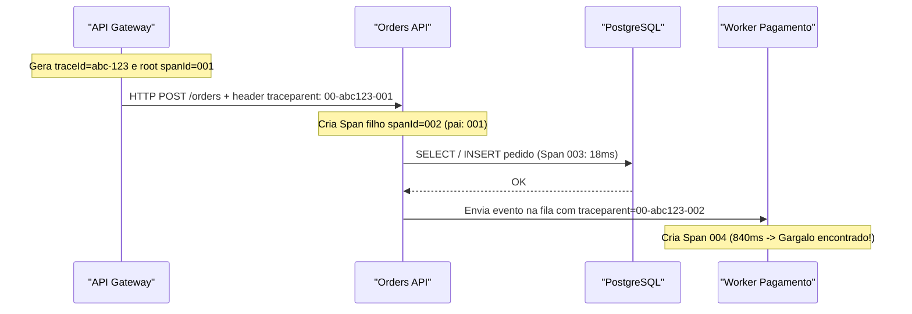

# 📡 Aula 21 — Observabilidade & Monitoramento

> *"Os olhos da nave. Monitore a saúde de suas aplicações em produção usando logs estruturados, métricas de hardware e traces distribuídos."*

---

## 1. 🚀 Briefing da Missão (Contexto Temático & Realidade de Mercado)

| Metadado do Setor | Especificação |
| :--- | :--- |
| **Galáxia** | Galáxia 4 — Órbita do DevOps & Cloud |
| **ID do Módulo** | `observabilidade` |
| **Pré-requisitos** | [Aula 19 — Cloud Computing & Serverless](./19-cloud-computing-serverless.md) (`cloud-serverless`) e [Aula 20 — Segurança Web & Criptografia](./20-seguranca-web-criptografia.md) (`seguranca-criptografia`) |
| **Próximo Passo** | [Projeto de Consolidação 04 — Órbita do DevOps & Cloud](./projeto-consolidacao-04-devops.md) |

### 🛸 Analogia do Navegador Cósmico: A Caixa-Preta e os Sensores de Telemetria da Nave

Imagine decolar um foguete tripulado sem nenhum painel de instrumentos na cabine: sem velocímetro, sem indicador de pressão de combustível, sem alerta sonoro de superaquecimento e sem caixa-preta gravando o que aconteceu antes de uma falha. Se uma turbina falhar no meio da órbita, a única notícia que você teria seria o cliente ligando do outro lado do rádio gritando: *"A nave caiu!"*.

**Observabilidade** é a **sala de telemetria e a caixa-preta** da sua aplicação em produção. Enquanto o **Monitoramento** tradicional pergunta *"o sistema está de pé ou caiu?"* (olhando falhas já conhecidas), a **Observabilidade** garante que, diante de **qualquer comportamento estranho e inédito**, você consiga inferir o estado interno exato do software olhando apenas os sinais externos que ele emite: **Logs**, **Métricas** e **Traces**.

### 💼 A Dor Real que Este Módulo Resolve nas Empresas

Quando sistemas crescem de um único processo local para containers distribuídos na nuvem, voar no escuro custa caríssimo:

1. **Descoberta de quedas pelo cliente no Twitter/WhatsApp:** o time de engenharia só descobre que o checkout parou de funcionar 40 minutos depois, quando o suporte começa a receber reclamações.
2. **"Caça às bruxas" no `console.log`:** em produção com 500 requisições por segundo, ler milhares de linhas de texto solto como `Erro ao salvar pedido` sem saber qual usuário, qual rota ou quanto tempo durou é praticamente impossível.
3. **Lentidão fantasma entre microsserviços:** a página demora 4 segundos para responder, mas a CPU está em 10%. Sem rastreamento distribuído (*Tracing*), ninguém descobre se o gargalo está na API Gateway, no PostgreSQL, no Redis ou em um gateway de pagamento externo.
4. **Fadiga de alertas (Alert Fatigue):** alarmes configurados de forma ingênua tocam às 3h da manhã por um pico de CPU inofensivo de 10 segundos, fazendo o time ignorar o alerta verdadeiro quando o banco realmente cai.

---

## 2. 📚 Carga de Conhecimento Completa (Tópico por Tópico)

### 2.1 Os 3 Pilares da Observabilidade: Logs, Métricas e Traces

Observabilidade moderna apoia-se em três tipos complementares de telemetria — nenhum deles substitui os outros dois:

| Pilar | O que É | Ponto Forte | Limitação Isolada | Ferramentas Clássicas |
| :--- | :--- | :--- | :--- | :--- |
| **1. Logs (Registros de Eventos)** | Registros discretos com timestamp detalhando eventos específicos ocorridos no código | Contexto rico de um erro exato (payload sanitizado, `userId`, `errorCode`) | Armazenar e buscar bilhões de logs brutos custa caro | Pino, Winston, ELK Stack, Grafana Loki, CloudWatch |
| **2. Métricas (Séries Temporais)** | Valores numéricos agregados ao longo do tempo (contadores, medidores, histogramas) | Levíssimas, ótimas para gráficos históricos e disparo de alertas rápidos | Não dizem *qual* requisição específica falhou nem mostram a linha de código | Prometheus, Grafana, Datadog, CloudWatch Metrics |
| **3. Traces (Rastreamento Distribuído)** | A jornada completa de uma única requisição atravessando múltiplos serviços e bancos | Aponta exatamente em qual etapa/serviço os milissegundos foram gastos | Requer instrumentação (ex: OpenTelemetry) e amostragem (*sampling*) em alto volume | OpenTelemetry (OTel), Jaeger, Grafana Tempo, Zipkin |

#### Os "4 Sinais de Ouro" (Google SRE Four Golden Signals)
Ao monitorar serviços com métricas, comece sempre por estes quatro indicadores universais:
1. **Latência (Latency):** quanto tempo leva para atender uma requisição (e lembre: meça **p95** e **p99** — percentis — nunca apenas a média, pois a média esconde os 5% de clientes mais lentos!).
2. **Tráfego (Traffic):** quanta demanda o sistema está recebendo (ex: requisições HTTP por segundo).
3. **Erros (Errors):** taxa de respostas falhas (ex: porcentagem de HTTP `5xx` sobre o total).
4. **Saturação (Saturation):** quão próximo do limite estão CPU, memória RAM, pool de conexões do banco ou fila de mensagens.

---

### 2.2 Configurar Logs Estruturados em Formato JSON na Aplicação

Um log textual tradicional (`console.log("Pagamento falhou para usuario 42 em 310ms")`) é legível para um humano lendo 10 linhas no terminal, mas péssimo para máquinas filtrando 10 milhões de linhas em produção (exige expressões regulares frágeis e lentas).

**Logs Estruturados** emitem cada evento como um **objeto JSON por linha (NDJSON)**:

```json
{"level":"error","time":"2026-11-18T03:12:44.102Z","service":"orders-api","requestId":"req-9f8a12","userId":"usr_42","durationMs":310,"statusCode":502,"msg":"Falha ao cobrar gateway de pagamento"}
```

**Por que o JSON muda o jogo?**
* Motores de busca como **Grafana Loki**, **Elasticsearch** ou **Datadog** indexam cada campo automaticamente: em 1 segundo você filtra `service="orders-api" AND statusCode>=500 AND userId="usr_42"`.
* **Regra de ouro de segurança nos logs:** **NUNCA** logue senhas, tokens JWT, números de cartão, CPFs ou chaves de API! Configure **Redaction** (mascaramento automático de campos como `password`, `authorization`, `token`) no logger como **Pino** ou **Winston**.
* **Escreva para `stdout` / `stderr`:** em containers Docker (Aula 17), a aplicação **não** deve gerenciar arquivos `.log` no disco interno do container (que enchem o disco e se perdem); ela imprime o JSON no `stdout` e o daemon/coletor do cluster captura e envia para o agregador central.

---

### 2.3 Coletar Métricas do Sistema usando Prometheus

O **Prometheus** é o padrão aberto (CNCF) para coleta de métricas em arquiteturas cloud-native. Diferente de ferramentas antigas onde a aplicação empurrava dados para um servidor central (*push*), o Prometheus funciona por padrão no modelo **Pull (Scraping)**:

1. Sua aplicação expõe um endpoint HTTP leve chamado `/metrics` em formato texto plano padrão OpenMetrics/Prometheus.
2. De tempos em tempos (ex: a cada `15s`, definido em `scrape_interval`), o servidor Prometheus faz um `GET /metrics` nos alvos configurados em `prometheus.yml` e armazena os números no seu banco de séries temporais (TSDB).

#### Os 4 Tipos Principais de Métricas no Prometheus

* **Counter (Contador):** valor que **só sobe** (ou zera quando o processo reinicia). Ideal para contagem acumulada de requisições (`http_requests_total`) ou erros (`payment_failures_total`). Para saber a taxa por segundo nos últimos 5 minutos, usamos `rate(http_requests_total[5m])` em **PromQL**.
* **Gauge (Medidor):** valor instantâneo que **pode subir e descer** — como o velocímetro do carro. Ideal para memória RAM em uso, conexões ativas no pool do banco ou itens pendentes em uma fila (`queue_jobs_pending`).
* **Histogram (Histograma):** agrupa observações (como duração de requisições ou tamanho de payloads) em **faixas configuráveis (buckets)** — ex: `<= 0.05s`, `<= 0.1s`, `<= 0.5s`, `<= 1s`. Permite calcular percentis reais como **p95** ou **p99** usando `histogram_quantile(0.95, ...)` no Grafana!
* **Summary:** parecido com o histograma, mas calcula quantis no cliente antes de enviar (menos flexível para agregar entre múltiplas réplicas da API; na dúvida, prefira **Histogram**).

---

### 2.4 Criar Dashboards Interativos de Monitoramento com o Grafana

Se o Prometheus é o motor coletor e o banco de dados de séries temporais, o **Grafana** é a **cabine de comando visual (cockpit)**. Ele se conecta a diversas fontes de dados (*Data Sources*) ao mesmo tempo — Prometheus para métricas, Loki para logs e Tempo/Jaeger para traces — e permite montar painéis em tempo real com gráficos de linha, medidores, mapas de calor e tabelas.

#### Consultas PromQL Essenciais que Todo Dev Júnior Deve Conhecer
* **Requisições por segundo (RPS) por rota e status:**
  `sum by (route, status_code) (rate(http_requests_total[5m]))`
* **Taxa de erro 5xx (em porcentagem):**
  `100 * sum(rate(http_requests_total{status_code=~"5.."}[5m])) / sum(rate(http_requests_total[5m]))`
* **Latência p95 das requisições HTTP (em segundos):**
  `histogram_quantile(0.95, sum by (le) (rate(http_request_duration_seconds_bucket[5m])))`

Um bom dashboard não é uma árvore de natal cheia de 40 gráficos confusos: ele responde em **5 segundos** se os 4 Sinais de Ouro estão saudáveis e permite filtrar por ambiente (`prod` / `staging`) e intervalo de tempo.

---

### 2.5 Rastreamento Distribuído (Tracing) para Depurar Microsserviços

Imagine que um cliente clica em "Finalizar Compra". Essa única ação dispara uma cadeia:
`Frontend → API Gateway → Serviço de Pedidos → Postgres → Fila Redis → Worker de Pagamento → API Externa`.

Como saber exatamente **qual elo dessa corrente** demorou 2.3 segundos ou falhou silenciosamente? Com **Distributed Tracing** usando o padrão aberto **OpenTelemetry (OTel)**:



* **Trace:** representa a jornada completa de ponta a ponta identificada por um **`traceId`** único propagado via cabeçalho HTTP padrão W3C (`traceparent`).
* **Span:** representa uma unidade individual de trabalho dentro do trace (ex: "consulta SQL ao Postgres", "chamada HTTP ao gateway"), registrando hora de início, duração e metadados.
* **Correlação Ouro (Logs + Traces):** quando você inclui o `traceId` (ou `requestId`) dentro dos seus logs JSON do Pino, basta clicar em uma barra lenta no trace do Grafana Tempo para abrir imediatamente os logs exatos daquela requisição específica!

---

### 2.6 Criar Sistemas de Alerta Automatizados Baseados em Limites Saudáveis

Olhar dashboards o dia todo não escala — humanos precisam dormir e programar. **Alertas automatizados** monitoram regras continuamente e avisam o time (via Slack, Discord, e-mail, PagerDuty ou Opsgenie) **apenas quando há impacto real ou risco iminente ao usuário**.

#### Princípios para Alertas Inteligentes (Sem Fadiga de Alerta)
1. **Alerte sobre Sintomas (Impacto no Usuário), não apenas Causas:**
   * *Ruim:* disparar PagerDuty às 3h porque um núcleo de CPU bateu 85% por 10 segundos (o usuário nem percebeu!).
   * *Bom:* alertar quando a **taxa de erros HTTP `5xx` ultrapassar 2% por mais de 5 minutos (`for: 5m`)** ou quando a **latência p95 passar de 1.5s por 5 minutos**.
2. **Use `for:` (janela de persistência):** evita falsos positivos causados por oscilações instantâneas de 1 scrape.
3. **Classifique por Severidade e Inclua Runbook:**
   * `warning` (vai para canal do Slack durante horário comercial — ex: disco com 75% cheio).
   * `critical` (acorda plantonista / envia notificação urgente — ex: API fora do ar ou 5xx > 5%), sempre acompanhado de **link para o Dashboard e Runbook** (passos de mitigação).

---

## 3. 💻 Mão no Código (Jeito Iniciante vs. Padrão Profissional)

### ❌ Jeito Iniciante (Antipadrão Comum)

```javascript
// ❌ ANTIPADRÃO: logs em texto solto, sem correlation ID, vaza dados sensíveis,
// sem métricas nem healthcheck detalhado
app.post("/orders", async (req, res) => {
  console.log("Recebendo pedido do user " + req.body.userId + " token=" + req.headers.authorization);
  try {
    const order = await createOrder(req.body);
    console.log("Pedido criado com sucesso!");
    res.status(201).json(order);
  } catch (err) {
    console.log("DEU ERRO:", err);
    res.status(500).send("Erro");
  }
});
```

### ✅ Padrão Profissional (Logs JSON com Pino + Redaction + Correlation ID + Prometheus `/metrics` + Regras de Alerta)

```javascript
// observability-server.js (Express + pino + prom-client)
import express from "express";
import pino from "pino";
import client from "prom-client";
import crypto from "node:crypto";

const app = express();
app.use(express.json());

// ==============================================================================
// 1. LOGGER ESTRUTURADO EM JSON COM REDACTION DE SEGREDOS
// ==============================================================================
const logger = pino({
  level: process.env.LOG_LEVEL || "info",
  base: { service: "galactic-orders-api", env: process.env.NODE_ENV || "development" },
  // ✅ Remove automaticamente campos sensíveis antes de gravar no stdout
  redact: {
    paths: ["req.headers.authorization", "req.headers.cookie", "*.password", "*.token"],
    censor: "[REDACTED]",
  },
});

// ==============================================================================
// 2. MÉTRICAS PROMETHEUS (Default Node.js Metrics + Counter + Histogram)
// ==============================================================================
const register = new client.Registry();
// Coleta automática de CPU, memória heap, event loop lag e GC do processo Node.js
client.collectDefaultMetrics({ register, prefix: "galactic_" });

const httpRequestsTotal = new client.Counter({
  name: "http_requests_total",
  help: "Total de requisições HTTP recebidas",
  labelNames: ["method", "route", "status_code"],
  registers: [register],
});

const httpRequestDuration = new client.Histogram({
  name: "http_request_duration_seconds",
  help: "Duração das requisições HTTP em segundos",
  labelNames: ["method", "route", "status_code"],
  buckets: [0.01, 0.05, 0.1, 0.25, 0.5, 1, 2.5, 5],
  registers: [register],
});

// ==============================================================================
// 3. MIDDLEWARE DE OBSERVABILIDADE (Correlation/Trace ID + Timer + Log JSON)
// ==============================================================================
app.use((req, res, next) => {
  // Propaga trace/request id recebido do gateway ou gera um UUID novo
  const requestId = req.headers["x-request-id"] || crypto.randomUUID();
  req.requestId = requestId;
  res.setHeader("x-request-id", requestId);

  // Cria logger filho já amarrado ao requestId para toda a requisição
  req.log = logger.child({ requestId });

  const endTimer = httpRequestDuration.startTimer();

  res.on("finish", () => {
    const route = req.route?.path || req.path;
    const labels = {
      method: req.method,
      route,
      status_code: String(res.statusCode),
    };

    // Ignora endpoint /metrics para não poluir métricas de negócio
    if (route !== "/metrics") {
      httpRequestsTotal.inc(labels);
      endTimer(labels);

      req.log.info(
        { method: req.method, route, statusCode: res.statusCode },
        "Requisição HTTP concluída"
      );
    }
  });

  next();
});

// ==============================================================================
// 4. ENDPOINTS DE SAÚDE, MÉTRICAS E NEGÓCIO
// ==============================================================================
app.get("/health", async (req, res) => {
  // Em produção, valide também ping rápido de dependências críticas (DB/Redis)
  res.status(200).json({ status: "ok", uptimeSeconds: Math.floor(process.uptime()) });
});

app.get("/metrics", async (req, res) => {
  res.setHeader("Content-Type", register.contentType);
  res.end(await register.metrics());
});

app.post("/orders", async (req, res) => {
  try {
    const { itemId, quantity } = req.body;
    // Simulação de processamento de negócio
    req.log.info({ itemId, quantity }, "Processando criação de pedido");
    res.status(201).json({ orderId: crypto.randomUUID(), status: "confirmed" });
  } catch (err) {
    req.log.error({ err }, "Falha inesperada ao processar pedido");
    res.status(500).json({ error: "Erro interno", requestId: req.requestId });
  }
});

app.listen(3000, () => {
  logger.info({ port: 3000 }, "Servidor de observabilidade iniciado");
});
```

E um exemplo real de regra de alerta automatizado do Prometheus (`prometheus-alerts.yml`):

```yaml
# prometheus-alerts.yml
groups:
  - name: galactic-api-slos
    rules:
      - alert: ApiAltaTaxaDeErros5xx
        # Dispara se mais de 5% das requisições retornarem 5xx durante 5 minutos seguidos
        expr: |
          100 * (
            sum(rate(http_requests_total{status_code=~"5.."}[5m]))
            /
            clamp_min(sum(rate(http_requests_total[5m])), 1)
          ) > 5
        for: 5m
        labels:
          severity: critical
        annotations:
          summary: "Taxa de erros 5xx acima de 5% na galactic-orders-api"
          description: "Mais de 5% das requisições falharam nos últimos 5 minutos. Verifique logs por requestId e painel do Grafana."

      - alert: ApiLatenciaP95Elevada
        expr: |
          histogram_quantile(
            0.95,
            sum by (le) (rate(http_request_duration_seconds_bucket[5m]))
          ) > 1.0
        for: 5m
        labels:
          severity: warning
        annotations:
          summary: "Latência p95 acima de 1 segundo"
          description: "95% das requisições ultrapassaram 1s nos últimos 5 minutos."
```

---

## 4. 🛠️ Laboratório de Voo (Exercício Prático Guiado)

**Duração estimada:** 45–60 minutos  
**Missão:** Subir a API instrumentada com logs JSON (`pino`) e métricas (`/metrics`) ao lado de uma stack real **Prometheus + Grafana** via Docker Compose, gerar tráfego sintético e construir seu primeiro painel com os 4 Sinais de Ouro + regra de alerta.

### Passo a Passo Reproduzível

1. **Inicialize o projeto:**
   ```bash
   mkdir lab-observabilidade-orbital && cd lab-observabilidade-orbital
   npm init -y
   npm install express pino prom-client
   ```
   Salve o arquivo `observability-server.js` da Seção 3 (adicione uma rota `/slow` com `setTimeout` de `800ms` e uma `/fail` retornando `500` para simular incidentes no laboratório!).
2. **Crie o `prometheus.yml`:**
   ```yaml
   global:
     scrape_interval: 5s
   rule_files:
     - /etc/prometheus/prometheus-alerts.yml
   scrape_configs:
     - job_name: "galactic-api"
       static_configs:
         - targets: ["host.docker.internal:3000"] # No Linux puro use o nome do serviço no Compose
   ```
3. **Suba Prometheus e Grafana via Docker Compose:**
   * Crie um `docker-compose.yml` com os serviços `prom/prometheus:v2.54.1` (porta `9090`, montando `prometheus.yml` e `prometheus-alerts.yml`) e `grafana/grafana:11.2.0` (porta `3001:3000`).
   * Rode `node observability-server.js` e `docker compose up -d`.
4. **Gere carga e inspecione os 3 sinais:**
   * Rode um pequeno loop no terminal disparando 100 requisições variadas contra `/orders`, `/slow` e `/fail`.
   * Observe no terminal da API as linhas JSON estruturadas saindo com `requestId` e `statusCode`, e verifique que o header `Authorization` aparece mascarado como `"[REDACTED]"`.
   * Acesse `http://localhost:9090` (Prometheus), vá na aba **Alerts** e confirme que sua regra carregou; vá em **Graph** e teste a query `rate(http_requests_total[1m])`.
5. **Monte o Painel no Grafana:**
   * Acesse `http://localhost:3001` (`admin` / `admin`), adicione o **Prometheus** (`http://prometheus:9090`) em *Connections > Data Sources*.
   * Crie um Dashboard novo com **3 painéis**: (1) RPS por rota, (2) Taxa de erros 5xx `%`, (3) Latência p95 usando `histogram_quantile`.

### ✅ Critérios de Domínio
- [ ] Logs saem em JSON válido de uma linha por evento e nunca imprimem tokens/senhas em claro (`[REDACTED]`).
- [ ] O endpoint `/metrics` responde no formato Prometheus exibindo `http_requests_total` e `http_request_duration_seconds_bucket`.
- [ ] Prometheus coleta métricas (`Status: UP` em `Targets`) e exibe os alertas configurados.
- [ ] Dashboard no Grafana plota em tempo real RPS, taxa de erro e latência p95 após geração de tráfego.

---

## 5. 🎯 Resolução Comentada do Teste de Ignição (Quest Oficial)

> **Pergunta Oficial (`data.js`):**  
> *"Qual o benefício crucial de utilizar logs estruturados (como o formato JSON) em vez de logs puramente textuais em produção?"*
>
> **A)** Logs estruturados ocupam sempre 90% a menos de espaço em disco rígido.  
> **B)** Logs textuais simples travam o processador da máquina se houver muitos erros.  
> **C)** Logs estruturados permitem que ferramentas automatizadas indexem, pesquisem e filtrem dados rapidamente por atributos como userId, status ou tempo de execução.  
> **D)** Logs estruturados são escritos em código binário que o usuário final não pode interceptar.

### 🏆 Gabarito Oficial: **Alternativa C**

#### ✅ Por que a Alternativa C está correta?
Logs em texto livre obrigam analistas e ferramentas a varrer strings não padronizadas usando `grep` ou expressões regulares complexas e lentas sempre que o formato muda. Ao emitir logs estruturados em JSON com pares chave-valor consistentes (`userId`, `statusCode`, `durationMs`, `requestId`), coletores e motores de busca (como Grafana Loki, Elasticsearch/OpenSearch, Datadog e CloudWatch Logs Insights) conseguem **indexar, filtrar, agrupar e gerar métricas/alertas instantaneamente** com precisão cirúrgica durante incidentes em produção.

#### ❌ Por que as demais estão incorretas?
* **Alternativa A (Errada):** Logs JSON frequentemente ocupam até um pouco *mais* espaço bruto do que texto curto devido aos nomes das chaves repetidas em cada linha (por isso compressão gzip/zstd e rotação/retenção são usadas no agregador). O ganho não é economia de 90% de disco, e sim **capacidade de busca, filtragem e correlação**.
* **Alternativa B (Errada):** Escrever logs excessivos de forma síncrona pode causar gargalo de I/O tanto em texto quanto em JSON, mas logs textuais simples não "travam o processador" magicamente por serem texto.
* **Alternativa D (Errada):** JSON é um formato textual legível por humanos (UTF-8), **não** é código binário nem criptografado — razão pela qual precisamos usar `redact` para nunca gravar segredos nos logs!

---

## 6. 🎤 Kit de Apresentação (Como Dar Aula / Apresentar Este Módulo)

### 🎙️ Pitch Feynman de 2 Minutos (Script Pronto para Falar)

> "Subir código em produção sem observabilidade é igual a dirigir um avião à noite com os vidros pintados de preto e o painel desligado: você só descobre que tem um problema quando bate na montanha — ou quando o cliente reclama no Twitter.
>
> Observabilidade se apoia em três pilares que trabalham juntos. Primeiro temos as **Métricas** (como o Prometheus coletando e o Grafana desenhando gráficos): são números baratos ao longo do tempo — quantas requisições por segundo estão entrando, qual a porcentagem de erros 500 e qual a latência dos 5% usuários mais lentos. Elas são perfeitas para acender alertas inteligentes no Slack antes de o sistema cair de vez.
>
> Quando o gráfico acusa um pico de erro, pulamos para o segundo pilar: os **Logs Estruturados em JSON**. Em vez de soltar frases soltas difíceis de pesquisar, gravamos objetos JSON com `requestId`, `userId` e `statusCode` — assim filtramos exatamente quem falhou e por quê em dois segundos, sempre mascarando dados sensíveis.
>
> E quando temos vários microsserviços conversando entre si e queremos saber onde os 2 segundos de lentidão sumiram, entra o terceiro pilar: **Distributed Tracing**, com OpenTelemetry. Ele coloca um passaporte com `traceId` na entrada da requisição e marca o cronômetro em cada parada — API Gateway, banco, Redis e fila — desenhando a linha do tempo exata do gargalo."

### 🖼️ Roteiro de Slides (6 Slides)

| Slide | Título do Slide | Bullets-Chave | Sugestão Visual |
| :--- | :--- | :--- | :--- |
| **1** | **Voando às Cegas vs. Observabilidade** | • Diferença entre Monitoramento (falhas conhecidas) e Observabilidade (responder perguntas novas)<br>• O custo do MTTR (tempo médio de recuperação)<br>• Os 4 Sinais de Ouro (Latência, Tráfego, Erros, Saturação) | Painel de avião moderno vs. cabine vazia |
| **2** | **Os 3 Pilares: Métricas, Logs e Traces** | • Métricas: séries temporais leves e alertas<br>• Logs: contexto rico de eventos<br>• Traces: jornada ponta a ponta entre serviços | Diagrama em triângulo conectando os 3 pilares pelo `traceId` |
| **3** | **Logs Estruturados (JSON) & Segurança** | • Texto livre vs. JSON indexável<br>• `requestId` / `traceId` para correlação<br>• Redaction obrigatória (nunca logar tokens/senhas!) | Exemplo lado a lado de `console.log` bagunçado vs. linha JSON limpa |
| **4** | **Prometheus & Os Tipos de Métricas** | • Modelo Pull (`GET /metrics` a cada N segundos)<br>• Counter, Gauge e Histogram (percentis p95/p99)<br>• Por que a média engana em performance | Gráfico comparando Média (120ms) vs. p99 (1.800ms) |
| **5** | **Grafana & Alertas sem Fadiga** | • Dashboards úteis respondem saúde em 5 segundos<br>• Alertar por sintomas (`5xx > 5% for 5m`), não ruído<br>• Severidades (`warning` vs. `critical`) + Runbook | Screenshot/mockup de um dashboard limpo com 3 gráficos e alerta |
| **6** | **Distributed Tracing com OpenTelemetry** | • `Trace` vs. `Span` e propagação W3C (`traceparent`)<br>• Encontrando gargalos em bancos, filas e APIs terceiras<br>• Click do Trace direto para os Logs da requisição | Gráfico estilo Waterfall (cascata) de Spans de um trace |

### ⚡ Roteiro de Demo Ao Vivo (3 Minutos)

1. **Minuto 0:00 – 1:00 (Logs Estruturados & Redaction):** envie uma requisição para `/orders` com um header `Authorization: Bearer segredo-123` e mostre no terminal o JSON estruturado saindo com `requestId` preenchido e `"authorization": "[REDACTED]"`.
2. **Minuto 1:00 – 2:00 (O `/metrics` cru ao vivo):** abra `http://localhost:3000/metrics` no navegador ou via `curl`, mostrando os contadores `http_requests_total` e os buckets do histograma `http_request_duration_seconds_bucket` subindo em tempo real.
3. **Minuto 2:00 – 3:00 (Grafana Reagindo a um Incidente Simulado):** dispare 20 chamadas na rota `/fail` e `/slow` e mostre no dashboard do Grafana a linha vermelha da taxa de erros `5xx` e a curva do `p95` subindo na tela ao vivo!

### ❓ Perguntas Difíceis da Plateia

1. **"Por que devo me preocupar com p95 ou p99 em vez de monitorar apenas a latência média da minha API?"**
   * **Resposta segura:** *"A média esconde outliers graves! Imagine que 95 requisições respondem em 20ms, mas 5 clientes VIP ficam presos por 10 segundos esperando um lock no banco. A média matemática parece 'ótima' (~519ms), mas 5% dos seus usuários estão abandonando a tela porque tudo trava. Percentis como **p95** (95% das requisições são mais rápidas que X) e **p99** revelam exatamente a pior experiência real enfrentada pelos usuários."*
2. **"Qual a diferença entre `GET /health` (ou `/healthz`) e `GET /metrics`? Preciso dos dois?"**
   * **Resposta segura:** *"Sim, eles têm papéis bem diferentes! O `/health` é uma checagem booleana de vida e prontidão (*Liveness/Readiness Probe*) usada pelo Docker, Load Balancer ou Kubernetes para decidir em milissegundos se aquele container deve receber tráfego ou ser reiniciado (retorna 200 OK ou 503). Já o `/metrics` expõe séries numéricas detalhadas acumuladas ao longo do tempo (uso de memória, quantidades de requisições, buckets de latência) para o Prometheus coletar e gerar gráficos históricos e tendências no Grafana."*

---

## 7. 💼 Radar do Mercado de Trabalho (Foco Dev Júnior)

### 🎯 3 Perguntas Reais de Entrevista Técnica Júnior

**1. "Explique com suas palavras a diferença entre Logs, Métricas e Traces — e quando você usaria cada um para investigar um incidente?"**
* **Resposta-modelo:** *"Eu penso neles em etapas de investigação: as **Métricas** me avisam que algo quebrou (por exemplo, um alerta no Grafana dizendo que a taxa de HTTP 500 subiu para 8% e a latência p95 triplicou). Em seguida, se a requisição passa por vários serviços, olho os **Traces** para descobrir exatamente qual microsserviço ou query de banco está causando a lentidão ou falha. Por fim, uso o `traceId` ou `requestId` para filtrar os **Logs estruturados (JSON)** daquela execução exata e ver a mensagem de erro e o contexto que originou o bug."*

**2. "Por que em containers Docker recomendamos enviar logs para `stdout`/`stderr` em JSON em vez de salvar arquivos `app.log` dentro do container?"**
* **Resposta-modelo:** *"Primeiro porque containers são efêmeros: se o container morrer ou for substituído em um deploy, qualquer arquivo `.log` gravado apenas no disco interno dele é perdido — justamente quando mais precisaríamos dele para investigar a queda! Segundo, gravar arquivos sem rotação pode lotar o disco do servidor. Enviando JSON para `stdout`, o runtime do container e agentes coletores (como Promtail, Fluent Bit ou CloudWatch Agent) capturam e encaminham tudo de forma padronizada para armazenamento central."*

**3. "Como funciona a coleta do Prometheus e o que é um Histograma?"**
* **Resposta-modelo:** *"O Prometheus funciona principalmente por Pull (scraping): ele consulta periodicamente (por exemplo a cada 15s) o endpoint `/metrics` exposto pela aplicação e grava os valores no seu banco de séries temporais. Um **Histograma** é um tipo de métrica que conta quantas observações (como tempo de resposta) caíram dentro de intervalos de tempo pré-definidos chamados buckets — permitindo depois calcular percentis como p95 ou p99 via PromQL mesmo agregando múltiplas réplicas da API."*

### ⚖️ Erros Clássicos de Júnior vs. Postura Profissional

| ❌ Erro Clássico de Júnior | ✅ Postura Profissional |
| :--- | :--- |
| Usar `console.log(req.body)` jogando senhas, tokens e CPFs no log em produção | Usar logger JSON (`pino`/`winston`) com `redact` explícito para nunca registrar PII nem credenciais. |
| Usar rótulos de **alta cardinalidade** em métricas Prometheus (ex: `userId` ou URL completa com ID `/users/12345` como label!) | Usar apenas labels finitos (`route: "/users/:id"`, `method`, `status_code`), evitando explodir a memória do Prometheus. |
| Criar 30 alertas no Slack por qualquer oscilação momentânea de CPU | Alertar pelos sintomas de negócio/SLO (`5xx > 2% for 5m`) com severidade clara e link de investigação. |
| Não retornar `requestId` no cabeçalho ou no corpo de erro HTTP 500 | Incluir `x-request-id` na resposta para o suporte/usuário informar e o dev achar o log na hora. |

### 🌟 Evidência para Portfólio / GitHub / LinkedIn

* **No GitHub:** adicione observabilidade real ao seu projeto principal: `/health`, `/metrics`, logs JSON com `pino`, `docker-compose.observability.yml` com Prometheus + Grafana pré-configurado (*provisioning* automático do datasource e do JSON do dashboard!), e coloque um print bonito do painel do Grafana funcionando no `README.md`!
* **No LinkedIn:** compartilhe um post técnico contando um caso prático de laboratório: *"Simulei um gargalo na minha API Node.js e encontrei o culpado em 30 segundos usando métricas do Prometheus e painel p95 no Grafana"*, destacando também o cuidado de evitar alta cardinalidade e vazar tokens nos logs.

---

## 8. 📡 Transmissões Recomendadas & Próxima Órbita

### 📚 Recursos Oficiais da Nave (`data.js`)
* [Observabilidade para Iniciantes (Honeycomb)](https://www.honeycomb.io/whitepapers/observability-for-software-engineers/) — Leitura fundamental sobre por que observabilidade vai além de gráficos estáticos e como eventos estruturados aceleram o debugging em produção.
* [Prometheus & Grafana Lab](https://prometheus.io/docs/introduction/first_steps/) — Guia oficial passo a passo para configurar seu primeiro scrape Prometheus e explorar métricas.

### 🧭 Conexão com a Próxima Órbita
Parabéns, Comandante! Você percorreu todos os 5 setores da **Galáxia 4 — Órbita do DevOps & Cloud**: aprendeu a empacotar em **Docker**, automatizar com **CI/CD**, escalar na **Cloud & Serverless**, blindar com **Segurança & Criptografia** e enxergar tudo em produção com **Observabilidade & Monitoramento**.

Agora chegou a hora da prova de fogo prática que une toda a galáxia em um projeto real de portfólio: avance para o **[Projeto de Consolidação 04 — Órbita do DevOps & Cloud](./projeto-consolidacao-04-devops.md)**!
