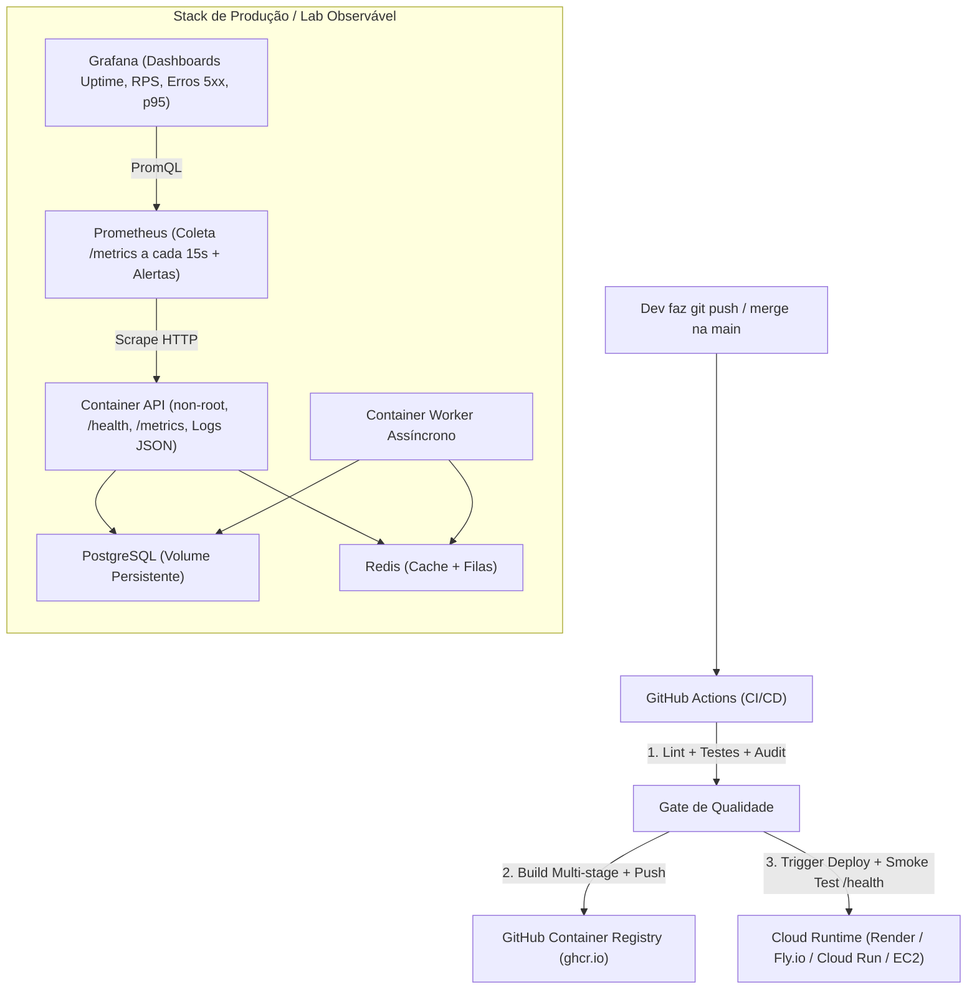

# 🎖️ Projeto de Consolidação 04 — Órbita do DevOps & Cloud

> **Missão Final da Galáxia 4:** transformar sua aplicação backend em um sistema pronto para produção — empacotado com Docker Multi-stage seguro, testado e publicado por uma esteira CI/CD no GitHub Actions, implantado na nuvem com zero segredos expostos e vigiado por Prometheus + Grafana.

---

## 1. 🎖️ Missão Oficial & Objetivo de Portfólio

> *"Escreva uma esteira CI/CD (GitHub Actions) para empacotar o projeto anterior em um container Docker otimizado (multi-stage). Configure deploys automatizados na nuvem e integre monitoramento básico de saúde (Uptime) com painel Grafana/Prometheus."*
> — **Texto Oficial de `consolidationProjects["observabilidade"]` (`app.js`)**

### 🎯 O Que Este Projeto Prova para um Recrutador / Tech Lead

No projeto da Galáxia anterior (*Cinturão de Arquitetura — E-commerce com Clean Architecture, Banco Relacional, Fila Redis/RabbitMQ e Cache Redis*), você provou que sabe **escrever código bem arquitetado**. Neste Projeto de Consolidação da Galáxia 4, você prova que sabe **operar, automatizar, proteger e monitorar software de verdade**:

1. **Dockerização Profissional:** imagem multi-stage enxuta, não-root, `.dockerignore` completo e `HEALTHCHECK`.
2. **Esteira CI/CD Real:** GitHub Actions validando lint, testes, segurança, build com cache e publicando imagens versionadas no `ghcr.io` com deploy automatizado na nuvem.
3. **Observabilidade Plug-and-Play:** endpoints `/health` (checagem real de Postgres + Redis) e `/metrics` (Prometheus), logs estruturados em JSON com `requestId` e painel Grafana provisionado automaticamente via código.

*(Nota: caso você ainda não tenha construído a API de e-commerce do Cinturão de Arquitetura, os starter snippets abaixo também funcionam em qualquer API Node.js/Express + Postgres + Redis que você criar para este desafio!)*

---

## 2. 🏗️ Arquitetura da Solução



### 📂 Árvore de Diretórios Recomendada

```text
ecommerce-orbital/
├── .github/
│   └── workflows/
│       └── deploy.yml                  # Esteira completa CI -> GHCR -> Deploy + Smoke Test
├── src/
│   ├── server.ts                       # API REST + /health + /metrics + logs Pino JSON
│   └── worker.ts                       # Worker assíncrono consumindo fila Redis/RabbitMQ
├── observability/
│   ├── prometheus/
│   │   ├── prometheus.yml              # Configuração de scrape da API
│   │   └── alerts.yml                  # Regras de alerta (API fora do ar, 5xx > 5%, p95 > 1s)
│   └── grafana/
│       └── provisioning/
│           ├── datasources/
│           │   └── prometheus.yml      # Data source Prometheus criado automaticamente!
│           └── dashboards/
│               └── dashboard.yml       # Provisionamento automático de dashboards
├── .dockerignore
├── .env.example                        # Modelo sem senhas reais (nunca commitar .env!)
├── Dockerfile                          # Multi-stage (builder + production non-root)
├── docker-compose.yml                  # Stack principal (API + Worker + Postgres + Redis)
├── docker-compose.observability.yml    # Extensão com Prometheus + Grafana
├── package.json
└── README.md                           # Documentação + prints do Grafana + guia de execução
```

---

## 3. 🛠️ Roteiro de Construção em 5 Etapas

### Etapa 1 — Instrumentação da API (`/health`, `/metrics` e Logs JSON)

Adicione estes endpoints e middlewares na sua API Node.js/Express para garantir observabilidade real desde o primeiro container (`npm install pino prom-client`):

```javascript
// src/observability.js
import pino from "pino";
import client from "prom-client";
import crypto from "node:crypto";

export const logger = pino({
  level: process.env.LOG_LEVEL || "info",
  base: { service: "ecommerce-api" },
  redact: ["req.headers.authorization", "*.password", "*.token"],
});

export const metricsRegistry = new client.Registry();
client.collectDefaultMetrics({ register: metricsRegistry, prefix: "ecommerce_" });

const httpRequestsTotal = new client.Counter({
  name: "http_requests_total",
  help: "Total de requisições HTTP",
  labelNames: ["method", "route", "status_code"],
  registers: [metricsRegistry],
});

const httpDuration = new client.Histogram({
  name: "http_request_duration_seconds",
  help: "Latência HTTP em segundos",
  labelNames: ["method", "route", "status_code"],
  buckets: [0.01, 0.05, 0.1, 0.3, 0.5, 1, 2.5],
  registers: [metricsRegistry],
});

export function observabilityMiddleware(req, res, next) {
  const requestId = req.headers["x-request-id"] || crypto.randomUUID();
  req.requestId = requestId;
  res.setHeader("x-request-id", requestId);
  req.log = logger.child({ requestId });

  const stopTimer = httpDuration.startTimer();
  res.on("finish", () => {
    const route = req.route?.path || req.path;
    if (route === "/metrics") return;
    const labels = { method: req.method, route, status_code: String(res.statusCode) };
    httpRequestsTotal.inc(labels);
    stopTimer(labels);
    req.log.info(labels, "HTTP request completed");
  });
  next();
}

export function registerSystemRoutes(app, { dbPool, redisClient }) {
  // Healthcheck profundo: verifica se Postgres e Redis realmente respondem
  app.get("/health", async (req, res) => {
    try {
      await dbPool.query("SELECT 1");
      await redisClient.ping();
      return res.status(200).json({
        status: "healthy",
        checks: { postgres: "up", redis: "up" },
        uptimeSeconds: Math.floor(process.uptime()),
      });
    } catch (err) {
      req.log.error({ err }, "Healthcheck falhou");
      return res.status(503).json({ status: "unhealthy" });
    }
  });

  app.get("/metrics", async (req, res) => {
    res.setHeader("Content-Type", metricsRegistry.contentType);
    res.end(await metricsRegistry.metrics());
  });
}
```

---

### Etapa 2 — Empacotamento com `Dockerfile` Multi-stage & `.dockerignore`

Crie o `.dockerignore` (`node_modules`, `.git`, `.env`, `dist`, `observability`) e o `Dockerfile` enxuto com usuário não-root:

```dockerfile
# Dockerfile
FROM node:20.18.0-alpine3.20 AS builder
WORKDIR /usr/src/app
COPY package.json package-lock.json ./
RUN npm ci
COPY tsconfig.json ./
COPY src ./src
RUN npm run build
RUN npm prune --omit=dev

FROM node:20.18.0-alpine3.20 AS production
ENV NODE_ENV=production
WORKDIR /usr/src/app

COPY --from=builder --chown=node:node /usr/src/app/package.json ./
COPY --from=builder --chown=node:node /usr/src/app/node_modules ./node_modules
COPY --from=builder --chown=node:node /usr/src/app/dist ./dist

USER node
EXPOSE 3000

HEALTHCHECK --interval=30s --timeout=5s --start-period=15s --retries=3 \
  CMD node -e "fetch('http://127.0.0.1:3000/health').then(r => process.exit(r.ok ? 0 : 1)).catch(() => process.exit(1))"

CMD ["node", "dist/server.js"]
```

---

### Etapa 3 — Esteira CI/CD Completa (`.github/workflows/deploy.yml`)

Este workflow roda testes contra serviços reais de Postgres/Redis, publica a imagem Docker taggeada com SHA e SemVer no `ghcr.io`, aciona o deploy na nuvem e valida o `/health` automaticamente após o deploy:

```yaml
# .github/workflows/deploy.yml
name: CI/CD — Build, Publish & Deploy

on:
  push:
    branches: ["main"]
    tags: ["v*.*.*"]
  pull_request:
    branches: ["main"]

concurrency:
  group: ${{ github.workflow }}-${{ github.ref }}
  cancel-in-progress: true

permissions:
  contents: read

jobs:
  test:
    name: Testes & Qualidade
    runs-on: ubuntu-latest
    steps:
      - uses: actions/checkout@v4
      - uses: actions/setup-node@v4
        with:
          node-version: "20.18.0"
          cache: "npm"
      - run: npm ci
      - run: npm run lint
      - run: npm test -- --ci

  build-and-push:
    name: Build Docker Multi-stage & Push GHCR
    needs: test
    if: github.event_name == 'push'
    runs-on: ubuntu-latest
    permissions:
      contents: read
      packages: write
    steps:
      - uses: actions/checkout@v4
      - uses: docker/setup-buildx-action@v3
      - uses: docker/login-action@v3
        with:
          registry: ghcr.io
          username: ${{ github.actor }}
          password: ${{ secrets.GITHUB_TOKEN }}
      - id: meta
        uses: docker/metadata-action@v5
        with:
          images: ghcr.io/${{ github.repository }}
          tags: |
            type=sha,prefix=sha-
            type=semver,pattern={{version}}
            type=raw,value=latest,enable={{is_default_branch}}
      - uses: docker/build-push-action@v6
        with:
          context: .
          target: production
          push: true
          tags: ${{ steps.meta.outputs.tags }}
          cache-from: type=gha
          cache-to: type=gha,mode=max

  deploy:
    name: Deploy Automático na Nuvem
    needs: build-and-push
    if: github.ref == 'refs/heads/main'
    runs-on: ubuntu-latest
    environment:
      name: production
      url: ${{ secrets.APP_PUBLIC_URL }}
    steps:
      - name: Disparar Deploy (Render / Railway / Fly.io / Cloud Run Webhook)
        env:
          DEPLOY_HOOK_URL: ${{ secrets.CLOUD_DEPLOY_HOOK }}
        run: curl --fail --silent --show-error -X POST "$DEPLOY_HOOK_URL"

      - name: Validar Uptime (/health) após deploy
        env:
          HEALTH_URL: ${{ secrets.APP_PUBLIC_URL }}/health
        run: |
          for attempt in $(seq 1 12); do
            if curl -fsS "$HEALTH_URL"; then
              echo "Deploy verificado com sucesso!"
              exit 0
            fi
            sleep 5
          done
          echo "Timeout aguardando /health responder 200 OK"
          exit 1
```

---

### Etapa 4 — Deploy na Nuvem (Escolha Prática sem Atrito)

Para o seu portfólio, você tem três caminhos excelentes (todos integráveis ao workflow acima):
1. **Render / Railway / Fly.io (Recomendado para agilidade e custo zero/baixo):** conecte sua conta, aponte para sua imagem publicada no `ghcr.io` (ou use `flyctl deploy` no job `deploy`), configure as variáveis `DATABASE_URL`, `REDIS_URL`, `JWT_SECRET` no painel seguro do provedor e copie a *Deploy Hook URL* para o Secret `CLOUD_DEPLOY_HOOK` do GitHub.
2. **Google Cloud Run (Serverless Containers):** autentique via OIDC no GitHub Actions e publique direto com `gcloud run deploy --image ...`. Escala até zero quando ninguém acessa!
3. **AWS EC2 / ECS via Terraform (Nível Diferenciado):** se quiser impressionar ainda mais, suba um `/infra/main.tf` provisionando VPC/Security Group/ECS ou EC2.

---

### Etapa 5 — Stack de Observabilidade (`docker-compose.observability.yml`)

Suba a aplicação junto com **Prometheus** (coletando `/metrics` e avaliando alertas) e **Grafana** (já conectado ao Prometheus):

```yaml
# docker-compose.observability.yml
# Execute com: docker compose -f docker-compose.yml -f docker-compose.observability.yml up -d
services:
  prometheus:
    image: prom/prometheus:v2.54.1
    container_name: galactic-prometheus
    restart: unless-stopped
    ports:
      - "9090:9090"
    volumes:
      - ./observability/prometheus/prometheus.yml:/etc/prometheus/prometheus.yml:ro
      - ./observability/prometheus/alerts.yml:/etc/prometheus/alerts.yml:ro
      - prometheus_data:/prometheus
    networks:
      - edge_net

  grafana:
    image: grafana/grafana:11.2.0
    container_name: galactic-grafana
    restart: unless-stopped
    ports:
      - "3001:3000"
    environment:
      GF_SECURITY_ADMIN_USER: ${GRAFANA_ADMIN_USER:-admin}
      GF_SECURITY_ADMIN_PASSWORD: ${GRAFANA_ADMIN_PASSWORD:-admin}
    volumes:
      - ./observability/grafana/provisioning:/etc/grafana/provisioning:ro
      - grafana_data:/var/lib/grafana
    depends_on:
      - prometheus
    networks:
      - edge_net

volumes:
  prometheus_data:
  grafana_data:
```

E o arquivo `observability/prometheus/prometheus.yml` apontando para o serviço `api` na rede Docker e para a checagem de Uptime:

```yaml
# observability/prometheus/prometheus.yml
global:
  scrape_interval: 15s
  evaluation_interval: 15s

rule_files:
  - /etc/prometheus/alerts.yml

scrape_configs:
  - job_name: "ecommerce-api"
    metrics_path: "/metrics"
    static_configs:
      - targets: ["api:3000"]
```

Configure também `observability/grafana/provisioning/datasources/prometheus.yml` para o Grafana já nascer conectado ao Prometheus sem cliques manuais:

```yaml
apiVersion: 1
datasources:
  - name: Prometheus
    type: prometheus
    access: proxy
    url: http://prometheus:9090
    isDefault: true
```

---

## 4. ✅ Checklist de Qualidade Profissional

Antes de publicar seu projeto no LinkedIn e no currículo, valide cada item abaixo:

- [ ] **Imagem Enxuta e Segura:** `docker images` mostra imagem final menor que 200 MB (`alpine` + multi-stage) e `docker run --rm <imagem> id` confirma usuário não-root (`node`).
- [ ] **Segurança de Secrets & Rede:** nenhum `.env`, chave privada ou senha hardcoded existe no histórico do Git (`git log`); redes internas no Compose isolam Postgres e Redis; queries SQL são parametrizadas e senhas usam Argon2id/Bcrypt.
- [ ] **Healthcheck & Graceful Shutdown:** `GET /health` testa dependências reais (`SELECT 1` no Postgres + `PING` no Redis), retorna HTTP `200` ou `503` e o Dockerfile usa `CMD ["node", "dist/server.js"]`.
- [ ] **CI/CD Funcional:** aba **Actions** do GitHub exibe execuções verdes de Pull Request e `main`, pacotes taggeados no **GHCR** (`sha-...` + SemVer) e Smoke Test validando `/health` após o deploy.
- [ ] **Observabilidade Visível:** logs saem em JSON com `requestId` e `redact`, Prometheus mostra target `UP`, e o Grafana exibe pelo menos **Uptime**, **RPS**, **Taxa de Erros 5xx** e **Latência p95**.
- [ ] **README Impecável:** explica a arquitetura (diagrama Mermaid), comandos de 1 linha para subir tudo localmente, variáveis necessárias em `.env.example`, link da API em produção e screenshots do CI verde + painel Grafana.

---

## 5. 🎤 Roteiro de Pitch de 5 Minutos para Entrevista Técnica

Quando um Tech Lead perguntar *"Me fale de um projeto do qual você tem orgulho e como ele vai do seu computador até produção"*, siga este roteiro cronometrado:

* **0:00 – 0:45 | Contexto & Problema:** *"Peguei uma API de e-commerce em Clean Architecture com Postgres, cache Redis e worker assíncrono, e construí toda a esteira DevOps ao redor dela para rodar em produção com segurança, zero configuração manual e visibilidade total de saúde."*
* **0:45 – 1:45 | Docker & Segurança:** *"Comecei resolvendo consistência e segurança no empacotamento: escrevi um Dockerfile multi-stage que compila o código no estágio builder e copia só o artefato final para uma imagem Alpine não-root, reduzindo o tamanho final em mais de 80%. No Compose local, isolei banco e Redis numa rede interna e protegi a aplicação contra SQL Injection, cabeçalhos inseguros e vazamento de segredos."*
* **1:45 – 2:45 | CI/CD & Cloud:** *"Depois automatizei a entrega com GitHub Actions: a cada Pull Request o pipeline roda lint, testes e audit. Quando entra na main, constrói a imagem usando cache do Buildx, publica no GHCR com tag imutável do SHA do commit, dispara o deploy automático na nuvem e só considera verde depois que um Smoke Test confirma HTTP 200 no `/health`."*
* **2:45 – 4:00 | Observabilidade & Incidentes:** *"Para não voar às cegas em produção, instrumentei a API com logs JSON estruturados via Pino carregando `requestId` e mascarando headers sensíveis, além do endpoint `/metrics` com `prom-client`. O Prometheus coleta contadores de erro e histogramas de latência para plotar os 4 Sinais de Ouro no Grafana — inclusive monitorando latência p95 em vez de só média — e disparei regras de alerta se os erros 5xx passarem de 5%."*
* **4:00 – 5:00 | Trade-offs & Próximos Passos (Maturação Sênior):** *"Como próximos passos em escala maior, eu evoluiria o deploy para autenticação OIDC sem segredos estáticos, adicionaria OpenTelemetry enviando traces para o Grafana Tempo para cruzar automaticamente logs e spans até o worker Redis, e gerenciaria a infraestrutura em nuvem inteira via módulos Terraform."*
