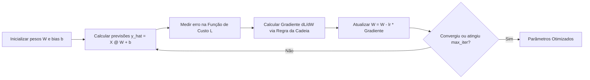

# 📐 Missão 22: Matemática Essencial para IA

## 1. 🚀 Briefing da Missão (Contexto Temático & Realidade de Mercado)

- **Galáxia:** 05 — Sistemas Inteligentes & ML (`ml`)
- **ID do Módulo:** `matematica-ia`
- **Pré-requisitos:** [NoSQL & Estratégias de Cache](../03-cinturao-de-arquitetura/) (`nosql-cache`)
- **Próxima Órbita:** [Missão 23 — Ciência de Dados com Python](./23-ciencia-de-dados-com-python.md) (`ciencia-dados-python`)
- **Descrição Oficial:** *"Os fundamentos matemáticos de tudo. Domine matrizes, vetores, derivadas e probabilidade básica para entender como as IAs aprendem."*

### Analogia do Navegador Cósmico

Imagine assumir o leme de uma nave de exploração interestelar em velocidade de dobra. Sem instrumentos matemáticos, pilotar é apertar botões no escuro torcendo para não colidir com um cinturão de asteroides. Nessa viagem, cada área da matemática atua como um módulo crítico do computador de bordo:

1. **Álgebra Linear (Vetores e Matrizes):** é o radar espacial de coordenadas. Posição, velocidade, orientação da nave e até a "assinatura" de um planeta habitável são guardados como listas ordenadas de números (vetores) e grades inteiras de sensores (matrizes).
2. **Produto Escalar e Similaridade de Cosseno:** é o detector de alinhamento de rota. Ele responde, em frações de segundo, se o vetor de empuxo dos motores aponta na mesma direção da estrela-alvo ou se está desviando do curso.
3. **Cálculo e Gradiente Descendente:** é o piloto automático de descida planetária. A nave mede a altitude e a inclinação do terreno (derivada) e ajusta os propulsores passo a passo para pousar exatamente no fundo mais seguro do vale de erro mínimo.
4. **Estatística e Teorema de Bayes:** é o sistema de análise de risco em tempestades solares. Mesmo quando os sensores falham ou há ruído cósmico, o navegador atualiza a probabilidade real de colisão combinando o histórico da rota com a nova leitura do radar.

### Qual dor real este módulo resolve em uma empresa de tecnologia

Muitos desenvolvedores júnior tratam Machine Learning como "importar uma biblioteca e chamar `.fit()`". Quando o modelo entra em produção e começa a errar caro — recomendando produtos absurdos, travando durante o treino ou aprovando fraudes — quem não domina a matemática básica fica completamente cego para diagnosticar a causa raiz.

Na prática das empresas de tecnologia, esse conhecimento resolve problemas concretos todos os dias:

- **Sistemas de busca e recomendação:** entender por que a Similaridade de Cosseno supera a distância euclidiana ao comparar perfis de usuários ou embeddings de texto em um e-commerce.
- **Debugging de treinamento:** identificar por que a função de perda explodiu para `NaN` (taxa de aprendizado alta demais no Gradiente Descendente) ou ficou estagnada (escalas desbalanceadas nas matrizes de entrada).
- **Análise confiável de métricas e dados:** saber quando a média salarial ou de ticket médio está sendo distorcida por poucos clientes bilionários (outliers) e quando um alerta de fraude tem alta chance de ser falso positivo usando o Teorema de Bayes.

---

## 2. 📚 Carga de Conhecimento Completa (Tópico por Tópico)

### 2.1 Álgebra Linear: Vetores, Matrizes e multiplicação matricial

Na computação científica e em IA, dados do mundo real são convertidos em estruturas numéricas multidimensionais:

- **Escalar:** um único número (por exemplo, temperatura `23.5` ou taxa de aprendizado `0.01`).
- **Vetor (1D):** uma lista ordenada de números representando um ponto no espaço ou um registro de atributos. Um usuário pode ser representado pelo vetor `u = [idade, renda_mensal, tempo_assinatura] = [28, 4500, 14]`.
- **Matriz (2D):** uma tabela retangular de números organizada em linhas (`m`) e colunas (`n`). Em um dataset tabular, cada linha costuma ser uma amostra (cliente, transação, sensor) e cada coluna é uma característica (*feature*).
- **Tensor (N-D):** generalização para 3 ou mais dimensões — por exemplo, um lote de imagens coloridas tem formato `(lote, altura, largura, canais_RGB)`.

A operação central das redes neurais e modelos lineares é a **multiplicação matricial** (`A @ B`). Para multiplicar uma matriz `A` de dimensão `(m, n)` por uma matriz `B` de dimensão `(n, p)`, o número de colunas de `A` **precisa** ser igual ao número de linhas de `B`. O resultado terá dimensão `(m, p)`:

```text
Matriz A (2 x 3)       Matriz B (3 x 2)       Resultado C (2 x 2)
[ 1   2   3 ]    @     [ 7   8 ]         =    [ (1*7 + 2*9 + 3*11)   (1*8 + 2*10 + 3*12) ]   =  [  58   64 ]
[ 4   5   6 ]          [ 9  10 ]              [ (4*7 + 5*9 + 6*11)   (4*8 + 5*10 + 6*12) ]      [ 139  154 ]
                       [11  12 ]
```

Por que isso importa tanto em hardware moderno? Porque GPUs e instruções vetoriais de CPU executam milhares dessas multiplicações em paralelo em vez de processar um dado por vez em laços `for`. Em uma camada de modelo linear `y_hat = X @ W + b`, milhares de clientes (`X`) são pontuados contra os pesos aprendidos (`W`) em uma única operação matricial.

### 2.2 Produto Escalar (Dot Product) e Similaridade de Cosseno

O **Produto Escalar** (*Dot Product*) pega dois vetores de mesmo tamanho `a` e `b`, multiplica elemento a elemento e soma todos os produtos:

```text
a · b = (a1 * b1) + (a2 * b2) + ... + (an * bn)
```

Geometricamente, o produto escalar mede o quanto dois vetores apontam na mesma direção multiplicado pelos seus comprimentos: `a · b = ||a|| * ||b|| * cos(theta)`, onde `||a||` é a norma (comprimento euclidiano) de `a` e `theta` é o ângulo entre eles.

O problema de usar o produto escalar puro em recomendações ou buscas de texto é que vetores "maiores" (um artigo muito longo, um usuário que comprou 500 itens) geram produtos escalares artificialmente altos mesmo quando o tema é diferente. A **Similaridade de Cosseno** resolve isso dividindo o produto escalar pelo produto das normas dos dois vetores:

```text
similaridade_cosseno(a, b) = (a · b) / (||a|| * ||b||)
```

A tabela abaixo resume a interpretação da Similaridade de Cosseno:

| Valor de `cos(theta)` | Ângulo entre vetores | Significado Prático |
| :--- | :--- | :--- |
| `+1.0` | `0°` (mesma direção) | Perfis ou textos extremamente similares em proporção |
| `0.0` | `90°` (ortogonais) | Nenhuma relação linear entre as características |
| `-1.0` | `180°` (opostos) | Preferências ou sentidos completamente opostos |

Se o Cliente A deu nota `[5, 5, 0]` para ação, ficção e romance, e o Cliente B deu `[1, 1, 0]`, o cosseno entre eles é `1.0` — ambos têm exatamente o mesmo gosto proporcional, embora o Cliente A avalie com notas maiores.

### 2.3 Cálculo: Conceito de Derivadas e Regra da Cadeia

Treinar um modelo de Machine Learning significa ajustar pesos para reduzir erros. Para saber em qual direção mexer um peso e com qual intensidade, precisamos do **Cálculo Diferencial**.

A **derivada** de uma função `f(w)` em um ponto mede a taxa de variação instantânea — a inclinação da reta tangente à curva naquele ponto:

- Se a derivada é **positiva** (`> 0`), aumentar `w` aumenta `f(w)`.
- Se a derivada é **negativa** (`< 0`), aumentar `w` diminui `f(w)`.
- Se a derivada é **zero** (`= 0`), estamos em um ponto plano (candidato a mínimo local, máximo local ou ponto de sela).

Quando a função depende de vários parâmetros ao mesmo tempo — por exemplo `L(w1, w2, b)` — calculamos a **derivada parcial** em relação a cada parâmetro tratando os outros como constantes. O vetor que reúne todas as derivadas parciais chama-se **Gradiente** (`∇L`).

E quando uma função é composta dentro de outra (como camadas de modelos ou predição seguida de função de erro)? Aplicamos a **Regra da Cadeia** (*Chain Rule*): multiplicamos as taxas de variação de fora para dentro.

Se o erro `L` depende da predição `y_hat`, e `y_hat` depende do peso `w`, então:

```text
dL / dw = (dL / dy_hat) * (dy_hat / dw)
```

É exatamente essa multiplicação encadeada de derivadas locais que permite ao algoritmo de *Backpropagation* (usado em redes neurais na Galáxia 6) descobrir a responsabilidade de cada parâmetro no erro final.

### 2.4 Otimização com Gradient Descent (Gradiente Descendente)

O **Gradient Descent** (Gradiente Descendente) é o motor de otimização iterativa mais importante da IA. Como o vetor gradiente `∇L` aponta sempre para a direção de **maior subida** da função de custo `L`, caminhar no sentido **oposto** (`-∇L`) garante descer a montanha do erro em direção a um vale de custo mínimo.

A regra fundamental de atualização de parâmetros é:

```text
w_novo = w_atual - eta * (dL / dw)
```

Onde `eta` (letra grega eta) é a **Taxa de Aprendizado** (*Learning Rate*), um hiperparâmetro crucial:

- **Taxa pequena demais (`0.00001`):** a descida é segura, mas leva milhares de iterações lentas para convergir.
- **Taxa equilibrada (`0.01` a `0.1`, dependendo da escala):** converge suavemente para o mínimo.
- **Taxa alta demais (`1.5` ou `10.0`):** o passo salta de um lado do vale para o outro cada vez mais alto, fazendo o erro divergir até estourar em `inf` ou `NaN`.



Na prática, existem três variações principais conforme a quantidade de dados usada por passo:

1. **Batch Gradient Descent:** usa todo o dataset em cada atualização. Estável, porém pesado em RAM para milhões de linhas.
2. **Stochastic Gradient Descent (SGD):** atualiza os pesos olhando apenas 1 amostra por vez. Muito rápido, porém com trajetória ruidosa.
3. **Mini-Batch Gradient Descent:** o padrão da indústria; processa blocos de `32`, `64` ou `256` amostras por passo, equilibrando estabilidade e velocidade em GPU/CPU.

### 2.5 Estatística Descritiva: Média, Mediana, Desvio Padrão e Distribuição Normal

Antes de alimentar modelos, você precisa resumir o comportamento dos seus dados sem cair em armadilhas estatísticas:

- **Média Aritmética:** soma de todos os valores dividida pela quantidade (`n`). Representa o centro de gravidade dos dados, mas é extremamente sensível a valores extremos (*outliers*).
- **Mediana:** o valor central quando os dados estão ordenados. Em distribuições assimétricas (salários, preços de imóveis, tempo de atendimento com travamentos raros), a mediana descreve o caso típico com muito mais honestidade do que a média.
- **Variância (`sigma²`) e Desvio Padrão (`sigma`):** medem o quão espalhados os valores estão em torno da média. O desvio padrão tem a vantagem de estar na mesma unidade da variável original (reais, segundos, metros).

Muitos fenômenos naturais e erros de medição seguem aproximadamente a **Distribuição Normal** (curva gaussiana em formato de sino, simétrica em torno da média `mu`). Nela vale a regra empírica:

- Cerca de **68%** dos dados ficam dentro de `1` desvio padrão (`mu +/- 1*sigma`).
- Cerca de **95%** dos dados ficam dentro de `2` desvios padrões (`mu +/- 2*sigma`).
- Cerca de **99,7%** dos dados ficam dentro de `3` desvios padrões (`mu +/- 3*sigma`).

Disso nasce o **Z-score** (`z = (x - mu) / sigma`), usado tanto para detectar anomalias (`|z| > 3`) quanto para padronizar variáveis numéricas antes de treinar modelos de Machine Learning.

### 2.6 Probabilidade Condicional e o Teorema de Bayes

A **Probabilidade Condicional** `P(A | B)` representa a chance de o evento `A` acontecer **sabendo que** o evento `B` já ocorreu. Uma confusão fatal entre iniciantes é achar que `P(A | B)` é igual a `P(B | A)`. A probabilidade de um animal ter 4 patas dado que é um cachorro (`P(4 patas | Cachorro)`) é quase 100%, mas a probabilidade de ser um cachorro dado que tem 4 patas (`P(Cachorro | 4 patas)`) é bem menor (pode ser gato, cavalo, mesa ou cadeira).

O **Teorema de Bayes** permite inverter essa condicionalidade com precisão matemática:

```text
P(H | E) = [ P(E | H) * P(H) ] / P(E)
```

Cada termo possui um papel claro na tomada de decisão sob incerteza:

- **`P(H)` — Prior (Probabilidade a Priori):** o que já sabemos antes da nova evidência (por exemplo, apenas `1%` das transações no sistema são fraudes reais).
- **`P(E | H)` — Likelihood (Verossimilhança):** chance de observar a evidência `E` quando a hipótese `H` é verdadeira (por exemplo, o detector acusa alerta em `95%` das fraudes reais).
- **`P(E)` — Evidência Marginal:** chance total de a evidência `E` aparecer no universo todo (somando verdadeiros positivos e falsos positivos).
- **`P(H | E)` — Posterior (Probabilidade a Posteriori):** probabilidade atualizada de `H` depois que observamos `E`.

Esse teorema fundamenta o classificador *Naive Bayes* (muito usado em filtros de spam e classificação rápida de texto), sistemas de inferência bayesiana e a avaliação correta de alertas médicos ou antifraude onde eventos raros geram muitos falsos positivos se ignorarmos o `Prior`.

---

## 3. 💻 Mão no Código (Jeito Iniciante vs. Padrão Profissional)

Abaixo comparamos a implementação ingênua usando laços Python puros e cálculos soltos com a implementação vetorizada e estruturada em **NumPy**, simulando similaridade semântica, Gradiente Descendente para Regressão Linear e inferência Bayesiana.

### ❌ Jeito Iniciante (Lento, frágil e sujeito a bugs numéricos)

```python
import math

# ANTIPADRÃO 1: Similaridade de cosseno com laços manuais e sem validação de norma zero
def cosseno_lento(v1, v2):
    dot = 0
    norm1 = 0
    norm2 = 0
    for i in range(len(v1)):
        dot += v1[i] * v2[i]
        norm1 += v1[i] ** 2
        norm2 += v2[i] ** 2
    # Bug: se um vetor for todo zero, lança ZeroDivisionError sem tratamento!
    return dot / (math.sqrt(norm1) * math.sqrt(norm2))


# ANTIPADRÃO 2: Gradient Descent sem vetorização e com learning rate perigosa
x_dados = [10, 20, 30, 40, 50]  # Escala alta sem normalização
y_dados = [22, 41, 63, 79, 102]

w = 0.0
b = 0.0
lr = 0.01  # Em escala [10..50], lr=0.01 explode o gradiente rapidamente!

for epoca in range(100):
    grad_w = 0.0
    grad_b = 0.0
    n = len(x_dados)
    for i in range(n):
        pred = w * x_dados[i] + b
        erro = pred - y_dados[i]
        grad_w += (2 / n) * erro * x_dados[i]
        grad_b += (2 / n) * erro
    w = w - lr * grad_w
    b = b - lr * grad_b

print("Pesos com risco de explosão:", w, b)
```

**O que há de errado aqui?**
1. Laços `for` em Python puro não usam vetorização em C/SIMD e ficam dezenas de vezes mais lentos com datasets reais.
2. `cosseno_lento` quebra com `ZeroDivisionError` se receber um vetor nulo `[0, 0, 0]`.
3. O Gradiente Descendente recebe `x_dados` sem escala (`10` a `50`) com `lr = 0.01`, o que faz os gradientes multiplicarem por `x_dados` ao quadrado (`~1100`) e explodirem para `inf` / `NaN` em poucas iterações.

### ✅ Padrão Profissional (Vetorizado com NumPy, estável e rastreável)

```python
import numpy as np


def cosine_similarity(vec_a: np.ndarray, vec_b: np.ndarray) -> float:
    """Calcula a similaridade de cosseno entre dois vetores 1D com proteção contra norma zero."""
    norm_a = np.linalg.norm(vec_a)
    norm_b = np.linalg.norm(vec_b)
    if norm_a == 0.0 or norm_b == 0.0:
        return 0.0
    return float(np.dot(vec_a, vec_b) / (norm_a * norm_b))


def train_linear_gd(
    X: np.ndarray,
    y: np.ndarray,
    learning_rate: float = 0.05,
    epochs: int = 500,
) -> tuple[np.ndarray, float, list[float]]:
    """Treina regressão linear via Gradient Descent vetorizado após padronização Z-score."""
    # Padroniza X para evitar explosão numérica e acelerar convergência
    mean = X.mean(axis=0)
    std = np.where(X.std(axis=0) == 0, 1.0, X.std(axis=0))
    X_scaled = (X - mean) / std

    n_samples, n_features = X_scaled.shape
    weights = np.zeros(n_features, dtype=np.float64)
    bias = 0.0
    loss_history: list[float] = []

    for _ in range(epochs):
        # Forward pass vetorizado: (n_samples, n_features) @ (n_features,) -> (n_samples,)
        y_pred = X_scaled @ weights + bias
        errors = y_pred - y

        # Função de custo MSE (Mean Squared Error)
        mse = float(np.mean(errors ** 2))
        loss_history.append(mse)

        # Gradientes analíticos via Regra da Cadeia vetorizada
        grad_w = (2.0 / n_samples) * (X_scaled.T @ errors)
        grad_b = (2.0 / n_samples) * float(np.sum(errors))

        # Passo descendente
        weights -= learning_rate * grad_w
        bias -= learning_rate * grad_b

    return weights, bias, loss_history


def bayes_posterior(prior: float, sensitivity: float, false_positive_rate: float) -> float:
    """Calcula P(Hipótese | Evidência Positiva) usando o Teorema de Bayes."""
    p_evidence = (sensitivity * prior) + (false_positive_rate * (1.0 - prior))
    if p_evidence == 0.0:
        return 0.0
    return (sensitivity * prior) / p_evidence


if __name__ == "__main__":
    # 1) Teste de Similaridade de Cosseno entre embeddings simulados
    doc_ia = np.array([0.9, 0.8, 0.1])
    doc_ml = np.array([0.85, 0.75, 0.15])
    doc_culinaria = np.array([0.05, 0.1, 0.98])
    print(f"Cos(IA, ML): {cosine_similarity(doc_ia, doc_ml):.4f}")
    print(f"Cos(IA, Culinária): {cosine_similarity(doc_ia, doc_culinaria):.4f}")

    # 2) Teste de Gradient Descent vetorizado
    X_raw = np.array([[10.0], [20.0], [30.0], [40.0], [50.0]])
    y_raw = np.array([22.0, 41.0, 63.0, 79.0, 102.0])
    w_fit, b_fit, losses = train_linear_gd(X_raw, y_raw, learning_rate=0.05, epochs=300)
    print(f"MSE inicial: {losses[0]:.2f} -> MSE final: {losses[-1]:.4f}")

    # 3) Teste Bayesiano: Fraude rara (1% prior), detector 95% sensível, 5% falso positivo
    prob_real_fraud = bayes_posterior(prior=0.01, sensitivity=0.95, false_positive_rate=0.05)
    print(f"Probabilidade real de fraude dado alerta positivo: {prob_real_fraud:.2%}")
```

---

## 4. 🛠️ Laboratório de Voo (Exercício Prático Guiado)

**Duração estimada:** 40 minutos  
**Objetivo:** Construir um pequeno motor diagnóstico combinando Álgebra Linear, Gradiente Descendente e Inferência Bayesiana em um único script Python usando apenas `numpy`.

### Passo a Passo da Missão

1. Crie uma pasta local `lab-matematica-ia` e ative um ambiente virtual Python com `numpy` instalado (`pip install numpy`).
2. **Parte A — Mini Buscador por Similaridade:** defina 4 vetores de 4 dimensões representando documentos técnicos (`["python", "dados", "ml", "frontend"]`) e um vetor de consulta do usuário `[1, 1, 1, 0]`. Ranqueie os documentos do maior para o menor `cosine_similarity`.
3. **Parte B — Experimento de Taxa de Aprendizado:** gere dados sintéticos `X = np.linspace(1, 20, 40).reshape(-1, 1)` e `y = 3.5 * X.squeeze() + 7 + ruido`. Execute a função `train_linear_gd` com 3 taxas diferentes: `lr = 0.0005` (lenta), `lr = 0.05` (ideal) e `lr = 1.2` (instável). Imprima o MSE na época `0`, `50` e `200` para cada caso.
4. **Parte C — Auditoria Bayesiana:** calcule com `bayes_posterior` qual é a probabilidade real de uma falha crítica no motor da nave quando o evento ocorre em `0.5%` dos voos (`prior = 0.005`), o sensor acerta `98%` das falhas (`sensitivity = 0.98`) e gera alarme falso em `4%` dos voos normais (`false_positive_rate = 0.04`). Compare com o resultado caso um segundo sensor independente confirme o alerta (use o posterior obtido como novo `prior`).

### Critérios de Domínio

- [ ] Seu script roda sem erros e sem loops Python dentro dos cálculos matriciais principais.
- [ ] Você consegue demonstrar numericamente que `lr = 1.2` faz o MSE crescer ou explodir enquanto `lr = 0.05` reduz o MSE de forma monotônica.
- [ ] Você observa que, no primeiro alerta bayesiano, a probabilidade real ainda é baixa (~`10.96%`) por causa da taxa base rara (`0.5%`), subindo drasticamente após uma segunda evidência independente (~`75.08%`).

---

## 5. 🎯 Resolução Comentada do Teste de Ignição (Quest Oficial)

> **Pergunta Oficial:**
> *"Como o algoritmo de Gradient Descent (Gradiente Descendente) utiliza derivadas para otimizar os parâmetros de um modelo de Machine Learning?"*
>
> - **A)** Ele calcula a derivada para encontrar a direção de subida e maximizar o erro do modelo.
> - **B)** Ele calcula a derivada da função de custo em relação aos pesos para determinar a direção de maior declive, permitindo ajustar os pesos gradualmente no sentido de minimizar o erro.
> - **C)** Ele ignora as derivadas e sorteia valores aleatórios até que o erro caia a zero.
> - **D)** Ele usa a derivada para apagar os dados que contêm ruídos ou falhas na medição.

### Gabarito Comentado

- **✅ Resposta Correta: Alternativa B.**  
  O vetor gradiente é composto pelas derivadas parciais da função de custo em relação a cada peso do modelo. Como o gradiente positivo aponta para onde o erro mais cresce, o algoritmo subtrai uma fração desse gradiente (`w = w - lr * gradiente`), caminhando na direção de **maior declive** para reduzir progressivamente a função de custo até convergir para um ponto mínimo.

- **❌ Por que a A está incorreta?**  
  Encontrar a direção de subida e maximizar o erro seria *Gradient Ascent* aplicado à função de custo — exatamente o oposto do que queremos ao treinar um modelo preditivo (queremos *minimizar* o erro, e não piorá-lo).

- **❌ Por que a C está incorreta?**  
  Sortear valores aleatórios caracteriza busca aleatória (*Random Search*) cega, que se torna computacionalmente inviável em modelos com dezenas, milhares ou bilhões de parâmetros. O uso de derivadas fornece direção e magnitude exatas.

- **❌ Por que a D está incorreta?**  
  Derivadas operam sobre os parâmetros do modelo em relação à função de erro durante a otimização; elas não limpam nem deletam registros com ruído do conjunto de dados (limpeza de dados pertence à etapa de análise exploratória e pré-processamento).

---

## 6. 🎤 Kit de Apresentação (Como Dar Aula / Apresentar Este Módulo)

### Pitch Feynman de 2 Minutos

> "Muita gente acha que inteligência artificial aprende de forma mágica, mas na verdade ela aprende usando três ideias bem concretas que cabem em uma folha de papel: representar o mundo em tabelas de números, medir o quanto está errando e descer uma montanha até o ponto mais baixo do erro.
>
> Primeiro, a Álgebra Linear transforma tudo — imagens, frases ou histórico de compras — em vetores e matrizes. Para saber se duas coisas são parecidas, como um filme que você gostou e outro do catálogo, medimos o ângulo entre seus vetores com a Similaridade de Cosseno.
>
> Segundo, quando um modelo faz uma previsão, ele erra. A gente mede esse erro com uma função de custo e usa o Cálculo — as derivadas — para perguntar: se eu mexer um pouquinho neste peso para cima ou para baixo, o erro sobe ou desce? O Gradiente Descendente junta essas respostas pela Regra da Cadeia e dá pequenos passos ladeira abaixo até o modelo errar o mínimo possível.
>
> Por fim, o mundo real nunca é 100% determinístico. Estatística e o Teorema de Bayes garantem que o sistema não seja enganado por casos extremos nem dispare alarmes falsos ignorando o quão raro um evento realmente é."

### Roteiro de Slides (6 Slides)

| Slide | Título | Bullets-Chave | Sugestão Visual |
| :--- | :--- | :--- | :--- |
| **1** | Por que matemática é o motor da IA? | Do código "caixa preta" ao diagnóstico real; Os 3 pilares: Álgebra, Cálculo, Estatística | Nave espacial conectando Radar (Álgebra), Piloto Automático (Cálculo) e Risco (Bayes) |
| **2** | Vetores, Matrizes e Produto Escalar | Representação tabular `(amostras, features)`; Multiplicação matricial como inferência em lote | Diagrama visual de grade `(m, n) @ (n, p)` destacando linhas x colunas |
| **3** | Similaridade de Cosseno na Prática | Por que o tamanho do vetor engana; Ângulo `0°` vs `90°`; Uso em buscas e recomendações | Gráfico 2D comparando dois vetores longos/curtos com mesmo ângulo vs distância euclidiana |
| **4** | Derivadas, Regra da Cadeia e Gradient Descent | Inclinação da curva de erro; Fórmula `w = w - lr * grad`; Impacto de `learning_rate` baixa vs alta | Parábola de custo com bolinha descendo suavemente vs saltando para fora da curva |
| **5** | Estatística e Armadilhas de Dados | Média vs Mediana com outliers; Desvio padrão e Z-score na Curva Normal | Gráfico de distribuição salarial mostrando média deslocada pela cauda longa |
| **6** | Teorema de Bayes contra Falsos Positivos | Confusão `P(A|B)` vs `P(B|A)`; Prior + Evidência = Posterior | Árvore de frequência natural com 1.000 transações (10 fraudes vs 49 falsos positivos) |

### Roteiro de Demo Ao Vivo (3 Minutos)

1. **(0:00–1:00)** Abra o script Python no terminal ou notebook e rode um comparativo cronometrado somando/multiplicando 1 milhão de elementos em `for` puro vs `np.dot()`, mostrando a diferença instantânea de velocidade.
2. **(1:00–2:15)** Execute `train_linear_gd` ao vivo mudando apenas `learning_rate`: mostre na tela o erro caindo limpo com `0.05` e imediatamente explodindo com `1.5`, explicando o conceito visualmente sem tocar em jargão complexo.
3. **(2:15–3:00)** Rode `bayes_posterior(0.01, 0.95, 0.05)` e pergunte à plateia qual ela acha que é a chance de ser fraude antes de revelar `16.1%` — esse momento gera engajamento imediato.

### Perguntas Difíceis da Plateia

- **Pergunta 1:** *"Preciso dominar cálculo integral avançado e demonstrar teoremas na mão para conseguir minha primeira vaga júnior em IA?"*  
  **Resposta segura:** "Não para começar como júnior em engenharia de ML ou ciência de dados aplicada. Você precisa de domínio conceitual e operacional: entender multiplicação de matrizes para depurar dimensões (`shape mismatch`), compreender derivadas e gradiente para calibrar otimizadores e interpretar curvas de erro, e saber estatística/probabilidade para não tirar conclusões falsas dos dados."
- **Pergunta 2:** *"Por que sistemas de busca semântica usam Similaridade de Cosseno em vez da distância normal (euclidiana) entre dois pontos?"*  
  **Resposta segura:** "Porque a distância euclidiana é sensível à magnitude absoluta do vetor. Em textos ou históricos de usuários, um documento com o mesmo assunto repetido várias vezes fica mais distante na escala euclidiana de um resumo curto, mesmo apontando exatamente para o mesmo tópico semântico. A Similaridade de Cosseno normaliza os comprimentos e compara apenas a direção."

---

## 7. 💼 Radar do Mercado de Trabalho (Foco Dev Júnior)

### 3 Perguntas Reais de Entrevista Técnica Júnior

1. **Pergunta:** *"O que acontece na prática durante o treinamento se a taxa de aprendizado (learning rate) do Gradiente Descendente for muito alta ou muito baixa?"*  
   **Resposta-modelo:** "Se for muito baixa, os passos de atualização dos pesos são minúsculos: o modelo converge muito devagar, consome mais tempo de computação e pode parar antes de atingir um bom mínimo. Se for muito alta, os passos ultrapassam o vale da função de custo e oscilam com amplitude crescente até o treinamento divergir, frequentemente gerando valores `NaN`."
2. **Pergunta:** *"Qual a diferença entre Produto Escalar e Similaridade de Cosseno, e quando a escolha entre eles muda o resultado?"*  
   **Resposta-modelo:** "O produto escalar multiplica as projeções considerando também a magnitude dos vetores, enquanto a similaridade de cosseno divide o produto escalar pelo produto das normas, restringindo o resultado entre `-1` e `1`. Quando os vetores não estão normalizados e suas magnitudes variam muito — como contagem de palavras em textos curtos e longos — o produto escalar favorece vetores maiores, enquanto o cosseno mede apenas o alinhamento de direção."
3. **Pergunta:** *"Nosso sistema antifraude tem acurácia de 95% e sensibilidade de 95%, mas quase todo alerta disparado é falso positivo. Como você explica isso matematicamente?"*  
   **Resposta-modelo:** "Pelo Teorema de Bayes e o efeito da taxa base (*Base Rate Fallacy*). Se a fraude ocorre em apenas 1% das transações (`Prior = 0.01`), 5% de falsos positivos sobre os 99% legítimos geram muito mais alertas errados em volume absoluto do que os 95% verdadeiros capturados sobre 1%. Calculando a probabilidade posterior `P(Fraude | Alerta)`, vemos que cerca de 16% dos alertas são fraudes reais, exigindo ajuste de limiar ou mais sinais confirmatórios."

### Erros Clássicos de Júnior vs. Postura Profissional

| Erro Clássico de Júnior | Postura Profissional Esperada |
| :--- | :--- |
| Escrever laços `for` em Python puro para multiplicar vetores e matrizes | Vetorizar operações em **NumPy**, verificando `.shape` antes de multiplicar |
| Ignorar `NaN` no treinamento sem investigar o `learning_rate` ou escala das features | Checar normalização de entrada e testar taxas de aprendizado em escala logarítmica |
| Resumir toda variável numérica apenas pela média aritmética | Avaliar média junto com **mediana, percentis e desvio padrão** para identificar assimetria e outliers |
| Interpretar `P(Alerta | Fraude)` como se fosse `P(Fraude | Alerta)` | Aplicar o **Teorema de Bayes** considerando a prevalência real do evento (`Prior`) |

### Evidência para Portfólio / GitHub / LinkedIn

- **No GitHub:** publique um repositório curto chamado `math-for-ml-from-scratch` contendo um notebook limpo demonstrando Gradiente Descendente animado/plotado para 3 `learning_rates` e um buscador simples de frases usando TF-IDF + Similaridade de Cosseno em NumPy puro.
- **No LinkedIn:** escreva um post curto com o código do cálculo Bayesiano mostrando o paradoxo do alarme antifraude com números reais — recrutadores e Tech Leads valorizam muito quem consegue traduzir matemática em impacto de negócio.

---

## 8. 📡 Transmissões Recomendadas & Próxima Órbita

### Recursos Oficiais do Módulo

- [Álgebra Linear - Khan Academy](https://pt.khanacademy.org/math/linear-algebra)
- [Cálculo 1 e 2 - Khan Academy](https://pt.khanacademy.org/math/calculus-1)
- [3Blue1Brown: Essência do Álgebra Linear (YouTube)](https://www.youtube.com/playlist?list=PLZHQObOWTQDPD3MizzM2xVFitgF8hE_ab)

### Conexão com a Próxima Órbita

Agora que você domina vetores, matrizes, gradientes e probabilidade no papel e em NumPy básico, está pronto para operar o ferramental completo de manipulação, limpeza e visualização de grandes tabelas reais na **[Missão 23 — Ciência de Dados com Python](./23-ciencia-de-dados-com-python.md)**.
