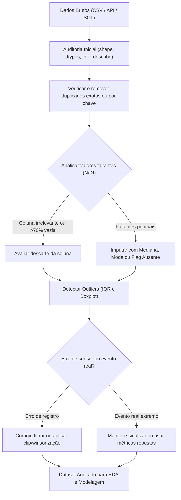

# 🐍 Missão 23: Ciência de Dados com Python

## 1. 🚀 Briefing da Missão (Contexto Temático & Realidade de Mercado)

- **Galáxia:** 05 — Sistemas Inteligentes & ML (`ml`)
- **ID do Módulo:** `ciencia-dados-python`
- **Pré-requisitos:** [Missão 22 — Matemática Essencial para IA](./22-matematica-essencial-para-ia.md) (`matematica-ia`)
- **Próxima Órbita:** [Missão 24 — Fundamentos de ML Clássico](./24-fundamentos-de-ml-classico.md) (`ml-classico`)
- **Descrição Oficial:** *"Aprenda a manipular grandes volumes de informação. Domine o ecossistema científico da linguagem Python usando notebooks interativos."*

### Analogia do Navegador Cósmico

A bordo de uma estação orbital de pesquisa, seus telescópios recebem milhões de registros de telemetria por hora: logs de propulsão, temperatura de reatores, leituras de radar e inventário de carga. Porém, o espaço é hostil aos dados: pacotes chegam corrompidos (`NaN`), sensores enviam sinais repetidos (`duplicados`), raios cósmicos geram leituras absurdas de temperatura (`outliers`) e cada subsistema grava informações em tabelas separadas.

Sem uma **Usina de Refinamento de Telemetria**, jogar esses dados direto nos motores de Machine Learning é garantia de pane — o famoso princípio *Garbage In, Garbage Out* (lixo entra, lixo sai). Nessa analogia:

- **Jupyter e Google Colab:** são a bancada interativa de comando, onde você testa hipóteses em tempo real com código, tabelas e gráficos lado a lado.
- **NumPy:** é o motor de propulsão em C que transforma matrizes gigantes de números em velocidade supersônica.
- **Pandas:** é a linha de triagem e cruzamento tabular que alinha colunas, limpa sujeiras e une tabelas diferentes como um JOIN espacial.
- **Matplotlib e Seaborn:** são os monitores holográficos que revelam anomalias e padrões invisíveis em tabelas de texto.

### Qual dor real este módulo resolve em uma empresa de tecnologia

Em projetos reais de Dados e IA, profissionais passam cerca de **70% a 80% do tempo** entendendo, limpando, cruzando e validando dados — e não apenas treinando algoritmos. Empresas sofrem diariamente com planilhas inconsistentes, datas em formatos mistos (`"2025-03-10"` junto com `"10/03/2025"`), clientes duplicados por falha de integração entre APIs e métricas comerciais distorcidas por transações de teste com valor `9999999`.

Dominar esse ecossistema transforma você no profissional que recebe dados brutos e caóticos de um banco ou API e entrega tabelas auditadas, insights visuais acionáveis e datasets confiáveis para modelagem.

---

## 2. 📚 Carga de Conhecimento Completa (Tópico por Tópico)

### 2.1 Configurar e rodar notebooks no Jupyter e Google Colab

Notebooks (`.ipynb`) combinam **células de código executável**, **células de texto em Markdown** e **saídas ricas** (tabelas HTML, gráficos e métricas) no mesmo documento. Isso os torna ideais para Análise Exploratória de Dados (EDA) e experimentação rápida.

- **Jupyter Notebook / JupyterLab Local:** roda no seu computador dentro de um ambiente virtual isolado (`python -m venv .venv` ou `uv`/`conda`), preservando privacidade dos dados da empresa e permitindo versionamento junto ao projeto. Para instalar e iniciar localmente: `pip install jupyterlab numpy pandas matplotlib seaborn` seguido de `jupyter lab`.
- **Google Colab:** ambiente gerenciado na nuvem dentro do navegador, com bibliotecas científicas pré-instaladas, integração direta com Google Drive e GitHub, além de acesso gratuito a **GPUs e TPUs** para cargas pesadas. Excelente para estudos, protótipos e compartilhamento imediato via link.

**Armadilha clássica do estado oculto:** como notebooks permitem rodar células fora de ordem (por exemplo, executar a célula 5, editar a célula 2 e rodar a célula 8), variáveis antigas podem continuar vivas na memória mesmo após você apagar código. A regra profissional é sempre executar **Kernel -> Restart Kernel and Run All Cells** antes de considerar uma análise concluída ou enviar um commit. Para código reutilizável em produção, extraia funções limpas para arquivos `.py` em `src/`.

### 2.2 Utilizar NumPy para operações de alta performance em matrizes e vetores

Listas nativas do Python (`list`) guardam ponteiros espalhados pela memória para objetos dinâmicos de tipos mistos. Para percorrer milhões de elementos, o interpretador Python precisa checar tipos a cada passo — o que é lento.

O **`ndarray`** (N-dimensional array) do **NumPy** armazena elementos de **tipo único e homogêneo** (como `float64` ou `int32`) em um bloco **contíguo de memória** e delega laços matemáticos para rotinas compiladas em C/Fortran.

Recursos essenciais do NumPy no dia a dia:

- **Criação e inspeção:** `np.array()`, `np.zeros((3, 4))`, `np.arange(0, 10, 2)`, `np.linspace(0, 1, 5)`, verificando sempre `.shape`, `.dtype` e `.ndim`.
- **Operações vetorizadas e Broadcasting:** você soma um escalar a um milhão de números (`arr * 1.15`) ou soma um vetor linha a todas as linhas de uma matriz (`matriz + vetor_linha`) sem escrever nenhum laço `for`.
- **Máscaras booleanas:** filtragem instantânea em memória, como `arr[(arr > 10) & (arr < 100)]`.
- **Agregações por eixo (`axis`):** `axis=0` reduz ao longo das linhas (produzindo uma métrica **por coluna**); `axis=1` reduz ao longo das colunas (produzindo uma métrica **por linha**).

### 2.3 Manipular e limpar tabelas de dados usando DataFrames do Pandas

O **Pandas** constrói duas estruturas sobre o NumPy:

- **`Series`:** uma única coluna rotulada por um índice.
- **`DataFrame`:** uma tabela bidimensional onde cada coluna é uma `Series` que pode ter tipo próprio (`int64`, `float64`, `datetime64[ns]`, `object`/`string`, `category`, `bool`).

Operações fundamentais que todo analista e engenheiro de dados precisa dominar sem hesitar:

1. **Ingestão tipada:** `pd.read_csv(..., parse_dates=["data_compra"], dtype={"id_cliente": "string"})`, `pd.read_parquet()`, `pd.read_json()`. Prefira `Parquet` para volumes médios e grandes por preservar tipos e comprimir o arquivo.
2. **Indexação explícita (`.loc` vs `.iloc`):** `.loc[linhas, colunas]` seleciona por **rótulos e condições booleanas** (`df.loc[df["uf"] == "SP", ["id", "valor"]]`), enquanto `.iloc[linhas, colunas]` seleciona estritamente por **posição numérica inteira** (`df.iloc[0:5, 0:3]`). Evite indexação encadeada como `df[df["a"] > 0]["b"] = 1`, que dispara `SettingWithCopyWarning` e falha silenciosamente.
3. **Agrupamentos com `groupby().agg()`:** resume métricas de negócio por categoria, por exemplo `df.groupby("categoria", as_index=False).agg(receita_total=("valor", "sum"), ticket_medio=("valor", "mean"))`.
4. **Junções e Empilhamentos (`df.merge()` vs `pd.concat()`):**
   - `df.merge(outro_df, on="cliente_id", how="left", validate="many_to_one")` executa cruzamento relacional por chave comum, exatamente como um `JOIN` em SQL. Usar `validate=` protege contra multiplicação acidental de linhas por chaves duplicadas.
   - `pd.concat([df_jan, df_fev], ignore_index=True)` empilha tabelas com mesmas colunas verticalmente (`axis=0`) ou cola blocos lado a lado por índice (`axis=1`).

### 2.4 Lidar com valores faltantes (NaN), duplicados e outliers nos dados

Dados reais quase sempre chegam incompletos ou sujos. A limpeza profissional segue uma ordem auditável:



- **Duplicados:** diagnostique com `df.duplicated(subset=["id_pedido"]).sum()` antes de chamar `df.drop_duplicates(subset=["id_pedido"], keep="last")`. Nunca apague duplicados sem saber qual registro deve prevalecer (`keep="first"` ou `keep="last"` após ordenação por data).
- **Valores Faltantes (`NaN` / `None` / `NaT`):** verifique proporções com `df.isna().mean().sort_values(ascending=False)`. Evite `df.dropna()` indiscriminado no DataFrame inteiro porque você pode jogar fora metade da base por causa de uma única coluna opcional. Avalie se o `NaN` significa "zero", "não informado" (categoria `"Desconhecido"`) ou demanda imputação pela **mediana** (preferível à média quando há assimetria). Importante: em Machine Learning, imputações estatísticas calculadas na base inteira antes do split geram *Data Leakage* — veremos como fazer dentro do `Pipeline` na Missão 24.
- **Outliers (Valores Atípicos):** dois métodos rápidos na etapa exploratória são o **Z-score** (para dados aproximadamente normais) e o **Método IQR (Intervalo Interquartil)**:
  - `Q1 = 25º percentil`, `Q3 = 75º percentil`, `IQR = Q3 - Q1`.
  - Limites padrão de Tukey: `limite_inferior = Q1 - 1.5 * IQR` e `limite_superior = Q3 + 1.5 * IQR`.
  - **Regra de ouro:** outlier não é sinônimo automático de erro! Um cliente que gastou R\$ 80.000 em joias pode ser seu cliente VIP; já uma idade de `245` anos ou temperatura de `-999` é erro de coleta. Investigue antes de deletar.

### 2.5 Criar gráficos exploratórios com as bibliotecas Matplotlib e Seaborn

**Matplotlib** é a biblioteca fundacional de plotagem do Python, oferecendo controle milimétrico sobre figuras e eixos. **Seaborn** é construída sobre o Matplotlib com foco estatístico, trabalhando nativamente com DataFrames do Pandas e gerando visualizações claras com poucas linhas.

Para criar gráficos profissionais com Matplotlib, prefira a **interface Orientada a Objetos (`fig, ax = plt.subplots()`)** em vez de comandos implícitos soltos de `plt.*`: ela permite compor painéis múltiplos (`subplots(1, 3)`), definir títulos, unidades nos eixos e salvar em alta resolução (`fig.savefig("eda.png", dpi=150, bbox_inches="tight")`).

Escolha o gráfico certo conforme a pergunta exploratória:

| Pergunta Exploratória | Gráfico Indicado | Função Seaborn / Matplotlib |
| :--- | :--- | :--- |
| Como uma variável numérica se distribui? | Histograma + Curva de Densidade (KDE) | `sns.histplot(data=df, x="valor", kde=True, ax=ax)` |
| Onde estão a mediana, quartis e outliers? | Boxplot ou Violin Plot | `sns.boxplot(data=df, x="plano", y="tempo_uso", ax=ax)` |
| Há relação entre duas variáveis numéricas? | Gráfico de Dispersão (Scatter Plot) | `sns.scatterplot(data=df, x="visitas", y="gasto", hue="churn", ax=ax)` |
| Qual categoria gera mais volume ou média? | Gráfico de Barras ordenado | `sns.barplot(data=df, x="categoria", y="receita", ax=ax)` |
| Quais variáveis numéricas caminham juntas? | Mapa de Calor (Heatmap) de Correlação | `sns.heatmap(corr_matrix, annot=True, fmt=".2f", cmap="coolwarm")` |

---

## 3. 💻 Mão no Código (Jeito Iniciante vs. Padrão Profissional)

Neste exemplo completo, recebemos duas tabelas simulando pedidos de e-commerce e cadastro de clientes com problemas reais: duplicados, `NaN`, strings numéricas sujas e um valor de pedido absurdo (outlier de sistema).

### ❌ Jeito Iniciante (Lento com `iterrows()`, perde dados e dispara avisos)

```python
import pandas as pd
import matplotlib.pyplot as plt

pedidos = pd.DataFrame({
    "pedido_id": [1, 2, 2, 3, 4, 5],
    "cliente_id": [10, 20, 20, 30, 40, 50],
    "valor": ["150.0", "200.0", "200.0", None, "180.0", "999999.0"],
})
clientes = pd.DataFrame({
    "cliente_id": [10, 20, 30, 40],
    "segmento": ["Prata", "Ouro", "Bronze", "Ouro"],
})

# ANTIPADRÃO 1: dropna() cego sem analisar impacto nem remover duplicados antes
pedidos = pedidos.dropna()

# ANTIPADRÃO 2: iterrows() lento linha por linha e mistura de tipos sem conversão prévia
taxas = []
for idx, row in pedidos.iterrows():
    val = float(row["valor"])
    if val > 180:
        taxas.append(val * 0.1)
    else:
        taxas.append(val * 0.05)
pedidos["taxa"] = taxas

# ANTIPADRÃO 3: merge sem especificar how/validate (perde cliente 50 silenciosamente no inner join)
tabela = pedidos.merge(clientes, on="cliente_id")

# ANTIPADRÃO 4: gráfico sem título, eixos ou tratamento do outlier 999999
plt.hist(tabela["valor"].astype(float))
plt.show()
```

**Problemas do código iniciante:**
1. Removeu o pedido `3` inteiro só porque `valor` estava nulo, e manteve o pedido `2` duplicado dobrando artificialmente a receita.
2. Usou `iterrows()`, que é dezenas de vezes mais lento que vetorização em NumPy/Pandas.
3. Fez `merge` com `how="inner"` padrão e perdeu o pedido `5` (cliente `50` não cadastrado) sem perceber.
4. Deixou o outlier `999999.0` esmagar o histograma inteiro em uma única barra ilegível.

### ✅ Padrão Profissional (Vetorizado, auditado, seguro e visualmente claro)

```python
import numpy as np
import pandas as pd
import matplotlib.pyplot as plt
import seaborn as sns


def build_raw_tables() -> tuple[pd.DataFrame, pd.DataFrame]:
    """Cria tabelas de exemplo reproduzindo sujeiras comuns de produção."""
    pedidos_raw = pd.DataFrame({
        "pedido_id": [1, 2, 2, 3, 4, 5, 6],
        "cliente_id": [10, 20, 20, 30, 40, 50, 10],
        "valor": ["150.0", "200.0", "200.0", None, "180.0", "999999.0", "320.0"],
        "data_pedido": [
            "2026-01-05", "2026-01-06", "2026-01-06",
            "2026-01-07", "2026-01-08", "2026-01-09", "2026-01-10",
        ],
    })
    clientes_raw = pd.DataFrame({
        "cliente_id": [10, 20, 30, 40],
        "segmento": ["Prata", "Ouro", "Bronze", "Ouro"],
    })
    return pedidos_raw, clientes_raw


def clean_and_enrich_orders(
    pedidos_df: pd.DataFrame,
    clientes_df: pd.DataFrame,
) -> pd.DataFrame:
    """Limpa tipos, duplicados, NaNs, outliers e cruza com cadastro de clientes."""
    df = pedidos_df.copy()

    # 1. Conversão explícita de tipos (valores inválidos viram NaN com errors="coerce")
    df["valor"] = pd.to_numeric(df["valor"], errors="coerce")
    df["data_pedido"] = pd.to_datetime(df["data_pedido"], errors="coerce")

    # 2. Remoção auditada de pedidos duplicados por chave primária
    duplicados = int(df.duplicated(subset=["pedido_id"]).sum())
    df = df.drop_duplicates(subset=["pedido_id"], keep="first").reset_index(drop=True)

    # 3. Cruzamento relacional seguro: left join preserva todos os pedidos válidos
    df = df.merge(
        clientes_df,
        on="cliente_id",
        how="left",
        validate="many_to_one",
    )
    df["segmento"] = df["segmento"].fillna("Sem_Cadastro")

    # 4. Detecção de outliers via IQR na série numérica válida
    q1 = df["valor"].quantile(0.25)
    q3 = df["valor"].quantile(0.75)
    iqr = q3 - q1
    upper_bound = q3 + 1.5 * iqr
    df["is_outlier_valor"] = df["valor"] > upper_bound

    # Cria versão tratada (cap/winsorize apenas para métricas operacionais, mantendo flag)
    df["valor_tratado"] = df["valor"].clip(upper=upper_bound)

    # 5. Imputação pela mediana dos valores não-outliers e cálculo vetorizado de taxa
    mediana_valida = df.loc[~df["is_outlier_valor"], "valor_tratado"].median()
    df["valor_tratado"] = df["valor_tratado"].fillna(mediana_valida)
    df["taxa"] = np.where(
        df["valor_tratado"] > 180.0,
        df["valor_tratado"] * 0.10,
        df["valor_tratado"] * 0.05,
    )

    print(
        f"Auditoria -> Duplicados removidos: {duplicados} | "
        f"Limite IQR superior: {upper_bound:.2f} | "
        f"Outliers detectados: {int(df['is_outlier_valor'].sum())}"
    )
    return df


def plot_eda_summary(df: pd.DataFrame, output_path: str = "eda_pedidos.png") -> None:
    """Gera painel exploratório comparando valores tratados e média por segmento."""
    sns.set_theme(style="whitegrid")
    fig, axes = plt.subplots(1, 2, figsize=(12, 4.5))

    sns.boxplot(data=df, x="segmento", y="valor_tratado", ax=axes[0])
    axes[0].set_title("Distribuição de Valor Tratado por Segmento")
    axes[0].set_xlabel("Segmento do Cliente")
    axes[0].set_ylabel("Valor Tratado (R$)")

    resumo = (
        df.groupby("segmento", as_index=False)
        .agg(receita_total=("valor_tratado", "sum"))
        .sort_values("receita_total", ascending=False)
    )
    sns.barplot(data=resumo, x="segmento", y="receita_total", ax=axes[1])
    axes[1].set_title("Receita Total por Segmento")
    axes[1].set_xlabel("Segmento do Cliente")
    axes[1].set_ylabel("Receita Total (R$)")

    fig.tight_layout()
    fig.savefig(output_path, dpi=150, bbox_inches="tight")
    plt.close(fig)


if __name__ == "__main__":
    pedidos_raw, clientes_raw = build_raw_tables()
    df_clean = clean_and_enrich_orders(pedidos_raw, clientes_raw)
    print(df_clean[["pedido_id", "segmento", "valor", "valor_tratado", "taxa", "is_outlier_valor"]])
    plot_eda_summary(df_clean)
```

---

## 4. 🛠️ Laboratório de Voo (Exercício Prático Guiado)

**Duração estimada:** 45 minutos  
**Objetivo:** Conduzir uma Análise Exploratória de Dados (EDA) completa em um Jupyter Notebook ou Google Colab, comparando performance NumPy vs Python puro e realizando limpeza e cruzamento relacional com Pandas + Seaborn.

### Passo a Passo da Missão

1. **Setup do Notebook:** abra o Google Colab ou inicie `jupyter lab` localmente e crie o notebook `eda_telemetria_frota.ipynb`.
2. **Benchmark NumPy:** gere um array `naves_vel = np.random.normal(loc=1200, scale=150, size=1_000_000)` e uma lista equivalente `list(naves_vel)`. Usando `%%timeit` (ou `time.perf_counter()`), compare quanto tempo leva para calcular a energia cinética `0.5 * v ** 2` usando compreensão de lista Python vs operação vetorizada NumPy.
3. **Criação de Tabelas Sujas:** construa dois DataFrames com pelo menos 15 linhas:
   - `voos`: `voo_id`, `nave_id`, `distancia_km`, `consumo_litros`, `status` (insira propositalmente 2 linhas duplicadas, 2 `NaN` em `consumo_litros` e 1 outlier absurdo `999999` em `consumo_litros`).
   - `naves`: `nave_id`, `classe` (`"Carga"`, `"Exploradora"`, `"Interceptadora"`), `ano_fabricacao`.
4. **Limpeza e `merge()`:**
   - Remova os duplicados exatos em `voos` registrando quantas linhas saíram.
   - Calcule os limites IQR de `consumo_litros`, marque a coluna booleana `is_outlier` e impute os `NaN` usando a mediana da respectiva `classe` após unir com `naves` via `voos.merge(naves, on="nave_id", how="left", validate="many_to_one")`.
   - Crie a feature vetorizada `eficiencia_km_por_litro = distancia_km / consumo_litros`.
5. **Visualização Exploratória:** gere uma figura com 3 gráficos lado a lado (`fig, axes = plt.subplots(1, 3, figsize=(16, 4))`):
   - Histograma + KDE de `eficiencia_km_por_litro`.
   - Boxplot de `consumo_litros` por `classe` (antes e depois ou destacando sem o outlier extremo).
   - Scatter plot de `distancia_km` vs `consumo_litros` colorido por `classe` (`hue="classe"`).
6. **Validação Final:** execute **Kernel -> Restart & Run All** para garantir reprodutibilidade total de cima a baixo.

### Critérios de Domínio

- [ ] O notebook executa do início ao fim após reiniciar o kernel sem nenhum erro ou variável fantasma.
- [ ] O benchmark comprova ganho expressivo do NumPy (tipicamente 10x a 50x mais rápido que Python puro).
- [ ] O cruzamento entre `voos` e `naves` usa `df.merge()` com `validate="many_to_one"`, sem multiplicar linhas silenciosamente.
- [ ] Todos os 3 gráficos possuem título claro, nomes nos eixos com unidades e legenda legível.

---

## 5. 🎯 Resolução Comentada do Teste de Ignição (Quest Oficial)

> **Pergunta Oficial:**
> *"Qual das seguintes funções do Pandas seria utilizada para mesclar dois DataFrames com base em uma coluna chave comum, similar a um JOIN no SQL?"*
>
> - **A)** `pd.concat()`
> - **B)** `df.merge()`
> - **C)** `df.split()`
> - **D)** `pd.pivot_table()`

### Gabarito Comentado

- **✅ Resposta Correta: Alternativa B (`df.merge()`).**  
  O método `df.merge()` (assim como `pd.merge(df1, df2, on="chave", how="inner|left|right|outer")`) realiza junções relacionais combinando linhas de dois DataFrames onde os valores de uma ou mais colunas-chave coincidem — exatamente a semântica dos comandos `JOIN` em bancos SQL.

- **❌ Por que a A (`pd.concat()`) está incorreta?**  
  `pd.concat()` concatena (empilha) DataFrames ao longo de um eixo — juntando linhas abaixo de linhas (`axis=0`, similar ao `UNION ALL` do SQL) ou colando colunas lado a lado pelo índice (`axis=1`), mas não faz correspondência relacional por chaves de colunas arbitrárias como um `JOIN`.

- **❌ Por que a C (`df.split()`) está incorreta?**  
  Não existe um método `.split()` diretamente em um objeto `DataFrame` do Pandas. O método `.split()` pertence a strings nativas do Python ou ao acessor vetorizado de texto `Series.str.split()`, usado para quebrar texto em substrings dentro de uma única coluna.

- **❌ Por que a D (`pd.pivot_table()`) está incorreta?**  
  `pd.pivot_table()` serve para reorganizar (*pivotar*) e sumarizar um único DataFrame em formato de tabela dinâmica (agrupando valores por linhas e colunas com funções como `mean` ou `sum`), e não para unir duas tabelas distintas por chave comum.

---

## 6. 🎤 Kit de Apresentação (Como Dar Aula / Apresentar Este Módulo)

### Pitch Feynman de 2 Minutos

> "Sabe quando alguém entrega dez planilhas diferentes cheias de células vazias, cadastros duplicados e erros de digitação, e pede para você descobrir o que está acontecendo no negócio ou treinar uma IA? É exatamente essa bagunça que o ecossistema científico do Python resolve.
>
> Primeiro, a gente trabalha no Jupyter Notebook ou Google Colab, que funciona como um caderno de laboratório vivo: código, tabela e gráfico ficam na mesma página, facilitando testar ideias passo a passo.
>
> Debaixo do capô está o NumPy. Em vez de o Python calcular número por número em câmera lenta, o NumPy organiza tudo em matrizes contínuas na memória e executa contas em bloco lá no nível da linguagem C.
>
> Em cima do NumPy entra o Pandas, que nos dá o DataFrame — pense em um Excel turbinado com o poder de SQL programável. Com poucas linhas a gente encontra nulos, remove duplicados, descobre valores absurdos com quartis e cruza tabelas inteiras usando `merge()`, igual ao `JOIN` do banco de dados.
>
> E como tabela de mil linhas não revela padrões à primeira vista, fechamos com Matplotlib e Seaborn para transformar números em gráficos exploratórios claros — revelando tendências, grupos e anomalias antes mesmo de rodar qualquer algoritmo de Machine Learning."

### Roteiro de Slides (6 Slides)

| Slide | Título | Bullets-Chave | Sugestão Visual |
| :--- | :--- | :--- | :--- |
| **1** | A Regra do *Garbage In, Garbage Out* | 70–80% do tempo em Dados é preparação; O ecossistema científico Python | Funil mostrando Dados Sujos -> Refinaria Python -> Modelo Confiável |
| **2** | Jupyter & Google Colab sem Armadilhas | Células Code vs Markdown; Armadilha de ordem de execução; Regra *Restart & Run All* | Captura anotada de um notebook destacando kernel, células e saída gráfica |
| **3** | NumPy: Por que Vetorizar Muda Tudo | Lista Python (ponteiros) vs `ndarray` (memória contígua C); Broadcasting e `axis=0/1` | Diagrama de memória fragmentada vs bloco contíguo + gráfico de speedup |
| **4** | Pandas: DataFrames, `.loc` e `merge()` | `Series` vs `DataFrame`; Seleção segura com `.loc`/`.iloc`; `merge()` vs `concat()` | Diagrama visual de 2 tabelas unidas por `cliente_id` destacando `how="left"` |
| **5** | Higiene de Dados: NaN, Duplicados e Outliers | Diagnosticar antes de apagar; Imputação consciente vs descarte; IQR e decisão de negócio | Boxplot anotado mostrando Q1, Mediana, Q3, IQR e pontos outliers |
| **6** | Visualização Exploratória (Matplotlib & Seaborn) | Anatomia `Figure` e `Axes`; Escolher o gráfico pela pergunta (Distribuição, Relação, Categoria) | Painel 2x2 com Histograma, Boxplot, Scatter Plot e Heatmap |

### Roteiro de Demo Ao Vivo (3 Minutos)

1. **(0:00–0:50)** No Jupyter/Colab, rode um teste ao vivo somando 1 milhão de preços com loop Python vs `np.sum(precos * 1.1)` e mostre o cronômetro caindo de dezenas de milissegundos para menos de 2 ms.
2. **(0:50–2:00)** Carregue um pequeno CSV sujo no Pandas, execute `df.info()` e `df.isna().sum()`, mostre um bug real ao usar `dropna()` cego (perda de quase metade dos dados) e corrija com tratamento cirúrgico + `df.merge(..., validate="many_to_one")`.
3. **(2:00–3:00)** Gere um `sns.boxplot` antes e depois de tratar o outlier `999999`, mostrando como a distribuição real das categorias "aparece" instantaneamente na tela.

### Perguntas Difíceis da Plateia

- **Pergunta 1:** *"Quando encontro valores `NaN` numa tabela, devo sempre deletar a linha com `dropna()` ou sempre preencher com a média?"*  
  **Resposta segura:** "Nem um extremo nem o outro automaticamente. Você só descarta linhas com `dropna(subset=[...])` quando o percentual faltante é mínimo e aleatório ou quando falta a variável-alvo (`y`) no treino supervisionado. Se muitas linhas tiverem nulos em uma coluna, deletar destrói o dataset; e preencher com a *média* distorce dados assimétricos, tornando a **mediana** (ou uma categoria explícita `'Ausente'`) geralmente mais segura — lembrando que em ML essa estatística só pode ser calculada nos dados de treino."
- **Pergunta 2:** *"Se `df.iterrows()` funciona e é fácil de ler, por que os profissionais dizem para evitá-lo?"*  
  **Resposta segura:** "Porque cada iteração do `iterrows()` empacota uma linha inteira do DataFrame dentro de uma nova `Series` Python, anulando todas as otimizações em C do NumPy e podendo inclusive alterar silenciosamente tipos numéricos por linha. Para 100 linhas ninguém nota; para 500 mil linhas, um cálculo vetorizado que leva `0.02s` passa a levar `30s` ou mais."

---

## 7. 💼 Radar do Mercado de Trabalho (Foco Dev Júnior)

### 3 Perguntas Reais de Entrevista Técnica Júnior

1. **Pergunta:** *"Qual a diferença entre `df.loc` e `df.iloc` no Pandas, e qual o risco de fazer atribuições encadeadas como `df[df['x'] > 0]['y'] = 10`?"*  
   **Resposta-modelo:** "`.loc` faz indexação baseada em rótulos (nomes de índices e colunas) e aceita máscaras booleanas diretamente; `.iloc` faz indexação estritamente posicional por índices inteiros (`0, 1, 2...`), como em listas Python. A atribuição encadeada `df[cond]['y'] = 10` pode operar sobre uma cópia temporária em vez do DataFrame original, disparando `SettingWithCopyWarning` e deixando os dados inalterados; o jeito correto é `df.loc[df['x'] > 0, 'y'] = 10`."
2. **Pergunta:** *"Explique a diferença entre `df.merge()` e `pd.concat()`, e como evitar duplicação acidental de linhas ao cruzar tabelas no Pandas."*  
   **Resposta-modelo:** "`pd.concat()` empilha tabelas pelo eixo (linhas abaixo de linhas ou colunas ao lado de colunas pelo índice), enquanto `df.merge()` une tabelas de forma relacional comparando chaves comuns, como um `JOIN` em SQL. Para evitar multiplicação silenciosa de linhas caso a tabela secundária tenha chaves repetidas, verifico duplicados antes ou passo o parâmetro `validate='many_to_one'` (ou `'one_to_one'`) no `.merge()` para falhar rápido caso a cardinalidade esteja quebrada."
3. **Pergunta:** *"Como você identifica e decide o que fazer com outliers em uma base de vendas antes de construir relatórios ou modelos?"*  
   **Resposta-modelo:** "Visualizo a distribuição com histograma e boxplot e calculo limites estatísticos usando IQR (`Q3 + 1.5 * IQR`) ou percentis (`p99`). Depois, investigo o domínio: se for um erro claro de ingestão (valor negativo para preço ou idade `999`), corrijo ou filtro; se for um comportamento legítimo extremo (um cliente corporativo comprando em atacado), não apago cegamente — posso reportar mediana junto da média, segmentar clientes B2B de B2C ou aplicar transformação/clipping conforme o objetivo do modelo."

### Erros Clássicos de Júnior vs. Postura Profissional

| Erro Clássico de Júnior | Postura Profissional Esperada |
| :--- | :--- |
| Rodar células do notebook fora de ordem e entregar análise quebrada | Sempre testar com **Restart & Run All** e versionar funções limpas em `.py` |
| Usar `for` / `iterrows()` para transformar colunas do Pandas | Usar operações vetorizadas, `np.where()`, `.map()` ou `.assign()` |
| Fazer `df.dropna()` sem medir quantas linhas e qual perfil de dado sumiu | Medir `%` de `NaN` por coluna e documentar o critério de remoção ou imputação |
| Chamar `merge()` sem checar `shape` antes e depois do cruzamento | Comparar `len(df)` antes/depois e usar `validate=` no `.merge()` |

### Evidência para Portfólio / GitHub / LinkedIn

- **No GitHub:** crie um projeto de Análise Exploratória de Dados (EDA) em um dataset público brasileiro (por exemplo, Olist E-Commerce ou dados abertos do IBGE/Datasus) com um notebook narrado contando 3 descobertas de negócio em gráficos Seaborn limpos + um script `src/clean_data.py` reutilizável que limpa tipos, deduplica e gera um Parquet limpo.
- **No LinkedIn:** publique um carrossel ou post mostrando "Antes e Depois de um gráfico sujo por 1 único outlier" explicando como detectar via IQR salvou a interpretação dos dados.

---

## 8. 📡 Transmissões Recomendadas & Próxima Órbita

### Recursos Oficiais do Módulo

- [Python para Análise de Dados (Livro clássico — Wes McKinney)](https://wesmckinney.com/book/)
- [Pandas User Guide](https://pandas.pydata.org/docs/user_guide/index.html)
- [Google Colab](https://colab.research.google.com/)

### Conexão com a Próxima Órbita

Com os dados devidamente limpos, padronizados e visualizados em Python, chegou a hora de aprender as leis que regem o aprendizado de máquina clássico e impedir que modelos decorem os dados em vez de aprender padrões reais na **[Missão 24 — Fundamentos de ML Clássico](./24-fundamentos-de-ml-classico.md)**.
