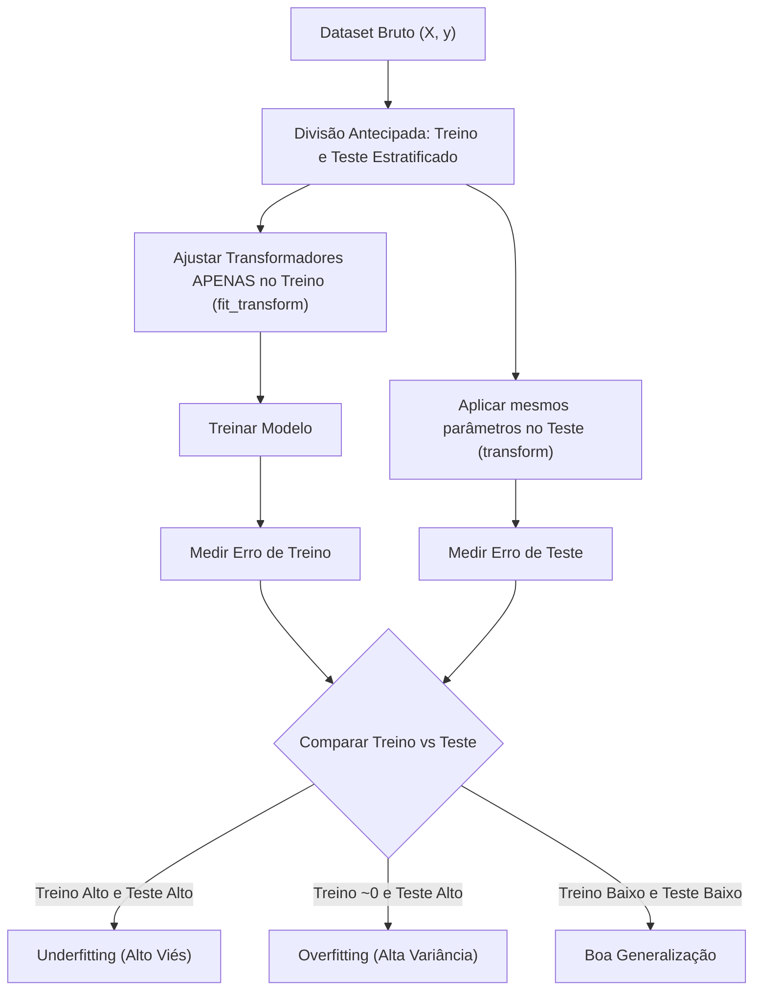

# 🤖 Missão 24: Fundamentos de ML Clássico

## 1. 🚀 Briefing da Missão (Contexto Temático & Realidade de Mercado)

- **Galáxia:** 05 — Sistemas Inteligentes & ML (`ml`)
- **ID do Módulo:** `ml-classico`
- **Pré-requisitos:** [Missão 23 — Ciência de Dados com Python](./23-ciencia-de-dados-com-python.md) (`ciencia-dados-python`)
- **Próxima Órbita:** [Missão 25 — Algoritmos & Scikit-Learn](./25-algoritmos-scikit-learn.md) (`scikit-learn`)
- **Descrição Oficial:** *"A base do aprendizado de máquina. Entenda os tipos de aprendizado, como preparar suas features e como combater o terrível Overfitting."*

### Analogia do Navegador Cósmico

Imagine treinar um piloto automático de cargueiro espacial em um simulador de asteroides. Existem três formas desastrosas e uma forma vitoriosa de conduzir esse treinamento:

1. Se você ensinar regras rígidas demais ("sempre vire 1 grau à esquerda"), o piloto bate em quase todos os meteoros já dentro do simulador e também no espaço real — isso é **Underfitting** (modelo simples demais, alto viés).
2. Se você deixar o piloto decorar a posição exata de cada rocha do simulador ("no segundo 14,32 desvie 4 metros"), ele faz 100% de aproveitamento na simulação, mas explode na primeira missão real porque os asteroides reais estão em posições inéditas — isso é **Overfitting** (decoreba, alta variância).
3. Pior ainda: se durante o simulador você deixar o computador espiar o mapa secreto do teste final (*Data Leakage*), ele vai tirar nota 10 na prova falsa e falhar miseravelmente quando decolar de verdade.
4. O piloto ideal aprende os **princípios físicos gerais** de desvio (generalização) usando sensores calibrados na mesma escala (*Feature Engineering*) e só vê a missão real no momento do teste final.

### Qual dor real este módulo resolve em uma empresa de tecnologia

A maior causa de fracasso em projetos de Machine Learning corporativos não é escolher o algoritmo "errado", e sim **erros de fundação**: tentar resolver com IA o que uma regra SQL simples resolveria, avaliar um modelo com vazamento de dados (*Data Leakage*) e colocar em produção um modelo superajustado que tinha 99% de acerto no notebook e 52% no mundo real.

Dominar esses fundamentos impede que você queime meses de engenharia construindo modelos ilusórios que falham diante do primeiro cliente real.

---

## 2. 📚 Carga de Conhecimento Completa (Tópico por Tópico)

### 2.1 Divisão de Aprendizado: Supervisionado, Não-Supervisionado e Reforço

Antes de escrever qualquer código, o engenheiro de ML identifica qual paradigma de aprendizado corresponde aos dados e ao problema da empresa:

| Paradigma | O que recebe como entrada | Objetivo Principal | Exemplos Reais de Mercado |
| :--- | :--- | :--- | :--- |
| **Aprendizado Supervisionado** | Dados de entrada `X` **+** gabarito/rótulo histórico `y` | Aprender a mapear `X -> y` para prever casos futuros inéditos | Prever cancelamento de clientes (*Churn*), detectar fraude em cartão, estimar preço de frete |
| **Aprendizado Não-Supervisionado** | Apenas dados de entrada `X`, **sem rótulo `y`** | Descobrir estruturas ocultas, agrupamentos ou anomalias nos dados | Segmentar clientes por comportamento de compra (*Clustering*), comprimir dimensões, detectar invasão incomum em rede |
| **Aprendizado por Reforço** | Um **Agente** agindo em um **Ambiente** e recebendo **Recompensas/Penalidades** | Aprender uma sequência ótima de ações (política) ao longo do tempo | Controle de robôs industriais, otimização dinâmica de rotas/energia em data centers, sistemas de lances em tempo real |

**Nota prática de engenharia:** se você já possui regras determinísticas claras (por exemplo, bloquear compras acima de R\$ 10.000 de contas não verificadas), use `if/else` tradicional. Machine Learning só brilha quando as regras são complexas demais para serem escritas manualmente e há histórico suficiente de dados.

### 2.2 Diferença prática entre tarefas de Regressão e Classificação

Dentro do **Aprendizado Supervisionado**, quase todos os problemas de negócio se dividem em duas famílias determinadas pelo tipo do alvo `y`:

- **Regressão (`y` numérico contínuo):** o modelo responde *"quanto?"*. Exemplos: prever o valor de venda de um apartamento em reais, estimar o tempo de entrega em minutos, prever a demanda elétrica de amanhã em megawatts. A saída é um número real dentro de um espectro contínuo.
- **Classificação (`y` categórico discreto):** o modelo responde *"qual classe?"* ou *"qual a probabilidade de pertencer à classe X?"*. Divide-se em:
  - **Binária:** duas classes mutuamente exclusivas (`Fraude` vs `Legítima`, `Churn` vs `Retido`, `Spam` vs `Normal`).
  - **Multiclasse:** três ou mais classes onde cada item pertence a apenas uma (`Suporte Financeiro`, `Bug Técnico`, `Cancelamento`).
  - **Multirrótulo:** um mesmo item pode receber várias etiquetas simultâneas (um filme classificado como `Ação` e `Ficção Científica` ao mesmo tempo).

**Decisão estratégica de produto:** muitas vezes o mesmo problema de negócio pode ser formulado de duas formas. Prever *"quantos dias o pedido vai atrasar"* é **Regressão**; prever *"o pedido vai violar o prazo prometido (Sim/Não)?"* transforma o problema em **Classificação Binária**, que costuma ser mais acionável para disparar alertas automáticos de operação.

### 2.3 Trade-off Viés-Variância (Bias-Variance Tradeoff)

Todo erro de generalização de um modelo preditivo pode ser decomposto conceitualmente em três partes:

```text
Erro Total = Viés² (Bias²) + Variância (Variance) + Ruído Irredutível
```

- **Viés (Bias):** erro causado por suposições rígidas e simplificadoras do modelo. Um modelo linear tentando ajustar uma relação fortemente curva tem **alto viés**: ele ignora nuances reais dos dados mesmo vendo milhões de exemplos.
- **Variância (Variance):** sensibilidade exagerada do modelo às pequenas flutuações aleatórias do conjunto de treinamento específico. Uma árvore de decisão sem limite de profundidade muda completamente sua estrutura se você trocar 10% das linhas do treino — isso é **alta variância**.
- **Ruído Irredutível:** incerteza natural do mundo real (variáveis não medidas, erro de sensor, humor imprevisível do comprador) que nenhum algoritmo consegue eliminar.

O **Trade-off Viés-Variância** descreve a gangorra inevitável entre os dois primeiros componentes: aumentar a complexidade do modelo reduz o viés (ele passa a capturar curvas complexas), mas aumenta a variância (ele começa a memorizar ruídos da amostra). O ponto ótimo fica no meio da curva em U do erro de teste, onde a soma de `Viés² + Variância` é mínima.

### 2.4 Overfitting (Superajuste) e Underfitting (Subajuste)

Na prática diária, o equilíbrio Viés-Variância se manifesta em dois diagnósticos clássicos ao comparar o desempenho no **conjunto de treino** vs **conjunto de validação/teste**:

| Diagnóstico | Erro no Treino | Erro no Teste | Causa Principal | Como Corrigir na Prática |
| :--- | :--- | :--- | :--- | :--- |
| **Underfitting (Subajuste)** | Alto | Alto | Modelo simples demais para capturar o padrão (Alto Viés) | Usar modelo mais expressivo, criar melhores features, reduzir regularização excessiva |
| **Ajuste Ideal (Generalização)** | Baixo | Baixo (próximo ao treino) | Equilíbrio entre capacidade e regularização | Validar com K-Fold e monitorar estabilidade em produção |
| **Overfitting (Superajuste)** | Muito baixo (~0%) | Alto | Modelo decorou ruídos e particularidades da amostra de treino (Alta Variância) | Coletar mais dados, limitar complexidade (`max_depth`, menos parâmetros), aplicar regularização (L1/L2), usar ensembles (Random Forest) ou remover features ruidosas |



### 2.5 Feature Engineering: Normalização, Padronização e One-Hot Encoding

Algoritmos de Machine Learning são equações matemáticas: eles não entendem textos como `"São Paulo"` e sofrem quando uma coluna varia de `0` a `1` (`quantidade_filhos`) enquanto outra varia de `1.500` a `80.000` (`renda_mensal`). É aqui que entra o **Pré-processamento e Engenharia de Features**:

1. **Normalização (`MinMaxScaler`):** comprime cada coluna numérica para um intervalo fixo, geralmente `[0, 1]`:
   `x_norm = (x - x_min) / (x_max - x_min)`
   Útil quando você precisa de valores estritamente limitados (intensidade de pixels `0..255` indo para `0..1` em redes neurais), mas é **sensível a outliers**, pois um único valor extremo esmaga todos os demais perto de `0`.
2. **Padronização (`StandardScaler`):** centraliza a variável subtraindo a média e dividindo pelo desvio padrão (Z-score):
   `x_std = (x - media) / desvio_padrao`
   Resulta em média `0` e desvio padrão `1`, preservando melhor o comportamento quando há outliers moderados. **Obrigatória** para algoritmos baseados em distância ou gradiente como Regressão Logística, SVM, KNN, K-Means e Redes Neurais; dispensável para Árvores de Decisão e Random Forest.
3. **One-Hot Encoding (`OneHotEncoder`):** algoritmos matemáticos não devem receber categorias nominais (`"Pix"`, `"Boleto"`, `"Cartão"`) transformadas em `0, 1, 2`, pois isso inventa uma ordem falsa (`Cartão > Boleto > Pix` e média entre Pix e Cartão igual a Boleto!). O *One-Hot Encoding* cria uma coluna binária (`0` ou `1`) para cada categoria possível. Em produção, configure sempre `handle_unknown="ignore"` para a API não quebrar caso apareça uma categoria nova não vista no treino. (Use `OrdinalEncoder` apenas quando houver ordem real, como `"P" < "M" < "G"`.)

**A Regra de Ouro Anti-Leakage:** nunca calcule `min`, `max`, `média`, `desvio padrão` ou categorias sobre o dataset inteiro antes de separar treino e teste! Se você normalizar antes do `train_test_split`, informações estatísticas do conjunto de teste "vazam" (*Data Leakage*) para o conjunto de treino, inflando artificialmente suas métricas.

---

## 3. 💻 Mão no Código (Jeito Iniciante vs. Padrão Profissional)

Vamos demonstrar dois erros clássicos juntos: cometer **Data Leakage** normalizando antes do split e celebrar um modelo com **Overfitting** olhando apenas a acurácia no treino — e em seguida a solução profissional com `ColumnTransformer` e `Pipeline`.

### ❌ Jeito Iniciante (Com Data Leakage e cego para Overfitting)

```python
import pandas as pd
from sklearn.datasets import make_classification
from sklearn.model_selection import train_test_split
from sklearn.preprocessing import StandardScaler, OneHotEncoder
from sklearn.tree import DecisionTreeClassifier
from sklearn.metrics import accuracy_score

X_num, y = make_classification(
    n_samples=600, n_features=6, n_informative=3, n_redundant=1, random_state=42
)
df = pd.DataFrame(X_num, columns=[f"num_{i}" for i in range(6)])
df["num_0"] = df["num_0"] * 1000  # Escala diferente
df["plano"] = ["Basico", "Pro", "Enterprise"] * 200

# ANTIPADRÃO 1: Codificação e escalonamento no dataset INTEIRO antes do split -> DATA LEAKAGE!
scaler = StandardScaler()
df_scaled = scaler.fit_transform(df[[f"num_{i}" for i in range(6)]])
plano_dummies = pd.get_dummies(df["plano"], dtype=float)
X_vazado = pd.concat([pd.DataFrame(df_scaled), plano_dummies], axis=1)

X_train, X_test, y_train, y_test = train_test_split(X_vazado, y, test_size=0.25, random_state=42)

# ANTIPADRÃO 2: Árvore sem limite de profundidade + avaliar apenas no treino
modelo = DecisionTreeClassifier(random_state=42)
modelo.fit(X_train, y_train)

print("Acurácia no Treino (falsa sensação de perfeição):", accuracy_score(y_train, modelo.predict(X_train)))
# O iniciante nem checa ou se surpreende com a queda no teste!
```

**O que há de errado aqui?**
1. `scaler.fit_transform()` olhou médias e desvios incluindo as linhas de `X_test`.
2. `pd.get_dummies()` antes do split cria colunas fixas que falham em produção se uma categoria faltar ou surgir um valor inédito em um único registro da API.
3. A `DecisionTreeClassifier` sem limite decora os `450` exemplos de treino (`1.00` no treino) e degrada drasticamente em dados inéditos.

### ✅ Padrão Profissional (Split antes de tudo + `ColumnTransformer` + Diagnóstico Treino vs Teste)

```python
import pandas as pd
from sklearn.compose import ColumnTransformer
from sklearn.datasets import make_classification
from sklearn.impute import SimpleImputer
from sklearn.metrics import accuracy_score
from sklearn.model_selection import train_test_split
from sklearn.pipeline import Pipeline
from sklearn.preprocessing import OneHotEncoder, StandardScaler
from sklearn.tree import DecisionTreeClassifier


def create_sample_dataset() -> tuple[pd.DataFrame, pd.Series]:
    """Gera dataset misto (numérico + categórico) com ruído realista."""
    X_num, y = make_classification(
        n_samples=600,
        n_features=6,
        n_informative=3,
        n_redundant=1,
        flip_y=0.12,
        random_state=42,
    )
    df = pd.DataFrame(X_num, columns=[f"num_{i}" for i in range(6)])
    df["num_0"] = df["num_0"] * 1000.0
    df["plano"] = ["Basico", "Pro", "Enterprise"] * 200
    # Introduz alguns valores faltantes para testar imputação segura dentro do Pipeline
    df.loc[[5, 25, 140, 410], "num_1"] = None
    return df, pd.Series(y, name="target")


def build_preprocessing_pipeline(
    numeric_cols: list[str],
    categorical_cols: list[str],
) -> ColumnTransformer:
    """Constrói transformador de colunas que impede Data Leakage durante treino e inferência."""
    numeric_transformer = Pipeline(steps=[
        ("imputer", SimpleImputer(strategy="median")),
        ("scaler", StandardScaler()),
    ])
    categorical_transformer = Pipeline(steps=[
        ("imputer", SimpleImputer(strategy="most_frequent")),
        ("onehot", OneHotEncoder(handle_unknown="ignore", sparse_output=False)),
    ])
    return ColumnTransformer(transformers=[
        ("num", numeric_transformer, numeric_cols),
        ("cat", categorical_transformer, categorical_cols),
    ])


if __name__ == "__main__":
    X, y = create_sample_dataset()
    numeric_features = [f"num_{i}" for i in range(6)]
    categorical_features = ["plano"]

    # 1. REGRA DE OURO: Dividir ANTES de qualquer imputação, escala ou encoding
    X_train, X_test, y_train, y_test = train_test_split(
        X, y, test_size=0.25, stratify=y, random_state=42
    )

    preprocessor = build_preprocessing_pipeline(numeric_features, categorical_features)

    # 2. Comparar explicitamente Underfitting (depth=1), Ideal (depth=4) e Overfitting (depth=None)
    for depth in [1, 4, None]:
        clf = Pipeline(steps=[
            ("preprocessor", preprocessor),
            ("model", DecisionTreeClassifier(max_depth=depth, random_state=42)),
        ])
        clf.fit(X_train, y_train)
        train_acc = accuracy_score(y_train, clf.predict(X_train))
        test_acc = accuracy_score(y_test, clf.predict(X_test))
        print(f"max_depth={str(depth):>4} -> Treino: {train_acc:.3f} | Teste: {test_acc:.3f}")
```

Observe como encapsular tudo no `Pipeline`: quando chamamos `clf.fit(X_train, y_train)`, o `SimpleImputer`, o `StandardScaler` e o `OneHotEncoder` aprendem estatísticas **exclusivamente** de `X_train`. Quando chamamos `clf.predict(X_test)`, eles apenas aplicam `transform()` com os parâmetros já congelados do treino — zero vazamento de dados!

---

## 4. 🛠️ Laboratório de Voo (Exercício Prático Guiado)

**Duração estimada:** 40 minutos  
**Objetivo:** Provocar intencionalmente os fenômenos de *Underfitting*, *Ajuste Ideal* e *Overfitting* variando a complexidade de um modelo e construir um pipeline de Feature Engineering sem Data Leakage.

### Passo a Passo da Missão

1. Crie um script ou notebook `lab_overfitting_pipeline.py`.
2. Gere uma relação não-linear com ruído usando NumPy:
   - `rng = np.random.default_rng(42)`
   - `X = np.sort(rng.uniform(-3, 3, size=120)).reshape(-1, 1)`
   - `y = 0.5 * X[:, 0]**2 + X[:, 0] + 2.0 + rng.normal(0, 0.9, size=120)`
3. Faça `train_test_split(X, y, test_size=0.30, random_state=42)`.
4. Crie um loop testando `PolynomialFeatures(degree=d)` seguido de `StandardScaler()` e `LinearRegression()` dentro de um `Pipeline` para graus `d` em `[1, 2, 15]`.
5. Calcule o **MSE** (Erro Quadrático Médio) tanto no `X_train` quanto no `X_test` para os três graus (`1`, `2` e `15`) e plote as curvas ajustadas sobre os pontos de teste usando Matplotlib.
6. Em seguida, adicione uma coluna categórica simulada (`regiao` com valores `"Norte"`, `"Sul"`, `"Leste"` no treino, e inclua uma amostra com `"Oeste"` no conjunto de teste) para comprovar na prática que `OneHotEncoder(handle_unknown="ignore")` dentro de um `ColumnTransformer` lida com categorias inéditas sem quebrar a aplicação.

### Critérios de Domínio

- [ ] Você consegue identificar nos números obtidos que `degree=1` sofre de **Underfitting** (MSE alto no treino e no teste).
- [ ] Você comprova que `degree=15` sofre de **Overfitting** severo (MSE de treino bem menor, enquanto o MSE de teste explode dramaticamente).
- [ ] Você comprova que `degree=2` atinge o melhor equilíbrio Viés-Variância (menor MSE no teste).
- [ ] O `ColumnTransformer` processa a categoria inédita `"Oeste"` no conjunto de teste sem lançar exceção.

---

## 5. 🎯 Resolução Comentada do Teste de Ignição (Quest Oficial)

> **Pergunta Oficial:**
> *"O que caracteriza o problema de 'Overfitting' em um modelo preditivo de Machine Learning?"*
>
> - **A)** O modelo apresenta erros gigantescos tanto na base de treino quanto na base de teste por ser simples demais.
> - **B)** O modelo decora perfeitamente os dados de treinamento (baixo erro de treino), mas perde a capacidade de generalizar, apresentando taxas de erro elevadas em dados inéditos de teste.
> - **C)** O modelo roda muito lentamente devido a excesso de variáveis no banco de dados relacional.
> - **D)** O modelo requer o uso de GPUs pesadas para conseguir computar somas básicas.

### Gabarito Comentado

- **✅ Resposta Correta: Alternativa B.**  
  O *Overfitting* (superajuste) ocorre quando um modelo possui capacidade excessiva em relação à quantidade ou qualidade dos dados disponíveis e acaba memorizando ruídos e peculiaridades da amostra de treino. O sintoma inconfundível é um **erro baixíssimo no treino combinado com erro alto no conjunto de teste** (falha de generalização).

- **❌ Por que a A está incorreta?**  
  A alternativa A descreve exatamente o fenômeno oposto: **Underfitting** (subajuste), em que o modelo é rígido ou simples demais para aprender sequer os padrões principais dos dados de treinamento, errando muito tanto no treino quanto no teste.

- **❌ Por que a C está incorreta?**  
  Lentidão de consulta por excesso de colunas ou ausência de índices em um banco de dados relacional é um problema de performance de infraestrutura/SQL, não tendo relação com o fenômeno estatístico de superajuste de um modelo preditivo.

- **❌ Por que a D está incorreta?**  
  Necessidade de aceleração em GPU refere-se a custo computacional de treinamento em larga escala (como grandes redes neurais ou processamento de imagens), e não à incapacidade de um modelo generalizar do treino para o teste.

---

## 6. 🎤 Kit de Apresentação (Como Dar Aula / Apresentar Este Módulo)

### Pitch Feynman de 2 Minutos

> "Sabe a diferença entre um aluno que entendeu uma matéria e um aluno que apenas decorou o gabarito da lista de exercícios? Na inteligência artificial acontece exatamente a mesma coisa, e nós damos a isso o nome de generalização.
>
> Quando construímos um modelo de Machine Learning clássico — seja uma Regressão para prever um número como preço, seja uma Classificação para prever uma categoria como fraude — existem dois inimigos esperando na esquina. O primeiro é o Underfitting: o modelo é tão simples que não aprende nem os exemplos de estudo. O segundo é o terrível Overfitting: o modelo tem tanta liberdade que decora até os erros de digitação e ruídos dos dados de treino. Na prova simulada ele tira 10, mas quando vai para o mundo real com clientes novos, ele reprova.
>
> Para vencer essa briga, a gente nunca avalia um modelo com os mesmos dados que ele usou para estudar — separamos um conjunto de teste blindado logo no início. E para os algoritmos enxergarem tudo direito, preparamos os ingredientes com Feature Engineering: colocamos variáveis numéricas na mesma régua com Padronização ou Normalização e traduzimos textos de categorias para colunas binárias com One-Hot Encoding — tudo dentro de um Pipeline para o modelo nunca 'colar' olhando estatísticas do teste."

### Roteiro de Slides (6 Slides)

| Slide | Título | Bullets-Chave | Sugestão Visual |
| :--- | :--- | :--- | :--- |
| **1** | O Mapa dos Paradigmas de ML | Supervisionado `(X, y)`, Não-Supervisionado `(X)`, Reforço (Agente/Recompensa); Quando `if/else` basta | Diagrama em árvore com os 3 ramos e 2 ícones de exemplos reais por ramo |
| **2** | Regressão vs. Classificação | Prever valor contínuo vs categoria/probabilidade; Como transformar um problema de negócio entre os dois | Duas colunas comparativas: termômetro contínuo (Regressão) vs selos discretos (Classificação) |
| **3** | A Gangorra Viés-Variância | Erro = Viés² + Variância + Ruído; Rígido demais vs Sensível demais | Gráfico clássico em U com eixo X = Complexidade e 3 curvas (Treino, Teste, Total) |
| **4** | Underfitting vs. Overfitting na Prática | Sintomas na métrica Treino vs Teste; 4 ações corretivas objetivas para cada caso | Três gráficos de dispersão lado a lado: reta pobre, curva suave e curva zigue-zague decorada |
| **5** | Feature Engineering Essencial | `MinMaxScaler` vs `StandardScaler`; Por que evitar `0, 1, 2` em categorias e usar `OneHotEncoder` | Tabela mostrando `"Pix / Boleto"` virando colunas `0/1` e salários virando Z-score |
| **6** | O Crime do Data Leakage & `Pipeline` | Por que escalar antes do split é trapaça; A solução limpa com `ColumnTransformer` | Fluxograma destacando muro de isolamento entre `fit_transform(Treino)` e `transform(Teste)` |

### Roteiro de Demo Ao Vivo (3 Minutos)

1. **(0:00–1:10)** Rode o loop de `DecisionTreeClassifier` com `max_depth=1`, `4` e `None`: peça para a audiência olhar o salto da acurácia de treino para `1.000` no `max_depth=None` enquanto a acurácia de teste **cai** em relação a `max_depth=4`.
2. **(1:10–2:10)** Mostre o antipadrão do `StandardScaler` fora do split vs `ColumnTransformer` dentro do `Pipeline`, destacando a linha `OneHotEncoder(handle_unknown="ignore")`.
3. **(2:10–3:00)** Envie um único dicionário/DataFrame com uma categoria inventada (`"Plano_Galactico"`) para `.predict()` do `Pipeline` salvo e mostre que ele responde sem quebrar a API.

### Perguntas Difíceis da Plateia

- **Pergunta 1:** *"Entre Normalização (`MinMaxScaler`) e Padronização (`StandardScaler`), existe uma regra rápida para saber qual usar?"*  
  **Resposta segura:** "Sim: use `StandardScaler` como padrão inicial para modelos lineares, SVM, PCA e K-Means, porque ela preserva melhor a distribuição quando existem outliers ocasionais sem comprimir todos os pontos normais em uma faixa minúscula. Use `MinMaxScaler` quando o domínio exigir estritamente valores entre `[0, 1]` (como entradas de pixels ou dados limitados sem outliers extremos). Já em modelos baseados em árvores (Decision Tree, Random Forest), o escalonamento não altera a ordem dos cortes, então não é necessário."
- **Pergunta 2:** *"Se minha empresa só tem 400 registros de histórico, separar 25% para teste não desperdiça dados preciosos de treino?"*  
  **Resposta segura:** "Separar um conjunto de validação final ainda é vital para ter uma medição honesta contra Overfitting; você nunca deve medir o modelo só nos dados em que ele treinou. Em bases pequenas (como 400 linhas), a estratégia recomendada é combinar um conjunto Holdout menor (15% a 20%) com **Validação Cruzada K-Fold** nos dados de treino para aproveitar melhor cada exemplo durante a seleção de modelos — exatamente o que aprofundamos na Missão 26."

---

## 7. 💼 Radar do Mercado de Trabalho (Foco Dev Júnior)

### 3 Perguntas Reais de Entrevista Técnica Júnior

1. **Pergunta:** *"O que é Data Leakage (vazamento de dados) no pré-processamento e como você garante que ele não aconteça no seu código Scikit-Learn?"*  
   **Resposta-modelo:** "Data Leakage ocorre quando informações do conjunto de teste (ou informações do futuro que não existiriam na hora da predição real) influenciam o treinamento do modelo. Um exemplo clássico é calcular média e desvio padrão do `StandardScaler` ou imputar nulos usando todo o dataset antes do `train_test_split`. Para evitar isso, sempre faço o split primeiro e encapsulo toda imputação, escalonamento e encoding em um `Pipeline` + `ColumnTransformer`, garantindo que `.fit()` rode apenas nos dados de treino."
2. **Pergunta:** *"Seu modelo tem 99% de acurácia no treino e 68% no teste. Qual é o diagnóstico e quais três medidas concretas você testaria primeiro?"*  
   **Resposta-modelo:** "É um caso claro de Overfitting (alta variância). Minhas três primeiras ações seriam: (1) restringir a complexidade do modelo (ex.: limitar `max_depth` / aumentar `min_samples_leaf` em árvores ou aumentar força de regularização L2/L1); (2) revisar e remover features ruidosas ou altamente redundantes; e (3) usar técnicas de ensemble como Random Forest e aumentar o volume de dados de treino se possível."
3. **Pergunta:** *"Por que não podemos simplesmente transformar a coluna `cidade` (`São Paulo`, `Rio`, `Recife`) nos números `1`, `2` e `3` para treinar uma Regressão Logística?"*  
   **Resposta-modelo:** "Porque ao atribuir inteiros arbitrários a variáveis nominais sem ordem natural, criamos uma relação matemática falsa de grandeza e distância (`Recife = 3 > São Paulo = 1`, e a média entre eles daria `Rio = 2`). Modelos lineares e baseados em distância interpretam esses valores literalmente. O correto para categorias nominais é aplicar `OneHotEncoder`, criando colunas binárias independentes."

### Erros Clássicos de Júnior vs. Postura Profissional

| Erro Clássico de Júnior | Postura Profissional Esperada |
| :--- | :--- |
| Chamar `scaler.fit_transform(X)` antes do `train_test_split` | Fazer `train_test_split` primeiro e usar `Pipeline` / `ColumnTransformer` |
| Usar `pd.get_dummies` manualmente em notebooks e depois quebrar em produção | Usar `OneHotEncoder(handle_unknown="ignore")` dentro do `Pipeline` serializável |
| Comemorar 99,8% de acerto olhando só `score(X_train, y_train)` | Comparar sistematicamente score de **Treino vs Validação/Teste** |
| Jogar Deep Learning pesado em problemas que regras simples ou regressão resolvem | Escolher o paradigma e o modelo mais simples que atenda à métrica de negócio |

### Evidência para Portfólio / GitHub / LinkedIn

- **No GitHub:** adicione uma seção explícita *"Prevenção de Data Leakage & Análise de Overfitting"* no README de qualquer projeto de ML, exibindo uma tabela comparativa `Treino vs Teste` e o diagrama do `ColumnTransformer`.
- **No LinkedIn:** faça um post curto mostrando um snippet de 10 linhas de *"O erro número 1 de iniciantes no Scikit-Learn: normalizar antes do train_test_split"* explicando o porquê de forma visual.

---

## 8. 📡 Transmissões Recomendadas & Próxima Órbita

### Recursos Oficiais do Módulo

- [Curso Machine Learning (Andrew Ng / Coursera)](https://www.coursera.org/specializations/machine-learning-introduction)
- [Google Machine Learning Crash Course](https://developers.google.com/machine-learning/crash-course)

### Conexão com a Próxima Órbita

Agora que você domina os paradigmas de aprendizado, sabe diagnosticar Viés e Variância e prepara features sem vazar dados, chegou o momento de colocar os principais algoritmos de regressão, classificação e agrupamento para rodar com maestria na **[Missão 25 — Algoritmos & Scikit-Learn](./25-algoritmos-scikit-learn.md)**.
