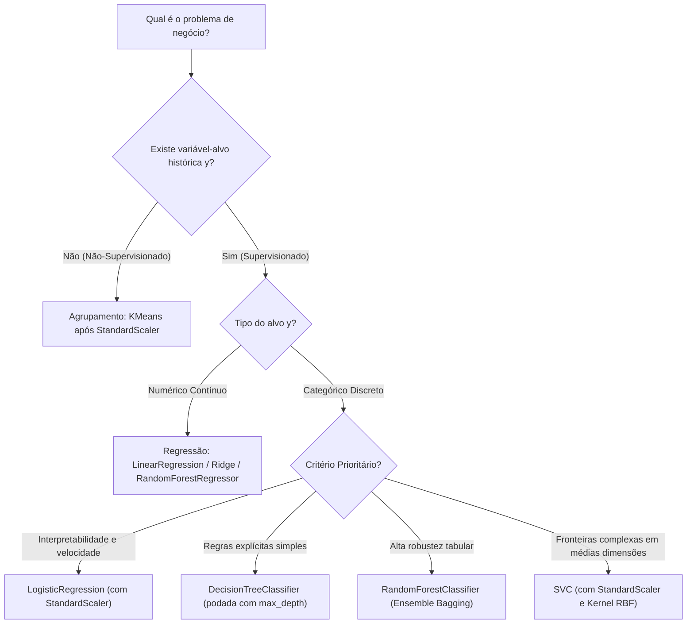

# 📊 Missão 25: Algoritmos & Scikit-Learn

## 1. 🚀 Briefing da Missão (Contexto Temático & Realidade de Mercado)

- **Galáxia:** 05 — Sistemas Inteligentes & ML (`ml`)
- **ID do Módulo:** `scikit-learn`
- **Pré-requisitos:** [Missão 24 — Fundamentos de ML Clássico](./24-fundamentos-de-ml-classico.md) (`ml-classico`)
- **Próxima Órbita:** [Missão 26 — Avaliação & Deploy de Modelos](./26-avaliacao-deploy-de-modelos.md) (`validacao-modelos`)
- **Descrição Oficial:** *"Coloque os modelos para rodar. Treine algoritmos de regressão, classificação e agrupamento utilizando a biblioteca Scikit-Learn."*

### Analogia do Navegador Cósmico

Imagine entrar na ponte de comando de uma frota estelar onde cada instrumento de decisão possui uma especialidade tática, mas **todos obedecem exatamente aos mesmos controles universais** (`.fit()`, `.transform()`, `.predict()`):

- **Regressão Linear:** é a régua gravitacional que traça a tendência contínua de consumo de combustível por ano-luz.
- **Regressão Logística:** é o sensor probabilístico que estima de `0%` a `100%` o risco de uma nave hostil atacar com base em sinais lineares.
- **Decision Tree (Árvore de Decisão):** é o fluxograma de protocolo do comandante ("Escudo < 30%? Sim -> Desviar; Não -> Avançar"). Fácil de explicar, mas um único oficial impulsivo pode exagerar nas regras e errar (Overfitting).
- **Random Forest:** é um conselho com 100 oficiais independentes, onde cada um observa amostras e sensores sorteados de ângulos diferentes e decide pelo voto da maioria — muito mais estável que um oficial solitário.
- **Support Vector Machine (SVM):** é o engenheiro de escudos que posiciona a barreira exatamente no meio do corredor mais largo possível entre duas frotas rivais (margem máxima).
- **K-Means:** é o cartógrafo automático que olha um enxame de asteroides desconhecidos sem etiqueta e os organiza em `K` constelações vizinhas.

### Qual dor real este módulo resolve em uma empresa de tecnologia

Em quase toda vaga júnior de Ciência de Dados ou Engenharia de ML, **80% dos problemas de dados tabulares** (churn, risco de crédito, previsão de demanda, segmentação de clientes, detecção de fraude, triagem de chamados) são resolvidos primeiro — e muitas vezes definitivamente — com algoritmos clássicos do **Scikit-Learn**, antes mesmo de pensar em Deep Learning ou LLMs.

Dominar essa biblioteca permite construir benchmarks rápidos, comparar múltiplos algoritmos com código limpo e escolher com critério técnico qual modelo entrega o melhor equilíbrio entre precisão, velocidade de inferência e explicabilidade para o negócio.

---

## 2. 📚 Carga de Conhecimento Completa (Tópico por Tópico)

### 2.1 Praticar modelagem preditiva utilizando a biblioteca Scikit-Learn

O grande trunfo arquitetural do **Scikit-Learn** é sua API padronizada e consistente inspirada em três interfaces:

1. **Estimators (Estimadores):** qualquer objeto que aprende parâmetros a partir de dados usando `.fit(X, y)` (ou `.fit(X)` no não-supervisionado). Parâmetros configurados antes do treino são *hiperparâmetros* (`max_depth=5`, `C=1.0`); parâmetros aprendidos nos dados terminam com sublinhado (`coef_`, `feature_importances_`, `cluster_centers_`).
2. **Transformers (Transformadores):** objetos de pré-processamento (`StandardScaler`, `SimpleImputer`, `OneHotEncoder`) que implementam `.fit(X)` e `.transform(X)` — além de `.fit_transform(X)` como atalho apenas no treino.
3. **Predictors (Preditores):** modelos treinados que expõem `.predict(X)` (e, em classificadores probabilísticos, `.predict_proba(X)` ou `.decision_function(X)`).

Ao encadear transformadores e um estimador final em um **`Pipeline`**, você trata todo o fluxo como um único objeto Estimator, tornando impossível esquecer de escalonar novos dados no teste ou em produção.



### 2.2 Treinar modelos de Regressão Linear para previsões numéricas contínuas

A **Regressão Linear** modela uma variável contínua `y` como uma combinação linear ponderada das features de entrada `X`:

```text
y_hat = w1 * x1 + w2 * x2 + ... + wn * xn + b
```

O algoritmo clássico de Mínimos Quadrados Ordinários (`LinearRegression`) busca os coeficientes `w` (acessados depois em `model.coef_`) e o intercepto `b` (`model.intercept_`) que minimizam a soma dos erros quadráticos entre valores reais e previstos.

**Quando brilha e quando sofre:**
- **Força:** extremamente rápido, determinístico e altamente interpretável — se `coef_` de `area_m2` vale `+8500`, cada metro quadrado adicional soma em média R\$ 8.500 ao valor estimado (mantidas as demais variáveis).
- **Limitações:** pressupõe relação aproximadamente linear, é sensível a outliers extremos e sofre quando há **multicolinearidade** (duas features altamente correlacionadas entre si, causando pesos instáveis gigantes).
- **Variantes profissionalizantes com regularização:**
  - **`Ridge(alpha=1.0)` (L2):** encolhe pesos exagerados suavemente, controlando variância e multicolinearidade.
  - **`Lasso(alpha=0.1)` (L1):** pode zerar completamente pesos de features inúteis, realizando seleção automática de variáveis.

### 2.3 Aplicar classificadores: Regressão Logística, Decision Trees e Random Forest

Estes três classificadores formam o núcleo indispensável de qualquer cientista de dados:

1. **Regressão Logística (`LogisticRegression`):** apesar do nome, é um algoritmo de **Classificação**. Ele calcula uma combinação linear `z = X @ w + b` e passa o resultado pela função **Sigmoide** (`1 / (1 + exp(-z))`), comprimindo a saída entre `0.0` e `1.0` — uma **probabilidade calibrada**. Exige escalonamento (`StandardScaler`) e possui o hiperparâmetro `C` (inverso da força de regularização L2). Excelente baseline em produção pela rapidez, transparência dos pesos e probabilidades confiáveis.
2. **Árvore de Decisão (`DecisionTreeClassifier`):** divide o espaço de dados em retângulos por meio de perguntas sequenciais do tipo *"idade <= 35?"*, escolhendo a cada nó o corte que mais reduz a impureza dos grupos (medida por **Índice Gini** ou **Entropia**). Não exige normalização nem padronização de escala, captura relações não-lineares nativamente e gera regras auditáveis. **Ponto fraco:** alta variância — sem limitar `max_depth` ou `min_samples_leaf`, decora o treino rapidamente.
3. **Random Forest (`RandomForestClassifier`):** resolve a fraqueza da árvore única usando a técnica de **Bagging (Bootstrap Aggregating) + aleatoriedade de features**. Ele treina dezenas ou centenas de árvores independentes (`n_estimators=100` ou `200`), onde:
   - Cada árvore recebe uma amostra aleatória com reposição dos dados (*bootstrap*).
   - Em cada divisão de nó, a árvore só pode escolher a melhor quebra dentre um subconjunto aleatório de features (`max_features="sqrt"`).
   - Na previsão, todas as árvores votam (classificação) ou tiram a média (regressão).
   Ao combinar várias árvores **descorrelacionadas**, os erros individuais se cancelam, derrubando drasticamente a variância e tornando o Random Forest um dos modelos tabulares mais confiáveis do mercado.

### 2.4 Compreender algoritmos baseados em margem como Support Vector Machines (SVM)

Enquanto a Regressão Logística aceita qualquer reta que separe as classes minimizando o erro logarítmico, a **Support Vector Machine (`SVC` / `SVR`)** adota um princípio geométrico elegante: encontrar o hiperplano que cria a **maior rua (margem) possível** entre os pontos mais próximos das duas classes. Esses pontos críticos na fronteira da rua são os **Vetores de Suporte** (*Support Vectors*).

Conceitos-chave que você precisa dominar sobre SVM:

- **Hiperparâmetro `C` (Soft Margin):** controla a tolerância a violações de margem. Um `C` pequeno aceita alguns erros na margem para manter uma fronteira mais larga e generalista (menos overfitting); um `C` muito alto força o modelo a acertar todos os pontos de treino estreitando a margem (risco de overfitting).
- **O Truque do Kernel (*Kernel Trick*):** e quando as classes não podem ser separadas por uma linha reta (por exemplo, um círculo dentro de um anel)? O SVM projeta matematicamente os dados para dimensões superiores onde passam a ser separáveis linearmente, usando funções de kernel como `kernel="rbf"` (Radial Basis Function, padrão no Scikit-Learn) ou `kernel="poly"` — sem precisar materializar todas as coordenadas extras em memória.
- **Requisito Crítico:** como o SVM calcula distâncias geométricas entre vetores, **é obrigatório aplicar `StandardScaler` antes**, caso contrário uma feature em milhares anula completamente uma feature entre `0` e `1`. Além disso, `SVC` tem custo quadrático/cúbico conforme o número de linhas cresce (`> 50.000` amostras fica lento) e só habilita `.predict_proba()` se instanciado com `SVC(probability=True)`.

### 2.5 Estudar agrupamento não-supervisionado com o algoritmo K-Means

No mundo real, muitas vezes não existe coluna gabarito `y`: você tem 100.000 clientes e quer descobrir perfis naturais de comportamento (*personas*) para campanhas de marketing ou detecção de padrões operacionais. O **K-Means (`KMeans`)** é o algoritmo clássico de *Clustering* (agrupamento particional).

**Como o K-Means funciona passo a passo:**
1. Você escolhe previamente o número de grupos `K` (`n_clusters=K`).
2. O algoritmo posiciona `K` centróides iniciais no espaço (o Scikit-Learn usa por padrão `init="k-means++"`, que espalha os centróides iniciais para evitar convergências ruins).
3. **Atribuição:** cada ponto do dataset é atribuído ao centróide mais próximo (por distância euclidiana).
4. **Atualização:** cada centróide é recalculado como a média (centro de massa) de todos os pontos atribuídos a ele.
5. Os passos 3 e 4 se repetem até os centróides pararem de se mover (convergência).

**Como escolher o melhor `K`?**
- **Método do Cotovelo (*Elbow Method*):** plota-se a **Inércia** (soma das distâncias quadráticas de cada ponto ao seu centróide, atributo `kmeans.inertia_`) para `K = 2, 3, 4... 10`. O ponto em que a curva deixa de cair abruptamente e forma um "cotovelo" sugere um bom equilíbrio.
- **Silhouette Score (`silhouette_score`):** varia de `-1` a `+1` e mede o quão bem separado cada ponto está do grupo vizinho mais próximo (quanto mais perto de `+1`, mais coesos e bem separados são os clusters).
- **Atenção obrigatória:** assim como o SVM, o K-Means depende de distância euclidiana, exigindo `StandardScaler` no `Pipeline` antes de agrupar.

---

## 3. 💻 Mão no Código (Jeito Iniciante vs. Padrão Profissional)

Abaixo vemos um comparativo prático treinando classificadores, Regressão Linear/Ridge e agrupamento K-Means no Scikit-Learn.

### ❌ Jeito Iniciante (Sem escalonamento para SVM/K-Means e scripts soltos sem Pipeline)

```python
from sklearn.datasets import load_breast_cancer
from sklearn.model_selection import train_test_split
from sklearn.svm import SVC
from sklearn.cluster import KMeans

data = load_breast_cancer()
X_train, X_test, y_train, y_test = train_test_split(data.data, data.target, test_size=0.2)

# ANTIPADRÃO 1: SVM sem StandardScaler! Features em escalas de 0.01 e 2000 distorcem a margem
svm = SVC(kernel="rbf")
svm.fit(X_train, y_train)
print("SVM sem escala:", svm.score(X_test, y_test))

# ANTIPADRÃO 2: Sem random_state (resultados mudam a cada execução) e K-Means sem escala
km = KMeans(n_clusters=3)
km.fit(X_train)
print("Clusters sem escala (dominados pela maior coluna):", km.labels_[:10])
```

**O que acontece de errado aqui?**
1. `SVC` sem `StandardScaler` fica cego para features pequenas (`smoothness` ~ `0.09`) porque features grandes (`area` ~ `1500`) dominam a distância do kernel RBF, derrubando drasticamente a acurácia.
2. Falta `random_state` e `stratify=y` no split, tornando experimentos irreproduzíveis.
3. O `KMeans` agrupa olhando quase exclusivamente para a coluna de maior magnitude numérica.

### ✅ Padrão Profissional (Benchmark unificado com `Pipeline`, Regressão Ridge e K-Means com Silhouette)

```python
import numpy as np
from sklearn.cluster import KMeans
from sklearn.datasets import fetch_california_housing, load_breast_cancer
from sklearn.ensemble import RandomForestClassifier
from sklearn.linear_model import LogisticRegression, Ridge
from sklearn.metrics import accuracy_score, f1_score, r2_score, silhouette_score
from sklearn.model_selection import train_test_split
from sklearn.pipeline import Pipeline
from sklearn.preprocessing import StandardScaler
from sklearn.svm import SVC
from sklearn.tree import DecisionTreeClassifier


def benchmark_classifiers() -> None:
    """Compara 4 classificadores clássicos usando a mesma interface Pipeline e split estratificado."""
    dataset = load_breast_cancer()
    X_train, X_test, y_train, y_test = train_test_split(
        dataset.data,
        dataset.target,
        test_size=0.25,
        stratify=dataset.target,
        random_state=42,
    )

    models = {
        "LogisticRegression": Pipeline([
            ("scaler", StandardScaler()),
            ("clf", LogisticRegression(max_iter=1000, random_state=42)),
        ]),
        "DecisionTree (depth=4)": Pipeline([
            ("clf", DecisionTreeClassifier(max_depth=4, random_state=42)),
        ]),
        "RandomForest (200 trees)": Pipeline([
            ("clf", RandomForestClassifier(n_estimators=200, random_state=42, n_jobs=-1)),
        ]),
        "SVM (RBF + Scaler)": Pipeline([
            ("scaler", StandardScaler()),
            ("clf", SVC(kernel="rbf", C=1.0, probability=True, random_state=42)),
        ]),
    }

    print("=== BENCHMARK DE CLASSIFICAÇÃO ===")
    for name, pipe in models.items():
        pipe.fit(X_train, y_train)
        preds = pipe.predict(X_test)
        acc = accuracy_score(y_test, preds)
        f1 = f1_score(y_test, preds)
        # Demonstra obtenção de probabilidades no teste para a classe positiva (1)
        prob_sample = pipe.predict_proba(X_test[:1])[0, 1]
        print(f"{name:<26} | Acc: {acc:.4f} | F1: {f1:.4f} | Prob[amostra 0]: {prob_sample:.3f}")


def demo_regression_and_clustering() -> None:
    """Demonstra Regressão Linear regularizada (Ridge) e seleção de K no K-Means."""
    # 1. Regressão Contínua
    housing = fetch_california_housing()
    X_tr, X_te, y_tr, y_te = train_test_split(
        housing.data, housing.target, test_size=0.2, random_state=42
    )
    reg_pipe = Pipeline([
        ("scaler", StandardScaler()),
        ("reg", Ridge(alpha=1.0)),
    ])
    reg_pipe.fit(X_tr, y_tr)
    r2 = r2_score(y_te, reg_pipe.predict(X_te))
    top_coef = reg_pipe.named_steps["reg"].coef_[0]
    print(f"\n=== REGRESSÃO RIDGE ===\nR² no teste: {r2:.4f} | Coeficiente MedInc: {top_coef:.4f}")

    # 2. Agrupamento Não-Supervisionado com K-Means + Silhouette
    cancer = load_breast_cancer()
    X_scaled = StandardScaler().fit_transform(cancer.data)
    print("\n=== K-MEANS CLUSTERING ===")
    for k in [2, 3, 4]:
        km = KMeans(n_clusters=k, n_init="auto", random_state=42)
        labels = km.fit_predict(X_scaled)
        sil = silhouette_score(X_scaled, labels)
        print(f"K={k} | Inércia: {km.inertia_:.1f} | Silhouette Score: {sil:.4f}")


if __name__ == "__main__":
    benchmark_classifiers()
    demo_regression_and_clustering()
```

---

## 4. 🛠️ Laboratório de Voo (Exercício Prático Guiado)

**Duração estimada:** 45 minutos  
**Objetivo:** Dominar na prática o fluxo unificado do Scikit-Learn construindo um comparador de algoritmos de classificação (com e sem `StandardScaler` no SVM) e uma análise de seleção de `K` com K-Means.

### Passo a Passo da Missão

1. Crie o script `lab_algoritmos_sklearn.py` em um ambiente com `scikit-learn` e `matplotlib` instalados.
2. **Experimento 1 (Impacto da Escala no SVM):** carregue `load_wine()` do `sklearn.datasets`. Divida com `train_test_split(..., test_size=0.25, stratify=y, random_state=42)`. Treine dois `SVC(kernel="rbf", random_state=42)`:
   - Um diretamente nos dados brutos sem escalonamento.
   - Outro dentro de `Pipeline([("scaler", StandardScaler()), ("svc", SVC(kernel="rbf", random_state=42))])`.
   Registre a diferença na acurácia de teste.
3. **Experimento 2 (Árvore Única vs Random Forest):** compare `DecisionTreeClassifier(random_state=42)` sem limite de profundidade contra `RandomForestClassifier(n_estimators=150, random_state=42)` no dataset `make_moons(n_samples=500, noise=0.30, random_state=42)` (ou `load_breast_cancer()`). Imprima acurácia de treino e teste de ambos para observar a redução de variância do Random Forest.
4. **Experimento 3 (K-Means + Método do Cotovelo):** usando `make_blobs(n_samples=400, centers=4, cluster_std=1.1, random_state=42)`, aplique `StandardScaler` e rode `KMeans` variando `K` de `2` até `7`. Imprima `inertia_` e `silhouette_score` para cada `K` e plote a curva de Inércia vs `K` identificando o cotovelo visual em `K=4`.

### Critérios de Domínio

- [ ] Você observa que o `SVC` no `load_wine` salta drasticamente de desempenho (tipicamente de ~`65%` para ~`98%`) apenas adicionando o `StandardScaler` no `Pipeline`.
- [ ] Você comprova que a `DecisionTreeClassifier` livre obtém `1.00` no treino mas perde para o `RandomForestClassifier` no conjunto de teste.
- [ ] A curva de cotovelo e o `silhouette_score` apontam claramente para `K=4` no experimento do `KMeans`.

---

## 5. 🎯 Resolução Comentada do Teste de Ignição (Quest Oficial)

> **Pergunta Oficial:**
> *"Como funciona a técnica de 'Random Forest' e por que ela tende a ser mais robusta do que uma única Árvore de Decisão simples?"*
>
> - **A)** Ela treina uma única árvore com profundidade infinita até que não ocorra nenhum erro.
> - **B)** Ela cria uma floresta de múltiplas árvores de decisão treinadas em subconjuntos aleatórios de dados e features, combinando suas previsões (via média ou votação) para reduzir a variância e mitigar o overfitting.
> - **C)** Ela converte textos em dados criptografados aleatórios antes de aplicar as condições lógicas.
> - **D)** Ela usa computação quântica para simular múltiplos caminhos condicionais paralelos.

### Gabarito Comentado

- **✅ Resposta Correta: Alternativa B.**  
  O *Random Forest* é um método de *ensemble* baseado em **Bagging + seleção aleatória de features**: cada árvore recebe uma amostra *bootstrap* diferente dos registros e, em cada nó de divisão, considera apenas um subconjunto aleatório de colunas. Isso garante árvores diversificadas (descorrelacionadas); ao agregar suas saídas por votação majoritária (classificação) ou média (regressão), erros individuais se anulam, **reduzindo fortemente a variância** e combatendo o *overfitting* típico de uma árvore isolada.

- **❌ Por que a A está incorreta?**  
  Treinar uma única árvore com profundidade infinita até zerar o erro no treino é a receita clássica para provocar **Overfitting severo**, exatamente o oposto do objetivo do Random Forest.

- **❌ Por que a C está incorreta?**  
  O algoritmo não criptografa textos; variáveis textuais ou categóricas precisam ser codificadas numericamente (por exemplo, com `OneHotEncoder` ou embeddings) antes da modelagem, e a aleatoriedade do Random Forest está na amostragem de linhas e features.

- **❌ Por que a D está incorreta?**  
  Random Forest é um algoritmo clássico inteiramente executado em CPUs convencionais (inclusive paralelizando o treino das árvores independentes entre núcleos da CPU via `n_jobs=-1`), sem qualquer relação com computação quântica.

---

## 6. 🎤 Kit de Apresentação (Como Dar Aula / Apresentar Este Módulo)

### Pitch Feynman de 2 Minutos

> "Quando a gente sai da teoria e vai colocar modelos para rodar no mundo real com Scikit-Learn, o mais incrível é que não precisamos aprender um jeito diferente de programar para cada algoritmo. Tudo usa a mesma tomada universal: `.fit()` para treinar nos dados, `.transform()` para preparar entradas e `.predict()` para prever.
>
> Com essa mesma estrutura, você escolhe a ferramenta certa para cada missão. Quer prever um número contínuo como o preço de um frete com explicabilidade clara? Usa Regressão Linear ou Ridge. Quer classificar uma transação como fraude e saber a probabilidade exata? Vai de Regressão Logística. Precisa de regras fáceis de explicar? Árvore de Decisão.
>
> Só que uma árvore sozinha costuma decorar demais os exemplos de treino. Aí entra o Random Forest: em vez de confiar em um único especialista, criamos um conselho de 200 árvores diferentes, cada uma olhando partes sorteadas dos dados e das colunas, e decidimos no voto da maioria. E se o problema for separar classes por fronteiras geométricas bem complexas? Chamamos o SVM, que abre a maior avenida possível entre os grupos — só não esqueça de padronizar as escalas antes! Por fim, se ninguém deu o gabarito das categorias e queremos descobrir perfis naturais de clientes, o K-Means agrupa quem tem comportamento parecido ao redor de centróides."

### Roteiro de Slides (6 Slides)

| Slide | Título | Bullets-Chave | Sugestão Visual |
| :--- | :--- | :--- | :--- |
| **1** | A Arquitetura Universal do Scikit-Learn | Estimator, Transformer, Predictor; `.fit()`, `.predict()`, `.predict_proba()`; `Pipeline` | Diagrama de encaixe modular mostrando `StandardScaler -> Estimator` como bloco único |
| **2** | Regressão Linear, Ridge e Lasso | Hiperplano `y = X @ w + b`; Interpretação de `coef_`; Regularização L2 e L1 | Reta ajustada com segmentos verticais ilustrando resíduos quadráticos |
| **3** | Classificadores: Logística vs. Árvore vs. Floresta | Probabilidade via Sigmoide; Cortes ortogonais por Gini; Sabedoria da multidão no Random Forest | Comparação lado a lado de fronteira de decisão linear vs degraus da árvore vs suave da floresta |
| **4** | Support Vector Machines (SVM) | Margem máxima e Vetores de Suporte; Efeito de `C`; Kernel Trick `rbf` e obrigatoriedade de escala | Gráfico 2D destacando a "rua" mais larga entre duas classes e os pontos de suporte circulados |
| **5** | Agrupamento Não-Supervisionado com K-Means | Loop Atribuir -> Atualizar centróides; K-Means++; Método do Cotovelo e Silhouette | Sequência em 3 quadros dos centróides migrando até o centro dos 3 grupos |
| **6** | Guia Rápido de Escolha de Algoritmo | Tabela prática por tipo de tarefa, tamanho dos dados, necessidade de escala e interpretabilidade | Fluxograma resumido igual ao diagrama da Seção 2.1 |

### Roteiro de Demo Ao Vivo (3 Minutos)

1. **(0:00–1:00)** Abra o script `benchmark_classifiers()` e mostre que as 4 linhas trocando `LogisticRegression`, `DecisionTreeClassifier`, `RandomForestClassifier` e `SVC` executam exatamente com o mesmo `.fit()` e `.predict()`.
2. **(1:00–2:00)** Remova propositalmente `("scaler", StandardScaler())` do `Pipeline` do `SVC` no dataset de vinhos (`load_wine`) ou câncer de mama e rode ao vivo: a plateia verá a acurácia despencar instantaneamente — e voltar ao topo ao restaurar a linha do `StandardScaler`.
3. **(2:00–3:00)** Rode o loop de `KMeans` para `k=2, 3, 4` exibindo inércia e `Silhouette Score`, destacando como não passamos `y` em nenhum momento no `.fit()`.

### Perguntas Difíceis da Plateia

- **Pergunta 1:** *"Se Random Forest geralmente acerta mais que Regressão Logística em dados tabulares, por que bancos e seguradoras ainda usam tanta Regressão Logística?"*  
  **Resposta segura:** "Por três motivos práticos de produção e regulação: explicabilidade direta (cada feature tem um peso claro exigido por auditoria ao negar crédito), calibração natural de probabilidades e latência ultrabaixa em tempo real com uso mínimo de memória RAM."
- **Pergunta 2:** *"Por que o SVM quebrou o desempenho sem `StandardScaler`, mas a Árvore de Decisão e o Random Forest nem sentiram falta da escala?"*  
  **Resposta segura:** "Porque SVM e K-Means calculam distâncias geométricas euclidianas/dot products entre vetores: uma coluna medida em milhares esmaga qualquer coluna medida em décimos. Já árvores de decisão testam limiares de uma coluna por vez (`renda > 5000` é idêntico a `renda_z > 0.42`), sendo invariantes a transformações monotônicas de escala."

---

## 7. 💼 Radar do Mercado de Trabalho (Foco Dev Júnior)

### 3 Perguntas Reais de Entrevista Técnica Júnior

1. **Pergunta:** *"Qual a diferença conceitual entre Regressão Linear e Regressão Logística?"*  
   **Resposta-modelo:** "Apesar do nome parecido, a Regressão Linear é usada para prever valores numéricos contínuos (como preço ou demanda) ajustando uma combinação linear direta das entradas. A Regressão Logística é um algoritmo de Classificação que aplica a função Sigmoide sobre a combinação linear para retornar probabilidades entre `0` e `1`, prevendo classes discretas."
2. **Pergunta:** *"Por que o Random Forest costuma generalizar melhor do que uma Árvore de Decisão simples, e quais seus principais hiperparâmetros de ajuste?"*  
   **Resposta-modelo:** "Uma árvore única é muito sensível a pequenas variações nos dados de treino (alta variância). O Random Forest reduz essa variância treinando muitas árvores em amostras bootstrap diferentes e sorteando subconjuntos de features em cada divisão, combinando as previsões por votação ou média. Os principais hiperparâmetros para calibrar são `n_estimators` (número de árvores), `max_depth` (profundidade máxima), `min_samples_leaf` e `max_features`."
3. **Pergunta:** *"Quais algoritmos clássicos exigem obrigatoriamente escalonamento de features (`StandardScaler`), e como você escolhe o `K` no K-Means?"*  
   **Resposta-modelo:** "Algoritmos baseados em distância geométrica, margem ou otimização por gradiente exigem escalonamento — especialmente SVM, K-Means, Regressão Logística regularizada, Ridge/Lasso e KNN. Para escolher `K` no K-Means, combino conhecimento de negócio (quantos segmentos são acionáveis) com o Método do Cotovelo sobre a inércia e a maximização do Silhouette Score."

### Erros Clássicos de Júnior vs. Postura Profissional

| Erro Clássico de Júnior | Postura Profissional Esperada |
| :--- | :--- |
| Treinar `SVC`, `KMeans` ou `LogisticRegression` sem `StandardScaler` | Encapsular `StandardScaler` no `Pipeline` antes de algoritmos sensíveis à escala |
| Usar `.predict()` no classificador sem explorar `.predict_proba()` para limiares de negócio | Inspecionar probabilidades e ajustar o limiar conforme custo do erro |
| Treinar apenas um algoritmo complexo direto sem baseline | Sempre criar um baseline simples (`LogisticRegression` / `DummyClassifier`) para comparar ganho real |
| Esquecer `random_state` e obter resultados diferentes a cada execução | Fixar `random_state=42` em splits e modelos para reprodutibilidade total |

### Evidência para Portfólio / GitHub / LinkedIn

- **No GitHub:** crie um notebook ou script comparativo testando 4 modelos (`LogisticRegression`, `DecisionTree`, `RandomForest`, `SVC`) via `Pipeline` em um mesmo dataset de classificação, exibindo tabela de métricas + tempo de treino/inferência e explicando a escolha final.
- **No LinkedIn:** compartilhe um mini estudo de segmentação de clientes usando `KMeans` com gráfico do Método do Cotovelo e descrição dos perfis encontrados em linguagem de negócio (*"Cluster 0: alto ticket, baixa frequência"*).

---

## 8. 📡 Transmissões Recomendadas & Próxima Órbita

### Recursos Oficiais do Módulo

- [Scikit-Learn Documentation](https://scikit-learn.org/stable/)
- [Hands-On Machine Learning (Livro clássico de Aurélien Géron)](https://www.oreilly.com/library/view/hands-on-machine-learning/9781492032632/)

### Conexão com a Próxima Órbita

Treinar modelos no notebook é apenas metade do caminho. Antes de colocar inteligência artificial diante de clientes reais, você precisa provar sua estabilidade com Validação Cruzada, escolher a métrica exata para o risco do negócio, serializar o `Pipeline` inteiro e servi-lo em uma API de alta performance na **[Missão 26 — Avaliação & Deploy de Modelos](./26-avaliacao-deploy-de-modelos.md)**.
