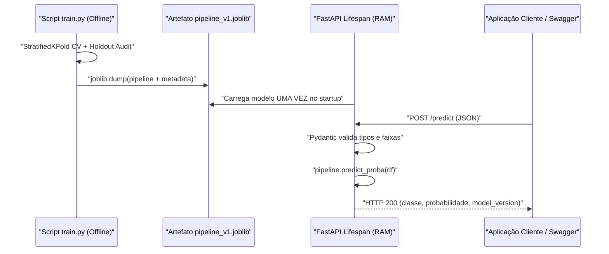

# 🎯 Missão 26: Avaliação & Deploy de Modelos

## 1. 🚀 Briefing da Missão (Contexto Temático & Realidade de Mercado)

- **Galáxia:** 05 — Sistemas Inteligentes & ML (`ml`)
- **ID do Módulo:** `validacao-modelos`
- **Pré-requisitos:** [Missão 25 — Algoritmos & Scikit-Learn](./25-algoritmos-scikit-learn.md) (`scikit-learn`)
- **Próxima Órbita:** [Projeto de Consolidação 05 — Sistemas Inteligentes & ML](./projeto-consolidacao-05-ml.md) e **Galáxia 6 — Constelação das IAs Generativas & LLMs** (`06-ias-generativas-e-llms/`, módulo inicial `deep-learning` — *Deep Learning & Redes Neurais*)
- **Descrição Oficial:** *"Valide seu trabalho antes de subir. Domine as métricas de validação de modelos e disponibilize sua inteligência via APIs em produção."*

### Analogia do Navegador Cósmico

Imagine construir um detector automático de meteoros assassinos para proteger uma colônia espacial. Apenas 1 em cada 1.000 objetos no radar é realmente letal — os outros 999 são poeira inofensiva. Um programador distraído cria um detector "preguiçoso" que responde sempre *"Não é meteoro letal"* e exibe com orgulho **99,9% de acurácia**! Resultado: na primeira rocha mortal real, o escudo não dispara e a estação é destruída.

Além disso, um modelo brilhante que só existe dentro de um Jupyter Notebook no seu computador não protege nave nenhuma:

- **Validação Cruzada (K-Fold):** é testar o computador de bordo em 5 ou 10 rotas climáticas diferentes antes de aprovar o projeto, em vez de confiar em um único voo de sorte.
- **Métricas de Classificação e Regressão:** são os instrumentos calibrados de risco (custo de deixar um meteoro passar vs custo de disparar um alerta falso).
- **Joblib / Pickle:** é a cápsula criogênica que congela o `Pipeline` treinado exatamente como ele aprendeu para embarcar na nave.
- **FastAPI:** é o barramento supersônico de comunicação que recebe requisições JSON validadas e devolve previsões em milissegundos para qualquer aplicativo da frota.

### Qual dor real este módulo resolve em uma empresa de tecnologia

Um modelo de Machine Learning só gera valor financeiro quando sai do notebook e entra em produção com segurança. Empresas quebram a cara em dois momentos críticos:

1. **Escolher a métrica errada:** usar acurácia em bases desbalanceadas (fraude, cancelamento de assinatura, diagnóstico médico) esconde modelos completamente inúteis.
2. **Deploy improvisado:** salvar apenas o estimador sem o `StandardScaler`/`OneHotEncoder` (gerando previsões absurdas na API), carregar o arquivo `.joblib` do disco a cada requisição HTTP (derrubando a latência da API) ou aceitar JSON sem validação de contrato (causando erros `500` silenciosos).

---

## 2. 📚 Carga de Conhecimento Completa (Tópico por Tópico)

### 2.1 Substituir validações simples por Validação Cruzada (K-Fold Cross Validation)

Um único `train_test_split` tem uma fragilidade estatística: e se, por pura sorte do sorteio (`random_state=42`), as amostras mais fáceis caírem exatamente nos 20% de teste? Você achará que o modelo é melhor do que realmente é — especialmente em datasets pequenos ou médios.

A **Validação Cruzada K-Fold** resolve isso dividindo o conjunto de treino em `K` fatias iguais (*folds*, geralmente `K=5` ou `K=10`):

1. O modelo treina em `K - 1` fatias e é avaliado na fatia restante.
2. O processo repete `K` vezes, revezando qual fatia fica para validação.
3. No final, calculamos a **média e o desvio padrão** das `K` pontuações — avaliando não só a performance média, mas também a **estabilidade** do modelo.

**Boas práticas obrigatórias de mercado:**
- Em classificação (principalmente desbalanceada), use **`StratifiedKFold`** (padrão automático do `cross_val_score` em classificadores) para manter a mesma proporção de classes em cada fold.
- Passe o **`Pipeline` completo** dentro de `cross_val_score(pipeline, X_train, y_train, cv=5)` para que `SimpleImputer`, `StandardScaler` e `OneHotEncoder` sejam reajustados do zero dentro de cada fold sem Data Leakage.
- Mantenha sempre um conjunto **Holdout (Teste Final)** separado desde o início que só será tocado uma única vez no final para auditoria honesta.

### 2.2 Dominar métricas de classificação: Acurácia, Precisão, Recall e F1-Score

Em classificação binária, toda predição cai em um de quatro quadrantes comparando o **Real** vs **Previsto**:

- **VP (Verdadeiro Positivo / TP):** era positivo e o modelo previu positivo (acerto crítico).
- **VN (Verdadeiro Negativo / TN):** era negativo e o modelo previu negativo (acerto normal).
- **FP (Falso Positivo / FP — Alarme Falso):** era negativo, mas o modelo previu positivo.
- **FN (Falso Negativo / FN — Omissão Crítica):** era positivo, mas o modelo deixou passar como negativo.

A partir desses quatro contadores nascem as quatro métricas fundamentais:

| Métrica | Fórmula | O que responde na prática | Quando priorizar |
| :--- | :--- | :--- | :--- |
| **Acurácia** | `(VP + VN) / Total` | Qual o percentual geral de acertos? | Apenas quando as classes estão balanceadas e FP/FN têm custos parecidos |
| **Precisão (Precision)** | `VP / (VP + FP)` | *Quando o modelo diz POSITIVO, quantas vezes ele acerta?* | Quando o **Falso Positivo** é caro (ex.: filtro de spam apagando e-mails reais, bloquear cartão de cliente VIP injustamente) |
| **Recall (Sensibilidade)** | `VP / (VP + FN)` | *De todos os POSITIVOS reais existentes, quantos o modelo capturou?* | Quando o **Falso Negativo** é catastrófico (ex.: detecção de fraude, rastreamento de doença grave, falha crítica em avião) |
| **F1-Score** | `2 * (Precision * Recall) / (Precision + Recall)` | Média harmônica que exige equilíbrio entre Precisão e Recall | Bases desbalanceadas onde você precisa equilibrar captura de positivos sem inundar a operação com alarmes falsos |

Observe por que o **F1-Score** usa média harmônica e não média aritmética: se Precisão for `1.0` e Recall for `0.02`, a média simples daria `0.51` (enganosa), enquanto o F1-Score cai para `0.039`, denunciando imediatamente o colapso do modelo.

### 2.3 Entender e interpretar Matrizes de Confusão e curvas ROC/AUC

- **Matriz de Confusão (`confusion_matrix`):** é a tabela 2x2 (ou NxN em multiclasse) que exibe lado a lado os valores exatos de `TN`, `FP`, `FN` e `VP`. Enquanto um número único como `0.85` esconde onde o modelo erra, a matriz mostra imediatamente se o modelo está errando por excesso de alarme (`FP` alto) ou por omissão (`FN` alto).
- **Limiar de Decisão (*Threshold*):** classificadores probabilísticos devolvem uma probabilidade `p` via `.predict_proba()`. Por padrão, `.predict()` usa o corte `0.50`. Em produção, você pode baixar o threshold para `0.30` (aumentando o **Recall**, capturando mais fraudes) ou subir para `0.80` (aumentando a **Precisão**).
- **Curva ROC e AUC (`roc_auc_score`):** a curva ROC plota a **Taxa de Verdadeiros Positivos (Recall/TPR)** no eixo Y contra a **Taxa de Falsos Positivos (`FP / (FP + TN)`, FPR)** no eixo X variando o limiar de `0.0` até `1.0`. A área sob essa curva (**AUC-ROC**) resume a capacidade de ordenação probabilística do modelo:
  - `AUC = 0.50`: equivalente a jogar uma moeda aleatória.
  - `AUC = 0.70 - 0.80`: poder discriminatório aceitável.
  - `AUC > 0.85`: forte separação entre probabilidades de positivos e negativos.
  - **Nota sênior:** em desbalanceamento extremo (por exemplo, `0.1%` de fraudes), a curva **Precision-Recall (PR-AUC)** costuma ser ainda mais informativa que a ROC-AUC, pois a taxa de falsos positivos `FP / TN` fica artificialmente minúscula devido à quantidade gigantesca de negativos verdadeiros.

### 2.4 Avaliar modelos de regressão usando métricas MAE, MSE e R²

Quando o alvo `y` é numérico contínuo, olhamos para o tamanho dos erros residuais (`y_real - y_previsto`):

1. **MAE (*Mean Absolute Error*):** média dos valores absolutos dos erros (`mean(|y - y_hat|)`). Está **na mesma unidade do negócio** (ex.: erro médio de R\$ 18,50 no frete), sendo fácil de explicar para gerentes e mais robusto contra alguns outliers.
2. **MSE (*Mean Squared Error*) e RMSE:** média dos erros **ao quadrado** (`mean((y - y_hat)²)`). Ao elevar ao quadrado, erros grandes recebem punição muito severa — ideal quando errar por `100` é muito pior que errar cinco vezes por `20`. Como o MSE fica na unidade ao quadrado (R\$²), costumamos tirar a raiz quadrada obtendo o **RMSE**, que volta para a unidade original mantendo a penalidade forte aos grandes erros.
3. **R² (Coeficiente de Determinação):** mede que proporção da variação dos dados o seu modelo explica em comparação a um modelo ingênuo que sempre chuta a média de `y`:
   - `R² = 1.0`: previsão perfeita sem erro.
   - `R² = 0.0`: seu modelo não é melhor do que sempre responder a média histórica.
   - `R² < 0.0`: no conjunto de teste, seu modelo está performando **pior** do que simplesmente chutar a média constante!

### 2.5 Serializar modelos treinados utilizando Joblib ou Pickle

Depois de treinar e validar seu `Pipeline`, você precisa salvá-lo em disco para que o serviço de API carregue o modelo pronto sem re-treinar tudo a cada inicialização:

- **`pickle`:** módulo nativo da biblioteca padrão do Python que serializa objetos Python genéricos. Funciona, mas pode ser mais lento e gerar arquivos maiores para modelos cheios de grandes arrays NumPy (como Random Forests com centenas de árvores).
- **`joblib` (`joblib.dump` / `joblib.load`):** otimizado especificamente para objetos científicos com grandes matrizes NumPy internas, oferecendo compactação eficiente e carregamento rápido — é o padrão recomendado pela documentação oficial do Scikit-Learn.

**Regras obrigatórias de serialização segura em produção:**
1. **Salve o `Pipeline` inteiro** (pré-processadores + estimador), nunca só o modelo final solto.
2. **Salve metadados junto:** versão do modelo, versão do `scikit-learn`, lista ordenada das colunas de entrada e métricas de validação, evitando que um upgrade de biblioteca quebre o `.load()` silenciosamente.
3. **Segurança crítica:** tanto `pickle` quanto `joblib` executam desserialização arbitrária de objetos Python. **Nunca** carregue arquivos `.pkl` ou `.joblib` vindos de fontes externas não confiáveis.

### 2.6 Empacotar o modelo treinado em uma API veloz construída com FastAPI

O **FastAPI** tornou-se o padrão dominante em Python para servir modelos de ML em microserviços devido à combinação de alta performance assíncrona, tipagem rigorosa via **Pydantic** e geração automática de documentação interativa **OpenAPI/Swagger** em `/docs`.



Boas práticas essenciais na API FastAPI de ML:
- **Carregamento no `lifespan`:** carregue o arquivo `.joblib` apenas uma vez quando o servidor sobe (`@asynccontextmanager async def lifespan(app: FastAPI):`), guardando-o em `app.state.model`. Nunca faça `joblib.load()` dentro da rota `/predict`!
- **Contratos com Pydantic (`BaseModel`):** valide tipos, campos obrigatórios e limites (ex.: `Field(gt=0)` para idade ou renda) antes de chamar o modelo, devolvendo HTTP `422` automático para payloads inválidos.
- **Rotas operacionais:** exponha sempre `GET /health` (para Docker/Kubernetes verificarem se o modelo foi carregado na memória) e `POST /predict` retornando a predição, a probabilidade e a versão do modelo.

---

## 3. 💻 Mão no Código (Jeito Iniciante vs. Padrão Profissional)

### ❌ Jeito Iniciante (Avaliação enganosa, Pickle incompleto e API que lê disco a cada request)

```python
# ANTIPADRÃO NO TREINO:
import pickle
from sklearn.datasets import make_classification
from sklearn.ensemble import RandomForestClassifier
from sklearn.model_selection import train_test_split
from sklearn.preprocessing import StandardScaler

X, y = make_classification(n_samples=1000, weights=[0.95, 0.05], random_state=42)
X_tr, X_te, y_tr, y_te = train_test_split(X, y, test_size=0.2)
scaler = StandardScaler().fit(X_tr)
clf = RandomForestClassifier().fit(scaler.transform(X_tr), y_tr)

# Erro 1: olhar só score (acurácia) em base 95% vs 5%
print("Acurácia enganosa:", clf.score(scaler.transform(X_te), y_te))

# Erro 2: salvar apenas o clf sem o scaler! Em produção as features chegam sem escala
with open("modelo_quebrado.pkl", "wb") as f:
    pickle.dump(clf, f)

# ANTIPADRÃO NA API (NUNCA FAÇA ISSO):
# @app.post("/predict")
# def predict(payload: dict):  # Sem validação de campos nem tipos!
#     model = pickle.load(open("modelo_quebrado.pkl", "rb"))  # Lê disco em TODA requisição!
#     return {"pred": int(model.predict([list(payload.values())])[0])}  # Ordem errada de dict!
```

### ✅ Padrão Profissional (Validação Cruzada + Métricas Completas + `joblib` + FastAPI com `lifespan` e Pydantic)

**Arquivo 1 — `train_and_export.py` (Treinamento auditado e exportação segura):**

```python
from pathlib import Path
import joblib
import pandas as pd
from sklearn.datasets import make_classification
from sklearn.ensemble import RandomForestClassifier
from sklearn.metrics import (
    classification_report,
    confusion_matrix,
    f1_score,
    roc_auc_score,
)
from sklearn.model_selection import StratifiedKFold, cross_validate, train_test_split
from sklearn.pipeline import Pipeline
from sklearn.preprocessing import StandardScaler

FEATURE_NAMES = ["valor_transacao", "tentativas_hora", "distancia_km", "idade_conta_dias"]
ARTIFACT_PATH = Path("artifacts/fraud_pipeline_v1.joblib")


def train_pipeline() -> None:
    """Treina pipeline com StratifiedKFold, audita no Holdout e salva artefato versionado."""
    X_raw, y_raw = make_classification(
        n_samples=1500,
        n_features=4,
        n_informative=3,
        n_redundant=0,
        weights=[0.92, 0.08],
        flip_y=0.02,
        random_state=42,
    )
    X_df = pd.DataFrame(X_raw, columns=FEATURE_NAMES)
    y_ser = pd.Series(y_raw, name="is_fraud")

    # 1. Holdout blindado desde o início
    X_train, X_test, y_train, y_test = train_test_split(
        X_df, y_ser, test_size=0.20, stratify=y_ser, random_state=42
    )

    pipeline = Pipeline(steps=[
        ("scaler", StandardScaler()),
        ("clf", RandomForestClassifier(
            n_estimators=150,
            max_depth=8,
            class_weight="balanced",
            random_state=42,
            n_jobs=-1,
        )),
    ])

    # 2. Validação Cruzada Estratificada com múltiplas métricas
    cv = StratifiedKFold(n_splits=5, shuffle=True, random_state=42)
    cv_results = cross_validate(
        pipeline,
        X_train,
        y_train,
        cv=cv,
        scoring=["precision", "recall", "f1", "roc_auc"],
    )
    print(f"CV F1-Score : {cv_results['test_f1'].mean():.4f} +/- {cv_results['test_f1'].std():.4f}")
    print(f"CV Recall   : {cv_results['test_recall'].mean():.4f}")
    print(f"CV ROC-AUC  : {cv_results['test_roc_auc'].mean():.4f}")

    # 3. Treino final em todo X_train e auditoria única no Holdout
    pipeline.fit(X_train, y_train)
    y_pred = pipeline.predict(X_test)
    y_prob = pipeline.predict_proba(X_test)[:, 1]

    print("\n=== AUDITORIA FINAL NO HOLDOUT ===")
    print("Matriz de Confusão:\n", confusion_matrix(y_test, y_pred))
    print(classification_report(y_test, y_pred, digits=4))
    print(f"Holdout ROC-AUC: {roc_auc_score(y_test, y_prob):.4f}")

    # 4. Serialização do Pipeline completo + metadados com Joblib
    ARTIFACT_PATH.parent.mkdir(parents=True, exist_ok=True)
    bundle = {
        "pipeline": pipeline,
        "feature_names": FEATURE_NAMES,
        "model_version": "1.0.0",
        "holdout_f1": float(f1_score(y_test, y_pred)),
    }
    joblib.dump(bundle, ARTIFACT_PATH, compress=3)
    print(f"Artefato salvo com sucesso em: {ARTIFACT_PATH}")


if __name__ == "__main__":
    train_pipeline()
```

**Arquivo 2 — `api.py` (FastAPI em produção carregando no `lifespan` e validando via Pydantic):**

```python
from contextlib import asynccontextmanager
from pathlib import Path
import joblib
import pandas as pd
from fastapi import FastAPI, HTTPException, Request
from pydantic import BaseModel, Field

ARTIFACT_PATH = Path("artifacts/fraud_pipeline_v1.joblib")


class TransactionFeatures(BaseModel):
    """Contrato estrito de entrada validado antes da inferência."""
    valor_transacao: float = Field(..., description="Score normalizado ou valor da transação")
    tentativas_hora: float = Field(..., description="Quantidade de tentativas na última hora")
    distancia_km: float = Field(..., description="Distância geográfica da última compra")
    idade_conta_dias: float = Field(..., description="Dias desde abertura da conta")


class PredictionResponse(BaseModel):
    """Contrato padronizado de saída da API de inferência."""
    is_fraud: bool
    fraud_probability: float
    model_version: str


@asynccontextmanager
async def lifespan(app: FastAPI):
    """Carrega o artefato .joblib uma única vez na inicialização do servidor."""
    if not ARTIFACT_PATH.exists():
        raise RuntimeError(f"Artefato não encontrado em {ARTIFACT_PATH}")
    bundle = joblib.load(ARTIFACT_PATH)
    app.state.pipeline = bundle["pipeline"]
    app.state.feature_names = bundle["feature_names"]
    app.state.model_version = bundle["model_version"]
    yield
    app.state.pipeline = None


app = FastAPI(title="Galactic Fraud Detector API", version="1.0.0", lifespan=lifespan)


@app.get("/health")
def health_check(request: Request) -> dict[str, str]:
    """Endpoint de observabilidade para probes de container e balanceadores."""
    if getattr(request.app.state, "pipeline", None) is None:
        raise HTTPException(status_code=503, detail="Modelo não carregado")
    return {"status": "healthy", "model_version": request.app.state.model_version}


@app.post("/predict", response_model=PredictionResponse)
def predict_fraud(payload: TransactionFeatures, request: Request) -> PredictionResponse:
    """Executa predição respeitando a ordem exata de colunas usada no treino."""
    pipeline = request.app.state.pipeline
    feature_names = request.app.state.feature_names

    # Monta DataFrame com colunas nomeadas e ordenadas exatamente como no treinamento
    input_df = pd.DataFrame([payload.model_dump()])[feature_names]

    fraud_prob = float(pipeline.predict_proba(input_df)[0, 1])
    is_fraud = fraud_prob >= 0.50

    return PredictionResponse(
        is_fraud=is_fraud,
        fraud_probability=round(fraud_prob, 4),
        model_version=request.app.state.model_version,
    )
```

---

## 4. 🛠️ Laboratório de Voo (Exercício Prático Guiado)

**Duração estimada:** 50 minutos  
**Objetivo:** Treinar um classificador validado com K-Fold, comparar métricas de classificação e regressão, serializar o `Pipeline` com `joblib` e subir uma API FastAPI funcional testada via Swagger UI (`/docs`) e `TestClient`.

### Passo a Passo da Missão

1. Crie uma pasta `lab-deploy-ml` e instale as dependências: `pip install scikit-learn pandas joblib fastapi uvicorn httpx pytest`.
2. Crie o arquivo `train_and_export.py` adaptado da Seção 3 e execute-o (`python train_and_export.py`). Analise a Matriz de Confusão e compare `Accuracy` vs `Recall` vs `F1-Score` na classe minoritária (`1`).
3. Em um segundo pequeno experimento de regressão (`eval_regressao.py`), treine um `RandomForestRegressor(random_state=42)` no dataset `fetch_california_housing()` usando `cross_validate` com `scoring=["neg_mean_absolute_error", "neg_root_mean_squared_error", "r2"]` e imprima as médias dos 5 folds (lembrando de inverter o sinal dos scores negativos do Scikit-Learn).
4. Salve `api.py` e suba o servidor localmente: `uvicorn api:app --reload --port 8000`.
5. Abra `http://127.0.0.1:8000/docs` no navegador, teste `GET /health` e envie duas requisições em `POST /predict`:
   - Um JSON válido verificando o código HTTP `200` e o campo `fraud_probability`.
   - Um JSON faltando o campo `distancia_km` ou passando uma string `"abc"` em `valor_transacao` para observar a rejeição automática HTTP `422` do Pydantic protegendo seu modelo.

### Critérios de Domínio

- [ ] A validação cruzada roda sem vazamento de dados (o `StandardScaler` está dentro do `Pipeline`).
- [ ] Você consegue ler e interpretar cada número da Matriz de Confusão (`TN`, `FP`, `FN`, `VP`) gerada no Holdout.
- [ ] O arquivo `.joblib` contém tanto o pré-processamento quanto o classificador e metadados de versão.
- [ ] A API FastAPI carrega o modelo apenas uma vez no `lifespan` e responde no endpoint `/docs` com validação Pydantic ativa.

---

## 5. 🎯 Resolução Comentada do Teste de Ignição (Quest Oficial)

> **Pergunta Oficial:**
> *"Em um modelo de classificação para detecção de fraudes em transações financeiras, por que a métrica de 'Recall' pode ser considerada mais prioritária do que a 'Precisão'?"*
>
> - **A)** Porque o Recall avalia o tempo de resposta em milissegundos do servidor de banco de dados.
> - **B)** Porque o Recall mede a proporção de transações realmente fraudulentas que foram capturadas pelo modelo, minimizando os Falsos Negativos (deixar passar uma fraude real sem bloqueio), mesmo que isso gere alguns Falsos Positivos temporários.
> - **C)** Porque a Precisão é muito complexa de calcular matematicamente e consome CPU desnecessária.
> - **D)** Porque o Recall garante que a resposta do modelo seja sempre salva em formato JSON criptografado.

### Gabarito Comentado

- **✅ Resposta Correta: Alternativa B.**  
  O **Recall** (`VP / (VP + FN)`) responde: *"dentre todas as fraudes reais que aconteceram, qual porcentagem o nosso modelo conseguiu detectar?"*. Em sistemas financeiros, um **Falso Negativo** (aprovar uma fraude real) causa prejuízo direto imediato e irreversível, enquanto um **Falso Positivo** (bloquear preventivamente uma compra legítima e pedir confirmação via SMS/app) gera apenas um atrito temporário contornável — justificando priorizar o Recall quando o risco financeiro de omissão é muito alto.

- **❌ Por que a A está incorreta?**  
  Tempo de resposta em milissegundos é uma métrica operacional de latência/infraestrutura (observabilidade de API ou banco de dados), e não uma métrica estatística de acerto preditivo de classificação.

- **❌ Por que a C está incorreta?**  
  A fórmula da Precisão (`VP / (VP + FP)`) é tão trivial quanto a do Recall (`VP / (VP + FN)`), exigindo apenas uma divisão simples com custo computacional praticamente nulo.

- **❌ Por que a D está incorreta?**  
  Recall é uma métrica matemática de avaliação de qualidade preditiva; ela não tem qualquer relação com formato de serialização JSON ou algoritmos de criptografia de dados.

---

## 6. 🎤 Kit de Apresentação (Como Dar Aula / Apresentar Este Módulo)

### Pitch Feynman de 2 Minutos

> "Imagine que você treinou um modelo incrível no seu notebook e ele disse que acerta 99% das vezes. Antes de comemorar e mandar para produção, você precisa fazer três perguntas de engenheiro responsável: ele deu sorte ou é consistente? Ele acerta o que importa para o negócio? E como o resto da empresa vai consumir essa inteligência?
>
> Primeiro, a gente substitui a sorte de uma única divisão pela Validação Cruzada K-Fold: testamos o modelo em cinco pedaços diferentes para ter certeza de que ele é estável.
>
> Segundo, olhamos a Matriz de Confusão e escolhemos a métrica pelo custo real do erro. Em fraude ou medicina, deixar um caso real escapar — o Falso Negativo — custa caríssimo, então priorizamos o Recall. Em filtro de spam ou oferta cara de marketing, incomodar quem não deveria receber o alerta custa caro, então priorizamos Precisão — ou equilibramos os dois com F1-Score. Em valores contínuos, medimos em reais ou minutos usando MAE, RMSE e R².
>
> Por fim, um modelo parado em um notebook não serve clientes. Empacotamos todo o pré-processamento e o modelo em um arquivo Joblib e colocamos atrás de uma API FastAPI com Pydantic. A API carrega o modelo na memória ao ligar, valida cada dado que chega e entrega previsões em milissegundos."

### Roteiro de Slides (6 Slides)

| Slide | Título | Bullets-Chave | Sugestão Visual |
| :--- | :--- | :--- | :--- |
| **1** | Do Notebook à Produção Segura | Por que 99% de acurácia pode ser um desastre; Os 3 pilares: Validação, Métricas, Deploy | Ilustração de iceberg: 20% modelo no notebook vs 80% validação, contratos e API |
| **2** | K-Fold Cross Validation | Limite do split único; `StratifiedKFold` passo a passo; Média +/- Desvio Padrão; Holdout final | Diagrama colorido de 5 barras mostrando o bloco de validação deslizando do Fold 1 ao 5 |
| **3** | Classificação: Matriz de Confusão, Precision, Recall, F1 e ROC | Onde mora `FP` vs `FN`; Trade-off por threshold; Leitura de AUC-ROC e PR-AUC | Matriz 2x2 destacada com ícones de "Alerta Falso (FP)" vs "Fraude Escapou (FN)" |
| **4** | Regressão: MAE, MSE/RMSE e R² | MAE interpretável; RMSE punindo desvios grandes; O que significa `R² = 0` ou negativo | Gráfico de resíduos mostrando erro absoluto vs erro quadrático em um outlier |
| **5** | Serialização Limpa com Joblib | Por que salvar o `Pipeline` completo e não só o modelo; Metadados e segurança contra pickle malicioso | Caixa lacrada etiquetada: `Scaler + OneHot + RandomForest + Versão -> .joblib` |
| **6** | Servindo com FastAPI + Pydantic | Carregamento único no `lifespan`; Validação estrita `BaseModel`; `/health` e `/docs` | Diagrama de sequência Cliente -> Pydantic -> `app.state.pipeline` -> Resposta JSON |

### Roteiro de Demo Ao Vivo (3 Minutos)

1. **(0:00–1:00)** Rode `python train_and_export.py` no terminal e aponte para o relatório gerado: mostre os desvios padrão do `StratifiedKFold` e aponte diretamente na Matriz de Confusão quantas fraudes escaparam (`FN`) vs quantos falsos alarmes (`FP`) ocorreram.
2. **(1:00–2:00)** Suba `uvicorn api:app --reload` e abra `http://127.0.0.1:8000/docs` no navegador mostrando o Swagger gerado automaticamente.
3. **(2:00–3:00)** Dispare um `POST /predict` válido no Swagger UI (mostrando resposta imediata `200`) e depois envie uma string inválida no campo numérico mostrando o erro `422` claro gerado pelo Pydantic antes mesmo de tocar no modelo.

### Perguntas Difíceis da Plateia

- **Pergunta 1:** *"Se um classificador obteve `ROC-AUC = 0.94`, ele já garante excelente performance em produção com o `.predict()` padrão?"*  
  **Resposta segura:** "Não automaticamente. O `ROC-AUC` mede a qualidade da ordenação das probabilidades através de todos os limiares possíveis, e não o corte específico de decisão. Em datasets muito desbalanceados (como 0,2% de fraude), você pode ter `ROC-AUC = 0.94` e mesmo assim ter Precisão baixíssima no corte padrão `0.50`. É essencial inspecionar também a curva **Precision-Recall** e calibrar o threshold de decisão pelo custo financeiro real de FP e FN."
- **Pergunta 2:** *"Qual é o perigo de segurança ao usar `pickle` ou `joblib` para salvar e carregar modelos?"*  
  **Resposta segura:** "Tanto `pickle` quanto `joblib` reconstroem objetos Python arbitrários e permitem a execução de código oculto durante o `.load()` se o arquivo tiver sido adulterado por um atacante. Em produção, só devemos carregar artefatos `.joblib` gerados pelo nosso próprio pipeline interno com controle de integridade/hash ou, em cenários críticos de compartilhamento entre times, adotar formatos não executáveis como **ONNX** ou **Safetensors**."

---

## 7. 💼 Radar do Mercado de Trabalho (Foco Dev Júnior)

### 3 Perguntas Reais de Entrevista Técnica Júnior

1. **Pergunta:** *"Você construiu um detector de churn onde apenas 3% dos clientes cancelam por mês. O modelo atingiu 97% de acurácia. Você colocaria em produção? Por quê?"*  
   **Resposta-modelo:** "Não colocaria antes de verificar a Matriz de Confusão, Recall, Precisão e F1-Score da classe minoritária (`churn = 1`). Com 97% dos clientes ficando na base, um modelo trivial que simplesmente prevê 'não vai cancelar' para todo mundo já atinge 97% de acurácia sem capturar nenhum churn real (`Recall = 0%`). Eu avaliaria principalmente F1-Score, PR-AUC e calibraria o threshold para equilibrar o custo de retenção (FP) contra o custo de perder o cliente (FN)."
2. **Pergunta:** *"Como você organiza uma API em FastAPI para servir um modelo Scikit-Learn sem degradar o tempo de resposta sob carga?"*  
   **Resposta-modelo:** "Primeiro, serializo o `Pipeline` inteiro (pré-processadores + estimador) com `joblib` para garantir transformações idênticas ao treino. Segundo, carrego esse `.joblib` uma única vez na inicialização da aplicação usando o evento `lifespan` do FastAPI, mantendo-o em `app.state`, em vez de ler o disco a cada requisição. Terceiro, uso `Pydantic` (`BaseModel`) para validar tipos e limites na entrada e ordeno as colunas explicitamente em um `DataFrame` antes de chamar `.predict_proba()`, além de expor um endpoint `/health`."
3. **Pergunta:** *"Qual a diferença prática entre MAE e RMSE na avaliação de um modelo de regressão?"*  
   **Resposta-modelo:** "Ambos ficam na unidade original da variável-alvo, mas o MAE calcula a média dos erros absolutos tratando cada erro linearmente — sendo mais intuitivo e menos distorcido por outliers pontuais. Já o RMSE calcula a raiz da média dos erros ao quadrado, penalizando de forma desproporcionalmente maior os desvios extremos. Se errar uma previsão por um valor alto é inaceitável para o negócio (como estimativa de risco ou estoque crítico), olho prioritariamente para o RMSE."

### Erros Clássicos de Júnior vs. Postura Profissional

| Erro Clássico de Júnior | Postura Profissional Esperada |
| :--- | :--- |
| Avaliar classe rara usando `accuracy_score` | Usar **Precision, Recall, F1-Score, Matriz de Confusão e PR-AUC/ROC-AUC** |
| Fazer `cross_val_score` sobre dados já escalados fora do loop | Passar o **`Pipeline` completo** dentro do `cross_val_score` / `StratifiedKFold` |
| Salvar apenas o modelo final em `.pkl` e esquecer o `StandardScaler` | Salvar o **`Pipeline` + metadados** (versão e lista ordenada de colunas) com `joblib` |
| Chamar `joblib.load()` dentro do handler `@app.post("/predict")` | Carregar o modelo uma única vez no **`lifespan`** da API FastAPI |

### Evidência para Portfólio / GitHub / LinkedIn

- **No GitHub:** conclua o **[Projeto de Consolidação 05 — Sistemas Inteligentes & ML](./projeto-consolidacao-05-ml.md)** colocando uma API FastAPI completa no ar (com testes automatizados via `TestClient` do `pytest` e screenshots da documentação Swagger `/docs` no `README.md`).
- **No LinkedIn:** poste um vídeo curto de 45 segundos mostrando seu notebook gerando o `.joblib`, o `uvicorn` subindo e o Swagger `/docs` respondendo predições ao vivo — poucos candidatos júnior demonstram o ciclo completo ponta a ponta até a API!

---

## 8. 📡 Transmissões Recomendadas & Próxima Órbita

### Recursos Oficiais do Módulo

- [FastAPI para Deploy de ML](https://fastapi.tiangolo.com/)
- [Métricas de Avaliação de Modelos (Towards Data Science)](https://towardsdatascience.com/metrics-to-evaluate-your-machine-learning-algorithm-f10ba6e38234)

### Conexão com a Próxima Órbita

Parabéns por concluir toda a carga teórica e prática da **Galáxia 05: Sistemas Inteligentes & ML**! Antes de cruzar o portal para a **Galáxia 06: Constelação das IAs Generativas & LLMs** (`06-ias-generativas-e-llms/`, começando em `deep-learning` — *Deep Learning & Redes Neurais*), consolide todas as habilidades aprendidas construindo sua missão final no **[Projeto de Consolidação 05 — Sistemas Inteligentes & ML](./projeto-consolidacao-05-ml.md)**.
