# 🏆 Projeto de Consolidação 05: Sistemas Inteligentes & ML

## 1. 🎖️ Missão Oficial & Objetivo de Portfólio

> **Título Oficial (`consolidationProjects["validacao-modelos"]`):**
> **Projeto de Consolidação: Sistemas Inteligentes & ML**
>
> **Descrição Oficial da Missão:**
> *"Obtenha um conjunto de dados públicos. Crie um script Python para realizar análise exploratória e limpeza com Pandas. Treine dois modelos diferentes usando Scikit-Learn (ex: SVM vs Random Forest) com validação cruzada, escolha o melhor baseado no F1-Score e crie uma API FastAPI para servir predições."*

### Objetivo de Portfólio e Posicionamento de Carreira

Ao finalizar as 5 missões da Galáxia 05, você precisa de uma peça central no GitHub que prove para recrutadores e Tech Leads que você não fica apenas rodando `.fit()` solto em notebooks acadêmicos. Este projeto demonstra domínio completo do ciclo ponta a ponta de Machine Learning aplicado:

1. **Engenharia e Limpeza de Dados:** leitura tipada, tratamento auditável de nulos/duplicados/outliers e estatísticas exploratórias com Pandas e Seaborn.
2. **Rigor Científico Sem Data Leakage:** divisão Holdout estratificada prévia, `ColumnTransformer` + `Pipeline` encapsulados e seleção imparcial entre **SVM** e **Random Forest** usando **Validação Cruzada (`cross_val_score`) pelo F1-Score**.
3. **Engenharia de Software para ML:** persistência versionada com `joblib`, API assíncrona em **FastAPI**, validação de contrato com **Pydantic** e testes automatizados com `pytest`.

### Sugestões de Datasets Públicos Ideais (Escolha 1)

- **Telco Customer Churn (Recomendado para os snippets abaixo):** dados reais de telecomunicação com mistura rica de variáveis numéricas e categóricas e desbalanceamento moderado (`~26%` de cancelamento), ideal para brilhar com `ColumnTransformer` + `F1-Score`.
- **Bank Marketing (UCI / OpenML):** prever adesão a produto bancário com dados demográficos e de campanha (`~11%` classe positiva).
- **Heart Disease / Credit Risk (Kaggle / OpenML):** prever risco clínico ou inadimplência de crédito.

---

## 2. 🏗️ Arquitetura da Solução

```mermaid
flowchart LR
    Raw["Dataset Público CSV (data/raw)"] --> EDA["Etapa 1: src/eda.py (Pandas + Seaborn)"]
    EDA --> Clean["Dataset Limpo Parquet (data/processed)"]
    Clean --> Split["Split Estratificado Treino / Holdout"]
    Split --> CV["Etapa 2: Validação Cruzada K-Fold (SVM vs Random Forest)"]
    CV --> Select["Etapa 3: Vencedor por F1-Score + Auditoria Holdout"]
    Select --> Joblib["Artefato Versionado (artifacts/churn_model_v1.joblib)"]
    Joblib --> FastAPI["Etapa 4: api/main.py (FastAPI Lifespan + Pydantic)"]
    FastAPI --> Tests["Etapa 5: tests/test_api.py (Pytest + TestClient)"]
```



### Árvore de Diretórios Recomendada

```text
ml-churn-predictor-api/
├── README.md
├── requirements.txt
├── data/
│   ├── raw/
│   │   └── telco_churn.csv
│   └── processed/
│       └── telco_churn_clean.parquet
├── reports/
│   ├── eda_overview.png
│   └── model_metrics.json
├── artifacts/
│   └── churn_model_v1.joblib
├── src/
│   ├── __init__.py
│   ├── eda.py
│   └── train.py
├── api/
│   ├── __init__.py
│   ├── schemas.py
│   └── main.py
└── tests/
    └── test_api.py
```

### Dependências Iniciais (`requirements.txt`)

```text
numpy>=1.26.0
pandas>=2.2.0
pyarrow>=15.0.0
matplotlib>=3.8.0
seaborn>=0.13.0
scikit-learn>=1.4.0
joblib>=1.3.0
fastapi>=0.110.0
uvicorn>=0.29.0
pydantic>=2.6.0
pytest>=8.0.0
httpx>=0.27.0
```

---

## 3. 🛠️ Roteiro de Construção em 5 Etapas

Os trechos abaixo formam um esqueleto funcional e coerente usando o schema clássico do **Telco Customer Churn** (você pode baixar o CSV público no Kaggle/OpenML ou adaptar os nomes das colunas para o dataset público que escolher).

### Etapa 1 — Análise Exploratória e Limpeza com Pandas (`src/eda.py`)

Responsável por corrigir tipos inconsistentes (como `TotalCharges` que chega como string com espaços em branco no dataset Telco), deduplicar por `customerID`, inspecionar outliers via IQR, salvar gráfico exploratório e persistir o dataset limpo em Parquet.

```python
from pathlib import Path
import matplotlib.pyplot as plt
import pandas as pd
import seaborn as sns

RAW_PATH = Path("data/raw/telco_churn.csv")
PROCESSED_PATH = Path("data/processed/telco_churn_clean.parquet")
REPORT_FIG = Path("reports/eda_overview.png")


def run_eda_and_cleaning(raw_path: Path = RAW_PATH) -> pd.DataFrame:
    """Carrega dados brutos, corrige tipos, audita nulos/duplicados e salva Parquet limpo."""
    df = pd.read_csv(raw_path)
    initial_rows = len(df)

    # 1. Remoção de duplicados pela chave primária do cliente
    df = df.drop_duplicates(subset=["customerID"], keep="first").copy()

    # 2. Correção de tipo: no dataset Telco, TotalCharges vem com espaços vazios " "
    df["TotalCharges"] = pd.to_numeric(df["TotalCharges"], errors="coerce")

    # 3. Conversão explícita do alvo binário para 0/1 e remoção de linhas sem alvo
    df["Churn"] = df["Churn"].map({"Yes": 1, "No": 0})
    df = df.dropna(subset=["Churn"]).copy()
    df["Churn"] = df["Churn"].astype(int)

    # 4. Auditoria de nulos e distribuição de classes
    missing_summary = df.isna().sum()
    churn_rate = df["Churn"].mean()
    print(f"Linhas iniciais: {initial_rows} | Após limpeza: {len(df)}")
    print(f"Taxa de Churn (classe positiva): {churn_rate:.2%}")
    print("Colunas com NaN:\n", missing_summary[missing_summary > 0])

    # 5. Checagem rápida de outliers via IQR em MonthlyCharges
    q1, q3 = df["MonthlyCharges"].quantile([0.25, 0.75])
    iqr = q3 - q1
    outliers = int(((df["MonthlyCharges"] < q1 - 1.5 * iqr) | (df["MonthlyCharges"] > q3 + 1.5 * iqr)).sum())
    print(f"Outliers detectados em MonthlyCharges (IQR): {outliers}")

    # 6. Gera visualização exploratória chave para o README
    REPORT_FIG.parent.mkdir(parents=True, exist_ok=True)
    sns.set_theme(style="whitegrid")
    fig, axes = plt.subplots(1, 2, figsize=(12, 4.5))
    sns.countplot(data=df, x="Contract", hue="Churn", ax=axes[0])
    axes[0].set_title("Churn por Tipo de Contrato")
    sns.boxplot(data=df, x="Churn", y="MonthlyCharges", ax=axes[1])
    axes[1].set_title("Distribuição de Cobrança Mensal vs Churn")
    fig.tight_layout()
    fig.savefig(REPORT_FIG, dpi=150, bbox_inches="tight")
    plt.close(fig)

    # 7. Remove identificador puro que não deve entrar como feature
    selected_cols = [
        "tenure",
        "MonthlyCharges",
        "TotalCharges",
        "Contract",
        "InternetService",
        "PaymentMethod",
        "Churn",
    ]
    df_clean = df[selected_cols].copy()
    PROCESSED_PATH.parent.mkdir(parents=True, exist_ok=True)
    df_clean.to_parquet(PROCESSED_PATH, index=False)
    print(f"Dataset limpo salvo em: {PROCESSED_PATH}")
    return df_clean


if __name__ == "__main__":
    run_eda_and_cleaning()
```

### Etapa 2 — Pipeline Anti-Leakage + Validação Cruzada SVM vs. Random Forest (`src/train.py` — Parte 1)

Observe que a imputação de `TotalCharges` (que possui alguns `NaN` para clientes novos) é feita **dentro do `Pipeline`** (`SimpleImputer(strategy="median")`), impedindo qualquer Data Leakage entre os folds da validação cruzada e do Holdout.

```python
import json
from pathlib import Path
import joblib
import pandas as pd
from sklearn.compose import ColumnTransformer
from sklearn.ensemble import RandomForestClassifier
from sklearn.impute import SimpleImputer
from sklearn.metrics import classification_report, confusion_matrix, f1_score, roc_auc_score
from sklearn.model_selection import StratifiedKFold, cross_val_score, train_test_split
from sklearn.pipeline import Pipeline
from sklearn.preprocessing import OneHotEncoder, StandardScaler
from sklearn.svm import SVC

PROCESSED_PATH = Path("data/processed/telco_churn_clean.parquet")
ARTIFACT_PATH = Path("artifacts/churn_model_v1.joblib")
METRICS_PATH = Path("reports/model_metrics.json")

NUMERIC_FEATURES = ["tenure", "MonthlyCharges", "TotalCharges"]
CATEGORICAL_FEATURES = ["Contract", "InternetService", "PaymentMethod"]


def build_preprocessor() -> ColumnTransformer:
    """Cria transformador numérico e categórico isolado contra Data Leakage."""
    num_pipe = Pipeline(steps=[
        ("imputer", SimpleImputer(strategy="median")),
        ("scaler", StandardScaler()),
    ])
    cat_pipe = Pipeline(steps=[
        ("imputer", SimpleImputer(strategy="most_frequent")),
        ("onehot", OneHotEncoder(handle_unknown="ignore", sparse_output=False)),
    ])
    return ColumnTransformer(transformers=[
        ("num", num_pipe, NUMERIC_FEATURES),
        ("cat", cat_pipe, CATEGORICAL_FEATURES),
    ])


def train_and_select_model() -> None:
    """Compara SVM vs Random Forest via StratifiedKFold (F1-Score), audita Holdout e exporta."""
    df = pd.read_parquet(PROCESSED_PATH)
    X = df[NUMERIC_FEATURES + CATEGORICAL_FEATURES]
    y = df["Churn"]

    # Holdout blindado (20%) antes de qualquer ajuste estatístico
    X_train, X_test, y_train, y_test = train_test_split(
        X, y, test_size=0.20, stratify=y, random_state=42
    )

    candidates = {
        "SVM_RBF": Pipeline(steps=[
            ("preprocessor", build_preprocessor()),
            ("clf", SVC(kernel="rbf", C=1.0, class_weight="balanced", probability=True, random_state=42)),
        ]),
        "RandomForest": Pipeline(steps=[
            ("preprocessor", build_preprocessor()),
            ("clf", RandomForestClassifier(
                n_estimators=200,
                max_depth=10,
                min_samples_leaf=5,
                class_weight="balanced",
                random_state=42,
                n_jobs=-1,
            )),
        ]),
    }

    cv = StratifiedKFold(n_splits=5, shuffle=True, random_state=42)
    cv_summary: dict[str, dict[str, float]] = {}

    for name, pipe in candidates.items():
        scores = cross_val_score(pipe, X_train, y_train, cv=cv, scoring="f1", n_jobs=-1)
        cv_summary[name] = {
            "f1_mean": round(float(scores.mean()), 4),
            "f1_std": round(float(scores.std()), 4),
        }
        print(f"[CV 5-Fold] {name:<14} -> F1 Médio: {scores.mean():.4f} (+/- {scores.std():.4f})")
```

### Etapa 3 — Seleção do Campeão, Auditoria no Holdout e Exportação `.joblib` (`src/train.py` — Parte 2)

Complete a função `train_and_select_model()` escolhendo automaticamente o modelo de maior F1 médio na validação cruzada, re-treinando em `X_train`, avaliando no `X_test` nunca visto e salvando `.joblib` + `model_metrics.json`:

```python
    best_name = max(cv_summary, key=lambda name: cv_summary[name]["f1_mean"])
    best_pipeline = candidates[best_name]

    # Treina o vencedor em 100% do conjunto de treino e valida uma única vez no Holdout
    best_pipeline.fit(X_train, y_train)
    y_pred = best_pipeline.predict(X_test)
    y_prob = best_pipeline.predict_proba(X_test)[:, 1]

    holdout_f1 = float(f1_score(y_test, y_pred))
    holdout_auc = float(roc_auc_score(y_test, y_prob))
    print(f"\nModelo Vencedor: {best_name}")
    print(f"Holdout F1-Score: {holdout_f1:.4f} | Holdout ROC-AUC: {holdout_auc:.4f}")
    print("Matriz de Confusão:\n", confusion_matrix(y_test, y_pred))
    print(classification_report(y_test, y_pred, digits=4))

    ARTIFACT_PATH.parent.mkdir(parents=True, exist_ok=True)
    bundle = {
        "pipeline": best_pipeline,
        "model_name": best_name,
        "model_version": "1.0.0",
        "feature_names": NUMERIC_FEATURES + CATEGORICAL_FEATURES,
    }
    joblib.dump(bundle, ARTIFACT_PATH, compress=3)

    METRICS_PATH.parent.mkdir(parents=True, exist_ok=True)
    report_payload = {
        "selected_model": best_name,
        "cv_results": cv_summary,
        "holdout_f1": round(holdout_f1, 4),
        "holdout_roc_auc": round(holdout_auc, 4),
    }
    METRICS_PATH.write_text(json.dumps(report_payload, indent=2), encoding="utf-8")


if __name__ == "__main__":
    train_and_select_model()
```

### Etapa 4 — Construção da API FastAPI + Validação Pydantic (`api/schemas.py` e `api/main.py`)

**`api/schemas.py`:**

```python
from typing import Literal
from pydantic import BaseModel, Field


class CustomerChurnRequest(BaseModel):
    """Schema validado de entrada para inferência de risco de churn."""
    tenure: int = Field(..., ge=0, le=120, description="Meses de permanência do cliente")
    MonthlyCharges: float = Field(..., gt=0, description="Valor mensal cobrado em reais ou dólares")
    TotalCharges: float = Field(..., ge=0, description="Total acumulado cobrado até o momento")
    Contract: Literal["Month-to-month", "One year", "Two year"]
    InternetService: Literal["DSL", "Fiber optic", "No"]
    PaymentMethod: str = Field(..., min_length=3, max_length=60)


class ChurnPredictionResponse(BaseModel):
    """Resposta estruturada retornada pelo serviço de inferência."""
    will_churn: bool
    churn_probability: float
    risk_tier: Literal["BAIXO", "MEDIO", "ALTO"]
    model_name: str
    model_version: str
```

**`api/main.py`:**

```python
from contextlib import asynccontextmanager
from pathlib import Path
import joblib
import pandas as pd
from fastapi import FastAPI, HTTPException, Request
from api.schemas import ChurnPredictionResponse, CustomerChurnRequest

ARTIFACT_PATH = Path("artifacts/churn_model_v1.joblib")


@asynccontextmanager
async def lifespan(app: FastAPI):
    """Carrega o Pipeline treinado em memória apenas na inicialização do processo."""
    if not ARTIFACT_PATH.exists():
        raise RuntimeError(f"Modelo não encontrado em {ARTIFACT_PATH}. Execute src/train.py antes.")
    bundle = joblib.load(ARTIFACT_PATH)
    app.state.pipeline = bundle["pipeline"]
    app.state.feature_names = bundle["feature_names"]
    app.state.model_name = bundle["model_name"]
    app.state.model_version = bundle["model_version"]
    yield
    app.state.pipeline = None


app = FastAPI(title="Customer Churn Prediction API", version="1.0.0", lifespan=lifespan)


@app.get("/health")
def health(request: Request) -> dict[str, str]:
    """Verifica prontidão do modelo carregado na RAM."""
    if getattr(request.app.state, "pipeline", None) is None:
        raise HTTPException(status_code=503, detail="Pipeline indisponível")
    return {"status": "ok", "model": request.app.state.model_name}


@app.post("/predict", response_model=ChurnPredictionResponse)
def predict(payload: CustomerChurnRequest, request: Request) -> ChurnPredictionResponse:
    """Executa inferência preservando ordem exata das colunas de treino."""
    pipeline = request.app.state.pipeline
    feature_names = request.app.state.feature_names
    input_df = pd.DataFrame([payload.model_dump()])[feature_names]

    prob = float(pipeline.predict_proba(input_df)[0, 1])
    risk_tier = "ALTO" if prob >= 0.70 else ("MEDIO" if prob >= 0.40 else "BAIXO")

    return ChurnPredictionResponse(
        will_churn=prob >= 0.50,
        churn_probability=round(prob, 4),
        risk_tier=risk_tier,
        model_name=request.app.state.model_name,
        model_version=request.app.state.model_version,
    )
```

### Etapa 5 — Testes Automatizados da API com `pytest` (`tests/test_api.py`)

Garanta que sua API nunca entre no ar quebrada testando tanto o caminho feliz quanto rejeição de dados inválidos usando `TestClient` com bloco `with TestClient(app) as client:` (que dispara o `lifespan` corretamente):

```python
from fastapi.testclient import TestClient
from api.main import app


def test_health_endpoint() -> None:
    with TestClient(app) as client:
        response = client.get("/health")
    assert response.status_code == 200
    body = response.json()
    assert body["status"] == "ok"


def test_predict_valid_customer() -> None:
    payload = {
        "tenure": 3,
        "MonthlyCharges": 89.5,
        "TotalCharges": 268.5,
        "Contract": "Month-to-month",
        "InternetService": "Fiber optic",
        "PaymentMethod": "Electronic check",
    }
    with TestClient(app) as client:
        response = client.post("/predict", json=payload)
    assert response.status_code == 200
    data = response.json()
    assert 0.0 <= data["churn_probability"] <= 1.0
    assert data["risk_tier"] in {"BAIXO", "MEDIO", "ALTO"}
    assert isinstance(data["will_churn"], bool)


def test_predict_rejects_invalid_tenure() -> None:
    invalid_payload = {
        "tenure": -5,
        "MonthlyCharges": 89.5,
        "TotalCharges": 268.5,
        "Contract": "Month-to-month",
        "InternetService": "Fiber optic",
        "PaymentMethod": "Electronic check",
    }
    with TestClient(app) as client:
        response = client.post("/predict", json=invalid_payload)
    assert response.status_code == 422
```

---

## 4. ✅ Checklist de Qualidade Profissional

Antes de publicar seu repositório no GitHub e enviar o link em candidaturas, audite cada critério abaixo:

- [ ] **Reprodutibilidade:** `random_state=42` fixado no `train_test_split`, no `StratifiedKFold` e em ambos os classificadores; dependências listadas no `requirements.txt` com instruções claras de ambiente virtual.
- [ ] **Zero Data Leakage:** divisão `X_train` / `X_test` executada **antes** de qualquer cálculo estatístico; `SimpleImputer`, `StandardScaler` e `OneHotEncoder` encapsulados dentro do `Pipeline` e reajustados do zero dentro de cada fold da validação cruzada.
- [ ] **Critério de Seleção Auditável:** comparação justa entre SVM e Random Forest via `cross_val_score(..., scoring="f1")`, exibindo média, desvio padrão e avaliação final única no conjunto Holdout (`reports/model_metrics.json`).
- [ ] **Qualidade de API & Inferência:** artefato `.joblib` guarda o `Pipeline` completo e lista ordenada de colunas; FastAPI carrega uma vez no `lifespan`; Pydantic valida tipos e intervalos; endpoint `/health` funcional.
- [ ] **Testes Automatizados Passando:** execução limpa de `pytest -v` validando `/health`, `/predict` (HTTP `200`) e rejeição de schema inválido (HTTP `422`).
- [ ] **Documentação de Alto Impacto (`README.md`):** inclui descrição do problema de negócio, diagrama de arquitetura, tabela comparativa CV (SVM vs Random Forest), gráficos da EDA, comandos exatos de execução (`python -m src.eda`, `python -m src.train`, `uvicorn api.main:app`, `pytest`) e exemplo de `curl` para `/predict`.

---

## 5. 🎤 Roteiro de Pitch de 5 Minutos para Entrevista Técnica

Use este roteiro estruturado quando um Tech Lead pedir: *"Me apresente um projeto de Machine Learning que você construiu do zero"*:

### Cronograma de Apresentação (5 Minutos)

1. **(0:00 – 1:00) Problema de Negócio e Análise Exploratória:**
   > "Construí um serviço de previsão de cancelamento de clientes (Churn) usando dados públicos de telecom. Na etapa de EDA com Pandas e Seaborn, identifiquei que a coluna `TotalCharges` vinha como texto corrompido com espaços em branco, removi duplicados e observei um desbalanceamento (~26% de churn) concentrado em contratos mensais (`Month-to-month`) e tickets mensais maiores. Por causa desse desbalanceamento, decidi desde o início não usar acurácia como métrica principal."

2. **(1:00 – 2:15) Engenharia de Features e Blindagem contra Data Leakage:**
   > "Separei 20% dos dados como Holdout estratificado logo antes de qualquer transformação estatística. Montei um `ColumnTransformer` aplicando imputação por mediana e `StandardScaler` nas variáveis numéricas — essencial para o SVM — e `OneHotEncoder(handle_unknown='ignore')` nas categóricas para a API não quebrar diante de categorias novas em produção. Tudo ficou encapsulado dentro do `Pipeline` do Scikit-Learn."

3. **(2:15 – 3:30) Comparação SVM vs. Random Forest com Validação Cruzada pelo F1-Score:**
   > "Em vez de confiar em um único split, comparei `SVC` com kernel RBF e `RandomForestClassifier`, ambos com `class_weight='balanced'`, usando `StratifiedKFold` de 5 folds medindo média e desvio padrão do **F1-Score**. Escolhi o F1 porque precisamos capturar o máximo de clientes em risco de saída (Recall) sem inundar o time de retenção com falsos alertas caros (Precisão). Só depois de escolher o vencedor pela validação cruzada rodei uma única auditoria no Holdout."

4. **(3:30 – 4:30) Serialização e Deploy com FastAPI + Testes:**
   > "Exportei o `Pipeline` completo e metadados de versão com `joblib` e subi uma API em FastAPI. O modelo é carregado uma única vez na RAM pelo evento `lifespan`, as entradas passam por validação estrita de contrato via Pydantic (`BaseModel`) e o endpoint `/predict` retorna a probabilidade e a faixa de risco (`BAIXO`, `MEDIO`, `ALTO`). Também escrevi testes automatizados com `pytest` e `TestClient` garantindo respostas `200` e bloqueio `422`."

5. **(4:30 – 5:00) Trade-offs Conhecidos e Próximos Passos em Produção:**
   > "Como próximos passos para escalar este serviço em ambiente corporativo, eu adicionaria: empacotamento em container Docker (conectando com a Galáxia de DevOps), calibração fina do limiar de corte (`0.50`) conforme o custo de retenção vs LTV do cliente e monitoramento contínuo de *Data Drift* nas features recebidas pela API."

### 3 Perguntas Prováveis do Tech Lead (e Respostas Seguras)

- **"Por que você usou `StratifiedKFold` em vez de `KFold` comum?"**  
  *"Porque em classificação com classes desbalanceadas, o `KFold` comum pode gerar folds com muito menos exemplos positivos por acaso. O `StratifiedKFold` preserva a mesma proporção da variável-alvo em todos os 5 folds, estabilizando a estimativa do F1-Score."*
- **"O que aconteceria se amanhã surgisse um novo método de pagamento na API que não existia no treino?"**  
  *"Como configurei `OneHotEncoder(handle_unknown='ignore')` dentro do `Pipeline`, a API não lança exceção 500; ela codifica a categoria inédita como vetor de zeros naquela dimensão e continua servindo a predição com segurança — enquanto um log pode alertar o time para futuro re-treino."*
- **"Por que carregou o `.joblib` no `lifespan` em vez de dentro do endpoint `/predict`?"**  
  *"Carregar arquivos do disco dentro da rota causaria I/O repetido e explosão de latência e memória sob requisições simultâneas. Carregar no `lifespan` deixa o `Pipeline` pronto em `app.state` para inferência direta em milissegundos."*
