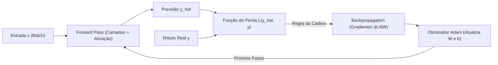

# 🧠 Aula 27: Deep Learning & Redes Neurais

> **Setor da Navegação:** Galáxia 6 — IAs Generativas & LLMs · **ID do Módulo:** `deep-learning`

---

## 1. 🚀 Briefing da Missão (Contexto Temático & Realidade de Mercado)

### Metadados do Setor
- **Galáxia:** 6 — IAs Generativas & LLMs
- **ID Oficial:** `deep-learning`
- **Descrição da Missão:** *"Crie cérebros sintéticos. Compreenda os fundamentos das redes neurais profundas, funções de ativação e implemente modelos usando PyTorch."*
- **Pré-requisitos:** [`validacao-modelos`](../05-sistemas-inteligentes-e-ml/README.md) (*Avaliação & Deploy de Modelos*, Galáxia 5)
- **Próxima Órbita:** [`28-transformers-nlp-moderno.md`](./28-transformers-nlp-moderno.md) (`transformers-nlp`)
- **Destino Final da Galáxia:** [`projeto-consolidacao-06-llms.md`](./projeto-consolidacao-06-llms.md) (`llmops-otimizacao`)

### Analogia Espacial — O Navegador Cósmico e os Motores de Correção de Rota
Imagine que você comanda uma sonda interestelar que precisa pousar com precisão milimétrica em uma lua distante sem um mapa pré-programado. No casco da sonda existem milhares de pequenos propulsores ajustáveis (os **pesos** e **vieses** da rede neural). Na primeira tentativa de pouso (*Forward Pass*), a sonda erra o alvo por 400 metros.

Em vez de chutar novos ajustes aleatórios, o computador de bordo mede exatamente a distância e a direção do erro (*Função de Perda / Loss*) e envia um sinal de trás para frente — do ponto de impacto até cada micropropulsor — calculando o quanto cada um contribuiu para o desvio (*Backpropagation*). Em seguida, o piloto automático (*Otimizador Adam*) gira cada válvula na proporção exata para reduzir o erro na próxima tentativa. Depois de milhares de simulações rápidas, os propulsores trabalham em harmonia perfeita: esse é o coração do **Deep Learning**.

### Qual Dor Real Este Módulo Resolve na Indústria?
Modelos de Machine Learning clássico (como Regressão Logística, SVM e Random Forest, vistos na Galáxia 5) brilham em dados tabulares bem estruturados, onde um humano já definiu manualmente as colunas relevantes (*Feature Engineering*). Porém, empresas enfrentam problemas com **dados não estruturados** em escala massiva: textos livres de suporte, áudio de call centers, imagens de radiografias, logs sequenciais de cliques e documentos PDF.

Para extrair padrões complexos dessas fontes — e para compreender, depurar ou ajustar qualquer LLM moderno (GPT, Claude, Llama, Gemini) por baixo dos panos — um Engenheiro de IA precisa dominar **tensores, redes multicamadas, funções de ativação não-lineares, backpropagation e o ecossistema PyTorch**. Sem essa base, LLMs viram "caixas mágicas" impossíveis de diagnosticar quando dão `OutOfMemoryError`, divergem durante um fine-tuning ou sofrem com gradientes instáveis.

---

## 2. 📚 Carga de Conhecimento Completa (Tópico por Tópico)

### 2.1 Estrutura de um Neurônio Artificial Simples (Perceptron)
O **Perceptron**, proposto por Frank Rosenblatt em 1957, é a unidade atômica das redes neurais. Ele recebe um vetor de entradas numéricas $x = [x_1, x_2, \dots, x_n]$, multiplica cada entrada por um peso aprendível $w = [w_1, w_2, \dots, w_n]$, soma um termo de deslocamento chamado **viés (*bias*, $b$)** e passa o resultado por uma função de ativação $\sigma$:

$$z = \sum_{i=1}^{n} (w_i \cdot x_i) + b = w^T x + b$$

$$y = \sigma(z)$$

- **Entradas ($x_i$):** As características (*features*) numéricas do dado (ex.: pixels normalizados, idade, embeddings).
- **Pesos ($w_i$):** Indicam a importância e a direção (positiva ou negativa) de cada entrada para a decisão final.
- **Viés ($b$):** Permite deslocar o limiar de ativação independentemente das entradas — funciona como o intercepto da reta na geometria analítica. Sem o *bias*, a fronteira de decisão ficaria presa passando pela origem $(0,0)$.
- **Limitação clássica do Perceptron único:** Por calcular uma combinação linear antes de um limiar, um único Perceptron só resolve problemas **linearmente separáveis** (como portas lógicas `AND` e `OR`). Ele falha matematicamente no problema clássico do `XOR` (OU exclusivo), pois nenhuma reta única consegue separar os pontos `(0,1)` e `(1,0)` de `(0,0)` e `(1,1)`.

### 2.2 Funções de Ativação Não-Lineares (Sigmoid, Tanh, ReLU, Softmax)
Empilhar 100 camadas lineares sem função de ativação não-linear resulta apenas em outra função linear equivalente a uma única camada ($W_2(W_1 x) = (W_2 W_1) x$). É a **não-linearidade** que permite às redes neurais dobrar o espaço de decisão e aproximar qualquer função contínua complexa (*Teorema da Aproximação Universal*).

| Função de Ativação | Fórmula Matemática | Faixa de Saída | Onde Usar na Prática | Armadilha / Cuidado |
| :--- | :--- | :--- | :--- | :--- |
| **Sigmoid** | $\sigma(z) = \frac{1}{1 + e^{-z}}$ | $(0, 1)$ | Camada de saída em **classificação binária** (probabilidade). | Sofre de *Vanishing Gradient* (gradiente quase zero nos extremos). Evite em camadas ocultas profundas. |
| **Tanh** | $\tanh(z) = \frac{e^z - e^{-z}}{e^z + e^{-z}}$ | $(-1, 1)$ | Camadas ocultas específicas (ex.: portões de LSTMs/RNNs) por ser centrada em zero. | Também satura para valores muito altos ou baixos de $z$. |
| **ReLU** | $\text{ReLU}(z) = \max(0, z)$ | $[0, +\infty)$ | **Padrão ouro** para camadas ocultas de redes densas e convolucionais. | Pode gerar *Dying ReLU* (neurônios presos em 0 para sempre). Variantes como GELU/SiLU são comuns em Transformers. |
| **Softmax** | $\text{Softmax}(z_i) = \frac{e^{z_i}}{\sum_j e^{z_j}}$ | $(0, 1)$ com $\sum y_i = 1$ | Camada de saída em **classificação multiclasse** mutuamente exclusiva (e no *Attention* dos Transformers!). | No PyTorch, use `nn.CrossEntropyLoss()` direto nos *logits* brutos, pois ela já aplica `LogSoftmax` internamente com estabilidade numérica. |

### 2.3 Fluxo de Propagação de Erro (Backpropagation) e o Otimizador Adam
Treinar uma rede neural significa encontrar os valores de $W$ e $b$ que minimizam uma **Função de Perda (*Loss Function*)**, como `MSELoss` (regressão) ou `CrossEntropyLoss` (classificação). O ciclo acontece em quatro passos contínuos:



1. **Forward Pass:** Os dados entram na rede e fluem camada por camada até gerar a previsão $\hat{y}$ e a perda escalar $L$.
2. **Backpropagation (Retropropagação):** Usando a **Regra da Cadeia** do Cálculo Diferencial, o motor de diferenciação automática do PyTorch (`autograd`) calcula o gradiente $\frac{\partial L}{\partial w}$ para cada peso da rede — ou seja, quanto o erro sobe ou desce se ajustarmos aquele peso específico.
3. **Descida de Gradiente vs. Adam:**
   - No **SGD** (*Stochastic Gradient Descent*) puro, todo peso é atualizado na direção oposta ao gradiente com uma taxa fixa (*learning rate*, $\eta$): $w \leftarrow w - \eta \cdot \nabla w$. Se $\eta$ for alto demais, diverge; se for baixo demais, demora eternamente ou trava em platôs.
   - O **Adam** (*Adaptive Moment Estimation*) é o otimizador padrão da indústria porque combina duas médias móveis exponenciais por parâmetro: o **1º momento** (*momentum* — média dos gradientes passados para suavizar oscilações) e o **2º momento** (variância não-centrada dos gradientes para adaptar o passo individualmente a cada peso). Em LLMs modernos, sua variação **AdamW** separa o *Weight Decay* (regularização L2) da atualização adaptativa, evitando overfitting sem distorcer o passo adaptativo.

### 2.4 Redes Multicamadas (MLP) para Classificação Básica
Uma **MLP (*Multilayer Perceptron*)** conecta pelo menos três tipos de camadas densas (`nn.Linear`):
1. **Camada de Entrada:** Recebe o vetor de *features* de dimensão `in_features`.
2. **Camadas Ocultas (*Hidden Layers*):** Aplicam transformações lineares seguidas de não-linearidades (`ReLU`, `GELU`) e frequentemente regularização (`Dropout`, `BatchNorm`/`LayerNorm`). É aqui que a rede aprende representações hierárquicas (ex.: resolver o problema do `XOR` combinando duas retas em um espaço intermediário).
3. **Camada de Saída:** Projeta para o número de classes alvo (ex.: 1 *logit* para classificação binária ou $K$ *logits* para $K$ classes).

### 2.5 Loops de Treinamento Nativos em PyTorch
Diferente do Scikit-Learn (onde `model.fit(X, y)` esconde tudo), o PyTorch expõe explicitamente o loop de treinamento. Esse controle é indispensável para arquiteturas customizadas, acumulação de gradientes, *mixed precision* (`torch.autocast`) e depuração em tempo real.

A anatomia obrigatória de cada iteração de treino em PyTorch segue cinco passos sagrados:
1. `model.train()` (ativa comportamento de treino para `Dropout` e `BatchNorm`).
2. `optimizer.zero_grad()` (zera gradientes acumulados da iteração anterior).
3. `logits = model(X_batch)` e `loss = criterion(logits, y_batch)` (*Forward pass*).
4. `loss.backward()` (*Backpropagation* populando `.grad` em cada parâmetro).
5. `optimizer.step()` (atualização dos pesos pelo otimizador).

Na fase de validação/teste, o padrão obrigatório muda para `model.eval()` combinado com `with torch.no_grad():`, economizando memória de grafo computacional e garantindo inferência determinística.

---

## 3. 💻 Mão no Código (Jeito Iniciante vs. Padrão Profissional)

Abaixo resolvemos um problema clássico não-linearmente separável (classificação de duas luas entrelaçadas, impossível para um Perceptron simples) usando uma MLP em PyTorch.

### ❌ Jeito Iniciante (Cheio de Armadilhas Silenciosas)
```python
import torch
import torch.nn as nn

# Problema 1: Sem seed fixa -> experimentos irreproduzíveis.
# Problema 2: Sem normalização, sem DataLoader e hardcoded na CPU.
X = torch.randn(500, 2)
y = ((X[:, 0] ** 2 + X[:, 1] ** 2) > 1.0).float().unsqueeze(1)

# Problema 3: Sigmoid em todas as camadas ocultas (vanishing gradient) + Sigmoid no fim
# seguido de BCELoss (numericamente instável comparado a BCEWithLogitsLoss).
model = nn.Sequential(
    nn.Linear(2, 16),
    nn.Sigmoid(),
    nn.Linear(16, 1),
    nn.Sigmoid(),
)

optimizer = torch.optim.SGD(model.parameters(), lr=0.1)
criterion = nn.BCELoss()

for epoch in range(50):
    # ERRO GRAVÍSSIMO: esqueceu optimizer.zero_grad()!
    # O PyTorch SOMA os gradientes a cada epoch, causando explosão de passo.
    pred = model(X)
    loss = criterion(pred, y)
    loss.backward()
    optimizer.step()

# ERRO: avaliando sem model.eval() e sem torch.no_grad(), desperdiçando RAM/VRAM.
acc = ((model(X) > 0.5).float() == y).float().mean()
print("Acurácia (no próprio dado de treino!):", acc.item())
```

### ✅ Padrão Profissional (Loop PyTorch Completo, Reprodutível e Modular)
```python
import numpy as np
import torch
import torch.nn as nn
from sklearn.datasets import make_moons
from sklearn.model_selection import train_test_split
from sklearn.preprocessing import StandardScaler
from torch.utils.data import DataLoader, TensorDataset


def set_seed(seed: int = 42) -> None:
    """Garante reprodutibilidade entre execuções."""
    np.random.seed(seed)
    torch.manual_seed(seed)
    if torch.cuda.is_available():
        torch.cuda.manual_seed_all(seed)


def get_device() -> torch.device:
    """Seleciona automaticamente GPU CUDA, Apple Silicon MPS ou CPU."""
    if torch.cuda.is_available():
        return torch.device("cuda")
    if torch.backends.mps.is_available():
        return torch.device("mps")
    return torch.device("cpu")


class MoonClassifierMLP(nn.Module):
    """MLP com ReLU e Dropout para classificação binária não-linear."""

    def __init__(self, in_features: int = 2, hidden_dim: int = 32, num_classes: int = 2) -> None:
        super().__init__()
        self.net = nn.Sequential(
            nn.Linear(in_features, hidden_dim),
            nn.ReLU(),
            nn.Dropout(p=0.1),
            nn.Linear(hidden_dim, hidden_dim),
            nn.ReLU(),
            # Saída em logits brutos (sem Softmax aqui; CrossEntropyLoss aplica internamente)
            nn.Linear(hidden_dim, num_classes),
        )

    def forward(self, x: torch.Tensor) -> torch.Tensor:
        return self.net(x)


def train_one_epoch(
    model: nn.Module,
    loader: DataLoader,
    criterion: nn.Module,
    optimizer: torch.optim.Optimizer,
    device: torch.device,
) -> float:
    model.train()  # Ativa Dropout e modos de treinamento
    running_loss = 0.0

    for X_batch, y_batch in loader:
        X_batch, y_batch = X_batch.to(device), y_batch.to(device)

        optimizer.zero_grad()               # 1. Limpa gradientes acumulados
        logits = model(X_batch)             # 2. Forward pass
        loss = criterion(logits, y_batch)   # 3. Calcula perda
        loss.backward()                     # 4. Backpropagation
        optimizer.step()                    # 5. Atualiza pesos com AdamW

        running_loss += loss.item() * X_batch.size(0)

    return running_loss / len(loader.dataset)


@torch.no_grad()
def evaluate(
    model: nn.Module,
    loader: DataLoader,
    criterion: nn.Module,
    device: torch.device,
) -> tuple[float, float]:
    model.eval()  # Desativa Dropout para avaliação determinística
    total_loss = 0.0
    correct = 0

    for X_batch, y_batch in loader:
        X_batch, y_batch = X_batch.to(device), y_batch.to(device)
        logits = model(X_batch)
        loss = criterion(logits, y_batch)

        total_loss += loss.item() * X_batch.size(0)
        preds = logits.argmax(dim=1)
        correct += (preds == y_batch).sum().item()

    avg_loss = total_loss / len(loader.dataset)
    accuracy = correct / len(loader.dataset)
    return avg_loss, accuracy


def main() -> None:
    set_seed(42)
    device = get_device()

    # Dados não-linearmente separáveis (duas luas entrelaçadas com ruído)
    X, y = make_moons(n_samples=1000, noise=0.2, random_state=42)
    X_train, X_val, y_train, y_val = train_test_split(
        X, y, test_size=0.2, stratify=y, random_state=42
    )

    # Normalização ajustada APENAS no treino (evita data leakage)
    scaler = StandardScaler()
    X_train = scaler.fit_transform(X_train)
    X_val = scaler.transform(X_val)

    train_ds = TensorDataset(torch.tensor(X_train, dtype=torch.float32), torch.tensor(y_train, dtype=torch.long))
    val_ds = TensorDataset(torch.tensor(X_val, dtype=torch.float32), torch.tensor(y_val, dtype=torch.long))

    train_loader = DataLoader(train_ds, batch_size=32, shuffle=True)
    val_loader = DataLoader(val_ds, batch_size=64, shuffle=False)

    model = MoonClassifierMLP().to(device)
    criterion = nn.CrossEntropyLoss()
    optimizer = torch.optim.AdamW(model.parameters(), lr=1e-3, weight_decay=1e-4)

    for epoch in range(1, 61):
        train_loss = train_one_epoch(model, train_loader, criterion, optimizer, device)
        val_loss, val_acc = evaluate(model, val_loader, criterion, device)
        if epoch % 15 == 0 or epoch == 1:
            print(
                f"Epoch {epoch:02d} | Train Loss: {train_loss:.4f} | "
                f"Val Loss: {val_loss:.4f} | Val Acc: {val_acc * 100:.2f}%"
            )


if __name__ == "__main__":
    main()
```

---

## 4. 🛠️ Laboratório de Voo (Exercício Prático Guiado)

**Duração estimada:** 40 minutos · **Objetivo:** Provar na prática o porquê da não-linearidade e construir um classificador MLP real com salvamento de pesos.

### Passo a Passo
1. **Setup do ambiente:** Crie um ambiente virtual Python (`python -m venv .venv && source .venv/bin/activate`) e instale `torch` e `scikit-learn` (`pip install torch scikit-learn`).
2. **Experimento 1 — Prova da Linearidade:** Pegue o código profissional da Seção 3 e remova todas as camadas `nn.ReLU()` da classe `MoonClassifierMLP`. Execute e anote a acurácia máxima atingida na validação. Observe que ela estagna perto de ~85% (fronteira apenas linear).
3. **Experimento 2 — Restauração da Não-Linearidade:** Reative as funções `nn.ReLU()` (e teste também `nn.GELU()`). Compare a evolução do `Val Loss` e veja a acurácia subir para >95%.
4. **Experimento 3 — Early Stopping & Checkpoint:** Modifique o loop `main()` para salvar o melhor modelo em disco sempre que `val_loss` atingir um novo mínimo histórico usando `torch.save(model.state_dict(), "best_mlp.pt")`.
5. **Experimento 4 — Inferência Isolada:** Crie um pequeno script separado que instancia `MoonClassifierMLP()`, carrega os pesos com `model.load_state_dict(torch.load("best_mlp.pt", weights_only=True))`, coloca em `model.eval()` e prevê uma nova coordenada aplicando `torch.softmax(logits, dim=1)`.

### Critérios de Domínio
- [ ] O aluno explicou nos comentários do código por que a remoção da `ReLU` derrubou o poder de separação do modelo.
- [ ] O loop de treino limpa os gradientes (`zero_grad()`), realiza `backward()` e atualiza com `Adam` ou `AdamW`.
- [ ] O checkpoint salvo em `.pt` é recarregado corretamente com `weights_only=True` e `model.eval()`.
- [ ] O script roda sem erros tanto em CPU quanto em GPU/MPS (sem hardcode de `.cuda()`).

---

## 5. 🎯 Resolução Comentada do Teste de Ignição (Quest Oficial)

> **Pergunta Oficial (`deep-learning`):**
> *Por que as funções de ativação em redes neurais profundas (como a ReLU) devem ser obrigatoriamente não-lineares?*

- **A)** *"Para acelerar o salvamento do modelo em disco rígido."*
- **B)** *"Porque, sem não-linearidade, a composição de múltiplas camadas se comportaria como uma única função linear simples, impedindo a rede de aprender relações complexas e não-lineares nos dados."*
- **C)** *"Para forçar os tensores do PyTorch a rodar sempre na GPU."*
- **D)** *"Para limitar os números de entrada a valores obrigatoriamente inteiros."*

### ✅ Gabarito Oficial: **Alternativa B**

- **Por que a B está correta?** Matematicamente, o produto de matrizes é associativo. Se uma rede tem duas camadas lineares $h = W_1 x + b_1$ e $y = W_2 h + b_2$, substituindo $h$ temos $y = (W_2 W_1)x + (W_2 b_1 + b_2) = W_{eq} x + b_{eq}$. Não importa se você empilhar 2 ou 200 camadas: sem uma função não-linear (como `ReLU`, `GELU`, `Sigmoid` ou `Tanh`) entre elas, toda a rede colapsa em uma única regressão linear incapaz de aprender fronteiras curvas, imagens ou semântica linguística.
- **Por que a A está errada?** Serialização e tamanho em disco dependem da quantidade de parâmetros e da precisão numérica (FP32, FP16, INT4), não da função de ativação aplicada durante o *forward pass*.
- **Por que a C está errada?** A alocação de hardware (`.to("cuda")`, `.to("mps")` ou CPU) é uma decisão explícita de código no PyTorch e independe da linearidade matemática das ativações.
- **Por que a D está errada?** Redes neurais operam com números contínuos em ponto flutuante (`float32`, `bfloat16`), e ativações como Sigmoid, Tanh e ReLU geram saídas reais contínuas, nunca forçando entradas a serem inteiras.

---

## 6. 🎤 Kit de Apresentação (Como Dar Aula / Apresentar Este Módulo)

### Pitch Feynman de 2 Minutos (Texto Pronto para Falar)
> *"Muita gente acha que Deep Learning é magia negra, mas na verdade é um jogo de ajuste fino baseado em cálculo simples. Imagine tentar ensinar um robô vendado a acertar um dardo no alvo. Cada camada de uma rede neural é um conjunto de multiplicações que transforma dados brutos — como pixels ou números — em uma tentativa de resposta. No meio dessas camadas, colocamos dobradiças matemáticas chamadas funções de ativação, como a ReLU. Sem essas dobradiças não-lineares, empilhar mil camadas seria igual a usar uma única linha reta: você nunca conseguiria desenhar curvas para separar dados complexos.*
> *Quando o robô erra o alvo, calculamos uma nota de erro chamada Loss. É aí que entra o Backpropagation: ele usa a Regra da Cadeia lá do cálculo para voltar de trás para frente, descobrindo exatamente qual neurônio puxou o braço para a direita ou para a esquerda demais. Com essa culpa medida, um otimizador como o Adam ajusta cada peso na direção certa. No PyTorch, você escreve esse ciclo inteiro em cinco linhas transparentes: zera o gradiente, faz a previsão, mede o erro, retropropaga e dá o passo do otimizador. É literalmente esse mesmo motor de camadas, ReLU/GELU, Backpropagation e Adam que, em escala gigante, treina o GPT, o Claude e o Gemini."*

### Roteiro de Slides (6 Slides)
1. **Slide 1 — Do Perceptron ao Deep Learning:** O que é um neurônio artificial ($wx + b$) e o famoso limite do `XOR` (visual: gráfico 2D de linha reta falhando em separar o `XOR` vs. espaço dobrado por uma MLP).
2. **Slide 2 — O Poder da Não-Linearidade:** Comparação visual de `Sigmoid`, `Tanh`, `ReLU` e `Softmax` (visual: 4 mini-gráficos lado a lado mostrando curvas e derivadas).
3. **Slide 3 — Como a Rede Aprende (Forward + Loss + Backprop):** Fluxo completo com a analogia dos propulsores da sonda espacial (visual: diagrama da Seção 2.3 com setas bidirecionais coloridas).
4. **Slide 4 — SGD vs. AdamW:** Por que o Adam converge mais rápido adaptando o passo por parâmetro (visual: terreno de montanha com bola descendo em zigue-zague no SGD vs. caminho suave no Adam).
5. **Slide 5 — Anatomia de uma MLP em PyTorch:** Código limpo de `nn.Module` + `DataLoader` (visual: código destacado com caixas apontando para `Linear`, `ReLU` e *logits*).
6. **Slide 6 — O Ritual Sagrado do Loop de Treino:** Os 5 passos (`zero_grad`, `forward`, `loss`, `backward`, `step`) + `eval()`/`no_grad()` (visual: checklist numerado lado a lado com erros comuns em vermelho).

### Roteiro de Demo Ao Vivo (3 Minutos)
1. **Minuto 0:00–1:00:** Abra o script da Seção 3 com a `nn.ReLU()` **comentada** e rode no terminal. Mostre a acurácia travar em ~85% na fronteira das luas.
2. **Minuto 1:00–2:00:** Descomente as duas linhas `nn.ReLU()` ao vivo, rode novamente e mostre a perda despencando e a acurácia ultrapassando 96% em segundos.
3. **Minuto 2:00–3:00:** Abra um bloco rápido comentando `optimizer.zero_grad()` e mostre a perda oscilando/explodindo por acúmulo indevido de gradientes — nada grava melhor na mente da plateia do que ver um bug clássico acontecer ao vivo!

### Perguntas Difíceis da Plateia
- **Pergunta 1:** *"Se a ReLU zera valores negativos e tem derivada 0 para $x < 0$, isso não faz neurônios morrerem para sempre?"*
  **Resposta segura:** *"Sim, esse fenômeno existe e se chama Dying ReLU! Se um passo muito grande de gradiente empurrar os pesos de um neurônio para um estado onde ele sempre recebe entradas negativas, o gradiente vira zero e ele para de atualizar. Na prática, mitigamos isso usando learning rates adequados com AdamW, inicialização correta (Kaiming/He) ou usando variações suaves como LeakyReLU, GELU e SiLU — aliás, GELU e SwiGLU são as escolhas dominantes em LLMs modernos."*
- **Pergunta 2:** *"Por que aprender PyTorch na mão se o Keras ou Hugging Face Trainer fazem `model.fit()` ou `trainer.train()` em uma linha?"*
  **Resposta segura:** *"Abstrações de alto nível aceleram projetos padrão, mas assim que você precisa de uma função de perda customizada, múltiplos objetivos (ex.: destilação de LLMs), acumulação de gradientes ou depuração de NaN durante um fine-tuning, o loop nativo do PyTorch é o que separa quem copia código de quem resolve problemas em produção."*

---

## 7. 💼 Radar do Mercado de Trabalho (Foco Dev Júnior)

### 3 Perguntas Reais de Entrevista Técnica Júnior
1. **Pergunta:** *"Qual a diferença prática entre chamar `model.eval()` e usar o gerenciador `with torch.no_grad():` no PyTorch? Um substitui o outro?"*
   **Resposta-modelo:** *"Não, eles cumprem papéis diferentes e devem ser usados juntos na validação e inferência. O `model.eval()` muda o comportamento de camadas específicas como `Dropout` (que passa a não desligar neurônios) e `BatchNorm` (que passa a usar as médias acumuladas em vez das estatísticas do batch atual). Já o `torch.no_grad()` desabilita o motor de `autograd` para não armazenar ativações intermediárias nem construir o grafo de gradientes, economizando memória e acelerando a execução."*
2. **Pergunta:** *"Por que não devemos colocar uma camada `nn.Softmax()` no final do modelo quando usamos `nn.CrossEntropyLoss()` no PyTorch?"*
   **Resposta-modelo:** *"Porque `nn.CrossEntropyLoss()` espera receber os logits brutos e aplica `LogSoftmax` + `NLLLoss` internamente usando o truque matemático Log-Sum-Exp para evitar overflow ou underflow numérico de exponenciais. Se passarmos probabilidades já normalizadas por um `Softmax` explícito, aplicaremos a operação duas vezes, distorcendo os gradientes e prejudicando a convergência."*
3. **Pergunta:** *"O que acontece se esquecermos de chamar `optimizer.zero_grad()` dentro do loop de treinamento em PyTorch?"*
   **Resposta-modelo:** *"Por padrão, o PyTorch acumula (soma) os novos gradientes ao atributo `.grad` existente nos parâmetros a cada chamada de `.backward()`. Sem `zero_grad()`, o otimizador passa a usar a soma histórica de todos os batches anteriores misturados, causando passos erráticos e divergência no treino. Vale notar que esse comportamento padrão é proposital para facilitar uma técnica avançada chamada Gradient Accumulation quando temos pouca VRAM."*

### Erros Clássicos de Júnior vs. Postura Profissional

| Erro Clássico de Júnior | Postura Profissional Esperada |
| :--- | :--- |
| Normalizar todo o dataset (`StandardScaler().fit_transform(X)`) antes de dividir em treino e teste. | Fazer `train_test_split` primeiro e rodar `fit_transform` **somente no treino**, usando `transform` na validação/teste (*zero data leakage*). |
| Medir acurácia apenas nos dados de treino e comemorar 99,9%. | Acompanhar curva de `train_loss` vs `val_loss` para diagnosticar *overfitting* e salvar o melhor checkpoint pela validação. |
| Usar `.cuda()` hardcoded, quebrando o código no notebook do colega sem GPU Nvidia. | Escrever código *device-agnostic* (`cuda` / `mps` / `cpu`) e garantir `weights_only=True` no carregamento de pesos. |

### Evidência para Portfólio / GitHub / LinkedIn
- **Repositório no GitHub:** Publique um mini-projeto `pytorch-mlp-lab` com dois notebooks/scripts comparativos: (1) solução do `XOR` e `make_moons` provando visualmente a fronteira de decisão linear vs. não-linear com `matplotlib` e (2) classificador tabular completo em PyTorch com `DataLoader`, *Early Stopping* e inferência via CLI.
- **Post no LinkedIn:** Compartilhe os dois gráficos lado a lado ("Com vs. Sem ReLU") explicando em 4 parágrafos claros por que camadas profundas sem não-linearidade colapsam em uma única matriz. Recrutadores de Engenharia de IA valorizam quem domina os fundamentos por trás das APIs.

---

## 8. 📡 Transmissões Recomendadas & Próxima Órbita

### Recursos Oficiais do Módulo
- 📖 [Deep Learning Book (Gratuito — Data Science Academy)](https://www.deeplearningbook.com.br/)
- 🔥 [PyTorch Tutorials (Documentação Oficial)](https://pytorch.org/tutorials/)
- 🎥 [3Blue1Brown: Redes Neurais (YouTube — Playlist Clássica)](https://www.youtube.com/playlist?list=PLZHQObOWTQDNU6R1_67000DX_ZCJB-3Ut)

### Próxima Órbita
Agora que você domina os tijolos fundamentais (tensores, ativações não-lineares, Backpropagation e PyTorch), está pronto para descobrir como esses blocos foram reorganizados em uma das maiores invenções da computação moderna: a arquitetura **Transformer**. Avance para a [**Aula 28: Transformers & NLP Moderno**](./28-transformers-nlp-moderno.md).
