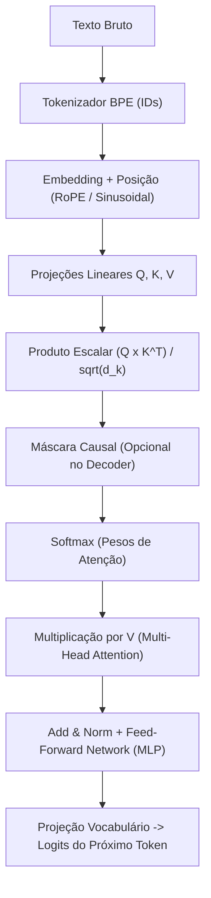

# 🗣️ Aula 28: Transformers & NLP Moderno

> **Setor da Navegação:** Galáxia 6 — IAs Generativas & LLMs · **ID do Módulo:** `transformers-nlp`

---

## 1. 🚀 Briefing da Missão (Contexto Temático & Realidade de Mercado)

### Metadados do Setor
- **Galáxia:** 6 — IAs Generativas & LLMs
- **ID Oficial:** `transformers-nlp`
- **Descrição da Missão:** *"A revolução da linguagem. Estude a arquitetura Transformer que permitiu a criação dos modernos modelos de linguagem (GPT, Claude, Gemini)."*
- **Pré-requisitos:** [`27-deep-learning-redes-neurais.md`](./27-deep-learning-redes-neurais.md) (`deep-learning`)
- **Próxima Órbita:** [`29-engenharia-de-prompt-apis-llm.md`](./29-engenharia-de-prompt-apis-llm.md) (`prompt-eng-apis`)
- **Destino Final da Galáxia:** [`projeto-consolidacao-06-llms.md`](./projeto-consolidacao-06-llms.md) (`llmops-otimizacao`)

### Analogia Espacial — A Mesa Redonda de Tradutores Telepáticos
Antes de 2017, modelos de linguagem como RNNs e LSTMs liam frases como um oficial solitário lendo um pergaminho por uma fresta estreita: uma palavra por vez, da esquerda para a direita. Quando chegava ao final de um parágrafo longo, ele já havia esquecido quem era o sujeito da primeira frase — e não podia paralelizar a leitura porque o passo 50 dependia do passo 49.

A arquitetura **Transformer** substituiu a fresta por uma **Mesa Redonda Telepática**: todos os tokens da frase entram na sala ao mesmo tempo. Cada token levanta três cartões: *"O que eu estou procurando?"* (**Query**), *"O que eu ofereço de contexto?"* (**Key**) e *"Qual conteúdo eu carrego?"* (**Value**). Em uma fração de segundo, um pronome como `"ela"` na posição 40 olha diretamente para `"a engenheira"` na posição 3, descobre que pertencem um ao outro e absorve esse significado sem precisar atravessar 37 etapas de memória degradada.

### Qual Dor Real Este Módulo Resolve na Indústria?
No mercado atual, praticamente todo produto de IA — de copilotos de código e busca semântica até sistemas de classificação de tickets e geração multimodal — depende de **Transformers**. Entender tokenização, embeddings, atenção e geração autoregressiva resolve dores reais diárias do engenheiro:
- Por que um modelo erra contas matemáticas simples ou conta errado letras em `"strawberry"`? (**Tokenização subword**).
- Por que o custo e a latência explodem quadraticamente conforme o contexto cresce? (**Complexidade $O(N^2)$ da matriz de Self-Attention**).
- Quando usar um modelo leve estilo BERT (*Encoder-only*) para classificar 1 milhão de documentos por centavos em vez de queimar orçamento chamando um GPT (*Decoder-only*)?

---

## 2. 📚 Carga de Conhecimento Completa (Tópico por Tópico)

### 2.1 Tokenização Moderna (Byte-Pair Encoding — BPE)
Computadores não processam caracteres ou palavras diretamente; redes neurais exigem **IDs inteiros** que apontam para linhas de uma tabela de vetores. Como transformar qualquer texto do mundo (português, código Python, emojis, neologismos) em IDs sem gerar um vocabulário infinito?

- **Tokenização por Palavras (Falha):** Vocabulário explode com plurais, conjugações e erros de digitação (`"correr"`, `"correndo"`, `"corri"`, `"correrr"` viram entradas distintas ou `<UNK>` desconhecido).
- **Tokenização por Caracteres (Falha):** Vocabulário minúsculo (~256 bytes), mas sequências ficam longas demais e cada token carrega pouquíssimo significado semântico.
- **Byte-Pair Encoding (BPE — Padrão de GPT, Llama, Claude):** Começa com bytes/caracteres básicos e, iterativamente durante o treinamento do tokenizador, funde os pares adjacentes mais frequentes no corpus em novos subtokens (`"in"`, `"crível"`, `"mente"`).
  - Palavras muito comuns (`" que"`, `" function"`, `" return"`) viram **1 único token**.
  - Palavras raras ou novas são quebradas em pedaços conhecidos sem nunca gerar erro de palavra desconhecida (`<UNK>`).
  - **Impacto prático em custos e português:** Tokenizadores treinados majoritariamente em inglês tendem a quebrar palavras em português em mais tokens do que seus equivalentes em inglês, encarecendo chamadas de API e consumindo mais janela de contexto.

### 2.2 Conceito e Geração de Embeddings Vetoriais para Texto
Depois que a frase vira uma lista de IDs (ex.: `[15496, 995]`), cada ID passa por uma camada de **Embedding** (`nn.Embedding(vocab_size, d_model)`), que funciona como uma tabela de busca (*lookup table*) aprendida durante o treinamento.

- **O que é um Embedding?** É um vetor denso de números reais (ex.: 768, 1536 ou 4096 dimensões) que posiciona o token em um espaço geométrico contínuo onde **similaridade semântica vira proximidade espacial**.
- **Embeddings Estáticos vs. Contextuais:** Em modelos antigos (Word2Vec), `"banco"` (de sentar) e `"banco"` (instituição financeira) tinham exatamente o mesmo vetor. No Transformer, o embedding inicial somado ao **Positional Encoding** (ou RoPE — *Rotary Position Embedding*, que informa a ordem dos tokens na frase) entra nas camadas de **Self-Attention** e sai transformado em um **embedding contextual**, onde `"banco"` se aproxima de `"empréstimo"` ou de `"praça"` dependendo da vizinhança.
- **Embeddings de Sentença/Documento:** Para buscas e RAG, modelos especializados extraem um único vetor representando o significado de um parágrafo inteiro (geralmente aplicando *mean pooling* ou pegando o token `[CLS]`/`EOS`).

### 2.3 Mecanismo de Self-Attention (Auto-Atenção) em Detalhes
Introduzido no artigo clássico *"Attention Is All You Need"* (Vaswani et al., 2017), o **Scaled Dot-Product Attention** é a equação central dos LLMs modernos:

$$\text{Attention}(Q, K, V) = \text{softmax}\left(\frac{Q K^T}{\sqrt{d_k}} + M\right) V$$

Como isso funciona passo a passo?
1. **Projeções Lineares ($Q, K, V$):** A matriz de embeddings de entrada $X$ (formato `[seq_len, d_model]`) é multiplicada por três matrizes de pesos aprendíveis ($W_Q, W_K, W_V$) para gerar:
   - **Query ($Q$):** O que cada token está buscando no contexto.
   - **Key ($K$):** O rótulo/assinatura que cada token anuncia sobre si mesmo.
   - **Value ($V$):** A informação real que será entregue caso haja correspondência alta.
2. **Pontuação de Afinidade ($Q K^T$):** O produto escalar entre cada Query e todas as Keys gera uma matriz quadrada `[seq_len, seq_len]` medindo o quanto cada token se relaciona com todos os outros — **em paralelo, independentemente da distância** na frase.
3. **Escalonamento ($\div \sqrt{d_k}$):** Divide-se pela raiz quadrada da dimensão das chaves ($d_k$) para evitar que produtos escalares muito grandes saturem o `softmax` e matem os gradientes.
4. **Máscara Causal ($M$, apenas no Decoder):** Em modelos geradores como GPT, tokens futuros recebem $-\infty$ antes do `softmax`, garantindo que a posição $t$ nunca "cole" a resposta da posição $t+1$.
5. **Multi-Head Attention:** Em vez de rodar uma única atenção, o Transformer divide o espaço em múltiplas "cabeças" paralelas (ex.: 32 ou 64 cabeças). Uma cabeça aprende relações sintáticas (verbo-sujeito), outra resolve pronomes, outra rastreia indentação de código.



### 2.4 Arquiteturas: Encoder-Only (BERT) vs. Decoder-Only (GPT)
O Transformer original de 2017 tinha dois blocos (Encoder + Decoder, voltado para tradução). A indústria evoluiu especializando cada metade:

| Característica | Encoder-Only (ex.: BERT, RoBERTa, BGE) | Decoder-Only (ex.: GPT-4, Claude, Llama, Gemini) | Encoder-Decoder (ex.: T5, Whisper) |
| :--- | :--- | :--- | :--- |
| **Direção da Atenção** | **Bidirecional:** cada token vê tokens à esquerda e à direita ao mesmo tempo. | **Causal / Unidirecional:** cada token só vê a si mesmo e os anteriores. | Encoder bidirecional + Decoder causal com *Cross-Attention*. |
| **Objetivo de Treino** | *Masked Language Modeling* (prever lacunas `[MASK]` no meio da frase). | *Next Token Prediction* (prever o próximo token da sequência). | Tradução / Sequência para sequência (*Seq2Seq*). |
| **Onde Brilha Hoje** | Classificação de textos, NER, análise de sentimento, **geração de Embeddings para RAG** e Rerankers. | Chatbots, geração de código, raciocínio, agentes autônomos e uso geral (*Zero-Shot / Few-Shot*). | Transcrição de áudio (Whisper), tradução especializada. |
| **Custo de Inferência** | Baixíssimo (modelos de 110M–560M parâmetros rodam em CPU ou GPU pequena em milissegundos). | Mais alto (bilhões de parâmetros gerando um token por vez). | Moderado a alto. |

### 2.5 Processo Probabilístico de Geração Autoregressiva de Tokens
Uma LLM não "pensa na resposta inteira pronta". Ela gera texto em um loop **autoregressivo** (token a token):
1. Recebe o prompt `[t1, t2, ..., tn]` e executa o *forward pass* produzindo um vetor de **logits** com a pontuação de todas as dezenas de milhares de palavras possíveis do vocabulário (ex.: 128.256 tokens no Llama 3) para a posição `n+1`.
2. Aplica **Softmax** (modulado por `Temperature`, `Top-K` e `Top-P`) para transformar logits em uma distribuição de probabilidades.
3. **Estratégias de Decoding (Amostragem):**
   - **Greedy Decoding:** Escolhe sempre o token de maior probabilidade (`argmax`). Determinístico, mas pode gerar textos repetitivos.
   - **Sampling (Amostragem Estocástica):** Sorteia o próximo token respeitando as probabilidades filtradas (veremos `Temperature` e `Top-P` em detalhe na Aula 29).
4. O token escolhido é concatenado ao final do prompt `[t1, ..., tn, t_novo]`, e o processo se repete até o modelo emitir um token especial de parada (`<|endoftext|>` / `<EOS>`) ou atingir `max_tokens`.
5. **KV Cache (Otimização Crucial):** Para não recalcular $K$ e $V$ de todos os tokens anteriores a cada novo token gerado, engines modernas guardam as chaves e valores já computados na VRAM (*KV Cache*), transformando cada novo passo em um cálculo rápido apenas para o último token!

---

## 3. 💻 Mão no Código (Jeito Iniciante vs. Padrão Profissional)

Abaixo comparamos a abordagem ingênua de tratar linguagem como contagem isolada de palavras vs. implementar tokenização BPE real e o bloco de **Scaled Dot-Product Self-Attention Causal** em PyTorch.

### ❌ Jeito Iniciante (Sem Subwords e Sem Contexto Posicional/Atenção)
```python
# Problema 1: Quebra por espaços falha com pontuação, código e palavras raras.
texto_a = "O banco bloqueou meu cartão."
texto_b = "Sentei no banco da praça."

tokens_a = texto_a.lower().split()
tokens_b = texto_b.lower().split()

# Problema 2: Representação "Bag of Words" ignora ordem e contexto.
# Para esse código, "banco" e "cartão." (com ponto!) são símbolos rígidos sem relação,
# e "cachorro mordeu o homem" tem os mesmos tokens que "homem mordeu o cachorro".
vocab = {palavra: idx for idx, palavra in enumerate(set(tokens_a + tokens_b))}
print("Vocabulário frágil:", vocab)
```

### ✅ Padrão Profissional (Tokenização BPE + Self-Attention Causal + Decoding em PyTorch)
```python
import math
import torch
import torch.nn as nn
import torch.nn.functional as F

try:
    import tiktoken
except ImportError:
    tiktoken = None


def demonstrar_bpe(texto: str) -> list[int]:
    """Tokeniza texto usando Byte-Pair Encoding (cl100k_base / GPT-4)."""
    if tiktoken is None:
        print("Instale 'tiktoken' para ver IDs BPE reais; usando fallback ilustrativo.")
        return [ord(c) for c in texto[:12]]

    enc = tiktoken.get_encoding("cl100k_base")
    token_ids = enc.encode(texto)
    partes = [enc.decode([tid]) for tid in token_ids]
    print(f"Texto: {texto!r}")
    print(f"Total de tokens: {len(token_ids)} | Subwords: {partes} | IDs: {token_ids}\n")
    return token_ids


class CausalSelfAttention(nn.Module):
    """Implementação didática e fiel do Multi-Head Causal Self-Attention (estilo GPT)."""

    def __init__(self, d_model: int = 64, num_heads: int = 4, max_seq_len: int = 128) -> None:
        super().__init__()
        assert d_model % num_heads == 0, "d_model deve ser divisível por num_heads"
        self.num_heads = num_heads
        self.head_dim = d_model // num_heads

        # Projeta X de uma só vez em Q, K e V (3 * d_model) — padrão eficiente de produção
        self.qkv_proj = nn.Linear(d_model, 3 * d_model, bias=False)
        self.out_proj = nn.Linear(d_model, d_model, bias=False)

        # Máscara triangular inferior para impedir que tokens olhem para o futuro
        mask = torch.tril(torch.ones(max_seq_len, max_seq_len))
        self.register_buffer("causal_mask", mask.view(1, 1, max_seq_len, max_seq_len))

    def forward(self, x: torch.Tensor) -> tuple[torch.Tensor, torch.Tensor]:
        B, T, C = x.shape  # Batch, Comprimento da Sequência (Tokens), Dimensão do Embedding

        # 1. Calcula Q, K, V e reorganiza para [Batch, Heads, SeqLen, HeadDim]
        qkv = self.qkv_proj(x)
        q, k, v = qkv.chunk(3, dim=-1)
        q = q.view(B, T, self.num_heads, self.head_dim).transpose(1, 2)
        k = k.view(B, T, self.num_heads, self.head_dim).transpose(1, 2)
        v = v.view(B, T, self.num_heads, self.head_dim).transpose(1, 2)

        # 2. Scaled Dot-Product Attention: (Q @ K^T) / sqrt(d_k)
        scores = (q @ k.transpose(-2, -1)) / math.sqrt(self.head_dim)

        # 3. Aplica máscara causal: posições futuras viram -infinito -> Softmax vira 0
        scores = scores.masked_fill(self.causal_mask[:, :, :T, :T] == 0, float("-inf"))

        # 4. Probabilidades de atenção e agregação ponderada de Values
        attn_weights = F.softmax(scores, dim=-1)
        context = attn_weights @ v

        # 5. Reagrupa todas as cabeças e aplica projeção de saída
        context = context.transpose(1, 2).contiguous().view(B, T, C)
        return self.out_proj(context), attn_weights


@torch.no_grad()
def exemplo_passo_autoregressivo() -> None:
    torch.manual_seed(7)
    vocab_size, d_model, seq_len = 1000, 64, 6

    embedding_table = nn.Embedding(vocab_size, d_model)
    pos_table = nn.Embedding(128, d_model)
    attn_block = CausalSelfAttention(d_model=d_model, num_heads=4)
    lm_head = nn.Linear(d_model, vocab_size, bias=False)

    # Sequência inicial de token IDs simulando um prompt
    tokens = torch.tensor([[42, 105, 87, 312, 19, 501]])  # shape [1, 6]
    positions = torch.arange(seq_len).unsqueeze(0)

    # Soma embedding semântico + embedding posicional
    x = embedding_table(tokens) + pos_table(positions)
    contextualized, weights = attn_block(x)

    # Para prever o PRÓXIMO token, usamos apenas o vetor da última posição (-1)
    next_token_logits = lm_head(contextualized[:, -1, :])
    probs = F.softmax(next_token_logits, dim=-1)
    next_token_id = torch.multinomial(probs, num_samples=1)

    print("Shape dos embeddings contextualizados:", contextualized.shape)
    print("Shape dos pesos de atenção (Head 0):", weights[0, 0].shape)
    print("Próximo token amostrado (ID):", next_token_id.item())


if __name__ == "__main__":
    demonstrar_bpe("Engenharia de Inteligência Artificial & Transformers!")
    exemplo_passo_autoregressivo()
```

---

## 4. 🛠️ Laboratório de Voo (Exercício Prático Guiado)

**Duração estimada:** 45 minutos · **Objetivo:** Inspecionar tokens BPE reais em português vs. inglês e comparar um modelo Encoder-only gerando embeddings semânticos contra a matriz de atenção causal.

### Passo a Passo
1. **Instale as dependências:** `pip install tiktoken torch sentence-transformers numpy`.
2. **Auditoria de Tokenização BPE:** Escreva um script com `tiktoken.get_encoding("cl100k_base")` e `o200k_base` (GPT-4o) comparando quantos tokens gastam as seguintes entradas:
   - `"A inteligência artificial generativa está transformando a engenharia de software."`
   - `"Generative artificial intelligence is transforming software engineering."`
   - `"9999999 + 123456 = "` e `"strawberry"`
   Imprima cada subtoken decodificado individualmente para visualizar como números e palavras em português são fatiados.
3. **Inspeção da Máscara Causal:** Usando a classe `CausalSelfAttention` da Seção 3, imprima a matriz `weights[0, 0].numpy().round(2)` e confirme visualmente que todos os valores acima da diagonal principal são exatamente `0.0`. Depois, remova a linha `masked_fill` para simular atenção bidirecional (estilo BERT) e veja a matriz completa se preencher.
4. **Embeddings Contextuais com Encoder-Only:** Carregue um modelo Encoder leve (`all-MiniLM-L6-v2` via `sentence-transformers`), gere os vetores das frases `"O banco central elevou os juros"` vs `"Sentei no banco da praça"` vs `"A taxa Selic subiu hoje"`, e calcule a similaridade entre eles via produto escalar normalizado.

### Critérios de Domínio
- [ ] O aluno conseguiu imprimir os subtokens exatos do BPE e explicar por que `"9999999"` vira múltiplos pedaços numéricos.
- [ ] Confirmou matematicamente que a máscara triangular inferior zera a atenção para tokens futuros no modo Decoder-only.
- [ ] Demonstrou numericamente que embeddings contextuais separam sentidos diferentes da palavra `"banco"`.

---

## 5. 🎯 Resolução Comentada do Teste de Ignição (Quest Oficial)

> **Pergunta Oficial (`transformers-nlp`):**
> *Qual a inovação crucial do mecanismo de 'Self-Attention' (Auto-Atenção) introduzido nos Transformers em relação a arquiteturas anteriores como LSTMs e RNNs?*

- **A)** *"Ele descarta o uso de matrizes matemáticas, focando apenas em busca de palavras-chave."*
- **B)** *"Ele processa sequências de texto inteiras em paralelo (em vez de palavra por palavra sequencialmente) e calcula o nível de relação entre cada palavra e todas as outras na frase, independente da distância física entre elas."*
- **C)** *"Ele obriga o modelo a responder perguntas em menos de 1 segundo utilizando menos memória RAM."*
- **D)** *"Ele traduz automaticamente qualquer idioma para inglês antes de salvar os dados no banco relacional."*

### ✅ Gabarito Oficial: **Alternativa B**

- **Por que a B está correta?** RNNs e LSTMs possuíam um gargalo sequencial inerente: para processar o token $t$, era preciso esperar o estado oculto $h_{t-1}$, o que impedia aproveitar plenamente o paralelismo maciço das GPUs durante o treinamento e causava perda gradual de memória em textos longos (*bottleneck* de contexto). O *Self-Attention* processa todos os tokens de entrada simultaneamente em operações matriciais altamente paralelizáveis ($Q K^T$) e cria conexões diretas $O(1)$ de distância entre quaisquer dois tokens da janela, preservando referências longas.
- **Por que a A está errada?** Pelo contrário: o Transformer é pura álgebra linear matricial (projeções $W_Q, W_K, W_V$, produtos escalares e redes feed-forward), abandonando a recorrência, não as matrizes.
- **Por que a C está errada?** O Self-Attention clássico tem complexidade de memória e computação **quadrática** ($O(N^2)$ no tamanho da sequência), portanto pode consumir *muita* memória RAM/VRAM em contextos gigantes se não houver otimizações como *FlashAttention*. Além disso, não garante tempo de resposta fixo de 1 segundo.
- **Por que a D está errada?** Transformers são modelos multilíngues agnósticos treinados sobre sequências de tokens BPE/SentencePiece, sem nenhuma tradução obrigatória para inglês nem persistência em banco relacional.

---

## 6. 🎤 Kit de Apresentação (Como Dar Aula / Apresentar Este Módulo)

### Pitch Feynman de 2 Minutos (Texto Pronto para Falar)
> *"Por anos, tentar fazer uma IA ler um livro era como fazê-la ler através de um canudo: palavra por palavra, usando RNNs e LSTMs. Quando chegava no capítulo três, ela já tinha esquecido o nome do protagonista do capítulo um. E o pior: como o passo 100 precisava esperar o passo 99 acabar, você não conseguia usar mil núcleos de GPU trabalhando juntos ao mesmo tempo.*
> *Em 2017, o artigo 'Attention Is All You Need' mudou o jogo com o Transformer. Em vez de ler pelo canudo, o Transformer joga a página inteira na mesa de uma vez e usa o Self-Attention. Funciona assim: cada palavra — na verdade cada pedacinho de palavra chamado token — vira um vetor numérico e conversa com todas as outras palavras ao mesmo tempo usando três vetores: Query, Key e Value. Se aparece a palavra 'ele' no fim do texto, o Self-Attention calcula na hora uma pontuação de afinidade que liga 'ele' diretamente ao 'engenheiro' lá do começo.*
> *Dessa mesma peça saíram dois primos famosos: o BERT, que olha para os dois lados da frase e é imbatível para classificar e gerar embeddings de busca; e o GPT, que tampa as palavras futuras com uma máscara para aprender a prever uma palavra depois da outra, gerando código, texto e raciocínio de forma autoregressiva."*

### Roteiro de Slides (6 Slides)
1. **Slide 1 — O Gargalo Sequencial das RNNs/LSTMs:** Por que ler palavra por palavra travava o treino em GPUs (visual: esteira linear em fila única vs. matriz paralela).
2. **Slide 2 — Tokenização BPE & Embeddings:** Como texto vira números e números viram coordenadas semânticas (visual: frase sendo fatiada em tokens coloridos e plotada em espaço 3D).
3. **Slide 3 — A Mágica de Q, K e V (Self-Attention):** Analogia do buscador: Query = o que busco, Key = título do livro, Value = conteúdo do livro (visual: heatmap $N \times N$ ligando `"ele"` a `"servidor"`).
4. **Slide 4 — Encoder (BERT) vs. Decoder (GPT):** Atenção bidirecional vs. Máscara causal triangular (visual: matriz toda preenchida de um lado vs. triângulo inferior do outro).
5. **Slide 5 — Geração Autoregressiva e KV Cache:** O loop token-a-token que faz o ChatGPT digitar palavra por palavra (visual: ciclo de feedback do token recém-gerado voltando à entrada).
6. **Slide 6 — Guia de Decisão Prática:** Quando escolher um Encoder pequeno de 100M parâmetros vs. um Decoder gigante de 70B+ (visual: tabela custo x tarefa).

### Roteiro de Demo Ao Vivo (3 Minutos)
1. **Minuto 0:00–1:00:** Abra o site interativo da OpenAI Tokenizer (ou rode a função `demonstrar_bpe` no terminal) com código Python, texto em português e emojis, mostrando a contagem de tokens mudando diante da plateia.
2. **Minuto 1:00–2:15:** Rode `CausalSelfAttention` no terminal/notebook e plote um heatmap com `matplotlib` (ou imprima a matriz) mostrando a máscara triangular com zeros no topo direito.
3. **Minuto 2:15–3:00:** Gere embeddings de 3 frases (`"erro no servidor postgres"`, `"falha de conexão no banco de dados"`, `"receita de bolo de cenoura"`) e exiba o score de similaridade ao vivo provando que `"servidor postgres"` aproxima-se semanticamente de `"banco de dados"` mesmo sem compartilhar palavras idênticas!

### Perguntas Difíceis da Plateia
- **Pergunta 1:** *"Se um Transformer vê todas as palavras em paralelo, como ele sabe a diferença entre 'o cachorro mordeu o João' e 'o João mordeu o cachorro'?"*
  **Resposta segura:** *"Excelente pergunta! O Self-Attention puro é invariante à permutação — se você embaralhar as palavras, ele daria o mesmo resultado. Por isso somamos aos embeddings uma codificação de posição (Positional Encoding senoidal no artigo original, ou RoPE — Rotary Position Embedding nos modelos atuais como Llama e Mistral). Isso injeta a assinatura matemática da ordem antes de calcular Q e K."*
- **Pergunta 2:** *"Por que quase todos os grandes modelos de hoje (GPT-4, Claude, Llama) são Decoder-only e abandonaram o bloco Encoder?"*
  **Resposta segura:** *"Na prática, descobriu-se que treinar uma arquitetura Decoder-only uniforme na tarefa simples de prever o próximo token escala de forma extremamente limpa com dados e poder computacional (Scaling Laws), além de unificar entrada e saída em um único fluxo com suporte natural a KV Cache. Encoders continuam reis em eficiência para embeddings e classificação pura, mas para inteligência generativa geral o Decoder-only venceu."*

---

## 7. 💼 Radar do Mercado de Trabalho (Foco Dev Júnior)

### 3 Perguntas Reais de Entrevista Técnica Júnior
1. **Pergunta:** *"Por que dividir palavras em subtokens (BPE) em vez de usar palavras inteiras ou caracteres?"*
   **Resposta-modelo:** *"Tokenização por palavras inteiras exige vocabulários gigantes e falha diante de palavras novas, termos técnicos ou erros de digitação. Já por caracteres cria sequências longas demais, explodindo o custo quadrático $O(N^2)$ do Self-Attention. O BPE encontra o equilíbrio ideal: mantém palavras frequentes como um único token e decompõe termos raros em subunidades reutilizáveis, garantindo vocabulário compacto e cobertura de 100% dos textos."*
2. **Pergunta:** *"Explique com suas palavras o papel dos vetores Query, Key e Value no Self-Attention."*
   **Resposta-modelo:** *"Cada token gera três projeções. O Query representa a pergunta que o token faz ao contexto ('quem combina comigo?'). O Key funciona como o índice ou etiqueta de cada token disponível na frase. Fazemos o produto escalar entre Q e K (dividido por $\sqrt{d_k}$) e aplicamos Softmax para obter pesos de relevância que somam 1. Por fim, multiplicamos esses pesos pelos vetores Value, produzindo uma representação contextualizada que mistura informações das palavras mais relevantes da frase."*
3. **Pergunta:** *"Se uma empresa precisa classificar 500 mil comentários por dia em 'Elogio', 'Dúvida' ou 'Reclamação' com latência menor que 20 ms, você usaria GPT-4 ou um modelo Encoder-only como BERTimbau/RoBERTa? Por quê?"*
   **Resposta-modelo:** *"Usaria um Encoder-only ajustado (fine-tuned), como um BERT/RoBERTa em português. Como a tarefa é classificação fechada e não exige geração de texto livre, a atenção bidirecional do Encoder captura o contexto completo em uma única passada sem loop autoregressivo. Ele roda em hardware modesto por uma fração mínima do custo e atinge facilmente menos de 20 ms por lote, ao contrário de um LLM Decoder-only."*

### Erros Clássicos de Júnior vs. Postura Profissional

| Erro Clássico de Júnior | Postura Profissional Esperada |
| :--- | :--- |
| Estimar tamanho de contexto contando "palavras" (`len(texto.split())`). | Contar tokens reais usando o tokenizador do modelo (`tiktoken` / `AutoTokenizer`) antes de enviar para a API ou chunker. |
| Achar que embeddings do GPT/OpenAI são sempre melhores que modelos dedicados de embedding. | Escolher modelos treinados especificamente para representação semântica (Encoders / bi-encoders) e avaliar via benchmark (ex.: MTEB) no idioma alvo. |
| Usar LLM generativa cara para tarefas puramente discriminativas de alta escala. | Avaliar trade-off custo/latência entre Encoder-only especializado vs. Decoder-only generalista. |

### Evidência para Portfólio / GitHub / LinkedIn
- **Repositório no GitHub:** Crie um projeto `attention-visualizer-pytorch` com uma implementação limpa comentada de `CausalSelfAttention` + um pequeno script que gera e salva mapas de calor (*heatmaps*) de atenção e uma comparação de eficiência de tokenização BPE em português vs. inglês.
- **Artigo / Post no LinkedIn:** *"Por que o ChatGPT erra quantos 'r' existem em 'strawberry'? Tudo se resume a Byte-Pair Encoding"* — explicando com prints reais do `tiktoken` como o texto vira IDs antes de entrar na rede neural.

---

## 8. 📡 Transmissões Recomendadas & Próxima Órbita

### Recursos Oficiais do Módulo
- 📄 [Artigo original: Attention Is All You Need (arXiv:1706.03762)](https://arxiv.org/abs/1706.03762)
- 🤗 [Hugging Face Course (NLP)](https://huggingface.co/course/chapter1/1)
- 🎨 [The Illustrated Transformer (Jay Alammar — Blog clássico)](https://jalammar.github.io/illustrated-transformer/)

### Próxima Órbita
Agora que você entendeu o motor interno de tokenização, atenção e geração probabilística de tokens dos Transformers, é hora de aprender a pilotá-los de fora como Engenheiro de Aplicações de IA. Siga para a [**Aula 29: Engenharia de Prompt & APIs de LLM**](./29-engenharia-de-prompt-apis-llm.md).
