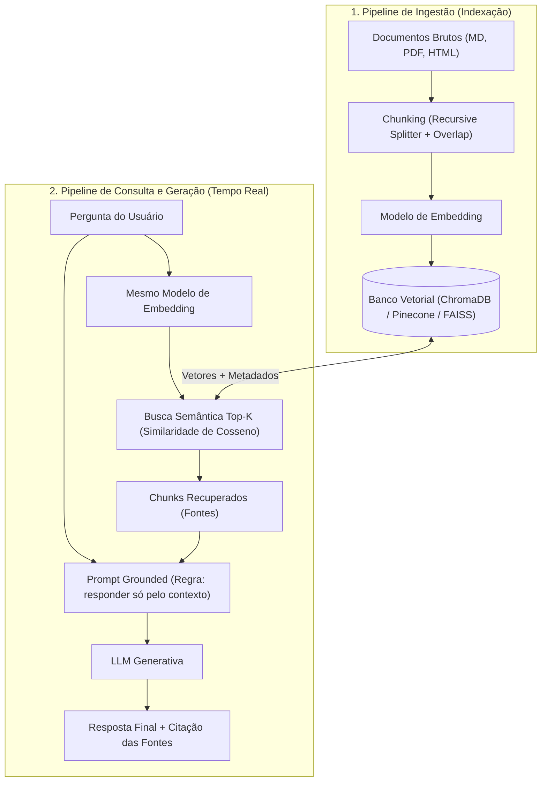

# 📚 Aula 30: RAG & Bancos de Dados Vetoriais

> **Setor da Navegação:** Galáxia 6 — IAs Generativas & LLMs · **ID do Módulo:** `rag`

---

## 1. 🚀 Briefing da Missão (Contexto Temático & Realidade de Mercado)

### Metadados do Setor
- **Galáxia:** 6 — IAs Generativas & LLMs
- **ID Oficial:** `rag`
- **Descrição da Missão:** *"Expanda a memória da IA. Aprenda a injetar documentos privados atualizados no prompt da LLM utilizando bancos de dados vetoriais modernos."*
- **Pré-requisitos:** [`29-engenharia-de-prompt-apis-llm.md`](./29-engenharia-de-prompt-apis-llm.md) (`prompt-eng-apis`)
- **Próxima Órbita:** [`32-llmops-otimizacao-de-modelos.md`](./32-llmops-otimizacao-de-modelos.md) (`llmops-otimizacao`) — *(após concluir também Agentes na Aula 31)*
- **Destino Final da Galáxia:** [`projeto-consolidacao-06-llms.md`](./projeto-consolidacao-06-llms.md) (`llmops-otimizacao`)

### Analogia Espacial — A Biblioteca Estelar de Consulta em Prova
Imagine um engenheiro espacial brilhante fazendo uma prova de certificação com **consulta livre autorizada**. A memória decorada dele (*os pesos internos da LLM*) foi congelada meses atrás quando ele se formou na academia: ele conhece física orbital perfeitamente, mas **não sabe** qual válvula foi trocada ontem na Nave 09 nem conhece o manual interno confidencial da sua empresa.

Se você proibir a consulta aos manuais e exigir que ele responda sobre a Nave 09, duas coisas acontecem: ou ele inventa um número plausível com extrema confiança (**alucinação**), ou você tenta colar 800 páginas de manual na folha da prova dele de uma vez só — estourando a mesa e deixando-o perdido no meio da leitura (**limite da janela de contexto e custo explosivo**). O **RAG (*Retrieval-Augmented Generation*)** resolve isso colocando um **bibliotecário supersônico** ao lado do engenheiro: antes de responder, o bibliotecário localiza os 4 parágrafos exatos do manual no índice vetorial e os entrega na mesa junto com a pergunta. Agora o engenheiro lê as fontes reais e responde citando exatamente de onde tirou a informação!

### Qual Dor Real Este Módulo Resolve na Indústria?
A arquitetura **RAG** é o padrão arquitetural número 1 do mercado corporativo de IA Generativa hoje. Empresas têm milhares de PDFs de RH, runbooks em Markdown, históricos de suporte, contratos e políticas de preço que mudam toda semana. Retreinar (*Fine-Tuning*) uma LLM toda vez que um manual é editado seria caríssimo, lento e não impediria alucinações factuais. Com RAG, você atualiza o conhecimento da IA em segundos apenas reindexando o documento alterado no banco vetorial, com **rastreabilidade de fontes** e **controle de acesso**.

---

## 2. 📚 Carga de Conhecimento Completa (Tópico por Tópico)

### 2.1 O Problema de Alucinação e Janelas de Contexto Limitadas das LLMs
Por que não simplesmente treinar a LLM com os dados da empresa ou colar tudo no prompt?
1. **Conhecimento Paramétrico Congelado (*Knowledge Cutoff*):** O conhecimento guardado nos pesos da rede neural para no dia em que o treinamento terminou. Ela não sabe o preço de hoje, a versão lançada ontem ou sua documentação interna privada.
2. **Alucinação:** LLMs são treinadas para prever continuações estatisticamente plausíveis, não para checar fatos em um banco de verdade absoluta. Diante de uma pergunta sobre um protocolo interno inexistente nos dados de treino, o modelo tende a fabricar nomes de classes, cláusulas ou comandos convincentes, porém falsos.
3. **Limites da Janela de Contexto (Custo, Latência e *"Lost in the Middle"*):** Mesmo com modelos aceitando 128k ou 1M de tokens, enviar 300 páginas em *toda* pergunta:
   - Multiplica a fatura de API por 50x–100x;
   - Aumenta o *Time to First Token* (TTFT) drasticamente devido ao custo $O(N^2)$ do Attention;
   - Sofre do efeito **"Lost in the Middle"**: pesquisas demonstram que LLMs prestam muita atenção ao início e ao fim do prompt, mas tendem a perder informações enterradas no meio de contextos gigantescos.

### 2.2 Arquitetura Completa de RAG (Retrieval-Augmented Generation)
Um sistema RAG profissional divide-se em **dois pipelines distintos**: o pipeline de **Ingestão (Offline/Assíncrono)** e o pipeline de **Consulta e Geração (Online/Tempo Real)**.



- **Regra de Ouro:** O modelo de embedding usado na indexação (`EMB1`) **precisa ser exatamente o mesmo** usado na pergunta (`EMB2`). Vetores de modelos diferentes vivem em espaços geométricos incompatíveis!

### 2.3 Estratégias de Quebra de Texto (Character vs. Recursive Chunking)
Indexar um livro de 200 páginas em um único vetor dilui todos os assuntos em uma média vaga e estoura o limite do embedding. Por isso quebramos documentos em pedaços menores chamados **Chunks**.

| Estratégia | Como Funciona | Pontos Fortes | Fraquezas / Cuidados |
| :--- | :--- | :--- | :--- |
| **Fixed / Character Chunking** | Corta rigidamente a cada `N` caracteres (ex.: `chunk_size=500`), ignorando pontuação ou estrutura. | Simples e previsível em tamanho. | **Quebra palavras e ideias ao meio** (ex.: separa a condição `"Não reinicie"` da consequência `"se o banco estiver gravando"`). |
| **Recursive Character Chunking** | Tenta quebrar primeiro por separadores grandes e naturais na ordem `["\n\n", "\n", ". ", " ", ""]`, descendo de nível só quando o bloco ainda passa de `chunk_size`. | **Padrão de produção.** Preserva parágrafos, seções Markdown e frases inteiras sempre que possível. | Exige calibrar `chunk_size` (ex.: 400–1000 chars ou 250–500 tokens) e `chunk_overlap` (10%–20% de sobreposição entre chunks adjacentes). |
| **Markdown / Semantic Chunking** | Divide por cabeçalhos (`#`, `##`, `###`) ou por queda de similaridade entre sentenças vizinhas. | Mantém metadados ricos (`secao`, `arquivo`) para filtros e citações precisas. | Mais lento na ingestão (Semantic Chunking exige rodar embeddings frase a frase). |

- **Por que usar `chunk_overlap` (Sobreposição)?** Se uma resposta estiver bem na fronteira entre o Chunk 4 e o Chunk 5, uma sobreposição de 10% a 20% garante que ambos os pedaços retenham a ponte de contexto necessária.

### 2.4 Bancos de Dados Vetoriais (ChromaDB, Pinecone, FAISS)
Bancos relacionais (SQL) foram feitos para buscas exatas (`WHERE id = 42`) ou substrings (`LIKE '%erro%'`). Bancos vetoriais são especializados em buscar **os $K$ vizinhos mais próximos (*ANN — Approximate Nearest Neighbors*)** em espaços com 384 a 3072 dimensões usando índices como **HNSW** (*Hierarchical Navigable Small World*) ou **IVF**, unindo velocidade de milissegundos com filtragem por metadados.

- **ChromaDB:** Banco vetorial open-source em Python/Rust muito popular para desenvolvimento local, protótipos e serviços médios. Roda embarcado persistindo direto em disco (`PersistentClient`) ou em modo cliente-servidor.
- **FAISS (*Facebook AI Similarity Search*):** Biblioteca C++/Python da Meta ultrarrápida para busca vetorial em memória RAM ou GPU. Não é um "banco completo" (não gerencia metadados ricos nem CRUD distribuído nativamente sem camada extra), mas brilha como motor de altíssima performance embarcado.
- **Pinecone (e Qdrant / pgvector):** Pinecone é uma plataforma gerenciada *serverless* em nuvem projetada para escalar bilhões de vetores com zero manutenção de infraestrutura. (Alternativas muito cobradas em produção incluem **Qdrant**, **Weaviate** e a extensão **pgvector** no PostgreSQL para quem já opera Postgres).

### 2.5 Buscas Semânticas com Similaridade de Cosseno
Como medir matematicamente se a pergunta `"Como configuro variáveis secretas?"` combina com o chunk `"Armazene suas chaves API no arquivo .env"` — mesmo sem nenhuma palavra em comum? Medindo o ângulo entre seus vetores de embedding usando a **Similaridade de Cosseno (*Cosine Similarity*)**:

$$\text{similaridade\_cosseno}(A, B) = \frac{A \cdot B}{\|A\| \, \|B\|} = \frac{\sum_{i=1}^{d} A_i B_i}{\sqrt{\sum_{i=1}^{d} A_i^2} \sqrt{\sum_{i=1}^{d} B_i^2}}$$

- **Faixa de valores:** Vai de `-1` (sentidos opostos) até `+1` (direção idêntica). Na prática, para embeddings de texto, quanto mais próximo de `1.0`, maior a equivalência semântica.
- **Por que Cosseno em vez de Distância Euclidiana (L2)?** A distância Euclidiana é sensível à magnitude (comprimento) dos vetores; dois textos sobre o mesmo assunto mas de tamanhos diferentes podem parecer distantes em L2. A Similaridade de Cosseno mede apenas o **ângulo (direção)** no espaço vetorial. Quando os vetores já são normalizados (norma $\|v\| = 1$), a Similaridade de Cosseno equivale exatamente ao **Produto Escalar (*Dot Product*)**, sendo super rápida de calcular! *(Atenção ao ChromaDB: ele retorna **distância de cosseno** $= 1 - \text{similaridade}$, onde **menor** distância significa **maior** similaridade!)*

---

## 3. 💻 Mão no Código (Jeito Iniciante vs. Padrão Profissional)

Abaixo comparamos a armadilha clássica de fatiar texto ingenuamente e colar tudo no prompt vs. um pipeline RAG real com **Recursive Chunking + ChromaDB com espaço Cosseno + Cálculo explícito de Similaridade + Geração Grounded com Citação**.

### ❌ Jeito Iniciante (Corte Cego de Texto, Sem Metadados e Risco de Alucinação)
```python
# Problema 1: Quebra por tamanho fixo mutila palavras e perde contexto nas bordas.
documento = open("manual_deploy.md", encoding="utf-8").read() if False else (
    "Política de Deploy: nunca suba código na sexta às 17h sem aprovação do Tech Lead."
)
chunks_quebrados = [documento[i:i+25] for i in range(0, len(documento), 25)]
# Resultado horrível: ['Política de Deploy: nun', 'ca suba código na sexta', ...]

# Problema 2: Busca por palavra-chave exata ("implantação") retorna VAZIO porque o texto usa "Deploy"!
matches = [c for c in chunks_quebrados if "implantação" in c.lower()]
print("Matches por palavra-chave:", matches)  # [] -> Sistema falha totalmente!
```

### ✅ Padrão Profissional (Recursive Chunking + ChromaDB + Similaridade de Cosseno + Prompt Grounded)
```python
from pathlib import Path
import numpy as np
import chromadb
from chromadb.utils import embedding_functions


def recursive_chunk_text(
    text: str,
    chunk_size: int = 300,
    chunk_overlap: int = 60,
    separators: tuple[str, ...] = ("\n## ", "\n\n", "\n", ". ", " ", ""),
) -> list[str]:
    """Quebra texto recursivamente preservando parágrafos e frases com overlap."""
    text = text.strip()
    if len(text) <= chunk_size:
        return [text] if text else []

    # Escolhe o primeiro separador natural presente no texto
    sep = ""
    for candidate in separators:
        if candidate == "" or candidate in text:
            sep = candidate
            break

    parts = text.split(sep) if sep else list(text)
    chunks: list[str] = []
    current = ""

    for part in parts:
        piece = f"{part}{sep}" if sep and part != parts[-1] else part
        if len(current) + len(piece) <= chunk_size:
            current += piece
        else:
            if current.strip():
                chunks.append(current.strip())
            # Se uma única parte ainda exceder chunk_size, aplica recursão com próximo separador
            if len(piece) > chunk_size and len(separators) > 1:
                chunks.extend(recursive_chunk_text(piece, chunk_size, chunk_overlap, separators[1:]))
                current = ""
            else:
                # Mantém cauda de sobreposição (overlap) para preservar continuidade
                tail = current[-chunk_overlap:] if chunk_overlap > 0 else ""
                current = (tail + piece).strip()

    if current.strip():
        chunks.append(current.strip())
    return chunks


def cosine_similarity(vec_a: list[float], vec_b: list[float]) -> float:
    """Calcula a Similaridade de Cosseno explícita entre dois embeddings."""
    a = np.asarray(vec_a, dtype=np.float32)
    b = np.asarray(vec_b, dtype=np.float32)
    denom = float(np.linalg.norm(a) * np.linalg.norm(b))
    if denom == 0.0:
        return 0.0
    return float(np.dot(a, b) / denom)


def build_rag_index(docs: list[dict[str, str]], db_path: str = "./chroma_db") -> chromadb.Collection:
    """Indexa documentos em ChromaDB configurado explicitamente com espaço Cosseno."""
    client = chromadb.PersistentClient(path=db_path)

    # Usa embedding multilíngue leve local (SentenceTransformers) — roda offline!
    embed_fn = embedding_functions.SentenceTransformerEmbeddingFunction(
        model_name="sentence-transformers/paraphrase-multilingual-MiniLM-L12-v2"
    )

    collection = client.get_or_create_collection(
        name="manuais_tecnicos",
        embedding_function=embed_fn,
        metadata={"hnsw:space": "cosine"},  # Métrica de cosseno no índice HNSW
    )

    ids, documents, metadatas = [], [], []
    for doc in docs:
        chunks = recursive_chunk_text(doc["content"], chunk_size=260, chunk_overlap=50)
        for idx, chunk in enumerate(chunks):
            ids.append(f"{doc['source']}::chunk_{idx}")
            documents.append(chunk)
            metadatas.append({"source": doc["source"], "chunk_index": idx})

    # Upsert torna a ingestão idempotente (re-rodar atualiza sem duplicar IDs)
    collection.upsert(ids=ids, documents=documents, metadatas=metadatas)
    return collection


def retrieve_with_threshold(
    collection: chromadb.Collection,
    query: str,
    top_k: int = 3,
    min_similarity: float = 0.35,
) -> list[dict]:
    """Busca Top-K no ChromaDB e filtra trechos irrelevantes por limiar de cosseno."""
    res = collection.query(
        query_texts=[query],
        n_results=top_k,
        include=["documents", "metadatas", "distances"],
    )

    evidences = []
    for doc, meta, dist in zip(res["documents"][0], res["metadatas"][0], res["distances"][0]):
        # No espaço 'cosine' do ChromaDB: distancia = 1 - similaridade_cosseno
        sim = 1.0 - float(dist)
        if sim >= min_similarity:
            evidences.append({"text": doc, "source": meta["source"], "similarity": round(sim, 4)})
    return evidences


def build_grounded_prompt(query: str, evidences: list[dict]) -> str:
    """Monta o prompt final instruindo a LLM a citar fontes e recusar se não houver evidência."""
    if not evidences:
        return (
            "Nenhuma evidência relevante encontrada na base. "
            "Responda ao usuário: 'Não encontrei essa informação nos manuais internos.'"
        )

    context_blocks = "\n".join(
        f"[{i}] (Fonte: {ev['source']} | Sim: {ev['similarity']}) {ev['text']}"
        for i, ev in enumerate(evidences, start=1)
    )
    return (
        "Você é um assistente técnico. Responda USANDO APENAS o contexto abaixo.\n"
        "Cite as fontes no formato [Fonte]. Se a resposta não estiver no contexto, diga que não sabe.\n\n"
        f"<contexto>\n{context_blocks}\n</contexto>\n\n"
        f"<pergunta>{query}</pergunta>"
    )


if __name__ == "__main__":
    sample_docs = [
        {
            "source": "runbook_deploy.md",
            "content": (
                "## Janela de Implantação\n"
                "Implantações em produção ocorrem de segunda a quinta até as 16h. "
                "Deploys às sextas exigem aprovação explícita do Tech Lead e plano de rollback validado.\n\n"
                "## Variáveis Secretas\n"
                "Todas as credenciais de banco e chaves API devem residir no arquivo .env fora do Git."
            ),
        },
        {
            "source": "troubleshooting_redis.md",
            "content": (
                "## Erro OOM no Cache\n"
                "Se o Redis atingir 90% de memória, verifique a política maxmemory-policy (use allkeys-lru)."
            ),
        },
    ]

    col = build_rag_index(sample_docs, db_path="./chroma_demo_db")
    pergunta = "Posso subir código novo em produção sexta à noite?"
    evidencias = retrieve_with_threshold(col, pergunta, top_k=2, min_similarity=0.30)

    print("Evidências recuperadas:", evidencias)
    print("\n--- Prompt Pronto para a LLM ---")
    print(build_grounded_prompt(pergunta, evidencias))

    # Demonstração da função matemática direta
    print("\nTeste similaridade cosseno:", round(cosine_similarity([1, 0.8, 0.2], [0.9, 0.7, 0.1]), 4))
```

---

## 4. 🛠️ Laboratório de Voo (Exercício Prático Guiado)

**Duração estimada:** 50 minutos · **Objetivo:** Indexar uma pasta real de arquivos Markdown, testar busca semântica sem palavras idênticas e conectar a geração a uma LLM (Ollama ou OpenAI).

### Passo a Passo
1. **Ambiente:** Instale `pip install chromadb sentence-transformers openai numpy` (ou use `langchain-text-splitters` para comparar com sua função recursiva).
2. **Crie 3 arquivos Markdown fictícios** dentro de uma pasta `./manuais/` (ex.: `politica_ferias.md`, `guia_arquitetura.md`, `incidentes_postgres.md`) com pelo menos 300 palavras cada.
3. **Experimento de Chunking:** Rode o pipeline de ingestão duas vezes em coleções diferentes: uma com `chunk_size=120` (muito picotado) e outra com `chunk_size=450, chunk_overlap=80`.
4. **Busca Semântica sem Palavras-Chave Iguais:** Faça 3 perguntas usando sinônimos (ex.: pergunte sobre `"folga remunerada"` quando o documento diz `"período de férias"`, ou `"banco travado"` quando o manual diz `"deadlock no PostgreSQL"`). Compare o *score* de Similaridade de Cosseno entre os dois tamanhos de chunk.
5. **Conexão com LLM + Teste Negativo:** Envie o prompt gerado por `build_grounded_prompt()` para sua LLM (Ollama ou API) e teste também uma pergunta **fora da base** (ex.: `"Qual a receita de pizza margherita?"`). Confirme que o limiar `min_similarity` bloqueou contextos irrelevantes e a LLM recusou alucinar.

### Critérios de Domínio
- [ ] A base ChromaDB persiste em disco e usa `upsert` sem duplicar chunks ao reexecutar.
- [ ] A busca recupera o trecho correto mesmo usando sinônimos sem interseção exata de palavras.
- [ ] A similaridade de cosseno é calculada e convertida corretamente a partir da distância do ChromaDB (`1 - distance`).
- [ ] Perguntas sem cobertura na base disparam resposta segura de "não encontrado" sem alucinação.

---

## 5. 🎯 Resolução Comentada do Teste de Ignição (Quest Oficial)

> **Pergunta Oficial (`rag`):**
> *Qual das seguintes alternativas descreve corretamente uma vantagem chave de utilizar a arquitetura RAG em comparação com o Fine-Tuning completo de uma LLM?*

- **A)** *"RAG reduz permanentemente o custo de chamadas da API da LLM a zero centavos."*
- **B)** *"RAG permite que a IA acesse fontes de dados dinâmicas, proprietárias e atualizadas em tempo real sem a necessidade de re-treinar ou ajustar os pesos do modelo através de processos computacionais caros."*
- **C)** *"RAG torna a IA capaz de traduzir textos muito mais rapidamente do que os modelos normais."*
- **D)** *"RAG converte os modelos de linguagem em bancos de dados puramente relacionais com suporte total a queries SQL."*

### ✅ Gabarito Oficial: **Alternativa B**

- **Por que a B está correta?** O *Fine-Tuning* modifica os pesos da rede neural: é ótimo para ensinar um **estilo, formato ou jargão** específico, mas péssimo e caríssimo como banco de conhecimento factual mutável, pois exige preparar datasets de treino, GPUs caras e um novo ciclo de treinamento sempre que uma regra de negócio muda. O **RAG** mantém os pesos da LLM congelados e injeta o conhecimento atualizado dinamicamente no contexto de entrada em tempo de execução, reduzindo custos, viabilizando atualização instantânea e permitindo citar fontes verificáveis.
- **Por que a A está errada?** Pelo contrário: o RAG até aumenta levemente os tokens de entrada por chamada (porque injeta os chunks recuperados junto com a pergunta), além de ter custo de geração de embeddings e hospedagem do banco vetorial. Só é zero se você rodar modelos locais gratuitos, o que independe de usar RAG ou não.
- **Por que a C está errada?** RAG não acelera tradução de idioma nem altera a velocidade de decodificação de tokens da LLM — na verdade, adiciona uma etapa prévia de busca vetorial antes da geração.
- **Por que a D está errada?** Bancos vetoriais realizam busca aproximada por similaridade semântica em vetores densos (ANN), não transformam a LLM em um SGBD relacional com garantias ACID e SQL puro.

---

## 6. 🎤 Kit de Apresentação (Como Dar Aula / Apresentar Este Módulo)

### Pitch Feynman de 2 Minutos (Texto Pronto para Falar)
> *"Muita empresa acha que para fazer uma IA responder sobre seus documentos internos precisa treinar um modelo próprio do zero — o que custa milhares de dólares e fica desatualizado na semana seguinte. A resposta da engenharia moderna para isso se chama RAG: Retrieval-Augmented Generation.*
> *Funciona como uma prova com consulta. Primeiro, no processo de ingestão, pegamos os PDFs e manuais da empresa e os quebramos de forma inteligente com Recursive Chunking, preservando parágrafos inteiros com uma pequena sobreposição nas bordas. Cada pedaço vira uma coordenada numérica — um embedding — guardada em um banco vetorial como ChromaDB ou Pinecone.*
> *Quando um usuário faz uma pergunta, não buscamos palavras-chave literais; transformamos a pergunta em vetor e usamos a Similaridade de Cosseno para medir o ângulo no espaço de significado. Isso permite que 'falha de autenticação' encontre 'erro 401 no token JWT' mesmo sem nenhuma palavra igual! Pegamos os 3 ou 5 trechos mais próximos, colamos dentro do prompt da LLM com a regra rígida 'responda só usando isso e cite a fonte', e pronto: zero treino caro, dados atualizados em tempo real e alucinações drasticamente reduzidas."*

### Roteiro de Slides (6 Slides)
1. **Slide 1 — O Limite do Modelo Congelado:** Por que LLMs alucinam sobre dados privados e sofrem com contexto gigante (*Lost in the Middle*) (visual: gráfico U-invertido de atenção ao início/fim vs. meio do texto).
2. **Slide 2 — RAG vs. Fine-Tuning:** Quando buscar conhecimento externo (RAG) vs. quando ensinar comportamento/estilo (Fine-Tuning) (visual: tabela comparativa direta custo, atualização, citação de fonte).
3. **Slide 3 — Os Dois Pipelines do RAG:** Ingestão offline vs. Consulta em tempo real (visual: diagrama Mermaid da Seção 2.2).
4. **Slide 4 — A Arte do Chunking:** Fixed Character (mutilando frases) vs. Recursive Chunking com overlap (visual: bloco de texto sendo cortado errado vs. corte limpo em `\n\n`).
5. **Slide 5 — Bancos Vetoriais & Similaridade de Cosseno:** O que é buscar pelo ângulo entre vetores em ChromaDB, FAISS e Pinecone (visual: dois vetores no plano 2D com ângulo $\theta$ pequeno = alta similaridade).
6. **Slide 6 — Engenharia da Resposta Grounded:** Como montar o prompt final, aplicar threshold mínimo de similaridade e exibir citações confiáveis (visual: print de resposta com `[Fonte: runbook_deploy.md]`).

### Roteiro de Demo Ao Vivo (3 Minutos)
1. **Minuto 0:00–1:00:** Mostre no código a função `recursive_chunk_text` dividindo um Markdown real e imprima os chunks com `overlap` visível entre o fim de um chunk e o começo do próximo.
2. **Minuto 1:00–2:15:** Rode `build_rag_index` e faça uma consulta usando **sinônimos sem nenhuma palavra igual ao documento** (ex.: pergunta `"Posso fazer deploy no fim da tarde de sexta?"` para um texto que diz `"Implantações às sextas exigem aprovação"`), imprimindo o score de Similaridade de Cosseno recuperado!
3. **Minuto 2:15–3:00:** Faça uma pergunta absurda fora do escopo (`"Qual a senha do Wi-Fi?"`) e mostre o filtro `min_similarity` retornando vazio e impedindo a LLM de inventar uma resposta.

### Perguntas Difíceis da Plateia
- **Pergunta 1:** *"E se eu pesquisar por um código exato de erro ou matrícula, tipo `ERR_5092_X`? Busca vetorial por cosseno acha códigos exatos bem?"*
  **Resposta segura:** *"Excelente observação! Embeddings semânticos são ótimos para sinônimos e intenção, mas muitas vezes falham em códigos exatos, siglas raras, CPFs ou SKUs de produtos. Em produção madura, resolvemos isso com **Hybrid Search (Busca Híbrida)**: combinamos busca léxica clássica (BM25 / Full-Text Search) com busca vetorial por cosseno usando Reciprocal Rank Fusion (RRF), e opcionalmente passamos os top-20 resultados por um Reranker Cross-Encoder."*
- **Pergunta 2:** *"Como escolher o tamanho ideal de chunk (200, 500 ou 1000 tokens)?"*
  **Resposta segura:** *"Não existe número mágico universal — depende da granularidade das perguntas! Chunks pequenos (200–350 tokens) trazem altíssima precisão na busca sem ruído, mas podem perder contexto; chunks maiores (800–1000 tokens) dão mais contexto à LLM, mas diluem o embedding. Um padrão excelente é fazer busca com chunks pequenos e enviar o chunk-pai completo (*Parent-Child Retrieval*) para a LLM, validando sempre com métricas de recuperação (Recall@K) em um pequeno conjunto de testes."*

---

## 7. 💼 Radar do Mercado de Trabalho (Foco Dev Júnior)

### 3 Perguntas Reais de Entrevista Técnica Júnior
1. **Pergunta:** *"Quando você recomendaria RAG e quando recomendaria Fine-Tuning para um cliente?"*
   **Resposta-modelo:** *"Recomendo RAG sempre que o problema exigir acesso a dados dinâmicos, documentos proprietários que mudam com frequência ou necessidade de auditar e citar fontes sem inventar fatos. Já o Fine-Tuning entra quando queremos adaptar o formato, o tom de voz, um domínio linguístico altamente especializado ou destilar o comportamento de um modelo grande para um modelo menor e mais rápido. Na prática, muitas empresas começam com RAG bem ajustado — porque entrega valor mais rápido e barato — e só investem em Fine-Tuning se métricas mostrarem necessidade."*
2. **Pergunta:** *"O que é `chunk_overlap` e o que acontece se configurarmos `chunk_size` grande demais ou pequeno demais?"*
   **Resposta-modelo:** *"O `chunk_overlap` é uma janela de caracteres ou tokens repetida entre o final de um chunk e o início do próximo, evitando que frases ou raciocínios cortados na fronteira percam sentido. Se `chunk_size` for pequeno demais, os pedaços ficam fragmentados e sem contexto suficiente para a LLM responder. Se for grande demais, um único vetor tenta resumir muitos assuntos ao mesmo tempo, reduzindo a precisão da Similaridade de Cosseno e enchendo o prompt de ruído."*
3. **Pergunta:** *"Por que devemos obrigatoriamente usar o mesmo modelo de embedding tanto na ingestão quanto na consulta?"*
   **Resposta-modelo:** *"Cada modelo de embedding constrói sua própria geometria latente (dimensões diferentes, rotações e escalas aprendidas no treino). Se indexarmos documentos com `text-embedding-3-small` (1536d) e consultarmos com um modelo local MiniLM (384d), além de incompatibilidade direta de dimensões, as coordenadas não compartilham o mesmo espaço semântico — tornando a Similaridade de Cosseno completamente sem sentido."*

### Erros Clássicos de Júnior vs. Postura Profissional

| Erro Clássico de Júnior | Postura Profissional Esperada |
| :--- | :--- |
| Subir todo o documento sem metadados (`source`, `pagina`, `data`) e não conseguir mostrar de onde veio a resposta. | Salvar metadados ricos em cada chunk, usar IDs determinísticos para `upsert` idempotente e citar fontes na resposta. |
| Achar que colocar RAG elimina 100% das alucinações por mágica. | Aplicar limiar de similaridade (`min_similarity`), instrução negativa explícita (*"se não estiver no contexto, diga que não sabe"*) e avaliar *Faithfulness* (fidelidade ao contexto). |
| Tratar a distância retornada pelo ChromaDB como se maior fosse melhor sem verificar a métrica. | Ler a documentação da engine (`cosine distance = 1 - cosine similarity`) e testar scores reais com casos positivos e negativos. |

### Evidência para Portfólio / GitHub / LinkedIn
- **Repositório no GitHub:** Publique um `rag-docs-assistant` com ingestão incremental de arquivos Markdown/PDF, armazenamento persistente em ChromaDB, filtro de similaridade configurável, citação automática de fontes e um pequeno script `eval_retrieval.py` testando se 10 perguntas-chave trazem o chunk esperado no Top-3 (*Hit Rate@3*).
- **Post no LinkedIn:** Explique com um diagrama simples a diferença prática entre *busca por palavras-chave*, *busca vetorial por cosseno* e *busca híbrida*, mostrando um caso real onde sinônimos salvaram a busca.

---

## 8. 📡 Transmissões Recomendadas & Próxima Órbita

### Recursos Oficiais do Módulo
- 🌲 [Pinecone Learning Center (Banco Vetorial)](https://www.pinecone.io/learn/)
- 📘 [What is RAG? (IBM Guide)](https://research.ibm.com/blog/retrieval-augmented-generation-what-is-rag)

### Próxima Órbita
Um sistema RAG tradicional segue sempre um fluxo rígido: `pergunta -> busca -> responde`. E quando a resposta **não está nos documentos** e a IA precisa decidir sozinha executar um teste em Python, consultar uma API ou pesquisar na web antes de responder? Bem-vindo à [**Aula 31: Agentes de IA & LangChain**](./31-agentes-de-ia-langchain.md).
