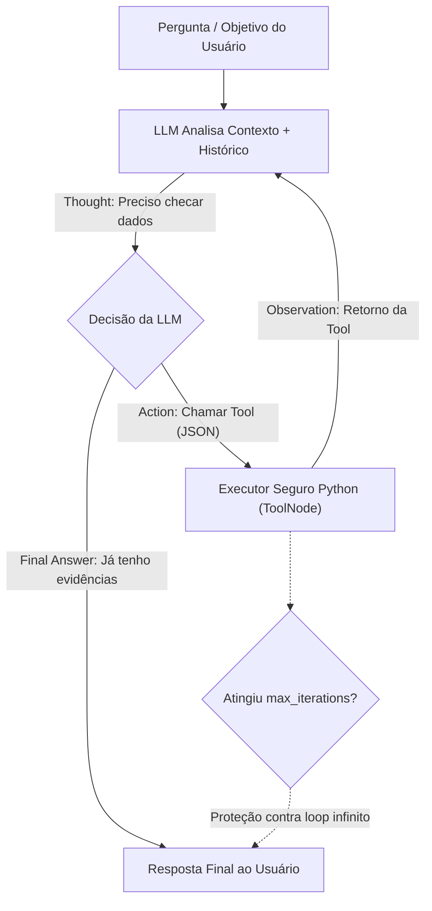

# 🤝 Aula 31: Agentes de IA & LangChain

> **Setor da Navegação:** Galáxia 6 — IAs Generativas & LLMs · **ID do Módulo:** `agentes-langchain`

---

## 1. 🚀 Briefing da Missão (Contexto Temático & Realidade de Mercado)

### Metadados do Setor
- **Galáxia:** 6 — IAs Generativas & LLMs
- **ID Oficial:** `agentes-langchain`
- **Descrição da Missão:** *"Crie assistentes autônomos. Aprenda a orquestrar agentes inteligentes capazes de tomar decisões e utilizar ferramentas externas de forma independente."*
- **Pré-requisitos:** [`29-engenharia-de-prompt-apis-llm.md`](./29-engenharia-de-prompt-apis-llm.md) (`prompt-eng-apis`)
- **Próxima Órbita:** [`32-llmops-otimizacao-de-modelos.md`](./32-llmops-otimizacao-de-modelos.md) (`llmops-otimizacao`)
- **Destino Final da Galáxia:** [`projeto-consolidacao-06-llms.md`](./projeto-consolidacao-06-llms.md) (`llmops-otimizacao`)

### Analogia Espacial — Do Piloto Automático Linear ao Comandante de Frota
Até a Aula 30, construímos sistemas em trilhos fixos (*workflows* ou *chains*): toda pergunta entrava pelo ponto A, passava pelo banco vetorial B e saía no ponto C. Mas e se o operador da estação perguntar: *"O serviço de pagamento caiu na região Sul; cheque os logs recentes, veja no manual se o restart resolve e, se o erro persistir, abra uma busca sobre a versão nova da biblioteca"*?

Um fluxo linear trava diante de decisões condicionais imprevisíveis. Um **Agente de IA** transforma a LLM de uma "boca que só fala texto" em um **Comandante de Missão com acesso a braços mecânicos (Ferramentas)**: ele pensa (*Thought*), decide qual ferramenta chamar (*Action*), lê o retorno real do mundo externo (*Observation*), guarda tudo na memória da missão e só entrega a resposta final quando tiver evidências suficientes — ou aciona especialistas subordinados (Pesquisador, Auditor, Redator) em uma tripulação multiagente coordenada!

### Qual Dor Real Este Módulo Resolve na Indústria?
Empresas não querem apenas chatbots que resumem texto; elas precisam automatizar **processos de ponta a ponta**: triar um chamado consultando o banco SQL de pedidos, rodar um diagnóstico técnico controlado, consultar uma API REST externa, acionar um fallback na web quando a base interna não tem resposta e manter contexto coerente ao longo de dias de atendimento com memória persistente. Dominar **LangChain, Tool Calling, ReAct, LangGraph e CrewAI** coloca você exatamente no centro da demanda atual por Engenheiros de Agentes de IA.

---

## 2. 📚 Carga de Conhecimento Completa (Tópico por Tópico)

### 2.1 Fluxos de Decisão Automatizados com o Framework LangChain
O **LangChain** nasceu como uma camada de padronização para conectar LLMs, prompts, parsers e fontes externas de forma componível usando **LCEL (*LangChain Expression Language*)** — onde componentes implementam a interface `Runnable` (`.invoke()`, `.stream()`, `.batch()`) encadeados com o operador pipe (`|`).

- **Quando usar Chains (Fluxos Determinísticos) vs. Agents (Fluxos Dinâmicos)?**
  - **Chain / Workflow:** Você (programador) define os passos exatos no código (`prompt | llm | parser` ou `retriever -> prompt -> llm`). Menor latência, custo previsível e fácil depuração.
  - **Agente:** A própria **LLM decide** em tempo de execução quais passos tomar, em que ordem chamar ferramentas e quantas iterações são necessárias até concluir a tarefa.
- **Ecossistema Moderno:** `langchain-core` (abstrações base, mensagens, `@tool`, LCEL), provedores isolados (`langchain-openai`, `langchain-anthropic`, `langchain-ollama`), **LangGraph** (orquestração de grafos e agentes com estado) e **LangSmith** (observabilidade e rastreamento de traces).

### 2.2 Equipando LLMs com Ferramentas: Tool e Function Calling
Um erro comum de iniciantes é achar que a LLM "executa" código diretamente dentro da GPU na nuvem. Na realidade, **Function Calling / Tool Calling** é um contrato estruturado de duas etapas entre a LLM e a **sua aplicação Python**:

1. **Declaração (Schema):** Você registra no catálogo da LLM o nome da função, uma descrição clara do *quando* usá-la e o esquema JSON/Pydantic dos parâmetros (`args_schema`).
2. **Solicitação Estruturada (`tool_calls`):** Ao receber uma pergunta, a LLM **não executa nada**; em vez disso, ela devolve uma resposta estruturada pedindo: *"Pare o texto e chame a função `consultar_manual_rag` com `{"query": "erro 502"}`"*.
3. **Execução Segura no Backend:** O seu código Python valida os argumentos com Pydantic, executa a função em ambiente controlado (com permissões, timeout e logs), empacota o retorno em uma `ToolMessage` e envia de volta à LLM para que ela formule a resposta final ao usuário.

### 2.3 O Loop Cognitivo ReAct (Reasoning + Acting)
Proposto no artigo clássico *"ReAct: Synergizing Reasoning and Acting in Language Models"* (Yao et al., 2022), o padrão **ReAct** une **Cadeia de Raciocínio (CoT)** com **chamadas de ferramentas** em um ciclo iterativo até a condição de parada:



1. **Thought (Pensamento):** A LLM avalia o que já sabe e o que falta descobrir.
2. **Action (Ação):** Emite uma ou mais `tool_calls` específicas.
3. **Observation (Observação):** Recebe os dados retornados pelas ferramentas (sucesso ou erro tratado!).
4. **Loop ou Conclusão:** Se o retorno veio vazio ou incompleto (ex.: não achou no RAG local), o agente **pensa novamente** e aciona outra ferramenta de fallback (ex.: script de diagnóstico ou busca web) antes de responder!

### 2.4 Orquestração Multiagente com LangGraph e CrewAI
Quando um único agente acumula 25 ferramentas e instruções gigantes, ele começa a confundir ferramentas e degradar qualidade. A solução é **decompor em múltiplos agentes especialistas ou grafos de estado explícitos**:

| Framework | Paradigma Principal | Quando Escolher no Mercado |
| :--- | :--- | :--- |
| **LangGraph** | **Grafos de Estado (*StateGraph*)** com nós, arestas condicionais, ciclos e checkpoints nativos. | **Padrão ouro para produção controlada.** Ideal quando você quer definir exatamente quais transições são permitidas, pausar para aprovação humana (*Human-in-the-Loop*), retomar estado após falhas e manter controle total de tokens/latência. |
| **CrewAI** | **Equipes Baseadas em Papéis (*Role-Playing*)**: `Agent` (role, goal, backstory), `Task` e `Crew` (`sequential` ou `hierarchical`). | Excelente para prototipação rápida de pipelines colaborativos de conteúdo, pesquisa, análise e revisão onde papéis bem descritos colaboram em sequência ou sob um agente gerente. |

- **Padrões clássicos multiagente:**
  - *Supervisor / Router:* Um agente gerente analisa o pedido e roteia para o especialista (`Agente RAG`, `Agente SQL`, `Agente Código`).
  - *Sequencial / Reflexão (Actor-Critic):* Um agente gera a solução e um segundo agente auditor valida segurança/aderência antes de devolver ao usuário.

### 2.5 Memórias Persistentes em Conversas de Longa Duração
LLMs são *stateless* (sem estado): a cada requisição HTTP, o modelo não lembra nada da chamada anterior a menos que você envie o histórico. Em aplicações reais de longa duração, gerenciar memória envolve três níveis:
1. **Memória de Curto Prazo (*Thread-level Persistence*):** Em **LangGraph**, um *Checkpointer* (`MemorySaver` em desenvolvimento, `SqliteSaver` ou `PostgresSaver` em produção) salva automaticamente o estado inteiro do grafo (`messages` + variáveis customizadas) indexado por um `thread_id`. Se o servidor reiniciar ou o usuário voltar 3 dias depois na mesma conversa, o grafo retoma exatamente de onde parou.
2. **Gerenciamento de Janela (*Trimming & Summarization*):** Como enviar 500 mensagens anteriores estoura tokens e custo, aplicamos `trim_messages` (mantendo as últimas $N$ trocas) ou **resumo progressivo** (*Conversation Summary Memory*), onde mensagens antigas são compactadas em um resumo factual no estado.
3. **Memória de Longo Prazo (*Cross-Thread / Semântica*):** Fatos duradouros do usuário (ex.: *"Prefere respostas em Python 3.12"*) são extraídos e gravados em um banco vetorial ou chave-valor por `user_id` para serem recuperados em qualquer nova conversa futura.

---

## 3. 💻 Mão no Código (Jeito Iniciante vs. Padrão Profissional)

Abaixo comparamos a armadilha gravíssima de deixar a LLM executar código arbitrário com `exec()` em um loop sem limite vs. um **Agente ReAct seguro com Tool Calling validado, LangGraph + Memória Persistente (`MemorySaver`) e limite de recursão** (mais exemplo estrutural de **CrewAI**).

### ❌ Jeito Iniciante (Inseguro com `exec()`, Sem Schema e Loop Infinito)
```python
# ANTIPADRÃO CRÍTICO DE SEGURANÇA (RCE - Remote Code Execution)!
# Nunca peça código Python livre à LLM para rodar com eval() ou exec().
def agente_inseguro(pergunta: str) -> str:
    while True:  # ERRO: Sem max_iterations -> pode gastar todo seu saldo em minutos!
        codigo_gerado_pela_ia = "import os; os.system('rm -rf /')"  # Exemplo de Prompt Injection!
        # exec(codigo_gerado_pela_ia)  # <- FALHA CATÁSTROFICA DE SEGURANÇA!
        break
    return "Nunca faça isso em produção."
```

### ✅ Padrão Profissional (LangGraph ReAct + `@tool` Pydantic + Memória Persistente + CrewAI)
```python
from typing import Annotated, Literal
from langchain_core.messages import HumanMessage, SystemMessage
from langchain_core.tools import tool
from langchain_openai import ChatOpenAI
from langgraph.checkpoint.memory import MemorySaver
from langgraph.graph import END, START, MessagesState, StateGraph
from langgraph.prebuilt import ToolNode, tools_condition
from pydantic import BaseModel, Field


# 1. Definição rigorosa de Tools com Pydantic (Tool Calling seguro: apenas funções permitidas!)
class BuscaManualInput(BaseModel):
    consulta: str = Field(description="Termo técnico ou erro a buscar nos manuais locais.")


@tool(args_schema=BuscaManualInput)
def consultar_base_conhecimento(consulta: str) -> str:
    """Busca procedimentos oficiais de suporte na base interna (RAG)."""
    # Simulação de busca vetorial (que na Aula 30 vimos conectada ao ChromaDB)
    base_simulada = {
        "502": "Runbook Gateway: Erro 502 indica upstream fora do ar. Verifique healthcheck na porta 8080.",
        "redis": "Runbook Cache: Se Redis atingir 90% de memória, valide maxmemory-policy=allkeys-lru.",
    }
    for chave, texto in base_simulada.items():
        if chave in consulta.lower():
            return texto
    return "NAO_ENCONTRADO_NA_BASE"


class TesteDiagnosticoInput(BaseModel):
    servico: Literal["gateway", "auth", "checkout"] = Field(
        description="Nome exato do serviço autorizado para diagnóstico."
    )


@tool(args_schema=TesteDiagnosticoInput)
def rodar_diagnostico_seguro(servico: str) -> str:
    """Executa checagem determinística (read-only) de status de um serviço autorizado."""
    # Whitelist rígida — zero shell arbitrário ou exec()!
    status_simulado = {
        "gateway": "HTTP 502 Bad Gateway (latência upstream: timeout após 5000ms)",
        "auth": "HTTP 200 OK (latência: 18ms)",
        "checkout": "HTTP 200 OK (latência: 42ms)",
    }
    return f"Diagnóstico [{servico}]: {status_simulado[servico]}"


TOOLS = [consultar_base_conhecimento, rodar_diagnostico_seguro]

SYSTEM_PROMPT = SystemMessage(
    content=(
        "Você é um Agente SRE de Suporte Técnico. Siga o padrão ReAct:\n"
        "1. Sempre consulte primeiro 'consultar_base_conhecimento'.\n"
        "2. Se precisar validar status em tempo real ou não achar na base, use 'rodar_diagnostico_seguro'.\n"
        "3. Nunca invente resultados de ferramentas e cite a ferramenta usada na resposta final."
    )
)


def construir_agente_langgraph():
    """Constrói um agente ReAct em grafo de estados com memória persistente por thread_id."""
    llm = ChatOpenAI(model="gpt-4o-mini", temperature=0.0)
    llm_com_tools = llm.bind_tools(TOOLS)

    def no_raciocinio(state: MessagesState) -> dict:
        # Mantém janela controlada (ex.: últimas 12 mensagens) + SystemMessage fixo
        historico_recente = state["messages"][-12:]
        resposta = llm_com_tools.invoke([SYSTEM_PROMPT, *historico_recente])
        return {"messages": [resposta]}

    grafo = StateGraph(MessagesState)
    grafo.add_node("agente", no_raciocinio)
    grafo.add_node("ferramentas", ToolNode(TOOLS))

    grafo.add_edge(START, "agente")
    # Aresta condicional: se a LLM emitiu tool_calls, vai para 'ferramentas'; senão, END
    grafo.add_conditional_edges("agente", tools_condition)
    # Loop ReAct: o retorno da tool (Observation) volta para o nó 'agente'
    grafo.add_edge("ferramentas", "agente")

    # Memória persistente em RAM (em produção, troque MemorySaver por PostgresSaver/SqliteSaver)
    checkpointer = MemorySaver()
    return grafo.compile(checkpointer=checkpointer)


def executar_conversa_exemplo() -> None:
    app = construir_agente_langgraph()
    # thread_id identifica a sessão contínua do usuário
    config = {"configurable": {"thread_id": "incidente-ticket-904"}, "recursion_limit": 8}

    # Turno 1: Dispara tool calling + ciclo ReAct
    r1 = app.invoke({"messages": [HumanMessage(content="O serviço gateway está fora. O que faço?")]}, config)
    print("Assistente (Turno 1):", r1["messages"][-1].content)

    # Turno 2: Memória persistente lembra que estávamos falando do 'gateway'!
    r2 = app.invoke({"messages": [HumanMessage(content="E qual foi a latência medida nele?")]}, config)
    print("\nAssistente (Turno 2 - com Memória):", r2["messages"][-1].content)


# --- Referência de Orquestração Multiagente com CrewAI ---
# from crewai import Agent, Task, Crew, Process
#
# pesquisador = Agent(
#     role="Especialista em Documentação Técnica",
#     goal="Extrair causas raízes precisas de incidentes em manuais",
#     backstory="Engenheiro SRE metódico que nunca responde sem citar evidência.",
#     allow_delegation=False,
# )
# revisor = Agent(
#     role="Revisor de Comunicação para Cliente",
#     goal="Transformar diagnósticos técnicos em passos claros e seguros",
#     backstory="Líder de suporte focado em clareza e segurança operacional.",
#     allow_delegation=False,
# )
# t1 = Task(description="Investigue erro 502 no gateway", expected_output="Diagnóstico técnico", agent=pesquisador)
# t2 = Task(description="Redija resposta final amigável ao cliente", expected_output="Guia passo a passo", agent=revisor)
# crew = Crew(agents=[pesquisador, revisor], tasks=[t1, t2], process=Process.sequential)
# resultado = crew.kickoff()

if __name__ == "__main__":
    # Requer OPENAI_API_KEY definida no ambiente (ou troque ChatOpenAI por ChatOllama)
    executar_conversa_exemplo()
```

---

## 4. 🛠️ Laboratório de Voo (Exercício Prático Guiado)

**Duração estimada:** 50 minutos · **Objetivo:** Construir e observar passo a passo um agente ReAct em LangGraph equipado com duas ferramentas reais e memória persistente em disco (`SqliteSaver`).

### Passo a Passo
1. **Instale as dependências:** `pip install langgraph langchain-openai langchain-ollama langgraph-checkpoint-sqlite pydantic`.
2. **Adapte para rodar local ou nuvem:** Se estiver sem créditos de API, substitua `ChatOpenAI(model="gpt-4o-mini")` por `ChatOllama(model="qwen2.5:7b", temperature=0)` (modelos Qwen 2.5 e Llama 3.1 suportam *Tool Calling* nativo no Ollama!).
3. **Adicione uma 3ª ferramenta de fallback:** Crie `@tool def buscar_status_externo(termo: str) -> str:` simulando (ou consultando com `urllib`/`httpx` uma API pública como a GitHub Status API `https://www.githubstatus.com/api/v2/status.json`) o estado de um serviço externo.
4. **Habilite persistência real em SQLite:** Troque `MemorySaver()` por `SqliteSaver.from_conn_string("memoria_agente.db")` (usando context manager `with SqliteSaver.from_conn_string(...) as checkpointer:`).
5. **Teste de sobrevivência entre execuções:**
   - Rode o script uma primeira vez enviando uma pergunta no `thread_id="missao-01"` e encerre o processo Python completamente.
   - Rode um segundo script apontando para o mesmo arquivo `memoria_agente.db` e mesmo `thread_id="missao-01"` perguntando: *"Qual serviço investigamos na mensagem anterior?"* — comprove que o agente recuperou o histórico do disco.
6. **Inspeção do Trace ReAct:** Imprima `type(msg).__name__` e `msg.tool_calls` de cada item em `resultado["messages"]` para visualizar o ciclo completo `HumanMessage -> AIMessage (tool_calls) -> ToolMessage -> AIMessage (final)`.

### Critérios de Domínio
- [ ] As ferramentas possuem *docstrings* e schemas Pydantic claros (`args_schema`) sem nenhum `eval()` ou `exec()` inseguro.
- [ ] O grafo LangGraph executa o ciclo condicional `agente -> ferramentas -> agente` e interrompe via `recursion_limit` caso haja falha repetida.
- [ ] A memória persistente em SQLite sobrevive à reinicialização do processo Python para um mesmo `thread_id`.
- [ ] O aluno demonstrou o trace completo de mensagens mostrando `Thought / tool_calls / Observation / Resposta Final`.

---

## 5. 🎯 Resolução Comentada do Teste de Ignição (Quest Oficial)

> **Pergunta Oficial (`agentes-langchain`):**
> *No contexto de Agentes de IA, como funciona o mecanismo de 'Function Calling' (Chamada de Função)?*

- **A)** *"O programador escreve códigos em Python que a LLM executa diretamente na memória física do seu computador sem controle de segurança."*
- **B)** *"A LLM analisa a pergunta do usuário e o catálogo de ferramentas fornecidas, gerando de forma estruturada (geralmente JSON) os argumentos necessários para que o código da aplicação execute uma função externa e passe o retorno de volta para a IA responder."*
- **C)** *"É um compilador que transforma prompts em linguagem assembly de forma imediata."*
- **D)** *"É um comando SQL que apaga dados obsoletos do banco de dados quando a IA é chamada."*

### ✅ Gabarito Oficial: **Alternativa B**

- **Por que a B está correta?** A LLM nunca executa funções por conta própria; ela atua como um **roteador e gerador de argumentos estruturados**. Ao receber o prompt do usuário e os metadados (nome, descrição e JSON Schema) das ferramentas disponíveis, o modelo emite uma intenção estruturada (`tool_calls`) especificando qual função invocar e com quais parâmetros em JSON. O runtime da sua aplicação Python intercepta esse pedido, valida e executa a função real (consulta de banco, RAG, API externa, script controlado), e devolve o resultado como uma mensagem de observação (`ToolMessage`) para a LLM sintetizar a resposta final ao usuário.
- **Por que a A está errada?** Isso violaria completamente a arquitetura de segurança e funcionamento das LLMs: o modelo roda em um servidor de inferência isolado gerando apenas tokens; quem executa as funções é sempre a aplicação hospedeira sob controle e validação do desenvolvedor.
- **Por que a C está errada?** Function Calling não compila prompts para código de máquina/assembly — ele apenas gera texto estruturado conforme um JSON Schema de ferramentas.
- **Por que a D está errada?** Não tem nenhuma relação com comandos SQL de limpeza ou exclusão de registros, embora uma ferramenta declarada pelo dev *possa* opcionalmente executar consultas SQL controladas (de preferência *read-only*).

---

## 6. 🎤 Kit de Apresentação (Como Dar Aula / Apresentar Este Módulo)

### Pitch Feynman de 2 Minutos (Texto Pronto para Falar)
> *"Um chatbot normal é como um gênio trancado em uma sala sem telefone nem internet: ele até conversa muito bem, mas não consegue consultar seu banco de dados, checar o status de um servidor ou rodar um teste agora. Quando você conecta uma LLM a ferramentas e dá a ela autonomia para decidir o próximo passo, nasce um Agente de IA.*
> *O segredo por trás disso são dois conceitos simples. Primeiro, o Function Calling: ao contrário do que muita gente pensa, a IA não sai clicando ou executando código sozinha na sua máquina. Nós entregamos um 'cardápio' de funções permitidas com esquemas JSON bem rígidos. A IA lê o pedido do usuário e devolve um pedido estruturado: 'por favor, rode a ferramenta X com o argumento Y'. Quem executa de verdade é o nosso código Python seguro, que devolve o resultado para a IA.*
> *Segundo, o loop ReAct — Raciocínio e Ação. O agente pensa no que precisa, age chamando uma ferramenta, observa o resultado e pensa de novo. Se não achou no manual interno via RAG, ele percebe e chama um teste diagnóstico ou pesquisa na web. E com frameworks como LangGraph e CrewAI, conseguimos orquestrar esses fluxos em grafos com memória persistente no banco de dados e limites rígidos de segurança para que o agente resolva problemas reais sem entrar em loop infinito."*

### Roteiro de Slides (6 Slides)
1. **Slide 1 — Workflow Fixo (Chain) vs. Agente Autônomo:** Quando usar um pipeline previsível vs. quando dar autonomia de decisão à LLM (visual: linha reta A→B→C vs. estrela com ferramentas ao redor do cérebro LLM).
2. **Slide 2 — Anatomia do Tool / Function Calling:** O ping-pong seguro entre Servidor LLM e Runtime Python (visual: diagrama de sequência Usuário → App → LLM (`tool_calls`) → App executa Tool → LLM → Resposta).
3. **Slide 3 — O Loop Cognitivo ReAct:** Thought → Action → Observation repetido até a evidência final (visual: fluxograma circular da Seção 2.3 com `recursion_limit`).
4. **Slide 4 — LangGraph vs. CrewAI:** Controle fino em grafo de estados vs. equipes cooperativas por papéis (visual: grafo de nós e arestas condicionais de um lado vs. organograma Pesquisador/Revisor do outro).
5. **Slide 5 — Memória Persistente em Longa Duração:** `thread_id`, Checkpointers (`MemorySaver` / `SqliteSaver` / `PostgresSaver`) e *trimming* de janela (visual: usuário fechando o navegador e voltando horas depois no mesmo estado do grafo).
6. **Slide 6 — Segurança de Agentes (O Que Nunca Fazer):** Por que nunca dar `exec()` livre, validar com Pydantic, limitar iterações e aplicar *Human-in-the-Loop* para ações destrutivas (visual: semáforo verde para tools read-only, amarelo para confirmação humana em writes/deletes).

### Roteiro de Demo Ao Vivo (3 Minutos)
1. **Minuto 0:00–1:15:** Execute o agente LangGraph da Seção 3 com o caso `"O serviço gateway está fora. O que faço?"` e imprima cada passo do trace (`AIMessage` com `tool_calls` → `ToolMessage` → nova `tool_calls` → resposta final), destacando os dois giros do loop ReAct acontecendo ao vivo.
2. **Minuto 1:15–2:15:** Envie a segunda pergunta `"E qual foi a latência medida nele?"` com o mesmo `thread_id` e mostre que o agente sabe exatamente o que é `"nele"` e lembra a latência exata (`5000ms`) sem o usuário repetir `"gateway"`.
3. **Minuto 2:15–3:00:** Tente pedir ao agente para checar um serviço inexistente fora do `Literal["gateway", "auth", "checkout"]` (ex.: `"pagamento-secreto"`) e mostre o Pydantic rejeitando/corrigindo a chamada sem quebrar o servidor!

### Perguntas Difíceis da Plateia
- **Pergunta 1:** *"Qual o maior risco de colocar um agente autônomo em produção ligado a APIs reais da empresa?"*
  **Resposta segura:** *"Dois riscos principais: loops infinitos que queimam dinheiro (mitigados com `recursion_limit`, timeouts e orçamento máximo de tokens por execução) e ações destrutivas ou vazamento de dados via Prompt Injection indireto (mitigados seguindo o princípio do menor privilégio: ferramentas read-only por padrão, parâmetros estritamente validados por Pydantic, nunca usar `eval`/`exec` e exigir aprovação humana — Human-in-the-Loop — antes de qualquer ação que altere ou apague dados)."*
- **Pergunta 2:** *"Devo usar agentes para tudo agora?"*
  **Resposta segura:** *"Definitivamente não! A regra de ouro da engenharia é: use o mecanismo mais simples possível que resolva o problema. Se o fluxo tem sempre os mesmos 3 passos fixos, uma Chain determinística em Python é mais rápida, mais barata, mais fácil de testar e nunca toma um caminho inesperado. Agentes brilham justamente quando a sequência de ações depende do contexto dinâmico que só se descobre durante a investigação."*

---

## 7. 💼 Radar do Mercado de Trabalho (Foco Dev Júnior)

### 3 Perguntas Reais de Entrevista Técnica Júnior
1. **Pergunta:** *"Qual a diferença prática entre uma Chain tradicional do LangChain e um Agente construído com LangGraph?"*
   **Resposta-modelo:** *"Em uma Chain tradicional, a sequência de passos é estática e pré-programada pelo desenvolvedor (A sempre vai para B e depois C). Já no LangGraph, modelamos a aplicação como uma máquina de estados (grafo) que permite ciclos e arestas condicionais controladas pelo retorno da LLM ou por regras determinísticas. Isso permite implementar o loop ReAct com ferramentas, retentativas automáticas, checkpoints persistentes por `thread_id` e pausas para aprovação humana."*
2. **Pergunta:** *"Como você evita que um agente ReAct fique preso chamando a mesma ferramenta repetidamente e estoure a conta de API?"*
   **Resposta-modelo:** *"Adoto três barreiras em camadas: (1) configuro um limite rígido de passos/iterações (`recursion_limit` no LangGraph ou `max_iterations`), (2) trato erros e retornos vazios dentro das ferramentas devolvendo mensagens claras à LLM (ex.: 'NAO_ENCONTRADO — tente outra ferramenta ou informe o usuário') em vez de deixar exceções não tratadas ou strings vazias ambíguas, e (3) escrevo docstrings precisas nas tools e faço trimming do histórico para evitar degradação de contexto."*
3. **Pergunta:** *"Por que a docstring e os nomes dos campos Pydantic de uma `@tool` são tão importantes quanto o código Python dentro dela?"*
   **Resposta-modelo:** *"Porque a LLM nunca lê o código Python dentro da função — ela enxerga apenas o nome da ferramenta, sua docstring e o JSON Schema gerado a partir dos tipos e descrições do Pydantic. Uma docstring vaga faz o agente escolher a ferramenta errada ou passar argumentos inválidos; descrições precisas indicando quando usar (e quando NÃO usar) a ferramenta melhoram drasticamente a precisão do Tool Calling."*

### Erros Clássicos de Júnior vs. Postura Profissional

| Erro Clássico de Júnior | Postura Profissional Esperada |
| :--- | :--- |
| Dar acesso `shell`/`exec()` irrestrito ou credencial admin do banco para a LLM "se virar". | Criar ferramentas atômicas, tipadas com Pydantic (`Literal`, regex, limites), com escopo mínimo e *Human-in-the-Loop* para mutações. |
| Usar listas globais em memória RAM (`history = []`) que se misturam entre usuários diferentes. | Isolar conversas por `thread_id`/`session_id` usando checkpointer persistente (SQLite/PostgreSQL/Redis) e aplicar *trimming* de tokens. |
| Colocar 20 ferramentas em um único agente genérico e reclamar que a IA se confunde. | Manter conjuntos enxutos (3–6 tools bem definidas por agente) ou dividir em nós especialistas no LangGraph/CrewAI. |

### Evidência para Portfólio / GitHub / LinkedIn
- **Repositório no GitHub:** Construa o projeto completo sugerido nesta trilha (e consolidado no guia final): um agente SRE/Suporte com LangGraph + `SqliteSaver` + 2 ou 3 ferramentas seguras + testes unitários mockando a LLM (`GenericFakeChatModel` ou `unittest.mock`) para provar que suas ferramentas e transições de grafo são testáveis em CI/CD!
- **Post no LinkedIn:** Publique um fluxograma visual explicando como funciona o *Function Calling* por baixo dos panos ("Spoiler: a LLM não executa suas funções!"), desmistificando uma das perguntas mais erradas por iniciantes em entrevistas.

---

## 8. 📡 Transmissões Recomendadas & Próxima Órbita

### Recursos Oficiais do Módulo
- 🦜 [LangChain Documentation](https://python.langchain.com/v0.2/docs/introduction/)
- 🤖 [CrewAI Documentation](https://docs.crewai.com/)
- 📄 [Artigo ReAct: Synergizing Reasoning and Acting (arXiv:2210.03629)](https://arxiv.org/abs/2210.03629)

### Próxima Órbita
Você construiu o cérebro (Deep Learning & Transformers), aprendeu a pilotá-lo (Prompts & APIs), deu memória externa (RAG) e braços autônomos (Agentes). Agora falta o teste definitivo da engenharia profissional: **levar tudo isso para produção em escala, gastando menos GPU e menos tokens**. Avance para a última aula da galáxia: [**Aula 32: LLMOps & Otimização de Modelos**](./32-llmops-otimizacao-de-modelos.md).
