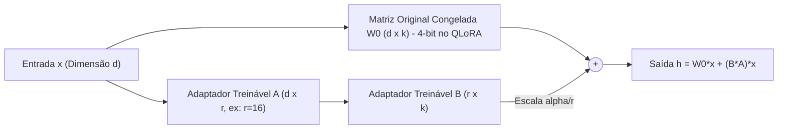

# 🌌 Aula 32: LLMOps & Otimização de Modelos

> **Setor da Navegação:** Galáxia 6 — IAs Generativas & LLMs · **ID do Módulo:** `llmops-otimizacao`

---

## 1. 🚀 Briefing da Missão (Contexto Temático & Realidade de Mercado)

### Metadados do Setor
- **Galáxia:** 6 — IAs Generativas & LLMs
- **ID Oficial:** `llmops-otimizacao`
- **Descrição da Missão:** *"Produção em escala industrial. Aprenda a otimizar modelos open-source para rodar com eficiência de hardware e gerencie custos de tokenização."*
- **Pré-requisitos:** [`30-rag-bancos-de-dados-vetoriais.md`](./30-rag-bancos-de-dados-vetoriais.md) (`rag`) e [`31-agentes-de-ia-langchain.md`](./31-agentes-de-ia-langchain.md) (`agentes-langchain`)
- **Destino Final da Galáxia:** [`projeto-consolidacao-06-llms.md`](./projeto-consolidacao-06-llms.md) (`llmops-otimizacao`)

### Analogia Espacial — Engenharia de Propulsão e Telemetria em Escala Industrial
Construir um protótipo de nave no hangar (um notebook que responde a 1 usuário em 8 segundos pagando caro por requisição) é só metade do desafio. Colocar uma frota operando **para 50.000 usuários simultâneos** exige engenharia de propulsão pesada (**LLMOps**):

- **Quantização** é trocar tanques de chumbo por ligas de titânio ultraleves sem perder potência: o modelo de 8 bilhões de parâmetros que exigia 32 GB de VRAM cabe folgado em 5 GB mantendo praticamente o mesmo raciocínio.
- **LoRA e QLoRA** são acoplamentos modulares: em vez de reconstruir o motor inteiro do foguete para adaptar a nave a uma nova atmosfera, você congela o motor principal e treina apenas pequenos painéis adaptadores de 1% do peso.
- **vLLM com PagedAttention** organiza a memória de bordo como o sistema de paginação de memória virtual de um sistema operacional, atendendo dezenas de passageiros em paralelo sem fragmentar a VRAM.
- **Prompt Caching e Telemetria** evitam que você queime combustível reprocessando o mesmo manual de 4.000 tokens em toda decolagem e medem exatamente quantos tokens por segundo e quantos centavos custa cada quilômetro voado.

### Qual Dor Real Este Módulo Resolve na Indústria?
A maior causa de cancelamento de projetos de IA Generativa após a fase de PoC (*Proof of Concept*) não é falta de inteligência do modelo — é **conta de nuvem impagável, latência inaceitável (>10s) e GPUs estourando memória (`CUDA Out of Memory`)**. Times que dominam LLMOps reduzem faturas de API em 50% a 80% com *Prompt Caching* e roteamento inteligente, ajustam modelos especializados com QLoRA em uma única GPU acessível e escalam inferência open-weight via vLLM com altíssimo *throughput*.

---

## 2. 📚 Carga de Conhecimento Completa (Tópico por Tópico)

### 2.1 Quantização de Modelos (FP32 / FP16 para INT8 e INT4 / GGUF)
Um modelo de 8 bilhões de parâmetros (`8B`) armazena 8 bilhões de números na memória VRAM da GPU apenas para seus pesos (*weights*), sem contar o espaço extra para *KV Cache* e ativações. A **Quantização** reduz a precisão numérica com que cada peso é armazenado:

| Precisão Numérica | Bits / Bytes por Peso | Memória só para Pesos (Modelo 8B) | Impacto Prático |
| :--- | :--- | :--- | :--- |
| **FP32** (*Float32*) | 32 bits (4 bytes) | ~32,0 GB | Precisão completa de treino legado; desperdício gigantesco em inferência. |
| **FP16 / BF16** (*Half*) | 16 bits (2 bytes) | ~16,0 GB | Padrão de treino moderno (`BF16`) e inferência sem perda perceptível de qualidade. |
| **INT8 / FP8** | 8 bits (1 byte) | ~8,0 GB | Redução de ~50% na VRAM vs. FP16 com degradação quase nula (~0%–0,5%). |
| **INT4 (NF4 / AWQ / GGUF Q4_K_M)** | 4 bits (0,5 byte) | **~4,5 a 5,0 GB** | Cabe em uma RTX 3060/4060 ou MacBook de 16 GB! Pequena queda em raciocínio extremo, excelente custo-benefício. |

- **Como funciona sem destruir o modelo?** Em vez de truncar números ingenuamente, técnicas modernas agrupam pesos em blocos (ex.: blocos de 64 pesos), guardam um fator de escala em alta precisão e mapeiam os valores para uma grade de 16 níveis (`INT4`) ou distribuição normal (`NF4` — *NormalFloat4*).
- **Principais formatos em produção:** **GGUF** (para `llama.cpp` / Ollama em CPU+GPU/Apple Silicon), **AWQ / GPTQ / FP8** (otimizados para GPUs Nvidia em produção com **vLLM**) e **NF4 via `bitsandbytes`** (para QLoRA no ecossistema Hugging Face).

### 2.2 Fundamentos de Fine-Tuning Eficiente: LoRA e QLoRA
Fazer *Full Fine-Tuning* de um modelo de 8B ou 70B exige atualizar bilhões de pesos, guardando gradientes e estados de otimizador AdamW (que multiplicam a memória necessária por 4x a 8x!). A técnica **PEFT (*Parameter-Efficient Fine-Tuning*)**, liderada pelo **LoRA (*Low-Rank Adaptation*, Hu et al., 2021)**, resolve esse gargalo genialmente:



- **A Ideia Central do LoRA:** Em vez de alterar a matriz gigante $W_0$ ($d \times k$), nós a **congelamos** e somamos um desvio $\Delta W = B \cdot A$, formado pelo produto de duas matrizes muito finas de **posto baixo (*Low Rank*, $r = 8, 16, 32$)**.
  - Exemplo real: uma matriz `4096 x 4096` tem **16,7 milhões** de parâmetros. Com LoRA de rank `r=16`, treinamos apenas `4096*16 + 16*4096 = 131.072` parâmetros (**0,78% do total!**).
  - Ao final do treino, os adaptadores pesam poucos megabytes e podem até ser fundidos (*merged*) de volta em $W_0$ sem adicionar zero milissegundos de latência na inferência!
- **O que é QLoRA?** É a combinação de **Quantização 4-bit (NF4)** para os pesos congelados do modelo base $W_0$ + **Double Quantization** + **Paged Optimizers** + adaptadores **LoRA** treinados em `bfloat16`. Isso permite fazer fine-tuning de modelos de **7B–14B em uma GPU única de 16 GB–24 GB** (ou até de 70B em uma única A100 de 48–80 GB).

### 2.3 Monitoramento de Custos e Latência de Inferência (Tokens/s, TTFT, TPOT)
Em LLMOps, medir apenas "média de tempo da requisição HTTP" esconde o que o usuário sente e o que pesa na fatura. As métricas obrigatórias de observabilidade de LLMs são:
- **TTFT (*Time to First Token*):** Tempo entre enviar o prompt e receber o **1º token** em *streaming*. Determina a sensação de velocidade instantânea no chat. Cresce com o tamanho do prompt de entrada (*prefill phase*).
- **TPOT (*Time per Output Token*) e Throughput (Tokens/segundo):** Tempo médio para gerar cada token seguinte (ex.: 20 ms/token = **50 tokens/s**, mais rápido que leitura humana).
- **Custo por Requisição e Custo por Feature:** Calculado separadamente para **input tokens** (mais baratos) vs. **output tokens** (tipicamente 3x a 5x mais caros porque exigem geração sequencial passo a passo). Monitorar desvios evita que um bug de agente em loop queime US\$ 500 em uma madrugada!

### 2.4 Servir Inferência Veloz em Produção com vLLM
Rodar um loop `model.generate()` direto da biblioteca `transformers` em produção atende bem **1 usuário por vez**, mas colapsa sob tráfego concorrente porque desperdiça até 60%–80% da VRAM pré-alocando blocos contínuos gigantes para o *KV Cache* de cada requisição.

O **vLLM** revolucionou o *serving* de LLMs open-weight em produção com três pilares:
1. **PagedAttention:** Inspirado em memória virtual de sistemas operacionais, divide o *KV Cache* de cada conversa em **blocos/páginas não contíguas** de tamanho fixo na VRAM, eliminando fragmentação e permitindo compartilhar prefixos comuns entre requisições simultâneas!
2. **Continuous Batching (*In-flight Batching*):** Em vez de esperar o pedido mais longo de um lote terminar para liberar a GPU, o vLLM encaixa novos pedidos imediatamente assim que qualquer requisição do lote emite `<EOS>`, multiplicando o *throughput* (tokens/s totais) em até 10x–24x.
3. **API OpenAI-Compatible Pronta:** Com um único comando (`vllm serve meta-llama/Llama-3.1-8B-Instruct`), você sobe um servidor HTTP pronto na porta `8000` compatível com o cliente padrão `OpenAI(...)`.

### 2.5 Caches de Prompt para Economizar Tokens Repetidos
Em aplicações corporativas (Agentes com 10 ferramentas, RAG com `System Instructions` longas, exemplos *Few-Shot* extensos), **70% a 90% dos tokens de entrada são idênticos** entre chamadas sucessivas! Repetir o processamento de atenção sobre o mesmo prefixo desperdiça dinheiro e tempo de GPU (*TTFT*). Existem duas camadas complementares de cache:

1. **Prefix Prompt Caching (Nível de Engine / Provedor):**
   - Suportado nativamente por **OpenAI** (automático para prefixos $\ge 1024$ tokens com ~50% de desconto), **Anthropic** (`cache_control: {"type": "ephemeral"}` com até 90% de desconto na leitura de cache), **Gemini** (*Context Caching*) e **vLLM** (`--enable-prefix-caching`, que reutiliza os blocos físicos de *KV Cache* já calculados na VRAM!).
   - **Regra de ouro de engenharia:** Sempre coloque conteúdo **estático** (System Prompt, definições de Tools, exemplos Few-Shot, documento fixo) no **início** do prompt e conteúdo **dinâmico** (data atual, pergunta do usuário) no **final** — qualquer mudança no 1º caractere invalida todo o cache dali para frente!
2. **Semantic / Exact Response Cache (Nível de Aplicação com Redis):**
   - Antes mesmo de chamar a LLM, verifica se a mesma pergunta (hash exato) ou uma pergunta semanticamente equivalente (via embedding + threshold altíssimo $\ge 0.96$ no Redis/Qdrant) já foi respondida recentemente, retornando em <15 ms a custo US\$ 0,00!

---

## 3. 💻 Mão no Código (Jeito Iniciante vs. Padrão Profissional)

Abaixo mostramos os erros clássicos de desperdício de hardware/dinheiro vs. um kit LLMOps profissional cobrindo: **cálculo de memória & configuração QLoRA**, **telemetria de TTFT / tokens por segundo / custo** e **Cache de Prefixos + vLLM**.

### ❌ Jeito Iniciante (Sem Cálculo de VRAM, Sem Telemetria e Sem Cache)
```python
# Problema 1: Tentar carregar modelo 8B em FP32 numa GPU de 16 GB -> CUDA OutOfMemoryError!
# 8e9 params * 4 bytes = 32 GB só de pesos + ativações + KV cache!
# model = AutoModelForCausalLM.from_pretrained("meta-llama/Llama-3.1-8B-Instruct")

# Problema 2: Re-enviar 3.000 tokens com timestamp DINÂMICO no INÍCIO do prompt,
# quebrando qualquer Prompt Caching do provedor e sem medir tokens/s nem custo!
from datetime import datetime

def montar_prompt_ruim(pergunta: str) -> str:
    agora = datetime.now().isoformat()  # <- Quebra o prefix cache em TODA chamada!
    manual_estatico = "Manual longo de 3000 tokens... " * 200
    return f"Hora atual: {agora}\n{manual_estatico}\nPergunta: {pergunta}"
```

### ✅ Padrão Profissional (Estimador VRAM + QLoRA Config + Telemetria TTFT/TPS + Cache & vLLM)
```python
import hashlib
import time
from dataclasses import dataclass
from typing import Iterator

try:
    import tiktoken
except ImportError:
    tiktoken = None


# 1. Estimador de VRAM para planejamento de hardware (Quantização + KV Cache)
def estimar_vram_gb(num_parametros_bilhoes: float, bits_por_peso: int, overhead_fator: float = 1.2) -> float:
    """Calcula VRAM aproximada necessária para inferência (pesos + overhead de KV cache/ativações)."""
    bytes_por_peso = bits_por_peso / 8.0
    gb_pesos = (num_parametros_bilhoes * 1e9 * bytes_por_peso) / (1024 ** 3)
    return round(gb_pesos * overhead_fator, 2)


# 2. Configuração padrão de QLoRA (4-bit NF4 + LoRA rank baixo) no ecossistema Hugging Face / PEFT
def criar_config_qlora():
    """Retorna configurações recomendadas de BitsAndBytes 4-bit e LoRA para Fine-Tuning eficiente."""
    # Imports opcionais aqui para o script rodar mesmo sem GPU instalada localmente
    import torch
    from peft import LoraConfig, TaskType
    from transformers import BitsAndBytesConfig

    bnb_config = BitsAndBytesConfig(
        load_in_4bit=True,
        bnb_4bit_quant_type="nf4",            # NormalFloat4: ideal para distribuição normal de pesos
        bnb_4bit_use_double_quant=True,       # Quantiza até as constantes de escala (~0.4 bits economizados/peso)
        bnb_4bit_compute_dtype=torch.bfloat16,
    )

    lora_config = LoraConfig(
        r=16,                                 # Rank baixo (8, 16 ou 32)
        lora_alpha=32,                        # Fator de escala (geralmente 2 * r)
        lora_dropout=0.05,
        bias="none",
        task_type=TaskType.CAUSAL_LM,
        target_modules=["q_proj", "k_proj", "v_proj", "o_proj", "gate_proj", "up_proj", "down_proj"],
    )
    return bnb_config, lora_config


# 3. Telemetria de Streaming (TTFT, Tokens/s e Custo) + Cache Estático de Prefixo
@dataclass
class MetricasInferencia:
    ttft_ms: float
    total_ms: float
    prompt_tokens: int
    output_tokens: int
    tokens_por_segundo: float
    custo_estimado_usd: float
    cache_hit: bool


class LLMOpsGateway:
    """Wrapper com Cache Exato em memória/Redis e Telemetria de Latência/Custo."""

    def __init__(self, preco_input_1m: float = 0.15, preco_output_1m: float = 0.60) -> None:
        self.preco_input_1m = preco_input_1m
        self.preco_output_1m = preco_output_1m
        self._cache: dict[str, str] = {}

    def _contar_tokens(self, texto: str) -> int:
        if tiktoken is None:
            return max(1, len(texto) // 4)
        return len(tiktoken.get_encoding("cl100k_base").encode(texto))

    def montar_mensagens_cache_friendly(self, system_manual: str, pergunta_dinamica: str, hora_atual: str) -> list[dict]:
        """Regra LLMOps: Prefixo 100% ESTÁTICO primeiro; variáveis dinâmicas apenas no final!"""
        return [
            {"role": "system", "content": system_manual},
            {"role": "user", "content": f"Data/Hora da consulta: {hora_atual}\nPergunta: {pergunta_dinamica}"},
        ]

    def executar_com_telemetria(
        self,
        prefixo_estatico: str,
        entrada_dinamica: str,
        stream_fn,
    ) -> tuple[str, MetricasInferencia]:
        """Executa geração em streaming medindo TTFT, TPS e aplicando cache de resposta."""
        chave_cache = hashlib.sha256(f"{prefixo_estatico}||{entrada_dinamica}".encode()).hexdigest()
        prompt_tokens = self._contar_tokens(prefixo_estatico + entrada_dinamica)

        if chave_cache in self._cache:
            resposta = self._cache[chave_cache]
            return resposta, MetricasInferencia(
                ttft_ms=0.5,
                total_ms=0.5,
                prompt_tokens=prompt_tokens,
                output_tokens=self._contar_tokens(resposta),
                tokens_por_segundo=0.0,
                custo_estimado_usd=0.0,
                cache_hit=True,
            )

        inicio = time.perf_counter()
        primeiro_token_ts = None
        pedacos: list[str] = []

        for chunk in stream_fn():
            if primeiro_token_ts is None:
                primeiro_token_ts = time.perf_counter()
            pedacos.append(chunk)

        fim = time.perf_counter()
        resposta_completa = "".join(pedacos)
        out_tokens = self._contar_tokens(resposta_completa)

        ttft_ms = ((primeiro_token_ts or fim) - inicio) * 1000.0
        total_ms = (fim - inicio) * 1000.0
        tempo_geracao_s = max(1e-6, fim - (primeiro_token_ts or inicio))
        tps = out_tokens / tempo_geracao_s

        custo_usd = (
            (prompt_tokens / 1_000_000) * self.preco_input_1m
            + (out_tokens / 1_000_000) * self.preco_output_1m
        )

        self._cache[chave_cache] = resposta_completa
        return resposta_completa, MetricasInferencia(
            ttft_ms=round(ttft_ms, 2),
            total_ms=round(total_ms, 2),
            prompt_tokens=prompt_tokens,
            output_tokens=out_tokens,
            tokens_por_segundo=round(tps, 2),
            custo_estimado_usd=round(custo_usd, 6),
            cache_hit=False,
        )


# 4. Referência de Serving em Produção com vLLM (CLI + Python OpenAI SDK):
# Terminal (subindo modelo quantizado AWQ com Prefix Caching ativado):
# $ vllm serve Qwen/Qwen2.5-7B-Instruct-AWQ --quantization awq --enable-prefix-caching --port 8000
#
# Cliente Python apontando para o servidor vLLM:
# from openai import OpenAI
# vllm_client = OpenAI(base_url="http://localhost:8000/v1", api_key="token-vllm")

if __name__ == "__main__":
    for nome, bits in [("FP32", 32), ("FP16/BF16", 16), ("INT8", 8), ("INT4 (GGUF/AWQ)", 4)]:
        print(f"Modelo 8B em {nome:16s}: ~{estimar_vram_gb(8.0, bits):5.2f} GB VRAM estimados")

    def fake_stream() -> Iterator[str]:
        time.sleep(0.08)  # Simula TTFT de 80ms (prefill)
        for token in ["Cache ", "e ", "vLLM ", "reduzem ", "custo ", "e ", "latência."]:
            time.sleep(0.015)
            yield token

    gw = LLMOpsGateway()
    manual = "Manual técnico estático de engenharia..." * 50

    _, m1 = gw.executar_com_telemetria(manual, "Como reduzir custo?", fake_stream)
    _, m2 = gw.executar_com_telemetria(manual, "Como reduzir custo?", fake_stream)
    print("\nChamada 1 (Cold):", m1)
    print("Chamada 2 (Cache Hit):", m2)
```

---

## 4. 🛠️ Laboratório de Voo (Exercício Prático Guiado)

**Duração estimada:** 45 minutos · **Objetivo:** Medir na prática TTFT, tokens/segundo, economia de VRAM por quantização e impacto de ordenação de prompt para Prompt Caching.

### Passo a Passo
1. **Instale as ferramentas de medição:** `pip install tiktoken openai` (e tenha Ollama ou uma chave de API configurada).
2. **Tabela de Dimensionamento de Hardware:** Use `estimar_vram_gb` da Seção 3 para calcular quanto de VRAM exigem os modelos `3B`, `8B`, `32B` e `70B` em `FP16`, `INT8` e `INT4`. Identifique quais cabem em uma GPU de entrada (8 GB), intermediária (24 GB) e corporativa (80 GB A100/H100).
3. **Benchmark de Latência Real (TTFT & TPS):** Conecte o `LLMOpsGateway` da Seção 3 a um streaming real (`stream=True` no OpenAI SDK apontando para Ollama local ou API na nuvem). Meça TTFT e tokens/s comparando:
   - Prompt curto (~50 tokens) vs. Prompt longo (~2.500 tokens).
   - Modelo quantizado `Q4_K_M` vs. `Q8_0` no Ollama (se houver memória suficiente).
4. **Refatoração Cache-Friendly:** Pegue um prompt que colocava `Data atual: {hoje}` e `Usuário: {nome}` na primeira linha antes de um manual de 2.000 tokens e refatore movendo toda a parte variável para o **final** da última mensagem do usuário. Calcule quantos tokens estáticos se tornaram elegíveis ao *Prefix Caching*.

### Critérios de Domínio
- [ ] O aluno calculou corretamente o consumo de VRAM entre FP32, FP16, INT8 e INT4 e explicou o limite de hardware de cada um.
- [ ] Mediu TTFT (ms) e Throughput (tokens/s) em uma chamada com `stream=True` real.
- [ ] Demonstrou como posicionar prefixos estáticos antes de variáveis dinâmicas maximiza o *Prompt Caching*.
- [ ] Consegue explicar em código e desenho arquitetural como o LoRA/QLoRA reduz o número de parâmetros treináveis para <1%.

---

## 5. 🎯 Resolução Comentada do Teste de Ignição (Quest Oficial)

> **Pergunta Oficial (`llmops-otimizacao`):**
> *O que é a 'Quantização' de modelos de linguagem e qual sua principal vantagem técnica?*

- **A)** *"É o processo de multiplicar o número de neurônios da rede por 4 para deixá-la mais inteligente."*
- **B)** *"É a conversão das variáveis categóricas de texto em vetores normais utilizando embeddings vetoriais."*
- **C)** *"É a redução da precisão numérica dos pesos do modelo (por exemplo, de floats de 32 bits para inteiros de 4 ou 8 bits), reduzindo drasticamente o consumo de memória RAM/VRAM e permitindo a execução em hardwares mais acessíveis com perda mínima de qualidade."*
- **D)** *"É o processo de bloquear requisições repetidas de usuários na esteira de CI/CD."*

### ✅ Gabarito Oficial: **Alternativa C**

- **Por que a C está correta?** Os pesos de uma rede neural são originalmente treinados em ponto flutuante (`FP32` de 32 bits ou `BF16` de 16 bits). A **quantização** mapeia esses valores contínuos para representações mais compactas (`INT8`, `FP8`, `INT4`, `NF4` ou variantes `GGUF Q4_K_M`), reduzindo o uso de memória RAM/VRAM em até **4x a 8x**. Além disso, como a inferência de LLMs é fortemente limitada por largura de banda de memória (*memory-bandwidth bound* — o tempo de mover pesos da VRAM até os núcleos da GPU), pesos menores aceleram a geração de tokens/s e viabilizam rodar modelos capazes de 7B–70B em servidores muito mais baratos ou até localmente.
- **Por que a A está errada?** Multiplicar o número de parâmetros por 4 aumentaria o custo computacional e o consumo de memória, indo na direção oposta da quantização.
- **Por que a B está errada?** Transformar texto em vetores densos é a geração de **Embeddings** (ou *One-Hot Encoding* para categorias simples), não quantização de pesos.
- **Por que a D está errada?** Bloquear ou reutilizar requisições repetidas diz respeito a *Rate Limiting* ou **Prompt/Response Caching**, sem relação com a precisão numérica dos pesos na memória.

---

## 6. 🎤 Kit de Apresentação (Como Dar Aula / Apresentar Este Módulo)

### Pitch Feynman de 2 Minutos (Texto Pronto para Falar)
> *"Muita gente consegue colocar um chatbot no ar no notebook, mas trava na hora de colocar em produção de verdade: a GPU estoura a memória, a resposta demora 12 segundos e a conta da API assusta no fim do mês. É aí que entra LLMOps.*
> *Temos quatro superpoderes de otimização. O primeiro é a Quantização: imagine guardar uma foto em RAW de 40 MB vs. um WebP de alta qualidade de 4 MB — o olho humano quase não nota diferença, e agora cabem dez vezes mais fotos no cartão. Reduzindo os pesos da IA de 32 ou 16 bits para 4 bits, um modelo de 8 bilhões de parâmetros cai de 32 GB para menos de 5 GB!*
> *O segundo é o QLoRA: em vez de retreinar todos os bilhões de pesos para adaptar a IA a um nicho, congelamos o modelo em 4 bits e treinamos só mini-adaptadores de 1% do tamanho. O terceiro é o vLLM em produção, que usa PagedAttention — igual à memória virtual do Linux — para atender dezenas de usuários simultâneos na mesma GPU sem desperdiçar VRAM. E o quarto é telemetria com Prompt Caching: colocando o texto fixo no começo do prompt e medindo TTFT, tokens por segundo e custo em tempo real, você garante velocidade instantânea sem quebrar o orçamento."*

### Roteiro de Slides (6 Slides)
1. **Slide 1 — O Vale da Morte entre PoC e Produção:** Custo, latência (TTFT vs TPOT) e OOM em GPUs reais (visual: gráfico "Protótipo para 1 usuário" vs. "500 req/min em produção").
2. **Slide 2 — Quantização Desmistificada:** De `FP32` (32 GB) até `INT4 / GGUF` (5 GB) para um modelo 8B (visual: barras decrescentes de VRAM com comparação de acurácia mantida).
3. **Slide 3 — Fine-Tuning Barato com LoRA & QLoRA:** Matrizes congeladas + adaptadores de posto baixo $B \cdot A$ (visual: diagrama Mermaid da Seção 2.2 destacando `<1%` de parâmetros treináveis).
4. **Slide 4 — vLLM & PagedAttention:** Por que o `transformers.generate()` trava sob concorrência vs. memória paginada + *Continuous Batching* (visual: blocos contínuos desperdiçados vs. blocos paginados compactos).
5. **Slide 5 — Prompt Caching na Prática:** Regra do prefixo estático antes da variável dinâmica (visual: bloco verde `CACHE HIT` para System + Tools + Docs vs. bloco amarelo `NOVO` só na pergunta final).
6. **Slide 6 — Painel de Observabilidade LLMOps:** O que todo Engenheiro de IA monitora diariamente: TTFT, Tokens/s, Taxa de Cache Hit, Erros de Tool Calling e Custo USD por usuário (visual: mockup de dashboard Grafana/LangSmith).

### Roteiro de Demo Ao Vivo (3 Minutos)
1. **Minuto 0:00–1:00:** Rode `estimar_vram_gb` no terminal mostrando o salto de 32 GB → 16 GB → 8 GB → 4,8 GB para um modelo 8B e explique em qual placa de vídeo cada versão cabe.
2. **Minuto 1:00–2:00:** Execute as duas chamadas do `LLMOpsGateway` ao vivo: mostre a chamada fria imprimindo `TTFT`, `tokens_por_segundo` e `custo_estimado_usd`, e logo abaixo a segunda chamada batendo `cache_hit=True` em `0.5 ms` e custo US\$ 0,00.
3. **Minuto 2:00–3:00:** Exiba lado a lado a função `montar_prompt_ruim` (timestamp na primeira linha) vs. `montar_mensagens_cache_friendly` (timestamp apenas no final), mostrando como uma simples troca de ordem de 2 linhas economiza metade da fatura em APIs com *Prefix Caching*.

### Perguntas Difíceis da Plateia
- **Pergunta 1:** *"Quantização para 4 bits (INT4) piora muito o raciocínio do modelo em tarefas difíceis?"*
  **Resposta segura:** *"Em modelos muito pequenos (1B–3B), quantização agressiva para 4 bits pode gerar degradação perceptível em matemática e código complexo; nesses casos, prefira Q5_K_M, Q8_0 ou FP8. Já em modelos médios/grandes (8B, 32B, 70B), um modelo maior em INT4 costuma ser muito mais inteligente do que um modelo menor em FP16 ocupando a mesma VRAM! Técnicas como AWQ e GGUF K-quants protegem os pesos mais sensíveis em maior precisão para preservar a qualidade."*
- **Pergunta 2:** *"Quando vale a pena subir meu próprio servidor vLLM em GPU na nuvem em vez de continuar pagando OpenAI/Gemini/Anthropic por token?"*
  **Resposta segura:** *"Tudo se resume a volume, previsibilidade e compliance. Se seu tráfego é baixo ou em picos irregulares, APIs pay-per-token ganham fácil porque você não paga GPU ociosa de madrugada. O ponto de virada para self-hosting com vLLM acontece quando você tem volume alto e constante (alta utilização da GPU 24/7), requisitos rígidos de privacidade/residência de dados ou um modelo especializado fine-tuned com QLoRA que supera modelos genéricos em latência e custo unitário."*

---

## 7. 💼 Radar do Mercado de Trabalho (Foco Dev Júnior)

### 3 Perguntas Reais de Entrevista Técnica Júnior
1. **Pergunta:** *"Como você reduziria em 50% a conta mensal de um sistema de IA em produção sem destruir a qualidade das respostas?"*
   **Resposta-modelo:** *"Atacaria em quatro frentes mensuráveis: (1) Roteamento de modelos (*Model Routing*): usar modelos menores/baratos (como `gpt-4o-mini`, `haiku`, `flash` ou 8B local) para tarefas simples de classificação/extração e reservar modelos caros apenas para raciocínio complexo; (2) Reordenar prompts para manter prefixos estáticos no início e ativar Prompt Caching; (3) Otimizar o RAG com chunks enxutos para não enviar lixo de contexto; e (4) Implementar cache semântico/exato no Redis para perguntas recorrentes."*
2. **Pergunta:** *"Qual a diferença entre TTFT e Throughput (tokens/s) e por que ambos importam para o usuário final?"*
   **Resposta-modelo:** *"TTFT (Time to First Token) é o tempo de espera até o primeiro token começar a aparecer na tela, ligado principalmente ao processamento paralelo do prompt de entrada (*prefill*). Tokens/segundo (ou inverso do TPOT) mede a fluidez com que o texto continua sendo digitado depois que começou (*decode*). Um sistema com TTFT ruim parece travado; um com baixo tokens/s parece lento para ler. Medimos ambos em streaming para isolar se o gargalo está em prompts gigantes ou na velocidade de decodificação/concorrência."*
3. **Pergunta:** *"Explique a diferença entre LoRA e QLoRA e por que eles democratizaram o Fine-Tuning."*
   **Resposta-modelo:** *"O LoRA congela os pesos originais do modelo base e injeta pequenas matrizes treináveis de posto baixo (rank $r$) nas camadas de atenção/MLP, reduzindo os parâmetros treináveis em mais de 99%. O QLoRA dá um passo além: carrega o modelo base congelado já quantizado em 4 bits (NF4) e treina os adaptadores LoRA em BF16 com paginação de otimizadores, reduzindo drasticamente a VRAM necessária para que desenvolvedores consigam ajustar modelos de 7B–14B em uma única GPU acessível."*

### Erros Clássicos de Júnior vs. Postura Profissional

| Erro Clássico de Júnior | Postura Profissional Esperada |
| :--- | :--- |
| Colocar datas dinâmicas, IDs de usuário ou variáveis no topo do `System Prompt`. | Isolar instruções, ferramentas e exemplos estáticos no topo para maximizar *Cache Hits* de prefixo e mover dados dinâmicos para o fim. |
| Usar `.generate()` padrão do `transformers` dentro de uma rota FastAPI síncrona para vários usuários. | Servir modelos open-weight via **vLLM** (ou TGI/SGLang) aproveitando *PagedAttention* e *Continuous Batching*. |
| Não registrar consumo de tokens nem custo por funcionalidade no sistema. | Instrumentar cada chamada com métricas de `prompt_tokens`, `completion_tokens`, `TTFT`, `latência total` e custo estimado em USD. |

### Evidência para Portfólio / GitHub / LinkedIn
- **Repositório no GitHub:** Adicione uma pasta `benchmarks/` ou módulo `telemetry.py` no seu projeto final registrando logs estruturados em JSON com `ttft_ms`, `tokens_per_sec`, `cache_hit` e `estimated_cost_usd` — e inclua um print dessa telemetria rodando no `README.md`.
- **Post no LinkedIn:** Escreva um guia prático *"Como dimensionar VRAM para rodar LLMs locais e como o Prompt Caching corta sua fatura pela metade"*, mostrando a tabela FP32→INT4 e o truque de ordenação de prefixos.

---

## 8. 📡 Transmissões Recomendadas & Próxima Órbita

### Recursos Oficiais do Módulo
- 📄 [LoRA: Low-Rank Adaptation of Large Language Models (Artigo original)](https://arxiv.org/abs/2106.09685)
- ⚡ [vLLM Engine (Documentação Oficial)](https://docs.vllm.ai/en/latest/)
- 🤗 [Guia de Quantização da Hugging Face (Optimum)](https://huggingface.co/docs/optimum/concept_guides/quantization)

### Próxima Órbita — Missão Final da Galáxia 6!
Você completou todas as 6 aulas da **Constelação das IAs Generativas & LLMs**! Agora é hora de unir RAG com ChromaDB, Agentes com Tool Calling, fallback seguro por script/web e boas práticas de LLMOps em um único sistema de portfólio de nível júnior/pleno. Siga para o [**Guia do Projeto de Consolidação 06: Constelação Generativa & LLMs**](./projeto-consolidacao-06-llms.md).
