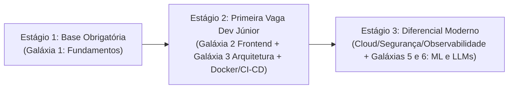

# 🚀 Manual do Comandante — Academia Galáctica Dev Júnior

> **Baseado 100% no Galactic Developer Roadmap (`Navegador Cósmico`):**  
> 🌐 Mapa Interativo Original: https://adialaleal.github.io/galatic-developer-roadmap/  
> 📦 Cópia local dos dados originais: [`recursos-originais/data.js`](recursos-originais/data.js) e [`recursos-originais/app.js`](recursos-originais/app.js)

Bem-vindo à bordo, Comandante! Este repositório de estudos foi construído para transformar os **32 módulos (planetas)** e **6 Projetos de Consolidação** das **6 Galáxias** do *Galactic Developer Roadmap* em um curso completo e pragmático com três metas claras:

1. **Tornar você um Desenvolvedor Júnior de alto potencial**, com fundamentos sólidos que não desmoronam na primeira entrevista técnica ou no primeiro código em produção.
2. **Preparar você para dar aulas e apresentar cada módulo** em meetups, grupos de estudo, mentorias, entrevistas, LinkedIn ou vídeos — aplicando o *Método Feynman* (quem consegue ensinar com clareza dominou o assunto de verdade).
3. **Destacar você no mercado de trabalho**, unindo código no padrão profissional, resolução comentada dos *Testes de Ignição (Quests)*, perguntas reais de entrevista e projetos de portfólio com cara de engenharia real.

---

## 🧭 Estratégia Inteligente para Virar Dev Júnior (Sem Overdose de Conteúdo)

O *Galactic Developer Roadmap* vai de **Git** até **LLMOps e Agentes de IA**. Tentar decorar tudo antes de se candidatar às primeiras vagas é uma armadilha clássica. A forma inteligente de conquistar sua vaga Júnior e evoluir depois é dividir sua jornada em **3 Estágios Estratégicos**:

### 🥉 Estágio 1 — Base Obrigatória (Semanas 1 a 5)
* **Foco:** **Galáxia 1 (`Nébula dos Fundamentos`)** — Módulos `01` a `05` + `Projeto 01`.
* **Por quê:** Nenhuma empresa contrata um júnior que não sabe resolver conflitos no Git, entender Big-O básico, estruturar uma API HTTP REST ou escrever um `JOIN` em SQL. Esta é a base inegociável de qualquer área (Frontend, Backend, Dados ou IA).

### 🥈 Estágio 2 — Pronto para Sua Primeira Vaga Web / Backend (Semanas 6 a 15)
* **Foco:** **Galáxia 2 (`Constelação do Frontend Web`)** (`06`–`10` + `Projeto 02`), **Galáxia 3 (`Cinturão de Arquitetura`)** (`11`–`16` + `Projeto 03`) e os dois primeiros módulos da **Galáxia 4** (`17` Docker e `18` CI/CD).
* **Por quê:** Aqui mora 85% das vagas de Dev Júnior no Brasil e no exterior. Saber criar uma aplicação React bem estruturada, escrever APIs com Clean Code/SOLID, testes automatizados, cache com Redis, filas e empacotar tudo em Docker com esteira de CI coloca você na frente da imensa maioria dos candidatos que só fizeram "CRUD copiado de tutorial".
* **Dica de Ouro:** Ao terminar o **Estágio 2**, **já comece a aplicar para vagas Júnior e Estágios**, enquanto estuda o Estágio 3!

### 🥇 Estágio 3 — Diferencial Competitivo Moderno (Semanas 16 a 24)
* **Foco:** Restante da **Galáxia 4** (`19` Cloud/Serverless, `20` Segurança Web, `21` Observabilidade + `Projeto 04`), **Galáxia 5 (`Sistemas Inteligentes & ML`)** (`22`–`26` + `Projeto 05`) e **Galáxia 6 (`IAs Generativas & LLMs`)** (`27`–`32` + `Projeto 06`).
* **Por quê:** O mercado atual procura profissionais de software que entendem segurança (OWASP/JWT), monitoramento (Prometheus/Grafana) e que sabem integrar **IA aplicada a produto** (APIs de LLM, RAG com bancos vetoriais, Function Calling e Agentes) com responsabilidade técnica e controle de custos.

---

## 📅 Cronograma Sugerido de 24 Semanas

Cada semana segue um **Ciclo de Voo de 5 Passos** (cerca de 8 a 12 horas semanais):

1. **Dia 1–2 (Teoria + Analogia):** Ler as seções `1` e `2` da aula do módulo, desenhando os diagramas com suas próprias palavras.
2. **Dia 3–4 (Mão no Código + Lab):** Comparar o *Jeito Iniciante vs. Padrão Profissional* (seção `3`) e executar o *Laboratório de Voo* (seção `4`) no seu terminal/editor.
3. **Dia 5 (Ignição + Entrevista):** Responder o *Teste de Ignição* (seção `5`) no site oficial e no arquivo da aula, e treinar em voz alta as *3 Perguntas de Entrevista* (seção `7`).
4. **Dia 6 (Modo Professor):** Gravar um áudio ou ensaiar no espelho o *Pitch Feynman de 2 Minutos* e revisar o *Roteiro de Slides* (seção `6`).
5. **Dia 7 (Vitrine):** Publicar o código do laboratório ou resumo didático no **GitHub** e um post técnico curto no **LinkedIn** contando o que você aprendeu.

| Semanas | Foco na Trilha | Entregável Principal de Portfólio |
| :--- | :--- | :--- |
| **01 – 04** | Galáxia 1: Módulos `01` a `05` | Fundamentos solidificados + Repositórios dos labs |
| **05** | **Projeto de Consolidação 01** | CLI que consome GitHub API, ordena manualmente e persiste em SQLite |
| **06 – 09** | Galáxia 2: Módulos `06` a `10` | UI responsiva acessível, JS assíncrono, React + Zustand + React Query |
| **10** | **Projeto de Consolidação 02** | SPA React + Vite com rotas protegidas, Code Splitting e nota alta no Lighthouse |
| **11 – 14** | Galáxia 3: Módulos `11` a `16` + Módulos `17`–`18` | Código SOLID testado com TDD, Patterns, Clean Arch, Filas, Redis, Docker e CI |
| **15** | **Projeto de Consolidação 03** | API REST E-commerce Clean Arch + SQL + Fila Async + Cache-Aside Redis |
| **16 – 17** | Galáxia 4: Módulos `19` a `21` + **Projeto 04** | Pipeline CI/CD + Docker multi-stage + Cloud/Segurança + Grafana/Prometheus |
| **18 – 20** | Galáxia 5: Módulos `22` a `26` + **Projeto 05** | Análise exploratória Pandas + Scikit-Learn (F1-Score) + API FastAPI em produção |
| **21 – 24** | Galáxia 6: Módulos `27` a `32` + **Projeto 06** | Agente de Suporte Técnico com RAG (ChromaDB) + Tool Calling + LLMOps |

---

## 🎤 Guia do Apresentador Técnico (Como Transformar Qualquer Aula em Talk)

Você comentou que quer estudar bem cada módulo **para poder apresentar futuramente**. Cada uma das 32 aulas já vem com a seção **`## 6. 🎤 Kit de Apresentação`**, mas siga esta estrutura de ouro sempre que for preparar uma apresentação de 15 a 30 minutos:

1. **Gancho Inicial (2 min):** Nunca comece definindo siglas. Comece com uma **dor real** ou com a **analogia espacial** da Seção 1 (*"Imagine que você subiu um código em produção na sexta às 18h e..."*).
2. **Modelo Mental Visual (4 min):** Mostre 1 diagrama simples (fluxograma ou sequência) antes de mostrar qualquer código. A plateia precisa enxergar onde as peças se encaixam.
3. **Contraste Didático (6 min):** Use exatamente o bloco **"Jeito Iniciante vs. Padrão Profissional"** da Seção 3. Mostrar um erro comum real e depois refatorar ao vivo gera identificação imediata em quem assiste.
4. **Demo Ao Vivo de 3 Minutos (4 min):** Rode no terminal ou navegador algo palpável (um `git rebase -i`, o Event Loop no console, um teste quebrando e passando no TDD, um container subindo com `docker compose`, um endpoint FastAPI no Swagger ou um RAG respondendo com fontes). Tenha um backup gravado ou print caso a internet falhe!
5. **Fechamento + Q&A (4 min):** Resuma em **3 lições práticas para levar para o trabalho amanhã** e esteja pronto com as *Perguntas Difíceis da Plateia* já mapeadas na Seção 6.

---

## 🗺️ Mapa Completo Clicável (32 Módulos + 6 Projetos de Consolidação)

### 🌌 Galáxia 1: Nébula dos Fundamentos
| # | Módulo (Planeta) | ID Original | Pré-requisitos | Material de Aula |
| :--- | :--- | :--- | :--- | :--- |
| 01 | 📁 Git & GitHub Avançado | `git-github` | — *(Início)* | [01-git-github-avancado.md](01-nebula-dos-fundamentos/01-git-github-avancado.md) |
| 02 | 🧠 Lógica, Estruturas de Dados & Complexidade | `logica-ed` | `01` | [02-logica-estruturas-dados-complexidade.md](01-nebula-dos-fundamentos/02-logica-estruturas-dados-complexidade.md) |
| 03 | ⚙️ Paradigmas de Programação | `paradigmas` | `02` | [03-paradigmas-de-programacao.md](01-nebula-dos-fundamentos/03-paradigmas-de-programacao.md) |
| 04 | 🌐 APIs & Protocolo HTTP | `apis-web` | `02` | [04-apis-protocolo-http.md](01-nebula-dos-fundamentos/04-apis-protocolo-http.md) |
| 05 | 💾 Bancos de Dados Relacionais & SQL | `sql-bd` | `03`, `04` | [05-bancos-de-dados-relacionais-sql.md](01-nebula-dos-fundamentos/05-bancos-de-dados-relacionais-sql.md) |
| 🎖️ | **Projeto de Consolidação 01: Nébula dos Fundamentos** | `sql-bd` | `01`–`05` | [projeto-consolidacao-01-fundamentos.md](01-nebula-dos-fundamentos/projeto-consolidacao-01-fundamentos.md) |

---

### 🌐 Galáxia 2: Constelação do Frontend Web
| # | Módulo (Planeta) | ID Original | Pré-requisitos | Material de Aula |
| :--- | :--- | :--- | :--- | :--- |
| 06 | 🎨 HTML5 & CSS3 Moderno | `fe-html-css` | `04` (`apis-web`) | [06-html5-css3-moderno.md](02-constelacao-do-frontend-web/06-html5-css3-moderno.md) |
| 07 | ⚡ JavaScript Moderno (ES6+) | `fe-js-moderno` | `06` | [07-javascript-moderno-es6.md](02-constelacao-do-frontend-web/07-javascript-moderno-es6.md) |
| 08 | ⚛️ Componentização & React | `fe-frameworks` | `07` | [08-componentizacao-react.md](02-constelacao-do-frontend-web/08-componentizacao-react.md) |
| 09 | 🛣️ Estado Global & Roteamento | `fe-estado-roteamento` | `08` | [09-estado-global-roteamento.md](02-constelacao-do-frontend-web/09-estado-global-roteamento.md) |
| 10 | 📦 Performance & Build Tools | `fe-build-performance` | `09` | [10-performance-build-tools.md](02-constelacao-do-frontend-web/10-performance-build-tools.md) |
| 🎖️ | **Projeto de Consolidação 02: Constelação do Frontend Web** | `fe-build-performance` | `06`–`10` | [projeto-consolidacao-02-frontend.md](02-constelacao-do-frontend-web/projeto-consolidacao-02-frontend.md) |

---

### 🏛️ Galáxia 3: Cinturão de Arquitetura
| # | Módulo (Planeta) | ID Original | Pré-requisitos | Material de Aula |
| :--- | :--- | :--- | :--- | :--- |
| 11 | 💎 Clean Code & SOLID | `clean-solid` | `05` (`sql-bd`) | [11-clean-code-solid.md](03-cinturao-de-arquitetura/11-clean-code-solid.md) |
| 12 | 🛡️ Testes Automatizados & TDD | `testes` | `11` | [12-testes-automatizados-tdd.md](03-cinturao-de-arquitetura/12-testes-automatizados-tdd.md) |
| 13 | 📐 Padrões de Projeto | `design-patterns` | `11` | [13-padroes-de-projeto.md](03-cinturao-de-arquitetura/13-padroes-de-projeto.md) |
| 14 | 🕸️ Sistemas Distribuídos & Clean Arch | `sistemas-distribuidos` | `12`, `13` | [14-sistemas-distribuidos-clean-arch.md](03-cinturao-de-arquitetura/14-sistemas-distribuidos-clean-arch.md) |
| 15 | 📥 Mensageria & Filas Assíncronas | `filas-assincrono` | `14` | [15-mensageria-filas-assincronas.md](03-cinturao-de-arquitetura/15-mensageria-filas-assincronas.md) |
| 16 | ⚡ NoSQL & Estratégias de Cache | `nosql-cache` | `14` | [16-nosql-estrategias-de-cache.md](03-cinturao-de-arquitetura/16-nosql-estrategias-de-cache.md) |
| 🎖️ | **Projeto de Consolidação 03: Cinturão de Arquitetura** | `nosql-cache` | `11`–`16` | [projeto-consolidacao-03-arquitetura.md](03-cinturao-de-arquitetura/projeto-consolidacao-03-arquitetura.md) |

---

### 🛰️ Galáxia 4: Órbita do DevOps & Cloud
| # | Módulo (Planeta) | ID Original | Pré-requisitos | Material de Aula |
| :--- | :--- | :--- | :--- | :--- |
| 17 | 🐳 Docker & Containerização | `docker` | `15` ou `10` | [17-docker-containerizacao.md](04-orbita-do-devops/17-docker-containerizacao.md) |
| 18 | 🚀 Integração & Entrega Contínua (CI/CD) | `cicd` | `17` | [18-integracao-entrega-continua-cicd.md](04-orbita-do-devops/18-integracao-entrega-continua-cicd.md) |
| 19 | ☁️ Cloud Computing & Serverless | `cloud-serverless` | `18` | [19-cloud-computing-serverless.md](04-orbita-do-devops/19-cloud-computing-serverless.md) |
| 20 | 🔐 Segurança Web & Criptografia | `seguranca-criptografia` | `17` | [20-seguranca-web-criptografia.md](04-orbita-do-devops/20-seguranca-web-criptografia.md) |
| 21 | 📡 Observabilidade & Monitoramento | `observabilidade` | `19`, `20` | [21-observabilidade-monitoramento.md](04-orbita-do-devops/21-observabilidade-monitoramento.md) |
| 🎖️ | **Projeto de Consolidação 04: Órbita do DevOps & Cloud** | `observabilidade` | `17`–`21` | [projeto-consolidacao-04-devops.md](04-orbita-do-devops/projeto-consolidacao-04-devops.md) |

---

### 🤖 Galáxia 5: Sistemas Inteligentes & ML
| # | Módulo (Planeta) | ID Original | Pré-requisitos | Material de Aula |
| :--- | :--- | :--- | :--- | :--- |
| 22 | 📐 Matemática Essencial para IA | `matematica-ia` | `16` (`nosql-cache`) | [22-matematica-essencial-para-ia.md](05-sistemas-inteligentes-e-ml/22-matematica-essencial-para-ia.md) |
| 23 | 🐍 Ciência de Dados com Python | `ciencia-dados-python` | `22` | [23-ciencia-de-dados-com-python.md](05-sistemas-inteligentes-e-ml/23-ciencia-de-dados-com-python.md) |
| 24 | 🤖 Fundamentos de ML Clássico | `ml-classico` | `23` | [24-fundamentos-de-ml-classico.md](05-sistemas-inteligentes-e-ml/24-fundamentos-de-ml-classico.md) |
| 25 | 📊 Algoritmos & Scikit-Learn | `scikit-learn` | `24` | [25-algoritmos-scikit-learn.md](05-sistemas-inteligentes-e-ml/25-algoritmos-scikit-learn.md) |
| 26 | 🎯 Avaliação & Deploy de Modelos | `validacao-modelos` | `25` | [26-avaliacao-deploy-de-modelos.md](05-sistemas-inteligentes-e-ml/26-avaliacao-deploy-de-modelos.md) |
| 🎖️ | **Projeto de Consolidação 05: Sistemas Inteligentes & ML** | `validacao-modelos` | `22`–`26` | [projeto-consolidacao-05-ml.md](05-sistemas-inteligentes-e-ml/projeto-consolidacao-05-ml.md) |

---

### 🧠 Galáxia 6: IAs Generativas & LLMs
| # | Módulo (Planeta) | ID Original | Pré-requisitos | Material de Aula |
| :--- | :--- | :--- | :--- | :--- |
| 27 | 🧠 Deep Learning & Redes Neurais | `deep-learning` | `26` | [27-deep-learning-redes-neurais.md](06-ias-generativas-e-llms/27-deep-learning-redes-neurais.md) |
| 28 | 🗣️ Transformers & NLP Moderno | `transformers-nlp` | `27` | [28-transformers-nlp-moderno.md](06-ias-generativas-e-llms/28-transformers-nlp-moderno.md) |
| 29 | 💬 Engenharia de Prompt & APIs de LLM | `prompt-eng-apis` | `28` | [29-engenharia-de-prompt-apis-llm.md](06-ias-generativas-e-llms/29-engenharia-de-prompt-apis-llm.md) |
| 30 | 📚 RAG & Bancos de Dados Vetoriais | `rag` | `29` | [30-rag-bancos-de-dados-vetoriais.md](06-ias-generativas-e-llms/30-rag-bancos-de-dados-vetoriais.md) |
| 31 | 🤝 Agentes de IA & LangChain | `agentes-langchain` | `29` | [31-agentes-de-ia-langchain.md](06-ias-generativas-e-llms/31-agentes-de-ia-langchain.md) |
| 32 | 🌌 LLMOps & Otimização de Modelos | `llmops-otimizacao` | `30`, `31` | [32-llmops-otimizacao-de-modelos.md](06-ias-generativas-e-llms/32-llmops-otimizacao-de-modelos.md) |
| 🎖️ | **Projeto de Consolidação 06: Constelação Generativa & LLMs** | `llmops-otimizacao` | `27`–`32` | [projeto-consolidacao-06-llms.md](06-ias-generativas-e-llms/projeto-consolidacao-06-llms.md) |

---

## 🛠️ Como Usar Este Repositório no Dia a Dia

1. **Abra esta pasta como seu Workspace Ativo** no Antigravity (`/Users/eduardo/.gemini/antigravity/scratch/academia-galactica-dev`).
2. Comece pela [Aula 01 — Git & GitHub Avançado](01-nebula-dos-fundamentos/01-git-github-avancado.md).
3. Crie uma pasta `meus-laboratorios/` conforme avança e resolva cada **Laboratório de Voo** escrevendo código de verdade.
4. Use o Hub Interativo da conversa (`academia_galactica_hub.html`) para marcar seu checklist de estudos, acompanhar XP Estelar, praticar os **Testes de Ignição** e revisar os **Flashcards de Entrevista** e **Roteiros de Apresentação**.

Bons estudos e excelente voo rumo à sua vaga de Dev Júnior! 🚀
